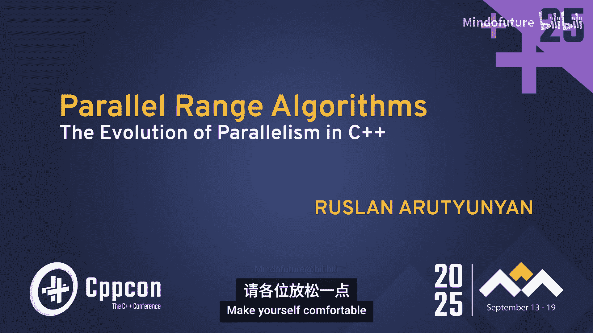
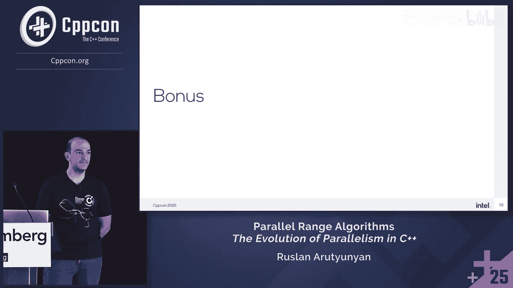
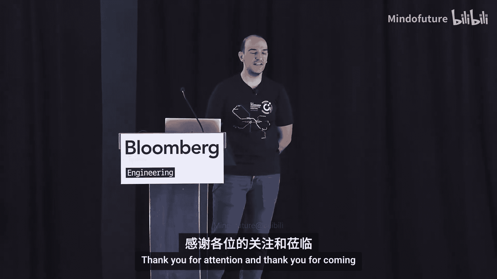

# Cppcon-2025-｜-C++-｜-C语言--｜-汇编-｜-编译器-｜-操作系统-｜-Linux-｜-Windows-p19-P19_并行范围算法_C++并行化的演进-Ruslan_Arutyunyan-CppCon_2025--BV1wyPBzrEeu_p19-

🎼If you come to the conference in person， you don't know who you're going to bump into in the hallway。

 you don't know exactly who you're going to run into at dinner。

 who you're going to end up sitting across from at the lunch table。

 but they could be your future collaborator， your future colleague。

Hey， everybody。Make yourself comfortable。 Thank you for choosing my talk。

 Despite how much good talks go in in parallel。

My name is Ru La。 My last name doesn't matter。 I don't care about it。So I am a C++ committee member。

 but since I am new here， let me introduce myself first。I'm working for Intel。嗯。

I am11 API data per C plus plus or1 DPL， the developer。

 which is basically our implementation of parallel algorithms at Intel。

I have significant contributions to other threading engines。

 including like one API threading building blocks or one TBBB or TBB， if you are familiar with that。

I'm also a contributor to SQL， which is yet another language for heterogeneous computing like Hoar from NviDdia or Hap from MD。

 but it was in the past。啊。I am contributor to C plus plus features within the standard like state C the execution and more。

 of course， parallel algorithms， The thing that we are going to talk about today。Also recently。

 more or less recently， I stepped in a role of S G1 concurtency andism Co chair in C+ Committee。

But that's my working part。 I am pretty good singer。I am pretty bad guitar player。16 months ago。

 I have a new hobby。 I'm a father。👏Thank you。😊，And， I am。Mount biker。Don't worry， I'll end it。

 That's why I'm here。Yeahh。😊，嗯。But that's a talk not about me， unfortunately。

This is the talk about parallel range algorithms。So let's dig into that。

 So we're probably mostly going to talk about like standardization and design。

 I'll show some implementations。 But it's more about like motivation and the story。

 how do we make this。Maybe happen， spoiler alert。We will see。

Let's talk first what are parallel algorithms， This is the algorithms that you probably get used already like anyO for four each or transform whatever with the execution policy as the first sample parameter。

😡，In sitname space， taking iterators。嗯。Also， like you can see the example， like this find if。

 we have begin and then for some input and some predicate。 It's a serial version。

 The parallel version is exactly the same。 You just put execution policy as the first parameter。

 Here It's execution par， which means like， do your best to execute it in parallel。😊，What are。

Pllel range algorithms。 It's a P 31，79 proposals。 So it's algorithms。

 Those are algorithms with the first temple parameter constrained by execution policy expedition only concept。

 we will see it in this talk in ranges name space and taken ranges as one overload and iterator and sentinels as the second overload。

 like for like vast majority of them。Here's the example。 We have still ranges find e with some input。

 some predicate。 And again， the same we do in this parallel。 It's input and like predcate。

 and we add execution policy par being like one of the。OurFirst parameter。And that's it。

That's basically the whole talk。 Thank you for attention。 There is no much to talk about more。

 We're done。 Of course， I'm kidding。 This is the evolution， as I said。

 as I mentioned in my name of the talk。And well see how we evolved it compared to what we have in C plus plus 17 for our algorithms。

 Just a disclaimer。 We parallellyize only the loop。 So basically find deep。 we don't。

Pass the execution policy to any of ranges。 we didn't modify like we didn't propose to modify any views or ranges in the standard。

 Only we're talking about only algorithms。嗯。The motivation。80。The motivation was。

Was covered today for somebody who participated in your talk。 Like， what's your name again。

 like Daniel Daniel， Yeah， in Daniel's talk。 we have some small intersection。 But as I said。

 like very small， In my opinion。 But the idea the motivation is pretty similar。

 So we combine the powerfulness of range API with parallelism。

 This opportunity to use parallel implications into one。

 it's better expressiveness and productivity of the code。 And this is the ease of use。

 That was our motivation to write a proposal。Let's look at the example。 We have state transform。

 still diverse and still finding it。Like those take some inputs， take， of course， execution policies。

 the first parameter。 But what is actually we can say about this code。

We have three algorithms invocation， and each adds its own overhead。

 meaning that we need to wait until the previous like invocation completes， for example。

 transform completes until we can start reverse and so on。

And the unnecessary work might be skipped only for the last algorithm by unnecessary work here for find。

 I mean that。嗯。If you find， if you already found some element in memory。Like， in some position。

You can basically skip searching all the elements from the right of this element， like in memory。

 because like the find this by semantics returns to the leftmost found。Looking at this example。

 you can say that this is a little bit artificial because honestly， we could。

 instead of doing transform and reverse instead of reverse， we could do like find。

Find last dave or whatever it's called something similar to that。 And then instead of transform。

 we could basically use this lambda， which does plus one in this find da。

 But there is a very specific reason why this example is written like that。And the reason is here。

This is because we have like these fancy curators and like spoil alert。

 we have the same views to just show you how we transform this code to something that is lazy。😊。

Or pipeline， if you want。 and compute and the flight。 of course， it has some differences。

 We previously did transform。 So it also has some side effects on memory here。 It's not the case。

 like the iters are lazy。And like， yeah， all the computations happened on the dereence。

 We used to make reverse iterator。We can， we use a DPL make transform iterator。嗯。

We don't have transformerator like fancyerator in the standard。 We need to use some third party。

 One TPL is not the only library that provides that facility。 The AG is pretty obvious。

So what's the problem with this code。啊。Before going to problems， it's one algorithmvocation。

 less of a head forism than necessary work might be for everything。

 Like it's just one algorithm call， but。It's unnecessarily verbose。 Like， it's a lot of verboity。

And as you can see， you should keep in mind that here， I hope you guys can see like my cursor。

 So we pass even like to make reverse work correctly。

 we pass and as the begin to transform aerator of reverse theerator。

If you wrap around your mind about that， it's like logical， but you need to remember about it。

 And this code， like， is not intuitive。Furthermore。It doesn't compile。Can somebody tell me why？😡。

Very quickly。LambdaYeah， And， thank you。 And says it's a lambda type。

 So despite the lambdas are spelled exactly the same， the type are going to be different。And。

 of course， it makes our transform iterators type different。

 which does our reverse type iterators different。 There is no type of era。

 and our old algorithm fashion algorithms require the iterator types to be the same。There is a fix。

 Of course， there is a fix。 We just move Lambda one line above on the stack and just use it。

 This code works。 All other downsides。 I still， I still there。

So now we're gonna use our powerful of ranges。 but with all the algorithms。 Can we do this， Yes。

 we can。 Thanks for the proposal that I think came from David Thoson from Nvi。😊，We can do this。

Does it work。 Yes， in principle， it works。 It does exactly what you expect。

 So data pipeline with transform pipeline with reverse。 It does it exactly the same。 Let's say。

 transformation going through the pipeline as we did previously with our calls。 We call find Dave。

 It works。Again， the same goals are achieved like one algorithm andvocation。

 then as the reward might be skipped。It's still unnecessarily ver both。 I mean， not that much。

 but ver both。 And also， if you want to leverage the advantage of ranges having the iterator and sentinel be not the same type。

 this is not going to work。嗯。To be honest， I don't know any random access range where the iterator and sententinel would be different types。

 But who knows what awaits us in the future。What happens without proposal。We have them。Basically。

Calllin the strangerranges find with execution policy and the same pipeline。Ever since school， right？

I'm not going to repeat all the previous advantages， but it's also it's also concise。 And， of course。

 it can work with different iterators and sentinels。 if it's the case in your code。There is， again。

 a problem。Can somebody tell me which one。This is。Mark， I can tell you which one。 Yeah。

 you know that。 Yeah， it's not really copy， even though the lamb is。 No。

 this is not the problem I'm talking about。 I mean， okay， and for this example， it's。

 it's trivial capable。 It is。 we don't have capture。 Come to my lining talk。

 We will cover what Mark Mark is talking about。 No， not this problem。Our rest is unusable。

 This is the hint。Can somebody tell me why。Yeah。It's not borrow， exactly。Thank you。

 This is not borrowed range。啊。Basically， when you pass our value range。And it's not borrowed。

The result， the returning type is going to be still ranges dangling and not the iterator that you。

 you， you're able to use。That's unfortunate because I really think that the transform view could be borrowed。

 This is not the case。 what we have in the standard。

 I hope like there is a paper that tries to fix it。 I'll hope it will。

 But this is what we have today。 So we need to fix it。

 We need to extract the pipeline to make it all value。Store it。Use it。

 And now we have everything we wanted to achieve。こ。I think it's cool。O。Bonus， we can use projections。

 if you need。So。Since it's an evolution， we should have some difference， right。

 Let's talk about them。啊。Those are difference， like some of them apply to the C plus 17 parallel algorithms。

 Some of them apply to see range algorithm。 Some of them apply to both。

 The execution policy is the first parameter。 is the obvious one。And yeah， like。

 we're just gonna go through them briefly because we're going talk more about them in details like a little bit later。

 so。We require parallel algorithms to have random access， iterator and range。

This is not the case for C plus plus 17。 The area was like forward iterator。

We require parallel algorithms to take size ranges。 We do need that for parallelism。嗯。用。

Can somebody quickly provide me an example of random access range， which is not sized。

 infinite Iodta。It's yes， yeah。Another example， that's a good one。 Thank you， Daniel。

 Another one is like sea stringring。It's a cha， but you don't know the end until you find actually the like the term non terminated symbol。

And this is probably the biggest change。 We require parallel reasons。 Take range。

 not the iterator as an output。For the overload with ranges。 And additional。

 they take the output sentinel for the iterator sensationinel overload。

Let me show you what that means in our signatures。 So here you can see like serial signatures for iterator and range。

We add the execution policy template parameter， we add execution policy function parameter。

 and then we use this concept exposition only execution policy here。

 which does exactly what C plus plus 17 do by just in concept syntax to be able to use it incon and simplify the wording of our C plus plus standard library。

Then we say， hey， now everything is random access for the input。 We don't touch output yet。

Both for it and Sentinel and for。Now， we said。Everything is not only random sorry， random access。

 but also sized。 And we introduced size random access range concept that that is again。

 not user visible。 I mean， it's exposition only in the standard just again， to simplify the wording。

And we made range as an output。 So let's look at ranges overload。 So basically， we said that here。

 instead of taking like the O as the iterator， I mean， here strictly speaking， weekly incrementable。

 But let's just pretend for the purpose of this so。 It's like some iterator。 we take it as a range。

 And again， size at random access range。 So everything is range and everything is like size at random access。

嗯。And for the sentinel overload， we basically did what I just described a moments ago。

 We just added the sentinel 40。For the output and also made make it sized。

 So I'm gonna switch to this slide。 This is sort of side by side or top to bottom， whatever you like。

 difference between。Cal range algorithms。With iterated and overload and the same for parallel 1。

So you can see all the difference I highlighted execution policy， R access iter， science1in all 4。

 again， random access iter instead of like weak incrementable and。Again。

 sized Sinel 4 and2 two extra parameters。For ranges overload。We have execution policies。

 execution policy like size random access ranges for both input and output。

 some tricks to get iters out of ranges。 and again。

 like one extra parameter and range instead of iterator。Are we good so far， Any quick questions？

 I want to keep big questions till the end， but quick questions I can take while we go。Okay。

 I assume we go so。Let's talk specifically about design。 why we made this choice。First of all。

 let's talk about sizes random access range。As I mentioned。In the past， we required forward toator。

But in practice， Intel 1 DP L and Wi thrust， Gnu lipst C plus plus。And as far as I'm aware。

 who correct me if I'm wrong Le C plus plus also goes with random accessiterators for now。

It's not done as far as I'm aware yet， but the choice is to go to be the randomized situation。

 So this is the reality。 This is the。Practical implementation that I'm aware of。

 My investigation showed the the only Microsoft S T L supports forward deters。 I mean， it's not。

 of course， the not perform one， but they support it。Again， this is the disclaimer。

 That's my investigation。 There might be some other implementations that do this。 I'm just not aware。

嗯。And honestly， I had a very interesting conversation with Daisy Holman。 And I， like。

 when I wasn't like， this was C plus plus 17 algorithm or standard Di when I did not。

 wasn't the part of C plus+ committee。😊，And I ask her like， why it like forward？And she said。

 you know， if I remember that correctly。It was input。Till almost like the variant end。

Daniel is lucky thank you， Daniel and。And somebody said， like。Why it is input。

And everybody in the committee just voted， yeah， why this input， Let's just make it forward。

 This should be enough。Good design approach， right？ And honestly。

 I think this is this story is true I'm not sure how truthful it is like I trust Daisy， of course。

 but， I mean， like tora stories here and there。 I did my investigation in the perlys T S scan algorithms。

 like this was before it was standard that actually had inputerator。

 So I kind of believe in this story。😊，嗯。Random access itator is a must for efficient parallelization for now。

 This is the back abstraction that we have in the standard again for now。 Yes。

 we eliminate some potentially useful use cases like filter view， but maybe relax in the future。

 Don't get me wrong。 I really like what Daniel said today。

 We are not going to relax it to be directional it， no。😊，This is not the relaxation。

 We need some middle ground。But the what what wast Daniel talk like。

 I don't think that the middle ground that Daniel invented in his library immediately feeds with this buffer like chunk stranges adapter because it violates our view concept semantic requirements。

But， at least。His talk helped me to think more about that。 Maybe we can come with some solution。

 but unfortunately， not today。And definitely not for C plus plus 26， that the line has passed。

And size is also necessary to be known in advance for parallelilization。So first of all。

 it's memory safe。 We are not going to do something like memory overrun。 We can check everything。

 It's not like， it's not undefined behavior anymore。We are going to return you。 I mean。

 if you're familiar with range algorithms or better to say algorithms in range of name space。

 where are they return the。Positions where they like stop last for your input， for like many of them。

 and basically the place where they stop in output。 And you can check all of it。

 if it's an error in your case， handle it。 if it's not fine。 But the point is， again， like it will。

 it will stop like all the algorithm will stop whenever they。like hit the end of any of the ranges。

Like no matter if it's input or output， we will look at this a little bit more in details and performance。

 if let's say you do copy， you provided your range like output range。

 which is less than size of which is less than the input。

 it will just go to and copy until the output is filled， filled up and。

This is basically what Mam copy say underscore as like save version of it would do。嗯。Yeah， so。

This is the design aspect we had the most debate about。 This is the Raes output。

 And here I'm just listing the algorithms， you know。

 for you to understand which like which they basically form the family of those。

 They belong to the same。 Like were mostly going to talk about copy。

 but also touch initialized copypi asmal。Here are our arguments。It's ease of use。

We don't need to like use the ds begin or don't begin whatever we can just pass range。It's better。

 memory safety。It's potentially better performance is in the previous example that a like。

Told you and also ability to detect an error。 We covered that。

 The objection was its more complicated switch between serial and parallel range algorithms。

 So it means that basically， it's not just aing the execution policy。

Another objection was like inconsistency with serial range algorithms。Okay。😊，And。Unclear semantics。

 Let's talk about it。First of all。About like hard week。While， this is true。Again。

 this is an evolution， and this evolution is not happening for the first time。

 I want you to look here on the iterator 2， first2。As you can see， there is no last two。

 This is a binary transform。 There is only last one that basically means that。

We need to assume that the second sequence and the output sequence is at least as big as the first input sequence。

嗯。But。This depth was the algorithm stood。The algorithm from the ranges that different。Story。

They add the sentinel for the second sequence or range for the second sequence。 So basically。

 they already do this improvement， In my opinion， this is a huge improvement and do the transformation until whatever of input ranges exhausted。

We just went further and say， hey， why output can it be arranged as well。So。Output and consistency。

Everybody agrees， right， that the C plus plus standard is consistent，100%。Right， in every single way。

 we don't have any inconsistence in the current standard。Of course， this is not true。Copi has。

Be quickly incrementalable or reator as the output。 while an initialized copy。

 which does more or less the same。啊。Has the range as the output。

Like for the second overload and the like extraentin。For the like， first of all lot so。

I think there are reasons for that。 They are out of scope of these talks， but still。

 this is the inconsistencies that we already have。And this is moreover， a precedent。嗯。

And unclear semantics， I don't really think that this argument applies。 you might think otherwise。

 So basically， there was some thought that， you know， this code where we have like V1 and V2。

 and we just call copy might appear that were gonna allocate for V 2。Make it as big as we want。

 if it's like smaller and it's smaller in this case， right， the size of V2 is 3。 But no。

 I think we just need to do what， what our algorithms do today。

 We just go to like the smaller sequence。 And it's absolutely consistent to be in depth regard with everything that we have。

There is no any contradictory。 So， and also。algorithmgoths that with the same semantic。

 one algorithm with the same semantics is an initializedco， right。

 It already does exactly what we propose。For the new set of overloraws。

 but actually not algorithm algorithms。It's also initialized move， which you can say， yeah。

 it's pretty similar to initialized copy， but also partial sort copy。

 which is completely different algorithm。 It also takes ranges output。So with that， I think that。

Those， like， we were able to convince。She plus， plus committed that。

Those concerns are not really concerns。 Like the first  one， I， I think still stands。 Yes。

 it's harder to switch， but in principle， no， nothing prevents us to add the overloads for serial range algorithms。

 which also take ranges and output in the future。When this is a different question。 But design wise。

 I think nothing prevents us。If you're interested， P 34。

90 is the proposal that covers ranges output in details because of that proposal we were able to like it's a separate compliment paper that was written。

 We were able to convince C plus plus committee that this is directing to do。😊，嗯。Are we good so far。

 Any questions？Okay， no small questions。Let's talk about algorithms output and gaps。 How I call them。

And we are going to。Talk about them taking copy as the example。So。Let's try to implement copy。

 effectively。 It's very interesting algorithm to parallelize。Partially Daniel already。

 if you participate in his talk like partially he already covered it。

 but we we are going to write an actual quote。 And as the disclaimer。

 my code is not gonna be the most performant。 This is not the purpose。

 This is just a demonstration purpose only。 and basically， it's one possible implementation。

 It should be done more efficiently。 in principle can have some bugs， though I run it。 it worked。

 but you know， some corner cases mightt be handled。 And you know。

There might be some weird code somewhere。 but remember the main purpose。

 the main purpose to feed the coat on the slide。嗯。So here's the implementation that I saw in in like in one framework and this。

 the author of this framework just claimed how quick this implementation is。

There is sort of lot of code。 But the main thing is it does for rich。And it just goes by indices。

 it captures like input and output。 and if predictedcate is true。And。

Right to the output if the pre is true， It's just。Basically for the for for loop。

Do we like this implementation？For somebody who knows what copy does。This is the hint。 Basically。

 here is the input。 Here is the output。And here is the result。 Anything wrong with the result。

For Kopi。Somebody。Everything is okay。 Oh， then we can throw the half of my top。No， of course。

 it's not like copy is like gather algorithm。 There shouldn't be these zeros。 It should be like 1，7。

5，3，7，9。 And then the rest。 And the rest is not interesting。 It should be like this。

4 is not appropriate implementation for that。So let's think how we can implement it。

 like our predicate here basically tries to find， you know， odd numbers。If it's odd number。

 it should be， it should be cooking。So。Here's the input。 What we can do in principle。

We can calculate。The project， individually。For every element。And we're gonna have a mass。

 but not bull mass。It's like one of0's mask。And we do it in parallel。Then。We can scan it。

And this basically， like， again， like。If you don't know what scan does。

 it's basically partial sums so。To just be absolutely clear。

 we start from 0 as the some initial element。 we do 0 plus1。 It's 1，1 plus 1 is 2，2 plus 0 is 2。

2 plus 1 is 3，3 plus 1， it's 4 and so on。嗯。So this is the scan。 but also what's interesting。

 it gives us indices for the elements that need to be copied。So looking here we have nine。

 for example， which is like has true or like one as the calculated mask and it goes to fourth index。

And then。And then we just copied the element。Is it clear。

Are we ready to go to some code to see how it might be done， okay。So。I allocate the vector。

 and do transform。With execution policy that came to me range as the input， mask as the range， again。

 as the output， we already leverage the advantage of our API， we don't。Right mask dot begin。

We move predicate and move projection。 And again， like this code is not fully generic。

 I missed some forwards。 I don't care about them for the purpose of this talk。

 but I specifically put move here to show that we don't need predicate and we don't need projection after we did the first stage of the algorithm。

It's done after calculating the mask。So。And these， like。Maybe for somebody hard expression。

 like double invogue， it basically means invoke projection for x。

 And the result of the projection just invoke like this predicate。

 So it's basically the invocation of the predicate。Whether it's true or false。

 and we converted it to size T because I said， like we need numbers。We do exclusive scan。

 So we basically， we don't have any numeric range algorithms， even serial。

 That's why we have to use the oldfashed one。 But it's going to work because we know that mask is a vector and vector has iterator and iterator。

 It doesn't have sentinel。 Those at the same time。嗯。And you can see how ver it is。

 like we always begin and begin instead of just using mask and scan result。

We can use the advantage of our proposal。And our initial element is 0。

And then we do four reach with zip。 So we basically zip。Input， mask， and scan result。

And the code might look a little bit ver， but actually， the thing that we are doing here is simple。

 We just capture result。We。Structure bind or like unpack this the topple that came to us to input mask and result。

 And if mask is one， which is copy， knowing in the index。By no index， the input that we need to copy。

 That's it。I give you a little bit of time and probably think about some questions。Yeah都 ahead。

App to me that is it。Yeah， so basically， parallellyzing scan is like very big story。

 It's like a separate topic， but scan is parallellyizable。

 Transform is basically as easy as parallellyzing just four four reaches again，4。The。

 the question was like， sorry， I didn't repeat it。 Like the question was like。

 how could it work in parallel and。Like， I'm not going tell you how to pize this scan。

 It's like one hour， maybe， especially if efficiently。嗯。We also need to return our stop points。

 right， for the input for this implementation， It's not even a question。

 Like we basically traversed all the input。 We need to calculate how much elements we actually copied。

 And here， our previous thing like previous computations can help。

 We can just take the last element in mask and scan and du plus。

 So6 plus one gives us exactly the number of elements that we copied because like here we have like。

 we know it's like。6 elements。 Each one forms the new groups。And。

If the last element should not be copied， it would be one zero here。 So it would be 6。

 But since the last element should be copied， we just make like 6 plus one。

 And it gives us exactly the necessary result。 We do it like weal as copy elements。

 and we do it like。Rang is plus range of size and begin like plus copy elements。But again。

 we have range as an output， right。We did not implement anything。嗯。

When the range is not sufficient to have all the elements from input that need to be copied。

And here is why there is a space here。It's like， not occasion。Let's think about it more， so。

For this example， everything since fine， if we have the output that is 7。

And we need to copy 7 elements。It's， again， fine。 There is no U B here。

 It's allowed to have output less， but like， we can still copy all the elements。The。

 interesting case is this one， so。If we have， let's say four element， but we need to copy 8。

 and we know that we stop at this， like at element number 5。Of course， this is not the question。

 what to return。For the output， because， of course， for the output， we return and， right。

 we just traversed all the output。 outputput is done。 What to return for the input。Opinions。

We actually have two options。Who thinks that we need to return this aid。

Because that's the place where we stop。 Raise your hand。Not much。 What else can we return。

If not that， like， there is very few hands。 like， what else can we return。The hint is here， actually。

What if we stop here at at 5， But for the all。Our elements that remain。嗯。

There is no true predicate anymore。We would probably like to return end， right？

Because we basically traversed all the input。 We don't want to falsely return this aid。

 Preing that there were more elements for which predicate returns true。

But it's just your like users's fault that they didn't provide like enough enough output or not not like fault。

 but the， you know， the A code。So it's better to return the first element for which the predicate is true。

 but it doesn't feed like the size of the。This is the goal that we。嗯。Willll try to achieve。

Then the next question， how we can achieve that。嗯。So there are two interesting properties of the scan of the mask。

The first property is， as you can see， let's look at these group like all four。Yes。

 it was formed after five and we added three to1， we have four， but again like four， 4 plus 0，4。

4 plus 04， and then 4 plus 1， which is5， and it forms again U group。But new group， like for the。

 you know， for the next element。The point is。The numberered from each group that's going to be cop is always the last one。

And also， this sequence is sorted so we can use some binary search algorithm。Which are。

 let's say here。 we are going to use U Bo。What I'm going to try to find is upper bound。

Is the size of my output and see what upper bound returns to me。

 because I really want to try to find the element。Which doesn't fit an upper bound returns me the first number that is greater than the number that I requested。

 So for4， as we have here， is this output size。It's gonna to return 5。

And since I want to try to find the last element， I'm going to do -1， like just pessimistically。

And then I'm going to check。Whether my size was sufficient。 and if it was sufficient， of course。

 I just， you know， copied everything。 the output size， The output size was sufficient。

 I copied everything， and。If， for this example， my last element。E like， my size is not sufficient。

 or like， it's exact exact much， basically。 but my last element。

Which I have like has the mask equal to 0， that I'm also going to assume that I， it's the last one。

 and the mask is 0。 So then I'm also going to assume that I copied everything。

It's a little bit complicated stuff。But let's try to implement it。 again。

 this basically tells what I just said。We do upper bound， we。嗯。Like， do -1 peimistically。

We check if it's enough space here by just checking like if size is greater than scan back。嗯。

And again， if it's enough space， I wouldn't do even like。

 I wouldn't need to do even like upper bound。 But again， remember the main purpose。

 the main purpose is to feed the gold on the slide。嗯。So afterward， after that。

I'm checking what I just again said， like， I'm making plus one back。 like I did -1 PCistically。

 and I do plus one back if the space was enough or if this is the last element that I might need to copy。

 but I I don't need to if the mask is 0。 then I do plus one and return basically to the end like in this case。

Then I need to calculate distance for that。And then use this distance to。R like make zip smaller。

 The property of zip。 It just goes to the smallest sequence within it。I calculate the distance。

I use it。To make zip smaller， I have not changed anything in4 each。

And then I just calculate the number of copy elements based on this distance that I have。 again。

 just by adding the scan value to the mask there。And here， I'm also going to use distance。

 That's the number of elements that we trad and the number of copies elements we just。

 we just calculated。I'm going to post here。 I'm pretty sure that somebody is lost， but fortunately。

 we have the recording on YouTube。 You can rewatsh it if you're interested in that。And again。

 this is sort of a bit complicated stuff。Any quick questions？I'm not hearing anything。

 but the good news is we are done with the hard stuff。 Let's just continue enjoying the talk。😊。

So we have。Herogeneity and performance here。I'm going to show the heterogeneous example based on one DPL。

 As I mentioned at the beginning of my talk， This is those are the。Implementations of。

 this implementation of parallel algorithms。Which was the former product。

 which called like parallelestial， which we donated to L O V M， and is currently used as glue。

lips implementation。 L VM decided go to go their own path。It supports heterogeneous execution VL。

 the language that I mentioned at the beginning of my talk。

 Currently the part of like open govern to Excel Foundation。 We have both specification and the code。

 And now we have implemented 35 algorithms as the product quality and 15 are roughly 15 are coming in the in the next release。

U。So I hope you're still alive。 And remember the example that we saw at the beginning with these transform views reverse like and data pipeline and find if。

 And let's see， what does it take to。Basically executed on GPU using SQL and1 DPL。 First of all。

 we use SQL Q， I'm not gonna talk about SQL almost at all。 But just for your understanding。

 the queue there is the default way to submit the work。

 just the thing that associated with some SQL device， heterogeneous device。

Then we need the memory that is accessible on both CPU and GPU。

 We are going to use like unified shared memory allocator with the access to memory as shared。

 And we're gonna construct this allocator with。😊，Like as associating it with this cu。

 And then we're gonna create the vector with these allocates or allocate some data that we need。

 Of course， assuming that we feel this data。 And we also use。Like subrange。

 And we're gonna work with subrange because we for now。

 don't support vectors like being passed directly。 This is a little bit unfortunate。

 but I hope you will be able to deal with this limitation。So。

That's the machinery before making the in and to modify the in。 The pipeline looks exactly the same。

 We don't change it。 What we change。 So we basically work with standard views。

 What we change is namespace for the call and create some our some of our custom execution policies。

 which is device policy and again， associating it with the same queue。That's basically， it。

That this code will run on GPU if your like default device for the SQL Q is GPU， or you can。

 you know， SQL has the API to explicitly。Like。Say with， which device is going be associated。

Heres some performance measurements。 So basically， this is the chart about。The same pipeline。

 the baseline here is three algorithms called。 So transform， reverse and find if。Then。

We have 16 million of elements， and our target for fine D is like roughly in the middle。 because。

 you know， if the target for fine D is like the first element。

 it's there is no point to paralyze anything， right， It's just boom down。

And then we are showing the speed up here。 So high is better。

 And we show the speed up against this like three algorithmic call。 The the light blue 1 is the。😊。

P3 algorithms call， but parallel ones with iters。 The dark blue is parallel rangey air coal against three of them。

 but parallel algorithms。 And the yellow  one is the。Pipeline。

 like basically the call with our proposal， one called with three pipeline algorithms。

 And as you can see， we have like。12 x roughly speed up for the first two。Pllator。

 parallel rage like calls like33 algorithms and 30% compared to the baseline sorry30 x compared to the baseline as the speed up for pipeline range。

 And the situation is even better on GPU， like roughly 78 and 75 for respectively for three parallel algorithms calls with iterators and。

With three parallel range API calls。 And with pipeline， we have one30 x speed up。Of course。

 the even serial pipeline range coal would be better than three because we don't have these effects on memory。

 So we I draw the line like with 3 do 8。 This is the speed up。

Cial 3 coals versus serial 1 pipeline call。 just to give you an idea how like the serial 1 would be faster。

 even without any parallelization。So， scope and status。Here we have a table。 and of course。

 I don't want you to like read it。The whole point of me showing this。Table is。

 you should keep in mind that we standardized。Everything that was a part of C plus plus。17。

Algorithms， I mean， parallel algorithms。We have the same set for ranges， except numer。

And I'm gonna talk， in a minute why like without numeric。嗯。With the green color， we just showed like。

 to give you an idea roughly as let's say， let's say it's a map， like not the actual names。

With the green color， I show the algorithms that are implemented already as a part of oneP with the yellow color color。

 the algorithm that are coming。This slide basically talks that there are some。

Only arranges only algorithms。 There is no counterpart Instead。 Those are only instant ranges。

And we look at those， and they are all based on the existing algorithms。 So we were thinking。

 why not， And we just added them as well。And three of them are already implemented。

Out of scope for this paper。 So we did't add anything you that was not the part of except this 10 algorithms that I mentioned。

 but from， from the state name space。If the reason。

No policy today for C plus plus 17 parallel algorithms。

 We don't add the execution policy for ranges algorithms as well。

 because those are easily not parallelizable。I mean， there is no point to do that like lower bound。

 upper bound binding research， or it， it requires like big exploration。

 whether it actually beneficial to parallelize them。 And we didn't do that。

 We can always add them later。 if somebody thinks it， it makes sense。

 These cases are also questionable from my perspective。So algorithms from numeric， like the。

Reason is simple。 We don't have numeric range algorithms at all， except ayota。

I mentioned that at the beginning of my talk， but I just want to explicitly repeat it one more time。

 There is no like the drains to the drains transform， we just don't have them。啊。

I hope we are working together with Mark。 hey， Mark。To add them。 But it's gonna be C plus plus 29。

 And I hope we will be able to add both。 I mean， both serial and parallel。

 We are not focusing on parallel only。In our proposal， at least in the current stage。

And there are two algorithms from ranges that are out of scope， which is fault and generate random。

 generate random。 It was a deliberate decision by library evolution to not include the execution policy。

 We can extend it if we see the value， but this is a very random number generator。

 specific algorithm and fault is just specify it to be serial by nature。

 Like there is a specific order of。Ittererations， so we cannot paralyze it。 We need something。

Like the ranges reduced。This is the proposal status。 It's accepted for C plus， plus 26。I hope。

It's gonna be released。 Nobody will have them Con as are， you know。

 our reviewing process and but but fixed process。 But I hope you will have it。 And you。

 you could already try our one D implementation and play with it。

 it's definitely better productivity and expressiveness in my in my opinion。

 And it gives you better performance if you have like use cases for that。And here is， like。

 further work。嗯。We have numerical range algorithms。 As I mentioned。

 we have synchronous parallel algorithm centerers and receivers。

We also have synchronous parallel algorithms with sends like based on sends。

 I guess this is our supposed to be our default， as synchrony model。

And our strategy goal is to add ranges and output for serial range algorithm that I also mentioned。

So this is sort of strange goal because， you know， focusing even on third 3 is already a ton of work。

And I would like to give some special thanks to some people。 Some of them are famous here。

 Some of them are not。 Alexxi Koanov and is my coauor。 So he put a lot of work in this paper as well。

 not as much as I did。 but yeah， I'm very thankful。 it was easy to like without him。

 was it would be harder， much harder。😊，Jonathan Miller， basically for objecting。Yes， this is special。

 Thank for objecting。 And he was objecting loud to arrange his an output。

 but it basically forced us to go and understand the problem better and convince him that this is the right thing to do。

Invol le。For like we were in Poland and we were about to see this proposal。

 but unfortunately it was moved out from the schedule。

 so we had a very big chance to not have this proposal for C++ 26。

 but she organized out of cycle Telecon， we were able to review it and reviewed it again in Hugggenberg in Austria like in February。

 if I'm not mistaken and make it through Library Revolution and then thanks to Jeff Garlandt and Jonathan Wakeley。

 who are chairs of library working group who decided to schedule it for teleconons in between Austria and Bulgaria。

嗯。And which was like in June。This summer。We， we already finished this proposal even before like coming to Bulgaria。

 And， you know， it was just a formal vote there。And Zach La and Yonaton Miller， again。

 for reviewing my abstract for C plus plus Now， this is not the title。

 not for CPP con for C plus plus now。Because that's the first time where I delivered this talk。

 and it probably wouldn't happen if not my first talk at C plus plus now。 The feedback， the feedback。

 though， was the abstract look looks good， as is。So。Yeah， for in C plus plus now。

 we have like one hour and 30 minutes as a regular talk。 It's like more， you know。

Extended version of this talk。But we also leave4 each out of scope。

 We have a different return type there， but it's very easy to understand。And we also leave。

Reverse copy and rotate copy autotocope。 Those are very special algorithms。

 They also have different return types， and I would need like another 20 to 30 minutes。

Explaining it to you why it's different and what design decisions we made。

And I would completely overwhelm you with that。 I'm pretty sure， because like， I。

 I already feel that I overwhelmed you with like copy for example。

So definitely out of scope for this talk。 But if you're interested。

 here are some useful links to read about one DPL about SQL， about all our proposals。

 like the main one， the complementary two。😊，That's what we have。I have some bonus。

I will prioritize questions。If there are any。But my main part of my talk is done。

I hope you enjoyed it。

No questions。Everything is unclear。是。Can I ask a question about your back end。

 Like what happened when I call it， Do you， Does it spawn lots of threads in your implementation or is there a threat pool and its always。

That pool， and actually， we have different backends。 We have the backend based on TB。

 We have backend for open N。 It's not the second one is not optimized。

 though for T B just reuse TB thread pool and doesn't spawn the thread is like task work stealing。

B model how long does the threat pool live， I mean。

 like as long as the process the lifetime starts implicitly。And it leaves steel application dies。

Cool， thanks。Anynel。Okay， so if somebody wants to chat with me like after this talk。I'm available。

 find me in let's chat。I'm I'm not sure if you know。Draaw some available slots for lining talk。

 but I'm gonna go and submit my bonus as the lining talk。 It's really short。 So if it's accepted。

 you're welcome to see it there。 If not， sorry about that。That's it。 Thank you for attention。

 And thank you for。

