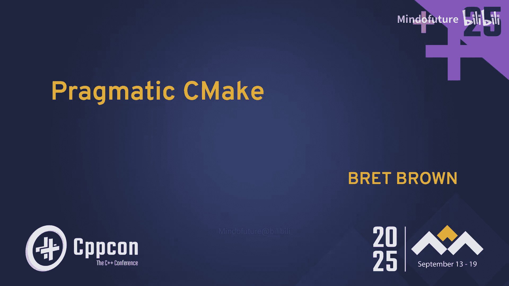
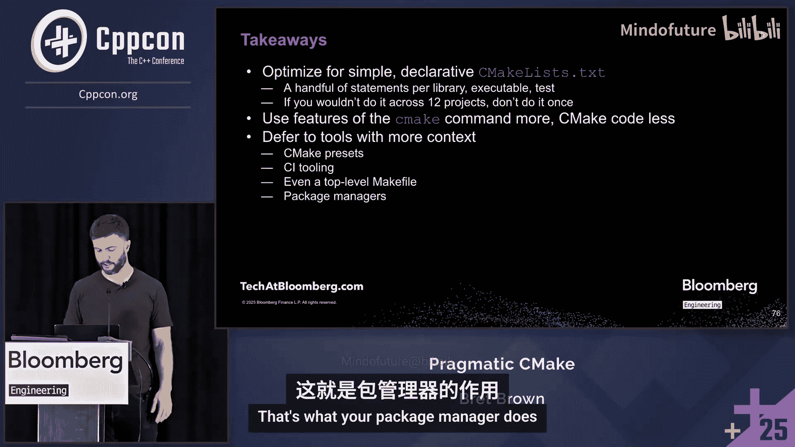

# Cppcon-2025-｜-C++-｜-C语言--｜-汇编-｜-编译器-｜-操作系统-｜-Linux-｜-Windows-p20-P20_CMake不必痛苦——行之有效的简单策略-Bret_Brown-CppCon_2025--BV1wyPBzrEeu_p20-

All right。Hi， everyone， Thanks for coming。 You're here because you want to hear about sea make。

 right？ This is the room about C make。 Just checking。 Allright， getting started。😊。

This is pragmatic CMake， as told by Brett Brown。 I am Brett Brown。 I am from Bloomberg。

 where I work full time in developer experience。😊，And I'm here to help you with your C make headaches。

 We all have them。 I probably have more than you because I probably write a lot more c make than you do。

It's got a lot going on， doesn't it， It's like a lot of stuff， a lot of docs， a lot of APIs。

Sometimes different APIs do the same thing。 And you're like， which one do I use。

They have as actually decent， pretty good。 actually actually like the reference stocks。

 They're very thorough in my experience， but it really need， you really need some good parts， right。

 What are the good parts， Like， what are the， what's the step by step， How do I get into that， Like。

 how do I hold that tool， right。So this is my attempt at helping clarify things， refresh things。

 update things for you， perhaps your L O Ms and how how to actually engage with CMakeake in a healthy way just to get you started again。

 Allright， my background from where I'm coming from on this is at Bloomberg again。

 we have thousands of engineers writing CMake all the time。😊，We have tens of thousands of projects。

 and， and we don't use a very special seam style。 Theres some small differences between what I'm asking you to do and what we do internally。

 But there it's more because we're ahead of you in some ways and not because we're doing anything particularly special or weird。

 Allright。My focus is on developer experience。 I really want to make sure every one of you is productive and working on the problems you're supposed to be working on。

 not fiddling with your build system or something， right。I want everything to be portable。

 I want your CMake to be as portable as the C++ code。 you've carefully crafted in those same repos。

 I want you to be able to turn to your colleagues next to you and show and they can see exactly what you're doing with your Cic configuration and not get confused about what's going on。

 And I definitely want your CMake to plug into all the rest of the rich ecosystem that is available so that you can really get the power out of your projects that you want。

 You want best inclass C。 You want your IdeE to just work。

 You want dependencies to just click in with the rest of the things you're working on， right。

So to road backap where we're going today， I'm going to walk through some resources with you。

 like I'm going to recommend for you to continue coming back to over and over as you grow even more in your CMake。

 I'm going to walk through how you command the CMake program itself。

 a lot of the power comes to just understanding how to do that。I'll talk through some principles。

 You can use one thinking about the CMake you write for your own projects。

 and then I'll show you an actual example of all of this。 It really helps， I think。

 to understand how things are going to work by seeing it in action And in a real project with real C I that is really being contributed to。

 And this is an open source project。As I go through my talk。

 watch out for this the sparkly emoji here。 That means it's something new that you probably haven't seen。

 It may not be brand new， but it may be something someone's never shown you before。

 and something I in my experience have seen being underused in some way。Also。

 watch out for these magnifying glass icons。 that indicates a real piece of code and to the best of my ability on the exact line numbers of the exact files where I grab them from。

 This is a snippet ever read me about a project I'm going to use to demonstrate some of these principles deal。

 And it's the 2。2。1 release exactly at that commit Shaw in case you're curious。😊。

The project is part of the Beamen project。 You might not be familiar with the Bea in project。

 It's only about 18 months old。 It main purpose isn't to advance Cm practices。 In fact。

 its main purpose is to advance this standard， C++ library by creating a collection of individually maintained but collectively owned C++ proposals with backing implementations that you can download integrate in your projects and so on。

Itss so its main purpose isn't making advancements in do systems。

 It's main purpose is to be so it was to be as boring as possible。

 but as useful as possible in that effort， as far as seic goes。

So it makes actually a good demonstration for the rest of us that aren't trying to like。

 make waves with our ideas and build systems。The project within that beamman project。

 we're looking at the exemplar repo。That's its URL there on the slide。It is a C plus plus library。

 What it does is not interesting。 It's just an example project。

 It could just as easily be a hello world。It's literally a project template。

 So if you check out that repo， there's a cookie cutter subdirecty that uses a Python utility called cookie cutter。

 You can look it up on what it does。 It's got a pretty intuitive interface。

 But if you run the command cookie cutter against that directory， it'll ask you some questions。

And when you're done， you have a full repo with whatever names you want out of it。And again。

 it's not trying to do anything special。 It's trying to do just plain vanilla， good。

 hard work and sea make。So on some resources， I'm gonna give you a lot of advice here。

 but it's not gonna be complete。 I'll reference different kinds of reference docs in CMake upstream。

 but you're gonna want more support than that， I think So when you hit a snag。

 you want to get a little deeper。 You want some advice。

 These are places I recommend This is a QR code to adjust。

 I have available You can go to that g to get to the links。 you can star them。

 you can send me messages at that up on Github to add more things or prove them or something。

 I recommend the CMake discourse hosted by Kitwear。

 I recommend the professional CMake book by Craig Scott。

 which is the most in depth discussion of how to use CMake book from a practical and from an expert perspective。

 that there's a CMake channel on CPP link Slack， which is sponsored by the C plus All。

 There's a lot of people like us hanging out there。 can help answer your questions。

 including a lot of core CMake developers。I also， of course， if you have issues， questions。

 confusion， even about the documentation， there are issues on the CMake upstream。 again。

 actively maintain， I can vouch for that。I don't。 I've had a lot less success in these two resources in particular。

 I feel like the C make topic and stack overflow could kind of use some purging and refreshing。

 A lot of the answers are from maybe 10 years ago， even it'll work。

 SeeMake is fantastically backwards compatible。 but you're gonna have a much better time If you check out the cool stuff that we've been seeing land in CMake in the last three to five years。

😊，Because that probably LOMs also give you kind of spotty advice。

 probably because it saw that on stack Overflow and so it assumes that's what you want to。

 but I'm here to help maybe start correcting that record。

 get some of these advances incorporated into into our collective knowledge here。

So there's some resources。 Let's dive into some more practicalies， right， How do we run CMake。

 This will be reviewed for a lot of you， because if you're hair， you' probably use Cm at least once。

Right， this will be a bit of a。 if you've never used seen before。

 hopefully you can follow along well enough。 but I'm not going to discuss some depth all the ins and outs。

 But there's roughly， I'm gonna break it up into five basic stages that go into making a build happen。

 The provision stage。 Let's start there。 is where you would set up your environment to just get success set up your environment to prepare for the rest of the steps。

 You're gonna get your build machine going。 so to speak， right。

Anything that looks like going off your box to get something would， in my mind， fit in this step。

 That's this including the source code for the repo you're about to build。

 exactlyact what version you were gonna build The versions of your dependencies。

 maybe you need to get their source code。 Maybe you need to install certain tools for your code generation to work。

 Anything that looks like you're going somewhere else or pintting a specific version of something。

 if you to be successful， that's in the provisioning step。

I really recommend you all look into package managing tools。

 at least try out the tutorials of the popular ones you might have heard of already。

 like Con and B package， that sort of thing， or at least learn which packages are available in the disros that you might be using at the O S level。

嗯。You have to be careful， though， because the reason I recommend that is because there's a lot of complications in just setting yourself up for success later。

 You really need to make sure that when you're making these choices。

 they all fit together and they were built together in particular in a way that's compatible。

 I'll get into some pitfalls about that later。 it's easy to grab version。 know。

 one flavor of one thing， another flavor of another thing。 and they don't fit。

 And you get a bad build or something worse later on down line。

 So it's important to be careful at this step， but picking things that work together。

 hence the job of dependency management tools like package managers maybe really big fan of mono repos。

 that serve the same purpose。 So that you have your head to commit that all has a bunch of things that are all tested together。

But often it's not as bad as all that。 Again， if you're in a mono repo。

 just keep your head branch working， maybe you have a container image that you like to develop against and you continually use that。

 Maybe you， you useubuntu and you just know which dev packages to install or you learn how to do that。

 or again， if you use like package managers， often you just go through the tutorial。

 And it's a nice step along the way to get somewhere else， right。So with that out of the way。

 it's important to find that that was not part of the seemic step。

 but it's very important to be successful later。The next step is to go ahead and make a build directory。

That's the basic CMake command。 If you've you've done this before or a tool has done on your behalf。

 If you， if you've used CMake before， this is a form that maybe some of you aren't using， though。

In particular， this dash capital B flag to define where your build directory is。

 I think like literally this morning， I was doing some kind of agentic development workflows。

 and it was changing directories around to try to run CMake in different directories。

 And I didn't need to do that。 And then actually kind of messed up the terminal state because that's a stateful operation right now。

 now， how many dots did I need to put in the go back to my source directory again， right。

 So this is really nice， because it's more of a stateless operation， It's nice for again， agents。

 they don't have to think about， Wait， where was I again or like run L S or PwD again just to see what it was doing。

 It's nice for C ice scripts because again， they don't have to juggle all this information either。😊。

It's often you're gonna add configurations at this point。 Again。

 you want to frontload a lot of these choices here at this step and not later and on later steps。

 And so it's really common to add flags at this point。

 When someone says Cm variable when they're talking about Cm。

 They're talking about these usually these dash capital D flags with H equals value qualification on it。

 So in this case， this might be a flag to enable testing for this particular repo。

 And there are other flags too， read the C dash dash docs。

 there's a bunch of really cool things that you might not even be aware of for debugging your workflows。

 in this case， I'm demonstrating dash dash fresh， which you might not be aware of what it does is it actually blows away your configurationguration and reconfigures。

 His， people are actually deleting the whole directory and starting over again， again。

 with stateful things that if you add a space oops I just deleted a whole directory didn' mean to right like eliminates those kinds of pitfalls。

you're going select a generator。 SeeMake is some people call a meta build system。

 And that it generates a different kind of build system to actually run your compiles and your links and your other steps。

By default， newcomers don't aren't aware that by default， you get a Uni make files based one。

 That's because it's maximally compatible。 the most kinds of systems will have a make file available。

 But at this point in the year 2025， you should really be picking a better one for what your workflow is。

 If you don't have a strong opinion， ninja is fantastic。

 It's gonna be faster and more feature full in a lot of ways。

 But if you're doing an Ide development using one of the Ides listed in the make help docs。

 look at those generators， they might have a much better IdeE experience for your workflows。😊。

Something a lot of people aren't aware of is that you can actually select your generator with a ceic generator Cic variable。

 or also as an environment variable importantly。 So you can set that in your docker file。

 your dot files and that sort of thing and avoid having to add dash capital G flags every time you want to make a new build directory or something。

 you're kind of setting yourself up with a new default for that workflow for that environment for that shell session。

All right。Also， if you haven't seen it， read the docs and the Ninja multi config generator。

 It's really nice if you're trying to do like optimizing while still doing a debugging in the same session and things like that。

 I don't have a ton of time to go into that， but it's really popular。 You should look into it。😊。

It's really common to pick a a quick question，Yeah， provide minus G environment。 Yeah。

 if we get minus G and environment variable at the same time。

 the environment variable functions as literally like a new default。 The minus G would override that。

 Make sense。 That's true of all the environment variables I'll be mentioning today。

That's a good question。So the semic build type is how you select maybe a flavor for your build。

 A lot of people don't know that by default， the flavor is。I like unspecified kind of name。

 but it means compiler defaults。 and actually a lot of package managers like that because it's maybe a lot closer to other build systems in different ways。

 They don't have to wonder like what flags did SeeMake magically said behind the scenes on my behalf。

 I don't want that。 So you actually， it's important as a main of projects that you support all these options。

 So if someone wants to configure you with the debug settings that you don't get their way。

 But also if someone doesn't want to configure you with any build type。

 you also don't get in their way。 Okay so by default， CMake supplies a few build types。

 debug is a really good one for local development workflows if you don't have an opinion。 Again。

 you get set that as an environment variable in your dot files and then you don't have to think about it or type it every time。

 I do this in my dot files。 I rarely set any of the things I just I just put them on my dot files。

 unless I have a specific need to do something unusual。

 One caveat is if you end up using that ninja multiconfigu generator I mentioned。

 It doesn't use the same variable name build type， because it supplies more than one build types。

 So there's a new variable name。For that called configuration types plural。

 But same thing also supports an environment variable。 Its just a list instead of one value。

So tool chain files。 So the backup half a step。 What is a tool chain that's maybe something you haven't heard of before。

 at least not from me。 It's a term of art in my circles for the compiler， the linker。

 the tools around those that help you really take those source that source code and make it into executables and libraries and things like that。

Maybe unsurprisingly， the CMake tool chain file is a file written in the CMake syntax to describe what a tool chain is and using the APIs that are documented in the CMake docs。

They're really nice because it's really hard to get these right every project all over the place。

 So this is a nice， reusable place to put those flags that are really important that you get the job done correctly。

They're also used by commonly by modern package managers to help do exactly for exactly that purpose。

 the package manager might know you're doing a debug build or a sanitized build this for this build。

 It'll tell you through the tool chain file so you don't have to add sanitizer support to each and every repo that's important to you。

It's an ideal place for the A BI settings in particular。

 or anything that requires certain very sensitive compatibility modes。Again。

 supports an environment variable。 So if you do have a tool chain file you want to use for that workflow。

 maybe a V package provided one。Just set that environment， variable and move on。

 And you don't have to think about it for the rest of that session。Configure again。

 sometimes you want to provide specific compiler flags。 People like to do this a lot。

 It's generally not a great idea。 Again， use the tool chain files for a lot of these things。

 but there are some that are harmless。 Like maybe you want to add any warning。

 this is a flag that you may not be aware that Gcc supports。

 which allows you to provide you're basically asking it for a structured json file describing your warnings and errors。

 And there's a lot of nice tooling upsides to be able to get that kind of information。

 And this is how I do it。 there's a few other ways to do it。 But I like this way。

 you use a CMake underscore C X X flags and you can add space tolim。 That's a good caveat。

 set of flags that you want to pass along to your compiler under the hood。

 one reason this is interesting to do here。 is because at this point。

 you probably know what compiler you're using So you can use flags that are specific to your compiler。

 If you push that information into your C make list text。

 Now you have a bunch of if statements about on this compiler at this version。

 and this day of the week。 I need to use the other form of flag。

 This kind of keeps your project simpler just to know that this is here for you。Alright。

 so at this point， you have a build directory。 It has a bunch of， let's say ninja build files in it。

 And you're ready to actually create some objects， of libraries， some tasks and so on。

 The next command for you is See make dash dash build。 Again， you might not have used this before。

 Maybe the tutorial you taken before says change directory to the build directory and then run make that will work。

 assuming you make as a generator， But do you really want to change your workflow depending on what your generator was。

 Wait， What was it set back when I ran it when I set that environment variable yesterday。 Well。

 this doesn't care。 run it for you， SeeMake knows which generator you used， It'll take care of it。😊。

The build flag takes as a parameter where the build rules are。

 So that's the binary director I've been referring to in the last in the previous steps。

It runs by default， a bunch of default targets。 It's a little confusingly called all because it's not all the targets。

 but that's kind of a name carried over for make files back in the day。You can。

 if you don't want certain things to be built， like。

 let's say you have a benchmark and you don't always benchmark on every workflow。

 but it's really important to support for C I workflows。

You can use special flags usually spell excluded from all。 If you search through the Cic docs。

 you'll find a lot of little hooks where you can do that。 And I you recommend checking those out。

If you do want to build， let's say you wanted to build that benchmark target。 After all。

 you could actually just say dash dash target and then the name of that benchmark target。

 it'll build that， even though it's not in the default list。

 It's also really useful if you have a very large project or otherwise your builds are slow。

 and you don't want to build everything。 You just want to build the one test you are planning on rerunning You'll find your I is actually know about this and we'll do this for you under the hood。

 So again， it's important to know this is a hook here。

 even if you don't plan on using it because somebody else is going want to use this。

There are some builtin targets。 I'm going go through a few of them today。

 There's a few I'm not gonna to have time for today。 I mentioned all。

 there's a clean target to clean up your artifacts and like maybe just do the recomple stuff。

 There's a test one， we'll get into that。 There's an install one， will'll get into that。

 I'm not gonna have time to get into is there's a new code gen。

 That's something Bberggen kit where I've been teaming up with to better to that as a discrete step。

 It's really nice for when you want to pop open your code。 You want to maybe do some analysis。

 to you just what there little red sigggly lines to go away in your IDE。

 but you definitely don't want to wait around for two hours for your link to finally finish So this will just run if you use the hooks that are supported。

 It'll just run the code generation。 you'll have all the code。

 and then you can get on with whatever interactive development you're planning on doing the API to look at the most if you're interested in that would be the a custom command API with the more recent versions the CMake andll describe'll describe and link to other resources and how to get that to work。

When you build， it's really common for newcomers or people running C I to want to see all the flags because maybe you're troubleshooting something or you really like to see what the commands are。

 was that search path correct or was pointing at the wrong directory， that kind of thing。

 There's a verbos flag。 His， other workflows that you might have learned about CMake。

 have other ways to provide verbosity that are maybe less intuitive and maybe harder to find This is easy。

 It's the verbos flag。 Just add it。 you're good。So if it seems simple， yeah， good we did a good job。

 We got the API right again， right。If you don't want to type verbos over and over again。

 there is a seemic variable for that。 You may not be aware of it。

 It's a little confusingly called ceic verboose make files， but it also works with ninja， etc ceter。

It's basically saying， you， well， verbo for this build is on， right。So you just ran the build。

 everything's built， your test built。 Now you want to see if you have any like runtime bugs。

 you're going want to be able to test things。There's a few ways to do this。 These are both valid。

I really like the first form， though。 It's C test， dash dash tester。 and again。

 point out wherever your binary directory is。 no need to change your directory。

 You have to be a little careful but with how you design your tests。

 you're not assuming a certain directory is is the current directory when you run them， but。

And there's CMake APIs for that if they're not。 If you wanted something a little more sensitive to that。

 But what it does is it just runs your tests that are registered with the test target I referenced earlier。

 I I'll show later how you mechanically make your test registered in that target。

 But this is how it works。 again， Ides know about this。 It knows about all the features in it。

 Ides tend to run exactly see test when they're trying to test your code because there's so many nice features for it。

 You can set verbosity settings for output from your tests。 you can filter， you can sort。

 you can run it a loop all night long。 if you want to。

 there's there's really advanced ways to say tests that depend on other tests。

 you can have nice set up and tear on logic before and after certain steps。 Again。

 Craig Scott's professional Seem and his blog， have a lot of really nice resources and advanced testing workflows that Seem supports inherently already baked in for you。

 So again， you don't need to innovate on a lot of those features。 It's already in there。

So one thing that people stub their toe on a lot is maybe they jump into the tar into the repo。

 they run C test。 and then they get one of these。 get some like test name， other score， not built。

Well， that's because Cic by default， doesn't build your tests。 Intuitively， you think they might。

 There's reasons historically and， and technically why it doesn't。

 maybe someday we can figure out something about maybe we can figure out a way to work work on that a bit later。

 But you need to build your test first。 And then your test will say， oh， there's the executable。

 Now I can actually run that test。Okay， so you've built your project。 You've tested your project。

 You're ready to actually give it to someone else to be useful。

 Your library is ready to build against your executable is ready to ship。

Socemic provides that installed target I briefly mentioned earlier for that purpose。

Use it for packaging， it also is useful for just installing in general。

 it does extra preparation steps in the process of installing that it makes it work in your production environment and not just in your building environment。

The API， I like the best for installing。 And again， L O Ms don't always use this one。

 like I wish they would is this one。 See make dash， dash and saw。

 And you point out the binary directory。 This parallels a lot of the earlier steps I was point out。

 And that's good。 It's good design is more intuitive。😊。

The the feature that people miss the most on this is the duster feature。

 which is an environment variable for reasons involving ninja。

 You can ask me or some of the Cmate core engineers that are here about why that has to work that way。

 But it does。 Duer is an environment variable for where you want to installs to actually go。

 A lot of people try to shove that variable into something called the install prefix。

 which technically can work， but practically speaking， there's reasons that's more awkward。

 including for packaging and certain kinds of other workflows。 So duster is an environment。

 And again， it's an environment variable。 If you know。

 you're gonna throw it in this particular tap directory set it in your set it in your local shell。

 moving on with your life， right。Prefix is where you would put it's different where it's supposed to be analogous to on a Posic system user or something like that user or the rude directory。

 one of those kinds of directories， you're looking for like the Linux file system hierarchy type locations usually but depends on their OS。

 of course， the default is actually user local for the most part。

 although sometimes you might want to put in a vendor specific directory。

 something like an opt beammin could be appropriate if you're say you're doing a special install location for beamman projects。

Most people are looking for duster， though， not prefiext。 Quick question。If you run it this way。

 it will install into to put it here， slash op， slash beamman。

 And then you'd have like a slash include。 and then your header files or something like that。

Just for registration there's a good reason why。Is there， is there a good reason you would do both。

 Yes， because you might have different components you're installing。

 You might want to put them in different places， for example。

 Like you might have one package that has multiple libraries It ships and you want to bundle them up and separate like tar balls or something。

 That's one use case。 There's other one。 So you can have a different duster。

 but maybe the same prefix across all of those。 We don't have ton of time for extra comments。

 if we can save the rest for's like if I'm not being clear that's a great interruption。

 But hopefully I can get it through fast enough that we have time for a few questions at the end。

So on， so that's the basic workflow。 It's not too bad。 Really， I mean。

 I'm going through it pretty fast， but I'm not， you know， it's not too confusing。 I hope。

 hopefully it's somewhat review。 Buty， that's a new form。 I didn't see that before。

 I haven't been using it。So let's talk about some principles that go behind me showing you this。

 There's a reason I went through that first。So look at the slide number， right。

 I'm on what 30 slide 36。How much Cma code have you seen， How many lines。0。

 that's about how many lines of Cma code you should be looking to write。

Civvic has some issues as like a language。 and it has a lot of APIs。 Again。

 It's really easy to implement your own built system in the See make language。

 I've seen it happen so many times， and it really limits your ability to have an impact to keep your projects easy to maintain。

 to to interrupt with all the things。 All that stuff I said at the top of the talk。

So I discourage all this stuff。 And what is， I will actually request changes in any PR I see with these with these flags。

 in a few cases， if you have just working around a bug or maybe there's an edge case that that you just need that Cmate just doesn't support for you。

 You could talk me into it。 But it needs a nice comment saying， hey。

 here's why I'm actually doing it the wrong the other way。

 And a technical justification just like you would for if you had to go to in your C plus plus code or something。

 right。So I discourage Interop logic as in like on Thursdays。

 my Seem needs to do this other weird thing， right。

 like a specific package manager specific any of that sort of thing。 Als， for sure。 loops。

 for the most part， variables， even I generally discourage。

 I don't even do like my current library name and expand that later in the same file。

 It doesn't save me any bugs。 frankly， Seemaker is stringly typed。

 It doesn't tell you that it doesn't know what identifier is。

 It just expand that variable to nothing。 then you get a weird error。Conditionals likewise。

 there's a few， there's some tasteful use of if。 But even then I keep it to a minimum if I can。

 So instead， describe your project。 What are you building。

 How is that laid out in your source directory， What are the dependencies， Which targets。

 which executables， which libraries which pieces of which headers， which source files。

 It's all factual， It's not something that's going to depend on where you're running it。

 who's running it or when they're running it， alright。

Hopefully you'll see that demonstrated later as I show you some examples。So day to day。

 what does your Seeic life look like， It doesn't look like， oh man。

 I really need to implement coverage analysis in my SeeMake list text。 it looks like， oh。

 I'm just going add another library。 It's in this directory， It's got these source files。

 I guess I need to pull in that one more dependency。Basically like that。 It's listing things。

 That's why it's called See make lists and not See make algorithms that someone else has to maintain later and they break because I would decided to port to S。

 right。Okay， so all the things I just described also don't break those。 I hinted at that earlier。

 but this is me emphasizing it。 Someone wants to set the Cic build type on your repo。

 Don't get in their way。 You don't set the seemic bill type。 That's not for you。

 If you read the Cic reference documentation， It says， don't set the seic build type。

 That's not for you， alright。Make C XX standard。 I will have a slide on that in particular。

 that is something I also discourage saying。 and that is one that almost every time I see a code a template。

 a demonstration or an agent recommending me SeeMake list text。 It will set that for me。

 And I don't want that。It's wrong in the Cic tutorial According to someone that's promised to fix that is saying it's wrong in the upstream Seeic tutorial right now。

 too。 So maybe this is breaking news for everybody。Again， specifically in the test workflow。

 I like to see everyone have a test target that is defined。

 I shouldn't have to guess whether I should or shouldn't run the test target on your reappa。

 I should just be able to run it so you have zero out of zero test passing。 fine。

 At least I know that you have zero tests that are working in my current workflow。

 I don't have to wonder what did they put it in a weird target。

 Do have to go read a bunch of cmaco just to figure out how to test this thing， right。

 You don't want your project to be too special。 You wanted to plug in nicely with the Is that already know about the test target。

 things like that， right。So if you do want to have like sometimes you do have a special test。

 it's not always on。 I mentioned benchmarks or maybe have a really hairy integration test or a fer that you don't know always have turned on。

 fine， But you could have an option like this is an example of an option that the Bman project uses to say。

 like sometimes I have something on and sometimes it's off。

 and they can use that as a conditional later and add that part of your project in out。

 depending on whether the user wants it or not， right。So this is my slide ony X X standard。

 The Beaman project that I mentioned already has， has a standard。 It's called the Beaman standard。

 This is a Q R code to that document。 If you're interested， inside that。

 we have something called passive projects。 That's the term it came up for this idiom， right。

 The idea that you should be receiving the flags that you're the person building you wants to use in your build。

😊，The C+ plus standard， surprisingly to a lot of people。

 is very sensitive setting to set at any large scale。

 the scale of two to three reoss that you personally maintain， not a big deal。

 but the second you start working with other reoss。

 especially popular reposs that have a lot of weird edge cases they need to support。

 things get kind of weird pretty fast。And the reason it gets weird that might be surprising to you is that while the C++ standard library goes to great lengths to make sure that you have compatibility across different kinds of standard settings between different files and different libraries。

 we can't expect the same kind of rigor in every single project out there in the ecosystem。

 and in fact， some are designed to basically not be that rigorous。

 Anything that provides a backboard in particular of a future C plus+ library feature。

 including the beamman project is literally A compatibleible with itself。

 depending on whether you have that flag on or off A B and compatibility means ill form code that that requires no diagnostic。

 It could fail any step of any of the things they just said today or even later in production with data corruption issues。

 This is a very important thing to take seriously。So the reason we don't set up per project is how do you ensure that every seeminglying project that you linked against all had that set statement exactly the same and compatible。

The easiest way is nobody sets it。 We put it in the tool chain file。

 or we set in this He E X X flags moving on with their lives。 That's what my recommendation is。

If you worried that someone's gonna get it wrong or you're worried that they need a better help。

 help me if they aren't setting it at all or something， it， it's okay to fail fast。 It's okay to say。

y， I can tell ideally in your C plus plus syntax， Hey。

 I can tell you're not actually setting the C plus plus standard ranges that I support。

 I'm gonna stop now and give you a nice error message。 That's great。 You should do that。

So to summarize with a visual aid， Cic does a lot of things。 You can implement all sorts of things。

 including ray tracers famously in the Siic language。 You could do all sorts of stuff。

 It's best at the stuff I just walked through， though。 You know。

 excepting the provisioning step because I specifically said that sets you up for the semic workflow。

 You make a configure， you configure something。 you build something。 you test something。

 you install something。 maybe some codegeneration in the middle there。 That's fine， right。😊，嗯。

So let's look at some actual code snippets。We're gonna go into the beamen exempary project I talked about before we get into that too much。

 It's important to realize that there's names in this the next portion。

 So a lot of what we're doing here is trying to make sure that when we create something。

 when we export something， when we depend on something。

 everyone's using the names that match each other。 So everything clicks together nicely like Le O bricks。

 makes sense。So the Beaman project likes to be consistent about its naming。

 So it it's got specific naming conventions。 almost always it's Beaman as like a first name。

 And then another project name as this second name。

 and they're joined together with some sort of delimiter。

 and basically everything that Beaman picks as a name includes that full qualification。

 So it can be specific about being exactly that thing you wanted and being disambiguated from anything else in the whole repo the whole world that might be named exemplar or something like that。

 especially if you have libraries name like u or core or database。

 like you really want to make sure you're qualifying things。

 So nobody's building the wrong thing at the wrong time。😊，Right。

 this happens a lot with test targets in particular。 People will name their targets like tester。

 Actually， if you name a test， you'll get errors。 But anything like unit test or integration test。

 youre like， you might collide with other people in surprising ways。

So those are like provisioning stuff things like what you name your package。 We like， again。

 Beaman exemplar with some kind of kind of delimiter。

 These are the ones you might see in your See make lists or similar technologies for like how you might qualify and find Beaman。

 You know， Beaman dot exemplar is our favorite， but sometimes it has to be a double colon for that particular technology doesn't play nice with dots or something like that。

 right。And then even in your C plus plus code， again， use naming conventions。

 use namespaces that follow the same conventions。 That's not a strict requirement。

 but it's nice for your users。 And again， you want to be specific。 It's gonna be。

 it's gonna really stink if you're a library named database ends up collecting with some very important open source or standard thing。

 Also call database at some point。 You're gonna be in a real tough spot。

 So try to try to qualify things as much as you can。So let's look at actual codes。

 We're going start on your top level See makeax。 This is what sets your whole project up。

The first line， the first set， you know， first substantial line in your project， you can have your。

 you know， your S P D X identifiers and your top of your file description of what you're doing or something。

 But the first real line， See make minimum required version and what compatibility version for your project you're using。

What did that mean， right？ The one guy that works on Cm notes。

 What is it actually is maybe surprising to you is a compatibility mode。 It's kind of a feature flag。

 And when you set that really old。 What you're saying is。

 I want to be bug compatible forever with and feature compatible Are you using old features of C make。

 let's say 2 do 8 dot 1。😊，I don't think any of you really want that， right， You just want to say。

 I'm don't care too much and just work， right， The way you smell it is actually keep it bumped。

The reason you keep it bumps to as new as you can is because you'll see deprecation notices。

 you'll get these new features enabled and other kinds of nice citiesties。

 performance optimizations in some cases by keeping that higher， okay。So what do you set it to， Well。

 if you're on a simple， basic use to only work on your one dev box or something。

 run ceic dash dash version， take the major minor version， paste it in there。 It's fine。

If you support a lot of platforms， Okay， go to every platform， do that and set it there。

 We did a quick survey of a lot of popular open source available platforms in the Beaman Project。

 We found out 3，25 is actually supported across the board。

 So it's maybe a lot newer than you might expect。 This is only about。

2 in2 two years and three months older or something like that。The next。

 the next line that's interesting is the project line。 There's a lot of options you could provide。

 This is just showing that you can。 Theyre not， if you want them， you can set them if you don't them。

 you don't have to set a lot of them， but have the project line next。

 That's the important thing to tick。From this slide， I mentioned those tool chain files。

 This is the line of code that loads those tool chain files。

 If you've ever gotten a confusing error about CMake script mode and something something not being defined or just a variable that's supposed to be expanded into like the O S name or something just was an empty string。

 It' probably because you did it before this line or you just didn't have this line。

 I've seen people do this because they pointed that at a subdirecty of their project instead of the top level。

 for example， which would not have necessarily project statement， okay。It confuses Cic。

 It confuses you consequently， right。Again， this is how you implement my。

 my recommendation that you always have a test target。 There's， there's different ways to spell it。

 The Damon project includes the C test， CMake module。

That's about all you need to know for the purpose of this talk。 But it does some other things， too。

 You can Google read the docs。 They're more intermediated advanced C test workflows。

 If you're interested in that， Daniel Pfeiffer has a talk at C plus+ Now 2025。

 talking a lot about C test and all the cool things it could do。

And you this describes more of your project structure。 again it's declaring， hey。

 I have more Cic in these other directories。 and it literally goes and looks for a C make list text file in that directory and just pulls it in as a procedable step。

So this is， we're adding the subdirecty that includes the Beaman library itself。

This is demonstrating how to use that option we talked about earlier。

 Sometimes we' want to build the examples。 Sometimes we don't。 So you can put a conditional。

 wrap it around your ad subdirecty and everybody wins。 Is this confusing。 Everyone gets this。

So let's go into that subdirecty with the library。 No， Note the。

 the Coast snippets we're in a different directory now， a different file。

So we're going to declare a library。 You can do in a quick short statement。

 That's the line for line line number three here。 You just need to say add library in the name of the library。

Not no fuss， right？ The second line is adding a different is adding more of an external API version of that same library。

 There's a few reasons for that。 But just to get the mechanics out of the way。

 it's an alias library and it's pointing out the thing you just declared， alright。So Alias libraries。

 you should always use a double colon name。 So I recommend if you have a delimiter。

 just replace that with a double colon like we did here。

How would you use those Well inside the same directory or when you're manipulating exactly that target。

 use the first name， that's like your special private name right that's your personal super top secret and that witches can do food curses on you if they knew what it was right so don't tell anybody else what that name was that's for you。

B a in colon exemplar is your more public name， right， So if other targets in the same repo。

 definitely anything outside of your repo。 They're going to use that then。Does that make sense。

The reason there's a few reasons for that reasons for that。

 The one that's best for you all to understand is if you have if you have something in a target link labors command listed as a dependency and it's spelled with two colons。

 See it does extra checking for you because it can tell that it's supposed to be one of these logical target names。

 It will tell you， hey， by the way， you never define that thing。

 So I'm just gonna stop and you need to go figure out what you spelled wrong or what you forgot to import。

And you want that， because if you don't get that behavior， what Siic does is。

Maybe that's a library installed somewhere。 I'm just gonna put it on the link line and see what happens。

 And yeah， we'll see what happens。So you don't want that。 That's bad， right， That's late。

 late breaking errors。 You don't want that。 So use the double colon。

The other bad problem with just slapping at something in your link line is。

 what about the header files。Is it pointing out those header files。

 are they the right version of those header files。I don't know， right。

 So this is why you always want to use these Elilias libraries。

 especially in you know these situations。Target sources is how you would associate different kinds of source code with those libraries or executables。

By the way， I keep saying target and SeeMake language targetrg is just a library or an executable or something that's supposed to behave like a library or executable。

嗯。Al， so you can associate source code。 There's not much to talk about here。

 It just does what you'd think。 The private keyword is the first time we've seen something like that。

 I believe on these slides that when you use private dig。

 just say this is something specific to me that nobody else needs to know about。 So in this case。

 the library is going build the code Incor it into the library and everyone else doesn't need to know about that CPP file。

 They can just link against the library and be fine。Right。

Here's another invocation of target sources。 This is something you're probably not doing yet。

 It's a little longer。 I see some smirks in the back row。

 but it is better because it is longer because it actually gives you something really nice。😊。

So the form is the first word is， again， the library name。And this is these are interfaces。

 These are your header files。 So it's a public thing。

 People need to know about your header files so they can link so they can include them， right。

We're saying they're headers by saying fcet headers。 These are headers。

 I'm going to tell you about CMic。 They are in these base directories。

 You can have several most of the time you're going to have just one or two。

 unless you have a really complicated project structure。In this case。

 we have a separate include in source directories。 So we're going to go up a few directories。

 It's over there。 That's where include the include directories。 They include files are。

 That's where headers are。 And then we're just going to list those files。

Cic can tell the difference between the names of the files and the directories they're in。

 And it knows that when you install them， you're gonna install that last little bit。

 beam an exemp or identifier identity H P P。 That's the thing I'm installing。 That's relative path。

 And that preserves that include path that you defined earlier for your users to use。

 Does that make sense。 we didn't have baseers It might just install identity H PP。

 And then you roll the dice on who else has an identity H PP or a config that H in the whole entire world。

 right， there could be a lot。So this is a new feature。 again。

 Ki where Bloomberg collaborated on this sort of thing。 And in the last three to five years。

 It's really nice。 It is the future of how we're gonna like support a lot of nice features as far as Cmate goes going forward。

 and's gonna really help you out。 I for the record if you've used Cm before。

 I use target include directories fairly rarely at this point。 I just do this。😊。

Target include directories is， is kind of an unstructured way to just slap things in your into your built compile commands。

 And you kind of roll the dice again on， like， was that a header behind the search path and what version of what library did I get when that happened。

 right。Like sometimes you I'm working on a library that is already installed on the system because the dash I was wrong。

 I got the old version of those headers， even though I'm trying to edit the code in my current directory。

 And I'm wondering， like， why is this not working like one of those bugs。

 raiseise your hand if you had one of those bugs before。 Yeah， yeah， it's that。 So this Tsmic， like。

 please help me make sure that doesn't happen。 Please， right。It has other nice features， though。

 I talked about it It's just a nice model。 It also helps Seeing knows how to install and given that。

 You know， the headers go with the library。 I'll go ahead and install those， too。😊。

It fixes your include directories。 I don't use those anymore。It can also validate your headers。

 There's a feature that is fairly rarely understood or used。

 but the Bman project uses it because I told them to use it。

 it's called lets you actually verify that the headers compiled on their own。

 There's actually a lot of bugs。 Maybe you' have seen this before。

 where maybe a header doesn't even work at all。 Like it is not valid C plus plus syntax。

 Like there's just a straight up bug in there。 But nobody has ever included that header at all in the entire evaluation process of that pull request。

So I just slipped through and then went to your clients。 And they said。

 what gives am I doing this wrong， And they going be like， oops， yeah， I I didn't test my files。

So what this does is prevent that by saying， by seeing knows that you have headers。

 It knows because it knows about your library， how to compile those headers。

 So it just generates targets to build those headers。 It's not its as simple as that。

I it also puts them into your compile commands Json file。 I't have time to explain what that is。

 But that's a really nice interface for static analysis， tools。

 I D and some other things to also know about your source code。 Que question。😊。

If you set that property， it creates that's a good question。

 So the question was you're basically asking， this is increased compile times because you're par to those headers by default。

 that all verify interface header sets is not as part of the default target set。

 But you can evoke it directly using the dash dash target command that I mentioned earlier。

 That being said， it is in your compile command set Json。 So you might。

 if you aren't claim tidy against that build directory。

 It'll be picking up some more things to analyze。 But that's kind of the point， isn't it， right。

 Okay，Does that make sense with everybody。Or good enough。 You could ask me later， if not。So， O。

 so at this step， we actually have defined our library。 That's all you need to do。

 There weren't that many steps， right， We just defined it。 Hey，'s the exemplar library。

 all the code that's in it。 It does not have any dependencies that we didn't have a step for that。

What we're going to do now is install it。 This is how we do in the Beaman project。 We pull in。

 We call find package to pull in some Cmate code that we're going to use in a second。

 The next line is to use that Cmate code。 So find package Bea in install library。

Defins the be install library function。 And then we call it。And that。

 that's where we put a lot of the complexity of our install process into some reasonable code that we can use across several projects。

I really recommend you all think about this， especially for your organizations where you have project structure conventions。

 you have installation expectations， that sort of thing。 use modules。

 I have a talk about this back in 2021， where I spend a whole hour here at CPPcon talking aboutic modules。

 how you can ship them， how great they are， how they'll make your cogen amazing， check it out。😊。

In particular， what it， what the purpose is those names I talked about earlier is just making sure that those are lined up for your consumers that when they call a fine package。

 they can spell it B of that exemplar and it gets resolved。 that sort of detail。

That when they call pound include。They， they can spell it beam in example， identity do H P， P。

 And they don't have to mess with targeting include directories to make up for your mistakes， right。

I don't have time。 the actual implementation of that is a little slide where hostile。

 So you'll forgive me by summarizing it with a few shorter， simpler versions。

 These are the simplest possible ways you can install a library。

You' you're probably going to want more features， but you'll know what the APIs are。

 You can read the reference stocks。 You can adjust from there if you get stuck again。

 it just gave you some resources to go say， hey， what。

 what do I do if I want to you know ship a shared library with a different E name or something like that。

 right。So this is how you install a library or an executable。 This is a library in particular。

 So we're installing targets， right， and we're installing the library target we defined。

We're exporting。 That's a that's a correlation I D for later。

 That's so it's gonna be useful later when we try to generate the fine package support for this project。

 So it's just saying， Im making a correlation I D called being an exemplar。

 I'm gonna define a fine package support for this later。 Just， you know。

 this is targets going in that fine package。And then we seeing file set headers。

 got to take the headers along with it。 I'd rather have headers than that。啊。Right， I said all that。

The this is， this is the quickest way to possibly have a config find package beam and dot exemplar work。

exportport is that same collation I D。Right， so it's the next line。

 So it's hopefully not too confusing。 You can give give it a different name if you want to。

 You could call it export name or something。It's putting it in a destination。

 That's a magic path for you all。 But if you read the fine package docs。

 it gives you 75 different places you could put a C make file。 And this is one of the nice。

 easiest ones to put on a slide。😊，That C making install L is a special variable is defined by that that include on the the first line there that include defines that variable so you can use it。

Yeah， well， again， this is why I use beam in install library because it's like， do you need。

 Does everyone in the whole room need to learn this， Maybe not。The namespace is interesting。

 This is how we support the beam and colon colon exemplar interface for your consumers that they can add that as a dependency for their executables or own libraries。

 It's the beam and colon colon and beam and colon colon exemplar when they when to depend on you。

 So it's important to get that right and spelled correctly。

The next line is the file that's the base name of a file that you're installing。

 There's a few ways to spell this again。 Again， find package docs。

 describe all the possible ways you can spell it。 This is a nice 1。 I like the kab case。

 dash Confiig do See make Find package knows to look for this。 When someone calls find package。😊。

This next， the last line you may not be able to use yet。 In fact， you almost certainly aren't。

 because it's an experimental feature， but possibly even by the time this comes out on YouTube。

 it's something you can use in the newest versions of CMake。 This is really cool。 It's brand new。

 That's how new it is。 it's still experimental。 But what it does is make sure that you're transitive dependencies are well declared for your consumers。

 So if you depend on FMT。 They can transitly depend on FMT and you don't have to do any extra hair Seeic stuff to make that work。

 This is more for the existing and advanced C make users in the crowd。

 Ru of you be glad that when you get this will be here for you when you get to that point。😊。

So all this is just to make F package beam an exemplar work。Again， we're iterating on this as。

 as a community。 We're moving to more Json based installation stuff。

 that's like going be a lot more intuitive。 This is the current state of things。

So I talked about beam in colon colon matching。嗯。So awkwardly， if we'd stop there。

 we would be exporting something called beamman colon colon， beamman dot exemplar。

That's not what you want to spell。 is it。 Now， if you're the F and T repo， it would be spelled。

 Your library was BB named Lib FM T dot A on Linux。

 It would And the target name would be FM T colon colon FM T， you could have stopped right there。

 But in the case of Bm exemplar， it's an awkward name。

 So the way to fix it is with this is it' called a target property。

 It's literally just setting like a variable on the target。 And it's saying， yeah。

 I have a different name。 You could drop the second beam and just call it exemplar after the colon colon。

那这。That was weird。 That was the Harest part。 It was still only three statements， right， And。

 you know， you have to read some docs for some of those。So Vio's here in the room right now。

 He has a fantastic talk。 I really enjoyed at C plus plus now 2025。

 I don't believe it's on YouTube yet。😊，It's up。 It just got posted like this week or something。

 great。 So you can go find it。 It goes in a lot more advanced detail on those last three slides。

 So if you're scratching your head a little bit， you can watch this video。

 He'll get into it out a little bit more。 If not， you can harass him in the channels I mentioned earlier。

 Hellll be obligated to correct his mistakes。😊，So。We haven't talked about actually running a test yet。

 right， So let's talk about how to wire that up。 So we're changing directories。

 We're in the tests of directory now。RightWherever you want your test source code。

 it could be the same directory。 But in this case， it isn't。 We have a dependency。 In this case。

 the project uses Google tests。 So this is us using someone else's exported API。

 Gt has one of some dot Seeic file some magic look up directory that Cic supports。

 And so we call this。 and it works。Use required， by the way， that way。

 you get a nice error message if your dependency is not there。

 The only time you don't want user required is when you're doing special case logic about what day on the week do you want to use G test versus catch2 and you don't want to do that。

 So just， you want a nice error message。It defines， if you read the the Google test Docs。

 it defines a G test， Col and Col and G test interface for you to depend on。

 just to be clear because that's going to be important in the next slide。

So we're adding an executable。 Again， I picked a really unique name。 That's a long name for a test。

 isn't it， You probably just name it unit test， didn't you， But again， the longer it is。

 the more likely youre， the less likely you are to collide with other things like other projects。

 you might want to add like combine it to one big super build or something like that。

So it parallels a lot of what we just did。 So labor this slide too much。

 but we have an a executable command to make an executable。

 We're going to associate source code with it。 And then we're going to declare our dependencies。

 This is the only place in the whole beam in project where we do。

 So it's worth going over targetrg link libraries is basically add dependencies。

 So beam an exemplar test identity depends on Google test。 It also test beam an exemplar。

 So it's going to depend on that as well。 knows the colon colon。

 because the test is in a different subdirecty。 It's like kind of an external consumer to the actual library。

 So it's using beam and colon colon exemplar as it。Our dependency name。And。Oh， by the way。

 if you do have header files， you can still use falset headers at this stop if you want to， right。

We don't， so we did。So all that does at this point is declare an executable， though。

 As far as Cma knows that's your production code。 right， How does Cm know it's a test。

 There's different APIs for that， if you're using Google test or catch to there are nice APIs for those systems that teach SeeMake about the specific test cases for those test suites that you just built。

 And and it wires up nicely the filtering， the sorting， the randomization。

 the looping and all those sorts of things that you might want to use in your development environments。

 your IdeE knows about these。 So like if you have a nice Ide setup where you can click a little play button next to your Google test test case and it runs just that one test。

 that's because somebody did something like this or use an API like this。

 So if you have something specific， it's probably in your best interest to use it。😊，That being said。

 there are some edge cases where you might not want to do that。

 especially if your test is slow or something like that。 There's a more basic API for just to saying。

 I just have a test。 You're going run this executable。 No frills。 This is。

 this is what it looks like。The command is literally a shell out command。

 So you could add flags at the end of this   if you look up again， See make documentation。

 you can set properties on the test。 I mentioned a lot about dependency declarations。

 but you can also set environment environment variables。

 current working directories and things like that。Alright， so that was all of it。 I， I'm done， so。

optimizeimize for simple declarative to make list that text。 I talked a lot。 There weren't that。

's because I was really explaining all those statements。 There weren't that many that were 15 or so。

 And you might be surprised at how far you can get with that little amount of code。

You only when a handful of statements， declarative statements。

 if you find yourself doing something interesting or unique in that project。

 you probably want to take a pause。 if you don't want to do it across 12 projects across all the open source projects you're interested in do it on behalf of your teammates。

 It's probably too much work for that project， You should take a step back， ask somebody。

 iss there a simpler way to do this because usually there is。

These are the features of the CMake command more and the fifth CMake language yet less， right。

 We don't want to write a new build system in CMake。 We want to just use CMake the build system。

 right。Defer to tools with more context that could be your CMakeic presets。

 if you're tired of boilerplate。 If really all you're trying to work for is ergonomics。

 use some of these features designed to help with your ergonomics。

 Like have a ci system that is more robust， understand Cic knows how to run these commands like I described and get you to write answers。

 It is also gonna know more about what OS you're targeting and make sure those flags are plumed down that are compatible with your compiler。

 for example I've seen people write top level make files and there Cic projects that work actually really well。

 It just says Cic build as like a buildard did or something。

 Just make sure that you keep the project structure details to your CMake and keep your workflow details to the make fileile。

 and then you have a nice division and there's not a lot of confusion about what goes where。

package managers， again， good place to put a lot of context。 Am I doing a thread sanitizer bill。

 Do I need all my dependencies built with thread sanitizer， How does that work， Well。

 that's what they're for。 That's what your， your package manager does。

And that's the end of my talk。 I appreciate you listening。

 We have a tiny bit I probably time for like one or two questions。

 if anyone has anything they want to ask。😊，Thank you。All right， A lot of questions。

 We'll have to do some in the hallway， too。 Yeah Gr。 Thanks for the talk。

 Just real quickly on the CMake C XX standard。 If you're not recommending setting that。

 does that mean also like tend to avoid using target compile features。 And yeah， it's exactly。 Yeah。

 exactly， that's a similar issue where all the I tried all the locationss I could think of of those other features and all of them tried to default your C++ standard to try to be helpful。

 And。😊，Yeah， Beao says you can use them privately。 I guess the means behind locked doors。

 dont librariest。 Okay， if you use it on the executables and your libraries are using it the same way。

 you can be fine。 if that's not true or you're not sure it's true。

 then you're probably better off using it a tool chain file or using it as command life like like D C makes the X X standard or something like that。

 Okay， Sorry And then do you recommend using like project name or target names or being explicit。😊，I。

 I don't like using project name because it's kind of stateful like what directory you're in and it can change if somebody like adds a project。

 If someone adds a project command and a completely different directory， your build just got weird。

 really fast。 So I just find that it's not that big deal to keep pastcing to the name over and over。

 And again， if you spell project name wrong left off the sea right there in the middle somewhere。

 You're getting what So like Wiz is saving you really at the end of the day。

 You still have to make sure you don't get any typo in any characters at any time you're using it。

 So that's my logic。 I've seen people use it。 I've seen the music successfully。

 I just find it makes my code harder to read with more curly braces and doesn't really prevent any bugs for me。

 Does that make sense。 thanks。😊，Hi， hi， thanks for the talk。 I was La。 I'm sorry。

 So just wanted to know your opinion on maybe running static analysis tools via ad custom command and creating targets for them that you depend on say and all just curious like clang tidy for example。

 I've seen this a few times。 I had slides in this in my version of this I gave that C plus plus now because that another half an hour。

 There are two ways to build run static analysis baked into Cic。

 The one that kind of mentioned was compile command Json。

 That's probably the most popular way to do it。 It's also how clang D and other kinds of tools use it。

 And they can run like static analysis like a sidecar under your belt without complicating anything you need to maintain or replicate across bunch projects。

 So not creating a C make target for that。 I don't find I need it。

 other the other thing that you can do is there's a C make clang make C X X clang tidy variable you can set and you give it the path to clang tidy。

 for example， There's also CPP check and maybe something else。😊，Including what you use has one too。

See if P P has one。 And we could add more of just go to the issues and。

 And what that does is it adds targets parallel to your build targets to do exactly what you say。

 So you don't even have to do anything。 Probably what most people want is just that。

 When I build that one also on static analysis and gave me all those at the same time。

 literally the day， I was doing that when I was doing some C+ development。

 And that's what I recommend。 because then again， no complexity in project structure。

I you could do it if it wanted to。 Your C I system could do it if it wanted to。

 And like everybody wins， I think something makes sense。 Yep， thank you。B， thanks for the talk。

 I have two questions， one about how to set Seemic install perfect。

 So right now I have now like three ways of doing that。

These minus the C mag installed prefix that with the perfectx option of the Cm。

 And then you can do it with the presets。 Any recommended best practice way。 Okay， well the presets。

The presets are kind of like shortcuts for the other things。 I think under the hood。

 all the preset features boiled out of one the other two that you're talking about。

 So I'll focus on those。There are some situations where you really need to know that configure time what the prefix is to do certain things。

 There are other ways to provide that information like having a tar like a project specific seemic variable that could be effective。

 But I find they especially when in using other people's code sometimes they really really expect you to have your prefix defined before they configure。

Do what you gotta do to get the build work at that point。 But I find in my projects。 I don't need it。

 And in fact， it's kind of nice that if I want to install some1 for one package manager。

 I want to install onto user and another package manager。

 I wanted to install into like opt beam in and I don't have to do a whole other bill to make that happen。

 that's really nice to save kind compute that kind of stuff。

 So I like the the form I showed for that reason。 But the other one works。 It just。

 it's a little more brittle it certain ways。 Okay， I'm not on maybe it's specific。

 So with C tests my real project and it has dependencies works well on Linuxox because it has our path and Windows。

 it fails with a cryptic error because it kind find dependencies anymore in the build director because dependencies elsewhere。

😊，And I'm not sure follow the workflow。 That sounds like a good hallway question， though。

We'll talk talk about that in a minute。 Okay， last question。 I roll them over time。

 but maybe they'll forgive us。 So I like as the idea of having a very declars to make。

 But when I see add executable target sources， targeting libraries， install。

Doesn't feel that declarative。 Do you think we need better primitives that are more expressive and simpler to use for the 99% of users。

 that would allow us to better teach CMake to users。 I think as long term goals， I share that。

 I believe the course C make engineers do as well。 we have a lot of how do we get there from here problems。

 though， And the point of this talk was to say， what can you do right now。

 And assuming you can get a relatively recent Cic version as in like last two to three years or something。

I agree with that We have a lot of success in our in our organization for those situations where you have more opinionated project structure using Cic modules to know about that project structure。

 Like if you always have a subter of the sourceer that always matches the target names and the project games and all that sort of stuff。

 you don't need all the boiler plate。 just say I'm using project structure X and then walk the source tree and declare the targets for me。

 we have projects we do nothing but have a schema for a middleware projects。

 you just put a schema file in the repo。 and that's it。

 there's one seemic command you call and it does all the rest for you。

 So I think we already have a lot of the tools per organization for that。 Now。

 we don't have a standard C plus project structure。

 maybe that some of us can get together and make a popular one at least if not a standard one and might save a lot of headaches。

 and maybe beam in project can be one of those things like driving those kinds of consolidations if that makes sense。

 ultimately， I would like something like a C X X where you。

SayI have a library and it's got these dependencies in these source files or just it's in the normal project structure。

 Figure it out。 We just don't have that right now。 It would also be nice and relatively portable across potential build systems or maybe a Cic 5。

0 something or something right But yeah， so for now。

 I'm targeting projects I can ship in the one to 11 month range and then seeing what I can do from the next。

 know， the next annual cycle every year。 And so far， we've been making some gains。

 part of this talk was to show like， hey， where we right now kind of。All right。

 so let's keep talking on the hallway。 This is how， open source magic happens is people saying。

 shouldn't we？ And a lot of people say， yeah， but do you want to make the pull request， you know。😊。

All right， well， thank you everybody， I appreciate it。

