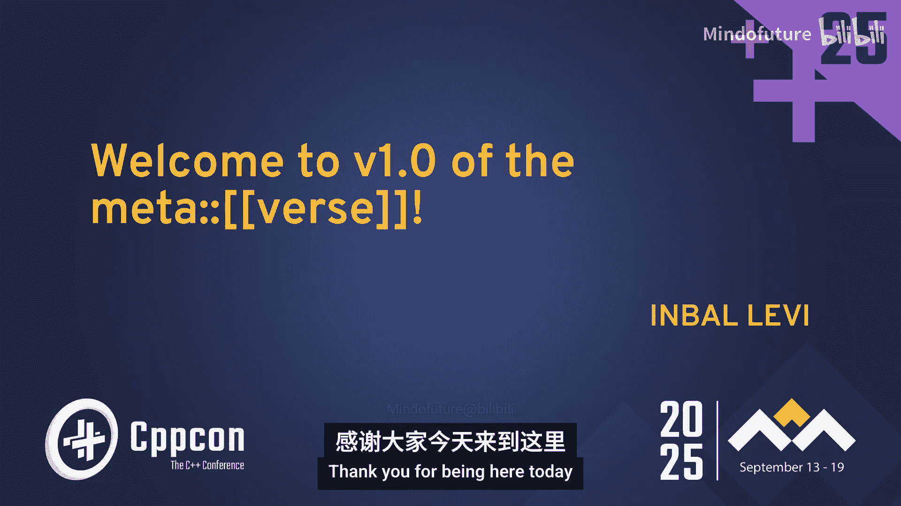
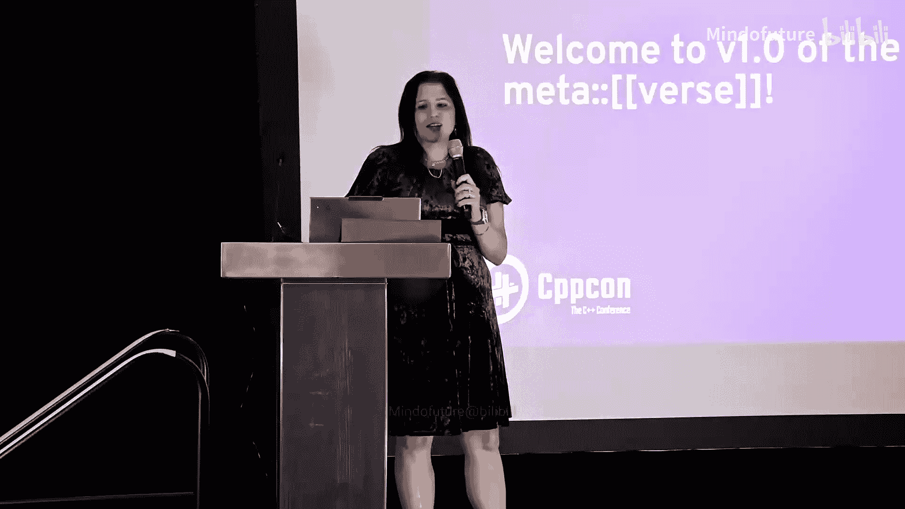
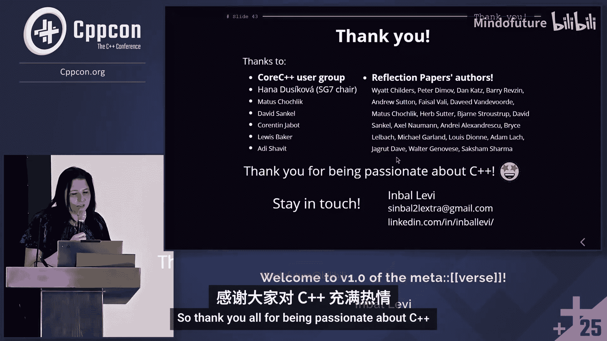

# Cppcon-2025-｜-C++-｜-C语言--｜-汇编-｜-编译器-｜-操作系统-｜-Linux-｜-Windows-p21-P21_C++26新反射功能简介-Inbal_Levi-CppCon_2025--BV1wyPBzrEeu_p21-

Honestly it's the hallway track， like the biggest the spaces where I've learned the most at CPPCon have been in the evenings。

 hanging out with people over a drink or at dinner and just chatting。So， everyone。

Thank you for being here today。 I let the last people come over。 Oh good。

 I have a clock here that's perfect because I tend to sometimes lose track of time。

 but it's really great to have you here to have you all here and welcome to the metataverse。😊。

Oh， selection we' doing。 I mentioned you in today's talk by your。 I'll tell you later。 So。

 first of all really welcome to be for， for you to be here today。 How many of you knows what the。😊。

The title reference to metaverse。 How， how many of you know what the title is referring into。

 Keep your hands up。Oh， okay， okay。 that's， that's not bad。 I should have picked a better title。

 I've been told how many of you read the abstract or how many of you know that you're here for a talk on reflection。

 just want to be， okay。😊，Thank you。 Okay。 so first of all， I apologize for the title。

 It looks like yeah， I should have probably not be so tried to be so clever。 So yeah。

 so meta is the new namespace that we're gonna add for reflections to meta and I'm gonna talk more about this。

 of course。 and welcome。 So yeah， I'm sure you can guess that this picture was generated by I。

 It's just because I used to draw， but I don't have time for this now because I'm a sswa developer。

 but。😊。

Honestly， I missed that。 So instead， I went toI， but I am just trying to express here the world of possibilities that I see as what reflection is。

 So I hope this picture helps。 a bit about me。 My name is in Ba Levi。

 I don't know if you've met me here already。 we talked if we haven't。 please come and talk to me。

 but I'm a S+ software engineer。 I'm working on OSs internals in Microsoft as of around a year ago。

 I'm also an Io S Foundation member。 the S Foundation is the one behind this conference。

 which is pretty awesome。 and Bo Foundation board member。 I'm sure you all heard about Beaman by now。

 hopefully yeah， we have a person here in the front with a t-hirt。 Oh the logo is amazing。

 by the way， I don't know he did this logo， but it's an amazing logo。😊。

I'm also a member of the ISO C++ Committee as Israeli National body Cha and as Library evolution work group Cha。

 so library evolution for those of you who doesn't know is the group that is in charge of the features that go into the standard library。

 it's in charge of the design of the features so we have another group after us that is in charge of the wording because I'm sure you all alreadyherit or know that standard proposals go by have some implementation reference you have some design and you have wording because the wording is actually what puts that into the standard。

Cool， so yeah， so here's also a small photo of what the standard looks like。 And you can see here。

 Let's see if it works。 Oh， cool。 So you can see sorry， here， S the 7 reflection。

 which is the domain group for reflection， the one that been incubating this chaired by Hanna de Soovva。

 Thank you so much to her。 And you can see here the two groups above core evolution and library evolution。

 This is the language group， and this is the library group that have been incubating this proposal。

 So I already tell you that this was one of the largest proposal we had definitely for 26 of maybe ever。

 and it had two parts。 It had library aspects。 and it had sorry， it had language aspects。

 And it had library aspects。 And we're gonna review this as well。😊，So just one more callout。

 I hope that I didn't miss any other reflection talk if I have I am sorry deeply。

 but we had two talks in this conference already one by Barry Rasvin。

 which is one of the authors I will also bring him his name a lot to do in the presentation he is one of the drivers of this proposal which is really awesome and he gave some really cool examples。

 and the second talk from this morning by Herb Sader about reflection Clast decade defining rocket Engine。

 and I do agree with herb that this is groundbreaking feature。 So Herb have shown a very。

 very exciting things that gonna come up I hope in the future for reflection I'm gonna go a bit simpler and broader because my aim for you today is to understand reflection like as thorough as possible so that when you go out there and write code you will be able to understand。

The errors and the problems that you stumble across， so that's my goal for today。

 not like herb to define the future or like Barry to show you complex examples。

But welcome to my talk。 So that's kind of funny because okay， so anyway。

 what do I mean when I say reflection。 reflection is the ability of a software to expose itsze structure。

 I think herbs said something very similar。 But I also want to emphasize that we're talking here about static reflection。

 So who exposes this structure。 It's the compiler。 and it's doing it on compile time。 Now。

 may sound trivial， but this is gonna to come up later， and there's gonna be some riddles。

 So keep this in mind。😊，嗯。And if you're a disclaimer， it's possible to carry the data into run time。

 So basically if I have something and the compiler generatesstruct have this information。

 I could technically leave it in the binary， but this is not what's been proposed for C+26。

 This is what we're going to talk about here today。

 and it also may introduce security and other issues。

 And this is not the focus of the C++ 26 reflection proposal。But what we do gonna talk about today。

 So we're gonna talk about， we're gonna see some intro to reflection。

 We're gonna talk about a brief history of how we got to today。

 We're going to talk about latest proposal， P299，6。

 This is the one that been voted in Sofia not that long ago， we're gonna to see some users examples。

 And as I mentioned before as I'm library evolution chair。

 my focus and my interest is on libraries based on reflections。 the second part。

 we're going to talk about some impact on our code bases。

 So we're going broaden our perspective and look at how is this going impact our code bases。

 pipeline generation and what next。So oh yeah。 One more comment that I wanted to make。

 We have few implementations already in Godbold， which is really exciting。

 One of them driven by Don Katz he was from Bloomberg。 Now。 he's in Adobe。

 Thank you so much for done for doing this。 And another one is by David Van de Rude in E D G。

 And by the way， by Wyatt Charles also when during his time on Lock free。

 also started this implementation。 So I'm really grateful for all of them。

 So let's look at the brief history。😊，The first place that I found that mentions anything that have something to do with reflection in relation to the standard were 22006。

 But this was a template based reflection library that Mathuuch Kch was also getting gratitude in Herbstock started working on。

 and it was called Mire reflection Library。This reflection library was something that you might be familiar with as template meta programming today。

 right， We also had some mentions of use cases for composite time reflection by Mike Part。

 I believe that was very insightful to look into the future。

 And some of the use cases being brought up back then。

 even before we had the syntax that we have today were serialization delegates。

 getters and setters and customization points。😊，I will give you another hint。

One of those things is not， I guess， in a sense， one of those things we still haven't delivered。

 So you look at those things and try to think during the talk what which of them has not been。

 I guess。Simply delivered， or at least trivially delivered。 So as I mentioned。

 Matt Matthu Ko's library， he was trying to propose it into the standard。

 And I'm sure you all know that proposing something he didn't standard take sometimes he'd been working on this。

 But as I said， there were different issues that came from the fact that this thing re on template meta programming。

 And another approval of that was by Bo Han library that was implemented by Louis Dion。

 also trying to observe the code。 And at that point。

 we realized that template meta programming is problematic for reflection。

 Anyone wants to shout out why。What's the problem with T into programming。

You can also raise your hand， if you really want to。Yeah， Sa， no， no。 You know what。 Wait。

 you know that。 Let's go with Richard。Right， and Saon， youre gonna say compile times。 Yeah。

 because son is， by the way， one of the reflections experts that we have here。 So feel free to。

 to talk to him。 Yeah， so yeah， definitely compile time。😊，So， so that was an issue。

 And therefore we diverged dive divergted。 Sorry， I'm not a native English speaker。

 So sometimes I'm gonna to say things weirdly。 So if I do。

 please feel free to stop me and correct me。 we diverged into having proposed syntax。

 because if we can do this with templates， that means that we need syntax in the language。

 So as you can see， there were multiple proposals coming up trying to define this syntax and by multiple people that I'm not gonna to read their names。

 But all of them are in charge of what we have today。 And at that point。

 also came the question of meta objects。 So how would you generally。

 how would you represent I have a C plus fast program， right？ This is， let's say。

 whenever I try to represent something from the real world。

 How would you represent something from the real world。 So the more classical example， students。

How just chat out like， how would your program look like。喂。Metaadata， I guess， yes。

 But where would you save this metadata？ Yes， classes， right， because。😊。

Our go to thing when we try to represent things in the real world。

 which is most commonly what we try to do when we wrote programs， is classes。 So， yes。

 this is exactly what this is。 Me objectsject are basically objects that represents parts of your program in classes。

I would also want to talk， okay， I missed this very important point of saying that Brna started taking interest in this。

 or maybe he started taking English before， but definitely published a paper。

 which means that the interest is increasing。 David Snkel also published reflection to S。 again。

 in charge of a lot of the syntax that we have today。So I want to go back to what I said before。

 So we represent parts of our program in classes， right？ So I I have a variable， and I have a type。

How would you put them in classes， Someone just described me。

 How would you write the program for that， If I， have a， I have a small program。It's int A equals 42。

I want to represent the parts of this program。 How would you write a program to represent the parts of this program。

It's not a true question。 a very trivial one。I syn text。Yeah， yeah， yeah。 That's good。

 So you would basically do a hierarchy， right， something along those lines。Would you， okay。

 so you have the type int。 You have variable A。What would you do with them。

 Would you put them in different classes。Templates， what。Exactly， thank you。 someone， someone。

 someone took debate。 Thank you person from the front row。 Yes， you would。 I would。

 if I would think of a program that I want to represent。

 I would probably do a hierarchy with the type in and the type will have different values or something else and they'll probably inher from that。

 But that is not what we went for。 we went for what we call monotype design。

 And what does it mean a monotype design。 So student meta info that we're going to talk about later is a single type represents all the elements in your program by value I mean。

 keeps values right， to represent all the elements of your program。😊。

Anyone want to guess why is that。Go ahead， person in this front row。

ReProduce a new language feature or remove some language feature。top过。Interesting， interesting。 Okay。

 that's a really interesting answer that Im actually not thought of。 What's your name， by the way。😊。

Villa Vina， thank you， Vina， that's a very refreshing perspective。 Well， in， I mean， technically。

 we could extend this tree of hierarchy， but you're right that would definitely create some burden for standardizing for each new feature。

😊，Oh yeah， sorry， sorry， sorry。I'm very tired because I have a jet like So Vina have said that if we have a hierarchy of those different things to represent our program。

 every time we add a new feature， we need to modify this our hiarch tree， right， we need new type。

 we this is kind of a implementation burden and opposed to having a single type stood meta info that contains values。

😊，Agreed whenever we had type， we need to， you know now maybe we have functions to deal with this type。

 maybe we have overload resolution。 This is a lot of burden comparing to a single type with a value。

 But another reason was the compiler implementers suggested that that would be simply too heavy。

 So we already talked about compile times， having a hierarchy of types is more heavy in terms of implementation and I'm not a compiler implementer。

 but according to them that was another issue。 that's why we went to meta info。

 But actually after watching various talk for Monday。

 I think'm actually I think I actually have another really good reason for having meta info because single type。

 because in a sense， reflection now when we have a single type allows us to have heterogeneous design of the algorithms are the same。

 but for multiple types all of。Those types or things or whatever are represented by the student meta info。

 So in the realm of reflection， they are all the same thing。

 So the algorithm develop is actually applying to all of them， which is quite cool。 So。

 so before watching Be talk， I did not thought of this as an another benefit or another positive aspect。

 But I do think of it now。😊，Any other question， any questions so far， by the way。

 I'm just rummbling here。Cool， right。 so， yeah。 so another thing I wanted to bring up is constant expertness。

 So we did had constant expert getting into the language。

 and some people have claimed things like we can have everything as constant expert and all the logic。

 And then we kind of don't need to use synex but clearly observing what constant can do， etc ceter。

 We did not see con expert as a complete solution。 And I will show you more in the in the future。

 But we do have more con expert things as a result of the reflection proposal。😊，So naming， as always。

 naming is hard。 syntax is hard， but we've solved all of that。And again。

 the question of single object， a single type versus multiple types came up latest in 2022。

 which is very late comparing to a proposal that have been idea that have been there for a while。

 but then we reconfirm the fact that we want a single type object and 2023 we got the proposal that we got for C++ 26 standard。

 which is P2996 reflection for C++ 26， which is very exciting all the names are here。

 we had some very interesting proposal about Python binding using reflections and jascript binding you can also see Adam Jas Dunka's jaros here by the way in the conference section also wrote a very interesting proposal talking about how to use reflection for AB tagging or versioning and all of those things came after the proposal in 2020。

3 came to try to emphasize and explain what are the use cases of reflection。

 And think those are very fascinating。 So we're now two years later。

 and I'm going to show you the final version of reflection as we got this into C plus+ 26。

 So draft have not been officially signed， but this was voted into the standard。

 which means that it very likely that this would be the final form。

So I want to show you a quick example to get， to get the things started。

 So I have here a library type。 It inherits from two base classes。And I have the user code。

 And I want in the user code to observe this type。And， basically。

And I basically want to ask a question about this type。 So I have here， first of all。

 student meta info， I've mentioned for this thing represent a reflection expression。

 and then I have reflection expression。 And then I lift the loop type into the reflection realm。

 and that's going be reoccurring term during this talk because what we actually do when we write reflection is we write code in a different level。

 we basically observe our programs， and we lift the things in our program into the reflection realm。

 get an expression that represent those things。 and then query on them。So I think it's a very。

 very important point to notice。 And then I take my reflection expression。

 and I can execute functions on it。 Those functions are coming from student meta namespace， right。

 So for example， basis of， So an not query basis of reflect expression and place 0。

 And what am I going to get。😊，You know that that's easy。 Yes， phase 1。 So， yes。

 So we're gonna get to thing by the the order of declarationation， which is also not trivial， right。

 Pretty cool。 What do you get。😊，Base one。What what what is is it is it it's， it's it's okay yeah。

 yes， exactly。Thank you。Sorry。操。Okay， so。Yeah， I， that was a spoiler allowed。

 So I'm now gonna show you all the objects of the reflection purpose。

 the components of the reflection proposal。😊，There are a lot of them。

 So we start with reflect reflection operator。 It gonna be Splicer' stood meta info object that I talked about and bunch of meta functions。

 We're not gonna go over all of those， but they exist there。 And if you look at them。

 you see things that might resemble type traits。 So you might have seen things like is pure virtual is all those kind of things。

 And this is not coincidence。 We actually have additional version of the traits in the meta namespace that use compiler magic that use that are basically more powerful for reflection。

 So that that is not accidental。 This talk also had different versions okay So I've updated this according to the version。

 So if you look at the previous version of this talk。 those things were modified。

 So I just wanted to highlight them。 Yeah， and we've been modifying some names。 But yeah。

 I'm not gonna go into this。 But if you look at the slides later， you can。😊，See the difference。

So let's start。 already showed you an example。 First of all， I wanted to say。

 the reflection operator now double carrot used to be a single carrot。Unfortunately。

 due to clash with language， I would not repeat name here， we had to give up on this syntax。

 which is very unfortunate in my mind。 But now we have the double carrot。

 It's also aka known as Uniipro。 So feel free to use this。 This is not the official term。

 This term was not defined by me， but it was defined by Jf which is evolution chair。

 So I showed you before the groups。 That's the nickname that we give it。 So， yes。

 we are now familiar with the lift operator。 And what does the lift operator do。

 It shifts thing into the meta shifts from the program realm into reflection realm。

 It shifts into meta。😊，So object can be used as input for other reflection utilities。

 as we saw before。But what happens， Sorry about that。What， what about this code。

 Does this code gonna compile。😊，You have to like that's not fair， yes。

 for people that have seen the presentation before。😊，Yes， we're gonna get an error。

 This doesn't work because meta type variables must be cons expert。

 We're talking about something that the compiler is doing。

 So compiler have to be able to hold this thing。 So this is one point that you might gonna get errors in your compilers and start to get frustrated。

 It's frustrating。 Think about this。Second thing is the spices。

 So we already lifted something into the reflection realm。 We have int here。 We lifted it。

 What is int， by the way。In our simple plus programming language。 Yes， it's a type。 Okay， cool。

 So what would be this thing here， a。😊，You get it。 yeah， you have a you have a there's a hint here。

 Yes， this is a。 The reason I'm using type name is because in some in some scopes。

 in some areas of the program， this might be ambiguous so we can basically you could do just the splicers here and and define like that reflects expression a equal 42 that would get back as a type。

 but in some areas of the program like， for example。

 if the name might be ambiguous with namespace or something else。

 you need to use type name in order to disamvigugorate。😊，For the compiler， cool， But the default is。

 you don't have to。 Yes， so we now have declared a， right。With a type ins。

 but we don't write in here。 We write reflection expression。 Now。

 imagine this thing is not two lines of code， but it's a different program passing you something that you don't know what this something is。

 but you want to instantiate it。 you could do it like that because the type that it's been passed here is stood me info。

 So youd have a function that takes me info another program， for example， when I say program。

 I mean another code whatever one second， let me just finish my sentence。

 another code initialize this reflection expression。

 but you don't know what the reflection expression represents as a type。

 but you want to create one of this。 So I do when hand waves here， because obviously I initialize it。

 And if it was something that doesn't fit to be initialized with 42 will be compiler or other things。

 But I do want you to understand the power of this。 Yes， research。

 then if I understand correctly So we're saying。Is an expression is an expression。

 and I could stood meta info。 In fact， Yeah， and I I could pass it to another function for it to use I。

Imagine the function has to be constant expert that。 Yeah， yeah。 it does。 It also have to constant。

 It Does't matter if I pass it by reference， R value pointer。

Let's get back to that because it's an interesting question， yes。I would say by default。

 pass it by value。 yeah， but we will talk about this because it's an interesting question。 Yes。

 sorry， whatre you name。And ahead it legal to inside the spr directly？Yes， it is。

 And Andrico have asked， is it legal to pass， Thank you。

 Volte for marking me to repeat the question that is very， very useful。 I， As I said。

 volunteertes are very， very useful。 Thank you。😊，I really do appreciate it， Yes， it's legal。

 you could you could， this is a regular COS syntax， if whatever you can do that kind of makes sense。

 take this expression and put it somewhere else， it will work。😊。

This is what Herb has tried to emphasize as well。 This is regular s plus plus syntax。

 So all the rules you're familiar with are also apply here。 For example。

 could they write this inside of a class like bodydy。Really， think about it a bit。Okay， true。

 but we'll get back back to that。 Okay， so splice exact， I was just trying to mess with you。

 So splice extract the C plus expression back from the info。

 But then we can use this in the C plus program。 So again， just to emphasize， we have our expression。

 What is this thing。😊，K shouts Me info object contains in of int。 What is type name expression。 Yes。

 it'st it cool。 now no reflection really， really well。 So now when you got get errors。

 you're gonna be able to identify them。 But I do mean it， or the rest is， is functions。

 And you know how function works。 So we talked about list operator about splicers。

 Let's talk a bit about the student meta info object type。 who recognize this。 What is this。😊，Andact。

Anyone worked on compilers here before。 That's a hint， raiseise your handss。啊必须。😀Yeah。😊，Yes。

 that is true。 Thank you for sorry， I forgot your name。😊，Max。

 thank you for the like five experts that I have in the room。But thank you for keeping the。

 the presentation going。 Yes， that is true。 Max， has correctly identify this A SD。

 Can you recognize which compile this A SD is from for any chance you， It's small。 So I。

 I wouldn't like， it's understandable if you can。😊，Claing。Yes， that's a clang SD。 Co。 So yeah。

 that's the clang AD of this function here。 I just realized this is quite dark。 I'm sorry about that。

Okay， I hope that wasn't too much of an issue in the previous slides。 Yeah， that's theang AS T。

 So we have things like function declaration for the function on the side。

 right in main we have variable declaration。 we have I， we have in etca， etc ce。

 we even have the L value R value definition of this。 So yeah， this is not by coincidence。

 student meta info represents okay student meta info can be as equivalent of Ast node。

 So it basically we don't in the standard。 we don't specify implementation。

 So we cant tell implementers how to implement， but I would not be surprised if they put this as a reference the。

 So keep that also in mind。 So type and type LSs function and member functions。

 basically all the different things in your program enumer templates namespace etc。

Look at this last line expression which that sorry for the width that can only be evaluated at compile time。

So there's a restriction。 Student meta info have to be con evil。So， yay。

 now you know reflection really well。 I'm not gonna give you any hints。 If this card compiles1。

1 second for the question。This this code compiles。Yeah okay， yeah， obviously if I'm asking， but yeah。

 yes， yes， you already know the answer。😊，This does not。 We don't have con expert。 So what。

 what about this in， I， I don't know if you remember in， in the example。

 I don't want to slide back in the example I showed you before。Wascon experts。A。

 and then will the reflection operator。 Sorry， it was constant reflection operator reflects int lifts。

 you know， lift operator int。 and it was constant expert。

 And then the second expression was also constant expert。 have your int array。

 This is not constant expert con thing。 Why does this thing works。This is just the。Yes， exactly。 So。

 yes， this is， it's confusing， right， because I declare some， something that is not uncomplied time。

 but I still able to query the object of this thing。 So if like object。

 I will give you the the information。 It takes an expression。

 but this is expression in normal program。😊，What would this are， sorry， that's actually a bug。

 R 0 will evaluate to。 Well， our one will also evaluate。 Yeah， and no。I probably did a syn et cea。

 But yeah， it's， it's， reference it's， it's， it's 0。 it's 0。 you， you， you access this element in R。

 It's 0。 It's not initialized， assuming， you know， garbage put aside， etc cetera。

 But I can still reflect on this thing and get the type。Right， so this is not compile time thing。

 but I can still get information from this。 for example， what its type is。Yes， Richard。

 But the result of a cracked operator is。The type isn't in reference if you like because you can assign to it。

 right， so it's not in our value in， is it's an L value。It's an L value reference。

 isn't it because I can if I have a it doesn't matter because it's if you'd write this in the program will be evaluated。

 So by the time I get to the to the parentheses， it is some some in in this case， let's say zero。

 It doesn't really our value and L value are not in play in in this reflected object。

Getting the type of the expression or the result of it。It gets。The type of the expression。

 And that's exactly the interesting thing here。 That's why I'm showing this function。 Yes， sorry。Vna。

 yes， go ahead。 But then I wanna continue。 And it， it's not a， it's not a tricky example。

 I was only showing you the reflect object usage。 Yes， so don't try， like。

 don't try to kind of realize this is just a regular array， yes。这李。Yeah，16 reporting。De everywhere。ア？

Yeah， yeah。 Okay， please， please ignore the fact that I did not initialize this array。

 Please ignore the fact that Ive in in accidentally put here 1 when I intended 0。

 Please ignore all of those。 It's just。Regular array with one element。

 And I'm sorry for editing this and not paying attention。 Yes， what's your name， Sorry。

 No the person the back。Tom， Yeah， yes， Tom。是。Oh yes。Right。And you had all these functions。喂。

But like one downside of having a single type is that。Not all functions really are applicable。

To all of。That is true。 And we have a mechanism to report errors， and I will get to it。Yeah， yeah。

 I will get to it。 I will get to it。 you're correct。Let's continue。 alright。So student info。

 I have another I I said there's gonna be like questions and and riddles during this talk。

 So I have another riddle for you。 But unfortunately， it's very dark。 Okay， no， it's gonna work。 Co。

 I have a class。 R just a regular class。 Nothing here too complicated。 I have a student info result。

 expression that represents this R。 and I have a print。

 And I basically ask about this class is complete type。😊。

So anyone here doesn't know what is complete type is， What is a complete type。Okay， what， sorry？Yeah。

 exactly。 Yeah， yeah。 let's， let's just say when I declare this R。

 a compiler doesn't know how to instantiate this thing until I tell you what this R looks like。

 So at that point， it's not a complete type， right？ So why do you expect this rest to this function。

 metata function is complete type to return。 Yes， false true at that point。Now， I completed the type。

 right。I have here。 So sorry。 So just to emphasize the name of the expression here is rest 1。Okay。

 that is important。 I've completed the type。 and， now I asked this question again。

 and I declare this Ra2， and I asked the question is complete type。

And then I saved this Inter print 2。 And then I asked the same question on Res1 again。

Save it into print 3。So， now。I have a question for you。What will be printed。So the first is false。

 or I gave you that one。Wait， wait。 The first is false。 please， everyone。 I know it's late。

 I know it's the end of the day。 Im giving you the first。 The first is false。

 So we have three prints， false。😊，Either true or false and either true or false。 So who thinks， Yeah。

 go ahead， say the answers that you think。Foster。F。So。Okay。

 so how many of you think falses true or true。 Raise your hand。And his max in the back。

 There's few people here， cool。Interesting， how many of you think falls true false。Cool， I'm sorry。

 I'm really enjoying this。 So I thought like you all， I expected false true false。

 What did I get false through true。 why did I get false true true。 What is happening here。

 I gave you already the hint。 I actually said that Anyone remember where the stigma info kind of goes to by default implementation。

 As T， What happens in A T S T represents our program。

 but it's been updated during the reading of our program。

 So rest1 here despite the fact that we basically took it sorry。

 the fact that we took it up terrible up here is actually looks like a value type， right。

 that kind of addresses your question， Richard， But what is this thing。

 It's actually kind of a reference type to the AS S T。 So yeah， So it's not okay。

 that's a good question。😊，Let me think。I'm trying to think。 Yeah， yeah。 So it was a question。

 I that an implementation defined so in other words， is that actually specified in the standard。

 So I can tell you that we actually specified in the Yes。 So in a sense。

 we specified in the standard that reflection is a stateful。

 which means we didn't exactly write it this way。 But stateful means in to stateless， that。You。

 you have you have rest1， and it states is get updated。

 and I may have confused that because I'm very tired。 but you got my point。 Yes。

 it's not defined whether， for example， this expression would return true or false。

 but it is defined how reflection would behave。 And second point did I want to make。

 put in aside a specification I that all implementations would behave this way。

 And this was actually pushed back from implementers because in a what would you need to do in order to have rest1 return false on last。

 Yeah， go ahead return。What would you need to do， assuming you are a compiler implementer。

You have to like snapshot your。 Yes， exactly。 You have to snapshot。 You have to store。

 You have to kind of save something。 You increase the。Footprint of your implementation。

 And people were not happy。 So that's what we got。 So I will say I'm not super happy。

 but I' also accept and understand why。 And that's an interesting thing to recognize。

 So whenever you write programs。 and oh by the way， you could save， of course， you could store。😊。

The result of the like print one still stores the result， right。

 what I was asking about is the evaluation of rest。 So pay attention。 This is a bit subtle。 Yes。

 Richardard， But I really need to move forward。 So what's the implication for this of putting in header files where at some points in your program。

 you forward declared a lot of classes And then you fully declare classes like doesn't exactly what you see here。

 This could be you could cut this part into a header file。 Oh yeah， sorry， Richard， thank you。

 Thank you。 What's your name， person， Nice person。 again， Palo。 Pa Pab Bo。😊，Sorry， whatever。

 thank you so much。 please come back all the volunteers。

 please come to the stage afterwards because I want to thank you properly anyway， yes。

 this part is you could wrap this thing into a header。 it's basically what you see here。

 So if you ask this question earlier before you exactly exactly that。😊，Cool， and by the way。

 I maybe forgot to mention there's Q R codes， the godbo links。 go and play with those stuff。

 So we talked about reflection operator， the lift operator， Splicers。

 to meta info and how does it it behaves。 We're now going go over each and every one of those meta functions。

😊，Not really。 sorry。 I yeah， not each of everyone， but there are tons of meta functions。

 They are really cool。 You should go and check that out。

 And hopefully there'll be in CP reference soon or maybe already are。

 There's another thing that that came oh， sorry that came in late。 The con Eval block。

 It's exactly how you imagine it。 It's a con Eval that you can open parentheses。

 write stuff and close parentheses will be conval。 But I don't go there because it's first of all。

 it's a late proposal that was appended upon。 And second， I don't have time。

 So please look into the paper number if you want。 So meta functions。

 I already showed you a few of them。 I want to show you one more here。 I have a equal 42。

 I have meta name of。 You're already familiar with all that。 Why do you expect to be printed。😊。

4 is a。A， interesting。 How about if I'll put this in a namespace。Now at。Still like， okay。

 so names in simple class are ambiguous because do I want a fully qualified name， Do I want。

So instead of name off， we replace these to identifyentifier of。

 There's an another function that's called the I forgot the name the designate。 Yes， thank you。

So name is not good ambgouous。 However， when I write logs and things like that。

 I maybe do want to have some more fine grainined control of this。 We may extend this later。

 but for now， you get identifyentifier， identify as the simplest identify thing in the closest scope。

 But this is interesting point， right， if I if I， if I want to keep this in mind for logs。

 So all the meta functions except in accept info and return except for some meta functions that reflect value object and function excepts the T。

😊，Except info and return either string view or stood me In。

 another metain because you did something to the type， right， or vector of stood me info。

 for example， we saw this in basis of or Boolean size D T and source location and member offset。

 which is a new extract it we added in order to query bits set and stuff like that。

the return of offset of。Cool， so you're now familiar with basically the majority of the reflection proposals。

 so you can now pull those guide links and play with them。

 I w to show you two more more complicated functions。 I do have kind of kind of have time。

 So I'll do it very quickly。 okay， so substitute。 substitute is the equivalent in reflection well for insian in a template。

 So。😊，I have here an array。 sorry， I don't know why it jumped， but。Yes， sorry， but。Okay。

 let's just start here。 Have your NRA。Okay， yes， sorry about that。I mean。

 what was I trying to show here， okay。Reflect expression here is the result of substitute function。

 Subt function takes array to the array and takes int and sorry。

 the stood metata info object that represents an int and reflect value of three。 So reflect value。

 I'll give you a hint is like taking is like taking value from your program and again。

 throwing this into the reflection realm。 So whatever I want to put three in my real program。

 I'll put reflect value of three。So anyone wants to guess what this function is basically doing。

 This substitute function takes array， takes type， takes。Value， which is 3。Exactly。

 itstan a template。 Now， I have another question。😊，Where does it instantiate the template。Is it here。

That's a hint。Oh， I'm so sorry。 I'm so sorry。 I'm so sorry。 Okay， there's a call for substitute。

And it returns something。And there's there the we， we splice the expression。 Thank you。

 Thank you so much， sorry。Did that help， We spliced the expression that would returned from substitute and call my array 1。

What its when it placed。Spliced is the this operator that I've shown you before that basically takes things back from this is this thing is a st meta info object。

So the result of substitute is still me for object。

 And here I splice it back into our real program world。 Yes， thank you。 Who said that。All of you。

 Oh my God， this is a group of very smart people。 Why， why do you think that， by the way。😊，Its costs。

 right， It's costs。 So， yes， here what I do at line 1 is basically。

 I just hold a stood meta info object that represents something that when I send it back to the program world。

Is instance is is a type。 So only here I actually get the call。

 What you use to look at array in3 is that。 And this is just preserving。

 It's preserving the information so that later case of substitute returns something which preserve the information so that later you can create the type。

 So yes， this is tricky。 It's only later instance it， which is pretty cool。 It's delayed。

 It's useful。 It's effective。😊，Here another example。 I have here somestructs。

 and this tract takes an int， and。imagine that this is just declaration of Str S。Co콩。

What would happen here。I substitute， right。And I'm not gonna show you the next thing。

 It's good because it's actually have the comment on showing what it shows。

 So I'm actually utilizing the fact that you don't see what's， what's gonna happen next。

 What's gonna happen when I try to splice this。😊，If by what you said that this place would be okay。

No， no， no。 this sp is the okay， exactly， exactly that what would happen。 Thank you。 This is awesome。

 So， sorry， what's your name，😊，J， J have said the substitute would succeed。

 The instantiation would fail。 Co or right awesome and other edge cases。

 So now we're talking about extract。 I I would yeah， if you have questions。

 I know it's it's very interesting and cool。 We have about 12 minutes。

 And I do want to go over a lot of things。 So try to keep your questions to。

 and I'll try to take few of them。 And if not， please catch me on the break。 So extract。

 What does itstruct to， It's the equivalent in reflection well for extracting values， So again。

 I'm sorry about the weird。嗯。Animation， I have your expression， extract int and reflect value 3。

So what would happen here， extract。What is this。Type right， It's int。 So what do I do。

 I tell extract that and you can you can notice that this is a template function that I take an int。

And there's a reflect values for here。What this thing returns。Third me for object represent 3。

 What would happen on the next example。I have expression。And I extracted。 Sorry， Oh， that's better。

 Sorry about that。 Animation was a bit weird。 Second line。 And you can already see the answer。Fails。

 right？ Why does it fail， Because I can't extract three from a string。 So extract。

 I think Barry said it really well。 It's just like any cast just like extracting value from a cast。

 So basically， you can extract by given the type from stood meta info object。

 the thing that you want to extract from and you're gonna get back the type Co。

Continuing type3 I already talked about。 So I'm gonna skip this。 I want to talk。

 I don't have a lost time。 I have 10 minutes。 I want to talk about function parameter names very quickly。

 And then I'm gonna move to other topics that I had in mind。 So I have the function here。

 print parameter K。 Okay， and it takes a stood meta in for R and a size D of parameterss。

 and it basically returned the name of parameters of R。😊，In the location K。

 So imagine now that per that R is basically a function。 So I give it a function， and I'm asking。😊。

Give me back the name of all the parameters。 that that's the， that's the gist of it。

 So I now have a function funk。 It would int first and int last。 And I have another。

 that's the function declaration。 And then I have the function definition。

 Function definition is int N int L， N。 I think I called it here。😊。

What would be returned from the function that I showed you before that basically takes a function and prints its parameters names。

So just as a reminder， I have。So sorry about that。 I have int and int L N。

 And in the second in the function declaration， I have first and last。Yeah，You don't know right。

 Why do you don't know， Because it's not like well defined。

 It's not we don't have any rules in C plus plus that tells you what this thing needs to return because there's no canonical name for funk perams。

 right？ So if I have a declaration and definition， Theres no canonical name for those things。

 That means that we need to make a decision here， right， So we could do multiple things。

 We could say we go with the last declaration the last names that we see， which is。

 in this case would be N and L N。 We can decide that we go with some weird array of all the names that this int had。

 We could decide that if this thing doesn't have the same name， we fail to compile。

 We could decide bunch of things。 because I don't have a lot of time。

I will introduce you to all the options that we can have， so。I I， there's tons of other options。

 But what we had when we discussed this in the committee and we discussed this exact thing in the committee in library evolution。

 because this is library function， right， It's a library function。

 There's equivalent library function。 doesn't matter inside of reflection that takes a function and needs to return its parameters names。

 So we had multiple options。 We have。😊，Compile。No one knows what returns。

 So if I had clang like it's implementation defined， In other words。

 if I have clang and I compile in clang， I get one answer， I compile in G， I get another answer。

I can enforce consistent naming， which means that if I have different names， I do not compile。

 or I can maybe mark with an attribute， some of those declarations， definition， whatever。

 and say this one's the canonical one1。 I care about this one。I see oversimplifies the other options。

3 options。If you would have sit in a room， what would you have voted。

 Who would have voted for compiling， No guarantees。

 application would be that if you have a log file from one compiler and you try to fit it into a different compiler。

 you， its， it doesn't fit。Who would vote for the first one。O。

 not many people who would vote for the second one enforce force coned naming， which means fail。Okay。

 cool。 Who would vote for marking by attributes。Okay， cool。 Well， I， I kinda like marking bi。

 But what we went with is actually enforce consistent naming。 So it have implications， right。

 Someone want to think about the implication of this thing。😊，Yes， it works。 Yes。

 Tom is saying you can't introduce reflection to existing code that violate this rule。

 but no one ever told you that you have to use the same names in definition declaration。 In fact。

 some companies prefer not to for different reasons some companies have the declaration with no names。

 And then a definition with names。 And that's a valid use case。 So but yeah， yeah， we went with this。

 I think I will I can talk to you about it is later。

 but I think this decision was actually a good one considering。 but it still have implications。

 So unfortunately， unfortunately， keeps happening to me。

 I do not have time to talk about reflection logger example。

 So please look into the example here afterwards， it would do exactly what you imagine。

 but with all the tools that we saw sorry， go ahead with all the tools that youve saw today。😊。

I trust you all to be able one more addition that you can actually report Con where value is kind of a utility that is also only an EDG that is not standardized that allows you to basically print from the compile time。

 By the way， one more thing I want to mention， jetbra have IDdeE that debugs compile time As of a few days ago。

 which is super awesome Now that we have reflection。

 we really need this thing right how exciting is that。Okay， cool。 So Im gonna skip this one as well。

 Unfortunately， I will just say in a few words， I have a talk about customization points。

 Ref was considered as a customization point option my personal opinion is that you don't want to use reflection as customization。

 customization point is how you basically modify your library to fit to your user types if you wna。

 if you want to have like specialized behavior。 I don't think that reflection fits that because it's quite complicated。

 but it could be used for that。 So in my personal opinion， we should have more customization points。

 but reflection allows you to do that but in a complicated way。 So jumping forward。

 the example I talked to you about before， and you identify correctly is break in user code。

 So if I so far had my pipeline。 And I had compiled something into a library。

 and I linked it with my main。😊，And I found out on Lier that I have a problem。Maybe。

 and I could do version controls with micros and things like that in the source code。Now。

 because reflection breaks existing code， I would not get to the linker。

 I would stop in the compiler。 Ill get errors。 and that， for example， imagine I work in a company。

 I write log library， my log library works perfectly well on most of the code。

 But someone from the other team takes my log library， which is written in reflection。

 this is just like template meta programgram by the way。 This is just like template header。

 in a sense that it needs to see the source code during compilation。 but I take it。

 I give it to another team and and they can use my log library because they don't have this applied this restriction applied in their code。

 maybe they need to now modify all the names。 fine， So that's something to think about。O。

I have three minutes， I have a bit more things to talk about， and I'm very excited， by the way。

 for all of your questions。😊，So instead of showing you all the slide， I will tell you that。

I had some consideration whether do we even need reflection， which is cogen。

 considering the world of AI。 So I have an agent。 I have I。 I ask that in this particular example。

 I generate a parser。I can give it a code and ask for code generation。

 Why do I need reflection for if I could just do this by I。 It's an interesting question， right。

How many of you think that we still need reflection。Ha wow。😊，I want to talk to you all afterwards。

 How many of you think that we don't need a reflection。Any more in the world of AI， okay， well。

I agree with with you all that we still need reflection。 I cannot promise what will be in the future。

 But for now， I do agree with you。 And I can give you one very。

 very strong reason is because the output coming from AI is not consistent。

 And when I use reflection feature， I know， for a fact。

 that what I'm gonna get each iteration of running this is consistent。

So not going into the weird things the day I generated， which I wanted to show you all here。

It's inconsistent。Second thing I wanted to talk about is rust。 So was brought up in in a panel。

 Rus does have utility of reflection。 It have procedural macros， which is。IYes。

 like you could refer to macros as as like something that you can think of as equivalent。

 despite the fact that it doesn't look the same way。

 It doesn't work the same way because it's actually being observed by the compiler。

 And it they also have the scene library， which is that inject tokens into the A T。

 Okay so you already talked about AS T。 So we have like the stream of tokens that are your program。

 And you now need to get into the stream， inject something into the stream in order to reflect to basically read information。

 That's what it does basically。 And then or or generate。

 And then give back the stream continue with your program。So I said in the panel in my opinion。

 in my opinion， and that's my personal opinion， that's less good of a user interface。

 now could claim that the markers themselves are intuitive and comfortable。

 I so the generation part is actually more intuitive， I think the reflection part。

 the part that you observe is less intuitive。That's my personal opinion。

 But that that is an interesting thing to consider。

 another thing I wanted to talk about is the errors we talked about errors。 Oh my God。

 I have no time。 We talked about errors。 So we have new feature that comes with reflection。

 This new feature is context exceptions。 That means your reflection code can throw exceptions that are basically only valid in compile time。

 Those exceptions cannot leak to long to run time。 but they provide you a better way to notify the user of the errors。

 basically like an errorist。 like you would have used with a regular exception in a regular code。

 So you can catch them。 You can print them pretty cool， isn't it。😊，I think it's really cool。

What chart。No， no， just try catchch。 And， if you evaluate this in a constant block。

 that would be constant expert expert and。Okay， so this is awesome。 So yeah。

 to answer the question from before， the things that can happen when your when your reflection fails。

 And I already mentioned that with the example is either compiler if doesn't compile。😊。

Or you get contact is by exception， exception。 either being caught and printed or if not。

 it will be terminated。 The program will be terminated。 The compiler will fail。

So this is what can happen with reflection。So what should we expect from reflection libraries。

 I think Herb was actually talking about this really well。 I think the realm of libraries。

 the realm of possible libraries have just opened in front of us。

 and I'm being in library evolution group Library evolution chair。

 I expect to see a bunch of proposals coming our way that we originally meant to go to evolution to the language。

 because now we're gonna have so many of you writing code in reflection code that you can test on your compilers。

 You don't need to be compilers developers anymore to be able to modify the language and you're gonna write libraries in reflection and they're gonna to work and do observation everything else。

 and you're going to come to our group and propose this as utilities for the standard。

 So first of all， I welcome you all and I have my in the end。 because really。

 really looking forward to the world of f that we're gonna have with this feature。

 yeah I need to hire more people to help。😊，So that's it。

 So I think that's actually summarize my talk。 Last thing I wanted to shout out。 You already seen。

 I hope most of you at least Daisy's talk about AI， if you want to learn more about AI。

 I didn't even had time to touch it。 But I was trying to， but if you want to learn more go there。

 Hannah de Suovva S G 7 chair， she also is in charge of a lot of the contacts per things that we saw a lot of the contact per utilities that added with reflection。

 So if you catch her at some conference， thank her because you did so much work。

 And I'm very excited about having reflection in 26 after。😊。

I guess 20 years or so that we actually looked at this idea and observed it。And last but not least。

 I want to thank core CP user group。 That's my local user group in Israel that review this Handi Soovva。

 Mattuush， David Corenta and Louise， Adi that all gave me feedback on the talk or gave me input on the things that you've seen。

 And I want to thank all the reflection paper authors and contributors。

 And I probably missed some of them。 but I really， really think that they are in charge of what we got here today。

 So thank you all for being passionate about C++。 Thank you very much。😊。

I had to skip a few of the last slides， but you can see the presentation。 And most of all。

 I want you to email me for anything that you have in mind。

 And if you have new reflection library proposal， please feel free to reach out。

 I'm excited about this。 Thank you。😊。

