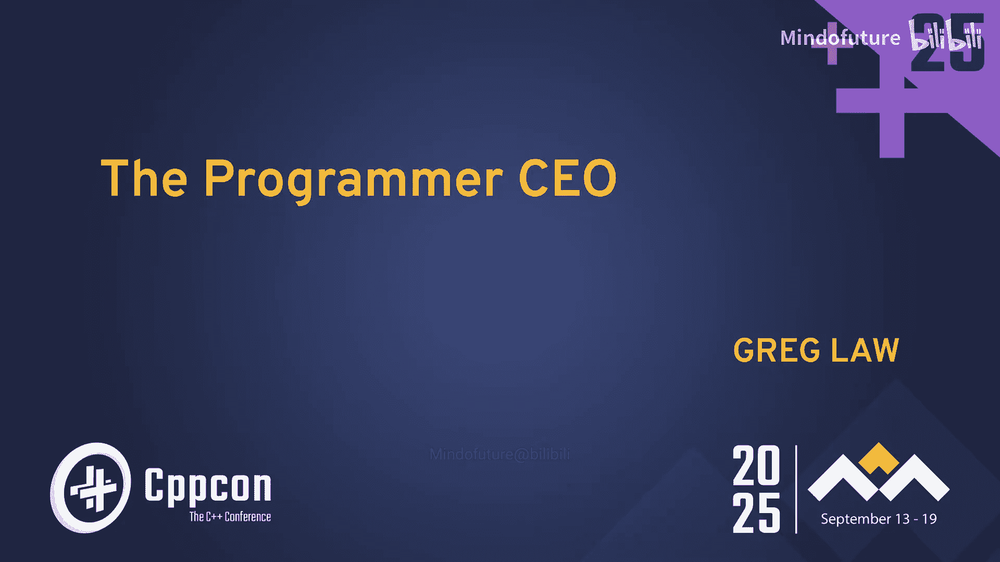
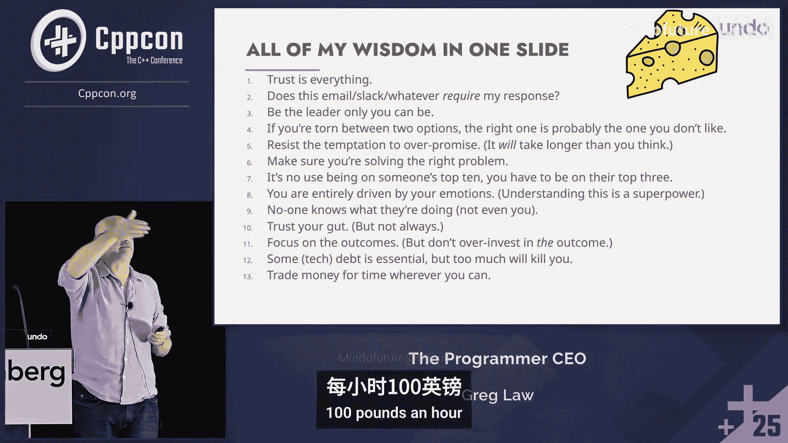

# Cppcon-2025-｜-C++-｜-C语言--｜-汇编-｜-编译器-｜-操作系统-｜-Linux-｜-Windows-p22-P22_关于成为程序员CEO的真相-Greg_Law-CppCon_2025--BV1wyPBzrEeu_p22-

It's just so nice coming and meeting everybody and making connections with people and actually having a sit down conversation with them。

 you know， getting contact information and just kind of being seeped in the environment of a bunch of really intelligent。

 really driven developers， I mean， is awesome。

All right， let's start because I have I still cut yeah right。

 I have way too much stuff to get through。 I really wish this session with like two hours。

 So we're just gonna start anybody's like can just come in late。

 Well that had cross my line a little bit。 So yeah。

 so this talk is not just if you're a budding entrepreneur or are an entrepreneur。

 I think this is this is for everyone。 if you maybe you're going into leadership management in in your company。

 There's a lot of stuff in here for you。 or maybe actually youve got no intention of going into into management。

 I mean， individual contributor。 there is still a large leadership component right。

 So leader and boss is not the same thing。 hopefully your boss is also a leader not necessarily many leaders are not bosses right So yeah。

 I mean， a leader is just somebody who people follow simple。😊。

I'm gonna。Yeah， I've been looking forward to this talk because I get to speak about my favorite subject towards me we're gonna do this with kind an autobiographical kind of arc。

 and then I'm going pull out all the kind of bits of wisdom and lessons I've learned along the way。

 Most of them lessons I've learned the hard way。 So hopefully you don't have to of them。

 many of them I've learned from other people， they've told me stuff and there's one or two things in here where actually I got it right。

 So we do those as well。 So just shopping list of stuff that I've learned along the way from how we start the business raising money and then getting into like how we do sales and marketing right I mean。

 sales， I used to think， I mean I always worked to starts even before I started undo。

 and I was the engineer that the salespeople liked to take along to meetings。

 and honestly thought that I was doing all the work I would write most of the slide deck。

 pop like the first two slide。 salesperons would do the first two slides。

 I'd write and and present all the others I do the demos。 I'd answer the questions。

 I'd basically do all the work。😊，They'd get all the money。

I have no idea how much goes into getting in that meeting in the first place and then how much on the back of it to actually turn that into。

 money， right， And that's the。Way， way more work。 And I used to think that engineering is the hard thing。

 That's the science thing。 And sales is the kind of the fluffy， easy thing， like。Programming。

 you just have to get the computer to do what you want， right， The sales。

 you have to get people to do what you want。And with marketing。

 you have to get people to do what you want， and you don't even get to meet them in order to do that。

 right， It's harder still， I think。Stuff about leadership that I learn along the way and the bit that surprised me like when I started this journey。

 I expected， you know I knew a little bit about how I didn't know about this stuff and I was going to have to learn all this stuff along the way。

 the bit that surprised me is how much is about psychology and particularly my own and other peoples。

So before I get into that just kind of context。 Can I seen show of hands for。

 do you know like what undo is like roughly seen a demo， Maybe you're a customer， Okay。

 I don't have to get into what it is good。 That saves us a little bit of time and the context is better。

 So yeah， do this stuff。 We have all these cool customers， we're doing well。 now。

 it's been quite the journey to get to that point。 let's start with not just how do we start a business。

 but why Like why are you looking to do it。 And I think one thing。I don't view this as。

 I never view it really as encouraging people to start a company。 In fact。

 you should do the opposite。 I feel like I should try and dissuade all of you from starting a company。

 And if you still are going to go on and do it despite that， maybe it's for you。

 but if you need encouraging。It's like you kind of have to be totally committed。 And it's good。

 I think， to be introspective and look at the why。 But yeah， if。

 friends don't let friends start companies， I。But yeah， good。 So listen to why。 And I like。

 I like this old African proverb。 you may have heard。 I think it's really smart。

 If you want to go fast， you go alone， if you want to go far， you go together。

 you can do more with lots of people。 And the beginning of this， I kind had this idea。 whoops。😊。

's spoiler。I had this idea， and I wanted to bring it to the market and the best way to do that was to create a company so I could pursue this vision and I could make programming better。

Yeah， bullsh。 right， The real reason。Was it ego I think all entrepreneurs have something kind of a bit wrong with them。

 I don't know。 we weren't hugged enough as kids or something。 I don't know what it is。

 And we just need this kind of validation。 It wasn't money， by the way。

 And money is a really bad reason to start a company。

 especially if you're in tech right because your expected amount of the expected return。

 Just join like a big company， work really hard。 go up。 The ranks earn big paychecks。

 do that for year after year。 your expected return is way higher than starting a business。

 The median financial reward from starting a business is either zero or less than zero right。And。

But anyway， was， unless like you really need to be a billionaire， then I。

 then I guess you can do it for that reason。 But yeah， my ego。

 far too big and far too fragile to be fixed by just money。

 I needed to kind of like build this thing。But。Do you think this is true。

 And this is really important right， to go far， we go together。

Like just there's only so much you can do on your own。

 so whether you're starting a company or you're working in another company or it's an open source project or whatever。

 you want to go work with people and you can do way more and that's where the leadership and the psychology stuff all kind of comes in。

Although。It's not actually you might have heard that one， it's not actually an African proverb。

 it was coined by an American management consultant in the 1980s， however it's still good。

 it doesn't matter who said it。So let's go to the beginning。 So yeah。

 like genuinely in the shower one morning， had this idea。 What have I'd seen this notion of。

Wasn't called time travelling debugging then， but that's essentially what it was。

 but not kind of C plus plus compiled code context。

 because I hadn't even seen it in some like Java or other kind of managed runtimes where you can kind of see how you'd make that work。

And I knew I wanted to start a business at this point。 I'd been working with a few different ideas。

 And then this one just kept gnawing at me。 And in the shower。

 it's all about just how could you work。 How could you make it work at scale for real world complex code。

 And it struck me that。If you want to go backwards where you could start from a snapshot and go forwards。

 if I've played like 1000 instructions， and I want to go back one。

 I go at the beginning and play 999。 And as long as I makes sure when it replays。

 it does the same execution path， then that's kind of morally the same， right。

 And that was kind of the breakthrough that maybe we can do this in a whole different way。

 it was completely。Undeveloped， I thought I was going to do it with like LD preload intercepting system calls。

 And that quickly turned out wouldn't have worked。 But the kind of core idea was， was， was there。

 So yeah， I think showers is。What it's my have by days Cha。

 actually I had the idea for my PhD sitting on the toilet。

I no longer have ideas on the toilet because we have mobile phones。

 but you can't use them in the shower。 So that's why we still have ideas or like maybe riding a bicycle or or running it something。

 So it's good。 I think it's important to be bored and let kind of creativity flow。😊。

And my immediate thought was right， now I need a cofounder。I don't think I ever thought。

 am I going to do this alone or with a cofounder， it was always like just it has to be a cofounder。😡。

So went and I approached somebody that I'd worked with previously super smart guy。

 quite entrepreneurial， kind of worldly wise。 thought he'd be the right person。

 pitched kind of the idea。 And like he didn't get it。 He was， why would you want to do that。

 Doesn't the bat trace give you what you need， And I just thought， looking back。

 I see now that that was kind of a red flag， because if like。If Chris。

 this super smart guy didn't get it， I just put that all on Chris， I was like， well。

 Chris must be having a bad day today。But actually， it turned out， yeah。

 like it's really hard to explain this stuff and why it matters。😊，But that was。

 I was going to discover that later。 And then I realized it was something I'd worked with a few years previously。

 I hadn't seen him for a little while， but it' my friend Jules， Julian Smith。

 who's got his's perfect for this for all kinds of reasons。 So I mailed him and said the idea。

 And I still remember that mail that came back。 He said， I'd love to start a business with you。

 And I could going。😊，Sadly， and I'll get to this， it didn't work out with us in the end。

 but he was absolutely instrumental in the first 10 plus years of the business we would not absolutely not have got there without him。

But I think， yeah， having the right cofoer。 if you're going to have a cofounder is just so important。

 I know， I I know somebody who start co founded a business with somebody who。

Sttoole the data in order to get the business going。 And I was like。

 do you really want to go into business with this person？Because it's going to be hard right。

 and you're going to have。Disagreements， and you've got to have that kind of basic level of trust。

 Otherwise， it's just too hard。 you'll never get kind of off the ground。All right， so's。

Co founder going and going and how do we start like physically start the business。 Well， obviously。

 first thing you do is type V I and you start typing code into the empty file， right。

 But there's obviously a bit more to it than that。 And people have told me about this red tape are going get tied up in red tape。

And you read things all the time。Here's a secret， right， There is no red tape。

 Now this is I' have to admit this is about UK business because that's what I know There's different jurisdictions There probably is a little bit more。

 We now have an Indian subsidiary and。Yeah， there is a lot of red tape there， but it's generally。

 I think。😊，People use it as an excuse。 very big company。 There's probably lots of red tape。

 but a small company。 not I got when we've had our first employee into the shed。

 I got and we ended up that he was a third kind of quasi cofounder Richard。

 And we said Jules and I were 5050。 Then after a few years， Richard came in and with 404020。

 And Richard said we better go and find out about like employment law and stuff。

 So I went and went on a course。 And like yeah， in the UK。If you're employing somebody。

In a place of work， then you have to carry out a risk assessment and if there are more than six employees。

 you have to write it down。😡，Like， this is the extent of it。 Now， like just for the UK。

 that probably doesn't apply like where you are。 But yeah。

 that turned out to be probably the only thing that was a lot easier than I thought it was going to be。

So yeah， I think you should seek help。 Probably psychological help。 But if you beyond that。

 I think incubators are great， they didn't really exist when we started because this is all going back by a long time。

 that shower was 2005 and incubators weren't really a thing。

 But now why combinator and all these things they're just awesome。 And I wish they they'd been there。

 there are some that are not so good。 So choose carefully and look at the pedigree and work out they have a t record how they incubated at least some successful companies。

 but yeah， I think they're great。 I think you can ask advice you be amazed。

 You can reach out to successful important people and nearly all of them will reply。

 some will say I'm sorry I'm too busy too many commitments。

 but you'd be amazed who will actually meet you and you can let me buy you lunch and know talk to you and get your advice and then they'll end up buying lunch。

 So it's even better。 governments generally want to help。😊，They often try and don't like succeed。

 the desire to help and the action implementation of help is different。

 but there is a lot of stuff grant funding。 there's all kinds of stuff you can get from from the government。

 be a bit selective。 I find government advice， probably not so much in my experience。 but yeah。

 there's grants and competitions and things which can be good。😊，Do be where the hang is on。

 I think my， my rule of thumbs like， whether somebody is useful or not is have they done this before。

 right， if they've been successful， if they've or maybe they even their business wasn't successful。

 but they ran a business and it didn't work out or whatever。

 then they've got kind of a right or if they've。Helped and coached lots of other people who've gone on to do stuff great。

 If they've just early retired from a big company。Probably no help at all。 In fact。

 probably negative help， right。 And there are quite a few of we kind of be able what I to call the hangers on。

Anyway， right， so next step， quit the day job， right， so I went to my day job boss and I said， look。

 I' had this idea， I want to start this business and I'm going to quit and。😊，They said， you know。

 is there anything we can do to persuade you to stay。 And it's not well， it's not， you know。

 it's not about money at this point。 If you just as we've already discussed that。

 But they'll tell you what， you could convince me it's not going to work because I really respected the founders of that business that I was in。

 It was another startup up very technical。 And I just thought it's too good to be true。

 I must have missed something。But I said， this is true。哎。

Don't try and convince me that the business has a problem。 The business side。

 if I can make this work technically， business wide， it's going to be easy。

 Everyone will want to buy it。I say okay， so we went through the technical stuff And it okay。

 can't find any holes in that。 Actually， as far as we can see it will work。

 But can we just have a chat about this business thing because I think it might be harder than you think。

 I， no， no， no， honestly， this is different。 you know， everyone says that。 I。

 I know everyone says that。 but this really is different。 Yeah Everyone thinks they're different。

 I know everyone thinks they're different， but this one really， really is different。😊。

It wasn't different。嗯。Okay， so， yeah， so one of the things that local government run that time。

 So there's this thing in the UK TV show called Dragons den。

 which actually is what became in the US Shark tank。

 A lot of actually successful popular US TV shows first started in UK。

 The office has the good grace to preserve the title。 Most of them changed。 The title。

 So Dragons Den is what you might know as Shark Ta。

 I didn't go on Dragons den because this is like way too techy for that。

 But there was a there's a thing run by the local government。

 One of the dragons is the original dragons was part of the panel。😊。

Now I think about 200 companies entered it and it whittled down over multiple rounds。

 and we ended up in the last 10 and we pitched quite big events， things like 1。

500 people in the audience。And we didn't win。😡，I just kind of I made it to say I still don't know why I did this。

 so the the guy who was the dragon then I collected my consolation prize and he kind of whispered in my ear。

 I think your stuff rocks， don't worry we'll get you your funding。And。The next day。

 I phoned him up and said， I'm sick of fundraising。

 I's spend the last six months just doing pitch decks and talking to investors。 The thing is， I mean。

 in my defense， people weren't saying no， just no one was saying yes。

 And it were just taking up so much time。 But the big mistake I made。

 And it they'll be running a theme on this。Was a misdiagnosis of where where we were， right。

 And and any strategy is all about the diagnosis。 If you get the diagnosis with where you are wrong。

You're going to have the wrong strategy。 You get it right。 The strategy is kind of write itself。

And I thought we were close。 We're just about the point where we can release this thing。

 get some customers， get some money in。 And then maybe we'll think about fundraising after that。

 So he said， fine， okay， if you go go and do that。😊，So we launch。

 right we got to a version one quite quickly， they say that if you're not embarrassed of your version one release。

 then you released too late。😡，Got that right。 believe version 1 It was pretty crummy。

 And I even like， because you can probably tell， I did the website myself。

 which was a complete waste of time。 totally shouldn't have done that。 I drew this this。

 but it never actually was a box for C Ds And it's not quite that old as a business。

 but thought if you're buying something。 there should be a notional thing。 So I drew this。

 but complete waste of time。😊，In the end， I paid a friend a few hundred pounds to who was a designer。

 who did mate rates for me。 I still implemented the website because that would have cost too much。

 but it got them to do the design， and it was so much better。诶。Yeah。

So we did the Dragons Ste thing and we launched。 And oh， I also， I said when we launched。

 So I was so excited to launch。 And I I'm gonna like tell the world。

 And everyone's just gonna be amazed by this amazing thing， So what do you do， Well。

 I don't really know about this stuff。 But how hard can it be， So wrote Googled。

 How do you write a press release， wrote to press release， put it out。😊，I genuinely。

 I emailed our website host people and warned them that we're going to launch。

 and there's going to be a lot of interest。 And I think the website might kind of crash。

IDon't know what I expected them to do about that。And they said， yeah， okay， thanks for the heads up。

😊，Yeah。Nothing happened， nobody cared because of course people are launching products all the time and。

😡，If Chris couldn't understand it， then a technology journalist who's getting like receiving 1000 press releases every day probably isn't going to be interested either。

 right。And。Yeah， Mike。This went off for like， but it was seven years from the beginning to me had enough kind of for me to leave the day job。

And there was a film that came out towards the end of that period。 I don't if anyone seen it。

 Little Miss Sunshine was a lot of yeah。 It's a lovely film。😊。

And there's this guy at the dad is's like completely delusional。 And he's got this thing。

 He's going start this self help thing。 And he's always like， I'm on the phone to somebody。

 I just make one more call honey。 And you you just know that the guy like the guy's just nuts。

 It's never going go anywhere。And that was really uncomfortable to watch。

 I watched that with my wife。 And like she didn't say anything。 I didn't say anything。

 but I was like。诶。And I'd kind of steal it back and take to why seven years。

 Like if I'd known it was gonna to be seven years， I never would have got started。

 But just evenings and weekends with the day job， Ki came along。 like by coincidence。

 my firstborn was born in 2005， same year that we created the company。

So it was kind of hard goinging。😊，But I just couldn't quit， right， And I've actually had。

I've had people I've had several people tell me who are happy customers that the product is like heroin。

 like those exact words multiple times。 have people talk about withdrawal symptoms。

 If for some reason they can't use it。 But so the product is like love know hearing that。

 I like think it's addictive rather than it ruined your life。

 But the company was kind of like heroin for me。 I I tried to crack I've just send this one last email。

 I'll wait this one call。 And that's probably going go nowhere and then that'll be it。

 And then it would come back and they'd just be like enough to。To keep going。 So， yeah。

 we eventually got to the place seven years in where actually。

 we probably I get there when we were at this stage。So wasn't completely completely delusional。

 There were enough kind of signals。 There was stuff coming back that was enough to keep going。

 And that's kind of one of the messages。 I don't want to say to people， just keep going。

 No matter what you're just gonna try hard enough， You'll get there。

 because most businesses don't make it。 And knowing when to fold is really important there was just enough。

 And I remember， like just after we launched。 So I don't know one or two years in。

 I we pumped it all up there like a integration with Paypal。

 who just credit card under and get a download。Because I guess we thought there's going to be so many purchases。

 We can't protest all these by hand。 I mean， I could have like literally traveled the person and taken a check from them。

But we did all this like automation because we were programmers and that's what programmers like to do。

😊，And one day got up in the morning， checked my email， email from Paypal， saying there's been a sale。

 $295 in your PayPal account。Like， that was a major milestone。

 I was like jumping up and down little dance， and。You kind of feel right， with。 And you know。

 the next day， very， very next day in the morning。 Check my email。There's another one。

We're going now。 this is， things are starting to move。

 I checked my email every morning for over a year after that。 and not a single sale came through。

Cosh。But we did have these things。 We had enough signal。 actually， over that time。

 we ended up with a kind of OEM type arrangement into a debu called total view。

 and that was kind of actually by the end， it was bringing in enough I think about 3040 k a year or something。

 So not enough to live off。 And remember I had kids had come along So just like living off noodles in my parents basement wasn't really an option I had to pay the mortgage and put food on the table。

 But it kind of getting the point where between Jules and Richard and me。 This was a pocket money。

 you could go on a nice holiday， you could buy nice things。 So there's something。😊。

But just not what I really wanted to do was quit the day job。And。And yeah。

 eventually we got to the point where we tried to raise money。

 as I said at the beginning and just got nowhere。It's always really annoying when they don't say no。

 like really any any investors you happen to be watching。 like， please say no quickly。

 if it was gonna be no。 So we just sort of stopped。 And then when investment did happen。

 was actually something was， This is one of the things， few things that I got right。 So I was。

 I had an adviser informal kind of adviser。 guy called Robert Robert Brady。

 He had his own company that had been successful。 he would come after work ever so often。

 we'd have a beer。 And you know， I'd say about that problem he'd advise me。

 he and then exited his business。 And so I said， why don't you come on board。 and will cut you。

So to come on as non executiveive chair and I'll give you 5% because I thought I wanted wanted him to have an interest in both senses of the word。

 Looking back that was possibly a bit generous，5%， but it needed to be kind of meaningful。

He was very happy to get involved but he said， well I'll pay you a little bit for I not just give me the shares。

 I' I'll pay you for them。😊，So that was a first funding round is actually by mistake。

 And then the second finding round was kind of by mistake because well。

 we went along he sort of brought us along to this thing with Cambridge Angels。

 which is a group of angel investors。 I know just giving advice。

 says this old thing if you if you want money， ask for advice and if you want advice， ask for money。

 and generally I went along just looking for advice。

 and the next day there was an email from one of the most active investors staying。😊。

Think you might have something here。 We should talk。 And so we actually raise money。

Which was then enough for me to quit the day job。 So let's get a little bit into the specifics of how that all works。

So you start the company and you can have the bunch of shares and there's some money。

 So you put like， I mean， you'd probably like 1000 shares or a million shares。

 I've just obviously that's hard to visualize。 So this company has 10 shares and you put some money into the bank right。

 So let's say it' $1000。 That's our business。 It's got a valuation of 1000 because there's nothing right And by the way。

 as the side， an idea is worth  zero。 So any the implementation of that idea that's worth anything。

So the company is worth exactly1000 at this point， because it's got 100 in the bank account。

 and that's it。 Now you do some stuff and maybe write some code and you。

Get some customers and other proof points， whatever it is， maybe some users。 And you decide right。

 there's some real value here。 I we'm going to raise money from investors。

 So now we just decide kind of by negotiation that the valuation of the business is now 5 million。

 right， let's say。By the way， like on shark tank and things， they say， well。

 I'll want so much money for a certain percentage of the business。

 The way this works in practice is you say you don't start with the percentage。 You say。

 what's the valuation of the company， We'll derive it from that。

 So I've got 10 shares So totaling $5 million And let's say I'm going raise a million。

 So they half million for each share。 I just create  two new shares。

 I just magic up shares and sell them。 It kind of feels a bit like fraud， right's。😊。

But it's actually that's exactly what happened at the beginning when we created a thousand dollars。

 right。And of course， there's a catch you've now diluted。 like each share is a smaller。

 slightly smaller percentage of the business than it was。 But that's all fine。

 Maybe then we create an option pool。 I think options are very important。

 I always valued share options when I was in other startups that I worked out。

 and I think they're very important now。 but they're kind of weird。

 So the share share option is what it sounds like it's an option to buy a share at a certain price。

 So the share options get approved Usually as part of the funding round， but they're not created yet。

 They're not actually exist。 There's just。😊，They're not even granted right there's just an approval to grant some option。

 then to employees and others you grant the option。

 which means that the employee then at some point in the future may exercise that option。

 And at the point you exercise that option， they pay money。

 and then you create a share okay but at this point。So the options are kind of notional。😊。

And the option pool here is。A million。 So if you count of the shares that are actually allocated。

 that's like 1617%。 or if you count the whole thing， what they call fully diluted。

 then it's like a little bit less anyway。 So what what often happens is you just to repeat this process。

 And then we that's the seed or series A， and then you do a series B， which is a higher valuation。

 more shares allocated。But as I've said， I'll say again， most businesses don't work out。

 So we need to think about what happens in the， you know， in in the less happy scenario。

 And there's there's actually I haven't got the numbers， but it feels I。You know。

 there's a kind of cohort。 There are lots of people I met who are starting businesses about the same time along the same way。

 One or two of them have gone on to be successful。 Most of them didn't make it。

 Most of them that failed， just failed hard。 like just 0， just dead。

 But a number did like a fire sale。 There was enough。 there's something here。 There's some patents。

 maybe someone you can convince somebody to ahi your team or something。

 And you make some kind of sale of the company way， way less than everybody hoped for。

 but at least it better than nothing。 So let's say， for example， in this little example。

 we end up selling the company for $2 million。Well I raise the million selling for two is like maybe it's not the end of the world。

 The share up probably all go away because the exercise price is probably less。

 The strike price is probably less than the value。 So you can just get rid of them。

 They don't exist anymore in to all intents and purposes。So he selling the company for 2 million。诶。

Great， so the investors have a sixth， the founders have five sixths。

 and so that's how the math works， I think if I got that right。😊，And you can imagine。

 like from an investor's point of view， this is not great。 I just put a million dollars in。

And you fucked it up， right。 You're the management of the company and is now dead。

 And you walk away with money。 and I make a loss。 like， so investors don't like this outcome。

 And investors tend to be much more focused on the downside， they've probably seen a number。

 not make it。 entrepreneurs on the way intend to be just just thinking about the upside because you kind of have to in order to like do this。

 So that doesn' that's not actually very seldom how it works。

 Usually the investor shares these special preference shares， which means on a sale of the company。

 they get paid out first。 So the investor gets their million dollars back。

 And then as found as you share what's left。 That's if it's a it gets a bit complicated。

 That's if it's a nonparticip pref， you can actually have participating pre。

 sometimes got double dip pref where they get the million dollars back first and then you distribute what's left。

 It all gets kind of complicated。Startuff off with the term sheet where you kind agree the term。

 So what's the preference structure and all the stuff you will have had enough set of an articles of association when you created the company you have to。

 You probably would have pulled the default set。 It's like the constitution from the rules of how you run the company。

 and they'll be replaced when you do investment around。

 and there's gonna shareholders agreement which probably what talks about preference structure and all these other kind of details。

 One of them is also always contentious the lever provisions。 because again。

 investors are worried like what happens if I put this money in And then the next day you quit maybe there's one founder。

 and they own 80% of the business。 And now they' quit。

 Now the business is 80% by somebodys not there it's not really tenable。

 it tends to be rules if you leave early， end up losing all your shares And that's always very contentious But what if they fire you's I' gonna enough time to get into so。

But the thing is， whether it's investors or customers or whatever。

 I like it gets very adversarial when you're setting the terms。诶。😊。

But if you think you need to think about it from the other person's point of view。

 and from the investor's point of view， they usually get screwed。 And also founders are all mad。

 So they do all kinds of things。 I've literally heard there is a famous case in Cambridge where somebody spent the money on a helicopter。

 I've also seen it where the company went bus and then when they went through。

 they were always like unpaid bills。 literally loads and loads of unpaid bills in the drawers。

 and I like just you know， it can get very messy and they need to protect themselves in the downside otherwise。

 they're very quickly run out of money。 I think on the whole。

 the most important thing is who your investor is because actually。

 it doesn't matter what is in the terms。 if your investor wants to screw you， they will。

Like it's like。It's not even a marriage because if you get marriage。

 you can get divorced when you bring an investor in。 like。

 there's no way to decouple that apart from like just just giving it up entirely。

 So it's much more important about who the investor is and get references。 I， I got lucky。

 My investors are really good， but that I didn't think about this。 I would definitely do it today。

 go and get references。 So find previous investD companies。Ones that didn't work out。

And find out how they acted because when it work when it goes well， everyone's sweetness and light。

 right， and everyone's collaborative， and it all goes great。

 It's when the shit hits the fan that we kind of see people's true colors。😊，嗯。😊，Raise enough money。

 I always got this wrong。 It always takes longer than you think it's going to。

 So raise enough that you're not going to go back and raise。In a year's time。Because in the end。

 you'll dilute a lot more that。😊，嗯。😊，there's different kinds of professors。

 angels are investing their own money generally， French capitalists are generally investing somebody else's money。

Or you could bootstrap a lot of successful business。 In fact， from the sort of cohort。

 the two of the most successful ones， my kind of cohort were just completely selffed。

 Boottrappped owned a whole business。 That's great if you can pull that off but I would still get somebody in like I did with Robert Brady。

 I think you want somebody on the inside。 even if it' they're not really a financial investor And you want I think that's a good thing to do It could be tempting because phing what's free money Right like this crazy my fraud thing where。

 And the other thing is like the whole thing of setting valuation is just all a bit nonsense really because how do you set valuation on a very early stage business when you're later and you've got revenue and then you can just like formula with like growth rates and A and you multiply it up and you can get a valuation range in the early days。

😊，嗯。So， it tends to be， actually。Its is more like the dragons than the the the shark tank just some percentage。

 and you tend to dilute between。10 and 30% ish each round。 And the more you。 So the more you raise。

 youre still dilute by the same amount。 And I fell into this trap。 And I have series B。Raised。

It was like I can raise 5 million and dilute by 20%， we can raise 10 million and dilute by 20%。

 so I think I'll have for 10， please。😊，The problem is that has an implied valuation that you need to grow into pretty quickly and if you don't。

😡，That's when it all starts going wrong， and we'll get into a bit of that subb story shortly。so。😊。

Yeah， just this point so the investment deals that you read about like the plane crashes right。

 You don't read about all the planes that land safely。

 But everyone walks away I did these slides on the airplane。

 I was really surreptitiouslying helps I a bit bad。

 But everyone walks away from this one actually the fact most plane crashes everyone walks away from like 80% of plane crashes everyone walks away from or something。

 But yeah， you don't read about in the news。 You don't read about all the planes that land safely。

 And you don't read about all the investment rounds that get done on more normal terms。

 What you read about is the exceptional like Mark Zuckerberg with Facebook or know open AI or these like that's not what real life is for nearly all of us。

 So the numbers are much more likely to be the kind of numbers I spoke about。😊，And yeah， right。

 I mean， I think it is Edison。 isnn't it 1% inspiration，99% perspiration。

 I always say I fucking wish。 I think it's like 0。001% inspiration。 Its just a slog right。

 And you have to be prepared to put in that， that slog。 Okay。

 so let's get into like the selling side of things。 Right。

 So who your cofounders and who are investors， who are your customers。

 This is the most important stuff now， right， and。Yeah we just had no idea what we were doing。

 so we set this thing up like I said of Paypal and everything because but it wasn't like are we going to be a B2 C business model or're just going to be enterprise sales like we didn't know to ask the question。

😡，When we did our first investment round， introduced to Chap called Ken。

 who really knew what he was doing and came in and sort of helped us。 he was an advisor who was very。

 very value add and actually became a really important coach and meant to me through the hardest days And he taught he taught me how you do enterprise sales。

 And it's like， it's hard。 And you have to think about the key thing is thinking about what matters to the customer。

 right So there is no such thing like say we're selling selling to Cisco。

 I always there's no such thing as Cisco。 There's a bunch of people and they all have their own hopes and dreams And so working out what they need and what they want and it's not easy complex enterprise。

 and selling his collaborative。 It's not this kind of snake oil you know。

 used car salesmen kind of cliche trying to manipulate people and trick people doesn't work generally the people was trying to sell to in this business are super smart。

And it just， you needs to be the cliche kind of win win thing。 already said that one。

 You need a coach on the inside， preferably more than one， right。

 people who will tell you what's going on because these big enterprises are just so opaque from the outside。

 You will never be able to know exactly what's going on。

 who cares about what you need somebody who you can like go and have a beer with or a coffee with and they'll probably tell you things that they probably ought because they see the value of what you're doing。

 they want。To succeed， they probably don't do it because they at least at the beginning。

 Do they care about you， but they want your product in the business because they know it's going to be better for the business。

 So you need that coach on the inside。 You can talk you through the trickiness and the dynamics of it。

Yeah， no good being on someone's top 10 things to do。 It'll never happen。 right。

 It's sort of an aventizing thing going on。 If you're number 5。

 other stuff's going to come into the list above it before it ever gets into the top three。诶。

Purchasing department has no power。 Don't listen to them。Oh yeah。 beware the innovation。 Oh。

 I can't smell。 That should say innovation lab。 A lot of big companies。

 banks and things have these innovation labs and they will talk to you all day long because that's their job。

 and they will never， ever， ever buy anything from you or be any use to you all。

Millilla Hyman is an enterprise sales process and it's really good。 You can gonna look it up。

 selling is just the first part， though， Once you've made the sale， you know。

 if it's kind of enterprise sales like we have， we have this land and expand model。

 which is very common。 So we need to now be successful post the sale。

 The first kind of enterprise deal we did was with cadence。 The chip design people and。😊。

We had this big success with them solve this super， very high value problem。And they were like。

 this is awesome。 Finally， somebody was noticing this is how awesome this is。

 And let's buy we were selling floating licenses， Let's buy1 hundred floating licenses just to start。

 It was a few thousand engineers。😊，The only concern was really is that that's not going to be enough how we're going to manage the demand。

 but let's get started。Because it's so good。 It's so useful。 Everyone will just start。

 We've proven how useful it is。 Everyone will just start using it。High5 round the office all good。

 Six months into that deal。 These are all annual contracts， Six months into that deal。

 I had a review with the with the guide signed the check。And he came into the room， like ashen faced。

And he said，  I just checked the usage stats and we bought 100 concurrent licenses。

And the peak usage in the last six months peak is three and we're like。

 I was he'sing I'm going to get fired， I thought my company is dead。

That's when I realized the importance of what they call customer success。

 But but getting that change， that behavior change in the in the company， they won't。

 doesn't matter how good your thing is。 They won't all pick it up and use it unless you kind of make that。

 make that happen。 We rescued the situation。 Cadence remained。

 And to this day is an important and happy customer。 still don know quite how we pulled that around。

 actually， but but we did。So the is gives some photos。 This is Nick in the shed。

 So we had five of us in the shed in my garden at one point。 My wife was very tolerant。

 it's quite a big shed， but still was a bit of a crowd。 So eventually we moved into our first office。

 There's me。 Look how young I look。 Its only about 10 years ago， right。

 This is what will happen to you and。😊，I was so nervous taking that lease out。

 I think it was about 10000 a year。 It was just， but it just was so scary。😰，tiny little office。

 But yeah， and then we of carried on raising money。 Things were sort of going really well。

 and we moved into this really。 We didn't have this whole office。 We had a chunk of it。

 right that's us like fitting it out。 We had the undo Os in the carpet。

 everything was like super awesome。 and there we all are I to call out。 So that's us in 2017。

 I think bunch of those people still with us。 So there's Nick， who is our director of roadmap。

 Tommy runs all the test infrastructure。s Mark， who is there， who is our CTO there's Jules。

 my cofounder he's the only one I'm gonna talk about not with the business now。

 there's Dan who works in Tom's team。 Tracy probably has the hardest job of all。

 which is looking after me。 Marco， who runs the AI project。

 Finn is a technical lead on the AI project。 Finn and Nick were both in the shed。 there'siani。

 who is our chief of staff and even though he works for me， reports to me， he's kind of my mentor。

 taught me almost everything I know about sort how to lead。😊，And Ia。

 who looks after some of our most demanding customer issues and is completely awesome。😊，Yeah。

 so up up， up， all good。😊，But it's a roller coaster， right， It's not all up into the right。

 And at this point， it was kind of more like that than a roller coaster。And so。Looking， but you know。

 I only realized the following writing this talk and working with Sherry who helped pull this out and it dawned on me。

I was， so。Focused on the office， I was using our fancy office as my kind of and all the people in it as my metric for success。

And we'd stop making sales。And of course， fancy office doesn't matter if the money is not coming in back。

 it's a burden。诶。And。哎。Yeah， it was， you know， everything was。

 I thought everything was going really well。 And it the。

 it was the the biggest single mistake that I made， I think。Whereas， so at this point。

We were in that little office， crappy end of town like 10 people。

 and we'd sold into cadence as I mentioned， we'd also sold into SAP。

 so like a Silicon Valley Stalwart tech company and the biggest tech company in Europe。😊。

And we'd sold right into the heart of both of these businesses。And we had no right to do that。

 And I should have said to my investors， there will be no more sales for the next year。

 At least you're going to put 3 million in。 We're going go a bunch of engineers because the product barely works。

 right，' technical debt on technical debt。 Howck on have to get to that point。

 And more important than that。 We need to make cadence and S A P successful。

 That's all the matters now， right， So that's our total focus until they're happy and it's working and the product' working。

 We're not even going try and get more customers。 I didn't say that。 I didn't。Decide not to say that。

 I just didn't even think of it。 I don't think I thought it was allowed。 I don't know。 And I said。

 well， we've got S A P。 So I guess we'll go and get Oracle and IBM。 and we've got cadence。

 We'll go and get mentor and synopsis。 How hard can it be。And like， yeah， it was bad。

 And the morale starts ready to suffer at this point and， and。

 and sales targets are getting missed by a bigger and bigger gap。

 And I started doing things more and more desperate to try and get some money and it assigned a deal that we never assigned because it was totally pulling us off in the wrong direction。

 but we just needed some money。 wasn't even yeah， anyway， And we kind of see this coming。

 And then I got。I got the call from my then chairman change chairman from Robert to Cha Tim。

 and I remember the call very clearly， was actually out at the shops at the time。

 And he just started talking my execution like every third or fourth word was execution。

 And I'm like， what's going on And it was clear that one of the Vcs had said something that was alarming。

 and I realized， okay， yeah， I'm I'm in trouble here。And it took a little while。

 but yeah eventually I was fired as CEO and time to bring in somebody who actually knows what they're doing。

😊，Another example of honestly misdiagnosis， right So the di notes there's actually always been this slight paradox with undoing that。

 we've got this thing that's completely amazing。 Everybody totally loves it， right。

 They describe it as like heroin and all this stuff。😊，And we have these amazing customers。And yet。

 why aren't we all billionaires， Like， why is it still always hard。

 And so you could kind of forgive So， So the Vc is are like well， Greg doesn't understand sales。

 and we need somebody more commercially。And。And so we got in， in the end。

 we found a CEO who was great， actually far better than we had the right to expect。

 given where we were， to be honest because not only did you know all about sales。

 he's a really accomplished salesman。😊，He's also very technical， new about the product。

 computer science background。And。Barry gave us。He did two things that were， It didn't work out。

 He'd been running around for 18 months， but two things that were like really。

 really important that allowed us， I think， to， to to see。

 But the thing that really allowed us to succeed was he gave us the space。

To go in and fix the technical debt。 And I didn't kind of feel。I could do that。

 I was I was very conscious that the investor， the Vcess。

 the board members would see me as a techie who doesn't understand business。 So I was always。

 I was too scared to say， guys， we got to fix the tech。 But we didn't have to fix the tech。

 Like if the product barely works， we couldn't make any new sales because every time it went on a new code base。

 it would just fall over。😰，We even lost a couple of engineers because I were like， I just， I can't。

 It's too demoralizing， just adding technical debt on technical debt。

 So haven't got time to fix anything properly。And so he， he gave us that， gave us that space。

 And then the other thing was yeah Jules had just become。Increasingly unhappy。

 like year after year at this point， he was miserable。 And， you know。

 no one was particularly happy with the situation， to be honest。 And I just couldn't do it， right。

 I just couldn't， you know。Separate with Jus。 I couldn't do it partly just like technically because by this point。

 I'd lost the confidence of the board and Jules had half the company and I did too。

 And so like were both on the board。 And so technically。

 I wasn't sure I could even do anything about it。 But really， I just emotionally couldn't do。

 And it took Barry to come into。you know， to， to help Jus to quit basically。

 to quit the terrible habit that was just making him miserable。It wasn't a happy outcome。 I mean he。

 Charles， I'm sure his point of view was， would be， well， you know， Greg just did things badly。

 And if he did things the way I was saying we should do them。

 we wouldn't have had all of these problems。 And maybes， he's right。

 But we just had these just increasingly difficult， different ways of doing things。

 And unfortunately， he has not spoken to me to this day。 And it's that's， that's hard。 You know。

 we were like， we became my brothers like working on this thing。 And as the single。Definitely。

 by far， the single hardest thing right through in the business。

 but not being CEO was also pretty hard。 In fact， I didn't realize。 So like this emotionally， I have。

Think I've just about got the point of。Conscious incompetence with my own emotions。 was。

 I was unconsciously incompetent for almost all my life。 I was thought I'm rational。

 like I was saying before， right， and yeah， and I actually thought I told myself very successfully。

 that I was happy with the arrangement。 I was happening being CO or Barry was CEO was working for me。

 a lot less stress for the first bit。 anyway， the business team to be going well。

 And then we ran into Covid， which definitely didn't help。

 I think there are probably other problems as well。 And。😊，And I remember。

 and Barry called me and said， I'm going move on。 I think I'm， I'm done here。And the emotion。

 like the， the adrenaline just immediately was flowing through my body。 I was just。

 just so emotional and excited。 And I've got my crown back。

 I didn't even know like it wasn't until that call that I realized what my real state of mind was。😊。

Yeah， and that was a kind of long complicated story。 I said to the board， okay， you know。

 I'm here to go through this to the next stage， but by the way。

 I'm not up for going out and finding a new CEO like if you want to do that good luck but I'm not doing that again and and by the way。

 I'm not interested in being interim CEO。 like every CEO is interim。

 Everyone knows that I know that more than anybody。

 but interim CEO means you're not really CEO're just looking for someone else。So。They said， okay。

 we'll go in and think about it。 They came back the next day and said。Okay， Greg。

 how about you be acting CEO。は。I was like my God， like I knew they didn't rape me。

 but I didn't realize I thought I was that dumb。We had it's extraordinary this。

 we had 18 months with no CEO formally。 No， so I mean， I was CEO， but you know。

 but not it didn't say that on my on my LinkedIn。It was mad。 I mean， we never we。

 we were desperately running out money by this point。 We didn't have enough to hire anybody。

 was there was no。 It doesn't matter how shit you think I am。

 There was nobody else who could do the job anyway， eventually after 18 months， we。

We kind of got there and。It's hard， right， Yeah， we're pushing the boulder up the hill。 But and yeah。

 success is never a straight line。 as always he's up， but hopefully you can come up and do better。

 That's our recurring revenue chart， which is really nice line。

 I slightly cherry picked the last couple of months aren't quite as good。 But but you know。

 things are kind of working。 for us now。 And it's been a slog to get there。

 That's where we live now And our office is much less glamorous。 It suits us much better。

 I think And that's not all the team。 It's hard to get everyone in the same place at the same time。

 We're about 40 odd now。😊，And it feels much more like this。 So yeah。

 if your pre product market fit is like pushing the boulder up the hill。

 postproduct market fit is like chasing the boulder down the hill。 And they' both are hard。

 pretty scary， horrible， dangerous things。 And it's very stressful right now。

 but definitely feels more， more like that。😰，So。In my， in the 11 remaining minutes。

 we're going get all of my wisdom into one slide。 and then we can have questions。Okay。

 so this does contain a little bit of cheese， right， Sometimes this is a bit cheesy。

 but that's one of my， this is my meta for a bit of wisdom。 The evil。

 like there's so much lazy cynicism。 And especially as engineers。

 There's this thing that like cynics and pessimists look smart。

 Opimists get rich and like people hate they really hate on the business jargon。

 Like the classic one they hate on is。Low hanging fruit。That's a perfectly good metaphor。 Like。

 it's no。 people are all right with all my eggs in one basket， right。

 because that's a metaphor that've been around for a long time。 So lots of it's a bit cheesy。

 but it serves a purpose。 And if anybody's going to be in trouble for using lots of jargon， then its。

😊，People in this conference， right， anyway， So trust is everything。 right。

 if you and this all of this， I think。Applies whether you're。You know。

 running a company or working in a company or working on an open source project with other people。

If you can't trust each other， you just， you just， you're just dead in the water， right。

 And trust comes。 There's three different types of trust。First is the easy one， which is the like。

 can I leave my wallet on the desk and go out to lunch and no it's going to be there when I get back well if you don't have that level of trust。

 then you really ask Rut， that's easy。Next level of trust is， do I trust your intentions？😡。

I might not agree with what you're saying， but at least you're kind of coming from the right place。

 The third level of trust， the hardest one is， do I trust your judgment， actually。

 I might do it differently， I would do it differently， but this is your bit。

 So I'm going to trust your judgment is better than mine。 if you can get to that level。

 then it's kind of a superpower。嗯。😊，On a kind of kind of micromanagement thing。 I think。

 and I'm still not good at this。 but I tried to do it。 So just email or slack message or whatever。

 does it require my response， Not do I have a response that demonstrates how clever and wise I am that I can make to this thread。

Does it need a response or can I just let other people fill in and do that。哎。Okay。

 some of these are super cheesy， but I think they're important， right。

 So be the leader only you can be， meaning don't just try and copy someone else。

 Don't do something like TV version and try and emulate someone else。

 You have to be your authentic self。 You know， and I say authenticity。 if you can fake that。

 you've got it made。 But you like you， you have to。Yeah， I don't know。 Le from the heart。 And。

 but that doesn't mean。Like avoiding difficult decisions。 Okay， In fact。

 I think if you're torn between two options。And one is the kind of comfortable one that you want to be true。

 And the other one you really don't want to be true。 And you can't decide which one it is。

 is's almost certainly the one you don't want， right。

 because we will rationalize away all the things to make it。

 That doesn't mean it's always the bad option， right， because sometimes it's obvious。 Well。

 I could do that。 But that's clearly wrong。 So I'm going to go this way。 But if I'm torn。

 it's the1 I don't want。 Most obvious with this， it'll be like。

If you kind of work out whether you need to fire somebody。

 but there's all kinds of much smaller like versions of that， right。And so， where is like。

Does this email or Slack require my response， Thats kind of default no。

Does this situation that's brewing， I can see， require action。

 or can I just ignore it and hope it goes away， that is default， yes， that requires action。

 unless there's a very good reason not to。😡，Yeah， so， you know。

 I over promisedised with my investors and I ended up getting fired for it。

 right because I had to get that big valuation to raise that big chunk of money。

 I had to put very aggressive sales targets。and。Yeah， it， you know， it it leads to pain。

 And the same field， like estimating how long a project was gonna is gonna to take Everyone can hate you at the beginning when you're really say。

 no， it's gonna to take longer than you want meanpy。

 or they'll hate you at the end when you actually get there and things taking way longer。

 and sort of bad outcomes。 So better than they hate you at the beginning。嗯。😊。

Make sure you're solving the right problem， right， So multiple times things when the times when things have gone really well is always。

 this point of diagnosis，under fundamentally misunderstood。

 haven't had the situational awareness about the business。嗯。I would say this one， no。

 no you being into Thomas's top 10。 You need to be in that top 3。Yeah， you are entirely driven。

 almost entirely driven anyway， by your emotions， We are not rational。

 And if you can understand that。 and so is everyone else， right。

 But if you ever find yourself thinking that person's being emotional。They probably are。

 but so are you。And。Yeah， and no one knows what they're doing right so we had these you investors in the early days and it told me all this stuff and I just thought well they' were really smart。

 some of them have been very successful。😊，No one knows what they're doing。 We're all bragging it。

 but also have a bit of humility with it， right， Like， you don't know either。

 So you're trying to get to root Cor。 come and give you some advice。

If you think they're worth listening to， then it's worth really drilling down on what that advice is and why that advice is。

 What was it about， you say that， why， what went well for you， What was it about the situation。

 the diagnosis， right， the situational awareness does that apply here。

 And often you find that it doesn't。 Sometimes you find it well。诶。

This is a kind of really difficult one， but there is， yeah， often， very often。

 I think when I look back， my gut feel was right。It wasn't always， definitely。

 but surprising number of times it was。 And it kind of got rationalized away。 So listen。

 maybe not trust your gut。 That's the wrong word。 Actually， listen to your gut， right。

 Listen to what that that kind of lizard brain bit is is is telling you。嗯。Yeah。

 focus on the outcomes。 anyone who works at undo will be sick of me。

 I'm sure saying that the end of every quarter two and we set our quarterly objectives for the next one。

 I'm always saying that doesn't seem like an outcome。 That seems like an activity。

But it's really important， right， It not I'm gonna to write this bit of code。

 I'm gonna release this thing， right， Why are you doing that， Why are you doing that feature。

 Is it because you want to grow users faster or maybe like to make the product crash less crash less often like whatever it is。

 That's what we're gonna measure。 And that's， that's the objective。 Okay。

 not the thing that gets you there。😊，But don't over investt in the outcome。So， this might sound。

Contradictorory， but it's outcomes versus outcome。 right So if I'm over obsessed with the final outcome。

 I think the point of how to know， how do you know whether you're over obsessing with the outcome versus being outcomes focused。

 if you find yourself in bed wondering what if。What if， what if。

 what if that is over investing in the outcome， because that doesn't help that what if questioning is just never helpful。

そ。Some tech debt is essential。 I like the term technical debt。 I think like financial debt。

 most people kind of instinctively think it's a bad thing。And it isn't like financial debt。

 just like technical debt， you can't redo anything。Without financial technical debt。

 it's very powerful。They say the， the hard thing about programming is not solving the problem。

 It's choosing the right problem to solve。So you should absolutely in the early days。

 build up as much technical debt as you can stomach。 But like financial debt， too much of it。

 uncontrolled will kill you。 And the technical debt we built up very nearly killed us。Actually。

 some financial debt that we built up also very nearly killed us as well。

's you't have time to get into that one。Where you can trade money for time。

 time is that one resource。 you cannot get back。 It's not easy at the early days。

 You don't have a lot of money。 So some a lot of stuff you do just have to do yourself。 But。

 you know， I definitely got that wrong several times。 in the early days， I would sort of。

 I ended up putting a dollar value or a pound value on my time。100 pounds an hour。

 Is this thing gonna I would decide I'm gonna happily spend 100 pounds to save me an hour of time。

 If you can't get that kind of return on your time。 You should probably go do something else。

嗯。😊，Finally， from the great philosopher， Ferris Bueller。😊，Life goes pretty fast。

 And if you don't stop to look around sometimes you might miss it。 So enjoy the ride。

 Now this is the very very last one。 actually， I said， it's fine。 It's not final。

 So I see this a lot。 Never start a presentation with an apology。 I see this a lot， right？

 So even if it's you're just talking to two people for 20 minutes。😊，Those two people have invested。

 there are 20 minutes。 That one resource， they cannot get back in what you're about to do。

 And if you start with， oh， I'm sorry， I didn't have enough time as I wanted to prepare for this。

 or I'm not really an expert on this。 What you're saying is， oh， this is a bit shit。

But here we go anyway。 You're in the room now。 So we have to go So never start with an apology。

 even though it's tempt because we're all nervous。 when we do these things or for that matter。

 end one with a thank you。You don't thank them， they thank you。

 the only exception is if there's like a really rapturous round of applause and punches to flowers are being thrown on the stage。

 then you can say thank you。Yeah。So that's it。👏看真的。あ。Questions。

You said something about measuring your success you think the number of employees in your office rather than making sales and your sales plummeted。

 And I think that kind of resonates with myself as an employee considering to start businesses。

 but also as an employee looking around for remote work which was very popular after COVID is now a lot more harder to find。

 So I'm wondering are there any lessons to learn about measuring employee count and or making sure that there's no fraud going on。

 for example， from employees that are just AIs。Oh right， So if you've got remote employees。

 how do you know like they're real employees versus or you hear these stories of people like remoteing for multiple like moonlighting。

 multiple kind of。 Yeah， I mean， I mean， honestly， I mean， that's if the company's big。

 it's different。 but if the companys you know， like， I don't know。😊，Fewer than 100 people。

And you don't know what， you know， whether your employees are real or using the AI。

 whether they're in the office with you or on the other side of the planet， you you're already dead。

 Like you should， you should know what they're doing。

 And I think a big thing about it is the outcomes focus， right。

 If I'm gonna be measured on like number of lines of code。 I write。

 right all La report requests or something。 then you really opening up to that。

 if you're gonna to measure in outcomes， then maybe if you're gonna go fight， I don't even care。

 if this employee is getting me the outcomes that I want for the business。

And they're actually only working two days a week when I think they're working full time。

Does it matter right， if it's outcomes based？😊，Thank you。H， thank you for the very interesting story。

 I was wondering you said something about it's very difficult to change people's behavior。

 and I feel this is something that at least or so in an employee， you can relate with your coworker。

 you come meet an ID， you make a presentation。😊，You could go back to your desk and then nothing happened。

 Yeah， even thoughs。 So how， how do you make people change their behavior， right， so。It's just。

I mean the thing is sustained effort right and understanding going in how hard it's going to be。

 one of I won't say here it is， but one of my favorite customers was very keen to change the behavior inside the organization that we were selling into and he'd done a number of videos about how to use it and everything and in this meeting I didn't deliberately throw him under the bus're quite big meeting with some quite senior people in the room and I oh can we just see how many views the videos you've had have。

 do you have it he said， oh yes， here we are probably all him checking it and I felt awful。

 but the expectation is well I've told them we put up on a wiki So everyone knows no they don't you need to tell them again and again and again and again I think there's also there's different levels of awareness if you' deployed this product into a company's the first level of awareness do you even know it exists。

Still really hard， we have customers who've been like big important customers for 10 years。

 and I still meet engineers from those companies and they've never even heard of us， right？

The next level of awareness is like what's it for， What will it do for me， Why should I be using it？

 And then the third level of awareness is like how do I actually use it， Like what do I type。

 do I need to set my path do I need to do it like how do I actually do it。😡，嗯。And also， patience。

again， some of our oldest customers，10 years plus。The user charts are still doing this。

 Like we're still adding users faster than we ever have。

 even though we've been in that account for 10 years and working really hard at it。

 So patience and perseverance， I think。Hi， my name is Nathan Dimars。

 I kind of want to go back to your section launch， I think that was like S5。

One of the things that you mentioned is know when to fold。 Yeah。

 and you had mentioned that you've gone seven years。 You also had a child at the time of， you know。

 starting in the company。 And I just kind of want to know， what is that threshold and also。

 what are those signals that determine， you know， if you should keep going or fold。

 You probably asking the wrong person。Right，You know， yeah， I probably， you know。

 I just I'm not good at it。😊，I think。But I I'll have a go at answering this。And。😊。

Talk to other people who are close。 Not if they're remote detached， they'll probably like to。

 And don't ask them like， should I fold because they'll probably say no。

 one would be supportive because I care about you。 And I want， you know。

 no one wants to be the asshole， right。But more like， what are the。Why do you think we're struggling。

 What do you think the gaps are， you know， ask more direct kind of specific questions of， you know。

 ask other people， ask yourself and。You know， like I said all the way through。

 we did have the signals， And we had， paint a slightly bleleaker picture for， you know。

 because partly don't have much time and partly because it probably makes presentation a bit entertaining。

 But you even from the very beginning， our revenue， although it was tiny， tiny。

 tiny was still rising each year。 I think maybe if you get to the point where it's really stopped going up。

 like having you measure， I mean， company measure revenue， other things you might users or whatever。

 if it's really not growing that Northstar metric KpiI is just not budging year after year。

That's probably a sign。 Even It doesn't really matter what the numbers are in absolute。

 but what's the growth。Thank。That makes sense。 Thank you。Hi， the question I have is。

 what was your like strategy for making good hires early on when you're just starting out because those hires are very crucial right。

 and making the wrong hire Yes， that's a really good point。

 And1 I wish I'd actually put into the talk。 So thank you for asking the question。 Yeah。

 early hires are just so。😊，Impactful more than almost anything else because they set the first five people in the business。

 like kind of set the culture。嗯。5 or 10。And。I there was a lot of luck I mean。

 this like but that's not very helpful answer， is it Well， one of the things is to to accept。😊。

That you're not going to make all the highest， you know。

 spot on and you're going to have to let some people go。And that's really， really hard。

 And it sounds really callous and heartless。 But I I really admire Netflix。

 And they kind there's I think called the Netflix culture deck and how they built that company。

 And they say that what makes a great place to work。

 iss not the fancy office and like a pool table and perks and like， you know， free candy。

 that doesn't make it a great place to work。 she' just remember our fancy office。 Nick。

 who had it was a couple of photos in him very unkindly a couple years ago described it as a bit like a racing car bed。

 sounds mean probably was。 Yeah， that doesn't make a great。

 What makes a great place to work is working with great people。 That's basically all the matters。

 And so there is very unpleasant。😊，But unavoidable choice。😡。

You can let people go if they're not right。😡，Or you can have a not great place to work with。

 you know， kind of mediocre people。 the third way of just nail every single hire doesn't that doesn't happen。

So yeah， so we do I mean the probation period at undo is really meaningful right so we used to have a I think three months is quite common。

 we found not long enough after three months， you can always kind of kid yourself that w。

 they haven't had enough time and you know， this thing happened and like you know the goldfish died and like we can so。

But if you make it six months， then you can grant more attention look， you haven't actually。

Naiiled it， you know， I mean， not or you're gonna be better in the second six months in the first。

 But you can tell， right， And then you just say， very sorry， but， you know， this isn't。

 this isn't working out。 Obviously， you want to minimize that and you want to really be careful on the hiring process。

 One of the things is remember in hiring。It's a two way thing right you're interviewing the I don't like the terminology actually they're the candidate and you're interviewing the candidate。

 you're the candidate right actually one of the things I admitted。

There's loads of stuff I've missed out。 I'm sure。 One of the things I missed out in the thing was when you're dealing with investors。

 remember that they don't have a portfolio，1020， maybe more companies。

 and they only need some of those portfolio to succeed in order for。Them to be successful， you。

 as the entrepreneur， have a portfolio of one， right。

 So your dynamic is no good if you're like 20% chance of a， of a 2000% return。

 if you're in the 80% that like， dies， right。It's the same for an employee。

 They have on a portfolio of one， which is your business。 So， you know， that's a mutual。

You know the employee interview， the candidate， the company is the candidate as well as the employee。

 so it's selling to them because making sure that when you make that offer they're more likely to accept and you can get the people in because you probably kind of know who they are you're looking for signals you're looking not just for technology signals we've interviewed engineers who were fantastic where we just like。

That's not， you know， was no question at all about their technical prowess。

 but it was pretty clear they were going to not be good kind of culture fit。

Probably you've metten for they were ashole。😊，呃。Yeah， and。And and treat people well， right。

 the same person can be an absolute star employee in one organization and be hopeless and all at sea in in another one。

 right So there's a lot of kind of pieces to。 and then most of all get lucky and either write people。

 the first 10 people that come in。Thank you。I started of a question about sales as the CEO and honesty and part of this goes back to your plane on fire where like all the CEOs we see out there are the outliers and really bluntly right now they look like they're lying through their teeth right like Anthropic is saying developers would be replaced in six months but it's still hiring developers right people are saying AGI is just around the corner it is absolutely not。

Right， but like this is the model CEO we see is people who just blatantly lie about what to do。

And the model there says to us like lying is part of sales。

And I would love to hear like a real person's experience with that。Yeah， right。 So， I mean。Don't lie。

And that's actually a lot harder to do than it sounds。 right。

 Everything internally as well as with the customers。 everything I I like to say internally business。

 I say to people， I will never bullshit you。 I can't always tell you everything。😊。

But I'll never bullshit you。 I got， and I caught myself out once。 It was quite a few years ago。

 one of the engineers asked me a question， and things were a bit tricky and。

And I gave him this bullshit answer。 And like， and I went home and I。Shit， that's my golden rule。

 And I've， and I've and I've broken it， so。I found a few days later。

 I'm quite proud of this one the way when a few days later I sort of found him an appropriate time and I said。

😊，Look Charles， I need to apologize to， because you asked me something。

 and I gave you a bullshit answer。 and I said， I would never do that。 And I'm sorry。

 And the real answer is this。And that was fact， that was super powerful right and you build that trust。

 So yeah， just that it's easy to say， don't lie。 It's much harder to do in the process。

 you're desperate to make that sale and you want to go。I think the point on AI。😡。

I think it's just that AI is special。There is just this thing where it's all kind of gone weird。

And although I've noticed recently very， very recently actually people backing away from it。

 Sachya Naella was just saying this morning that it took five to 10 years to turn up in productivity stat so I think there's just something about this insane demand for capital and so people kind of feeling they have to do this such hyperbolic stuff to raise the kind of money they need to raise otherwise they're going to get left behind。

😊，So yeah， I think that's an AI thing rather than a kind of model CEO thing。But it's a tightrope。

 you know， And it's so often， especially kind of engineers， we like to be very。Like， you know。

We back to hedge， you know， I mean and so， so you want to be confident。Without bullshtting。And yeah。

 I onena things sort of sort of self reflecting。 I also actually， this isn't a self reflection。 Why。

 I have， I have a shrink coach type person。 And she told me this。 I didn't know till she told me。

I am lousy at lying。 She said， whenever you lie， Greg， can just like。

 I'd want to play poker with you。 I can just see。 And since I've realized that。

 I think it's like it's， but I think everybody's a bit bad。 Not everyone's bad at me at doing it。

 but everyone's quite bad at doing it。 And so people know， right， And then that is the。

 that trust thing that I said is so important to everything。

 Ly is the worst possible thing you can do toerode to a road trust。 So。😊。

The bit where it's tricky is often there's uncertainty。

 so it's like is this going to work or how well is it going to work？

The honest answer is you know there's this kind of error bar and where am I going to pitch it within that error bar and sometimes you kind of need to be a bit bullish you can't just be super meek all the time and hedges certainly don't head it down the bottom。

 but even then saying we're going to have to see now when I'm talking when if it's a new customer you know that cadence story of how like three Mac pick usage was three。

 I always tell that story just like I told it today to a new customer before they've signed。To make。

 to be clear that like， we're going to work on this。 like we know how to solve that now。

 we're going to work on it together， but。It's not going to be adjust just， you know。

 buy it and install it and everyone's going to use it thing。So， yeah， thank you。

Thank you for the honest。Talk about it was really nice and interesting。 Quetion is you mentioned。

 investors。 What is the exit strategy for the investors in Ho or are they already there or expected。

 So， yeah， that's okay， good， good question。 Some investors are very focused on what's their exit strategy。

 I mean， obviously， investors put money in in order to make money， right。嗯。😊。

This is part of choosing investors who are kind of aligned with what you want。 And again。

 being honest from the beginning and perhaps wasn't always totally honest like with myself or with my investors in the early days。

So now I just say， look， we're going to build a company that's valuable， right。If you do that。

 that will turn into money。 I don't think。There's likely to be a trade sale of this business in the next few years。

 like。Could always happen， right， But I just don't see it。

 I think And we've been kind of close before times。 And you can tell when somebody's going happen。

 And I'm not， I'm not seeing that。 But the good these days。

 financial markets are quite sophisticated。 And there's bigger investors who will buy shares from the early investors right。

 And then you get a sort private equity and that sort of thing。 So we're quite likely to do that。

 actually。 And so our early investors， I missed that。 there's a long story on this， right。

 So but I feel now I have complete freedom to run over as long as want。 If anybody needs to leave。

 by the way， not well， I'll be a bit offended。 But it's okay。 so yeah， so we raise this money。

 We raised in the end。 I think。How much was it， I think got 25 million。 So like 30，35 million and。

 and then things just like went bad and。In the end。

We ended up with valuation of a company that was like， basically0， and。

I and the original some of the original founder investors bought all the shares back off of the Vcs for next to nothing。

 actually， with a really good outcome for the people who participated in that rescue round it。

 But it became clear that the business wasn't the right kind of shape for V C。

 So it kind of works for everybody。Why was I saying that got off my train to thought， Yeah。

 so that so。So those VCs， they kind of lost their money。

 but they understood that right the portfolio again。

 that's the game of the play and people who came back in and backed it like have made a very good paper return。

 No one's actually seen that in cash yet， but there's a kind of belief that like you know we will probably through private equity。

Deal at some point， betting。It's about aligning what you want with what the investors want。

 So a lot of entrepreneurs， what they want is to。Frankly， get rich quick。 They say。

 I want to be here for three or four years， make a sale， make a few million and you know。

 do my next gig or retire or whatever。 So there are investors who want that model as well。 right。

 So you want to find people who have the same kind of what what they want in terms of exit strategy in return。

 And others as they know， we want to build something meaningful。 We're here for the long game。

 And exit will come when it will come。 And yeah again， just be honest。😊，Thank you very much。

Speaking of sort of pay exits in return I'd like to and feel free to decline this question because I'm going to be asking you a bit about how you are paid in this right early on a CEO makes nothing。

 they make sweat equity and then there's a point where they pay themselves something but usually they pay all the other employees more than they make hopefully in the long run that switches or in some way how do you judge that trade point that switch point and when do you as the CEO start to make a salary commensurate with giving up your entire life for a decade Yeah okay well I'll let you know when that happens。

But， I mean， it all depends on circumstances again， Right， So I said， you know， I had young family。

 So when I quit the day job， I took a salary that was exactly the same salary as the one that where I'd quit。

 It was quite a low salary like relative to if I was working Google or somewhere。

 But I didn't take And I just said， like I've got mortgage to pay。 know。

 there's not gonna be a pay cut。 And then sort of slowly grew from there。 I mean。

 a key thing is when you get profitability， And then I think you can really make an argument。

 But it's always a tough one。 Like what's what's the reasonable amount。

 I think good investors and shareholders would understand。 that they don't want。You worrying about。

 you know， am I gonna make the mortgage payment like， you know， or oh I' got time to like， you know。

 like， I know， get somebody time is money thing。 I get people somebody comes and collects my shirts for ironing。

 I don't iron my own shirts。 that might sound a bit like highlut。

 But it's just not a good use of my time， and I have a gardener and you want that。

 you want to pay the CEO enough they will do those things and obviously not pulling out money of the business such that you kind of the business kind of ability to operate。

 But it' it's really， this is a long winded way， I think of saying just depends on the revenue。

 if if the revenue isn't coming in， you kind of need to keep your salary know， lows。

 you can get away with。Once the revenue is flowing， you can slowly start to kind of open up to say。

 well， you know， now it's fair I get more。What were some of the biggest。

Things you learned regarding interpersonal like relationships and。Yet， running a business。Yeah。

 I mean， there's， that's there's so many really important， you know， interpersonal relationships。

 One of the things， actually， one of the things I was another thing I forgot to say was one of the things that I used to find really stressful is how many different people are looking to you like all these pairs of eyes like looking。

 you know， wanting stuff from you and， and， and it just becomes like exhausting。

I don't know what changed somehow。 That doesn't exhaust me anymore。 I think I just learned not to。

Care in the same way。But yeah， I mean。在。I think everyone's got their own style。

 right comes access this thing。 Be the leader only you can be， right， part of my style is。

 I tend to overshare because you've probably seen， right， It's just like how I am。

 So lean into that right what and and。Just this other thing never just do not lie because you will get caught and that will destroy trust in the interpersonal relationships。

😊，I think there's also this thing like， you know， with my cofounder Jules of。

Like over investing in it， right， it， it went， you know， I mean， so the outcome was the same。

 He left the business。 and it was an unhappy， very unhappy kind of parting。

So it would have been much better in hindsight to have had that parting three or four years earlier because same outcome and he wouldn't have had the misery of those three and four years。

 and frankly， he was making other people a bit miserable as well。So， you know， that was kind of。

 But that relationship was so important to me。 I， I just really。Wasn't ready to do that。

 I really wanted to， to kind of make it work， so。I suppose it's that light knowing when to fold。

 saying again actually， but in an interpersonal way。But yeah， be be， you know， be， oh yeah。

 and be and and don't as the， So as the CEO， you feel in the early days anyway。

 that you're supposed to have all the answers。Right， and to some extent， that's true。

 So like no one wants to be。On a ship in stormy seas。 and the captain's going oh。

 I don't know what to do， right。 So you kind of got to show leadership。

But that doesn't mean you need to have all the answers straight away。

 and then know a phrase was I was taught by by one my one of many people who are mentors for me at different times is。

I don't know。 What do you think。And I I still use that off often。

 because often people will come to you with a question。 and actually。

It's better to help them find the answer than just to like produce the answer。

Is that kind of thing you you， we're getting at Yeah，Yeah， thanks so much。

What would you say would be the most rewarding part of being a CEO。嗯。It's nice being a CEO。

 like just saying it。 I like it when you say it。😊，And。😊，It's。Ca a lots quite a few to choose from。

Part of it is the personal growth that you do。 And and again。

 I've got the cheese disclaimer think up right， So， you know。

 you spend a lot of time very out of your comfort zone。 I saw a thing a while ago。

 some sort of listical article saying like。8 times to know whether you are in your comfort zone。

 And it's like。If you are wondering whether or not you're in the comfort zone。

 you're in the comfort zone。 like you if you're not， like you absolutely know， you're not。 And it'。

 and then， you know， your kind of capabilities expand so that now。

 like you are comfortable doing this。 And that is a nice feeling to know that I can do something now that I couldn't have done a year ago。

😊，And then there's just， you know。Buildings， I always like building things like when I was a little kid。

 I used love building elaborate Lego things。 And it kind of feels a bit like。😊，Bit like that。

Thank you。Hi， thanks for the great talk。Was there a defined point where you stopped feeling like an engineer with an idea。

 and you started feeling like a CEO was running a company。Again， I'll let you know when that happens。

😊，It's one of those things。's there isn't a moment。 It's a transition and it， you know。

 it blends from one end to the other and it， you know， know，king about joking aside it。It's。

 it's a transition that's ongoing， frankly。So， but yeah， there definitely wasn't a moment。

 There wasn't like one day when I woke up And I was like， okay， yeah， no， I know this。

 the like a butterfly now complete like， no， doesn't。 doesn't that doesn't happen like that。 Yeah。

 thanks。

