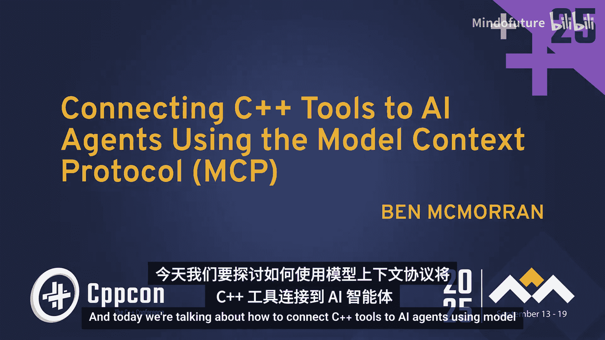
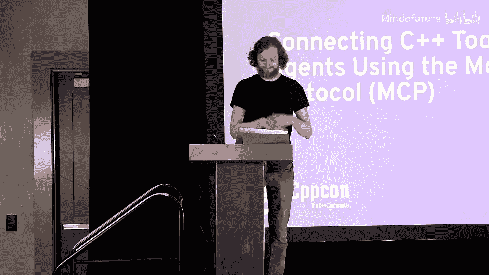
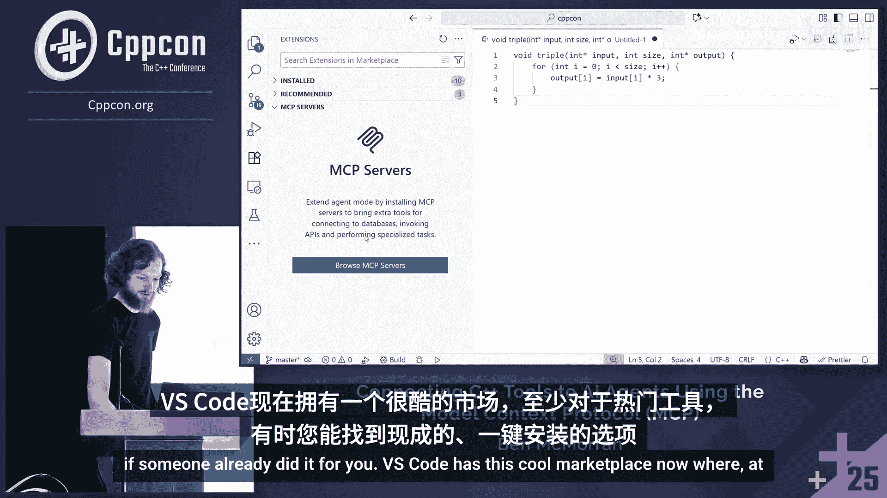
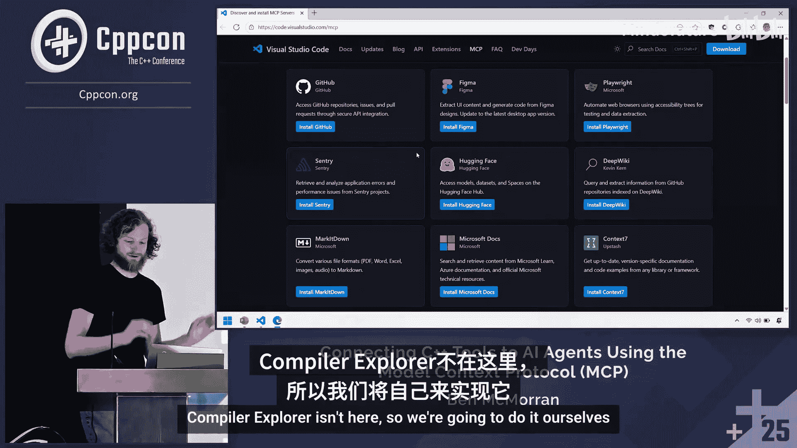
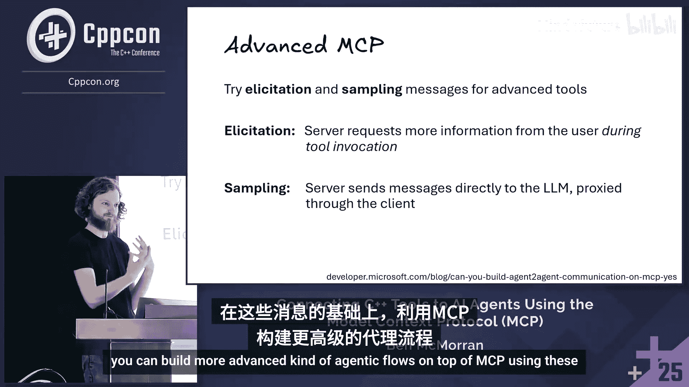

# Cppcon-2025-｜-C++-｜-C语言--｜-汇编-｜-编译器-｜-操作系统-｜-Linux-｜-Windows-p23-P23_使用模型上下文协议将C++工具连接到AI智能体-Ben_McMorran-CppCon--BV1wyPBzrEeu_p23-

Allright， thanks for coming everyone。 My name is Ben McMran。 I'm a software engineer at Microsoft。

 and today we're talking about how to connect C++ tools to AI agents using the model context protocol。

😊。

Kind of a mouthful。But to understand what MCP is and why it's useful。

 it's helpful to take a step back and see how we got to this point。

 so I'm presenting a brief incomplete history of large language models and developer tools。

And so naturally， we start with the launch of CatttPT in November 2022 and kicked off this whole era of LOMs in developer tools and broadly。

And key observers will note that this screenshot does not actually represent what chat UPD looked like in 2022。

 We have other buttons on here right like search and study。So what if you were a software developer。

 ChaGBT just launched and you want to use it？It's pretty simple right maybe you're trying to fix a unit test。

 you might type in， help me fix this test， copy paste your source code in， hit send。

 of course the request goes off to the LLM it generates a completion， it comes back。

 we display the result。Some problems here， I have to copy paste the source code that's not great。

 maybe the code I copied is not actually the right code at all。

 maybe the code with the bug is the code under test， it's not the unit test。

 so it'd be nice if we could fix all these things。And we can forward a few months now we're in early 2023。

 a lot has changed， a bunch of new AI labs are popping up with their own models。

Open AI has released API integration for their models。 And because those APIs are now available。

 you see all kinds of products that are bringing chat inside the product instead of requiring a separate web interface。

 And you see Is doing this in particular。And so now because the IEE already has all these other data sources available。

 which we call contexts for the rest of this talk， you can just directly reference it in chat I can say。

 hey， help me fix this test， I have this calculator file。

How would you implement this almost the same as before， right。

 it's just we have a little more client side preprosing this time so that we can go grab the file context ahead。

 put it into one giant string that's our final prompt text， send off the display the result。

That's cool。 be great if I didn't have to mention the file at all。 and that happens right。

 we go a few months later now we're in mid 2023， we see a lot of products that are starting to do automatic context collection now。

 you might hear this referred to as RaG stands for Retrieval augmented generation。

' really just a fancy term for automatically collect the context。😊。

And so we have this transcript now。 I wanted to help me fix the test。 somehow magically。

 it found a file on its own。 And then off it goes and answers my question。

So how would we implement this if we're writing the chat interface， There's a few options， right。

 One is we could just keep going with this strategy we had where we do more client side preprocessing。

 So it would look pretty similar。 But now we have some sort of database of relevant context。

 We're doing a keyword search or an embedding search or some other kind of document search technique。

 We get a bunch of context that are relevant， coming back。

 build it into the big prompt get the completion show to the user。This， this can work well。

 This can end up with way too much context because we have to do it all up front。

 Maybe our search algorithm isn't great。So you could flip this around and say， well。

 I already have an LOM on the other side of this transaction。

 Why don't I use it And you could make this a multistep approach where first we figure out what kind of contexts are available。

 we ask the LOM， hey， I've got these whatever 15 context that might answer the user's question。

 Could you tell me which one you think is closest to answering the question。

 And then we use the LOM's answer to build up our final prompt ship it off to the model。

 Come back and display the result。Kind of trade off between these， right。

 But with some combination of these techniques， chat's actually in a pretty good spot。

 I can ask questions。 contexttext gets pulled in automatically， such as my workspace。

 But what we've ignored so far is the entire rest of the inner loop。

 All we have is answering questions。 So far， the user still has to edit the unit test themselves。

 They have to build。 They have to verify that the fix actually works。

 And then they might have to go back because the fix didn't work， and they have more questions。😊。

So we're going to jump way ahead in the timeline now to late 2024， early 2025。

 and what's changed at this point is we're starting to see the rise of coding agents。

And these can semi autonomously handle at least simple inter loop tasks completely on their own。

And the key technology that enables this is what's called tool calling you'll also hear some vendors refer to this as function calling。

 same thing。And so on screen here， we can see later on in the same kind of transcript about fixing a unit test。

 it's trying to run a terminal command and the chat interface recognizes that this is a potentially dangerous operation and so it's asking the user like are you sure you really trust the AI that it knows what it's doing here？

But the cool thing is it was able to request a terminal command。嗯。So what， what is a tool right。

 To calling is key here。Tools fundamentally provide information or they take actions。

 or they can do both。They consist of two big parts， they consist of tool metadata。

 which we're seeing on screen right now for a simple example。

 and they consist of just a normal programming language function that implements the tool。

So in this sort of toy example， the metadata has three parts it has a name we're saying this tool is called add。

 It has a description just written in English， but this will be visible to the model。

 and that's how the model will decide if this tool is worth using。 And then in this case。

 it has a JO schema that's describing what is the shape of the input to this tool look like。

 And here we have two parameters， A and B that we're going to add together。Internally。

 what makes the tool calling work is that the LOMs have been trained to understand tool calls。

 and specifically， they're able to output special token sequences。

That indicate they would like to invoke a tool or they would like to。

 or they are receiving the result of a tool call。 And if you saw Dais's keynote earlier this week。

 this is kind of rehashing that。 So we imagine the same ad tool。

 We're passing that metadata along to the L M。 And we're sending just the text。 What is 37 plus 94。

The LLM will reply， but this is an incomplete reply， right saying 37 plus 94 is in just normal text。

 and then it's using a special token sequence to say I'd like to invoke that ad tool that you provided with these parameters。

The client then runs the normal function that backs this tool。 So it just calls the add function。

 figures out the result is 131， literally just an ad operation and C++。嗯。

And then the client actually sends the LOM's response again and tax on the tool response。

 So now when the LOM is processing at this time， it gets to see the fact that it requested a tool and it gets to see the fact that the tool responded with the answer。

 And so the LOM will reply with all that's left to answer this question。

 which in this case is just 131。 And the client can stitch this all together dropping the tool call sequences because the user doesn't need to see that。

 And so the user just sees 37 plus 94 is 130。And you could imagine kind of arbitrarily complex tools that do more than just addition。

 and they'll follow the same basic pattern。So with all this put together。

 we have the building blocks to make our own simple agent right If we have a tool that can edit files and a tool that can run terminal commands。

 that's actually pretty much enough。 The key that we're missing in this diagram is that there's a closed feedback loop right So we have this red arrow here。

 So we pumped this loop。 And now the difference from what we saw before is that the LOM is able to respond to its own mistakes and iterate So it could run a terminal command to run a build。

 see that there was an issue， editit a file， run a command again。

 And this is just so much more powerful than the simple chat interfaces that we had before。

What you might naturally ask then is this coding agent is awesome。

 but my company has special things that we need to do or I have this really niche use case。

 and it would just be so cool if the LLM could run that tool， but it can't and yes， indeed。

 IDdeE's vendors have this same thought and they started to make the tool provider interface extensible so that you could come along to visual studio or VS code and drop in your own tools。

😊，Around the same time， this is what November 2024 Anthropic recognizes there's kind of a looming problem here。

 So notably we have a whole bunch of different chat interfaces that are emerging。

 Maybe this is IDs like Vi Studio of V code， maybe this is CI interfaces。And at the same time。

 we have a whole bunch of different potential tool providers， right。

 Maybe it's where you get your work items from， maybe it's your build system wants to provide tools。

 Maybe it's even like you deploy to the cloud and there are tool providers that manage your VMs。

 right。And because these are all separate interfaces， you end up with this illustrative。

 fractured landscape of what tools work in what chat interfaces。

And so the model context protocol is designed to solve this problem。

 It's turning this kind of n times M into an n plus M。Because this is a devtool conference。

 key observers might note that this looks very similar to the problem that LSP is trying to solve。

 Just we would have editors and language servers instead of。

What we're now calling MCP clients and MCP Surers。So under the hood。

 there are more similarities to LP。 This operates as a JSON RRPC protocol over standard Io。

 JO RRPC is just a remote procedure call mechanism that uses JPC or sorry JO。

 alternatively you can use HTDP， This is especially useful if you want to host your MCP server。

 say in the cloud。嗯。Yeah， because of the Json R PCC， it means that。

Both sides of this could be written in different programming languages， right， it's interoperable。

I put a link at the bottom of the slide here to the actual spec if people want to read through the gory details of MCP。

 but this is a simplified list of all of the JSON RRPC message types that are available in the protocol。

 We're going focus on just the four at the top that are related to tool calling except for a little coverage of sampling and eation later on。

 but I encourage you to read through it， there's a lot in the protocol that's interesting。

Given just those four messages， the actual kind of handshake and then call of tools looks like first in initialized message where the client and server negotiate which of these message types are supported。

The client says， okay， I'm ready to go。 Then it asks the server， hey， what tools you have available。

 And then based on the user's actions， we'll start to call those tools and get responses。

And then later on， the server could say， hey， I have new tools available now where some of my tools got dropped and it could let the client know that it should ask again。

And with that， we're going to switch to a live demo。

 fingers crosseded with an AI live demo of writing an actual MCP server。

And so the framing for this is。my keys here， I have this simple function that's just tripling values in an array。

And， I want to know。I'm using a Copilot here， but this would apply to pretty much any vendor。

I want to know if this code gets vectorized in MSBC。And so I can go ahead and ask。

 we'll let this think for a little bit。What you would expect happens here is that it can't really answer my question because it doesn't know what the assembly is right。

 It can kind of guess that it would probably work。But then it， yeah， so we see here it's。

 it's going to write me a book。 But it says that like， I can't actually see it。

 I think it probably does Maybe it doesn't。 I'm not really sure。We could do a lot better。

And so a natural thought here would be， what if we use compiler Explorer， That'd be cool。

 I would encourage before you go write your own MCP servers， check if someone already did it for you。

 V S code has this cool marketplace now。 where at least for popular stuff。

 you can sometimes find like off the shelf， single click installs。

 So there's also a growing registry of like official MCP servers that you can install。

 So like if I want to Github or docs or hugging face， I can just get that right off the bat。

 compiler Explorer isn't here。 So we're gonna do it ourselves。😊。

I will also note that it is a charitably early days for writing MCP servers in C++。

 unfortunately there is not an official anthropic SDK for this。

 there is one for rust so I'm using this community maintain CPP MCP library here with a few tweaks。

 but the protocols not that complex you could write it yourself if you needed to。And。So。

To get started here， I'm just including the libraries that I need in order to write this server。

 and then I'll use the oh， sorry， that's not what I want to。 This is okay， though。

 So I wanted to define what is the metadata that I'm using when I invoke this tool， right。

Let me go ahead and do。Oh， sorry I had the same thing Dan， I'll get this right eventually， I promise。

Here we go。 So I'm gonna use the HtTP transport here just because that's what this library is cooperating most with。

 So we're saying I want to be on4 880。 And then this is what we talked about with the negotiation。

 We're saying the only capability that I have is tools Don't try to send any of those other message types to me Go ahead and set those capabilities。

 And then you remember that JSson metadata that we had before。 We're saying， okay。

 I'm gonna have a tool。 It's called Git assembly。 It provides the assembly that MSPC would produce。

 and it takes two parameters。 So this is the same as that Json schema stuff that we saw earlier just now Express C++。

😊，But remember there's two parts to a tool right there's the metadata and there's the actual function that backs the tool so we still need the function So this is the way you do it in this library。

 we define a function this is going be our compiler Explorr handler start off by unpacking that JSON object that we were passed and convert it to the format that the compiler Explorer API expects here we're saying user arguments maps to options if there's extra flags that somebody wanted to pass in then we can go ahead and call out and scroll that up a little call out to the actual compiler Explorer API in this case I'm hard coding to the latest version of MSBC but obviously you could extend that。

嗯。And then this is a little interesting when we go to return this。

 we're actually not it's more than you might expect notice we're saying type text。

 the MCP protocol actually is a lot more flexible than say just devtool。

 you can return like images and audio and video if your client supports it in this case we're just returning text so we just say text here。

😡，So we're close to done the last step。The last step here is that we just need to go ahead and say。

 okay， register that tool so I'm ready to go and then go ahead and start my server。And this is it。

 like， this is。A functional MCP server that will call out to the compiler API。 sorry。

 the compiler Explorer API and return results。 But how do I know。

 How do I actually verify that this thing works。I I could obviously write my own test harness。

 try it outLuckiily anthropic sort of has that for you。

 So let me just kick off so this can run briefly in the background。

 I'm going to make sure that this builds and let it start running。

I'll talk over while this is happening。 Anthropic provides what they call the MCP inspector。

 It's distributed as an NPM package， and it lets you kind of visually interact with an MCP server so that you can like tweak all the knobs and see if it's working the way that you expect。

Cool， so our MCP server just started it's listening on local hosts 8080。

 and so let's go ahead and try connecting to it with the inspector。

So you would do this NX Mo complex Procol inspector， you need node if you want to do this。

Let this go ahead and start up， and then we'll get a browser that opens that we can use to interact with this。

Yeah。In Garyary。There we go so over here on the side I'm saying I'm using the service and events。

 this is just this library tax on this slash SSC at the end， but local host 880。

 see if we can connect。And today， we're connected， good。Down here。

 we're seeing all of the actual JN RRPC messages。 So if you really wanted to go into the guts and debug it。

 you can see exactly what's happening there on the wire。 We can list the tools。

 This is the tool I expected。 pretty cool to see it in the inspector now。 I can click on this。

 And I can try actually running the tool So I could say I've write a really trivial C plus plus function here。

 So this is just a function that returns3。 It's called 3。

 And let's say let's not optimize this thing at all。😊，Run this tool， calls out to the API。

 API was Spy responded。 We see this， This looks pretty reasonable， right， We've got one instruction。

 puts three in， then we return。 Co。 Looks like our server works。😊。

Can we answer the question that we were asking at the beginning of this demo now。

So we'll switch back to VS code。And the way， so this will vary depending on what client you're in。

 I'm demoing in Vs code。 obviously， in VS code， the way you do this is a MCP do Json file in your dot VS code directory so I can go here。

 do VS code。Had a new file， MCP done Jason V S code gives me this helpful hint that like， hey。

 maybe you wanted to server。 maybe you don't want to write it yourself。 I'll do that。 I say。

 I have H T TP。 This is the same thing we saw before， right， This is H T TP。On local host。

 8080 with this SSE endpoint。Name doesn't really matter， this is just internal for VS code。

 I'll call it CPP con， MCP。And networks。 if you were actually doing this for the first time。

 you would see an approval dialogue right now as being like， do you trust this MCP server。

 I've obviously hopefully done this before during the dry run。

 And so it just connected right away from me。 And we see this annotation up here where it says it's running。

 There's some more if I wanted to see diagnostic logging in V S code that I could try out。

Because it's connected now， if I go back to chat where I was before， and let's get a new session。

I can click here on this little configured tools， scroll all the way down。 Oh， look。

 here's my MCP server。Here's the tool that I expect to see on this MCP server。

 Let's go ahead and try the same question that we had before。So， if we do。Oh， not that one。

There we go。 Oh， not that one either。 All right， swear I had these hockeys figured out at some point。

There we go。Okay， so we have the same triple function that we had before。

 and we go ahead and ask the same question。 Notice that in this big list， my tool is checked。

 which means that I。The AI can use the tool if it wants to， right？So I can go ahead and ask。

Get this out of the way。 Let us think again。 And what we really hope happens here is that the AI almost immediately recognizes like。

 oh， this tool seems like a really good fit for the problem that the user is asking about。

 I should go ahead and see if I can run it。So it says， okay。

 I would like to do that and then here we see exactly the input that G5 has decided it wants to call this tool with。

 I'm getting this approval prompt because by default VS code is thinking these tools might be dangerous like we don't want to let you just know delete your hard drive with no consent So I'll say that looks fine go ahead and do it it calls out to the compiler Explorer API endpoint and then it's going to talk a little more。

Oh interesting。 Okay， in this case， it actually wants to do even more。

 It wants to try some different code and see what happens。And then we'll let this respond here。

We can see while it's thinking about this， that the actual compiler Explorer API response here in VS code。

Maches what we expect to see。 we get a lot of stuff there。

 and then the actual reply is a whole lot better than it was before。

 It's actually calling out specific instructions that it recognizes are showing vectorization。

 cool thing about this， combining the AI with the tool right is that I don't actually have to understand how to read this assembly。

The model is doing that for me。 it understands which instructions indicate vectorization。

 but it gets to take advantage of the accuracy of this compiler Explorer API to get the real assembly for the code。

So that's the end of the demo。If you want， thank you， thank you。はい。If you wanted to do this yourself。

 what should you be watching out for， What are the best practices， right。

 This is only a half hour talk。 So we're just going to dip our toes into this。 But let's get started。

First off， I've been talking about MCP， maybe you don't want to use it。

 There's actually a lot of reasons this is kind of complex to set up。

 even though it's not that bad if you don't have to set it up。

 don't if you just want to put a small amount of information on every request。

 say it's like a style guide or build instructions or some explanation about architecture。

 just use stuff that's built into your client that could be custom instructions， rules。

 prompts files， pretty much everyone has one of these a whole lot easier than setting up your own MCP server。

Also think about if you can just leverage the tools that are already there。

 say you have some arcane build system， is it really so arcane that it needs its own server or could you just write a shell script that invokes your arcane build system and have a custom instruction that says to use the shell script that might work just as well and it'll take you minutes to write see if it works before you jump to MCD。

😡，Also， if you are only supporting one IDdeE or chat interface。

 there are almost certainly platform specific APIs available that you can use instead and they are often easier and richer to use than MCP。

 So this is just an example， I have a link down at the bottom of people are curious of what this API looks like in V code notice it has this prepare invocation callback。

 So instead of just getting run， we can control what that consent dialogue looks like before the tool runss。

 And I haven't actually checked。 I don't think that's a part of MCP right So if I want to really precise control over the experience。

 that's an nice API to have。And lastly， if you have a really highly structured workflow。

MCP is probably not the right fit for you， you don't really get to influence control flow very much in a global sense via MCP right you're just taking actions or returning information。

😡，So if you're in this case， you're almost certainly better just writing a normal program and calling an OLMN point。

As needed， an example might be you have 10000 stack traces and you're trying to classify them into different buckets using an LOM。

 just right a forward loop。 It'll be easier。All right。

 we also got to talk about security and Simon Willon went down the bottom here has a lot of blog posts about security and MCP does a lot of work with this。

 I think he's credited with this term the lethal trifecta and so there are three parts of the lethal trifecta access to private data。

Exposure to untrusted content。 This is often coming from other users and the ability to externally communicate or exfilrate right And if you have a system that has all three of these things。

 you are vulnerable to having the private data go out to bad guys。

 right And the reason why is because the untrusted content can lead to a prompt injection attack。

 The LMs fundamentally can't differentiate between data and instructions， right。

 We can't escape like we can for Hml or SQL。And so anytime untrusted content is there。

 there is a chance that it will be able to abuse the other two capabilities。😡。

In order to cause the private data to lead your system。

One other key thing to think about here is that even if your MCP server doesn't have all three of these parts of the triangle。

😡，Remember you're operating in a larger system and the chat context。

 the history is to some degree shared between everything in the system。

 so this could actually be tools available on three separate servers that combine to create an insecure system that can leak that。

And this isn't unique to MCP， right， this is any AI system that could have prompt injection attacks。

And this is not theoretical， So this is a real CVE from this summer against a major AI assistant。

 not devtool related， where the three parts of this trifecta were an email from the attacker。

 internal business documents and the fact that this agent would prefetch image links and combined this led to an attack where an attacker could send an email to the system。

 it got ingested into a rag end point and then a few minutes later。

 an attacker controlled image link would get hit with exfiltrated done So do take this seriously。

 it's a big topic， I don't have time to go into it all that fully。

 but check out the resources online if you want to look more deeply into security and MCP。Lastly。

Think about how the LOM interact with your tools and help it use your tools really well。

 Part of this is writing great tool descriptions。 Remember that the language model actually has no idea how your tool is implemented before it calls it All it sees is that metadata。

 which means the description is key So I have on the left here the actual tool description that VS code uses for its run terminal tool the extension is open source now and so you can go to this URL at the bottom if you want to check out other tools that VS code has built in and think about letting the LOM help write these descriptions。

 It can actually be surprisingly good at that。😊，Also the LLM as good as it is is not perfect。

 it will probably call your tool wrong sometimes， so you want to be good about providing really readable error messages back to the LLM that let itself correct and try to call your tool again with better input。

😡，A more advanced thing to think about here is actually changing the way your input is structured to be more LOM friendly。

 So here we have two examples of like a definition tool that would you know find definitions in source code。

 The first one is structured where the LOM has to specify a file offset。

And the second one is specified where it does some like string searching to figure out which symbol we're trying to get the definition of。

It's likely the second one will perform better， even if behind the scenes。

 it just converts to a file offset because the LOM is probably going to do a bad job of counting exactly 5。

294 characters into a file to call this tool。And while you're doing this。

 it can be really helpful to have a corpus of test cases and harness this so that you can actually see like with this tool description。

 do I get invoked 30% of the time I expected in vote 90% of the time and tune your description？

And then I promise a little bit about other messages in MCP。

 these are two cool ones to look at if you're building more advanced agents。

 elicitation lets you request more information from the user while your tool is running。

 so this could be helpful in cases where you got bad input and you want to resolve it without having to go back to the LM。

 you can just directly prompt the user。And sampling lets you kind of piggyback on the existing LLM connection that the client has to send your own request directly。

 so this could be useful if you have a tool that say gets five megabytes of data and you want to summarize it before you return it to the client。

 you could use the sampling endpoint to send your own request just to summarize some information and then send it all。

And this link at the bottom has a bunch of other examples of how you can build more advanced kind of agent flows on top of MCP using these messages。

And with that， if you want to win one of these Lego sets， we have the survey you can take。

 I met Microsoft and a bunch of my colleagues are giving talks throughout the rest of the week。

 And thank you so much for coming。 I think we are at time， but。😊。

