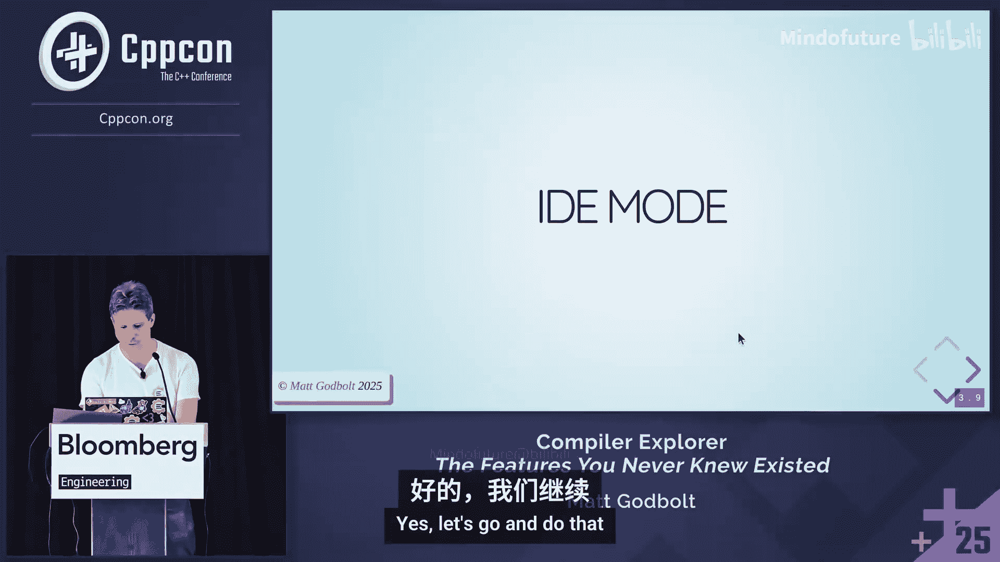
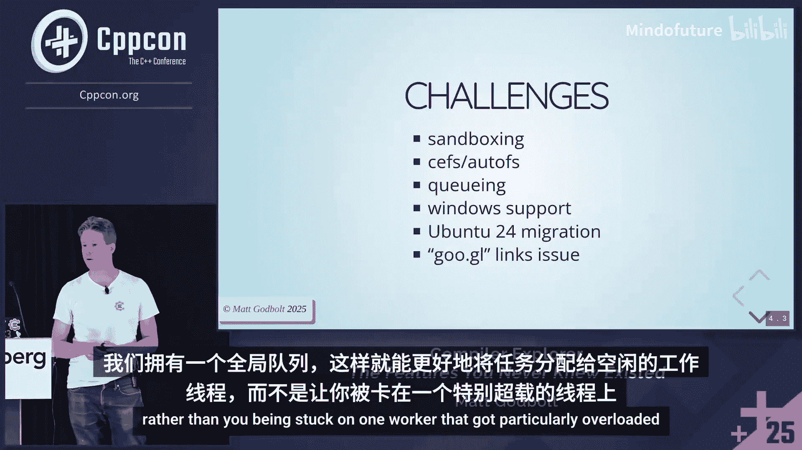
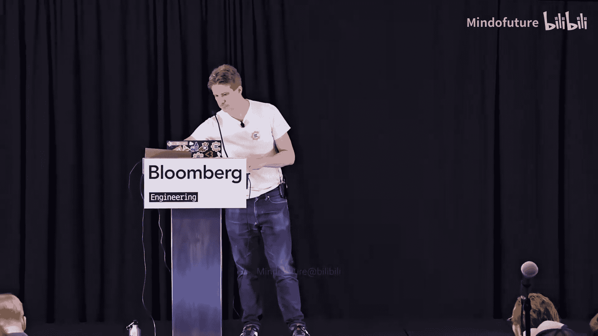

# Cppcon-2025-｜-C++-｜-C语言--｜-汇编-｜-编译器-｜-操作系统-｜-Linux-｜-Windows-p24-P24_Compiler_Explorer_你从未知晓的功能-Matt_Godbolt-CppCon_2025--BV1wyPBzrEeu_p24-

This is the Compr Exper talk。 As you probably noted。

 there are some other cool talks that unfortunately。

 I'm having to miss by being on stage here talking to you。

 So I appreciate that you're here listening to me。😊。

So obviously， we're talking about compiler Explorer here。

 I always wanted a little quick bit of history about how we got to where we are right now。

 at the end， I've got a little bit more in depth。 And depending on how much time we've got and how interested people are I can just talk forever about how this。

Complicated piece of software works。So Comp Exper started off looking like this。So this is in 2012。

 So we've been going quite a long while now。 It was an internal project that I kind of hacked together at the company I was working at。

 which is DRW， a finance trading company in Chicago。And I was having an argument with my boss。And。

 you know， so to give him his credit， we had just come out of writing some Java code where iterating over a container using the sort of range4 equivalent in Java is more expensive than doing in I equals 0 eyes less than the size of it because every time you do this。

 it creates some iterator object and that creates garbage。 And eventually it slows it down。

 So when I sort of said to him， can we use C plus plus range 4s。 He was like， no。

 it's probably slower。 And so I said to him， I'm sure it's exactly the same。Honestly。 And he said。

 well， write some benchmarks。 we looked at benchmarks that were roughly the same。 But he's like。

 I don't know about it。 It doesn't seem right to me。 There's got to be something going on。

 So I wrote a little shell script to run the compiler in a loop。

 and I split the terminal in half and I left that running on one side。 And I had V on the other。

 And we went back and forward， toggdling backwards and forwards between the two different approaches。

 And we're looking at the assembly output。 And we're like， oh。

 it's actually one instruction fewer to do it the new way。 That's cool and。😊。

We thought this is kind of handy， this kind of thing。

 and a friend of mine had just shown me little little knowledge is a dangerous thing had just shown me how to hack together a little web app and this is a result of it。

 I put it all together and we had this first version。

 which you'll notice is you know vaguely similar to what we have， but a little basic。

 So you'll notice that I'm not good at naming things。

 Look at the original name of the site at the top right top left hand corner。

 it's called interactive compiler。😊，It was I hosted it at GCC dot my personal domain because it was really。

 I thought it was more like a Gcc Expr。 And I never thought twice about that。 You know。

 I had my God bold old domain。 It's still where my email address is。

 It's still where all my other projects。 Well， until very recently where all my other projects are hosted。

 but obviously， I think most of you looked to the domain name and went， oh， that's what it's called。

But as you know， it's called compiler Explorer or GC Explorer as。 So in 2012， we had Gcc and Klang。

 which means that my even my name then Gcc Explorr was wrong。 We only C plus plus it was unfiltered。

 It was about 5000 lines of node and it was just me。 And I funded it myself。

 I had a question before we even started saying I pay for it for myself。 I did originally。

 and it wasn't very much because cloud computing is relatively commodity these days。 today now。

 we've got more than 5000 compilers，80 languages。 All sorts of filter tools and disk which we're going talk about shortly。

 which is why you're all here。 We've got 120000 lines of Typescript somehow。

 There's an amazing team that help me support it and we have patrons and sponsors that keep the site going。

 which is just as well because it's like another mortgage payment。😊。

This is what the compilations look like。 No， we haven't suddenly stopped doing lots of compilations。

 I changed the way that we record data and I didn't realize it until much later on。

 so we've lost the data from about the beginning of 2025 or it was tapering off but you can see this is the number of monthly compiles we were doing the tail off in the sort of end of 2024 where we dropped from like 18 million peak down to 12 million peak isn't just like Christmas and holiday times actually it was a one line change in our code base which changed the default time between you finishing typing and the compiler like firing up anyway we just made it three seconds I think rather than the two seconds that it was before and that was enough to bring down the type and I'll show you how to change that if you are clapping the front because you don't like it。

Nowadays our stats are more online， you can go and actually look at our live dashboard now at Statscomperexpllorer co you can see how many machines we have running the number of comps we've done this week This is a fairly typical week the screenshot I think it was two weeks ago So lots of things going on the background people ask me this it costs about three and a half grand a month now this is a little bit out of date even as because I'll tell you in a second but yeah but3 or four grand a month that works out as0。

039 cents per compilation which is a pretty good cost that's pretty good bank for buck that bill is split mostly in Aws fees and in about 500 in other bits and pieces like。

Buying licenses for software and like other external monitoring tools and stuff。

 and I've got a huge blog post that goes into all this detail at my blog atzaania。org。

Most recently we have had AWS themselves have given us a grant。

 an open source grant and have given us a decent chunk of vouchers coupon。

 whatever they' called credit， Thank you in the front credits that cover a lot of the cost of it。

 So that's a fantastic thing that means I'm just saving more money for when they inevitably don't let me renew it in a year's time So we're in a good spot though we're in a good spot。

😊，Okay， enough of the background。 Let's start by me realizingising that in this split screen display that I'm in。

 I can see my speaker notes just fine， but I can't see the screen that I'm about to try and use。

 So we're going to see how well this goes。 You move the mouseboard driver here and it may be。

 You see a little bit behind the curtain。 I， yeah， this is not going to work one second。

 Let me change this to be mirrored displays。Using the power of the function key and。没有啊。

And hoping that this doesn't upset all the recording， okay。

 and now you can see that my son has an MRI right now， that's useful for you to know。😊，Okay。

He broke his knee。Poor guy。All right。That is too big。 Stop it。 Stop it。 Okay， here we are。

 this is the U I we know and maybe love。 I don't know。

 It's kind of the U I that only a mother can love， right，'s， it's kind of grown organically。😊。

I'm no expert that this it's definitely been like people add a load of stuff onto it。

 It's a bit of the Homemo Simpson car if you think about it everyone kind of bulb boltts on the next thing that they want that we don't really think too hard about whether it's a good idea or not。

 So the things luckily I have this very lowte way of showing things that you see up here obviously is the left hand side is the code and the right hand side is the assembly I'm sure you've all worked out that the coloring matches as best we can between the left hand side and the right hand side and the mouseing over the various sections highlights the corresponding section on the other side。

 and if you don't really know an instruction is you can mouse over it and you can get more information you can also right click on it and go to more documentation that tells you more。

 We have support now for arm and I think risk 5 but it's a little bit out of date。

The other things that are worth noting on this page is the fact that there are these other buttons over here。

 which because of the zoom， unfortunately aren't showing you their names。

 this is how you'd probably normally see them with add new and add tool do do do here This is a sort of an aronistic thing。

 There is a distinction in the code base about two different ways of adding things to the results of your compilation。

 And because we're terrible programme as we expose them to you directly as Ui elements rather than just hiding and papering over the whole thing。

 So I'm sorry about that。 But you can add a new like whole pain。

 Now the sort of distinction between these two things， the add new generates a new pain。

 And that is typically something where we have to inject ourselves into the compilation itself。

 So for example， one of the things I'll show later on is stack usage。

 that means that we're gonna to be putting in a whole bunch of flags that are compiler and in parsing some auxiliary output file that it generates and then showing the view from it。

 So we kind of have to know about those ahead of time。 which is why they're in this particular。

Drop down the second dropdown over here at tool。 These are sort of post compilation tooling。

 These are things that having done the successful compile。 Now。

 we're going to run something like read Elf or P hole or some of these things that look at the binary output。

 So that's the distinction between those to。 And I'll show some of them off in a minute。

 But I just want to explain why they basically apologize why this're the way that they are。

On on yeah， if when you are generating these dropdowns。

 so like you know if I want to add a new compiler， I notice a lot of people click them because that would be like a normal newi thing to do you go for the dropdown you click the menu item and something happens So if I click a new compiler here。

 it does indeed pop up a new compiler and now I think I don't really want the compiler over there I can go and drag it now all of these things are very draggable so you can move them anywhere you like so you can put it over here or whatever you can even stack them so that they're in like a little tab mode up here because know if you don't get enough tabs in in your Chrome tabs you can have tabs inside your tabs right so that you can tab while you tab。

But what you can do， and this is I forget that other people don't know you this because it's the only way that I do it is you can actually click and just drag off of that and then you can just put it exactly where you want it。

 you don't have to kind of click and then go hunting for wherever it appeared and then land it in the right place。

😊，While we are here， you can also rename these things so if you're actually kind of opening up multiple views。

 when't we once's got optimization on one's got optimization often you can't remember which ones which you can give it a new name here you could say this one's called Bob and then if I make a new one these I can clone this compiler so this will give me exactly the same setting so that I can go into a second one and then maybe I can make this one clang X36 which I'll come back to it a second and then I can rename this one Ian because that's a sensible name for these things but now I've got useful names for these particular things you can also maximize them so if you're for example in a demonstration where you're on stage talking to a bunch of people and then you've got a tiny little window that pops up then you can actually maximize it to make you take up your limited screen real estate and then you can at least just talk about one pain and then you can confusingly this thing that looks like it's minimizing it it actually just restores it back to however it was before。

Or no。There you go。 or not。 There we are。 Thankly， it did do that。 And again。

 you can see that it's not doing very well on this smaller screen where I'm zooming it a little bit。

 I wonder if I unzoom it one more， is it still readable ish。

 And I'm really trying my best to kind of toe the line between getting stuff on the screen。 Yeah。

 I'm getting a thumbs up from some people on the bat there。 So yeah， you've got better eyes than me。

 like， I think Her and I are in the same boat when it comes to not being able to see very well。😊。

So yes， compiler selection。 This is something you do a lot。

 I imagine right you may have noticed that we have quite a few compilers and that can be sort of a blessing and a curse。

 so obviously this drop down is not necessarily the most easy thing to go hunting for your exact one but you can see you can favor them can if you find one you like can tap this little thing here and now it appears as a favorite at the top and so if you've just got cllang and Gcc trunk。

 you can mark them as both as favorites and then that you can find them a little bit easier。

 This text box I've discovered most people don't realize is kind of a really fuzzy FZf kind of type text box if you know what that is it's a fuzzy find so I will do something like just type clang X86 and now I've all the clang X86 builds and then I don't want all of those versions and I just type trunk and now I've got clang trunk and you can put them in any order as I've kind of done here and then you can select it and get it from the list like that So that's pretty cool。

 you can also just pop。Out this massive dialg box here。

 which gives you different ways of filtering by instruction set by category， by search box as well。

 and then you can sort of favorite them here and deffavite them and you can see how many stupid compilers we've got。

 it's a nightmare。😊，Yes， compiler oh， settings。 Yes， we have settings。 settings are useful。

 We store all of this in local settings， browser local settings。

 so they should persist if you come into a different compiler Explorer domain。

 you might not get the same settings。 So， for example。

 if you click a Godg link you'll get the God sort local settings。 But if you go to compiler Exper co。

 you get compile Exp do one。 And there's a natty trick for later that I'll get to at the end that you can use if you need two sets of like options。

 for example， other than just using GodBd do for one compiler Explorer for the other。

 So in the settings， there's any number of things you can change your site theme。

 I've chosen light here because it seems to be better on these projectors。

 But obviously I'm not a monster Im be in dark mode here。😊，は。

We have various different rainbow highlighting schemes that you can pick from here。

 two of which we attempt our best to be colorbld safe for those。

 you can configure the default language。 You can do all these various things here by default。

 for example， we will temporarily store your source code if there's an error on our server。

 we will delete it afterwards you can unt this and we'll never see it other than it stored briefly on the disk I spent an awful lot of time writing the privacy policy for this because I really wanted to be super super transparent about what we do with your data。

 I don't read your code I don't care about your code I never want to care about your code。

 but obviously obviously you put code into it。 you trust us with that so I just want to be clear that we do our level best to make it like not available generally other than if you choose to share it yourself I got fan mail for the privacy policy I I was pleased about that。

 someone said how great it was so anyway。Compers so， oh yeah。

 the setting I wanted to show because Laura was talking about this is if you go to compilation。😊。

The default， obviously， is the classic compiler Explorr experience of you type。

 and it points out you all the mistakes before you finish typing and you get annoyed with it。

 And you， yeah， you get annoyed with it。 but you can turn that off。 You can turn it off。

 And now it won't compile until I tell it to。😊，But you know， where's the fun in that。 If you。

 if you do want to tweak it， you can disable our automatic delay。

 and then you can fiddle around with the settings here。 if you like to be Tobo quick。

 There's some other settings that you can do here as well。 You can play around with those， obviously。

 And also on this more drop down up here is the thing that I use the most。

 which is reset code and U eye layout because when I've inevitably clins。

 clicked someone else's link。 And it's left remembering all their weird configuration。

 I just want to clean slate。 And that's what I do more often than not just to get it back into into a good state。

😊，Well what else have we got on the general page here。 Okay。

 other things you probably never knew about。 This is well。

 it just the whole talk is the little green icon here， obviously is the it compiled okay。

 And I say obviously tongue in cheek。 But if if I break the compile in some way。

 If I just put like a6 in the middle of the code there。

 that will go red and tell me that there's a problem。

 it'll also go amber if there are output from the compiler like a warning or something like that。

 it's not very clever at noticing if it's a warning or just some output thing and MSVC just loves to print the name of every file every time。

 just because it's proud that it's working on something。 I just don't tell me。

 I know I know you're compiling because I told you to compile。

 And so it tends to show that up anyway。😊，But there is a sort of hidden cheat code to it。

 If you mouse over it。 no， if you click it， it used to be mouse over。 If you click it。

 we actually show you the actual command line arguments we sent to the compiler because we do fiddle with those command line arguments if just to generate the stack traces and things that that if you've enabled in the views。

 But if you want to report a bug to Gcc or playing or whatever。

 It's useful to be able to tell them exactly what we sent to the compiler So we make them available here。

 And it's incredibly user friendly and discoverable way。😊，But big button You can。 Yes， yes。

 You can definitely select it。 Thank。 Yeah。 so you can copy paste that into your favorite place to report bugs。

😊，Let me put this back。Oh yeah， while we're here， gosh， there's so many things。

 And maybe maybe I'll be doing these out of audio。 you'll see。 but information is flowing。

 That's the main thing。 This massive list of command line options over here are the ones that I typically run with wall wextra wearer standard。

 they get unwieldy after a while， especially if you're copying them out of like your own cmate if you're trying to replicate something you're seeing in your own compiler in your own projects。

 you end up pasting 400 miles of like various randomized command line flags。

 and it's a pain in this tiny little box。 So you can in fact。

 click this little dropdown and open the detailed compiler view。

 and now you can edit it like a text document and you can add all your flags in that spot there。

 So that's somewhat useful I hope that is the right closed button。 it is。😊，Yes， okay。

 now so this is another cool trick。 I'm just going to put optimization on。 Let's do01 on that one。

 And then I'm going to。Make a new compiler down here。

 and I'm going to change this one to be Gcc trunk or toque。Live demos， everyone。 not arm。

 Arms lovely， but not now。GCC， there we are。Okay， and of course， it doesn't default。

 I forgot I have a local hack for presentations where it goes， makes it bigger font by default。

 Anyway， So， you know， we can run the same code through two different compilers。

 and sometimes it's useful to look at the difference between those。

 So one of the things you can do is add a di view here at the top。

 And put it over here and then maximize it or temp to， but I can't， because it's。There。

 You can maximize it。 And it used to be the case that it would choose two different things to differ instead of the same thing twice。

 because that's not very helpful。 But it somehow we've got a bug here。

 you've got a difference view that lets you kind of hone in and， you know， obviously。

The nature of assembly is that very often the differences once they start are massive and the whole thing looks different and this is just a wall of red and green and you don't really see it。

 But occasionally it's useful to kind of compare and contrast and so oh that's interesting。

 I wonder why Klang prefers to put the Ir after the mo and Gcc prefers to do the IMol and then move afterwards。

 Who knows But this is a way of resurfacing some of those ideas and certainly if you've got a way of like pound defining something on and off。

 you can compile the code once once with dash D my thing and and then one without dash D and then you can compare two implementations where it may show you useful differences inside of your code。

Okay， and I one other thing is that if you find yourself opening up lots of assembly views like this and you don't really care about the assembly。

 all you care about is does this compile or not， then if I got the view for you。

 we can add as wrong one off of this one here， you can see the view I's not confusing at all doesn't confuse me。

 I'm't what you're talking about。This is a conformance view and I'm actually going to close off these two things here。

 so now all we've got is the source code and an empty pane where I can add as many compilers up to。

 I think， 10。So let's just have a Gcc。 Yeah arm Gcc，32 bit。 Why not？ that  one。

 I should have really thought。 But you get the idea that I can pick a number of compilers here。

 And the green tick is telling me that it compiled without any errors at all。

 And if I pick some ancient version of clang。 Oh my God， I can't believe they all worked。

 that was not supposed to happen。 But you can now change your code。 And you know， if。

 if I include some like vector up here， I bet you one of them will now break because I bet you it doesn't have vector because it's too old。

Oh， damn you。Well， I think you understand what code that doesn't compile looks like。 And if it did。

 you'd see this would be red， and then you could actually click this little button over here and it would open up the pane again。

 and then you can go and look at the error。 you can look at the output。

 you can understand what the he's going on with it。

 But if you're sort of doing some gnarly template stuff and you're not sure what three or four compilers that you have to support。

 support it， you can use that。And then last of all， in this part。

 there's this big templates thing at the top here because I love templates as you know。

 they're a thing that I enjoy。 these are not c plus plus templates。

 These are templates for the website and we have some precanned sort of set up views because it can be awkward to set the code up and move all the windows around and all that stuff。

 So we have a difference of two sources， a difference of two compilers。

 a sort of simple c make project you saw herb demonstrating that this morning and actually I sent a screenshot of it to the compiler Explorer discord to the other people who work on the project and everyone was so impressed that he managed to get it set up that way because we had difficulty doing it。

 I'll show you how to do it in a moment。 and various other ID modes like know if you've ever wanted a Java I before in a web browser today is your lucky day。

😊，You can also save your own local ones as a state so you can say this is Java2 or whatever I don't know。

 We don't take the screenshot， we don't have that cornerness。

 but you can kind of save it locally again。 this again lives in your local browser state So it is exactly as volatile as your local browser state so don't put anything too precious in here my recommendation to you is if you've got like your one perfect setup that you love make a short link and then save that somewhere safe。

 put it in the read MD or whatever and probably the most frequently asked question I get is how long can we rely on those short links living and it is my sort of personal goal to make sure that lives forever so you should be able to keep relying on them we have a lot of them and it's not trivial to keep them all working all the time but we do try very hard。

 we consider it like a really highpri bug if you have an old link that stops working。Cool， all right。

 that is the first part， that's just the UI overview。😡，Now if I can go back。

 of course I've done 300 different moves here， let's go back to， there we are all good。

We are back and sing， next， let's look at some tools， some tools perhaps you haven't seen before。

So this， obviously， if you can read it， the green， unfortunately， the hash defined thing。

 is a bit vague to see。 But hopefully all of you are like recoiling in horror and seeing this particular piece of code。

 That's obviously on purpose。So here it is。 please don't use preprocessor。

 I don't care about this view。 You can go over there I'm you can't go over there because I need you。

 sorry I'm gonna add a tool view over here from the correct menu， which is this one。

 And I'm going add a preprocessor view。 And so this view shows me the code after the preprocesor has seen it with some clever filtering。

 And so if you have some gnarly preprocessor stuff and you shouldn't， But if you do。

 because we're all practical engineers and we all actually have to deal with real world situations right this view can help you。

 we've filtered out here all of the sort of the nonsense you can take that out and it will show you all the nonsense that that gets put in there。

 But you can see a little bit more clearly now that this is not going to work for it very well for us。

 And that's one that the views that that we have。And the next one is another page。

So another view here， and this is like my silly way， this is adding the numbers one through 82。

Or 8 there's bound to be off by one error。 And someone will no doubt put their hand up or tell me in the comments which one of it is。

 But this is a terrible way to do a sum over numbers。

 And you can see I'm making an array of that size。 I'm using St diota and I'm using stood ranges fold left first because I don't know I was just playing with things。

 And you know， the compiler has done a good job。 It has you know generated a ton of code。

 and it's not got optimization or anything like that。 But you know， it's doing what I asked it to do。

 which is， know fine。 That's okay。But， you know， the the asute among you will have noticed that this is well a terrible。

 But B， there's a ton of stack there。 You know， an unsigned value time you， it4 by times 82。

 That's not a trivial sized object。 I shouldn't really be putting things like that on the stack。

 One of our other views is to actually take a look at that。 We've got a stack usage view here and。

It's a little confusing。 Again， we're sort of at the mercy of what the compilers tell us。

 I've kind of made a small career out of showcasing other people's work and trying to pass it off as my own。

 which is what this is all about。 But somewhere buried in those yellow bars that made more sense when I did this in the dry run through。

 So I must have changed something is telling us a little bit about what kind of static allocation it's having to do on the stack。

Unfortunately it's not as clear as I thought it was going to be， so I apologize about that but。😊。

One of the interesting things here is if we do actually turn the optimizer on。

 I can't just leave it at that。GCC turns it into a loop without some stack usage。 And in fact。

 if I bring the stack usage thing back up again，'s put it down there， I think now yeah， oh。

 it is still on the stack。 Allright， let's try03。 Eventually， it's clever enough。

 I think to work out。 It doesn't even need to the stack in the first place。 Yes， okay， so by 03。

 GCC has worked out that it can， in fact， just work out the answer。Which is 3403。

 apparentlypparently。 And that's it still looks more complicated。 It's doing something else there。

 isn't it， It's clearly doing something else because it should just be able to do morev racks。

 come up whatever。Let's go to clang clang's usually smarter than this。X86， boom。Yeah。

 so there cllang goes， Yeah。 I just know the answer to this，82， whatever it goes down to 0 is that。

 But interestingly， in order to do that， cllang has obviously had to sort of single step through。

 And at some point， you know， go， all right， Oh， this does finish。

 It's not solve the halting problem here。 And we've kind of done our best to hide away what we're doing through these range things。

 And so if I put this to 83， then clang。😊，Does a great job of vectorizing the summation loop down here。

 But ultimately， it still could just give me the d answer at the end。 But， you know。

 there are limitations here。 There are limitations here。

 I know that's not really what the views all about。 But so Kang does give up。😊。

I wanted to yes that's right Okay and then we've got some other tools so these are the tools that we can run on the binary after it's been compiled so we've got a hello CPP con thing over here I can bring up for example things like NM which is you know the Unix tool oh it needs a binary object It does let's give it one。

😊，Let is compile a binary object。 And so NM tells me the symbols that the Uni system needs to or is either provided by or required by the object file that I've just built you can say T means that its expecting no it's defining main and then you is it undefined and it's expecting the outside world to provide puts to it。

 And then actually something else I didn't think to even put in my notes。

 But if you compile to assembly sorry compile to an executable like if you link to binary or if you take execute the code。

 then we actually do a full link and you get a binary like an8 or out kind of thing that we can run tools on。

 But if you just click compile a binary object then we actually leave it as a do o file and the interesting thing about o files is they're not fully linked。

 but we can still look into them。 and something we added fairly recently was pasing the relocation tables that that tell the link of what to do。

 So while you're here， you can see。It's saying the op code here says call main plus nor X E。

 which is if you look at the op codes， it's B it's very unlikely that it's calling a function a0。

 that doesn't seem right。 But this R X8664 PLt 32 puts minus0。

4 is a directive to the linker that says， hey， once you found that put symbol to link this。

 you need to take the value of whatever puts is subtract for from it and write it here。

 please address a。 So that's how the instruction code actually the machine code gets patched to do the actual linking。

 So you get to play around with that stuff too。What other tools we've got， we've got like strings。

 We've got readellf。 So know I spend my， I have spent a lot of my my career trying to work out why where things aren't working。

 usually to do with dynamic linking or whatever。 So read the D we can go and have a look at all the different others。

 no dynamic section， Of course， there isn't because can actually compile it is that there's a number of headers and things that you can go and look at here。

 And it's kind of a useful thing。 I know that certain universities use this when they want to just demonstrate quickly。

 this is what happens to you're executable without having to then tell everyone how to use the command line。

 that kind of good stuff。 Okay What else we've got overrides and flags。 Okay。

 this is my favorite little example of how clever compilers are which is just my way of sneaking it in and getting it to show to you again。

😊，So this function， which is a little bit。I didn't give you enough time to read is count how many one bits there are in the input。

 which is a surprisingly useful thing to do。And it does it by starting with0 and then saying while there are bits left。

 there is at least one， clear the bottom set bit， which is that nu and equals nu-1。

 which is one of those like leap hacker tricks that you learn。

 It's fun to sit down with a piece of paper and actually work through it。

 And I don't know if Jason's got it in his little puzzle book。 But that is a kind of like。

 why does that work is a fun little thing just to sit when you're on the plain home。

 perhaps's just doodle them in binaryry and work it out。 But anyway。

 we keep doing this in a while loop。 And Gcc over here on the other side。

 which is not running any optimization at all。 does exactly what we asked it to。

 And there's a loop and everything。 And that's fantastic。 But。😊，Most things these days。

Will generate better code， except it didn't。 So I was expecting it to generate an instruction that can do this in one go。

😊，But I haven't told it that it can because at the moment。

 it's currently targeting a processor that doesn't have that instruction。

 I know that there is an instruction that does that。

 but I can never remember what the darn flags are for all of those things。 So we have a tool for you。

 This overrides button here。 We have a limited number of things that we know are awkward and we can read out of the help or the help extra or whatever it is in the various compilers。

 and so architecture is one of those things。 So we can actually pass out all the supported architectures for the current compiler and then you can sort of scroll through like a history lesson of all the different things that Intel have put out over the years and a strange fetish with lakes and trails near around where I don't know。

Like rapillate though does sound very cool。I'm picking rapidly。

 We also allow you to pick the standard version so that this will be a list of all。

 And unfortunately， for the scaling， it's gone off the bottom of the screen here。

 And that's a bug on our side。 But you can see all the different versions of the supported standard that this compiler reported It supports。

 you can pick from there。 And then essentially we just insert that behind the scenes。

 The little overrdes thing goes on and goes orange。 gosh， green， I can do colors。

 It goes green to show that there is something set that' sort of slightly hidden from you。

 You noticed as well you can put in environment variables。

 that doesn't affect many C plus plus compilers because they're sane and rational and they're controlled by life switches。

 but things like rust and other compilers。 Sometimes you communicate through them by setting environment variables。

 So that's a way to get those injected in And now we can see that it has done the pop count。

 but very confusinglys also done all the rest of。 So I don't know what's going on here。

 This is not supposed to happen。 Let's just turn the optimizer up to 10。 There we go。

 That's what we were hoping for that very cleverly it has been able to。😊。

Determine what that this entire loop is just one instruction and in fact that's interesting so you notice it's just doing pop count racks from our RDI so it's saying count the number of setbits in RDI the first parameter and put the result in racks that's what you would expect to see that's what clang has always done but what I'm used to seeing and because I've picked Rator Lake because I like to go off script and confuse everybody or myself let's pick Sky Lake。

Okay， so this is an earlier revision of the chip。😊，Oh， look at that。

Anyone know why it's decided to do essentially E A X equals 0 and then write over it。

 And I can see Ed， is I Edward O there on my eyesight failing me。 Yes， yes。

 Could you want to shout it out。Yes， supposedly you had to make sure that E A X was not a dependency。

 So by clearing it out exactly。 So there was a bug in the chip。

 So the chip tracks dependencies between all of the various calculations that are going on and it erroneously thinks that pop count still depends on the previous value of whatever racks was。

 which meant if you just on a divide into the racks register。

 it would wait for the divide to finish before it then a pop counts are put into it， which is like。

 no， you don't need it。 just stop it and z EA X E X。

 it knows that that's like the beginning of a new lifetime of values。 So they fixed it。 apparently。

 and the compilers know which revisions affected and which ones were not。I mean， yeah， thank you。

 Eduardo。Have I done all the things I needed to do with this， let me just quickly look， oh， yes。

 opt for you。 That's an important one。 I'm going to switch to clang now。Pang X 86 trunk。

Compilation failed it's nice that's probably because it doesn't support that target architecture。

 let's pick something else。😊，Let's pick the no architecture and hope that that works or else。

Few okay， we're back all right， I'm just going to actually type in the thing because Kang actually supports more than just X86。

 so that architecture includes like everything you've ever heard of in your life。😊，Sky lake。

 sky lake。Come on。 There we go。 Alright， Okay， apparentlypparently， Kang knows it to。

 Kang used to be a bit funny about this Zi X X X thing again as well。 Anyway。

 So we've got a pop count。 Now， if like me， you're kind of like。

 how does it pull off this magic trick， I've written some just straight line code in a loop。😊。

And somehow it's gone， I know that loops of instruction。I've got a view for you。

 So one of our my favorite tools is the LLVM opt pipeline。

 so I'm going to pull this out and then maximize it and then I'm going to go and set the font size to oh。

😊，Maybe that okay， it's hopefully just about readable。 It's not ideal。

 What you're looking at here is the LLVM internal representation of the compiler as it processes your code on the left hand side。

 we've got each of the many， many， many passes that the compiler goes through to optimize the code and the key here is that every time one of these passes run。

 we look at the intermediate representation both before and after that pass。 And if they change。

 we highlighted in green， which does show up on the projector。

 So throughout our pass that's the official pronunciation。😊，Spa， know。

 a scalar replacement of aggregates， I think。That made a change and I can click on it and I can go and see this huge and complicated set of changes that happened here and if I knew more about how compilers work really。

 I might be able to explain to you， but I just happen to know because I've played around with this enough that eventually I scroll down here and we have a look at all this kind of loop idiom recognition passes induction blah。

 blah， blah， and we get to this one called loop deletion Pass。😊，And we look at the before。

 and it has all this loop nonsense and we look at the after， and there is some loop nonsense around。

 but it has， in fact， now changed all of that loop to be one call to LLVM dot CPop dot I64。

 which is its sort of internal function that represents an instruction that it knows that the architecture will have。

 So that is when this LLVMs account pop。Appears for the first time。

 and you can now just take loop deletion pass and put it into your favorite web search engine。

 and you will find the code for this。 And you'll see some of the clever little tricks they do for like discovering things that they think are loop that can be deleted and replaced with instructions or replaced with you know like rep stars B and things like that。

 So it'ss super cool。 So it's a little window in。 And I wish I knew more about compilers。

 But I do not。😊，I which everyone seems to think， you know oh you must know loads of things about products I know how to run compilers like nobody's business。

 but I have no idea what they're doing inside， there are just magical boxes。😊，Okay。

 we have execution。😊，YouWe have execution， which I'm sure most of you know about now。

 it's not the most discoverable feature there's a theme。😊，So here it is， I've got this little。😊。

Puts for every argument that you passed on the command line by using spans and clever things like that that I thought was clever at the time。

 but now doesn't feel on the slide and we've got the code on the right hand side and many of you know that you can change the mode over here and say execute the code and then now we're doing loads of resources on our side we're running your code but you're not even looking at the output for it because you have to now open the output window So this is just an absolutely terrible design but nevertheless。

Our program returned and it said greetreings to output doS because of course Og V0 is the name of the program So yeah we output dot S you can see how bad this is right So when we originally started this obviously the whole thing was just about the dos file and then as things have ticked on we've never bothered to rename it so it's still called output dotS even though it's a binary and we're running it。

😊，So it's there， but I'd like to be able actually put in some command line arguments。

 and at this point it was starting to get even for my taste too complicated in this view。

 and so we actually have a completely different view that you can do much more fine grainin execution work with So one of the things you can do is you can add an execution only view down here and I could drag that often then I could set it up much in the same way as the compiler or if you already have a compiler and you're like well I just want this。

 but I want it to be the execute view you can use this add new and do executeecutor from this and then you can drag it and put it wherever you like and I' might actually get to drag it and sort stack it up here so we only see one of them at a time。

 It's still doing both of them but actually I can just close we're not gonna look at it again so now we've got the same compiler the same arguments the same everything that we have before except that all we're really caring about now as the program and it execution and we've got more options we can still add libraries we can still run some overrides I can actually tick this down and I can put in arguments here so like CPP。

So now itll be greetings to CPP Carhan and， you know。

 monkeys in wife have I put quotes because I know it's not going to work in a cage。

 Sos it going work。 Oh， it did。 Who knew？ I didn't know that I didn't problem with the this properly。

Sometimes I surprise myself， okay， so you can add your command line flags here。

 which is oh sorry command line arguments here， you can also include standard in。😊。

So I can open this up and I can paste a document and so if you want to actually run the input into the compiler and you stood C and other horrible things and you're welcome to Another cool thing though is that we can actually we've got some things over here we can enable Heap track so we can link dynamically against Heap track which check the many allocations you're making and when they were made and we pass the outlet of that and we can present it to you and this is probably the most useful one if you're like trying to teach people how C++ works and if my mouse would work there we are we can enable Lib Seg fault and so catches Seg V and print a stack race so if I do everyone's favorite little bit of。

Gymnastics over here， I do I have to put volatile these days， I mean， it's more correct， right？😀Yeah。

😊，Please work and crash。 There we go。 So we've now got an almost unreadable because of the colors stacked trace。

 And then you've got at least some hope of working out what happens there。Checks notes， lips Sful。

 Oh yeah。 We don't have to just do X 86。 Nowadays， we can also do this on arm。

Let me get rid of this and then get rid of that。 Oops， if I can actually now， normally。

 I don't do this in this mode。 So I'm going to turn off the lips so full because otherwise I will expose the fact that it probably doesn't work arm 64。

Jesus he trunk。Unknown sky Lake， yes， yes， that is not a valid architecture for arm。😊。

This is where we have to wait a little bit longer。 Sig bus。 Well。

 that's exactly what I think actually， that's a known bug。

 I think someone in the front row is probably going。 don't do that。 Let me just try Gcc 15。2。

 we're in the middle of the ths， which operating system changing。 There we go few， something was。

 So arm 64 trunk doesn't work。 But arm 6415。2 Gcc does。 So we're good on that front。 And you know。

 if I could think of something that could show you proved to you that it is actually riding on an arm based computer in like a short amount of time I would。

 But know this is。Kind of a heavy lift on our side。 our infrastructure is all X 86 nodes。

 And then suddenly we're like， well， it would be really cool。

 And we've tried emulation and things like that。 But the thing about emulators is that they tend to want to do cool and interesting things like hook into the operating system and do stuff to make themselves run faster。

 But we're already in a sandbox in a VM。 And like there's only so many layers of turtles you can have before the whole thing starts falling apart。

 I mean， I think QM U in the right mode might work for us。 We could emulate it。

 But we're actually just running on the natural arm machine。😊。

So you have access to our machines and we're in the process of making it even better to add more things。

 which reminds me we can run on a GPU。The single most expensive thing that compiler Explorer does is have two GP nodes up all of the time。

Um I don't know very much about GPUs other than with enough copy pasting。

 I was able to get this to work and by work I mean compile and then print out a number。

So this is actually currently this is building on a GPU instance and the interesting thing when you start building GPU based stuff is that you get two parts of the output code。

 so this second window on the far right with the tiny writing is automatically popped up when it detected that we built an image that contained more than one ISA。

 so the second ISA here means that this is the code that would run on the X86 host。

This is the code that runs on the GPU。 That's kind of how this stuff works。

 And there are two this is more。 I'm way above my pay grade here in terms of talking about what as this is all about。

 But the way that I understand it is that is PT X is sort of the intermediate representation that the Nvidia GPUs use。

 And maybe this may only be ended here。 And then it gets optimized down to a particular specific architecture so that you can kind of ship it across heterogeneous different types of GPs and have it still mostly work without having to rebuild for every single GPU。

 So you can look at both of them here。 But you can also run it， he says。Please run， execute the code。

And get the upper window up。And wait in a queue， your compilation is important to us。There we are。

 maximumimum error is apparent。 Whatever example I picked up has a maximum error of a 0。000。

 Very exciting and interesting。 And I'm glad you all waited with me for that。

 it's possibly the most expensive compilation we've done yet， but。😊，There it is， so we've got GPUs。

 that was another big lift to get another sort of cluster of machines that run GPU full code。Yeah。

 so analysiss are now we to the meat of this stuff， this is good stuff。

 and I've already got 16 minutes left last。Okay， this is a little bit of code that just sums the squares of numbers and of course there are much。

 much better ways of doing this for all the reasons but I've decided to write it that way。😊。

So it sums up the squares and returns them as a float。 And on the right hand side。

 if you know a thing or two about parallelization。 So we're using Gcc 152 we're on03。

 So it's like say like do your best go go go go and Gcc is doing is doing something。 I mean。

 the way that I typically when I teach these kinds of things is I say I look for the loop So L2 is the loop here。

 It's annoyingly just bigger than the fits on the slide here。

 So I can see that G and E L2 and L2 at the top here。 that's the loop。

 So that's my thing that's gonna repeat over and over again。

 And then I look at how far it's moving the pointer each time around the loop。

 And I can see it's doing an add Rdi I comm 16。 I'm like oh floating point value is four bys and it's moving 16。

 And there are all these complicated looking instructions that have mu and they're using the XmM registers and things like So therefore it paralyzed it and used Cdy instructions。

 Hoay， it's fast。😊，Except if you look and so that works with a lot of these kind of things ass a rule of thumb。

 it's like has it paralyzed it， Yes， it has， but we've hampered it and we've hampered it because the rules of floating points。

 So what it's really doing is it's picking up four numbers。

 It's squaring those four numbers and then it's serially adding them all together in the order that I've asked it to do because floating point works that way。

 And so in order to keep the IE happy and have them arrive at your doorstep and knocking saying where are our bits of precision gone。

 you have to do it in the order that you said in the program。Okay。But I mean。

 many of you now the go to is to use my favorite and scariest flag in the compiler world。

 Does anyone know where I'm alluding to Well on， shout out。Fast math。 Oh， but that's true。 It's cool。

 but it's not fun's。Unafe math you've pronounced it wrong， but you're correct。 Yes， it's fun。

 safe math optimization because they are both fun and safe。 No。

 the command line is F unsafe math optimization。 enables a whole bunch of optimizations that are essentially。

 I think Cha La Cruth is quoted as saying it's like unbounded precision loss basically letting yourself go into。

 So don't do that generally an F fast math and O fast and all these things do this。

 They enable it globally and it's frankly terrifying that you are allowing this on your code。

 So my instinct is to always use a little magical thing。 is a canoe extension。

 but accepts it as well。 And so I'm just gonna tell here what it is hang on。😊，This is where my notes。

 I really have should have remembered this wrong how you get to see how the sausage is made here。

 My favourite， No got no， I didn't write down the stupid thing in here。

 Can anyone remember what the flag is， It's associate Associative math。 ha ha， there we go。

Associative math。 And this is like putting dash F associative math， but only for this function。

And that's super useful because， you know， now I get the loop I was expecting where it's doing a smaller loop where it's summing the squares。

 And so we've got we'll end up with four subtoals of squares。 And then at the end。

 we just do the one sum of all the squares to get the subtotals together into one total。

 and I've kind of minimized the blast radius of that change， which is a nice thing to do。😊。

I'm sure someone can say， yeah， something， something， O DR violation， something something else。

 So you know， you have to be very careful with these kinds of things。

 But you kind of are in that world anyway， especially if you're toggling F fast math on and off and using things that are defining headers。

 who knows what you're gonna get。 So just be careful。 But yeah， only this is all a big setup。

 because now I want to show you how cool the tooling is now。😊。

I can add this as a tool to compiler Explorer， as in I can drop it down and add a tool for the thing I'm about to add。

 I'm not going to do that because I want to show you a subsection of it。

 And at the moment we don't have a good little way for me to wrap a part of the source code and say I'd like you to analyze this bit。

 but what we're going to is we're gonna analyze the code。 I'm going pick out the loop。

 which I've already said it a bit I care about because I executes once for every four floats That's what they call and now I'm going to change language over here to analysis。

 We've got lots of languages。 you've probably noticed that。 This is the OSac。

 the open source architecture analyzer， but I'm going not use that I'm going to use LLVMMC。

 which is my wrappper name。啊。No， sorry。And this is this is the lowlevel virtual machine machine code analyzer。

 And what this does is it uses all of the tables and knowledge inside of clang about how all the various parts of the CPU interact。

 And it kind of turns it into a simulator rather than a predictor。 So when it's optimizing。

 it's trying to predict and say if if I schedule this instruction here。

 then it'll have to wait I put an it doesn't have to wait。 And that's why it's generating the code。

 But in this instance what we're doing is we're asking it to say well I have the code just assume that this is the inner body of a loop concate end to end 10 times。

 and then tell me what would happen。 And so it's telling us that for 100 iteration a loop。

 that would be 600 instructions， that's fairly basic maths。

 it would be 413 cycles which is a very unusual number of cycles。

 I agree because of all the clever things that are going on inside the CPU。

 And it gives us a breakdown of all the things that are going on。

 But my favorite thing to do is to put dash timeline up here and then maximize it and then hope that we can get some kind of view here。

 Yes， somewhere down here。 we get this beautiful ASciI art。😊，One day， I will make a view for this。

 This is one sweet day。 I will do a view for this。 But what we're seeing here is time going left to right。

 and the D means it's decoding instruction。 So what we can see is in the first clock cycle based on the current model that it's inferred from my command line flags。

 It thinks the first six instructions will have been decoded in one cycle。 And then the second cycle。

 two of them are executing。 And then down here， this one this is the second iteration of the loop on the second cycle。

 It's already started on the second iteration of the loop because of all the clever branch prediction。

😊，Register renaming and all the things I love to talk about。

 but don't have the time about to talk about now。 But you can look through this。

 and you can sort of marvel it like this feat of engineering。

 and you can kind of see this R is when it's retiring the instructions。

 That kind of pattern on the end there is effectively the throughput of the system。

 All those other instructions don't really count anymore because they're being executed while everything's waiting for the other instructions to finish。

 So it's super cool。 It's super fun。 It is not necessarily 100% accurate。 There are better things。

 And I want to investigate those。 I should should do because I have some free time at the moment。😊。

Yes， oh that was loud， sorry sorry everybody。IdeE mode yes， let's go and do that。

 This is the one slide where I hadn't actually prepared because I thought I know I'll just do it how hard can it be Ha ha ha。

😊。

Well you're about to see me be hoist by my own patar or whatever， look at this。

 what on earth is going， you see this is what happened。😊。

Ive got to godbot do org here as opposed to slide do compilerexer dot com。

 So I'm letting you know the secret I was going to tell you the end is like almost everything dot godbot do org or dot compilerexlorer dot com or actually do godbo dot LT。

 which in a sort of。😊，Fun thing I registered。 Anything dot that will go to compiler Explorer with some very weird exceptions。

 which is a fun thing for you to find out， which means that effectively。

 if you want a different set of flags。 like， for example， all the things we've been looking at。

 I've been at slide compiler Explorer Com because then I could set the zoom in Chrome and I had all my settings。

 But I've just type gobbleorg， you can see that normally I live in pink because it's a better color。

😊，Or dark mode honestly， all right， but I'm going do my whoops wrong button I reset code and Ui layout。

 We're gonna try and off the cuff turbo this where I'm going to show you how to get it into IDE mode。

 So we've got we start out with just the usual view。

 I'm going add an IDE mode thing here which is a tree and this is effectively like the little pan on the left hand side of visual Studio code that says these are the files in my project by default nothing is in the project you'll see on the left hand side at the moment included files is empty excluded files have C plus plus source number one。

😊，So the first thing I want to do is add this to the project and call this example。cppP why not？Okay。

 so now it's in the kind of build tree， any build that's triggered from that IDE mode will get all of the files there uploaded into one directory before it's run。

 which means that you can compile multiple files， you can include header files you can even put test data up there and then you can even read it when your code is executing because you've got your own little jail with your files in it。

😡，U。A caveat here， I mean， it's unlike C+ plus developers to expect a sharp edge somewhere in the process。

 but a sharp edge here is that this compiler that we've got over here was generated from that one editor。

 it's got nothing to do with that project and so it's actually unhelpful to me if I included something up here。

 this compile would fail because this is like me just running that on its own that one file on its own So I'm going to close it because it's confusing And instead I'm going to add a compiler that's a child of the IDE tree mode over here。

 And now this compiler is seeing all of those files。I can add another file。

 let me just add a new source editor and I'm going to drag it immediately up to next C+ for source there again we just get the default if I got the right one hit yes and I'm going to say project。

😊，Test， add。Executable， was it example do example， Yes， example dot CPP。

And then I'm going to save this over here。 and then I'm going to do that thing that we all hate。

 which is I'm going to rename it to be a different type of file。 See you make lists， do T XT。

What could go wrong because he now it knows it's a CMake file， that's great。

 everythings wonderful there。😊，I'm going to tick the box over here and tell it that the output is going to be example。

 obviously we can't tell what the name of the thing is that you're about to build us because you can type anything in CMake so we don't know which file to open up at the end。

And if we're really lucky。😊，There's a green dot there。Sees highly unlikely that it's worked。😊，Yeah。

 it doesn't look like it did work actually， so what have we done wrong here？😊。

I don't know what I've done， oh no dare okay， it's actually triggered now it was just taking its own sweet。

 mystical time。😊，What is our output， Where， what have I misspet here， Okay。

 so Cmate ran And because there's no reference to main。 that's an easy thing to fix。 halllujah。

 All right， So we've got our example up here。 if I had more time。

 what I would do is I would make another function， another file。 And I would put the main in that。

 And then I would extend the square in the other function。

 And then I would show that they were linking the two of them together。

 And then my usual party trick after that is to go up to the flag box internal link time optimization and show that it can inline the square。

 even though it was defined in a different translation unit unit unit。 But you know。

 so this is complicated， it's awkward with software engineers were not UX people， but。😊。

You can go over to here and click C++ CMake and you get like a starting point that is with a bigger screen is a a bit better。

 a bit more understandable this for example has a hello doTXT file that it opens and streams through and reads and has some IO and so it's a decent way to at least dip your toe in and see what kind of complex mask we've made for you。

😊，Yes。Question， can you do modules with that。 Can you do modules with that was the question。 Yes。

 you can do modules with this。 There are some links somewhere that are on the Internet。

 I don't know actually where there are now。 I know I've seen them。

 but people have used it to make modules。But it's not brilliant because we don't have anything to persist them。

 And so they are just slightly slower than doing it normally。

 But you can at least do them through the mechanisms that Cmate gives you。 Yeah。

 we have new enough version of Cmate that lets you do that。Okay。So yes， we talked about this。

 Mi trivia， anything。godbal。org， nearly everything that DoggBderorg goes to compiler Explorer and you can use it as your own personal subdomain。

 for example I use slides。compilerexplorer。com for my slides so they keep everything separate from that。

😊，If you go to a subdomain of compiler Explorer that happens to be a language name。

 it will start out by default in that language。 So if you go to rust dogo dot org or rustt compiler Exper dot com。

 you get rust up by default。 So that's another way for partitioning things and sort of getting there quickly。

 If you so desire。 Why would anyone at does C plus conference want to do that。 I know。

 Sorry about that。And yeah， we have two other domains as well。 God Bo dot L。 I was。

 I was so pleased with myself。 And I thought， I wonder if I get G do L T。 You know。

 it's Lithuania and GD dot L T is kind of small。 That could be my short URL kind of version。

 But unfortunately， it's a church in Lithuania。 and they didn't want to sell their domain。

 It seem rude。 So we've got these。 We' start with these。

 I think we've got compile somebody has got compiler Exper dot org and redirects to us。

 That's not quite the same because the redirect means that if you go to the dot org。😊。

By the time you get to us， it is the dotcomm again， so you get those local settings for that。

I did go through a period of time when I was more。Sensitive to everyone calling it what they call it。

 And so I was thinking of phasing out the first domain name up there。 But I have been， you know。

 roundly talked off of that now because everyone likes it and it's short and knows what it is。

 And it's a kind of cool word。 So I've accepted the mantle of that。 Now。

 even if I don't use it myself。 So hopefully， you'll forgive me。😊，Oh gosh，2 minutes，41。

 This is always time goes of us。 So behind the scenes， it's a mess of so many services。

 and it's about to change again。 Actually， we've got a big， big refactoring coming。

 We've just finished one massive refactoring about how we store all of our compilers。

 which I'll talk to forever afterwards。 But I've got a blog post about。😊。

There are lots and lots of moving parts here。 It has grown a ton in 13 years。 It really has。

 and the level of sophistication is getting quite up there for a jumped up Devopps C plus plus program and trying to write JavaScript。

 right you know。I've got two minutes to talk about any of these things here。

 So sandboxing turns out a even before we had， you know run your own code on compiler Explorr。

 a compiler is a massive attack vector for somebody。

 there are so many commandized switches that do naughty things that you might not think about it。

 So the best example I've got is somebody found a way to crash clang in a way that revealed the temporary file that it had written to before we had sandboxing。

 right。😊，And our usual scrubbing didn't match it。 And so they would crash clang。

 It had written out a dot O file somewhere。 And then it had given out the actual real path of it。

 So slash temp s some giant number， slash b dot O。 And then in the second incarnation。

 a second request， They would load that path in as a plug into Gcc。

 And then they could run arbitrary code inside Gcc。 And we'll see。

 they had to get scheduled on the same machine and had to hope that we hadn our directory， know。

 s temp clean I hadn't run。 But that was the kind of thing we're up again， so。

We had to sandbox our compilers。 And then by that point。

 we realized that we could we were confident enough that our sandbox would keep us safe。

 So we started letting you run your own code。 I've talked about the Cf that's like managing four terytes of compilers is not trivial。

 I'll talk to you forever。 The big change that's coming in the next few weeks isqueuing。

 So at the moment， if you submit request a compiler Exper。

 hits our load balancer and our load balancer does its best job of trying to spread the work across our machines。

 the machines then queue up the work on them。 And if you unfortunately get your tiny little hello world program behind some joker that's just put three massive template meta programming tasks in front of you。

 then you're gonna be waiting 60 seconds before those complete and then your thing even starts。

 I didn't show you But one of the buttons on the bottom is a little button you compress。

 and it shows you where the time was spent how long it was in a queue how long it was compiling how long it was in jascript code。

 So thatqueuing change will mean that we have a global queue and will be able to better give work。😊。

To idle workers rather than you being stuck on one worker that got particularly overloaded。

 And so there's ton more to talk about， but I have run out of time。 Thank you all for listening。

 and I will stay at the here and you can come and chat to me afterwards。

