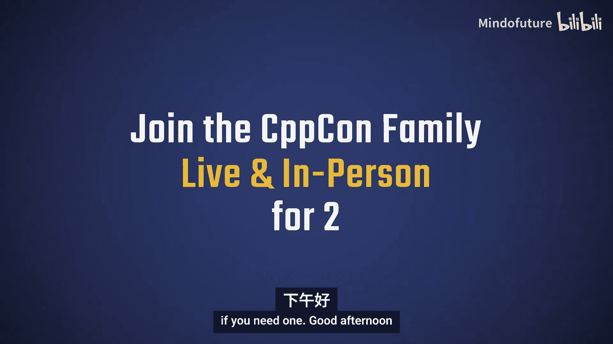
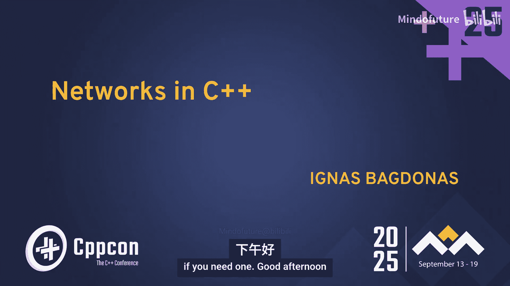
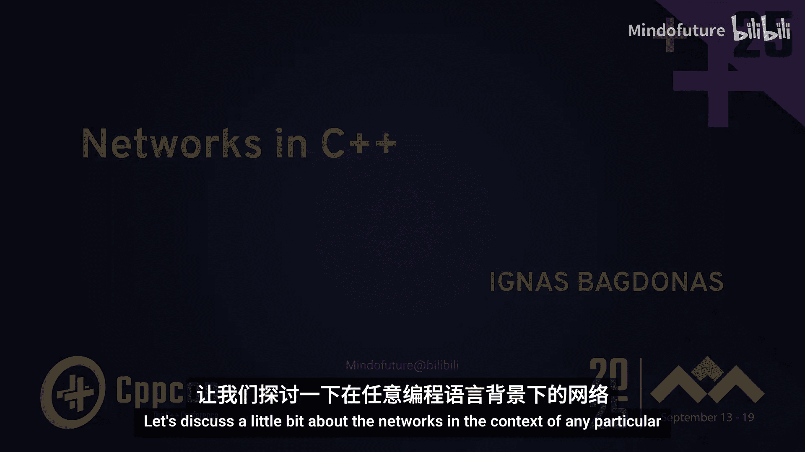
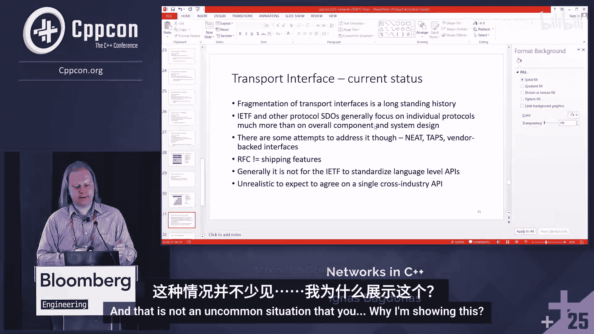
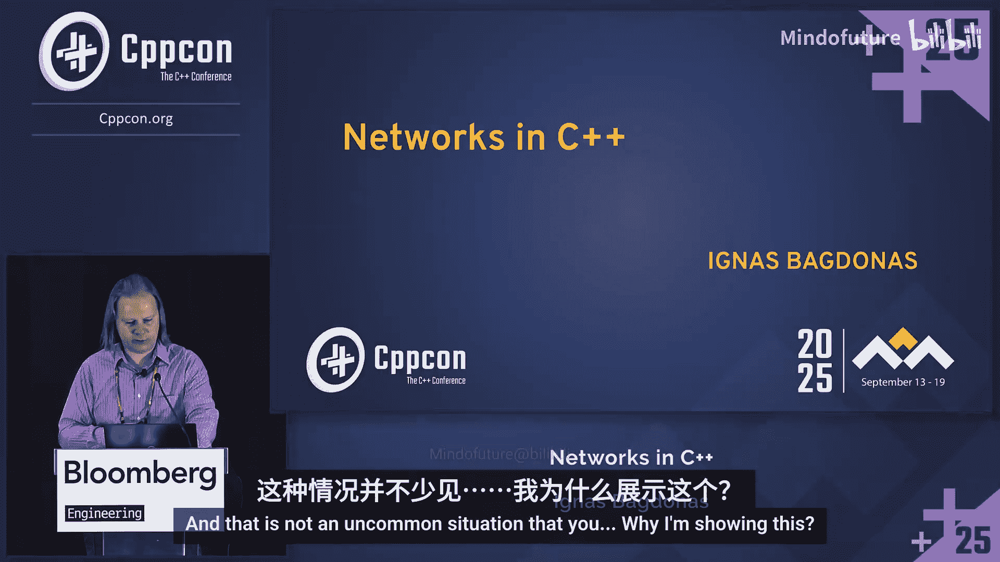
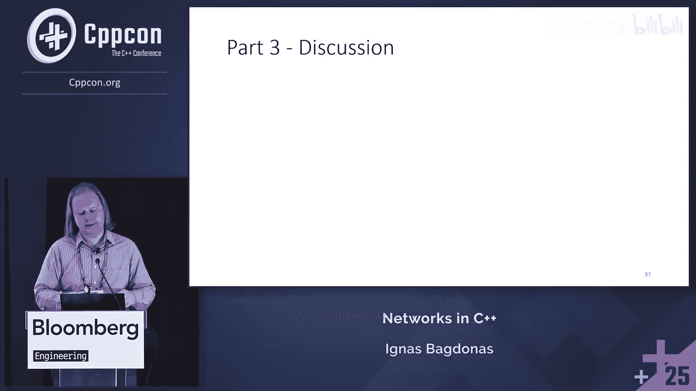
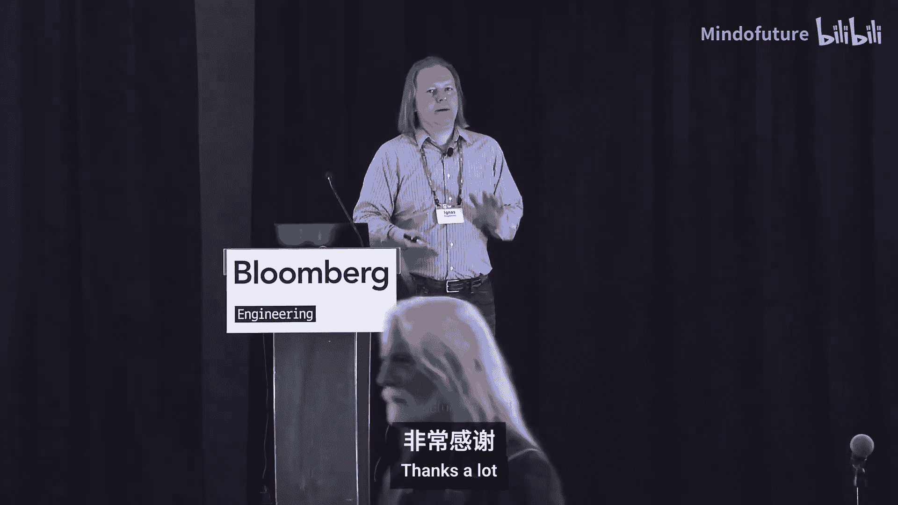

# Cppcon-2025-｜-C++-｜-C语言--｜-汇编-｜-编译器-｜-操作系统-｜-Linux-｜-Windows-p25-P25_C++中的网络——实际正在改变什么-Ignas_Bagdonas-CppCon_2025--BV1wyPBzrEeu_p25-

Something really valuable about actually attending and being here in person is having the opportunity to。

🎼Actually， we ask the speakers while they're there， go up to the microphone。

 ask a question that you have or meet them after the talk。

 chat them out in the hall There's just a lot of。

Opportunities if， you know， something isn't really clear to you to kind of just get in there and get a much clearer answer if you want。

Good afternoon。Let's discuss a little bit about the networks in the context of any particular programming language and in this case of C++ so what it is all about first talking about the networks quite often I do get such a fine request can I please have something that decreases my latency immediately to zero increases my bandwidth reliability and everything just works and gets out of the way Well sorry that thing doesn't exist and that basically concludes the session that's it it's against the laws of physics。

Right， the jokes aside。 this is an introductory attempt to explain。

About what is happening in a contemporary network transfer protocols， how is that evolving。

 how that is starting to cause all sorts of performance complexity and general application and awareness of the network type of problems and what can be done from the perspective of the language。

 so to set the context of the discussion。The main assumption is that the topic of networks is generally seen as a second class citizen and well and there's just a pipe。

 you know it sends packets from left to right， and what happens there。

 operating system or some underlying platform provides you some interface。

 you use that and you don't basically look into any more of the details。嗯。

What if we thought about revising the 40 years old BSD Sockets API or Windows 32 API which mostly clones it。

 for the reason that over the last decades， we have seen quite a lot of development in new transport protocols and while they bring in the new functionality in order to use that and basically to try to model it on top of the existing network interfaces。

There are two sorts of limitations， one is it becomes inherently difficult to break in the new functionality。

 second thing it puts in the complexity into your application because the interface that has been standardized 40 years ago does not necessarily fulfill the possibilities that could be achievable with the new transports。

If anything to define this is the work for a library part of the C++。

 there's no attempt to define any new language constructs is no attempt to define yet another concurrency framework。

And what would be important is in defining this library interface to basically have that you're able to use already existing concurrency frameworks that are already present in the language in a way that doesn't obstruct the new functionality available in new transports。

One comment about inventing Vietnam Pro certainly that's huge fun。 well。

 I myself have done that quite a few times and I really enjoyed it。

The only aspect is that if we are talking about a global end and connectivity。

 that's one scope it has to interpreterate global if we are talking about a limited domains basically your own infrastructure。

 your three there to do whatever you want and including defining the interface to your new transport protocol。

 therefore for that environment this talk probably won't be of much interest and value。

whyhy would you want to define a new specialty transport？哎。Generally。

 if you are large enough and relying on the network infrastructure substantially。

 a network is not just a dump pipe for you， you might see a lot of benefits in trying to cut out one message or if you opt or reassigning if you bits in the header for achieving the functionality that might be critical for your use cases。

 however that is definitely not for everyone that's not for the commodity and to end communication case。

So there are a few parts in the talk， first one is the interface into the transport。

 it's about communicating between the two applications， running when two hosts。

 generalizing whatever a host means。Again， network is a dump pipe。

 you put something on one side and you hope that it will show up on the other side， it may show up。

 it may not， it may require additional effort to try to control what shows up and at what instant and time。

Let's look at existing protocols from a perspective of the requirements。

 what they would bring to a common transport interface， so TCP。

 absolute commodity models the logical session， internal state TCP control block which has the basically internal representation of what is needed at that point that might be visible for your application depending on your operating system depending on your interface。

The problems that start to be evident with the BSD sockets interface into the TCP starts from a no operation type of thing suppose I want to do keep a light type of transport connection though basically that the middle boxes don't time out don't time it out for keeping it visible in some same monitoring system or something like that I actually cannot easily do that on a data plane because there is no the concept of sending zero byte message with TCP Yes there are options that are available wire basically get soop to indicate that I want on this session to have a certain keep alive which sends out a specific internally internal TCP message which is not externally visible and that will keep the state but if I want to have that from my application saying I don't have anything to send but I want to send an indication that I。

Still alive and I'm still there， there's no such easy possibility。

 you need to do that as an exception to your normal data processing。

If you start to look into the MTU PaM toU and basically what you can send out about requesting additional fragmentation that also is not necessarily visible。

 yes， you can query what is the current pathM to you on this connection。

If your underlying network for example triggers rerute or some other form of protection and adds an NPLs label onto the stack your MTU decreases by4oc1s this might come as a surprise if you assume that your current NTU is still the same there's no easy way to get a notification of the path level parameters again as a common interface。

 it's possible to query that but again that is seen as an exception。Authentation options。

 quite a few， they address real world problems， basically preventing the replay type of attacks on the session and middle boxes。

But in order to enable those， once again， you need to use specific socket option。

 this is per socket option。TCPMD5 allows you to set the key only at the session setup up and while technically you can change it by doing some fragile coordination between the both end points that is something that is not necessary to reliable option allows you to change the key but again doesn't specify the interoperable interface。

 how that could be done and if you happen to support multiple operating systems they do that in a very different way how the keys and algorithms forward intake I used again。

 the protocol says that you can define the values， how you do that it's up to you so it's an open question for what the interface。

 what a common interface could be for that fast open。

 if you care about the lates you actually can send payload with the initial scene packet of TCP session establishment again。

That is not your regular data interface， you need to do that as an exception。

AndTCP has a really versatile and flexible congestion control mechanism。

 the problem with that is that again the internals。

 both the internal state and the parameters that can be used to control that and not directly accessible to you yes you can get that again platform specific or via certain socket options and an extensions but that again is an exception path so where I'm coming to it would be probably really nice if we had something like a common interface which can be used both for the data operation sending feeding basically the data that needs to be transmitted and getting notifications that are received and at the same time getting the information about the dynamic properties of the TCP session。

In one more or less uniform interface。Let's add some complexity， multi TCP。

 well basically the idea is very simple， you have multiple connections in parallel。

 they still provide you the sequenced and reliable guarantee of transporting between endpoints but there are multiple sessions and this helps both with capacity which helps both with resilience。

😊，You can do well such things as use IPV4 and IPV6 at the same time and still treat that as one single logical session if you would have a use case for that again congestion control is different here because you also need to look into the interpo between those two subsessions from a logical point of view for what application sees that's one logical transport connection but its operation properties are different and its tuning might be different again。

 we need specifics how to export and be able to adjust that information。

UDP another absolutely universally deployed transport simple just send out something and hopefully it shows up if it doesn't show up you actually have no simple means to know that it didn't show up and some form of。

Indiication about that would be beneficial。Congestion control is left for the application。

 however it might be of value to have some indication into the lower properties of the path because you know that and point where you are connected to and you can query for example what is the path and available there again such the current interface does not allow that to do in a simple way UDP light that's actually quite a niche transport in a sense UDP which has a shorter checksum and part of the payload is not covered by the checksum that works perfectly fine for loss data think audio channel or some other media over the radio link radio link might have its own error for whatever error correction or you simply don't care too much about errors in the payload because your code that will compensate for that the headers are still protected。

And we need DPI defines a slightly usable error interface saying that I have received the packet with a broken checksum。

 therefore it's up to you to decide what you want to do， that's good。Dealless。

Likely the dominant part of the global traffic today。

 however that's not a standalone protocol that's basically a stack you have TTP below and you have a couple of layers of specific subprocols for exchanging the security related parameters and actually transforming the data that is being sent between and points。

 the implementations of TLS A plentyee。They do that in different ways and they tend to use open SSL defined interface。

 some have their own proprietary ones， but the most common one is open SSL based。

And this gives a large set of problems in event handling the TLS Library implementers have their own view about event handling and how to export that to your application and sometimes those views might be radically against what you think about the event handling so while it does provide。

A definitely required interface into simplifying all of the security credentials handling。

 while you basically feed in a certificate in one form or the other and eventually the session shows up。

But actually handling the data both sending and receiving from that。

 you are very much kind of controlled and restricted by what that particular librarys author thought about what is a good event handling。

You cannot just pull on that socket anymore， because there are transit layers that need to be peeled off before that data gets sent to your application。

DTLS exactly same idea implemented on top of datagrams in UDP in this case。

 with one addition that it implements its own kind of pseudo reliable pseudoTCP in a sense of adding a sequence numbers but from the interface perspective it has the same problems。

 basically event handling is complicated and depends on particular library。

Stream control that is specialty niche protocol typically used in mobile wireless control planes。

 it was specified status is being specified since long end it still stays there it has interesting properties it has been designed with reliability in mind so for example it addresses the TCP's problem of un reliable closure of the session with AC CPP you actually get definitive notification that the session has been closed and for the reason this or that whereas with TCP it might end up that if the remote site end that the session you might still think that it is available until you actually try to use that。

CP defines stream so basically subchans and it allows to carry objects or actual payload concurrently。

 you guarantees ordering within a subchannel and actual subchans can be processed concurrently there are different extensions of different restrictions of what is available and how but from the interface perspective。

 you don't have one socket or file descriptor anymore you have something else which has logical separation and how that maps on top of a BD sockets again is not clearly defined and generally depends on the implementation。

A couple of popular implementations model that based as an acillary data， same things that you use。

 for example， for gathering the UDP socket destination source information。

 you use that together here or to move a file descriptor from one process to the other works again。

 that is seen much more as an exception than the say commodity interface。

Harme converged teeth in that that's in the domain of the high performance computing so infinib band defined its own transport and on top of that it defined the mechanism to transport a page or buffer from one address page to the other as a message quite a complicated protocol and very different than IP world but what they did right there is in the synchronnos operation mechanism basically there are multiple cues the queue for transmission。

 the queue for reception and the queue for completion you sent out a descriptor saying from that address that many pages sent over there and then the library actually will do that behind you for the actual transmission。

When somebody sends something to you， you will get a notification saying that there is the descriptor waiting for you and says that the data has been placed over that that address once your transmission is completed。

 you get a notification on a completion queue saying that it is done with the status like that if you have familiar with Linux Io you' ring。

 that's pretty much the same idea just implemented 20 years later。

To model the interface for that would require quite a radical move away from BSD sockets because it just doesn't have anything close to this。

Whether we should care about rocky and various flavors of that。

It used to be the niche protocols used in high performance computing。

 but today with the advent of the accelerators and all the craze about all this AI thing。

 that's becoming quite widespread and good indications are that it is not going to disappear anytime soon。

Yes， over time it has been migrated to run native over E internet that's completely separate domain of problems and complexities。

 we are just not looking into that。Fibber channel， another source of possible ideas and what Fi channel Fiber channel is used for storage so if you for block level storage you can have functionality as to have your remote disks being accessible over the network as if they were connected locally to your node it's a protocol which reimplemented much of the ideas from the IP world by replacing the first letter of abbreviation to F because Fiber channel instead of OSPF as FPF there which does exactly same routeut and functionality but what Fiber channel got right from a design beginning is integration of naming and addressing。

The endpoints， nodes and hosts in the fiber channel network they have names。

 it looks like eight hexedademal digits， but that is treated as a name。

There is a function called name service which translates the name to the topology dependent identifier。

 that's an address that's three of that entity that U has used for outing， but that's internally。

 your application doesn't use that。And it's dynamic。 So in a sense。

 this is integration of DNS and into the IP world。 And that's seen as one common connectivity service。

 You actually cannot easily get to。Dealing with a connection on a fiber channel identifier level。

 if you try， you certainly can， but that's not the use case。

 normal use case so having the ability to connect based on the host name and possibly some parameters attached to the host name seems to be well needed functionality if we are talking about a general interface in the IP world and even furthermore。

 if we look at the say transport distribution dominant part of payload is a GDPP based and it has its own say ALPN naming and identification of where the particular service is going to be connected to therefore IP addresses is becoming more and more as just the local identifier which is which might be aemeral and what you actually need to deal with a connection is the name names are far more stable。

Quick。A rather relatively new addition， but that is one of the mostly visible protocols on the network if you look into the traffic accounting statistics。

 again depending on where you look， if for example， from a browser perspective， around two thirdds。

 probably even more these days of traffic coming in into your browser is based on quick and that's used between the service edge and the actual quantum consumers UDP based which models the connection properties。

 multiple channels， ability to define flexible congestion control and quality of service type of parameters ability to move ability to resume the session in a sense that you can start establish the session do an exchange terminated and then then restart it faster than if you would do。

Normally from the beginning。It has， again behind the scenes， this is UDP。

 a running derivative of TLS and on top of that modeling the multip DCP。

A way of having multiple transport obsessions。Almost all of quick implementations。

 which are probably now in high tens maybe low hundreds are in user spacekennel implementations for operating systems。

 all the prototypes but that's not say something that has been finalized mainly for two reasons one the design for KI was mostly driven by the browser networking and the interest was in rolling out the protocol as fast as possible as fast as practically possible into the field to gain the experience with that and do rapid reerations and revisions to that and trying to implement that in the kernelnel is not necessarily efficient the other aspect is again it relies on the TLS and majority of a TLS libraries are in the user space。

So from the perspective of the communication of basically the interface into the transport。

 quickb transport， it brings in probably a uniform mix of functionalities that has been mentioned in previous transports。

So you need to have an interface to feed in the credentials。

 you need to have an interface to do multiple excess of channels。

 you need to have an interface to get and set that underlying transport parameters and things like that。

So if we try to generalize this。In two dimensions， if we look across the protocols。

 the basic requirement is how do you establish a transport session between the two points。

 let's name it。And there's a clear indication that moving away or at least having more focus on named based DNS name based identification is required。

IP addresses they will still be needed on the wire， however。

 they not necessarily need to be visible from the application side as much。

There is a need to have ability to signal transport specific parameters and configuration somehow in a more uniform way。

And one of the possible candidates for that is the descriptor based scheme。

 and basically your descriptor defines the superet of all transport protocols and the particular instance of that picks what is needed for that particular transport protocol。

Congestion awareness and basically interfacing with a congestion control。

 this requires another type of the interface which would allow to have a visibility into the current state of a network and possibly interfere with that。

 try to adjust that。Now one of the major problems with BSD socketss interface at is synchrons in a sense you call some particular function and it expects and it will operate until a completion Yes if you set your socket to an unblocking mode and it cannot accept as much as you are trying to send that instance you will get an error notification which is in fact not an error for the lack of a better way of signaling such a situation it is indicated as a error but that's not an error from a transport protocol of your view that's not an error from the particular implementation point of view that's just not lack of the way to signal that at this particular instance I am unable to accept as much data as you want me to send。

And an interface which is based on well sending out something。

 a message a descriptor or some other entity or actually posting it to some queue and leaving it there and continuing doing something else and then getting a notification actually querying for the notification yourself from another queue appears to be way more practical if we are talking about the simplicity and to an extent about the performance from the application point of view you don't need to handle the exceptions。

 your interface to transmitting into a network is one point。

 you send out a descript and you either will get notified that it has completed or you will get notified that there is a error the interface of receiving from a network again is querying one particular queue you can run that in mode you can run it in the poll mode and depends how you implement that but you don't need to deal with multiple exceptions。

Okay， say Epo KQ indicate that I have activity on this particular socket， what does that mean。

 is there a data， is that actually TCP session has been closed and I need to handle that as an exception。

If I looking from a data perspective。嗯。The equivalent of descriptors needs to say that's really a simple abstraction and if we have a mechanism to represent the sub channelss as descriptors that probably would be a right way to do。

 we need to be able to use existing or at least familiar event notification systems。

 so KQ all way for multiple objects。Definitely needs to be a synronnoos。

 send out something and forget， don't wait， don't expect an error at the same instance。

So if we look into the requirements， try to group those requirements into some logical kind of unions。

Integration ornaming， so that's probably the most important part here and say a hypothetical transport connect function which puts in the URL。

And the context parameters the context parameters basically contains everything that is needed for this particular connection to succeed。

 like certificates， transport properties， address name spaces。

 routing whatnot and provides back you with FD， which represent a connected TLS session。

Which you then can put into your event handling loop or use it in some other way。

Equivalent of that might be to use the Q model that you have multiple cus， say the control queue。

 the completion queue， the transmit queue， the Re queue。

 and you just post different messages there and depending on what happens you might get an notification on one or multiple queue saying that okay your TLS connection has been established here NFD and heres your buffer at that address with that link you can use it。

嗯。The important aspect of commodity new commodity transports is basically dealing with the security credentials。

 how do you feed in what they expect majority from a practical point of view expect a certificate in one form or the other however if you're looking for example that's inCPAAO it expects a slightly different type of credentials in a slightly different way the interface needs to provide that yes that's a niche appability but it's broadly used in network control plane environments and for that is also important。

Ability to select a path， most of the contemporary transport protocols they are multipath available and it would require an interface to be able to select which particular path or all of them or subset of them or to select a path over a particular restrictions and so on a very practical example。

 your cell phone has two radio interfaces and they may happily use both of them at the same time and the application might want to control why for what purpose and at what parameters。

Congestion control that's an integral part of the enter and transport service and it generally works really well。

 the problem is that it's not that easy to get insight into what is happening there and to try to adjust that from the application perspective you can certainly do that from an operating system perspective but the value would be in having that programmable interface into that or more programmable interface than for example just reading some specialty files and trying to write some values to that。

Bffer management and ability to predict the network performance。

 it's not only that you can send something but how aware the network is about your intentions you might want to do for example。

 certain guaranteed betray type of services where you send out something and you want to prevent underrun that your transmit buffer is empty。

Yes， the current current transport interfaces will notify you that the buffer is empty。

 but that will be too late， the buffer is already empty if instead it allowed you to set a certain level of watermarks saying that if my current transmit queue either on akenal side or user space side implementation is below this particular threshold I get a notification on my completion queue for example。

 and I can adjust the rate at which my application is trying to send out something into the network and by the way what I've been talking here about applies equally to a user space orkenal space implementation technically the details of how that is done would be different but from interface point of view we are talking about how to interface to a transport parameters and whether that's akenallevel implementation or whether that's implemented in user spacer will stay like that this fundamentally doesn't change the actual interface how the particular signaling can then basically。

Wire imaging bits on the wire and notifications will be implemented and is different。

 but that is outside of the scope of trying to define such an interface。

Ability to mark the data right now one of the limitations for marking what you are sending into the network is per socket so basically you set a DSCP value onD and all the data that gets sent will be marked by that what if you want to do customized marking well there are extensions that would allow you to do that but there is no single interface that would allow you to describe that this particular object。

 this particular frame has to have this marking because you want it to be treated differently via the transit network。

And the security aspects， how do you authentic whom you are talking with and how do you manage the keys？

Plus also sub channels， well sub channels， today the reality is that sub channels are kind of given and they are represented as separate file descriptors。

 that's not a major problem， but still this needs to be somehow integrated into the overall interface architecture。

If we try to layer that and draw some diagrams here。Two parts， the transport service parameters。

 so basically it's a pre configurationguration。That's a new concept if we compare that to the BSD soets。

 we preet up the connection properties， like thats mentioned certificate routing parameters quality of service parameters and things like that and only that and get the context identifier for that and then the connection is established by giving the name and referencing that context。

 and then there's third phase which clearly cleanly shuts down the transport connection。

Then if we are talking about the backwards compatibility the BSD sockets and similar implementations could be modeled on top of this interface or maybe it could be left in parallel without disunification。

 that's an open discussion and sometimes that gets quite a heated discussion if well this proposal is coming mostly from my ATF side。

 the standard superization which tries to standardize the protocol both the protocol mechanics and protocol wire image。

The views there might not necessarily be practitioners views that use those interfaces for actually and building the applications and using the network。

So therefore it might look contentious， it might look unrealistic and therefore it' the reason for this talk。

 it's basically to socialize what is happening on the network network engineering side with the software engineering community and to get the feeling whether this is completely crazy or this might be something reasonably useful。

So you have different sub interfaces for configuring the parameters of the transport sessions and then for handling the events。

Then the actual implementations of the transport protocols and the important part is on the left of that gray rectangle。

 the DNS， which is integrated into a transport layer。

 so you don't directly deal way of IP addresses anymore as you do with PSD sockets。

 you basically deal with names， IP address can be treated as a name。

And then below you have the existing infrastructure of the packet layer and packet transport layer。

 which just treats everything as a packet now about the events。

So the important aspect is basically move away from a synchronos。Call model into synchronoss Q model。

 where you post something and notification comes via a different channel ability to select the path out of the multiple available ones seems to be important and that needs to be somewhat standardized。

This mechanism may allow you to have one single control point from your application point of view both the transmit site and the receive site might be visible from the same queue and therefore you have one point which directly interacts with all of your transports and in a normal operation and in exceptions。

And it's also important to have ability to see what is happening on the congestion control side。

So if we try to visualize that， your application has multiple cues to which it sends or receives something from。

And again， the data part ofet， BSD sockets can be implemented on top of that or maybe left aside as a standalone subsystem for the use cases which don't require such functionality and from a semantics point of view。

 you have three major operations， transmit side， receive side and exceptional error notification。

So what's the current status of all of this？The reality is that most of the transport implementations they have been defined keeping that particular transport protocol in the main context。

 the rest is while important it's not of the first importance and therefore there is no single kind of end to end view of how multiple transport protocols can combine that is the reason why you see very different interfaces that's the reason why you see a very different approaches to Evan handling This is just the reality in which ITF operates。

 the working groups there focused most exclusively on their own tasks defining yet another transport protocol which is certainly fun。

But not spending too much effort and trying to integrate all of that。

So the common transport interface was such an effort， has been concluded now。

 has been going for like eight or so years， trying to define a model of the all encompassing interface into different transports。

 trying to derive common properties and trying to define what might be of practical use。

One of the problems with this particular instance was and that's not the first one。

 there have been previous attempts in the ITF as well。

But the particular problem with this is that it was heavily academically influenced and driven。

 so basically the key contributors， they have finished their PhDs and move on doing some other things and the interest into trying to define the uniform universal interface has slightly declined。

In particular， I'm talking about the taps， transport the way packet at services。Neat is another in。

new extended API to transport if I am not mistaken。

 this is another initiative driven by yet another university。

 this is mostly outside of the scope of ITF to define something similar but in rathercomp and different way。

And also if we're look looking into them network system vendors and like operating system vendors。

 there are attempts to define certain vendor backed interfaces， some are successful。

 some are less so but again this is fragmentation， the important aspect to remember when talking about ITF specifications。

 the fact that there is an RFFCC published doesn't mean that。

The world cares and it doesn't mean that will be that will be implemented and productized basically。

It specifies a certain instance of thinking that got approved by the ITF process。

 whether that means that this solve practical problem in the field in a practical way。

 no that doesn't mean and that is not an uncommon situation that you why I'm showing this。

 what happened？

Apologies for that， you need to go to way left and that's not necessary what the industry will implement。

Therefore， if we are talking from a perspective of the interface into the transport in the context of the programming language。

 it might be a good attempt to try to define a practically usable interface into the network transports。

 not on the ITF side， but on the specialty language side。

Because that is way closer to how that could be used in reality。

And there are some attempts to implement the tap specification， for example。

 for sQ+ 29 as an experiment， there are some attempts to try to define a different universal transport model interface。

It is still way too early to try to talk about that of wave specifics and the main reason why I'm talking about this is to gather the feedback from the field if you think that this is a problem and if it is a problem。

 do you think it is worth trying to address and whether the effort put into trying to address this would offset the costs that would you have if you continued to use the current interfaces into the transport？

So this basically leaves part one， which talked about the interaction between the two applications。

 two and points， leaving aside the rest of the network。

The second part is the interface into the network of topology。

And when I socialize that with a few people here prior to going on stage。

 the physicalig are you crazy， you know， this is really not the crowd that would be able to understand majority of that。

 therefore part two is really trimmed and light。It is about how your application can try to control the topology of the network。

 the path selection over which particular way the packets will go through。

 how do you choose the destination exit out of your domain and not necessary your domain and in what interface that could be done so if you look from a network from a slightly different angle it's no longer thempi it's an intelligent and programmable entity which has quite a few elements well routeuters network elements which are not necessarily visible for you if you're looking only in a transport perspective but inside of that basically it's a distributed database running dedicated and quite complex control protocols among themselves trying to synchronize the topological view of both the network itself and its external connections and what kind。

Of logical instances used there。One of the possible options is to basically connect your application to the control plane of such a network and get the visibility into that。

 well， but if you read the news from time to time that research has crafted anotherBGP message and disconnected half of a global internet with that。

First thing you don't want to do that， second thing your network provider will not allow you to do that。

嗯。The other aspect is what you can control by this。

Suppose you want to connect your browser to some HTTP server。

 do you care over which particular path your request comes and the response comes back probably no。

 however， if you are dealing with say streaming video content or sending out some localized responses or doing some really low latency network connectivity with specific requirements over which path it can go over which path it cannot and that might be regulated requirements。

You might see a lot of need in trying to control from your application locally without a connectivity into the natural control plane。

 how to influence the actual path that your particular payload will take。So possible options。

 we already ruled out running the control plane directly to the network infrastructure not going to happen both from a practical point of view and from a complexity point of view。

 network control protocols are really complex and implementing them in a credible way takes quite a lot of effort。

Now this leaves an option for having a specific signaling between the host or the application。

 generalizing and the network edge， and this is a current model。

 it's not a new concept like in previous century ATM had arrive a similar approach to that where you can it worked like prettyselecting multiple virtual circuits and then the application actually choosing on its side way to send the particular traffic to the way how that works today as ATM moved to history。

 the way how that works today is basically by selecting a stack of identifiers and what is used as a technology where's NPLs segment routing derivatives or some of our custom protocols doesn't matter that much as long as the is。

For application to signal explicitly that looking into this diagram， first。

 it needs to go on the upper left， then it needs to go to the lower right via this particular link you basically put a stack of instructions that you packet go first there then from there you go there then from there you go there and you go to the exit and this is the source which controls that。

 It's not the network inside。 you don't need to mark the packet somehow。

 you don't need to do some kind of deriv the policy out of the incoming traffic stream in order to out those。

 No your application selects depending how that is implemented as a set instructions。

 It might be multiple destination addresses。 it might be multiple labels might be multiple of identifiers that is transported into the network edge and then is。

Spread out or actually not spread out， but it is already preset up in the network and it is just forwarded the overall technical term for that is network programming again not a new thing has been in deployment for a couple of decades in various formats and like。

Long time ago， this has been offline where you preselect a topology and preconfigure the devices and you can use that。

Today we see mostly far more of the dynamic state programming where you don't touch the configuration of the node at all。

 of course that's complex and fragile， where you simply feed in the state into the network。

 into the network element， saying that now this particular identifier means that incoming packet on this interface goes over there and incoming packet with another identifier incoming on this particular interface means that。

From a protocol mechanics point of view， this is mostly a solved problem。

The very unsolved problem is how do you represent such a topology and how do you feed that into application provided that a lot of this is very first thing vocal in a sense is a lot of information the second thing is very vendor proprietary information and this is a reality of how the network platforms are implemented。

 all of them they do mostly the same functionality but in a very different way and in order to influence how they do that。

 you need to be vendor specific。So。The possible approaches to that is you need to abstract the topology somehow。

 so you have network elements throughout this， you have the links。

 you have identifiers on those links， then you have paths， multiple layers of this。

 you feed that aggregated into some entity which builds the topological view and then your application can request to that topology saying I want a path from this interface on this node to that interface on that node going via this link but not going via that link。

 having capacity like this and having， for example， tunneling properties like that。

Request gets fit in， network state is changed and your application can send out the payload。

 which traversets over the topology which was requested。There are multiple approaches again。

 I2 arrest this died in idea of a decade ago， of course it tried to address too much。

There are Google specific implementations that are netlink， yes， netlink。

 the same net link which is used in Linux can actually carry these types of。Protocol elements。

And the reality today that such systems do exist quite universally。

 all of them have been proprietary， all of them are mostly used in limited domains and they solve practical problems which are within those limited domains。

 we probably need to think about such an interface， but that's second priority。

Once the transport interface is either solved or we have an indication that we don't need to solve that problem。

 we might think about a more complex thing of how you deal with the actual network of topology。

About the use cases of this， basically。They all relate to traffic engineering that can be a general term of traffic engineering to steer the traffic by means other than destination。

So indicating that this particular application can go via the left side。

 or it must go via the right side for various reasons。

 technical and untenical ability to reserve certain resources。

 ability to have protection and ability to have to validate whether the actual logical connection is present within a network and is operational and all of that。

Inadale case needs to be set up dynamically。This leads to the third part， the discussion。

And I would be interested in hearing your feedback， especially about the first part。

 let's leave the second one just for seeing the curious exercise。

Do you think that common transport interface would help you。

 do you think this well do you feel a pain say in your daily activities。

 whether that's something worth investing time and addressing if we are talking about from a pragmatical deliverables from a C++ perspective。

 we are talking about some form of a library。The library that integrates with the existing concurrency mechanisms and the library that provides more or less universal transport interface for today's commodity transport protocols。

Again， if you don't use most of those that have been described here。

Probably that wouldn't be a limiting factor because equally others equally use different transport protocols for different purposes。

 right， therefore， this whole discussion about the universal transport protocol。 That's。

 that's what I have from my side now。I guess the microphone line is open。Any comments， any feedback。

 any questions， any gifts and bribes。We'll love them。Thank you for the talk。Question。

 you mentioned multiple protocols， all of them peer to peer as I understand。

 do you consider multicast， Most of them support multicast。Okay。

 different ways in different capacities， right， all datagram one support multicast like from out of the box。

 right， it's not a restriction for them。Trying to define multicast operation on the stream based protocols in a undirectal way。

 that's possible。 And some of those do support that。 That's not necessarily commodity use case。

 but on the other hand， multicast inherent is unidirectal for practical purposes。 No， thank you。

I would say for the data interface， one of the big things that I've had to deal with on an embedded and mobile type of scenarios would be trying to discover if I'm not receiving data is that because the network is down is that because packets are being dropped somewhere and I don't have any sort of system interface to query in TCP in particular when was the most recent ping to the next the next peer did I receive a ping from them and the closest I can get is a timeout on the data which is not necessarily a timeout on the control stream itself and there's a lot of other protocols that kind of help solve that I could reimple the entire TCP stack and user space and at that point why not just look at quick like you mentioned current implementations of quick kind of do that because there are in user space but on the other hand there's other implementations that I would hope I。

that kind of visibility， but I'm not aware of you know what is the what is the system interface for those So there are two parts to this one in order to get visibility。

 you need to have something that gives you that visibility。

And if on a hypothetical TCP session there's nothing being sent back or forward。

 you won't see anything。This is a whole other domain of OEM。

 basically operations and maintenance of tunnels， interfaces and connections。Generally。

 if you want to know that your connection is alive。

 you need to send some form of probes there BFD and IP world and NLS world is one I Ether at OM and the Ether atdo pain is one andLS OAM and the whole machinery there is another one the idea here is that。

Into abstraction of the connection， be it and interface a tunnel or just a TCP session。

 you inject something。That is received on another side， but that is not treated as a payload。

And then you can have basically the will have visibility one of the BFD operation modes is basically can send aho in a sense you send out from yourself a packet to your neighbor address to yourself。

 they node will loop it back and this way you will know that you have bidirectional connectivity。

There are other OEMM protocols that operate in similar ways， right？嗯。

The problem of getting a notification， Yes， it's an open one you need to define an interface how you get an notification because there are different encapsulations that are different interface type of properties and they will provide a different type of information but the other thing is you need to have something that generates that probe information and this is a second part。

 basically you need for example， you set up a connection between the two end points and you tell edge network nodes which are the first as route for your connection to start a BD session among those and points this way if you get the feedback from a BD session that it is up and running you will get an indication that your tunnel over that network infrastructure is up and running。

😊，It's not enough， you also need to run from your host injecting the probes into the actual tunnel to understand that the endpoint of the tunnel are connected and then if you look deeper。

 you need to have probes which verify that your tunnel end point is connected to the end point which it is supposed to be connected There's a notion of connectivity and continuity so basically continuity that you have a path and connectivity is verifying that you are connected to the right end point。

It's a complex area， way more complex than just a transport interface。Generally it works。

 it's not interoperable again we are talking about the domains and the grand vision of the global end to end OEMA。

 yes， in OAM days， that was a grand vision。😊，OAM moved nowhere to an extent we still have a requirement for having to OM but not as acute as it was previously。

 because today we have far less end to end global connectivity because majority of your traffic is local it's basically the content entry to your eyeballs and that's it。

And that's where the majority of both from a technology point of view。

 complexity lies and from a capacity point of view。You don't have that much well。

 traffic or requirement to have the connectivity between different edges of the world。

TheThe basically the connectivity patterns have shifted。Thank you。But apart from that， well。

 excellent question and this is a fascinating area to go deep into yeah。Hello。

 I appreciate you trying to tackle this problem， which kind of makes my head hurt like when I try to think about it。

mI'm wondering if like， I guess I could。Not having thought about this problem for very long。

 I'm wondering what。What are you seeing that's appealing to from a language perspective like like why。

 I guess like my question is why， why do you think it's good to put this interface in the language level instead of。

 for example， at the OS S level。Just to use my， my company as an example。

 we program in a lot of different languages， but we only care about Linux， for example。

 And I wonder if you could just。achieve 80% of your desired outcome。All right。

 so just to kind of amend a little bit and particularly not talking about the language but the library。

 so yes， you use the word language in a different context in a different meaning and I understand your question。

So。If you define you try to define the operating system wide interface。

That first thing rules out the user space implementations mostly。

 because then you will have to do something like a tunneling back to the user space。

Second thing you will need to well basically persuade the operating system to implement that interface。

Whereas if you try to do that as a library。Right， you use the application on top of the operating system and you use use the interface that operating system provides them works。

 That's one scenario。The other scenario is that you use it as a library and you implement in your application。

 you are no longer dependent on the operating system as long as the library can talk to the interfaces provided by the underlying operating system。

It's from the well pragmatical point of view。So I'm just kind of thinking about like let's say BSD has a set of socket options。

 Linux has a set of socket options， and then Windows maybe has their own set of socket options。

So there is still some port concerns when you try to migrate one library to another yes so the goal is not to have something universally globally uniform。

 no， and it's not the goal of the interface from say from a definition perspective you have interface flexible enough to be able to express。

The requirements into the transport protocols。Whether all of them will be implemented in all languages on all platforms。

 no definitely it still who realistically they won't be starting from evenhand right wait for multiple objects is a very different semantics and KQ and that is not going to change therefore the importance from a library point of view will be to provide a rather table or superet interface to the application and only the portion of that superet interface will be actually implemented for a particular instance of the language and a particular instance of the operating system。

Thank you。😊，So you mentioned earlier and talk about。

Sort of the submission queue completion queue thing that also looks a lot like IOU ring。

Would it be reasonable or interesting to think about kind of a low level library that implements that in a very generic way that might wrap both of those things that you could essentially use the same idiomatic type programming style for IOU ring and networking。

Well， I will probably comment on that that Io U ring looks a lot like the cues described here because Ao U ring came noticeably later than for example。

 infinnneand， Cu Pice and that same wellow。Fibbitchan abstractions。

It's not about arguing who was first。There is a similarity in a form of basically you have the request and completion queuees in IOU ring。

 whether that can be extended， probably。Again， the limiting factor in my view would be that it is a kernel based interface。

 so basically that would rule out the user space。But I can theoretically rap。

I could create a library generic enough to that would allow you to touch the kernel level interface and then also the user level interface。

 whether that could be done， not arguing， certainly could be done。

 The question at what cost and whether that's practical。All right。To have a common interface。

 which looks like a you urine ring only。Given the amount of functionality that thering supports today and and will。

Kind of looking into perspective of what it will eventually， probably yes。But again。

 your ring is specific to one particular operating system。

I'm thinking more along terms of in terms of like the general idea of I have a submission queue。

And a completion queue。And that。I can do a lot of things with that specific type interface kind of the same way that I can do a lot of things with like the file descriptor interface from Pos。

 right。Would it be interesting And and each of these things like， you know。

 once you develop skills with Poss， you get used to it。

 it's easy to sort of like predict how things are going to work and write your code。

 And when you're first exposed to the submission completion queue thing。

 it takes a while to sort of get up to speed。 So I was wondering if it might be useful to sort of generalized submission queue completion queue in some way where that becomes kind of another standard type of idiom at a lower level that people could use。

for many different things so generalizing it as a concept definitely yes。

 generalizing that as one common implementation that' so in a sense you have one descriptor which goes into the IO your R queue and then everything goes through that probably no I wouldn't see that too practical well basically first thing it's a single point of AA second thing it's additional complexity basically you multipleplex a lot into the IO your ring and then you also need to demplex it on the other direction right so that seems to be like an extra work which is probably avoidable。

O， thanks。I thank you very much for working on this， by the way， because it's a terrible problem。

I feel your pain the。I'm not sure what I want。I know things that I don't want， though。

 I don't want to end up with an API in the standard that I have to tell everyone not to use。

Which is where we are essentially with our thread APIs。That they're too uniform to the extent where。

Like， I've got operating systems where they just do the wrong thing。And。

They're tempting to programmers because they're there in the standards。

 So they must be the right thing。嗯。Yeah it's like。When I've been doing porting work， for example。

 it's AIX， horrible in all respects， Uniuchs as employment by people who'd never seen it。

The default stack size for a thread on AAX was like 64K。And there was no way in the C。

 plus plus standard Apis to change that， because like。

 there wasn't a uniform way across everything we knew。

 So we standardized what was uniform across a lot of things。

And that trust turns out to be bad for everyone。So， no。

 I don't want a universal network API that's good for all。And it's like。

I don't think there actually could be such a thing Theres there's。

Too many corners of this space that are just different。

For how you might want to ask for something to be done or represent， that one API。You know。

 at worst case， it just， it devolves into， here's a JSON description of what I'd like you to try and do。

 please go out and try and do it and that's not。Useful。But on the other hand。

 I do think we should be。Much better for。Common user business application kind of network requests where it's like。

I want all the data at that URL。Please just give it to me until it's like。

I know that lives at a much higher level than what we're talking about here。

 but it's like there's somewhere know down at the bottom。

 there are kernel interfaces or maybe user interface spaces。

Hopefully we can come up with some something common enough in the middle that we can program to and still have to swap out the bottom。

 it's like， but thank you for working on this because it's a wicked problem。Right。

 so thanks for kind words now kind of trying to summarize this and I see the club blinking。

 but I guess this is the last question right， so nobody is going to kick me out of the stage fine。嗯。

This is certainly not for everyone。 If your application is sending two6 messages per day。

 you probably don't care。 if your application sending full line rate 100 gig E 24 hours per day to multiple destinations you already have mechanism how to control that and basically it's a solve problem you use your own transport and you are happy with that's most I would not say it's a solved problem but it's a understood problem we're managing now in various ways Yeah。

 and you are talking most problem about the limit domain way you have full control。

 you can do whatever you want right and that's addressable problem solve problem was what from my side。

 but it's a addressable problem However， if we are talking take， for example。

 hypothetical example web server vendor Well somebody who implements an HtTP server right an HTP。

happensapp to be able to handle like a few tens of thousands of requests per second。

 not a very large number， but not a small number。 Well， there is more than a toy。

 but more than a toy Yeah， and it takes a little bit of effort to handle 10 K requests per second。

 even from a network interface perspective。 you need to know how to do that。Therefore。

 if this can be kind of simplified， probably that's a target audience。And again。

 the example of theGTP service well all of them， HP3 is quick based right so that's basically HP over quick。

All of them implement quick in their own way because they need to integrate that into their event handling infrastructure。

嗯。Does that work， yes， that works， is it painful， yes， it's painful。

Can this be a way that probably if for example， a language allowed for an easy to use and practical to use library abstraction for this？

Thank you， thanks。

そだ。

