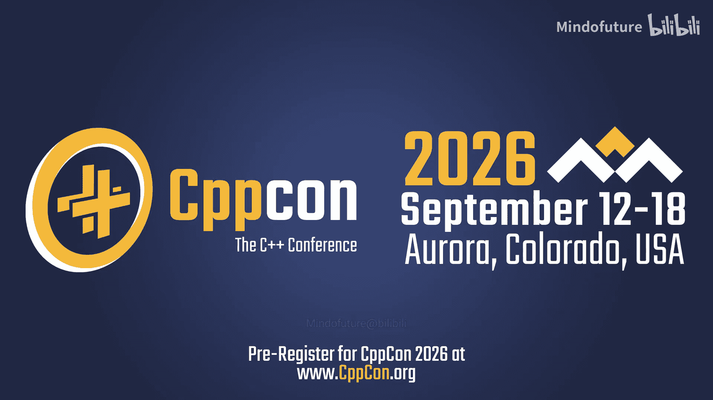
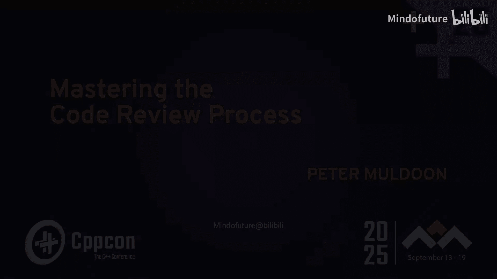

# Cppcon-2025-｜-C++-｜-C语言--｜-汇编-｜-编译器-｜-操作系统-｜-Linux-｜-Windows-p26-P26_掌握代码审查流程-Pete_Muldoon-CppCon_2025--BV1wyPBzrEeu_p26-

🎼Rending this conference， definitely， I would say to get a lot of insight who are already working in the industry。

 They are already here， a lot of trading firms。 I am into finance。

 so I met a lot of people who are already in finance， and they gave me a lot of insights。

Okay， alright， let's get started。 Allright， I got a， I got a lot to get through。Okay。

 welcome to my talk mastering the code review process。

 balancing quality speed and sustainability in your code base。😊，嗯。If you have questions。

 there's a little number down here in the corner。 So if you say， if you talk about a slide。

 you can remember that number， it just prevents me rububbling around， trying to get something。

So who am I， Who was this guy up on stage， who's been to one of my talks before。

 seeing him on YouTube。Alright， this is gonna be a little boring。 Then。 You know who I am， right。

 I started using C plus plus back in 1991。When we didn't really have anything， no strings。

 no nothing， no standard。We've come a long way。 My professional career has mostly been in systems。

 analysis and architect， looking at the complete systems， seeing how the function。

 I did 21 years as a consultant。Which just meant that I've seen a lot of different companies and a lot of different teams within companies to see what worked and didn't work。

And for the last decade， I have been in Bloomberg， and I'm currently in what's called the ticker plant。

 where we take all the information from the exchanges all over the world。 do some processing on it。

 They come out as the ticks you see on the Bloomberg terminal。Alright。

 so what am I doing here on stage， I like to talk about what I call practical software engineering。

 I'm not as bedazzled by the syntax， but more about engineering principles， how you'd apply them。

And how you apply those to the real world problems you have in your day to day job。 Okay。

 and I'm hoping you either take something away you can use。Or you have a shift in your perspective。

 how you view problems and break them down。Right， now that you come to the talk， look at it and say。

 well， that's great。 And forget all about it the next day， right， I think。That's a kind of failure。

 on my part。So welcome to CPPcon 2025。 We're just about the halfway way mark。😊，Alright。

 And when I looked at the talks this year about code reviews。In CPP con。

 we have back to basics code review。We had API structure and technique learnings from code review。

 seen with static analysis from I。e to C， I and code review。And mine。

 so was the last one for his mastering the code review process。So there's a kind of difference。

 And you guys might be a bit surprised that the thing I'm going to look at is not the code review。

 It's the code review process。Right， what you do， why we're doing a code view process， as opposed to。

 I will get into some of the little nitty gritty， but I won't be talking too much about what goes on when you're constanting and stuff like this。

 All right。So where will we be going to tell， what's the rough direction we're taking， Well。

 it will be having an effective technical code review process。Alright。

 we'll talk about what happens when you don't have process and you're just kind of winging it。

What are the fundamental elements of the process， not the technical review。

That makes your code reviews effective。 And how do you track and measure that。

 How do you know if you're improving if anything is getting better or you're just kind of， you know。

 wallowing around。And finally， but improving your code review culture。 And say at the end of day。

 every problem is really a culture problem， right。And I say this talk is rooted in real world enterprise environments。

 And it's something I have been working and struggling with for about the last9 months to a year。

 Okay， so it is my personal journey， but finding what can we do to make the code review process more effective。

 So where won't we be going， We won't be going into formatting of text。

 style guide seems to spend an inordinate amount of time talking about the indentation。

 how the comments are done。 the underscores， camel case naked。I won't say I couldn't care less。

 but I don't care about it here。 And And， that that stuff should probably be automated anyway。

 You're right， If you've got these textual formatting guidelines。

 have you have something do it for you。So let's start with terminology。

 If you've seen my talks before， Id like to get that shared understanding of terminology。

 What is a critique， Because a code review is a technical critique。Right。

 and it's a formal analysis of your own or someone else's work。Right， it's an analysis。

 It's not necessarily something that's trying to tear you down。

RightAnd it's supposed to be a careful judgment when you give your opinion on both the good and the bad parts。

 we tend to focus on the bad parts。 as a Miriam Webster and criticism。

 which is a close cousin to come from the same root word criticticos。

 seems to be about the reviewer trying to take someone down as opposed to help。

 which is what a critique should be trying to do。So the three main flavors of a critique， right。

 constructive， Instructive and destructive。 So we have constructive。 In other words， I use it to say。

 I think you have a problem here。 I think you made a mistake。 And here's a way to fix data。

 Here's the solution you can look at。Instructive can be looked。

 There's a new part of the language you don't know about。 initializing， I don't know。

 variables in the header files。 So you don't have to write default constructors that do it。

So you can instruct people with code reviews。 You can。

 You can bring up their knowledge of the language， right， And of course the last is destructive。

 We just say， like， you know， this thing sucks。 The code review。 You know， you suck。

 It's not very nice and。You know， you need to improve your hairstyle or something， right？

So that's the three ways of doing I I say， constructive is trying to build up and give solutions。

 Instructive is trying to say， I have a learning opportunity or give someone else a learning opportunity。

 And destructive is generally unhelpful。 I mean， it can sort of highlight problems。

 but it does it in a way that really grinds up your process。😊，So some perspective， what are the。

 But by the way， before I ask this， who here has code reviews done on them。All right。

 who here gives code reviews？Al right， So more or less everybody， right。Do we。

 who here thinks there's kind of problems with the code review process。All right。

 you might be part of that problem， okay。What are the core objectives of a code review？ And again。

 I like to ask the audience， we have a nice， smaller room this year。

 What are the core objectives of a code review。 What are we trying to get out of it。😊，Quality， yeah。

 anything else。嗯。Yeah， and that's kind of quality improved the programming。 correctness。 Yeah。

 so we want to have things correct， maintainable and fit for purpose。😊。

Is this a good definition of what you're trying to get out of a code review。Yeah， you're ahead of me。

 That's going come in a little later， right， It's incomplete。 right。

 We have to have feature delivery。 I mean， what are we trying to do with code reviews。

 Why are we writing code in the first place is to give business value， right。

 to give business value to our clients with new features， more reliability。

 We're trying to get that into production。 And if we don't get it in production。 We're kind of。

 I won't say wasting our time。 But， you know， business is going think we're wasting our time。Alright。

 But it also was about maintaining the long term health of your code base。Alright。

 but we tend to focus and obsess on correctness。 In other words， is it giving the right answer。

That's kind of a bar a lot of people go for。 And it really shouldn't be。

 You should be looking at the long termm health of your codeb。 right。

 And if anyone seen the a talk of earlier this year on the software engineering pyramid。

 I talk about like your awareness， how it has to expand to include the long term health of your day of your code base。

 Otherwise you're heading for a rewrite。Okay。So there's also a time element。But we want it fast。

 right， We don't want to say everything that goes into production takes six months，3 months。 right。

 There is a time element。 You want to be， I don't want say agile。 It's an overload word。

 but it's something I want to get into production because unless it's in production everywhere。

 which is my minimum definition I've done， I don't see what you've done is useful。😊，Okay。

So what are the less obvious objectives of a code review， Someone shouted something out， I think。

 over this side。Education， right， promote knowledge sharing， right， also ownership。

I think something that is not is lost on a lot of people who do code reviews is that you're taking on a shared responsibility。

And if you see my badge， I'm not wearing it now， it says a problem in production。

 go after a reviewer， not the developer。Right， and you need to feel that your name is now attached to that。

Right， and if it goes sideways， Pete， how did that get by you。Right， and hopefully。

 it's a one in a million confluence of very strange events that no one could predict。

 But if it's something very obvious， then right， I need to slap across the wrist and help spread the workload。

 Al right， You're not just there on your own trying to do something。 People are helping you。

 multiple people are reviewing your code。 There's that more sense of community and spreading that workload around。

So a more perspective， I like hard data。 So I went out to see what kind of data do we have on code reviews。

 And I could find one report on it。 was by this smart bear group it was done five years ago。😊。

And it said， what is the number one way to code quality。And they said that over the last three years。

 people had said the number one way is to improve is to have a good code review process。Right。

But 24% of respondents indicated that， right， And they indicated that unit testing was next， right。

 which is just funny because these are the two things I've kind of been looking at for the last year or so in my company chasing them down。

 All right， for the benefits they give。 And then you have integration and testing， okay。😊。

So what place in software engineering do code reviews sit？Right。

 where do you think the rank code reviews。You read more code than you write。Everyone agree with that。

 I mean， unless you have your eyes closed right and you got a Braille keyboard。

 you're not able to code ready， At least see in your own code and generally you have to see the context that the code or the change is in。

Alright。And it really is the last line of defense。For keeping a sustainable code base alive。

You will not be able to keep your code base healthy if you're just putting in。

Fast feature delivery and bug fix。 If you're if you're solely concentrated on that。

 you're gonna get a cold business that's heading towards real problems a couple of years down the road。

And it also can be a force multiplier for good practice， right， You can disseminate information。

 bringring the more junior people in to see what's going on in the code review。

 Give them the opportunity for learning that it's an instructive kind of thing。😊。

And I'm going to say something controversial。 I think it's unlikely to replace by AI。

 at least in the short term。 And I know I've seen something where you can just hit a button。

And AI gives you a code review。I find the code review to be on， let's say surface detail。 Not bad。

But an actual structure， how things are put together。It's not that good。 It'll just say， yeah。

 it's not too big。 or yeah， it's not too little， but it really doesn't tell you anything useful。

And for me， I did， I you know， I've tried this AI do a code review。 and there was a long template。

 and a template had make sure you do this， this， this and this。 And I have filled the template in。

 And I said today， I go do a code review。And I came back and said， this is terrible。

 You probably haven't done this。 You probably haven't done that。

 And all they did them was I chopped the bottom part of that off。All the stuff I didn't fill in。

And I came back and said， this is a really good modized PR。 All right， Well done。 Check it in。

 So again， I think still think that every place I see people talking about using AI。

 it's great help or it gets to 80%，85% there。 But you have to put the last piece in， right。

 It's only an assistant。😊，Alright， Anyone got any comments。

Anyone want to come after me of this stuff。Everyone's happy。Alright。

 you won't be by the end of this talk。 Allright， So code reviews can have mutually exclusive directives。

 things pulling in the opposite direction。😊，Right， so we have contending viewpoints on standards。

 too rigid or too lax。 We try to put order with having a really rigid set of standards。

 It kills creativity。Or we have no standards and it's lax， which is like， I guess。

 ultimate creativity， which is chaos。 So you have to excuse me， get a balance between the two。Timing。

 rush versus hardty reviews。 I want to mean Ru， I mean someone doesn't look at your your code very well。

 She said， you know are you generally good track record。I think it's called the approved Areno。

 just hit that looks good to me enough。 you go。Orty andty usually doesn't mean。

The person is taking a week to look at your code and figure it out。 At least it shouldn't be。

 Ta just means it was left on the shelf for a week before anyone near it。Wes have the scope。Alright。

 you have the minimalist scope， which says， look， if I'm told to do something and it just comes down to two or three lines。

 that's all I'm doing in the code review。Other way you say is， look， when I'm in there。

 let's do some good， Let's look for refactoring opportunities。

 Let's look for ways to make this code better in the local piece I'm in。

 not like they a complete rewrite。😊，So you have these things going on。 And if you're too minimalist。

 you miss opportunities to make the code better。 And if youre too expansive。

 you start slipping stuff in there to shouldn andt be in there。Right I have had it。 Where does it。

Code going in。And I wasn't reviewing the code。 I only seen it afterwards， when it。Broken production。

 And it turned out it was one of those little tiny pieces。 that just said， look。

 no one will spot it in the， you know， the 50 files that are being done。 And it was true。

 No one did spot it。 right， So we went down。And last is new feature use。

 And this is something like the language is changing a lot， right， every iteration is changing a lot。

 and not everybody is getting the compiler， you know， as it comes out， sort of way behind。

And I was like， how do you know。What new feature to use。Structured binding come along， right。

 People shouldn't really be doing Ie T first and I。 T second now， and you're looking at a pair。

OurCos just be breaking them into structured bindings。 But if no one's ever seen that before。

 because they've just got on to 17 or 20 from a pre 11 code base， they don't know what's going on。

And the other thing is what I call conservatively consistent， which means。

I do all my four loops with indexing into the container。Because that's done everywhere。

And that's a bad consistency。 That's just been consistently bad now keeping up with the engineering。

 So you have to break the patterns and the trends with new features and new engineering practices goes on。

I have been， I worked with a group。Which had a very 1995 approach to interfaces。

 lots of raw pointers， lots of in out parameters。 And I said， look。

 you got the optionals that of putting bos out。 You got variants。 You want to send things around。😊。

And it was like， yeah， but pointers are really efficient。

And that's ignoring like 25 years of progress， where we've tried to get pointers out of the language more or less。

 right， thingsh we call pointers unique and smart pointer just have pointer semantics。

 They're not really pointers anymore。So like I say。

 all can be taken to an extreme and finding the balance is what helps you have a good process and making your team run efficiently and collaboratively。

😊，So poor code reviews， what are the consequences of a poor code review。You whatYeah， developers。

 if you got a attrition， that is true， Anything else。Bathroom。Yeah， bad coders。Fine， like。

 what are the consequences， right， consequences of observable effects。Yeah， you get bugs。

 You have something like this happen， right， You have critical issues。

 Go on notice and boom it goes off in production。Allright。

 other things that happen is you don't have good codead quality， especially across teams。

 And I found across teams， there was a very variable set of。

What is good and what is not in the code review。O， and what they believe is good practices and what isn't。

 good practice in the code of。Even if you have a standard。

 most of them haven't read it because it's thousands of pages long。 And I got to say。

 I don't really read it either， right。And you have poor development velocity。

 We're going to talk about that a little more where PRs just sit idle。

It is one of your biggest killers of productivity or huge， complex PRs being routinely generated。

And they take a long time to make it through the system。 right， And the other thing is。

 you get spotty task coverage。 People are just not feeling they can safely code up new refactorings because the code blows up。

😊，And then bike shedding， This is something that happens quite a bit。

 Everyone know what bike sheing is。You've all built sheds。 All right， it's where， you know。

 it's just human nature to to focus on the trivial because it's easy and avoid doing the hard thing。

 And the bike shedding was about a nuclear reactor that we're trying to build and the committee that was trying to build it spent most of its time on the design of the bike shed。

 not the reactor， right because it's easy to get a handle on。 But again。

 these are the things that happened， right， Fails in production， poor quality。

 youre go to try and do something。 The code's hopelessly coupled up。

 So you take a long time to get it done。 You're not sure of your testing is adequate。

So code review preparation， what should be doing before you submit a code review。

Before you even ask people for a review， what should you be doing。は有一下。review it yourself。Very good。

 No one does that。 right， Someone said review it yourself， right， But look。

 you should have a checklist。😊，Right， first thing is， I need a static cold analysis， the warnings。

Get rid of them。 I really hate a code base when I compile it。

 And it's just reams and reams of warnings。And no one cares。 And if there's an error in there。

 it'll trip。 but I got to go back through pages and pages try and find it， right。H warnings。Yeah。

 well， there's， there's， that's fine in development。 You can't do it for production builds。 Okay。

 it's a bad practice。 I won't get into enough。 right。

 Ha it passed all the unit and integration tests。 And if you have made a change in observable behavior。

 have you added a new test for it。😊，And I get the widest range of excuses。 Why tests weren't at。

Right， you don't understand。It really comes down to its untestable。

And it's untestable because this has been let go on。 right。

 No one's put a demand that we need some testability in the code。And then what someone here said。

 a self review， right， you shouldn。 you should catch silly mistakes。

I shouldn't see stuff that just looks plain daft， right， passing in。 I du't know。

 I constant't int reference to a function or something equally dobe， right。 And there you can use AI。

 right， get try and like squeeze it， see what you get。 See if you get good stuff going on。

 I generally have it say， Here's something。 And I go， there's a problem here。 And what is the。

 what does the AI， I would say。You， you're absolutely correct。 That's right。I don't know。 I've， I've。

 I've been tempted to say something that isn't true and see if it says that。But first things first。

 right for preparation。You should write a proper title and description about what you're doing。

How am I supposed to know if you've met the requirements。In your coding， if you just say。嗯。

I'm fixing a bug。Right， I see that a lot。 I'm fixing a bug。It's almost no information。

Especially when there's no test attached to it。And when people do write titles。

 it's like to forget the use of an English language。 It's like it's a four year old wrote the。

 the thing， it's like。嗯。Doesn't give price or something like this。 And youre like。

 what does that actually mean， And you look at the actual description。

 descriptionscription has nothing in there。 And I've seen PRs actually checked in that say。

 do not check in till the proper title is provided。Right。Who let that in， right， Who let that in。

 The guy who let that in， you know， by the way， I mean， guy and girl， right America。Can mean both。

 right。 So what you need to focus on is what the hell are you doing， What are you trying to do。

It may be deducible from the diff if you've put it incorrect correctly。

 but you may have done something And I think， oh， yeah。

 you're doing this and this when you're never meant to have this side effect。And the why。Right。

 why are you doing this？Right， we are adding a new trading feature。Because data， data， da。

 because in my case， the exchange is having new tick types come in。 this is part of that。Allright。

 and finally， then， how are you verifying that your change is working。And but int like yet。 Yeah。

 And when I said how you verify， I that like。It'll be grace or something like this。 right， You say。

 here's the testing。 I'm adding some testing for this kind of thing。Any't want object to this。有。

I also that in your。B tracker， and you can just link click。What if it's a new feature。

Youre still powerful。I mean， it depends on their process。Right。

 I tell you what when I go to look at a code review。

 I don't want to do a forensic hunt write down tracker lists and stuff like this。

 This is the thing that grinds up the gears， right。

 puts the salt in the gears and causes it to to seize them。 So I'm going say。😊，That's not correct。

But you can do it。 I just。Don't want to be there for it， I。Alright， the next thing is。

 you want to take it easy on your reviewers。 I am telling you。

 if you make things easy on your reviewers。Your review gets a really thorough looking at。

 and you get the feedback that's good。 And you get to think through the process really quickly。Right。

 so again， do a self review first。Reviewers shouldn seen obvious errors。

 and you should be fixing things that don't look right。 Not like， w。

 this here just doesn't look right。But what the hell。

 let me just send it out there and see if people catch it。 right。

 You should have some pride in what you're doing。And reducing the cognitive load。

 This is one that I struggle with talking to people about because it's kind of like no cognitive load is really too big for the engineer。

It's almost like， look， we're all very smart people。 And this thing。

 I want to get it all done in one shot。And I got this massive PR， right。

 It's like 5000 files have been updated。What happens a 5000 file PR that's doing something really tricky。

What's good to me。Where do you work？Is it still a viable company， Allright。

 So I say you got to limit the scope。Of your PRs， In other words， you can't。

 I I'll be sneaking stuff in and make it say like， look， well， he's。

 it takes me a week for this thing to get reviewed。 Well， that's going on。

 I'm going put some more stuff in。Right， and as I put more stuff in， the person has to come along。

 and it's another three days and to look at it。 And it's almost never ending right And you want to highlight where key changes are located。

 When I do a PR， if there's like 50，60 files that are changing。

 But the real meat is in one or two files， I'll say， here's where the change is concentrated。

 go look there。 The rest is all just maybe adding a new call in 50，60 other files。😊。

So when I first give this talk in a dry run， I didn't want to talk about draft PRs， right。

 But people kept asking about it。 So draft PR is not something you check in。 We agree。

no one checks in a draft PR because well， Github won't allow you to。 Allright。

 And it's usually for a different purpose than a regular PR， right， It's get early feedback。

 See if you're in the right track， get some help。Right， maybe your interfaces with sloppy。

 You don't know how to use some interfaces in the system or there something historically buried in there。

 like a landmine you don't know about。 Like， I've come across that before where it's like。Oh， yeah。

 You think you're doing the right thing here。 There is a piece in there。

 you don't know about that's going to take it all apart， right， And these do not get merged。

 So I say we don't really， this is much more free form， much more related to helping people。

 it's not a real structured process。 right But the minute you say draft to I'm ready。

 createate the PR。 Now the hammer comes down and all this stuff comes comes into play。😊。

So let's look at a code reviewed timeline。 So we're all in our happy place。

 This is where we love to be， right， doing code development， showing our individual brilliance。😊。

And then we say， okay， I want this thing reviewed。I get an initial review。

With the feedback coming back。Then， I say。I've incorporated this thing。

 I think you're not quite correct here。 You send that back。 You wait for the final review。 If lucky。

 it only goes back and forth， you can get trapped in this cycle of like review， feedback， review。

 feedback， review feedback。 But if it's pretty straightforward。

 you wait the final approval and you merge。Alright， this is the。

 I'm gonna say the lifetime of a code review。So let's talk about sizing。What is the thing about size？

Size matters， right。I'm talking about in the code review， right。You people。Alright， so look。

 if you have a large mega change。Right， it is going to have a host of problems。RightYou're gonna be。

 it's gonna be， youre not gonna get good feedback because people can't load the whole thing into the brain。

Right， and I don't know about anyone else。 But whenever I'm asked。

 here is a 1000 line or 1000 file change of。I don't know，10000 lines of code。

I'm really hesitant to pump my。Stampling that， this is good。I think we're good to go into production。

Right， and I think a lot of other people as well， certainly where I am。

 people are nervous when things get big。Right， unless it's a repetitive change。 Now。

 I have SAT with groups and said， this PR is huge。And it should。 it was actually a group review。

 So this is huge。 It's got way too much in it。And he said， you just cannot break this down into。

Fhaed or steps。And as T O said， sure， you can。 You could do it here and you could do it here and you could do it here。

So what do you think he said after that， And he said， well， that's great。 I'll break it into PRs。

 I went into four PRs。 He said no。He said， look， if I give you a PR in the beginning and it gets approved。

The guy at the end doesn't know what happened in the beginning。 He's missing all that context。Right。

That's a mindset problem because your interfaces should be pushing that behind。

 So once you have a proper interface here， you shouldn't have to know what's behind the door， right。

 And it just shows you the， the I this is the poor development mindset。Right。

 and that you must know everything to know how to use any of our code。

 even out here where we have the final interface。I don't know about you。

 I really don't like reviewing stuff that's really difficult becauseuse then when I got to go is I got to put it in my I D E。

 try and run it through a debugger， stuff like this to see what the hell is going on。Allright。

 takes a long time。 And if all your brain is trying to just encapsulate what's going on。

You have no room for creativity outside of that。 You can't propose solutions。 You just go and say。

 what are you doing， Well， this is kind of what I'm doing。Okay， well， I guess looks good to me。Right。

 but， you know， the next time you come back to that code。

 you're gonna have real problems updating it。And I say the more unstructured， the code base。

 which means the more long live it has been， the longer been around， generally。

 the more unstructured it is。😊，Then the smaller your change sets should be。Alright。

 I want reliable feedback。 I just don't want looks good to me。

 And you assuming I'm the guy takes the fall when production blows up， because I'm gonna。😊。

Sa someone reviewed me for this。 And I think spacing， indentation， renaming should be left to。

The wrong PR， if you can。Right， I've nothing but annoyed when I go in and see a large PR and mostly its chopping spaces。

Cause the previous people did not have a choppped space on the editor set。Okay， if you put it in。

 you have a lot of different straight off the bat。 Check that in as a PR that just gets rid of spaces。

 Belve me， you won't have any problem getting that approved。Right， it'll go。

 It'll be liquidy split through the process。 And now you can get on to doing it， right。

 doing the actual change。And the big thing to take away from this is poorly understood changes are inherently more risky。

Right， so again， the more complicated the change， the shorter a scope should be。Anyone。

And he went against this because engineers are really good at coming up with， but。

RightBut there's a reason why my review is really big。

 I haven't found one that' stuck that I agreed with。So let's talk about timing。 So， look。

 timing is everything。Right， no change is useful until it shows up working everywhere in production。

here's the timeline I had before。 How do I significantly shorten。This process。

And it's not Russian people through reviews。HowHow do you make this thing shorter？Take掉 the置。Right。

 I mean， we'd do it in code if it was going， We were looking at a piece of code doing this。'd like。

 let's go and hit the weights up。😊，Right， in your process。You should have the way it's scoped out。

And what I like to do and what I did in teams in the past is I said， listen。

 there's a 24 hour window for you to start a code review。

And if you do standups every morning at stand up， I would say。Who here put a review in yesterday。

Who here is missing a review。 Oh， you know， Fred over here to do the review。And I say， Fred。

 what's going on。 I was like， while I'm doing it straight after this meeting。Right。

 because it's visible now。Right，And I say， that's great。 You know， but you do that a couple of times。

 You don't have to really look at it anymore。 People get into the habit of doing it because they don't want it pulled out。

 right， or， you know， I give， you know， I give Alex feedback yesterday and I haven't heard anything back。

Alex， what are you doing sitting on the code， Because remember。

 we're trying to get code into production reliably。 correct code into production。😊。

And if you're sitting on a review that's just needs like you've already given the feedback。

 you've incorporated it， and you're just waiting for the final button click。What is that。

 Why are you rushing to do a code review or of rushing to write code。

 if the code review process just holds you up a week or so。

Who here has had a PR that SAT around for a week。Waiing on a code review。Wow， that's a lot。

 What about two weeks。A month。Alright。 You need to go after the reviewers， right。Review my code。

 please。Alright， so that's how you do it。 So timing is everything。 And I'm telling you now。

 in a group， if you shorten that now， I said 24 hours to groups。

And they almost swoon and fall off their sea。I can't。 What if this is a huge， huge， huge review。

 and I can't get it done in 24 hours。 I said， No， you started in 24 hours。Most reviews， I mean。

 would you agree with me in saying that most reviews are mean。20 minutes in an hour。

If it was doing a normal distribution， that would probably catch three standard deviations。

So we would say， oh， you know， oh， but what if it's huge。

 What if the only guy that can review this code is on vacation。Right。

 what the hell is going on in your group that only this guy can do it。

 I got to wait for him to come back from Man O Cabo or something。Right， with this nice sun and say。

 hey， we're all waiting on you because you're the only guy。 So again。

 the other thing I say about guidelines is they apply to most reviews， not every single one。

 You have to have flexibility There are things that are outliers。 Like people say。

 well we'll get to it later。 there's a lot of right。 So when you are not getting reviews completed。

 If I code。Right， and I go to Alex here。 By the way， Can you review my code。 It's now ready。

 And Alice goes， sure， but I'm doing something I'll get to it in a couple of days。😊。

So Alice comes in a couple of days and sends me the code that he's done。

 But I'm onto to something else now。Allright， and he said， can you review my code？ I said， yeah。

 three or four days when I'm done。And you can see what is going to happen， right。

 The whole thing is going to gum up。So that's a priority problem。 And I have。

 whenever I've had enough。Clench on a group。 I say code reviews are higher priority than writing code unless it's a specific exception。

 which should be rare。Right， it's a priority problem。And the other thing。

 I don't know if I don't know about you。 But if I leave a code review around my code is not reviewed for two weeks。

 it's a nightmare trying to reinteg it with all， there's a bunch of other teams。

20 other teams are pushing code into this code base。 And when I go， oh， I got some， allright。

 that's a pretty good。 Oh， I missed missed no accept or something。 Let me put it in。 you have to。😊。

Right， you have to merge。 and then it like the merges don't go in smoothly。

 and you have to load the context into your brain。 And again。

 you're pushing out the code's timeline to hit production。So I said 24 hours。 some。

 some groups complain that's way too quick。 said， alright， pick something， two days， three days。

 pick something。But have it known in the group。And the the feedback should be the same。And then who。

 whose responsibility is it for a PR to get merged。I think it's the developer。

Everyone agree with that。 Or do you just say， look， I've done my piece。 I walk away。

 Someone can pick it up and merge it。 right， It's the developer。Right。I don't know。

 There's some company over here， I think might do it that way。Where was that guy who said we yeah。

 all right。 So， look， what， let's talk with code review timings， right。Again， from the same review。

 the same survey that was done。 I think it was about 1000 developers。

 How often do you participate in a code review process。Right。

 and how satisfied are you with the code review process。

 And you can see that daily reviews seem to get the most positive response out of teams。

 So if we're doing reviews daily。 And that's why I say 24 hours， I think is a good measure。

 supposed to three days or something like this。 right teamss are more satisfied when you're doing it daily。

 weekly by weekly， monthly quarterly。 I don't know if who does quarterly reviews。😊。

Maybe you where we over there。Al right。So let's talk about feedback categories。 Right， now。

 let's get into some of the nitty gritty of doing it。 I think there are three feedback categories。

 You show me a piece of code。3 things I will say with that code。Right。

I think there's a mistake in there。 Are you doing something that's structurally on sound。Alright。

 it's not the way you should be doing it。And I'll put that little red emoji on it。Right。

 emojis are cool。instead of angle， nitick， angle serious or something little emoji does the thing。

 right。The next thing is。I think there is an alternative， probably better pattern。Or implementation。

And what do you think And lots of times I say， you know， that that's not a bad idea。

 Let me think about it。Alright， And for that， I used the hammer and hammer and spanner， right。

 And I said， this will delay。 If you go， yeah， I don't care about it。

I'm really not wanting to improve your code right now。

 because I think you didn't give it proper consideration。

And you probably should get together if you have some kind of， you know， base difference of it。

And the last one is nitps。Right， hey， have you thought about putting your brackets over here instead。

Have you thought about doing it this way that I particularly like and you don't like， right？

 And that just is like your your personal viewpoints。

 kind of just sharing information and it's kind of take it to leave it。 And I just give the p。

 because it's a ni p。So。These are the three emojis I like these， But I need two more。

 I can't do a review with just these， right， So I need the emoji for。What's going on here。

I don't see how this does whatever。 right， It's a question。

 I need that answer before I can give you proper feedback。And the last thing is， hey， great。

 you really nailed it here。 I like this。😊，Right， whoever does that on a code review。Great。

Remember a third of the room。 All right， You're good people。Right， take a look at the other guys。

 right。Just look at them， stare them down。Alright， so you need to denote clearly in your feedback what category it's in。

 I don't really care how you do it。Because I don't want to say。

 you have to look for the most aggressive language to know this is a real thing that needs fixing。

Right， I can say in the most soft。呃嗯。Human sympathy， compassion。About something。

 And as long as that red emoji is on it， it's not going anywhere。Right。

 but I haven't got the backup the of the person who's whom I'm given the feedback on。

And when I give a review， I put a little， I put a little icon on people。

 there's a couple of people from my company here。 Then I put a little thing which says， here's the。

 here's the key。 And then I start putting all the stuff in the code review。

Let's talk what code review do。 What should you be doing in a code review。 Well。

 you should be standardizing the basics， whatever the basics are to you。

 Standardize them with a checklist。 That's short。Right， because I see every team。 like。

 who here thinks that all the teams in the company has a really consistent code review。No one， right。

 Why is that？If I'm an electrician， I can't walk into someone's house。

And just jury rig a socket on them and walk out and say， look， you plugged that in。 your light works。

Right， they didn't properly ground it and it burns the house down。 right， They electricians。

 plumbers， all of these have an absolute code of how stuff gets done。Alright。

 so we should have some kind of guidelines on what's been done， right and overview code with。

This code is fine。 It's the same as the other crappy code over here。Right， it's uniformly crappy。

 It doesn't stand out。 be that change。Right， and， and the other thing， and for me anyway。

 I've always looked on code reviews。 And there's people。2 in this room， I use a lot in code reviews。

 Are you here， Hamish。Now， told me he was coming。 Allright。 so I。

 I love having competent reviewers because it just gives me a better solution at the end of the day。

😊，I am not too proud to say， I'm glad that was that was real helpful for what you gave me， right。😊。

And I think you should be looking at code review as a collaboration or a health。

 not as some kind of punishment of being called out in public。 right， You get to learn so what。

 and train to skill。 There are people in teams。 And if you go， I want him to code review。

 He's very good at what finding stuff。 and he doesn't。 He doesn't tick me off， right。😊。

So train the skills， learning who sends people to a code review training course。

I don't think it exists。Maybe I'll do it， right， Maybe I'll do that to。C PP con 2026。

 How to do code reviews。 Allright， and you also have to have education。 The language is changing。

 right， It's evolving rapidly， even if you're not in C plus plus， right， How。

 what are the things you do to get to keep your knowledge at。 Well。

 what you're doing come to conferences。Alright， great， especially with the hallway track。

 go to look at the videos。 if you can't come here。 Everybody in YouTube land。 All right。

 Oh have book of video clubs in your area。 So your team puts out don't know an hour on Wednesday afternoon aside to look at a conference talk and debate how they could pull that kind of work into what they're doing。

😊，Alright， so。Something you really should be doing。

 And I'm gonna to call this out specifically is you should be。

 you should be reviewing the freaking tests that are in there， right， Don't just assume the test。 Oh。

 it has a test in there。Right， you should be looking to see have you got unit integration testing。

Happy， unhappy path。We're hitting any of the corner cases， magic numbers and protest naming。😊。

How can I tell if there's corner cases if your naming is D 1 and D 2， All right， or works good，1。

 works good 2， works good3， as opposed to。Exeing this type of trade with this kind of thing going on。

 executing this with this kind of thing going on。 And then I can look down these tests and magic numbers I see in in tests。

 Exp the price to be 1。35725 x。😊，Or something like this。 right，0 wax。 And I go， what does that mean。

 What the hell is that number， And I got to go grabapping through the code base to find that number。

 as opposed to saying， you know， I'm going to define。At particular value。

 the expected price equals 1。 to data， data， da。 Then in my test， I have expect。

The retrieve price to be。The expected price。 and's very easy to look at tests。

And your test should act your test， particularly unit test should act as ways to people to understand your code。

 how it works。 It should not be so serpentine if I have no idea what's going on here。

It looks like the program's eating its own tail， but I'm not sure。Right。

C you don't have bad preconceptions， right， Does this code look like all the other code around it。

 The flat Eric model used to work well， right until we found out we could circumnavigate。

 So we use it， We use the globe map， right。😊，Don't keep bad habits alive on the name of consistency。

 It prevents new features， better thinking， engineering practices。 I mean， I'm guessing you guys。

 these's a conference are probably in that crowd who goes and does this stuff。

 And legacy code bases suffer hugely from this because they grew up。

And then more less engineering knowledge， not as good a features in the language。

 You had to write everything yourself。 The quality is variable。And like I say。

 although the same look and feel is important and many style guides obsess on this。

John consistently can be the enemy of progress。You don't rigidly adhere to old thinking without using your brain and saying。

 is there a better way。Now， when you do the better way， you don't have people doing it both ways。

Right，You're try and get it into your guidelines。 This is the way we'd like to do things。Don't。 Now。

 the other side of that is just taking every new team that comes along and using it to death。Right。

 everything has to be in a co routine。 Everything has to be in， I don't know。

What's been hot this week？Reflection， and reflection comes like， it's amazing。

People are doing dopey things with reflection。 You heard it here first。 Allright。

 You can see people do that strangest thing and go， look how cute that is。Because I said change。

 for change' sake is a path to nowhere。And I had a T， L。啊。Talk to me and say， Pete。

We're supposed to be refactoring this piece of code to make it better。

And my guys have moved the code around， but I'm not sure they've done anything other than move the code around。

And I said， well， why are you doing the refactoring。It's for testability。Have you got tests， No。

 this said test will come in the next refactor。Right？And'm like， well。Ge， I don't trust， you know。

 not a trusting guy。 I'll be like， no， the other thing is I get PRs going in。 I said。

 there is no testing here。Yeah， that's coming in a PR right behind it。It's not。Never does。Alright。

 I know you telling me lies。 I mean， I don't know if you realize it。

 but you definitely tell them me lies， alright。So， how do you measure the effectiveness of your process。

 So here I am telling you do this， do that。 How do you measure the effect of this， Like。

 because I'm a Howard data guy。I don't want to just say， you know。

 there's a kind of happier vibe out there。Right， that's how I know we're doing well。 I mean。

 great if we have that。 But I like to do measurement。So what do I measure。

 One of the first things I measured was the test per PR。Right。

 the number of PRs with some testing versus the total number of PRs。And it wasn't really good news。

Right， and I went to the managers and said， look， here's a heat map of the whole area。

Showing this is by team。All right。 And it shows the darker colors that the people who have tests and the lighter colors are people who don't。

And you can see， here's where the love and attention needs to go。

 There's something going on in this part of the organization， which doesn't puting it。

Other things you can do。 I like this one as well。 The created P Os versus merged per group。😊。

Are you consistently running behind in the number merge versus created。Becauseuse if you are。

 you're putting a backlog in there。 And we know what happens when your backlog gets large， right。

 you forget about it。Other things you can do time to review， right， I'm big on this。

 like we now have。Is Chris here。 Oh， there he is。Alright。

 I hounded Chris to write something that would troll all kinds of information from the Git repo。

 I mean， everything we could get over。😊，The times， the reviewers who that belonged to。

 what types of files will change。 And now we can pull all these metrics out。RightAnd like I said。

24 hours should be a good start if I see a group that has。

Two weeks of this general starting of getting a comment again， we have to go and give them some love。

Right， so metrics， if you put these metrics， do you think people will be pissed off or sorry。

 We be unhappy。Or will be grateful or think it's great。Well， apparently。

 I find this a little hard to believe， because I'm not sure people are happy。

 I'm running metrics on them now。Right， they say that three times is likely to be satisfied with code reviews if you got metrics。

 I assume as you make it better。You feel good about it。 I mean。

 who wouldn't like to say our PRs were 20% tests。 And now we're up to 60。

 and we're trying to get 80 in the next quarter。😊，H没。So again， you regularly do this。

 people seem to be happy about it。Were getting low a little low on time。

 So what about the blast radius， right， Like all PRs are not the same， right。

 There are PRs that are just little functional changes。 S right answers， well defined， low risk。

 Write a test。 I don't care how low the risk is。 Write a test for it。

Do you have other things that are bigger architectural changes。there larger current considerations。

 we're moving from file base to the cloud。For instance。Right。So with those kind of things。

You have to be more careful for especially putting out a new public interface or really adding to the public interface。

 Once you put it out there， We won't be able to change it。

 So there's more considerations and risk involved。 right， you got to know。

 are you adhering to the architectural design record that said this is what we should be doing or have we just wandered off the path。

So I say for small code reviews， your peers and your T， L。

 your team lead is probably who you should have on it。If it gets more severe。

 you have to start bringing the historicaly， the hysterical， the historical people。Right。

 where you go， we're making this big change。 and they know stuff you don't know， because。

Then where the bodies are buried。Right， they probably buried the bodies so they know where they are。

 And you got to go， you've been around a long time。Will this work。And and， you know， it's helpful。

 It's great。 You need that。 I think you need that aspect of when you're doing large changes。

 And someone who's an architectural expert。 And I don't mean someone who's an architectural expert on this somewhat derange codeb you're working on。

 I mean， someone who's an architectural expert from， I don't go in the conferences。

 keeping up with papers， keeping up with books and stuff like this， right。

 as knowing how the way it is done that you're not the emperor with the new clothes when you're doing your reviews。

😊，So you can if you work remotely。So， and I was say more than one reviewer。Our approver。

 I hit the one reviewer thing you can present。 Yeah， but it's a really small change。 Or we have。

 I just change comments， our comments。Why do I need， two people to review。O， you know。

 if that's what you're doing generally， you're just updating comments and fine。

 Just put them in yourself。Right you're an exception。 You're an outlier。

 But with decrease in severity， you have to be more circumspect and bring more people in。

So like this is out of a document I have right in my code review guidelines。

 right before the PR is created， you can do a design review for significant changes。 Alright。

 so we have an idea of where we're going。 We're not just freelancing it。

 and you can do team discussions in formal pair programming。😊。

The second part is you create a PR and can be a draft PR。 It's optional If you want to do a draft。

 right， if you need， you want that early feedback。 Allright。

 and then you make your main PR submission。 Hey， please review this。And then after the PR， you have。

 if there's a lot of contention or it's a significant change， you shouldn't have a review meeting。

Right， not just， you know。Me and Freddie are just colluding behind the scenes。

 Youve put something huge， right， It's like people。

 there should be more people brought into the process。

 and then you should be merging right once it's approved。 once everyone's reasonably okay。

 they like the testing， then we approve it。So if you have all of this going on， right。

 bad stuff going on， how do you reinforce good culture。Right， have a checklist standardizes things。

 removes contention。 This is what's in the guidelines。That's why you should be doing it。

And add common mistakes to that guidelines。 But it the checklist， but it should be short。

It was really， really long。 no one's gonna look at it， I think。Two page is probably ideal。

Cold review， coaching and pairing。I SAT down with a brand new group one time and had to walk through culture reviews that one of the most powerful tools of educating them how to do a proper。

 modern way of structurally。Writing code and have it ready for review。

And this thing we don't do near enough， which is team review walkthroughs。

 the whole team sits up and looks at some PR。Right， to get insight of what people think。

 are we following practices， you have to be a little circumst that you don't pull someone's PR out and say。

 now we're all jumping on you today， right， that's not what we're trying to do here。

 We're trying to all educate。 Alright， get some group by it。yeah。

 and if you want to reinforce good practice， you run metrics on。 right， If people say， yeah。

 we're doing a great job。 Well， here's the metrics on you。

 You don't look like you're doing a great job。😊，Alright， that's when the excuses start。 Allright。

 And then after a while， once people get into the habit of doing things structurally and correct。

 they just do it。Right， because people are sort of policing each other。

How do you give constructive feedback， How do you not get the backup。

 How do you have your team not like at war with each other， Are two sides like。

These guys over here are nuts right。 these guys over here don't know what they're talking about。

 right， So you give your feedback in very specific terms。 Not like this sucks。 It's wrong。嗯。

More like， I think you might have a problem here with the lifetime of this object。All right。

 explainplain why。It's a problem。 not just say， well， look， anyone。

 any idiot could figure that out right because obviously， they can't and praise the good code。

And with the don't， it's like this， this dude here。

 He's both giving the thumbs down and somehow speaking thumbs down。 This is how AI does it。He's like。

 tones down。Try not to get people like， try and just ask as a question。 Hey。

 have you considered doing this， What about this circumstance here， as opposed to， this is wrong。

You're an idiot。 And here's what's wrong with you code， right。

 And don't review the developer because it can happen we human。Right， so really takes you off。

 and youd like to get in there in a review and kind of get a little thing。 So Dba， right， don't be。

Detractor， right， don't be a。Debbie Downor， right， the common pitfalls。

 water are the friction points， slow reviews， but it's slow to get started， ultimately rushed。

 You get bad feedback。 You have trouble bubble trouble in production。Giving large。

 complicated PRs to people like here， I spent two weeks doing this PR。

 and I've been doing nothing but that You have an hour to do what I did in two weeks to assimilate it。

 And I did it in， I don't know，25 commits， but you're just seeing the last commit。Focus and styles。

 not substance。 Again， when people can't figure out what's going on to put it into the sea line or something。

 V S code and then just write out a few things that the the editor are saying as a problem。 right。

 It's really not helpful。And you get review， reviewer fatigue。

 I am sick trying to tell this guy to do something or it just back and forth， back and forth。So look。

 see this， this person's very unhappy。This person very happy， right。

 What do you do to make the person happy。You grow a beard。That's what AI seems to think。 right。

 Old bearded people do look pretty happy in the audience。😊，Alright， so， look。

 set shared expectations。 This is what we mean by code review。use a checklist。

 Go down this checklist or have your AI go down the checklist， right， Use specific language， right。

Qu ask questions。 and all team members participate in the process。 You don't overload guys。

And celebrate good PRs and helpful reviews。😊，So what would a basic checklist look like？It will vary。

Right， I I know this link won't work。 So I have a backup， right， so。I went at things like this。

 A general code review check says don't care what your language is。

 Do you meet requirements with no premature optimization or necessary coplication。

 How can I tell that。I can only tell that if the title and description tells me what you're actually trying to do。

The sizing and cognitive load。Right， what is the risk associated with these。

 Are the changes theft documented are unduly surprising。Do we have local reasoning。

 do we have to know the whole code base to figure out what you're doing。

Surrounding code for context and sufficient testing hasn't been added。

And if functionality even cobbled together in a class， call it out， functionally separate these。

 We're now getting these， these monster classes。 And again， don't do this。Alright。

 So for C plus plus， I have a couple of things here。Right， nothing too stunning。Right。

 stuff I see a lot in legacy code that I don't want to see。Right， magic numbers。

 constantt override correctness， use initialized structures and design initializers。

 don't have transposition， that kind of thing。And the use of assert expect。

 I find a lot of people put tests in with assert this price is equal to the expected price。

 Aser the yield is equal to this。 And if there's a problem it blows up here， I fix it。

 It blows up here。 you only should be using expect in your testing。 If it's like。

 I'm gonna quiz an optional， assert the optional is not empty。Assert the point there。

 The unique point is not no， that kind of thing。Every time I do this， people say， why。

 Why don' you just use the standard， right， because they're different。Alright，1 is specific。

 One is general。One is looking for best practices。 One is like， did you meet the goals of the PR。

1 is about actionable items。 The other thing is， is like lots of explanation on what you would do in theory。

And those is populated with common mistakes。 And the other one is populated with all kinds of everything。

 right。And here's two examples， right， insure adequate testing for the coa cases versus here's how you use G test to do proper testing。

And teams with guidelines， again， twice as satisfied。Right。If you have a guideline， cause you're not。

Just looking for tribal knowledge。I'm very last。 And I'm going to be quick on this。

 What about AI and code reviews。 How do you leverage it。Well I said， remember， I said about the， the。

 the。And the punctuation and stuff。 Why not automate it。 Well Why not automate。 Why give a review。

 Hey， this doesn't look righter。 Hey， why aren't you doing this， Why not do it。

 make AI do it for you， What is's it good at， Simple transformations that are locally reasonable。

 can be applied at low risk because you can see the change and just to spot the change happen。

 And you can make that much longer， The human will get bored and tired， but AI probably won't。

And this is really good in legacy code business。Right，So here's things I have。In a prompt script。

 right， for overridden function， stop the old virtual keyword and used to do in the old days。

 replace it with overwride。Add constant member functions that don't have them。

Add no except on simple member functions that only access class variables。

 because I'm in a place where。There's kind of PT T SD of code going down in production。

 If you put a no except in， it's almost like you're telling him you're gonna blow the code up。

 But you say， look， this is returning a bo， it can never blow up。 I mean， if it does。

 there's something else going on， right， So just a really safe transformations。

 some more type de we using four while loops range force， It's really good at this stuff。😊。

Are using structured bindings instead of first or second。In line simple member functions， right。

 There's member functions are no loops， single lines pull themment into the header file and have them minline。

And then get rid of unused header includes。 I know you can do include what you use。

 but this does it as well。 and apply the C plus plus 17 style name press， right， name says， A。

 Col and， colon B， Col and colon and C， instead of these interminable sets of braces you're seeing。

So when you do these， by the way， if you just say it to an AI， here's a list of 12 things。

 go do them。 Your code is going to get scrambled。 right。

 It's going to do the worst things to your code。Right， for something simple。Like using declarations。

 it's pretty simple。 This is what the AI writes inside of the prompt for。 because I don't write it。

 I say， please make this happen。Right， and I've never seen a bad type F turned into a using statement。

But for no except correctness， it does's all kinds of stuff on lies about a huge amount of guardrails around it。

 right， Here's some of the rules I have right， Only access simple member functions get sets。Right。

 only only when it a member function being called on a member that is no except。Alright， what。

 there's more when to add。 These are things that all get added when I find it doing ours。

It also writes itself a little class to give it some idea what it should be doing。

And this thing works really well， with very little variability。

Because I have a lot of guardrails about it。So what do you get， Here's just a few snippets。

 I'm not going show too many cause I'm almost out of time。Right， this just changed virtual。

 And we had this macro because we didn't have it in some of our pre 11 stuff。 now we're all Linux 20。

Change override。 type defs to using。Take an iterator loops and making them into range forest。

 Imagine you run this just on chunks of your old code base。Right。

 and I can look at that Y loop and no 100%， it's probably okay。I wonder if any you would catch that。

 right。Alright， so again， these are the， the things， right， So part like Rathia， again。

 what are we trying to do in a code review， Correct， maintainable code。😊，That is long term viability。

 and should also have the knowledge sharing the collaboration。How do you do that。

 code review checklist， standardize the basics， encourage self reviews to count out these hours。

 good metrics to make sure everyone's being honest。En sure we have constructive feedback。

Periodic group reviews of the of the code base， like someone's PR in a way that's not victimizing them。

And normalize mistakes as learning opportunities。 And I don't mean normalize mistakes in production。

Right， like it went through production and blew it up。 This is a really good learning opportunity。

 Well， maybe it is。 I prefer to catch it。😊，Right， in the code review。And iterate。 So in summary。

 code reviews are about improving code quality and shipping product。😊，Right。

 if you just sit there and a little knitt pickicks and you prevent stuff。

 you're stopping the shipping of product。 It's an opportunity to coach an onboard junior members。

Coming into your team。And you should strive for an objective code review based on guidelines。

 not on individual preference。That leads to improved solutions and productivity in a group dynamic。

's， that's good in your group。I'm gonna give you a call to action， everybody here。

Code reviews are about the process， not just about the little piece of code you're looking at。

 I've talked about the whole process， the sizing， the timing。What you should be looking for。

It's not solely about the code。 As engineers， you tend to get very， very bewitched by some code。

 right， It's more than just the code。You need to acknowledge your responsibility as a reviewer。

 I was in a group with a lot of very high powered managers， given a presentation like this。

 and they said。And and， and the really high up manager said to there high up manager。Your guys。

 how do they feel as responsibility of a reviewer， Are they taking it seriously。And he said。

 not enough。And I believe that's generally true。 We just don't see the seriousness or acknowledge responsibility。

 So fix and improve your process。Okay。That's it。 We're done。 Sorry， but we ran a little over。

Do we have time for a question or two？I mean， I know you probably want to go and get the snacks。 So。

 oh， okay， someone。If you're willing to stay， I'm willing to say and listen to if we have groups of developers who are merging their own code and maybe they hit two or even three reviews on it。

 But you have a large code base with 15，20，30 team members on it， How do you prevent siloing。

 Because what I often see is this is how you end up with three very high quality， wellreed。

 independent logging frameworks， because you didn't have a single person responsible for。

 We ran a little over。 So I'm gonna have to talk about that in the hallway way。

 Are you taking to something。しこちらいす。okay， we apparently we're good you're saying siloing Yeah。

 so do you if you don't have a single maintainer who is responsible for the entire product who is looking at everything。

 how do you prevent individual groups of developers from siloing and not being aware of one another's efforts Are they in the same repo。

 they're in the same repo， but the repo can be then just look at the PRs going in So like you're saying every developer needs to look at every PR。

Well， not， not in， not in like go in and review every PR。

 but you can certainly go down to titles right if they're good titles and see which ones are germane to what you're thinking about。

I'll quickly fit you so more than one reviewer I saw that part good is there too many like we added 10 reviewers two got to it fast unless you're fundamentally making a business shift in the company10 reviewers is too many Yeah Well what I'm worried about is you know I have reviewed it and then it got approved by two other people and I wasted my time right and other engineers may second you reviewed it and what I'm in the middle of reviewing it two other people approve it。

 it goes in and I just wasted my time right you probably were late it to the party you should start within the 24 hours。

Right well， I'm， I'm looking at the code， right。 Now I'm saying they looked at it as well。

 So I assume roughly equal times to look at it。 So I'm just saying you should start review No， no。

 no， you're slow to start。 I said not not to review。So。I look， work it out， right。

 You know what you're trying to do。 trying to get code into production。 It doesn't fail。Yeah。

 make that happen。Okay。Andre。I， should fixes be done to the reviews to to the PR while the review is in place。

 I mean， you can see the prime con it gets fixes done faster。 But on the other hand， its。

 I'm reviewing you know， a rocking boat。 I prefer to leave that 24 hours before I touch it。

 So a bunch of people come in。And people can contend maybe themselves， right， Per A said， yeah。

 you know， I， I don't like what you're doing here in piece and said， but I do， right。

 So now I get to pick， right， And I pick the way I did。All right， thank you guys。

 Sorry for keeping you。Later than advertise。

