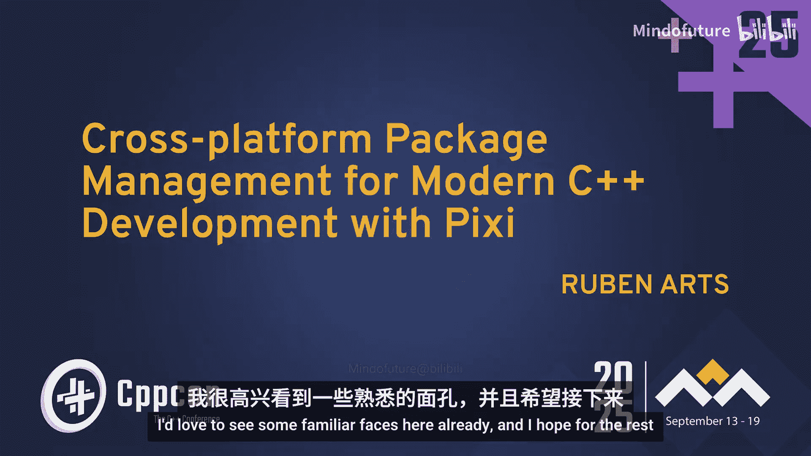
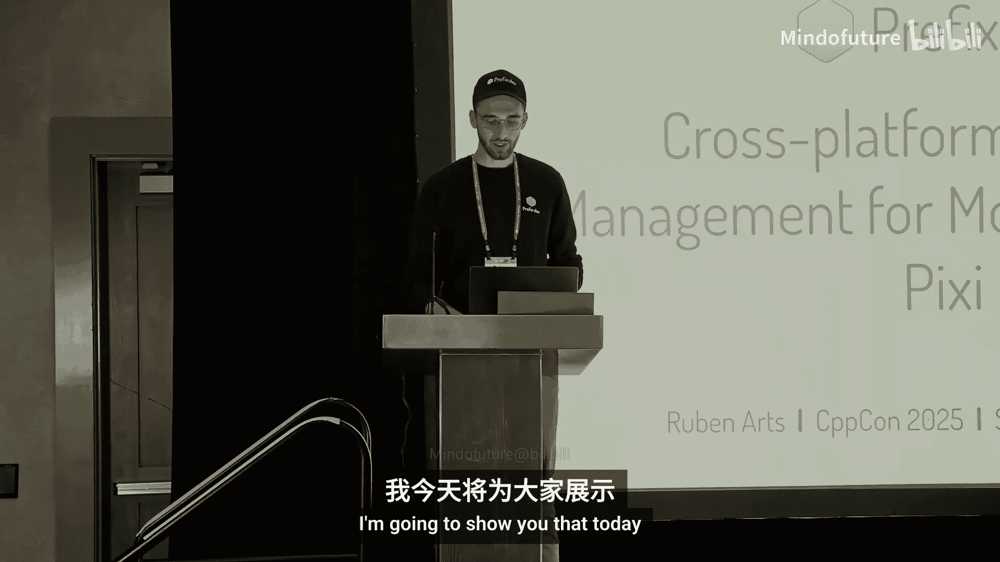
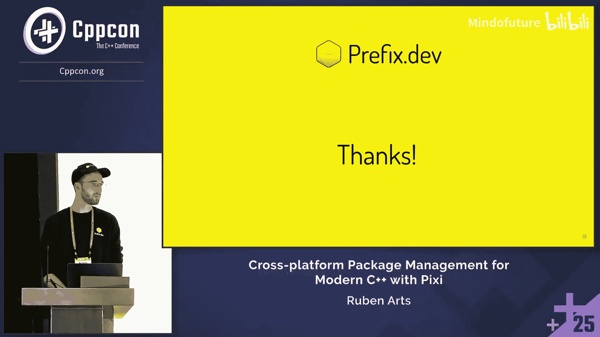
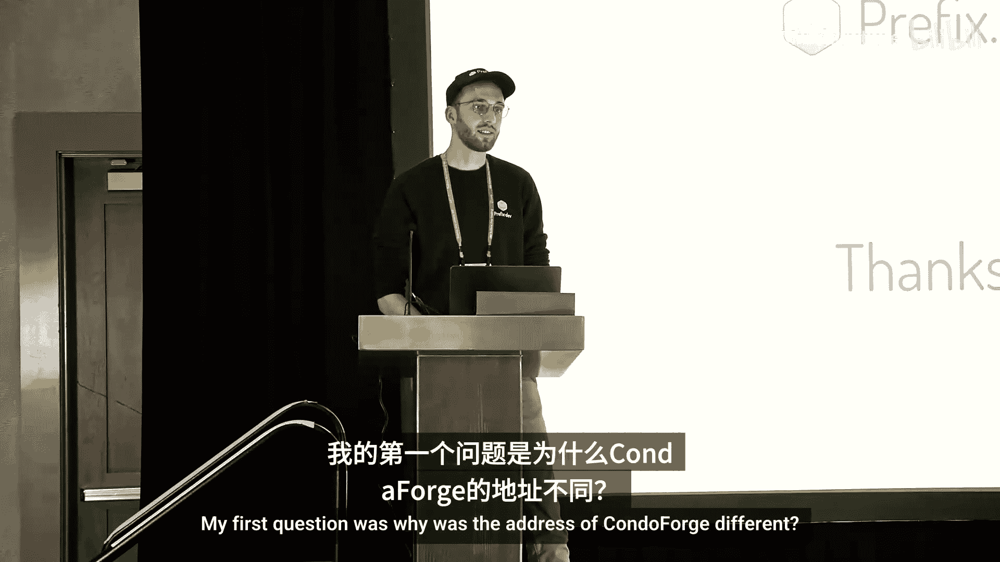
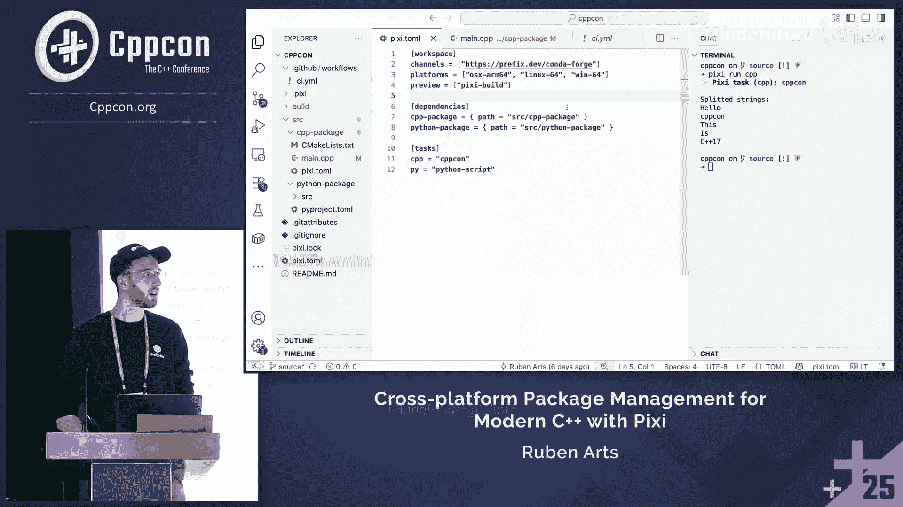
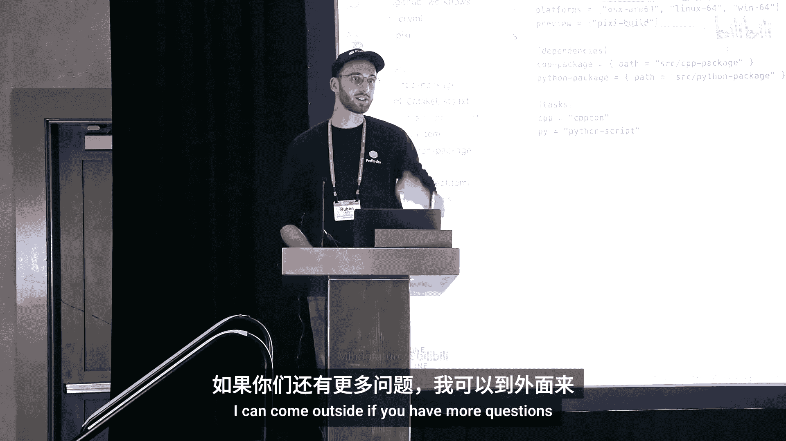

# Cppcon-2025-｜-C++-｜-C语言--｜-汇编-｜-编译器-｜-操作系统-｜-Linux-｜-Windows-p27-P27_使用Pixi进行现代C++开发的跨平台包管理-Ruben_Arts-CppCon_2025--BV1wyPBzrEeu_p27-

对。😡，Hello guys。 thanks for joining in。 love to see some familiar face already。

 and I hope for the rest that I can show you something cool。 I'm a human arts。

 and I'm going to talk you through Pixing today。 It's a cross platformat Pe management tool。

 and it's really cool for modern C++， and I'm going show you that today。😊。

So first I'm not alone in this， were a small startup in Europe。

 we've currently been working on bank management for three years。

 but we're coming out of an ecosystem prior to that our CEO built Mba。

 if you're familiar with Conda ecosystem， we are solving our own problems so were all from game development。

 robotics， data science and all these kinds of different。

Ecosystems where package management was still always a pretty big problem that we needed to solve。

 Thus， this company is solely based around the idea of helping package management be easier for everyone to use。

So first off， this talk is not about a C plus plus package manager。

 is's a talk about a package manager。 We're not poisonon rust or any type of language it's something different。

 So why should I still care about this this is a C conference。 Well。

 C plus like any other language can benefit from the generic package management。

 So you're probably familiar with homeru with Et gett with Winget or any other system language sorry。

 system package manager and Pixie can do the same thing。

 So you have the ability to have any type of package of any type of language on basically any type of Os。

 So we support Windows Mac and Linux directly out of the books。

 you can do it with binary and source dependencies and I will show you some examples later。

 and one of the biggest focus points of Pixie is repproucibility。 So the ability to。

Get your environment set up。 and then later on do it again， which might sound pretty easy。

 But I think all of us have had a situation where it was not that easy to get it set up again。

 And Pixie makes it really easy。So to give it some credit， we have already a lot of users。

 but one of which I think is really cool and especially for the S+ community is Freecat Freecat there's open source C+ developed computer edit design program and as all of these open source tools these days there is the description on how to compile on Linux。

 how to compile on Windows， how to compile it on Mac but there's also now a description on how to do it with Pixie because as soon as you do it with Pixie there is just a few commands left that you need to run which are all cross platformform and you don't really need to take your users through you readme to get it done basically it documents itself and the readme just contains how do I get Pixie which is a one liner for your machine and then maybe three or four commands to get your full system set up and probably your build run as well。

So before I go into more details on like the workspace workflow and all of the cool stuff that you can do for your receiptpl projects。

 Pixie also ships a Pixie Global， which is a tool to install tools on your machine So in this small example it shows you that it can install Gi It can install Z editor it can install envim PC package or con if you want to use different types of package management within your system。

 you can still use Pixie to get those installed on your machine。

 So it will give you an isolated environment with these tools installed。

 so not like with apps you have only one version that you can get or you need to play with repositories it is a normal version package management system and will put it in its own isolated environment So if you have a dependency in the Git environment that you need to update you can do that it will not touch the environment of any of the other packages that you're installing making it really stable on your machine It also comes with shortcuts and auto completion。

 which means。That it can also have like menu items。 for instance， in the example， we have。

The shortcut Z that is installed in your menu in your start menu or in like the desktop file and Linux or for every system。

 it has its own way of doing that。 But Pixy simplifies that into one command that you can run on all of these platforms。

 and especially it doesn't need any activation。 So if you're familiar with the Kma ecosystem。

 you often have to activate these environments。 This will be installed without the requirement of an activation so they will you will just have them always active in your CI。

 So you can just type get without an activation first。

Mainly meant for tools that don't try to get complete workspaces installed globally。

 I don't think that's the best idea， but。It could be an option for you。

So we're going directly into a little demo。 and this is a Pixie workspace demo。

What you see here is the Pixie Man。 I will tell you a little bit more about that later。

 but the ideas that you have one file that describes what does my environment look like。

 what is the where do I get my packages from So in this case。

 we define that we get the packages from Colla Forge by the way。

 is this readable for you I think I can grow it one。20 bits。

You define which platforms your project should run。 So in this case。

 we want to run on all the ecosystems like Mac Linux and Windows。

 which means that Pixie will always check， hey， all the dependencies that you depend on are they installable on these machines。

 So for instance， some of the tools some of the packages are not available on Windows and Pixie will tell you that before you try to ship it to your colleagues that are actually on Windows and that might require that dependency in this case。

 you can run Pixie ads and just like your normal package manager workflow。

 we call it ads call it install， that's the same thing but it will add that line also to this manifest。

 So if you then expect this states to change this is always done through this manifest and you will get like declarative experience instead of your system holds a certain state getting into that state might have become a long list of different commands to get you there。

 we always work from this。Mifest。 so the C I will just update that。 And from that point on。

 Pixy will do the rest of the workflow。 And I also added pyoner just because a lot of super plus developers use Python Pixy can install both of these things at the same time。

 So again， not just。To for C development。 I will quickly show you what that looks like。 So if you。

 for instance， want to update。And res the whole environment。

You can just run Pixy update and it will fetch your re data。 Unfortunately。

 that's going to take a little bit of time due to the internet speed here。

 but that was a soul for all the platforms at the same time。

 if you're coming from the Kda ecosystem that might have taken a few seconds。 in this case。

 it was just Internet checkout that we need to do with the rest is like instant。

 and we really optimized this workflow for everyone。

 then theres another thing you might have already seen。 This is called dosks。So in Pixy。

 we have an tasks shell that we ship with the binary itself。

 So these tasks are cross platform from here。 So if you start using environment variables or something like that。

 you define them like you would do with bash and then that would also work on Windows。

 it would also work on mic and the cool thing about this。

 we can do a little bit more than just running a command。 So it's not just an alias。

 you can also get these graphs of tasks that you define。 So in this simple example。

 we're running some Cmic。 you have a configure task， a build task and a test task。

 but we can depend on each other。 So of course， build depends on configure and test depends on build。

 And in this case， it will automatically execute them in the right order。 So all quickly。

Show how that works。Picture and test。 First， the configure will be run。Dend debilt。嗯。

A Pixie will also tell you what it ran in between with these little headers and it installed this little example。

 So I have some boost。 I have a Cmic list to get that set up。

 a cool thing that Pixie allows you is you don't you're not locked in so you can still use your normal workflow。

 you can still use your favorite way of dealing with CM if you're doing CM if if you're doing Python all of that works we have this extra file that you can add and that takes care of all of the batch management issues that you might get to so we don't try to lock you in into a different way of working we work with the normal ways and for instance。

 you could， in theory， just use conome within this environment and that Pixie set of the basics and that con O package or mix or whatever continue from that point on。

One thing I want to quickly show you as well， this is the log file might looks like a really long list。

 but what it does， it gives you which packages I specifically installed from which channel。

 which version and it goes a little bit deeper than just one file name it also says the Sha hassh and also the license that it comes with。

So this is a file that's very human readable， but you can do some checking on it。

 so it gives you some metadata that you can use， and this actually makes it reproducible because now we've solved it。

 it is in the log file。 If we add this to get， this will be easy to reproduce for anyone else。Then。

One very important thing， if you want to get a test that you normally build some C。

 So if you're familiar with Gith of actions， you need to define this workflow file。

 you normally would say okay， I need to run on all these machines， but per machine。

 you have a different way of installing This is something that you have to get close to what you're doing locally。

 This will never be exactly the same So a lot of people are trying to use Docker for these kind of solutions to get a little bit of a similar workflow。

A little example， what does this look like if you do use Pixie in the case that you use Pixie。

 you again just define which platform you want to run on and basically only have this extra line to say set up Pixie。

 install it and set up this environment for me and from that point on you have the same exact environment that you test it locally on your CI and from the point on you can run the task like you did locally so there is almost no difference anymore between what you run in CI and what you run locally。

That is the first demo。So let's get a little bit more detail on what that does。

 So what you saw is that we have this workspace in my example， what was called CPP comb。

 but in this case， it's workspace。 and in workspace， we have adult pie folder。

 and adult pixie folder contains the environment that we've installed。

 This is local to the project that you're installing。 It will be linked from cache。

 So the files that are in here are not copied all over your machine。

 It will be yeah there is some logic to decide which is the most efficient way to link it into your environment making sure that your cache is reused。

 but it looks like a normal like Unix style environment。

What this means is that you have to activate this environment。

 so when you install something with Pixie it will not break your machine。

 but that is because it's not activated unless you really want to So the files will just be there and then to run it。

 you do Pixie run or Pixie shellll Pixie shell will activate the environment and give you a shell back Pixie run will run that task shell that I talked about earlier and make sure that all the tasks that you want are executed in that environment and this is always close to the Pixie Tommal file and the Pixie will always put the Pixie work file next to that。

So that's a basic workspace environment。So I always showed you tasks what's really cool about tasks is it's very similar to makefiile。

 you can also say like on the change of this file， we want to update this task。

 so if you do have a really long really big graph of tasks that you need to run pixel will pickup up oh I only need to run these task because these files have been changed you can give aliases。

 you can give lots and lots of depends， we also have arguments that you can put in there and share them between these setups。

 so you really can make big pipelines of logic without needing to go outside and have another shell。

 take care of this or even go into like a Python script or something like that to do these sometimes simple tasks。

I already showed you the log file， but I want to reiterate on why it's so important。

 We think it's really easy to always add this log file anyway。

 Like some people say like no I make a library so I don't want to add the log file。

 but the log file gives you the ability to decide when you want to update packages and you can even go into C and say okay always like not to use the log file if you don't want that。

 but at least there is a way to get back to our situation that was working。

 So you now have the choice when you want to deal with these breaks。

 It also always locks all this platforms in one file。

 So there's one file will allow it to work on all the platforms。

 you don't need to manage it yourself。 it will make sure your C is a little bit more deterministic。

 can of course still make flag tests， but at least your environments are exactly the same you don't need to solve。

After it's already solved， sometimes if you add some pipeline packages， for instance。

 you might actually need to set up some built environments to solve this。 actually。

We not do that anymore because already can read all of the information from the log file。

 And if you've added to get， you can roll back。 so you have the ability to check， okay。

 which changes were made， Let me check if an earlier version did actually work。

And they get the actions again， it's a one liner to get it set up。

 and you don't really have to think about setting up these actions anymore。

What's the magic behind this So we use Coma Forge as the main repository of packages。

 This is a repository that's community managed there's over 7000 community members that add different upsource packages to that but this is every type of package so there are C packages in there there C+ Ro Python etc ce etc ce。

 to give you an idea this is again not a fair comparison but to give you an idea there's over 30000 packages on there and if you compare it to cone or PC package like it。

We are not a small project anymore。 There's a huge user base of of users。 But again。

 this is like thiss not the same type packages， but to give you a little bit of context what 30000 means。

 I think you can make sense of this。So Cola Forge has been built on the Kna ecosystem。

 This has been around for 13 years in the opensource world。

 you might know it as the Python package manager， which it's not I want to make that clear it's not a Python package manager。

 It's package manager that wanted to distribute compiled libraries for the Python ecosystem and it became really good at doing stuff like C++ and stuff like Fortron because it required for packages like nuy and like spi So thats where from the ground up it was built to deal with these kinds of workflows and these days it has gotten the name of the Python package manager but that is not really fair anymore because it works really well for these other types of languages。

 Pixie itself fully written and rust is also a Python sorry a Pixie package using all these ka packages So yeah giving you some credit to that workflow so。

To strengthen the ability to develop these environments。

 what I what you previously saw was a workspace that has C make installed that has some compilers installed。

 that has some libraries installed， but。It is still not a package。

 It still works buts still environment that you need to set up。 And then after that。

 you can do your own development。 But what if you can have。

package that is from source and in the coa ecosystem。

 you would normally use something called a recipe， which tells you how to build these items of packages into a Ko package。

 but we've introduced something new， which I will actually demo you。Which is called source beices。

So let me move to the source branch of this example。 By the way， this example can be seen online。

 I can link it after the presentation。 The Pixy Tommo now looks a whole lot different。

 It's still thes like where do I get my packages and which platforms do I support。

 We've added the preview to Pixy built because it's still in preview mode this feature but we are heavily building on top of it right now already。

 So in this example， I have added two dependencies， a C plus plus package and a python package。

 you will not see the compiler here anymore。 You will not see the C mix setup up here anymore because that's now part of those packages。

 The tasks are now just the binaries that those packages will build for you。

 So let's take a short look at the packages themselves。

 So what you previously saw the Cic list and and the main Cp still the same only thing is that I added an actual install。

Come on to the Cic list and then the Pixie Tommo looks like this。 So instead of the workspace。

 you will have a package definition， of course， a name and a version and then you have a backend and the backend is actually where all the magic happens。

 If you're already familiar with how the Python ecosystem uses built backends。

 we took a lot of inspiration of that。 So what this will do。

 it will install the backend as a tool in this case。

 the name of the backend is Pixie built Cic it is an actual it's its own binary and it will be able to read this source and create a corner package out of that。

So if I run install now because we have these both dependices in here in the main root of the workspace。

 it will actually go in here and check out， okay， I have Pixiebil CM。

 let me download PixB CM for you and run a build command on that and then check out what information is getting out of that and of course will give you the name。

 well give you the version and in the case of CM， it will also make sure that it creates a built environment that has CMG that has the compilers that has everything like from a standardized workflow。

 this can be configured if you need something special but just this that the basics will be set up for you like you would experience with like the build backends in the Python world。

You can add more dependencies to it so in this case we we're using boost so boostos is in this case a host dependency。

 you can think of it as a build dependency that you need to install for your target platform and this will automatically give me a lit boost also as a run dependency of this package that's some detail that I won't go too far in right now。

But if I know do Pixie install。On this。On this package， you will see an actual build being run。

 actually of both the two packages so also the python package， I'll quickly show you that。

The Python package is just a by project of T Pixie can also read by project of Ts。

 So we just added the tool of Pixie in there and the rest is exactly the same as your Pixie Tommal manifest style。

 And instead of Pixie built Seem， we use Pixie built Python here and that has the ability to read like the name and stuff like that from formula pipe project of T And then in the backend itself it will use either UV or Pip to do the actual building of of this package。

 one thing I want you to note here is that although it doesn't really make a lot of sense in this case。

 but you can actually have built dependencies from source。

 So if the CPP package was an actual library or something like that。

 Pixie will see that this is a built dependency or host penency in this case and will make sure that it is built before the rest of the built penencies So you will get this graph of。

Buildill setups that it needs to run。It。What it will do on your machine。

 It will create different built environments。 basically the same logic as Ka built will do for you。

 So you have a host dependency。Sorry。A built environment where your whole workspace is installed to build this package。

 This is similar again， to how the P ecosystem works。 It will be an isolated build。

 and then it will install that built directly into your environment and it will act like a normal package after that。

 You can have editable installs。Because there is a cool way of doing that so we can actually build an editable coma package from it and push that to your workflow。

 but the thing is that you actually can also have a fully released experience from your development workflow。

嗯。Let me see if I can give you a little example。 So for instance， now we want to rebuild this。

 And if you're experience with Ka built， this will be really slow to rebuild。

 But if I just change this to see pecom。I can run a new installation and it will pick up that it has a new setup for these things because we track the files that it used to change and then it will just rebuilt in like a few seconds it will have done a full setup again because everything is still cached and you don't need to have an actual moment incremental build like you would have with a normal goma workflow。

What can I show you more about it。 yeah right， So again， the C does not look different at all。

 So from this point on， we will have exactly the same thing Pix will set up the whole environment will do the build for you and we'll actually do the installation。

 And then you can still run your your tasks like you would do in your。Terminal locally。

And will actually show you that it is T comm instead of the hello world example that it was initially was。

嗯。Yeah， let's go back to the presentation。So。What was great about the work that we did next to Pixie is Rettle builtilt。

 So we're in our company improving more than just the experience of installing。

 we're also trying to improve the actual experience of building packages one of the biggest problems there was that Combil was just slow。

 So as you can see， the thing that we built rer built is not shaving off like compile time。

 like for instance for Pixie， it's still a rust built that we need to do。

 it can still take a few minutes to get that done。 but all the boilerplate around that has been speed up tremendously making actual building these packages a lot more fun again。

 and these data is coming directly out of the build form on Con Forge So these builds are really。

 really speeding up since since we've produced this Also the recipe formats that you need for building these packages is now Yammal instead of Yammal plus some extra logic。

Through comments and that actually will give you a lot of redquily lines if you try to read it。

 this is not the case anymore， and I really needed to put in Redr or built because I just think this URL is just a minute。

I should it。For more information。 So if you're a developer。And you're like。

 okay why should I use Pixie then recap Because I hopefully showed you some cool use cases。

 But the main focus is I want everyone to have a reproducible developer workflow。

 So something that you can try out locally， gift to your friend gift to your collea gift to your C and they will have the same exact experience as you had locally also that you will not be starting to break other projects on your machine。

 So if you have a pit installeded environment。 if you have an up the installeded environment。

 this is all global。 So then as soon as you update some packages。

 it might actually break other projects that you are working on switching between projects by switching between terminals is a great experience that I would recommend for everyone。

Then the ability to set up CI in like seconds instead of dealing with。

 oh how should I do this in a door agreement， how should I do this in this specific CI setup that I'm requiring doing the exact same thing as you're doing logo is the actual dream for C in my opinion then these packages that I just showed you you can easily just run Pixy built on them and then you will actually get a Pixy package or sorry a co package out of that and that is just reproducible distributable through your normal channel experience and last's not at least this is all cross platformform and we really want to take care of the problems that you are experiencing with making sure that it works on all the machines so you can actually have fun with the development of these applications。

You can try it out today。 If you scan the Q R， you will go to our documentation page if you have your laptop open。

 you can run the p mount and you can try it immediately。 It's a single binary。

 batch manager shouldn't need a batch manager， in my opinion。Have fun with it。

 I hoped you thought it was cool if there's any questions let me know。Thank you。😊。

Hey， thanks for the talk That was great。 You said you have like 30000。

Packages I was wondering if you have anything for the Ross ecosystem Oh that is an amazing question because I have it on my car。

 I am a big robotics fan， and that was what I came out of Yes。

 there is robotics channel actually it's called Robtack it has a different philosophy as Como Forge where Cona Forge will build all the packages in their own repositories and then push them to a general repository Rotack will do it in like a mono repo style where there's an automated logic to go from the Ro distros directly to the k recipes built that for you and push it there but just add Cona Forge and Rotack and then you will have the ability to install Ros packages。

Yeah。That works。Hi， thanks for the talk You mentioned how Pixie can read pi project Tl fileses I there any active development on reading cargo Tm fileses the same way I didn't have it in my example。

 but if you use Pixie built these built backends can read whatever you develop them to read so are rust backend because these backends that we currently have CMake byyth then but also rust Mojo more of these things they will be able to read that so in the cargo example you will not have to define a name of version all of that stuff will be read out of that cargo toma directly。

That's awesome， Thank you。Thank you。great talk I had two questions and a comment the comment was that regrettably locked environments are not necessarily reproducible because sometimes packages are removed and then the environments are broken but has not included the talk my first question was why was the address of condoda forged different Why did you go through prefix debt？

So for the standard condoda forge yeah I use the prefix mirror。

 mainly because I also it's just a mirror。 It's just a mirror I use it in this case not to just like show that we're also having but it's actually a little faster so where you're using the normalconda for from Anaconda you will download multi megabyte file if the ripple story updates we actually implemented a new way of downloading these files so we can download shs So in this case if only if only quite an update I only need to download like a few small kilobytes of change instead of a huge amount of data and for demos it's just so much faster that I is this something that other firms or people can produce locally。

Their own channels like that's from in the same way。 Yes， its。

 supports completely the same logic as a。 And then my second question was。

 do they understand correctly that there is a separation between a workflow and environments in that workflow？

 So in the sense， can I activate an environment from anywhere or do or do I have to be in the。

Direory for that workflow where the dot pixie is。So the quick answer is yes。

 you have to be here in the folder， but you can of course define a manifest path。

 so just give it a path to the root of your project and we actually have an issue open that I wrote a few weeks back to give the same workflow acon where there's like a global registry of the names thanks。

Thank you。

啊是。That's it， sorry， I can come outside if you have more questions， thank you guys。

