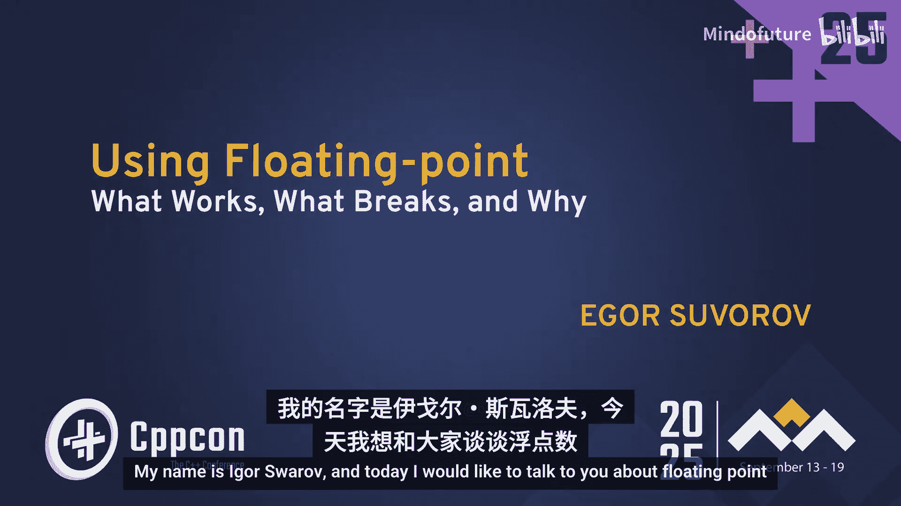
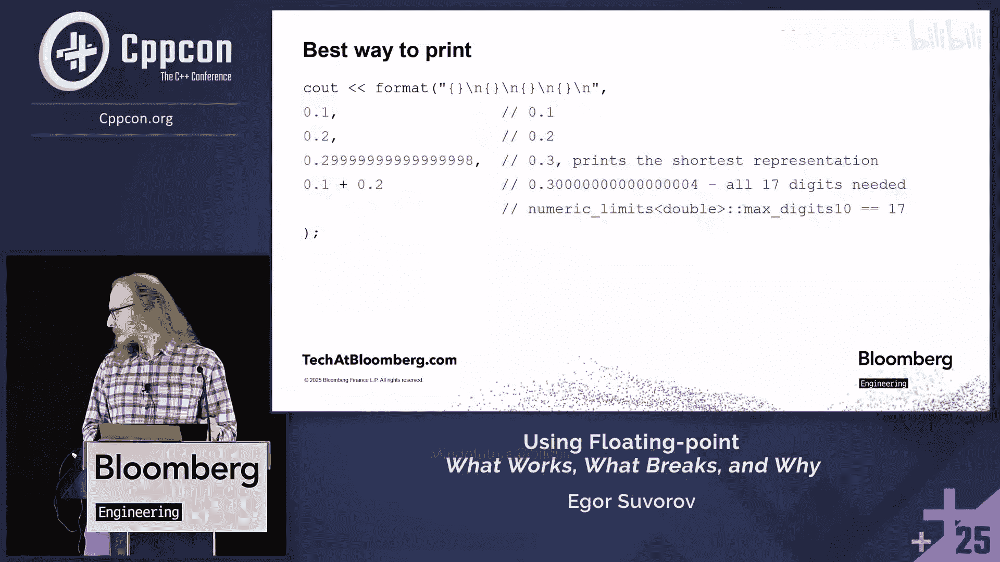
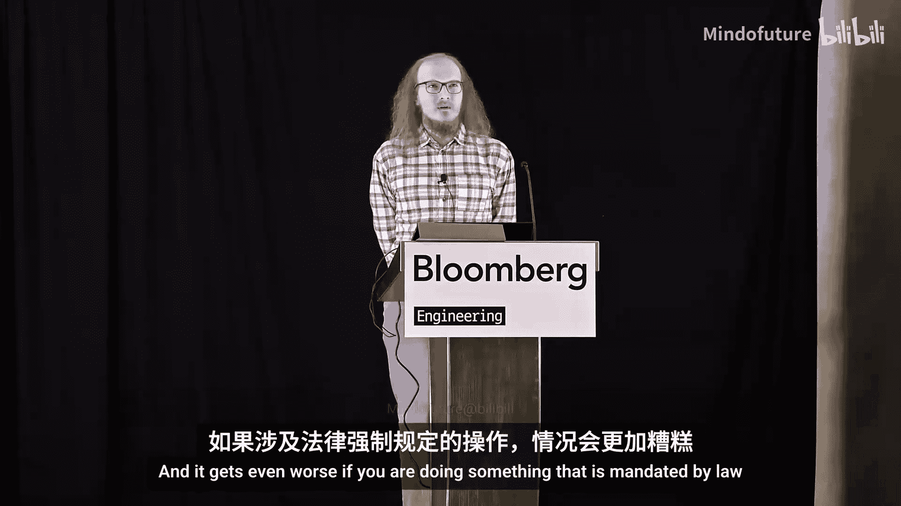
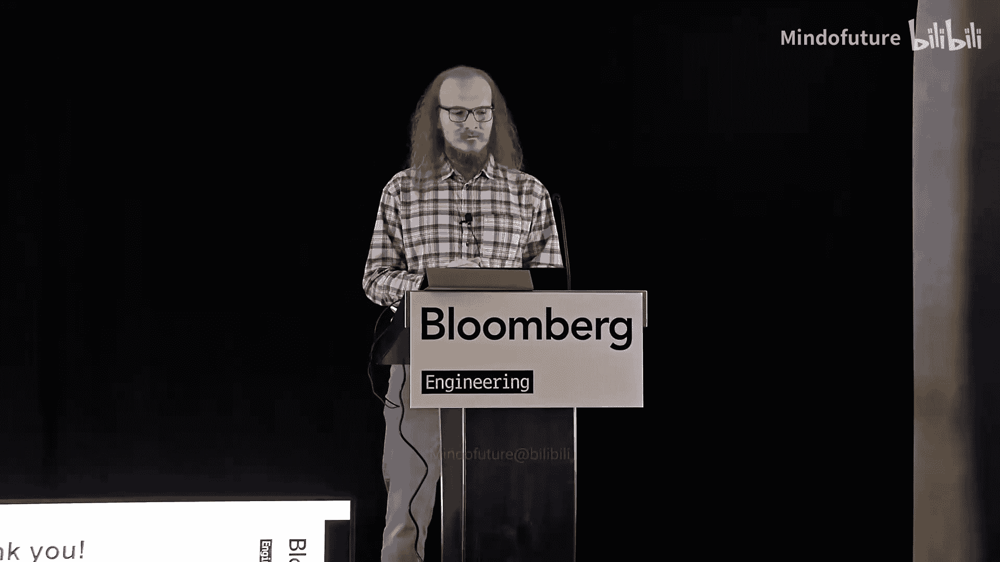

# Cppcon-2025-｜-C++-｜-C语言--｜-汇编-｜-编译器-｜-操作系统-｜-Linux-｜-Windows-p28-P28_在C++中使用浮点数_什么有效、什么会出错及其原因-Egor_Suvorov-CppCon_2025--BV1wyPBzrEeu_p28-

Okay， so hello everyone， welcome， my name is Igor Swarrov。

 and today I would like to talk to you about floating point numbers， what works， what breaks。

 and why。

So this talk focuses on binary floating point numbers， because in simple plus like float and double。

 We'll talk a little bit about mass behind them a little bit about standard behind them。

 a little bit more about C plus implementations like compilers and standard libraries behind them。

 It is not the only way you can work with non in simple plus。

 There are also decimal floating point numbers available in thirdparty libraries。

 And there is also a proposal to include them in standard simple plus。

 They might be more intuitive for some applications So you might want to check them out。

 You might also like fixed point arithmetic that again， might be more intuitive in some applications。

 you might want to check out arbitrary precision libraries if you need 5000 bit of precision and not just 50。

 but I would advise against going to them right away unless you know what you need that much precision for And there is also interval arithmetic。

 which is a really nice thing Again， check it out， not focus of today。

Let's start with floating point types in C the standard guarantees that we have three standard floating point type in C+ float。

 which is subsets of double which is subset of long double but it doesn't guarantee much above so it also allows for extended floating point types it is implementation defined and for example in GSC we have double which is8 bytes and long double which is1 but in visual Studios those are exactly the same type that takes8 bytes it's also implementation defined what these types actually do so when you type a plus B its implementation defined what will happen that's bad news good news is that compilers typically use whatever is a hard words give them and that typically means I believe least 754 standard which is good news and thats our todays focus Another bad news is that even the compiler claims that it supports the standard in full it doesn't mean that there weren't some artistic choices that might make following the standard a little bit harder and sometimes it even feels like undefined。

You write some code and it behaves a little bit differently from what you expect according to these standards or you write a code。

 it works on your machines then you send it to your friend and it works completely differently or you build it with a new compiler and it works completely different。

 All of these signs of UB and unfortunately or fortunate it's not what's happening happening in here but will start with something similar as a reminder here of what normal floating point numbers look like you get a number。

 you turn it into a binary exponential form then you make sure that it starts with one dot then remaining bits are called Manisa。

 you also have exponent， those that are in and you can easily write them into memory So depending on the type。

 we get one bit for a sign， we get some number of bits for exponent and the rest goes to Manisa I could also talk about range of these types but I think it would be a little bit misleading range is largely determined but how much bits you have in exponent and I think that precision which is how much bits you have for Manisa is much more important and much more trouble stem from Manisa。

And exponent。Floating point is designed to work with small numbers and big numbers reasonably well and they care about relative precision so in this talk we will be mostly focusing on double so for example if you take a look at difference between one and the next number that is representable in double the difference is about 10 to minus-16 if you repeat this experiment with1 billion the relative error is about 6 10 to minus-16。

However， if you care about absolute precision， then you might have some issues， for example。

 there are 2 to 52 doubles between1 and2 as you go higher between2 and40 2 to 52 doubles again。

 so that twice as sparse then again 2 to 52 doubles between4 and8， etc cea， et if you go toward 0。

 the picture is reversed you get 2 to 52 numbers between 0。5 and1 etc so the denser。

 the closer you get to 0 and if you care about absolute precision for example in your particular game a block has size1 then it means that if a player bounces somewhere far away from origin point they might have some fine effects and they will create a dedicated wiki page that least all these fine effects that they may observe in your game because of this floating point stuff。

Now， let's zoom in at what happens around0 around0， we have the smallest possible normal number。

 which is called double mean and c plus plus and to the right of it we have lots of doubles 2 to 52 and there's the densest they ever get for doubles but on the left of double mean we have this big red gap between zero and double mean with absolutely no numbers it's not the end of the world by itself。

 it's not criminal but it might have some issues if you do calculations。 For example。

 if you have two numbers that are small and close enough to double mean like low and n on the slide and you want to do some linear algebras then like maybe some linear approximations when you subtract this to numbers you might accidentally get zero because the difference is smaller than double mean and it gets rounded down to zero。

 So again， not the end of the world but if you want to work these numbers that means you will then have to handle this division by zero everywhere。

 which is not great So what we have instead is we have gradual under。

or subnormal numbers and we just add another group 2 to 52 numbers between0 and double min inside that gap even with sparse so now we have same group of numbers both on right and on the left of double min with same distances between them and that way we have a new environmentviant if you have two different numbers and you subtract them then you will get not zero which is really nice so these numbers across subnormals they are represented in slightly different way they work slightly differently from normal numbers and they solve this problem of accidental division by0。

Another special things that we get in floating point numbers are infinities Again。

 they are a little bit helpful for some cases like overflows when you want to check whether a times b is greater than c with integers。

 you have to handle some special cases like whether B is equal to0 what is the signine of B So the division actually works with floating point you just write a times B greater than C and if it overflows then it becomes positive infinity or negative infinity depending on the signine and it works more or less as expected。

 standard functions also work with them like exponent of negative infinity is 0 and logarithm of0 is negative infinity allegedly that leads to simpler code less branching as you don't have this special case of B equals 0 and hopefully more clearization and better performances。

Another thing that we have is sine0。 so by default， you get positive0。

 which is plus 0 or just0 that's called than s plus If you negate it， you get negative  zero。

 which is equal to 0， it's greater than all negative numbers。

 obviously and the only thing where it matters is when you divide something by negative zero for example。

 if you divide one by infinite， you get sorry one by positive zero， then you get positive infinite。

 if you divide one by negative zero， you get negative infinite and that might be useful in some cases where you care about the sine of the result and expression but you don't really care about value of the result in expression。

 So if you had an overflow somewhere in the middle then you will get a reasonably correct result。

 at least you will have the same sign might be useful。

And the last thing that we have is nu or not a number it's actually not a single well because there are a whole group of them。

 and they typically appear when you do something that looks invalid from mathematical point of view。

 like you take a screw root of negative number or you take not a number and add number root that's also not a number。

 or you multiply0 by infinity， which doesn't make much sense in undergraduate calculus。

 but on the other hand， multiply in positive number by infinity。

 makes sense in undergraduate calculus， so we get infinity instead of1， again。

 might be helpful for for some cases， we will none a little bit more later in the talk。

Now let's talk about rounding because all of this is fun。

 but we don't have infinite number of doubles and they will be around it like on inputs， on outputs。

 during compilations everywhere， so we need to understand how it's happening。

There are multiple rounding strategies we can truncate fractional parts。

 and that means we are running towards 0， we can round towards negative infinity that works differently for negative numbers。

 or we can round to the nearest number， which is the default in Ie37 Ie 754。

Not that I only round to integers we will be talking about runninging to multiple the small places later on in the dock if we want to run to the nearest。

 then we also have to define a tie breaking strategy， so what if our numbers ends in exactly 0。5？

Ty breaking shortages similar to rounding shortages， we can tiebreak。

 we can round tiebreaks towards0， we can round them down， we can round them up。

 we can round them away from zero， which is what I was taught in primary school so 0。5 goes up， 0。

4 in sales goes down or we can do what is called half to even or mentor rounding。

And the idea is reasonably simple。 So if tie breaking matters to you。

 that means you get a lot of ties in your inputs， you get a lot of numbers that end in exactly 。

5 and that probably means that you want to round half of them one way and half of them another So hopefully all these errors in rounding cancel each other out which is exactly what happens with banker surrounding。

 So I have an example here3 numbers0。51。52。5 the real sum is  is 4。

5 if I round them with banker surrounding and then add together I get four which is the closest I could get with all other row stretches of tie breaking I get either 3 or6 which is slightly worse。

Now， where does this actually happen， So first of all。

 it happens when you write your program and you compile it。 So when you write the 0。1 in C plus。

 it's a mathematical abstractstruction， it's not a real number that exists in C plus or binary floating point arithmetics It's reality it's around it during compilation to the nearest possible number that is presentable inside double So whenever you try to prove or read anything about binary floating arithmetics please make sure that when you see 0。

1， you understand whether it's a mathematical abstractstruction or whether it's an approximation of number that is double or float。

 So by default default compiler will around to nearest presentable title to even we'll talk about even on the next slide a little bit and now that it doesn't necessarily means that you will get the same digit in the beginning。

 So 0。1 happens to be round it upwards。 So with infinite precision it starts with 0。

1 some 0 some digits but 0。3 when printed with infinite precision starts as 0。299999 ce etc。

So there is also an interesting question like what is the tie between the maximum possible double and infinity because if I type a veryic number。

 it will become an infinity， but at what point it gets rounded down to a double max is separate questions that we won't touch today。

What does it mean do round have to even with this compilers Well even just means last bit of Manisa is0。

 we're working in binary， so even looks at last bit of Manisa note as that similar representation。

So I have here three numbers A B and C， these aref floats。

 they come one after another and if I write these values in my s program。

 they will to be represented exactly by the compiler but if I write some numbers in between them like x and y at the bottom of the slide since the compiler have to understand whether x is actually closer to a or to B and choose appropriate value In my case。

 x and y are equally distant from A and B or from B and C in case of y So the compiler has to first understands that this number is equally distant from A and B and second it has to understand that B is the one that has0 as less bit of Manisa So x is actually round it to B and y is all rounded to B and compiler has to be smart because if I change just one last digit of number y in my source code so that 500 becomes 501 then the compiler has to realize that there is no longer at I and this like big number y is now actually closer to。

See even though it's not representable in float exactly so it has to do something during compilation and the same happens with this doubles this double lits。

 So fortunately this is a solved problem so compilers work compilers may be doing some arbitrary precision arithmatictics inside I'm not really sure probably they don't and yeah you just need to know that this exists it works which available。

Now， after completionil we have runtime， so when we want to add two numbers together。

 let's say we want to add 0。1 which is really this number of the slide with 0。

2 which is really this number of the slide。 What happens is the CPU will add them is with infinite precision they will get the next number of the slides which is close to 0。

3 but not exactly and this number is unfortunately not exactly representable in double So it have to round it and again by default the mode is round to the nearest and in our case we have two options one is slightly less than real 0。

31 is slightly larger than real 0。3 so we have to round to even bit。

 and in this case it the second option that has less bit of minus is a 0 So we get that 0。1 plus 0。

2 is equal to 0。3 loss of 0s44 etca etc。And this number is actually a bit further away from real mathematical 0。

3 than there other options that we didn't choose。 So now we have this classical example that happens in simple class。

 Java， Java and most languages when 0。1 plus 0。2 is not equal to 0。3。

 So this what is happening just a bunch rounding。So we had all these rules and now the question is are these rules consistent between compilers and different machines。

 as you might guess， because I have a separate section for that， the answer for is not really？

We will start with GCC and GCC has a separate web page that tells you how to report bugs and it has a separate section that tells you which bugs and not really bugs and they don't want you to report them and one of the examples that they have is this one we have number a which is 0。

5 which is exactly representable in double well at least it should be and then we have number B which is equal to 0。

01 which is not exactly representable to double but according to standard rules it should be rounded a little bit up。

And then we just divide a by B and we don't expect to get 50 exactly。

 but we expect to get some number betweencate to integer and print what will be the result and then we do the same thing but we divide in a separate lambda function So in the first line we might get 49 because the real result with infinite precision here is a number that is slightly smaller than 50 because 0。

01 is actually slightly larger or we might get lucky as rounding and get 50 exactly in that case it will be trucate to 50 instead of 49 So we expect either 49 and 50 in the first line and I personally will expect the same result in the second line。

As you might guess。Both assumptions are wrong if I try GCC and I compile it in 32 bits with C++ 20 standard。

Then I get 49 in the first line and 50 in the second line。

What's even more surprising in that C+ 20 is supposed to be the most pedantic version of C+ 20 that GC supports and new plus plus 20 is supposed to be relaxed C plus 20 is some G extensions。

 So if I remember correctly this works the other way around a year ago so I think they fix something but maybe I just misremember visual Studio and Kang brain 50 in my tests all the time So what's really annoying about this is not that Gcc disagrees with other compilers is that a simple refactoring like extracting expression into a function might change what you see I believe the same thing can happen if you add edbu print so yeah that's not great that really feels like undefined behavior not cool so I believe it's not undefined behavior so what is happening here。

And what is happening is called excess precision。 So when you divide 0。5 by 0。

01 N all x numbers with infinite precision， you get this number on the screen。

 I highlighted that Manisa with yellow and the next bit after Manisa is in red。

 So we get this number as a result。 It's not exactly representable in double So we have to round it and we have the options ver around it。

 we either round it up to number 50 with all bits zeros or we round it down to the previous representable number which is 49。

99 and9 etc ceter， and then the next bit after Manisa is0。 So with 52 Manisa bits50 is closer。

 So if our calculations are completely within double。

 we should get 50 exactly And that's what we studio and clientang do。😊。

If we increase my number of antiabs from 52 to 53。We still need to round it up because the next bit of matius is1。

 and if we have at least 54 minusab bits， then the next bit is actually 0。

 So now we are rounding down to 49。99999。And yeah， so actually， that's more or less explanation。

 When you work with 64 B GC， it uses SSE instructions and 64 bit registers， same as double。

 So we always calculate everything in double but in 32 bit mode Gcc sometimes uses 80 B register from x 87 from last century and it think well。

 I've already divided a by B in this 80 B register， I will then need to decate to an inger。

 So there is actually no need to trucate it to 64 bit double after reftri I will just show in a little more precision for free for the user because extra precision is fine。

 Well apparently it's not always fine because it changes what decision we make with art program which is not great。

 it's an old issue it was first reported 25 years ago I'm not sure if it was still about excess precision back then maybe it was something different It's like an umbrella issue。

 I first encountered it in 15 years ago when I was doing some combative programming I discovered it the hard way because my solution failed during system tests while it's worked for me locally。

Whi was a bit annoying and again developer developer founded a few years ago when he wrote this nice blog post How join the Bar to3 community。

 I believe GCC added some switch to C to fix that and they also added it to C++ maybe a year ago it didn't work for me for some reason。

 but yeah， I'm not sure maybe I'm not trying hard enough。

This is not the only issue with reproducbilities we have。

 There was actually and I stopped by She action last year at CPPcon。

 we may also have some bio optimizationimization， for example。

 in floating point numbers so we can set around in mode different run time if we don't want round to nearest。

 we can round towards word plus infinity or negative infinity and compiler might sometimes break it if they want to rearrange negation signs around this can be disabled with a separate G flag or you might want to compile it with fast mass mode which allows compiler to do more incorrect。

More incorrect optimizations。 by incorrect， I means that they are not correct in presence of roundings as we do with floatinging point。

 they are mathematically correct， but they are not correct in Ia 754。 We also get access precision。

 and we also get a case of access precision that is called fu multiply ad some CPU support a separate instruction that allows you to do multiplication and addition in a single step。

 and it is faster， it sometimes allows you better precision。

 which might or might not be what you want。 So it's a case of access precision。

 So it becomes harder to understand what your code will actually do with all this numbers。

 if you have all of this in a modern compiler and you do have this in a modern compiler。 So if you。

 for example， try to implement a hand algorithm， which is mathematically equivalent to just calculating some of all numbers but it does it in a slightly clever way。

 So all these errors accumulated in a separate variable and just providing better precision。 Well。

 you can't really be sure that this algorithm works as intended when you use a modern compiler。

 you have to actually inspect the assembly code。Okay。

 so do we actually get any guaranteeees from any standards As a matter of fact， we do。

 So we know for a fact that four standard automaticmatictic operations and square root are calculated exactly to the last bit。

 At least that's mandated by the standard end that's what happened in my na test for some functions for all other functions we don't have the guarantees for some。

 we now have as a matter of fact， for example， for sin of a very large number。

 We don't know how to calculate its west least。 I don't know It is a solve problem。

 And actually most standard libraries do calculate sin exactly to the last digit。

 I'm not sure if that's meaningful because if you fluctuate input of sin on such big magnitude a little bit。

 and output changes significantly。 So not sure if it's even useful。

But the really bad thing happens with power function for all， you know。

 some standard libraries might implemented by exponentials and laborgraphs and 10 years ago again during competitive programming。

 someone discovered the hard way is that if you try to square number 10 and then you not always get 100 exactly。

 which isn't great because inputs are precise， the output can be precisely presented and double but it's just the function itself that is not ideal and it's actually permitted by the standard。

So I decided to check whether the still holds， so I wrote this piece of code。

 I go through all numbers between0 and 100 and I only check those that have a to the power of B less than。

 let's say a billion of a billion so I can double check it with long longs later on。

 and then I run it across several machines in different contillation modes。

So what I got is about 1% of incorrectness。 so you don't。

 you will not find it like during your day to day work， Probably you might find it accidentally。

 For example， with32 bit visual Studio， if you raise 7 to the power of 19。

 you get an incorrect result with the embedded P function， but I think it doesn't happen with Gcc。

 when you compile with Le as the D+ plus and also this set of incorrect inputs is different for business for different compilers。

 So yeah， that's like one more thing to be aware of P is not guaranteed。

 if you need both of two integers just right at the self I say。Okay。

 so now we have a lot of things to get about how do we debug issues when they happen。

 We need to print numbers。 turns out it's also not as easy。

 If you print it in default mode with C out， what you get is person J specifyifier for printf would prints six significant digits and not more。

 it rounds everything to six significant digits。 you have even if you have an integer that has more significant digits。

 And then it also sometimes switches to scientific nots to try to make the output as short as possible。

 So， for example， if you ver to print 0。1 plus 0。2， it will print 0。3， even though 0。

3 is not what we really have here。 We need more significant digits。

How much more well there is a nice constant called Max digit 1。

 which is exactly what you need for float tie specifically it is 9。

 that means that if you print nine significant digits in Demo。

 it's always enough to uniquely identify float。8 digits might be enough sometimes， but not always。

 for example， on the slide， I have two numbers that end in 0。156 and 0。164。

 these are two different floats。 But if I print them with8 significant digits instead of9。

 they are both around it to 0。16。 So they glue together。

 This is not an obvious fact because we only have 32 bits in onete set in float。

 And that means about 8 million values。 So I would expect 7 digits， maybe 8。

 but no turns out we need full 9 that small digits to print this。 So yeah。

 please use this constant instead of trying to calculate it yourself。

 So theneonic here is if you're looking for some number that specifies the minimum possible digits you need to can identify something。

 Max digits 10 is your friend。Don't confuse it with another constant that is called very similarly。

 It's called digits1 and it is actually equal for264 floats and it tells you about conversions the other way。

 how many decimal digits can you store in a float precisely and then get back So it turns out you can always store six digits in a float precisely and then get it back but it's not always true for seven digits again。

 an example on the slide I have this number 8，5，8，9 and7 and then if I write3 or 4。

 they both get rounded to the same floating point number when it turns them they get both rounded to3。

Which is not great And again， this example is not easy to combine because I looked through 10 digit integers and I found only that 03 of them are failing this test and 7 digits are almost always enough and for 11 and 12 digit diggers I didn't find any examples that actually don't store 7 integers exactly。

So dig1 is the upper bound if you're thinking like what is the maximum number of digits that I can safely store。

 digital10 is different。So what is the best way to print。

 You can obviously print like 17 digits for double and 9。4 flow。

 But the best way is to use SDD format from C plus 20。

 and it will smartly understand what is the minimal representation of a number that you have。

 So if you give it 0。3 round which is your0able double。 It will understand the printing just 0。

3 is enough。 If you give it the result of 0。1 plus 0。2。 It will understand that printing 0。

3 is not enough。 and it will keep printing more and more digits until we can uniquely identify the set specific double and differentiated from 0。

3。In this case， it has to print all 17 significant digits， that is the max digit stand for double。

So that's for numbers。Sream。You was是在。Now， I hope it's not about fllocking phone numbers。

We only have two screens here。That format。FMT format。

 not sure I suspect it should do the same thing because they will like model one after another in a sense。

 but I haven't checked。Yeah， any other questions while we're waiting for screens？

Is there an interaction between？There's just 10 whether you're printing in a sentence scientific notation or。

No max stem don't care about scientific， Sc is merely about whether you print lots of zeros at Z or whether you print like E plus9。

So it's the same。There might be some like difficulties with specifying number of digits because theres like plus -1 errors in print of modifiers。

 I believe。 So sometimes they account for like sign in the beginning。 sometimes they don't。

 So that might matter， but。That's much more。在 bother。Second。嗯。Woring about her。

I'm sure if I can hear you at home。But abouts， which are。Pation of 30 point numbers other than 754。

Oh。Yeah， so yeah， the question was， should we care about other representations for multiple numbers other than 754。

 I don't。 And I leave。 So I've heard that it was a real issue like 40 years ago when the standard was invented。

 and there was some situations with some formats where you can say， for example。

 you had like a divided by like a plus one greater disadvantage。

 It's like some weird stuff like this。 It's not happened in 7 by 4。

I suspect there might still be some hardware around that doesn't support 754 or maybe there might be some bugs in emulation but。

Yeah， I'm not aware of any hardware or yeah， if anyone has experience with non 7，5。

4 in the last 15 years， please pick up。Sure that' try maybe disconnecting laptop。

You could try it yeah。是。these ways of handling floats carryover from C or choices that C+ Oh， yes。

 yes， there are some things that we carry from C in C+， specifically SDD complex type。

 which I will be talking in a little bit if the slides fixed but yeah and it actually means that sometimes C+ is not as optimal because because it has to keep compatibility with C。

 I'm not sure if it's intentional or if it can be fixed， but yeah that is an issue。

I also heard that C might have some slightly different shows from C+。

 but my understanding is that neither standard really talks about floating point numbers。

 they just refer to 754 or just say it's implementation defined stuff。

Hes it。Cases three。using decimalYeah yeah for sure。

 the question is whether there are cases where people should use decimal floating points， Yes。

 for sure， for example， if you're working with real people。

 then real people typically sync in decimals so they type in some numbers like 12。5 plus 3。

5 and they expect it all to be exact which will be the case for floating point numbers sometimes but not always and when it breaks it's extremely hard to get rid out of your system。

 because if you're already using binary floating points throughout your system。

 it's already there it's like starting binary it's stored logs。

 it's in all Apis so you can really switch the decimals but yeah like if you're designing some financial application or something that you will keep financial people to work with so yeah please use decimal floating point numbers。

 The downside is they're not as popular So they might be bugs they might have significantly degraded performance because they're not supported by modern hardware I believe but I might be mistaken。

So yeah， for sure like for example， Excel， I think uses 754。 Well， part of it， for example。

 Excel doesn't support general normalmalized numbers because they behave weirdly and not sure if I fully agree。

 but I can see some reason behind that decision for Excel。 And。

 if you're working with financials in Excel， you may accidentally get all these fun stuff and rounding errors and lose ascent or maybe a dollar or maybe more。

 and it gets even worse if you are doing something that is mandated by law。

 Well if your auditors also use Excel， you're maybe fine。 but。

Has it arise， not so sure。Next slide is slide 36， so we were talking about how we can print numbers。

 What about non numbersers， What about infinities and nus Well。

 situation is reasonably simple Everything is case in sensitive。

 we have two different spellings for infinity in and infinity for none we can also have sign of none because sign of none is part of its spellload and we can also have implementation defined information in parentesis after none optionally so my is chill。

 it just prints in none negative noneun without any information but visual Studio actually uses this heavily and it can have quite none it can have signaling none it can have indefinite noneun all of them are spelled differently before visualual Studio at 2025 we also have a completely different standing spelling just visual Studio but I believe now it's standardized in C and visual Studio agrees again it's not the end of the role if you have different spellings for none like sine maybe something after none but it get worse if you want rereibility across platforms。

For example， if I take this line of code， which is C out square root of negative  one。

And that's the line。 So if I build this line with 32it visualual Studio for 32it Intel CPUu and run it on my computer。

 I get as an output negative non parentheses in。 So I get like seven characters。

 But if I run the same executable on Windows arm on my colleagues Macas with parallels。

 I get just none， I get three symbols instead。 And I believe that's because my Intel CPU and my col's Mac CPU use different nu payload for square root of negative numbers and visual Studio library stays the same and it only handles nuuns that it expects on Intel CPU and whatever it gets on Mac on Mac。

 it will just print as noneun。 So if it depends that。

 yeah here is another thing the same application without any compilation can work differently on different platformss。

 I guess because Windows arm doesn't bother to change internal representation of noneun for some functions。

 which I can totally understand。Now that we talked about none let's see about few more things about nuns so now in section nus are special First thing that you need to know about nuns is that they are not equal to any number。

 theyre not greater than any number and they are not less than any number which makes sense from mathematical point of view but it also is not equal to itself so none is never equal to none which makes no sense from mathematical point of view and it also breaks lots of natural assumptions about how comparisons work which isn't great。

 and I believe the initial idea behind the decision was that when the standard was first adopted last century I wasn't there for sure。

 then they didn't have is none function in standard library of any language but they still needed to provide some way of testing whether value is none So they decide okay let's just assume that x is not equal for x is true for nuns and falls for all other numbers which again。

 not the decision that might be the best but I can say when they come from。And in practice。

 what does it mean that if you have， let's say an array of doubles that has none。

 then you can sort this array without invoking undefined behavior because none is not equal to itself。

 none is not less and is not greater than any as number。

 So what happens in practice on my machine is that none just splits the array in all elements before none and all elements after none and it sorts them independently。

 Of course it's undefined behavior。 So that's what's happening on my machine with my specific standard library but it can just as well crash it may freeze it might time out。

 it may look indefinitely it may format my hard drive or SSD because well when're in 2055 now。

 and it's true for sort is true for set is's true for any in-house algorithms that you can write。

 So there is no way you can write reasonable sort of doubles if you don't handle none in some special way。

Turns out that Ie standard actually has total order predicate that gives some order to nuuns positive0 negative0 and infinities。

 but I think it's not implemented in simple class and comparison of nuuns is still implementation defined。

 so I'm not really sure whether it's useful。The next thing about Ns is their payload so Nn has one sign bit and 52 manisab bits that we are completely free to put anything in Z except for all zeros in the Manisa。

 The initial payload is not specified so again square root of negative number on x8 to6 CPU is negative sign all bit of Manisa as 0 except for one and on arm 64 that they checked as compiler Exper I get the same exact none but the sign is now positive I think its implementation defined what we actually get So may depend on the compiler on your con flags on the and CPU I believe the historical idea behind having these Manisab bits is that CPU may store some debuggging information inside none about the origins with n for example。

 a of an instruction where that none first appeared So when you see nonean as an output of your program you could then trace it back I don't think of any systems that does it currently there are also notions of quite none and signal lines that were I believe going for some debugging so please share if you use them or if you use them in the last 15 years and。

Help you because I haven't found any non theoreticaltical applications for them。

 Another fun part that we can have with nuuns is that we can notice that 52 is greater than 48 and 48 is a number of bits we need for 64 B pointer at the moment。

 So we can actually store pointers or even full strings inside nuns。

 And this is what some certified libraries do。 for example， in Lombberg。

 we have this video the datum type that uses exactly that。😊。

And we do still have some guarantees about payloads in nus， for example。

 if I have N1 with payload and none2 with a different payload。

 then if I make some operation with this nuuns， it's guaranteed that I will get either of this nuuns as a result。

 So if I add them together then is guaranteed that the result in none will have a payload as of 91 or N2 if I take square root of none。

 I get the original nu back。 And there is also this SDd in nu function in standard library and it's some limitation defined what it does with its argument。

 Bea Studio just ignore this argument completely。 And just takes this argument Part as a S number and then puts it into。

As a payed internet。There are also some fun corner cases where passing none as an input for integration does not result in a nu。

 For example， if you want to calculate hypotenus of a right triangle with one side being infinite。

 then it doesn't matter what the other side is the result is always infinite and the standard decided well let's allow it for nuuns as well So the correct implementation of the hypo function will handle none and infinitefinities separately and it might mean that it actually might be a little bit slower than your own square root of x squared plus y squared implementation Not sure whether you really want to use na information of the time maybe you need this behavior of hypo function but on the other hand it's probably faster than what the standard library gives you I don know you have the benchmark。

So we talked about all these stuff that make floating point weirds from programmers in point。

 Now let's talk about some mass caves that are not simple specific or not just specific or not visual Studio specific。

 One of them is even if we use simple operations like addition and multiplication and division。

 say I guaranteed to have the best precision possible， we still might lose some precision。

 for example， let's say I have coefficients A B and C。

 which is just like big random numbers and doubles that I have and I want to calculate weighted average of three numbers using a B and C as weights and let's say I want to test it。

 and I let's say I want to calculate weighted average of numbers 22 and 2 and I expect it to be2。

 no matter what weights are even as big as random as these ones and I get two on my machine which is great。

 But then if I try the same test with numbers 3，3 and 3。 I don't get3 as a result。

 I get a numbers that is slightly lower than3 and factor to1 in like 99996。

 So if at any point I had an assertions that my weighted。

Average algorithm works by plugging in equal values and checkings as the result is the same。

 It won't work with all weights。 So there is no really way to fix this in floating point derivative because it is inherently imprecise in some situations。

 like this is fine。So the naive approach here would be to assume that close number equals。

 It's advertised all over the Internet and they say well， floating point numbers are not precise。

 So whenever you compare numbers always use it with an epsilon。

 and then some will go as far as to say use double epsilon is the best epsilon you can have。

 it's in the standard。 I would say that such combination might have some merit。

 So yeah we can't really do better than to assume that if numbers are closed。

 then they are the same just different because of rounding issues。

 but using double epsilon is not really great， for example。

 it doesn't work for this example on the previous slide。 double epsilon has some value。

 It has some meaning in the standard， but it's not one size fits all epsilons for all application。

 So you should more or less eyeball what epsilon is good for your application。

 there might be some algorithms to figure it out。 but again。

 I haven't heard of a person who actually set down and decided that this is epsilon for my application here is like a robust proof。

 So people more or less eyeball it。 I think at least I haven't heard of。

Better explanation and then you have to write some operations within your program like when you compare to numbers。

 you should instead subtractg them and check that the difference is less than epsilon when you can check whether a is less than or equals than B。

 then you should also include those numbers that are equal to B when you check whether a is strict less than B then you should exclude numbers that are equal to be and it actually doesn't matter whether you use strict strict comparison or non-strict comparison because if you have a that is equal to B plus epsilon。

 then your epsilon is wrong。 some rounding works， some rounding doesn't square root is a fun example because it makes some decisions around 0 So if your number is positive is okay but if your number is equal to0 when compared with epsilon that is it might be slightly smaller than zero then real square root will just give you none which is obviously what it does So if you want to incorporateises like epsilon athmetics into your program。

 you should take maximum of x and0 and then give it a square root。

What where you don't need absence is when you want to sort doubles or put them into set standard comparison will work just fine。

 except for nuuns and。Yeah， and you actually shouldn't put Epson comparison in here because then you might actually break some transit properties or other properties of comparison。

That is， of course， assuming that you don't get bit by excess precision。

 which is exactly what happened to that profile from a game development company a few years ago when he joined the B3 to three community。

 so he had a set of doubles， he had some custom converter and then he got some excess precisions and everything break。

What you also want to do is you want to avoid some stable functions， for example。

 if you want to calculate a polar angle of a point， do not go with acos。

 go with a and2 which is a function dedicated to calculate in polar angle don't use power function。

 just multiply a number by itself， don't divide by first calculate in1 over B and then multiply an a by it just divide a by B directly。

 don't use her and formula for triangle area just use vector product as a bonus point it will also work for integers and there is also a link about other things you might not want to do with I guess it in this directionion and there is an nice thing that tells you about other things that you might want to do。

Okay， next massive thing that I would like to talk about is rounding to small places。

 so we talked about rounding to integers and tie breakinging logic。

 what if we want to round to two decal places after that small dot？Well。

 we need to decide whether we care about ties。 if we don't care about ties。

 then we can just skip the next few slides。 If we do care about ties， for example。

 in a banking industry when you are generating report and you have lots of inputs that are in exactly 05。

 then you do care about ties and you need to somehow handle them。

 So the approach would be to just use st format or print or sea out and print with two demals after the dot。

 But the trouble is that inputs are not precise。 So if you。

 let's say print two de small numbers after the dot and you print number 1。115。

 then it's not actually a number 1。115 that is printed。

 it's actually rounded to the new represent non double which is actually slightly smaller。

 So it's actually rounded down。 And if you try a different number， for example，1。135 then again。

 it's not exactly 1。135 So the tie breaking rule does not apply。

 It's actually a number that is slightly bigger So it's actually rounded up。

 and that might result in。Surprising situation where if we print like lots of numbers。

 then we get numbers 1。12 as a rounding as a result of rounding then we get number 1。

14 immediately without ever getting 1。13 So if you look at just some examples。

 then you might assume that you understand how rounding works。

 but it's actually you're just getting lucky。And。Okay， something happens。Think狗。Yeah， so yeah。

 so you might get some unexpected results if you assume that printing this format or see out will correctly round to2 to 2 places after that small point and that's because our inputs are not precise So what you might want to do is you might say。

 well we know that input are precise in this case， but what if I multiply everything by 100。

 and then I round to an integer， because that way my inputs should be precisely representable。

 for example， if I multiply 1。115 by 100， I should get 111。

5 which is exactly representable and double and then all this standard logic of around and type breaking should kick in。

 Well， it fixes examples on this slide which is by the way。

 slide 48 round into that small places but on the next slide I have a different set of examples。

 a different set of numbers and doesn't work for them So I've actually checked and if I look at all00 numbers between 0 and2 that start with。

2 digits and endV5 then all of them except7 get correctly rounded up and seven of them get rounded down because when I multiplly them by 100。

 I still get impreci result because the input for so un precise multiplying it by 100 didn't fix that impresion。

So which is not great because you can write this incorrect code。

 you can check it for some random inputs Be is that it works。

 but it actually doesn't work for 7% of the cases and then even worse you might not try it with two decimal digits。

 you might try it with three decimal digits instead and it will work all the time between one and two so these examples again are hard to convey by and I had to specifically look for this one。

Now what is the solution， the correct solution is to everything to do everything in integers。

 so you should know how many digits you had initially before you can round it correctly so you should know that you initially had three digits。

 so you multiply by 1 thousand00 you get a long long you do some mass here and then you can divide it by 100 and print with two with two decimals after the dot of course there are some like coordinate case still like what if or flows other even enough digits in a double to print this a long long after div in by1000 or should we print it separately as integers。

 but yeah that's a separate question。Okay so that was it about math。

 Now let's talk about some C plus caveats。 C plus specific。 It's not about floating points。

 It's just about playing all C+。 My favorite example is this one。

 I have an array of doubles and I want to print only those doubles whose absolute value is at least 0。

1 and I use apps function for that。 and with visual Studio I get all numbers as expected starting with negative 0。

5 but G Kk only print all other numbers， they don't print negative 0。

5 they don't think it's greater than 0。1 for some reason and the reason is that I've included C math header and what actually happened is that I've got apps for integers in the global name space and I get apps for floats in doubles in the SDD name space。

 So when I said apps I actually call the one for integers which round did negative 0。

5 to0 to absolute value which is 0 which is not greater than 0。

1 and this actually happened differently on visual Studio and G So I assume it's actually a matter of standard library not the compiler itself。

😊，There are three solutions to this problem。 first solution is。

 of course to use the appropriate SDD column and column apps when you include CM。And other yeah。

 and the other solution is to include master H and use apps from like c style times。

 So you will get both apps for integers and apps for floats and doubles in the same global name space and the search solution。

 which is my favorite， is to use F apps function， which doesn't exist for integers。

 it always exist for floats and doubles or if it compiles。

 even if you call it from a incorrect name space， it will work for flows or doubles as you would expect。

 So this is my recommendation。The next one part of S plus that we have is float to integer conversion。

 so when you have a floating point number and you trunccate it to integer。

 it will just drop the functionalal part as it should。

 and then it will try to fit the result into an integer if it fits it's so good if it doesn't fit。

 It's undefined behavior。 It's not even implementation defined behavior。

 It's straight away undefined behavior So again it can crash it can freeze it can from hard drive but what happens in practice at least in my machine is that you C14 prints gives me max int youC15 gives me min int Michel Studio gives me some random set of digits after some plane around。

 I believe that it's just my numbers that got that truncated into long long and then long long got truncated into4 bys or an integer and I have no idea what clientk gives me it just gives me some digits。

 but I wasn't able to make any sense of them。With integer to float conversion the situation is a little bit better because integers fits into floats better than floats fit into integers。

 so if the result can be represented in double exactly it will be but if it cannot be represented exactly for example。

 because we are taking a very big long lungk and there are 63 bits in long long opposed to 52 man bits in double so if our long long is very big and cannot be represented in double exactly then it is implementation defined how it will be rounded so it can be rounded down it can be rounded up and we have no control of it and we don't know so Gcc and visual studio saying their documentation that they will round to the nearest but they don't say anything about die breaks so not sure if that of any help and Kang just plainly doesn't say what their implementation defined choice of rounding integers to float is。

So yeah， be careful with that as well。Another fun thing that is not simple fast specific that's very more CPU specific is that subnormals numbers can be significantly slower。

 so I have a benchmark on my slides that takes a small number that is still a normal number and it divides by like 1。

1 which is another normal number and this benchmark takes like 2 nanoseconds on some like random Vm that I headline around。

Then I keep the same code， but I divide by a subnormal number instead。

 and that benchmark becomes 25 times slower。I tried to reproduce it on my machine。 It didn't。

 So maybe something is wrong with the benchmarkmark， maybe something wrong with the virtual machine。

 I was dein it on。 Maybe accidentally forgot some compile switch。 That's always。

 but I'm not the only one who notice who notices this issue for example。

 Matlaub documentation explicitly tells you that if you use sub normalmal numbers then you might expect about five times slow down during your compils during computation up to 50 times slowdown。

 which isn't great。 And actually some security researchers also exploited this thing and they wrote some javascript codes that loads。

 let's say your banking account in a separate iframe and by default browser shouldn't have access to that information directly。

 at least not from a thirdparty website but the time how long it takes to renders that page because they apply some cS filters and yeah。

 they were able to extract like a dozen pixels a second using the fact that subnormals are so much slower。

 So the alternatives is to use flash to zero， which basically says if you get。

Normal number as a result vibration flashed to zero。And another flag that is thes0。

 which is which works for input。 So if an operation sees the normalized number as an input。

 it just assumes its0。 you can opt in in behavior for scopirs for some CPUus and GPUus。

 I believe it might be as a default on some architectures even but I'm really sure here。

 So it will make your program faster， but on the other hand。

 if your program depends on subnormals that much that disabs them is a significant speed up。

The question is， why do you have so many submals in your application。

 like is it normal for your application for some applications it is for others it's a sign of an issue。

And the final thing that I want to talk about in terms of C+ plus issues is complex numbers。

 so in C99 we have complex type in C+ we have SDD complex that should be compatible with C99 and it turns out it can be 50% lower than your own handwritten implementation of yeah。

 thank you。Okay， now we have three screens。 So yeah， you can choose， hopefully。Yeah， so。

 as I was saying。We have SDD complex in C+ and I have this benchmark here and I had also my own version of complex numbers for flows written and it turned out to be 50% faster with Cang on maximal optimization level and it's not because standard library is stupid it's because it's actually more careful than I am so I just use the standard formal urine in high school form the blank complex numbers but in standard library they also define what infinite complex number is but not a number complex number is and all the separations have to handle this carefully so they do it but I believe they spend a little bit more CPU cycles doing that。

And another part， fun thing that might happen is that SD complex might actually be an LS4 C type that alcohol actual functions with coasse instruction instead of uning them。

 and that means slow down maybe as large as 300%。 So I ran it on quickbench I tried to producing it on my local machine and I got like 30% difference。

 not 300% difference， I also ran it on a random VM and standard fiber v5% faster。

 So I'm not sure what's going on， maybe I I measuring was wrong。

 but you're free to try it on your own。 So yeah if you use complex numbers you might want to write your own。

 if you don't care about nouns if you don't care about infinity and you don't care about all this like intricacies of complex numbers。

So yeah， we are getting a little bit closer to our time。

 do you have like maybe 10 more minutes due to the technical issues or ever running in low time？

I just said he has to be honest。Okay， yeah， okay， so two three， yeah， to 3，15， yeah， okay。Cool， oh。

 sorry everyone。Yeah， so now let's take a look at small examples that combines all of the previous presentation。

Suppose we have a list that contains a mixture of long long and doubles for some reason maybe we download it from Excel and we want to sort it。

 so we call SD sort， we pass it our custom comparators that call templated operator and it then gets A that is independently long order double and B that is independently a long long order double and then it just uses a standard comparison to comparison them。

So if I run it on my machine， it works as expected， but if I run it with a different set of data。

 then it fail hoendously， for example， if I use these numbers， then V1 is equal to v2。

 v2 is equal to v3 according to my compator and v1 is strictly greater to win3 which you can actually see on the screen and of course that's undefined behavior anything can happen as a disorder can break yada yada。

 but the question is why is our comparator so broken。Then for simple。

 C+ doesn't have operator for comparing long long and doubles， so when we ask it to do so。

 it just converts long long into a double， possibly losing some precision and then compares to doubles。

Which is not great because several long longs can get truncated into the same double。

 So they in particular， which is exactly what happened in my。Example。So the fix is to have two cases。

 one for small doubles and one for big doubles。 So if you have a small double so that there are actually more doubles than long longs。

 so there are some doubles between integers， then we can convert our long long to double。

 And yeah even if we lose precision， we don't really care。 And the other case。

 if our double is so big that there are gaps and not all integers are representable and double we can go its other way。

 we convert our double to long long and convert two long lungs。 So that's the main idea。

 And as you can guess by space lengths there， there are some coal cases to handle。So first of all。

 the behavior is undefined if our double doesn't fit into long lung。

 if it's none or if it's an immunity， then it's undefined behavior。

 so we need to handle that if a is not within long， long range， then very term， this doesn't work。

But it doesn't work for a different reason， It doesn't work because L long max is actually implicitly adjusted to double L long max cannot be represented inside a double precisely。

 so it's round either up or down implementation defined and if it's rounded up then we get incorrect comparison then if a is actually L long max minus1 or actually L long max exactly then the check doesn't work So what we should actually do is we should never compare doubles with some numbers that are not exactly doubles so I can compare a with L long max plus1 instead and use greater or equal comparison。

And in that case， this code almost works。 the only。Yeah， there are only a few things left to do。

I can replace these long numbers with hexadeimals， it looks a bit nicer。And I can also handle none。

 which I should have known a long time ago。 And now this works， you can also tweak it a little bit。

 but that's the correct way to compare long longs and doubles。 And yeah。

 so it's not as easy as it could have been。Now， in conclusion。

 when you work with floating point numbers， when you choose to do so， first of all。

 you should know your inputs。 if you have this number as an input。

 is it this exact number that just happens to be slightly bigger than one to 3。65 or is it one to 3。

65 that we stored in double or maybe that someone else stored and double and give it to us It might matter to your algorithm it might not but you should be aware whether it might not or maybe it's not two digits after the small dot。

 maybe it's more digits and again maybe you care， maybe you don't So if your library and you're getting doubles and you don't have much choice but if user is stping your number directly then you do have a choice if you're reading JSson or Xl with or party libraries you do have a choice to understand how many that small digits the user entered So it might be useful to preserve this information for the future or it might not or you might be better using on decimal floating point informs right away。

Similar thing applies to outputs， What is the expected out of your output of your program。

 Who will use it Like will it be used as an approximation will it be displayed to a user after rounding to 200 points Can you use you display to the user and round it yourself or should you generate a double that when round it to 2 to0 points will be represented to the user correctly The same applies when you store it for Excel or JSO for Excel for any format。

And finally， you should understand that some things you cannot fix with enough precision。

 So for example， if you have square root of number， then it works。

 but if you're trying to evaluate1 functions and it just jumps from positive infinity negative infinity around some certain values and you can calculate with 500 digits of precision and it won't help。

 So actually any kind of like discrete discrete decision and that you take in your program with floatinging point numbers is potentially bad So if you round stuff if you make a decision with if statement it might be bad it might not be And there is a separate branch of science called numericalic analysis that talks about this。

So for example， if you're trying to render progress bar and inputs the integers。

 you just want to render progress bar and your own requirements that you don't show 100% unless it's fully done。

 like the completion is stable， So it's fine and you can actually do it with integers only if you're writing a financial reports that mandated by law。

 then it puts are mandated by law that's mostly to places outputs mandated by law and exact results are also mandated by law。

 but your algorithm is not really that stable because you have roundings all over the place So you should be really careful with what numbers store what if youre writing a game you have player inputs that might be a little bit fuzzy you render something to the display players probably don't strive for pixel perfect。

 I hope but you also have collisions and whether player collides visible on this frame the next may affect the game So again。

 it's not really stable So you should be careful and you should be extra careful if you want your game safe to be transferable between different platforms then yeah just be careful and even worse if your game is laid over the network if you're doing scientific calculation。

Calculations， hopefully you know better than me and hopefully your inputs and outputs are integers and hopefully you're also using numerically stable methods。

😊，So whenever possible， please use integers。 It is possible in loss of cases。

 Like there is no need to calculate polar angles to check whether two xs are parallel。

 Just calculate do。 There is no need to calculate average to check that it's great using number。

 Just calculate sum instead。And if you do write floating points。

 then please test tests like any other components。 that is nothing intrinsically wrong with floating point numbers。

 They might behave a little bit weirder than usual。

 There are more corner cases like infinitefinous nuuns and submals。

 Subnormals also weren't testing for performance。 because if your program is suddenly 5050 times slower then you probably want to know that it might happen。

 And if you are writing some smart algorithm like Hans sumation。

 then tests that this algorithm actually behaves better than year event implementation。

 I tried it five times and my first four times failed and myhan algorithm limitation actually was worse。

 even though it's like literally six lines code I can't messing up like variableable names。

 and I think I also messed my test maybe like 16 times and only got it done 17。

 So yeah maybe if you can don't do it yourself So check if there is a library that already does what you really want to do。

Another idea is you can use float if you don't really need double。

 you can use float and you're test how behaves with flows。

 so are only two to 3 two of them so you can just check all of them and I believe this is how some hardware is actually tested。

Another thought that I picked up from second change is just random tests and not enough for floating points。

 they will find like infinities and nuns， but they won't find co cases that are specific for your algorithm。

 so yeah you should think about co cases for your algorithm specifically。

 where do you make decisions， what happens on like edges of those decisions。Yeah。

 so user engineerers understand your inputs and outputs。

 assumes that everything is approximate unless you can prove otherwise。

And also use better formulas before you try to increase precision。

 use better types or try to prevent a transformation algorithm。

 So there are lots of ways that you can use better formulas and get much better results。

 So mass is more powerful than programming in this case。 And also， if you have to do math。

 then prefer to use libraries。 because if you're trying to calculate tailor series for some function manually。

 probably there is more efficient and numerically stable way to do it。

 So even if you learn something in undergradud calculus， it does means that there isn't a better way。

 And if you do end up micro optimizeimizing an increasing precision。

 then be very aware that the compiler may screw you up and throw all linear efforts out of the window。

 I also left some links here that you may find in the download optimization and essentially Thank you。

 and sorry for technical difficulties。

