# Cppcon-2025-｜-C++-｜-C语言--｜-汇编-｜-编译器-｜-操作系统-｜-Linux-｜-Windows-p30-P30_反射_C++定义十年的火箭引擎-Herb_Sutter-CppCon_2025--BV1wyPBzrEeu_p30-

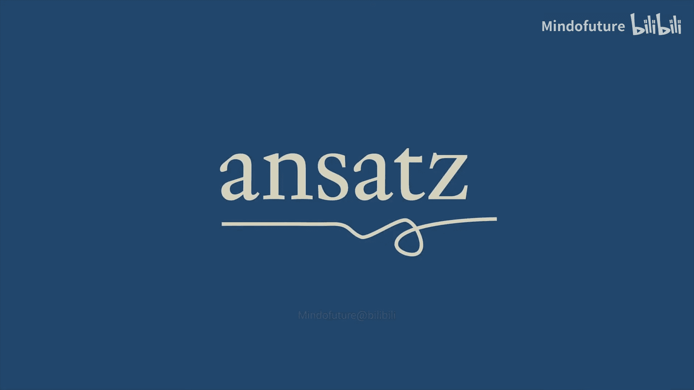

Are you enjoying CPP con so far where're at the midpoint of the week， are you having a good time？

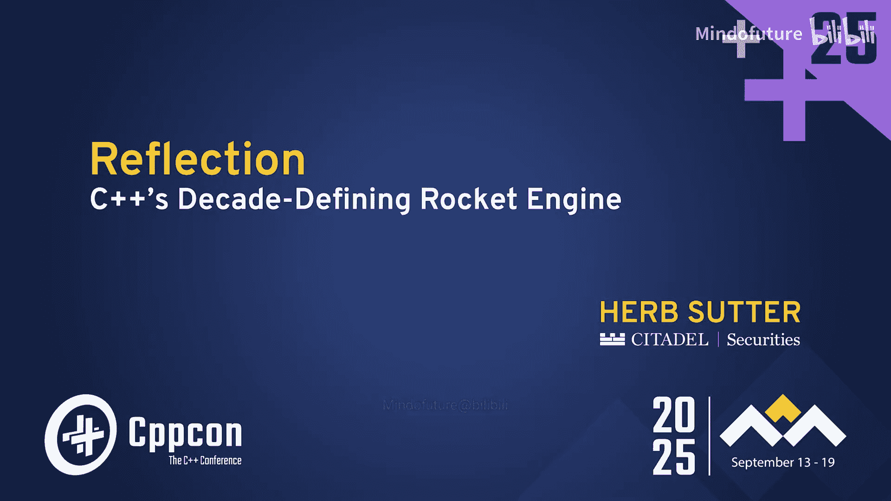

👏Yeah， good。 And thanks， Jimmy and the band。 We love having you here every year。😊。

This talk is a bit demo heavy。 so wish us luck。But first。

 I want to thank so many people starting with the bigger picture of Dan Katz of Bloomberg now。

 Adobe and all sorts of other folks， including many not shown on this slide who have worked over the past decade and Dan。

 especially in the last two years to push this over the line so that we actually have reflection in standard draft standard C plus plus for the first time in history as of just three short months ago with anybody who has ever contributed in any way as a paper as an implementer。

 but even in reflector discussion， would you please stand up if you have ever participated in in any of that。

Can we give a hand for all these people。Thank you。Also。

 you may have gone to Barry's talk on reflection already on Monday， in Bas got another talk。

 there are at least four reflection talks。This talk is all about what can we do。

 because when we voted reflection into the standard。

 I I the committee allowed me to pause them for a minute just to say。

 this is a big deal and it is going to take us a decade to learn everything we can do with what we just added to the standard。

 this talk is to give us a survey to fire up her imaginations with a breadth of example。 So if you。

 if one resonates with you great。Do not try to remember all of them。 The slides will be available。

 The point is the breadth。 But let's start off with a few tools。

This is the summary of what's in reflection。 So the short definition of reflection is the program can see and generate itself。

 Usually， I'll say reflection for both parts。 But sometimes we say reflection for the reading card and generation for the writing part。

 Hence， meta programs， programs that manipulate programs。To my knowledge。

 there is nothing like C plus plus reflection that we just added。In any commercial language。

 it is best in class。 And that， this is version 1。 We're going to keep building on it。

 post C plus 26， But even version 1 is rich。 If you have used reflection in other languages。

 it's great。 I am not dising that。 They have paved the way。

 and they've shown how useful reflection is。😊，But this is not runtime reflection。 This is static。

 compile time reflection。Of course， if you compute something and want to store it at runtime。

You get0 overhead by default。 But if you want to store something at runtime。

 use the tools that are now starting with define static array， defined static string。

 that's your conversion function to a runtime piece of data。Here is your first God bullet link。

 I won't show it too because theres so many more God bullet links and others。

 But this gives you idea that this is just C plus plus running at compile time。

 And we have just a few extensions。 So in addition to the for loop， there's a template， for loop。

 and like always， template implies， compile time， it also means stamping out。Loop bodies。 So。

 you know， when you instantiate a template， each specialization is basically stamped out。

 and you could get different types and different overload resolution in the bodies。

Think of that for four loops。Becauseuse you actually want that， but it's actually easy to use。

 Of course， if you do that， you'll probably want a constant a function over what you're iterating of a data member over what you're iterating over。

 And then you have the double carrot or the cat's ears reflection operator to reflect on the type。

 And here is a little example that simply takes a type and iterates over its members。

Which we've never been able to do before and simply prints out their names。

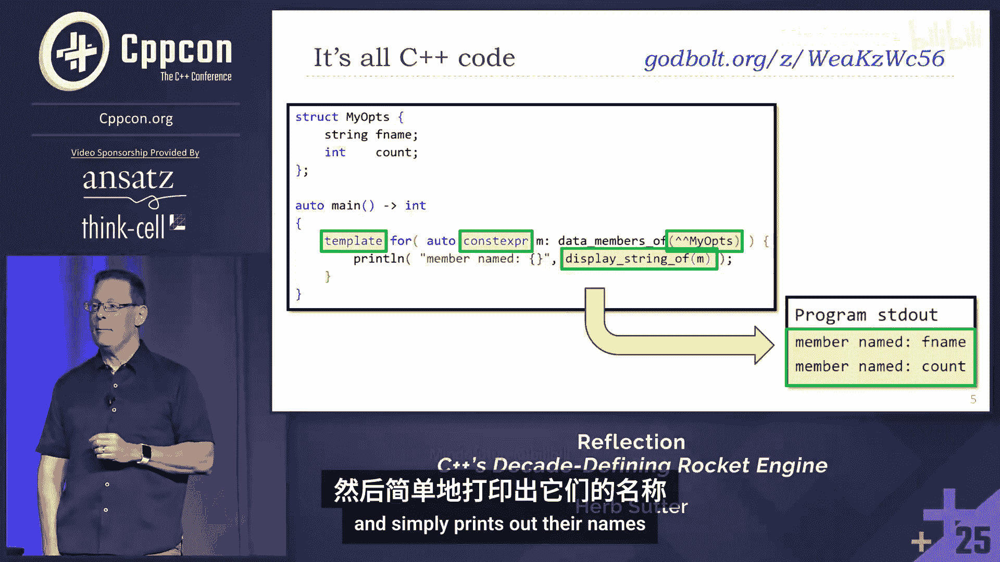

I want to address an elephant in the room。 How many of you are concerned already before a reflection about compile times。

I don't see too many hands that aren't out， okay。How many of you are afraid of all this talk about compile times。

Tom Fooleery。Yes。The answers on the slide， we are about to see a huge explosion in in C plus compile time code。

And it's generally， generally going to make your programs faster。Your builds faster。 Here's why。

Because it's not just adding stuff。 If you're doing something new， of course。

 you're going to get the added， the added costs。But if you're replacing something you're doing with template meta programming today。

How many of you have already， just with the cost expert functions we already have。

 How many of you have had the experience of taking it something you have computed by template meta programming。

Change it to contexts per code， which is more readable and debugable because it's just code and found that it's an order of magnitude faster to compile。

Quite a few hands。That's because you're， you're expressing your intent directly instead of expressing computation through a type system and specialization that was never designed to compute anything。

 It was an accidental side effect that it was turning complete。 Instead。

 you're expressing yourself as code。 And guess what。 Opimrss love code。 They see code。

 They just automatically latch onto it and optimizeize it。😊，Debuggers work。 And this is a benefit。

 And this is why we already see a speed up of from using contexts for code。

 The same thing with extra side compilers we'll talk about。

 when we simplify our tool chains and do more in the compiler instead of repeating mostly maybe right parsing。

 we can get rid of all that。Faster builds。

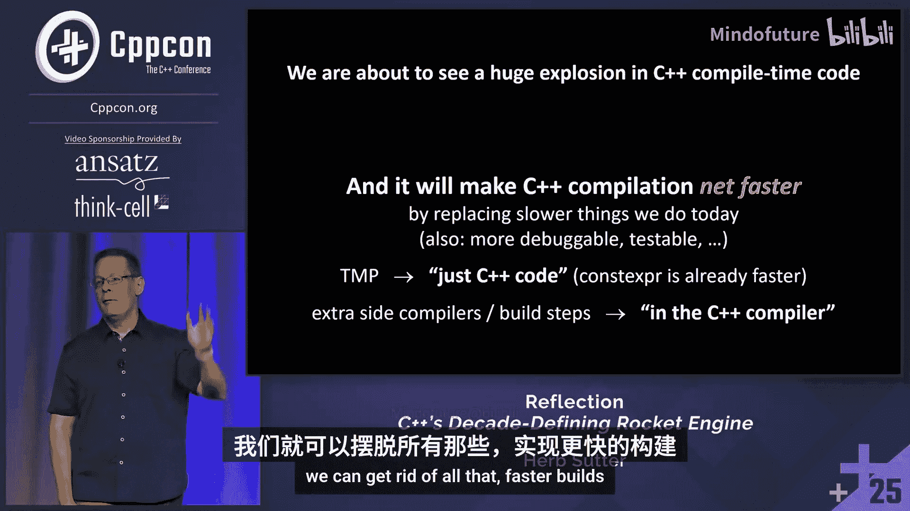

So we're gonna do quite a few demos。 Wish us luck。 I'll keep saying that because the the demo demons are always nearby。

 But I'm going to show three implementations。 The first two are Dan Cats's playing implementation and David Van deor's E DG based implementation of what's in the draft standard now。

 plus， some of them will see a couple of extensions because they have a superet of what's in the standard。

😊，And I'm going to show examples that are in C plus 26。

 but I'm also going to show examples of what to expect in the near and medium term future。

 For some of those， I'm going switch to my CPP front compiler， which again。

 is C plus plus It's a different syntax， but it compiles to 100% portable C plus plus that runs on every C plus compiler that's that's been around for the last decade。

😊，But its reflection implementation is ahead。 So I'm going to need to to use it because I've implemented more reflection in it than we have yet in in the prototypes。

 But it's all coming to the standard。 No confusion here。

 We're talking about the future of C plus plus itself。So let's start having looked at the tools。

 Let's start looking at things we can do today。 Now， in this section。

 I'm going to talk about things you can do with just the things that we have added to C plus plus 26。

As of June， it's so fresh still。After that， we're going to look at things we can do post C plus S 26。

 But in the nearer term， like that might make C plus S 29， maybe。But then I want to take us beyond。

And see， how can this affect the long term arc。Not just of C plus plus。

But of other languages and of our industry。Because we don't get to do that very often by adding a feature to our language。

So here's a road map sketch。 I'll come back to this slide。

 and I'll highlight different parts because both the reflection， the reading part and the generation。

 the writing part。We have a subset now that we've standardized version 1 in C plus S 26。

And we're going add more， but we'll come to that later。 But for now。

 we've added reflection for namespaces， classes。 We even got functions and parameters。

And something called annotations， which are basically， they look a lot like attributes。

 But inside the attributes， they start with an equal sign。

 I'll try to remember to demonstrate one of those。And we have a little bit of generation in the same translation unit with the splice operator。

 the square bracket colon。But we can generate anything we want as long as it's in a separate file。

 because we have O， F St。 We have C out。 We know how to。

 how to send text and binary information to a file。

So we don't have generation fully in the same translation unit while we're compiling it yet。

 That's coming。We can do quite a lot， by just using reflection。And producing a file。

Here's a warmup example that uses the feature hash embed and the splice operator。

 And you'll see the Godbot link here。 Let's actually switch to that。😊，If this works。

 I'll have a much better chance of the rest of this talk。If demos don't work， I have the slides。

 But live demos convince us that it's real， right。So here we have a， a God boltt setup up with Cbank。

 and it's a multi filele setup。 And what we're doing is the first thing we're doing is we're going and we're creating a Json data variable by we're doing hashtag embed test Json。

 let's take you can take that file。Pste it as if it's here， essentially。

Why would you want to do that， Well， you might want to check that file in separately。

 That file might be the source of truth， not just for my C plus plus program。

 but for other parts of the systems。 You don't want to copy it。 You just want to check it in once。

 And in fact， here it is down here。 We can see that it's a Json file that has。

An entry called magic of type string， and then a nestedstruct basically。

 in assess entries of word of type string and of number of type end。And then， we're going to call。

This function。 And I'm not gonna step through it。 If you want to see the answer。

 It's the1 hundred50 lines above this in this Godbolt example。 So you can look through the code。

 Please do。 And what this does is it parses。The Json data that we just embedded up here。

And it does something really wonderful。😊，It creates。A brand new structure。

A data type that is computed， a computed， generated data type that matches the runtime input。

 the compile time input， rather that we just added externally through hash andbed。

So that we can actually say now， V dot magic， as if it's a data member。

 because it is V dot inner dot word as a nested data member because it is。

 And we get exactly those things printed out just as we would expect。😊，Now。

 one thing I'm going to point out here。Because we have the new reflection operator。

 the Catsrs operator， right，m getting habit of doing this， I guess， the double carrot operator。

And we have the splice operator。 Some people are wondering， is all this gunk gonna infect my code。

 It's actually not too bad， at least not yet。 But this is the kind of thing that naturally goes in libraries。

 So here's an example of how you do that。 I'm putting this this splice here。

 because I want to show you splics。 But you can just as well say。

 call a regular template in this case， a variable template。

 So now the call site is just like we would expect in today's C plus plus。

 And inside that variable template。😊，We are doing。The placee。And it could be a function template。

 So you could hide the reflection operator inside a function template as well。 So that。

 that's the kind of thing you can do。 if you， you don't have to make your users know about reflection or splicing。

 you can put these in libraries because it's just code。One last thing， because。Why not。

 Because we can。 We also have this static assert。 But I want to walk you through what this does。

 This is a raw string， literal。Which， basically。Gets print some information and。

 and validates that it prints some information that's in Json format。 So this is Json right here。

We then。Use a user defined literal。Which C plus already supports， which converts this to an object。

But because of it can use reflection， that user defined literal invokes their reflection。

 creates thestruct， and we can immediately use the member of thestruct of this computed generated type。

So that's kind of nice。 And it gives us a warm up as to what we can do。😊，Now。

 let's go to a slightly more advanced example。 but it's still simple so we can。

 we can go through it in real time。 a command line option parser。

 So we've all used command line option parser is what this one does。 That's a bit different。Is that。

Paarse options of my opts looks just like an ordinary template call， because it is。

But notice it's passing the optionstruct and only the optionstruct is not passing separate string name。

 If， if it's this， then fill in this variable with， with maybe an object pointer。 No。

 it's just saying， here's thestruct。Go fill it。And just look at the strike。 I told you what the。

 what the flags and names and their types are。Just go fill it。

So let's take a look at what this would look like。Here we have that struct。And we can see that， yes。

 in fact， this works。 If we have the command line。The command language which I can barely read。

Is I S count for has some other stuff on it。 It's count 42。And。The file name is not specified。

 So it defaults。 And if we just left off file name， it would default as well because we。

 we have a default value for the file name。 This is all great。So what is actually going on here？

 So let's scroll up。And as we scroll up， we'll see。That parseel options。Takes its template parameter。

 And what does it do， The type itself is an input。 So we're going to use a template for。

 which is going stamp out a visitation of every nons static data member of reflect that type。 No。

 notice here， we've put the reflection inside the function template。

 So it's not leaking out everywhere。 Not everybody needs to write double carrot。

 It's up to you where you put it。And then we simply go through。

 Do we find a command line option that starts with dash dash， that flag name。 If so， then what。

 what are we going to do， Then we go through and we try to create a string stream and stream。

That value into opts dot。 And then do you see the splice there on line 36， into Ops dot。Data member。

 And this is on one instantiation will be Ott counts。 and another iniation will be Ott F name。

And the types will be right。 You can see why we're stamping it out like a template because the types are actually different in each loop body。

 potentially。This is typeafe。 And all we did is iterate over the members。Search for their names。 Oh。

 look， a name matched。And then try to stream into that。 It's all typesa and correct。 In fact。

 if here I had tried to say， count X 42。Oh， error value supplied for dash dash count is not a valid impt。

 And we got that message because we actually displayed the nice name。

 even though the compiler might have put I as the type I D dot name。

 We're going through all that and were saying， give us the real honest goodness source name。

 display string of the type of that data member。So you're not getting the mangling encoding。

 It's the actual source type that the user can understand。

So just to prove some more that this is live， let's add another data member。

 another thing that we could。Add， and once the compilation catches up， there we go。

We still want to fix our account value to be correct。But now， let's say we want to put， oh， look。

 now optstop pi default falls to the 3。14159， as it should。 You know， it's a float。 Like。

 do not give me grief over using a float for pie even。Because it's about to get worse。Let's say。

 we were in Indiana。In 1897， and we say pi equals 3。2。Oh， did I type it correctly。

 It's so small that I can't see。 Any see if I made a typo。Oh， there's no equals。 That's right。

There we go。 Now we conform to what almost passed legally in Indiana in 1897。

 If you do not believe me， look it up。Came this close。

 although the Senate spent most of the time laughing at it， which is good。😊，Now。

 here's a longer example。I'm gonna do a mission， impossible kind of riff and call it mission Dable。

 We want a drawable type erased wrapper that will wrap any object that has rough a draw function that can take a coordinate or something convertible to a coordinate。

And that returns an int or something that can be converted to an int。 So if。

 if you think about the conversions on parameter and return， this is just like stood function does。

So it doesn't have to be exactly this， but it has to be compatible with that interface。And。

Because I hadn't written one of those before。 I thought， let's see what how good an AI is。

 And I asked Chat CPT to do it。 And it wrote 200 lines of code， which I then tweaked and。

I don't pretend to understand all of it， but it seems to distinguish between costss and noncons。

 And those of you who've done this will tell me whether it's right。It appears to work。 I tested it。

 and I tweaked it。 And now， yes， in fact， you can have it， a vector of drawable and put in a sprite。

 an icon， a button。 Those are three unrelated types， right here。

And put them in and then call draw polymorphically on each of them。And it works。 How do you do this。

 What， what's， what's the core data structure inside Dawable， Somebody yell it out。V table， yes。

This is called how you write your own P table。 Let's see what chat GPT with a little assist from me。

 did。I'm not going to go through all the lines。 This is very， this is over 200 lines of code。

 But here I want to just prove to you at first that， in fact， there's nothing at my sleeve。

 Is that big enough for people in the middle in the back to to kind of see。 Yeah， O， oh。

 even at the back， O。I want your vision。 I'm so jealous。Okay， so we're doing the spec of the robble。

 Let me page up just to prove to you that In fact， we have sprite icon and button are all unrelated types。

 No inheritance up our sleeves。 And， in fact， some of them have the exact function that we're looking for。

 in this case of button。 We have。 it takes a point， but。

A point can be in that we see right above it can be converted from a coordinate argument。

 and it returns a short， which can be converted to an int。

 And all of these are compatible and they work。 And you've probably seen demos like this before here。

 Let me pull this over so you can actually see that。 In fact， yes。

 on GCC on Kang on Microsoft All of these。 all of this works correctly。No reflection here so far。

 The reason I'm showing you this example is to teach you。 And as I was learning it myself。

 my whole career， I've written about things as I am learning them。

 That's exactly the same thing here。Now， how do we generalize this。Want the short answer？

Get the ordinary case working that you write by hand。

Cut and paste it and put quotes around everything。And then substituted the names that you wanted and put in loops where things vary by save member function or data member。

Its actually that simple。 This whole example end to end took me two hours from a standing start from a blank screen to chat GPT to fixing the code to writing the reflection code。

 Now， I have written reflection code before， but I was surprised how fast it went。

 And let me show you what that looks like， because。😊，Here， we have。

If you put this code off to one side。So that we can now see。The reflection code。 So first。

 I'm going to show you the output of the reflection code。 So the the reflection code， well。

 I'll show you what it's doing at the very bottom here。 Maybe I will show you the bottom first。

Scroll， scroll， scroll， scroll， scroll， scroll， scroll。

All it's doing is it's taking an exemplar class dable， which has the signature we want to wrap。

Could be more than one。 But for now， it's just one。

 And we're going to call a compile time function polyly that。 So I didn't know what to call it。

 So polymorphic type eraser。Polly， close enough。And it's going to now take that as input。

And we are going to。Generate。Essentially， the same code as on the right my test it it by cutting and pasting it in。

 And yes， it works。 So here's the includes class drawable。

 the various concepts that are at the top of the file that we wrote by hand， etc。

But as we go to the file on the left， I especially want to draw your attention as one example of how this works to the V table。

So here is the V table。 It's in the middle of a file。 You。

 you can see how big this is with the scroll bar here。 So we're here in the middle of a file。

 Most of this is class d。 This is the right。 the left hand side here is the handwritten one。

And notice how we hand wrote R V table， and it's got。2 entries， deor and copy。

 which are going to be the same， no matter what， no matter what you type erase。

This type of erase thing needs to construct and copy。So that's not per function。 That's just。

For my type of race wrapper to be con。This is the stuff that's per function。

 And so if I wrapped something with two functions， I'd have double the entries here in this part。

 So let's see how we do this。 So the actual and let me actually first show you that we， in fact。

 do generate that。 Sc， scroll， scroll。I think we're getting close。Nope， that's the problem。

And a free function that we generated as well。 Okay， somewhere in here is the V table。Trust me。

 it's there。 It's hard to find。I， I'll find it again。 No， you don know what。

 I really do want to see it because I want to show you how it changes。

 So stop you when you see the V。 There it is。 There's the V table。 Okay。

 and notice it generates the same things as we have on the right hand side。 But this is all done。

 generated。 And， of course， it's not in the same file。 It's。Spit it to another C file。

 which we can then build and use in the same build if we want to。

 But we have to use it from a different file。 We don't have in source in translation unit generation yet。

Alright， so let's take a look at this code。So if we look at the the kind of code we have to write。

Let's look at the， the poly function itself。It is a function that simply takes the prototype and returns a string in this case。

 And you can see it starts by putting quotes around all the things that we have in the other file。

 includes your dependencies and everything that here's your constructor。

 When you get to the to some of these things， you see， I just copy and paste the file。 And then oh。

 instead of dable。 Where I see dable。 I just change search global search or replace。

 Dable to quote plus parts name plus quote。😊，It's pretty easy。And you do that for， for everything。

Now， some things are per member function。 So I I want to mention something here and why I did it this way。

 You'll notice so far， this function I've showed you is just an ordinary runtime function。 It。

 It's not even smart concept expert expert。 It's just an ordinary runtime function that does string stuff。

But I have to call this polyimplo with this reflect this prototype。

 And now it's going use the reflection information， okay。

My initial implementation was to put all of this straight。

 including the function we're seeing here that didn't need to be compiled time to make it also conval。

 And in this example， I hit planang's limit on Conval operations because of all the strings。

So you have multiple reasons。 I'm sure compilers will increase their limits as we， as we stress them。

 But you have reasons to do a lot of stuff in normal code and then delegate the parts you need to reflection code。

 And this is a good example of that of good hygiene。 And if we go for a quick look。

 here's the function that handles every member and。And outputs， all the things， all the strings。

 the pieces that I need。 All it does is。For this is gonna to be invoked once per member。

 it goes through the parameters of the the of that member function， remembers its return type。

 its arguments。 and it generates all those things that we see。 Here's a whole bunch of of things。

 These are pieces that are then going to be put in the right places by the end collar that we already saw that assembles them all。

And one of the nice things about this is if we go right back down to the bottom again， is。

If I now want to have。Make this where we can see it。

 I want to now change this and have another function。We'll wait for that to rebuild。

 And let's look at the new V table。 Now， I've got a V table that has a draw and get name。

So now I can wrap anything that has not either， but both draw and get named with conversions on parameters and return types。

I didn't write any code。So this is very， very useful and illustrative of the kinds of things that we are going to be able to do。

 And I really want to emphasize that the handwritten version was 200 lines of code to make drawable work。

 And now I've got 300 lines of code。 That was the handwritten code right there。😊，You have good eyes。

 This is your test at the back。 Any hands。 No， I didn't think so。

And all of that is now just generated。 I've written 300 lines of code。

 which will do all of this for any type of race thing I ever want ever。

 And I never have to write it again。 And I can debug it because it's code。 And it'll have。

 it'll have co generation bugs it first。 but it's just code。 We'll debug them。 And when it works。

 we ship it。Now。In8 years ago， on this stage， I I believe I did the first live demo of metaclass paper P 70。

7， which showed how to use reflection to help us generate C plus plus types more easily。

 more correctly。 And I first showed it on stage。 as slides at ACC。 Thank you。 AU。

 I believe the first demo was here on this stage。 And here's a quick refresher example。

 I've talked about it before。 So I'm gonna be real quick。 The idea is。

 today we write the boilerp on the left。 What if we could just say， hey。

 I am not just writing any class， I am writing an interface， which means I want certain defaults。

 All functions are pure virtual by default， even if I didn't write it。 That's just the default。😊。

I automatically get a virtual deor， even if I didn't write it by hand。

 I automatically get suppressed copying and move， that kind of thing。

Here is what that looks What we can implement today in C plus plus 26。 We can do it。

 It just has to go into a separate file。 And then we use it from that separate file。

And let me show that real quick in Godbol to show that it it's， it's done。

 And this is where I wanted to remember to show you one more thing。We don't eat you。We werent you。

 here we go。So here we have class widget。And we're using it as a prototype。

 And I'm calling the interface meta function on it。 And look， here。

 it's generating everything we saw。 I'm not going to step through it。 By now。

 this is an easy example now because we've seen much harder。 What I do want to show you is， hey。

 what if we actually add another function。To that， say float H double。 Oh， look， there it appears。

 Now we've handled that one， too。 So I'm proving to you this is live。 This is， in fact。

 reflecting and generating the the correct final function of applying the defaults virtual and pure virtual。

 But now， let's say we went a little bit further。Let's say you are the author of this compile time function interface。

And you'd say， boy， wouldn't it be nice if I could give the user a way to say， oh。

 all my functions except not that one。 I don't want that one to be an issueface。

 I'm just making up a strawman example。How would you do that？Well。

 you can do it in C Ps 26 without any more language features because you can。

Create a custom annotation。 Annotations are in the standard。 Here's what it looks like。

 I can just write。Here in this code。The user can just write equals suppress。

 and now notice on the righthand side， G disappeared。Is this magic。

 Is there a suppressed feature I can Google for in the standard itself。 No。

 there's nothing about suppressing the standard。 All it is， is that in this code。

 as I'm for for each over all the member functions。

 I'm actually looking at the annotations and saying， oh。😊。

I want to see all the ones that are not special member functions and that don't have the suppress annotation。

And what's the suppressed annotation。I just made one。It's just a type。That's how easy it is。

 And now you've written a meta function。That you're starting to provide an API for。

For your users to supply information from your end call site。Into your meta function。

And that's pretty useful to know。That so far， is C plus S 26。What can we do in the future。

 Where is reflection going。 And again， as we go beyond what's here is more hypothetical。

 But there are proposals and implementations already on the table。

To add to your own translation unit while you're compiling so that those things that we did already。

 like the interface could actually be used within the the same translation unit。

 And this slide here is now possible with the E DG compiler with this Godbo link。

 And it will generate exactly this output。 And notice， the key thing is we're generating this。

From inside the same file。And。This pattern is one you're gonna to see a lot。Where I put my。

 my exemplar， my prototype， usually in some subname space。 And then I reflect on that。

 I call a compile time function to reflect on that and do something。 Well。

 often it's to reflect on that and make a modified version of it for me to use。

 So I stick the original， the incomplete one in in some sub name space， I reflect on it and make it。

 as I complete it， the completed version。That's going to be so common that I am proposing。

 I continue， as of eight years ago， continue proposing their B， A syntax for it。

 Class peren interface is exactly and only a syntactic sugar for that。

 I've implemented the same thing in CPP front。 It's an alternative syntax as left to right。

 but it does exactly the same thing。 an interface type， and。😊，All of these things。

 including the E DG compiler on Goldbot right now and CPP frontron， with this example。

Generate exactly the same C plus plus honest to goodness， portable。100% C plus S code type。

That works on every compiler。The， the compile time stuff they work on， not work on every compiler。

 but the type that's created will work on every compiler。

And there are a bunch of these that I've already implemented。

It inter is the first one to polymorphic base ordered values struck enum， flag enum。

We can use class Eum， which simply reflects and makes everything context for functions。

 Flag Eum does the same thing and adds the bitwise operators。

We can use the C language E nu for compatibility with C。 But going forward。

 I personally believe that。The class pre and M syntax。

 which has been provisionally encouraged by S G 7 in the committee as syntax for that four lines of code。

Once we have generation， I don't think we'll ever write a naked class again。 Why should we。

Will say what class we're writing。 I'm not writing any class。 I'm writing an interface。

 And you know what， once you do that and you express your intent。

 you'll also never write equals default and equals delete again to get rid of the function that C plus generated that you didn't want or to reinstate one that you did something that's suppressed。

 but you really did want。 because today， we have one meta function for all class types hardwired into the compiler。

Becauseuse the language guesses what you probably want。But I'm not writing a valueative。

 I'm writing an interface。 I'm writing a proxy。 I'm writing an async function。

 I'm writing something else。So I'm just gonna read from what I wrote8 years ago。

 just the bottom part。Of that metaclass's paper， which is now finally becoming real。

 I'm just so thrilled each subsection， because I showed。😊，Coode， uncompilable at the time。

 But most of it， but actual code intended for each of those things。

 Each subsection of section 3 is equivalent to a significant language feature that would be a language feature in another language that would otherwise require its own E W G evolution paper and be wired into the language But here can be expressed as usually a tiny library that can go through the library evolution working group。

For example， this paper begins by demonstrating how to implement Java C sharp interface as 10 lines of C plus S constant expert code with reflection。

And get the same expressiveness， elegance， efficiency。

That you get with a built in language feature in languages like Java and C Shap。

 where they are specified as 20 pages of text for a human compiler writer to go implement。

10 line function。20 pages of text that I demonstrated on stage with a live demo8 years ago。

 Now we can do it in the draft standard and much more。

So reflection is going to help simplify the need for C plus further evolution。

 We're still gonna have language features that reflection。Doesn't directly affect。

 But many things that would have been language features， we can now do as libraries with reflection。

 and we can do them well。And that means we can test them and fix them。

 We have code that's portable right away instead of waiting for your compiler vendors to all implement it。

 It's faster to deliver on Github and package managers， easier to customize to adapt to fork。

 So what can we do with this。 We don't know yet。 But here's a starter list of ideas。

If I generate C plus file， I can generate a's serializer desializer for a C plus type。

Just an ordinary Cpl code as reflection。I can spit C plus S code。 I can spit Python code。

 I can spit Javascript code， and。Reflect over the， the structure of a type to write a rapper for another language。

If I can splitit a file， I can splitit a binary file such as whenM D binary information that C plus C X Now。

 the side compiler needs to generate for a C plus plus type。I can customize a class's object layout。

 say， class compressed。 how many of you have done this by hand and would like a way to do it without template me programming。

 Tom Fory。Generate unit test functions。 go navigate， just iterate over the namespace。

 find every function named as a unit test and generate a function to run them all。

Instead of doing it in a Pthon script， just write it as a few lines of C+ plus code。

Make a classes' interface async。 So class async might run all of its methods。

 all of its member function calls on a sender receiver thread pool。

And then the return types of those functions may change from T to future of T。

You can already think how to write it。 Why， Because you know how to write C plus plus code。

 If you can write it， you can automate it。

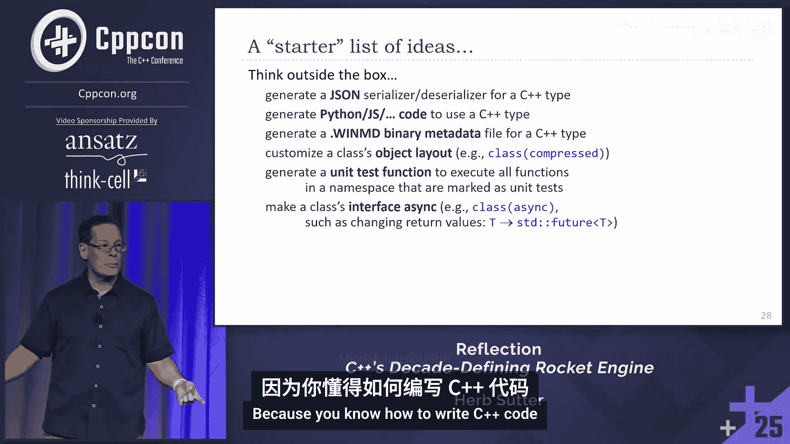

All of this import portable， testable， shareable， standard C plus S code， no side compilers。

 no scripts， no language extensions。And here's a prediction。 And I'll owe you all a beer。

 if I'm wrong。Really hoping I'm not wrong。 and not just because of the beer。

We are now on a direct path to be able to， whether the vendors do it or not。

 to be able to sunset side compilers and build systems like cute Mo。

 which have to add information that we can't have in C plus S source until now that can with reflection the sunset C plus O C I to sunset C plus O C。

 X in the next decade。😊，And I think I should know and be able to say that because I LED the design for two of those。

C plus C line， C plus C X。 And I got so much fl for why are you extending C plus fast。

 Are you trying to take over C plus plus some proprietary thing， No。

 it's just we need to buy into do net。 We need to buy into Windows co and。

We couldn't express all the information we needed yet in C plus+， as it was。

Which is one reason I've been pushing so hard to try to evangelize reflection as a direction so that I never need。

 as I said，8 years ago， publicly， never need to invent C plus L C I or C plus L C X again。

 And I had chat G B T fix the emoji。 This is the I O emoji。 Pretty good。

 But I think it needed a smile。 So thank you， Cha G P T。😊，The key to remember， if you're thinking。

 what can I do with reflection。Simple， simple answer。If you can write the code by hand。

 you can write the code to generate it as strings and tokens。

So what would you do if you had the equivalent of an accurate， always up to date C plus plus parser。

Available to your code。We are all about to find out。

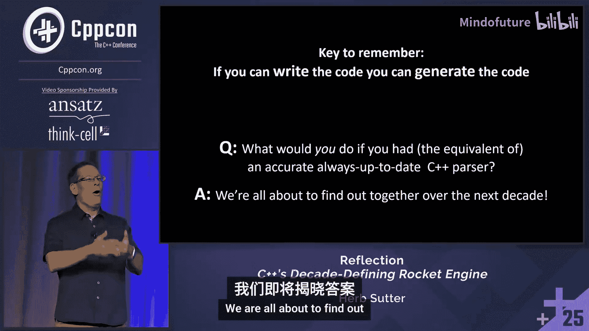

We are all about to find out the answer to that。Now， let's look at statements。And expressions。

 that's the next thing。 because notice we could do a lot already with namespaces， classes， functions。

 parameters， annotations。 That's a lot already in version 1。

 hot on the heels is statements and expressions。 And these ones I' have to show in CPP Fron。

 because we don't have reflection of those things in the in in Dans or in David's implementations yet。

 So this is a place where CPP F is out ahead。😊，But I want to show you something called Autodiff。

 And to do that， I'd like to invite to the stage， Max Sagabaten。 would you like to give him a hand。

 please。Thanks for having me。Thanks for having me。So I'm glad you could come this year because last year。

 you were at an Autodiff conference in Chicago the same week as CPP con giving several talks。

 That's because Maxs1 is a world expert in an Autodiff。

 So it's better for him to present a lot of this material than me because。😊。

I would have to fake what I've heard。 summarizemar what I've heard。 He knows this stuff。

 including he's implemented one of the major Autodiff libraries that exists today and knows the trade offs。

 So let's talk about what it is because by now， some of you are thinking。

 you keep using this word autodiff。So I know about automatic differentiation in mapple。

 like symbolic differentiation。 I remember doing that in school。

 and I know about numerical where we you， you make epsilon。

 you make the deelta smaller and smaller epsilon and do approximation to try to figure out a derivatives。

 What's different here。 So automatic differentiation or a grsome differentiation is a mathematical theory。

 where you basically assume that you can separate a computer program into small elementary functions。

 That's basically what a compiler always does。😊，And for each of these simple functions。

 we know the derivative。 And then by applying the chain rule and the directional derivative。

 we can then produce a mathematical series that says we can compute the derivative。

 And that's how we can apply it to a computer code。

And this is better as the slide summarizes than symbolic and numerical。

 because symbolic differentiation is accurate， but it explodes slow。

 and it doesn't scale and numerical is computable。 but it doesn't scale either and you get rounding errors and things like that。

 The gross differentiation will always get you the numerical precise derivative。 Yes， and by the way。

 one thing about option 3 is numerically precise and it's linear time iss a constant factor more expensive than just running the original function。

 And the constant factor for forward is like two or3 to3。 Yes， and for the reverse mode。

 it's about 2 to 4。 So show us forward mode with this example。

 We have y equals sine of x times x squared。 Yes， the first thing we do separated into the elementary functions。

 So we have sine of x x squared。 and then we multiplly these2。

 So this is basically materializing temporaries， yes。😊，So， and afterwards。

 we can compute the derivative。 The derivative of sine is cosine， very simple of x squared。 It's 2 x。

 And then we multiplly these two together。 So the derivative of y with respect to V is U。

 So we write U times。 and then derivative the derivative of D。 So that's it。

 And the other thing for V。 for U。😊，And one thing that we didn't mention。

 One of the nice things about this form of automatic differentiation is you could have functions with control flow。

 branches， loops where that you can't really easily show as a symbolic function。 for example。

 that's definitely true。 Usually you can support it。 Some things might be quite difficult。

 depending on what you use as an automatic differentiation tool。 but usually you can support it。

So what if there are is more than one input and output， This is just is a function from X to Y。

 What if there is more than that。 So the forward mode， if you have just one input。

 you can have as many outputs as you want。 You just computed one。

 and then you have the full gradient of the of the output。So for weve。

 but when other way round when you have， for example， in。Training of an I I AI model。 Also。

 you have billions of inputs and just usually one output。

So then you would have to run this 1 billion times， and this will take some time。

 You can cuts us off by a constant vector。 if you use a vector mode。But if you use reverse mode。

 you can just say， okay， I run this once， store some data。

And then who re use what what I have stored and runss a reverse pass。

 And then you get a full gradient in one pass。 Theres a little bit of memory overhead。

 what you need to store。 but usually you can manage。So forward mode is good when there's。

Fewer inputs than outputs。 And it's， it's linear。 I got that， I got that direction right， Right， Yes。

 yes， that's correct。 but you want， but that wouldn't scale。

 You'd have to do a million of those if you have like， if you have a billion inputs。

 then you want reverse mode where you take a pass through。

you do a forward pass that calculates the data structure that you then navigate backwards。

 but it's linear。 and you can， then you get all your derivatives even for your billion inputs。

 still linearly at once。 Yes， yes。 Now， what if you want the second derivative。 The third。

 the n derivative。 So the nice thing about algorithmic differentiation is you have a code。

 You apply it， you get a different code。 Then you can apply it again and again and again and you can have arbitrary high derivatives。

But the problem is， usually that's not what you want because it's very general。

 And you get a lot of derivative values or derivative directions you have to specify。

 What you can do is to have a tailor implementation and then use this tailor implementations that will reduce the number of values you have and the number of directions you need to specify。

 And 990% of the cases that's what you want to have。The summary， I would say of that。

 the big takeaway is。It's just code。 You have your whiteboard discussions about how to optimize it。

 It's just code。So why should we care， Does this come up in any important fields。

So we have heard about this a little bit in this conference。 It's used for training AIs。

 So if you have heard about back propagation， that's basically the reverse mode of algorithmic differentiation。

And scientific software uses this a lot， also。And yeah。But you could write these derivatives by hand。

 In fact， you were telling me that these days， people do write the derivative code。By him。 Yes。

 it's still done。 And I have to be frank。 That's the best way you can do it。

 If you want to have the fastest derivatives， that's how you should do it， but。Yeah。

Your primal code takes a year to develop。And then takes another year to write a derivative code or even two years。

 because usually it's more complex。And then the maintenance aspect。

 you change something in your primary code。 Then you have to update your derivative code in order to be the same or to compute the same thing。

 This algorithmic differentiation， theres an initial cost， but that you have to apply。

 and then you can run A D in a second on your code and you have the derivatives that will not be optimal。

 But then you can analyze your derivative evaluation or computation。Have a hot spot。

And then optimize the stressborn hotspot。 And then you will have nearly optimal derivative computer。

One thing for a hotspot is a linear system so。 You want。

 you don't want to do this in black box mode because it can produce longer derivatives。

that's very easy to optimize， so。So right now， we have operator overloading libraries。

 which has limitations。 By the way， Cody pack is yours。

 what you're the one that you're involved with。 There are custom compilers and forks like tappanade and Klang and Cad based on Klang。

 But as you say， the problem is， if you have like something that's bespoke compiler。

 How are you gonna adopt that in production， I'm using G C and I'm not going to adopt your fork of cllang。

 even if I am using Klang， I need something production quality。

 So how would you summarize the benefit now that you have actually written in in CPP front in C P2。

 you've written Autodiff。And you've done it as a library。 What's what' does it feel like。

 What's the difference。 So that's what you what you already told in your talk。

 You have now an up to date CPP parer at your hands or CPP Yeah， reflection par at your hands。

 You have an up to date thing and the nice thing。 If you have a nice API。

 you always know how to query the next thing。 You know， I have a function from a function， I know。

 okay， can query the input parameters。 I can query the output values。

 I can then query for a D the body the statements of the body。

 And then the expressions for each statements。 hopefully in CPP 29。

 but have knowing the thing you want to query and how to query the most important thing。

 That's usually what's the problem when you traverse the A T of some compiler that's not done for reflection that's done for compiling。

 So you have a lot of additional things is then need to ignore。

 And that makes it sometimes quite complicated to find the stuff you want。

So would you like to see some examples。Here's one。 Let's do a very simple y equals x squared。

 and let's。Asked the demo gods for their patience and understanding。

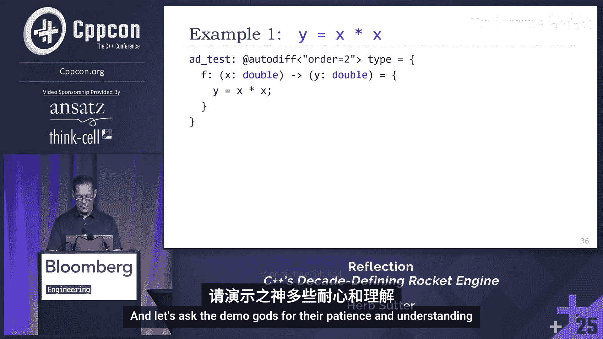

And so， here， we have。Again， this is CPP 2 code， but this compiles fully to C plus。

 It's fully C plus plus compatible。 Just， I'm using this because I have statement and and expression of reflection here。

 So here is our function。 Y equals x squared。 We're going do a first order derivative。

 And just to show how this works， I'm going to。😊，Try to run。A graph that's。

Visualizer that once again， Chat GP T helped me right， because I am not a Python expert。

And where is it。Oh， this happened before when I was rehearsing。 I may need to。Hardon me。

I may need to close the bashhe。Close the baho。 Close the windows。 here。 Close all of those。

And let's try restarting them。Oh， here we go。First thing we have。Oh， no， I don't want the power。

Oh no， I brought it all back。 Well， maybe， maybe that was enough。

 Do you think it might have restarted it。 Let's see。哦。😀 😊，Oh， C H。I， I can show you the screenshot。

 but I really want to show it live。's。 Oh not Powerhell。 That's the default。You miss birdd Pon。

I'm going to try one more time。No， I'm just gonna have to show you this as slides。 I'm sorry。

 but I will show you the auditive code。Alright， So here we are in demo。

 So I just won't be able to visual。 I like visual output。 and we don't have graphics in C P Sa yet。

 Don't get me started。 And here we're going to go and。Compilile this code，80。

Thought see who do because all our demo numbers start from 0。

And I also am using the print function meta function， which says， okay， autod it。

 then print the results so we can visually see the code that was generated。 And again， in CP2 syntax。

 So here is the original code。 And so tell us what we're seeing here with the autod code。

 So we edit the extra suffix to the auto code that we generated and D。

 And that's also what we added to the argument that we have X。

 we generates the direction of X X D and for the output。 And yes you can see here。

 we have the simple multiplication。 And we added before the simple multiplication。

 the update for the direction of y。 that's just multiplication we have seen on the slides before。

 So that's very simple。 And' when you implement automatic differentiation。

 always to the derivative computation first， because if you have self assignmentign。

 then you would use already a new value。 if you do it afterwards。And if Python was working。

 you would see this graph in real time。For the， for this Auto di example， excuse me。

Showing because all the the the source file does is then says for x equals -10 to 10 in steps of 01。

 create an data file with the values of， of X， Y and D Y。 And here they're printed。

 And this also shows the second derivative because we're going straight to order equals 2。Now。

 if we do this for another example， let's do Y x equals y sorry， Y equals x plus sine x plus 10。

 So here we're going to go to A D2。And let's compile that。

 So here we see that line 5 is that new function。 So we're going to go。let's see who B2。

And tell us what's different here。 So now we have these three terms that we want to sum up。

And we creates a temporary for the second term， which is an expression by itself。

 So and we do this first。 And that's basically the difference with respect to symbolic differentiation。

 So you would have to do this all in one thing that makes it more efficient or makes A D more efficient。

And we drop the last term， because it is constant。And that's basically it。 Otherwise。

 we just add here Z derivative values。So notice， we have our original function that does what it does。

 This function does both。 It does the， the original computation and in the same single path。

 it has Y and D， Y。Comptees them both。 So that's important。

 We're doing it in a single has with constant overhead。

 And that looks like this function where we have the function， the first and the second derivative。

You see here for the first derivatives， the linear part drops out。

 And then for the second derivatives， E constant we had for the linear part。

So now let's try one more example sign of x times x squared。

 This is similar to one we talked about before a slide where。 But let's actually see it as code。

So here it is 83。 and we're gonna compile that。And again， we've got that function。

 and it does the same thing。The same basic basic thing。

 And now you see it generate something that looks a bit more like an Xbox controller for those of you who are gamers。

AndNow here's the， here's a a question for you。Now， let's add some control flow。

Let's take those same three things we just automatically differentiated using reflection。

 But if x is less than 3 in -3， we do one of them else， if x is less than 3。

 We'll do the second one else。 We'll do the third one。 What do you think will happen。

 What graph do you think we'll see， Just shout it out。What。

 what will we see on the left hand side that's below -3。The original one， right， And， in fact。

 you are correct。 What will you see between -3 and plus 3。The second one。

 And what will we see with x is plus 3。And there's discontinuities。 This is a function。

 It doesn't have to be representable as something you can put into maple。

 It can have discontinuities。 It's code。 But now let's take a look at this。In。The implementation。

 and we'll go to 86 because it's  one plus 2 plus 3。And here。

 I'm going to clear so I can scroll because there's a bit more to show。 So let's do C B frontron 80。

s。Alright， so you're doing two things here。 So here's the beginning。

 And then we do forward mode first。 Here's the forward mode。

 And the forward mode for these control structures is usually quite simple。

 You just need to pull them over into the derivative code， and that's it。

 That's why forward forward mode tool。 you can implement usually always。 and it usually just works。

 That's not very complicated。 And now I'm going show you an example where we need to see both。

 So here is a function that I learned through you is quite common for testing optimization to see if they can be optimization of of solvers to see if they can be fooled。

 And what is special here about this function。 So we have here multi loops。 We have function calls。

 this function call we see is differentiated out of context。

 And then we also have passive values that need to be ignored。😊。

So let's see what this green w function looks like。And we're going to go through to。We rank CPU 2。

 Here we go。So here we see the function that's got a loop。 It's calling another function。

 That function happens to be non local。 It happens to be somewhere else in the enclosing name space。

 Yeah， let's see if you can handle this。 Well， so are you saying that that this function。

 you're going do name lookup， find out where it is and， and differentiate that one， too。 Yes。

 exactly， okay。Cause it's just code， right， And you can navigate from， from things you find。

 So let's see how this was done。We're going to。I didn't really warn you that we'd start going from very simple examples and that there would be a step into the deep end。

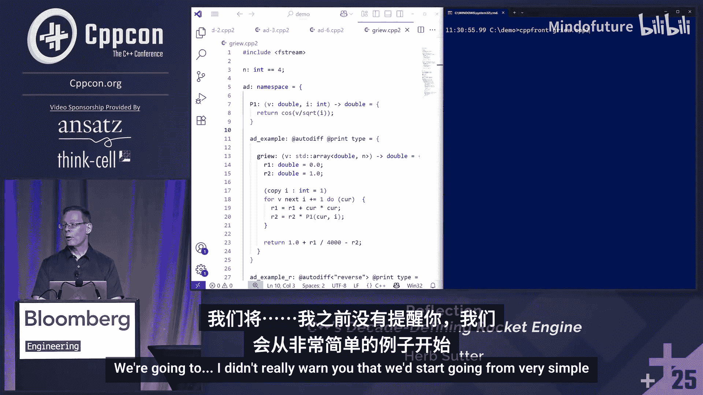

So there's a bit of code here。 Let's scroll back up。 So first， you've got forward mode here。

 So here's the original function forward mode。It's the forward motor still simple。

 The one new thing that we see here is that we have a shadow iterator for the loop。

 because we also need to loop over the directional values。

This is C plus plus 20 because if you P found to C plus plus 20。

 So there's no sip function available。 So I to do in that way。But the other thing is。

 that's what we have seen。 There's nothing new here。And again， we're just computing。

A and it's derivative。 And there's a bit more complexity because it's a more complex function。

 But yeah， we're doing the function calls。 And it's not shown here。

 But there's also the derivative of that function so that we can call it because we're calling we're gonna call that。

 Now， in reverse mode， that's the second example' that's later in the file， we have the same example。

 But now doing reverse mode。 And the only difference is that you invoked the auto meta function and said。

 oh， do reverse， please。 You just change the parameter And now rock us what through what you did here。

 It's that simple。So we have a different suffix here。 and as we see。

 if we iterate through the thing that we push some values because because r1 and r two are overwritten here。

 and when we go into the reverse mode over this again， we need these old values。

 We need to restore them。 And that's what we are seeing here。 at' the beginning of the first。

 we goes through this and reverse。This is a reverse view。

And then we pop these values that we have pushed at the beginning。As you can see here。

 we can also optimize this if the implementer of this has more time than he might do this。We。

 because we're overwriting here our one again， we need to push it again。

 And then when we go through this， you see the code gets a little bit bigger。

 And that's why the factor for reverse mode is 4 and not about 3。And。And。

 but this all stays the same。And there we have the external function call P1 underscore B。

 which is now calling the derivative。 It's not P1。 It's the the the one that's gonna compute the derivative as well of also that function that we're invoking。

 exactlyly。 And let's see if it's already there。 So if we have really generated this。R。So。

 but we don't have a point to use， so we don't can use Square here。

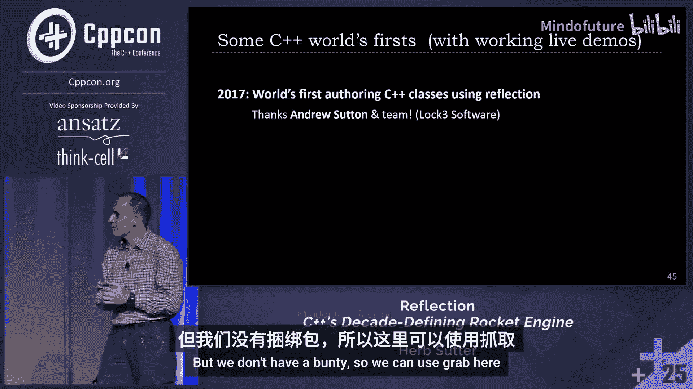

So8 years ago， when I first gave a talk about reflection and how to use it to write meta classes where it was very still abstract and hypothetical。

 And we had just the very earliest partial implementations where only two or three examples yet worked。

That was still the first time that I know of where we demonstrated on stage authoring C plus plus classes using reflection。

 That was eight years ago。 The prototype was written by Andrew Sutton and his team at Lock 3。

 Thank you very much to Andrew Sutton for that。 As far as I know。

 today was the world's first demonstration of automatic differentiation 4 C plus plus using Ref through CPP Fron。

 But all of it is directly applicable to extensions to statement and expression reflection。

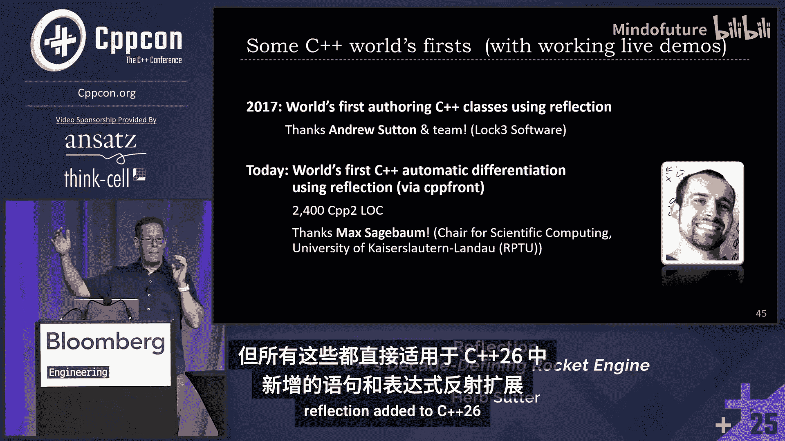

Added to C plus plus 26。So this is a world's first。 Thank you for doing that。

 I understand you wrote 2400 lines of C2 code and that if you wanted to finish reverse mode。

 it would be about double that total。 So thank you for for putting in that effort。

 And thank you for explaining that to us。 Thanks for having me。😊，Now， let's look。

A bit further forward。

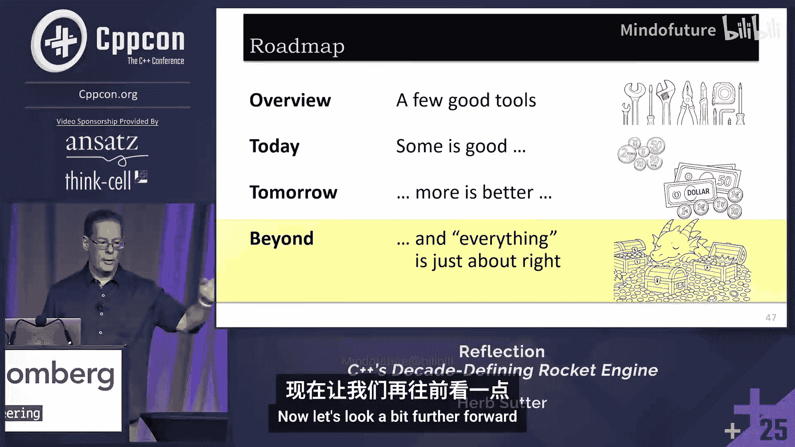

And。I want to invoke。

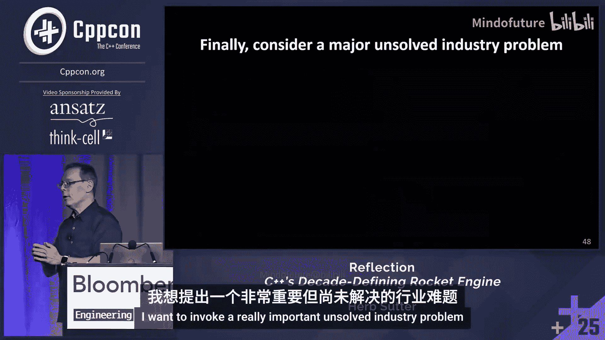

A really important unsolved industry problem。 But to set them stage for。

 I want to go back 3000 years。In history。To set context that we're not the first to encounter this problem。

The Ne Assyrian， there were several Assyrian empires。 The the one of the later one， the latest one。

 the Ne Assyrian one。Lasted centuries from the 10th to the 7th century， B， C。

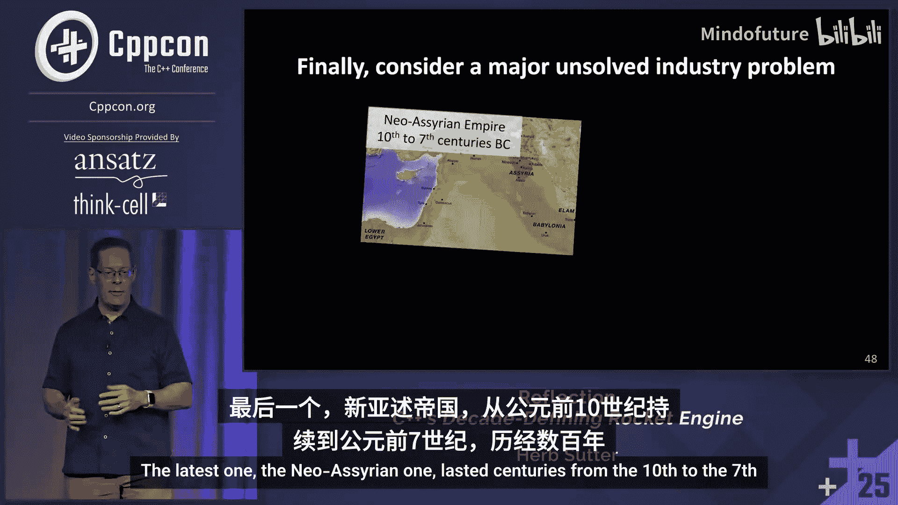

Then it was taken over and succeeded by an overlapping but larger neo Babylonian empire。

 This isn't the old Tamaurabi original Babylonian empire。

 This is the Ne Nebuchadnezzar and all those guys， the Neo Babylonian empire in the 7th to6th centuries B。

 C。And then， the Persians came along。And the Achamenid Persian empire lasted， again。

 hundreds of years from the 6th century to the4th century。There were no jet airplanes。This is a huge。

 huge land mass and sprawling empire。How on earth could humans scale to govern successfully for hundreds of years。

 empires 3 in a row of such size。 the Assyrians， the Babylonians， the Persians， How did they do it。

Well。They had other stuff， like roads。But these fine empires are brought to you by the imperial Aramaic language。

 and the imperial Aramaic language was used by the Assyrians， by the Babylonians， by the Greeks。

 It changed imperial Armaic that evolve。 But at any given time， you had a common second language。

Not necessarily first， but a common second language for trade， commerce。And also。

 in this particular case， it was also the language of diplomacy and of government。

Those common languages are not always the same， but in this case， they were。

These empires would not have been possible if that people had been able to talk to each other。

So easily， in such such a standardized way。And roads。Well， what happened a bit after that， Well。

 the Greek Empire was there， and then it was gone because Alexander didn't live that long it immediately fragmented。

But we probably all know that the empire that has existed for the longest。

 the longest lived empire in the world， where at least parts of it had lasted until the 15th century。

 include the Byzantine Empire， was the Roman Empire， the Roman and the Byzantine Empire。

And parts of it lasted So the 5th century A D， parts of the 15th century， A D。

What held those empires together。More roads。Famously and Latin。

 especially in the western part of the empire。 But Coate Greek was the language of trade。 Thank you。

 Alexander， that because it was so pervasive that people could talk to each other， They could barter。

 They could。 They could communicate。 Commerce could happen。 government could happen。

A lingua a franca。Is what binds disparate groups together and makes them governable and usable together。

 Why am on earth am I bringing up ancient history。What is ourlingua franca of programming。

What if I you you， let get to the punch slide。 Everybody's yelling out C， C， right。

 What is the language， If you want to expose an API that every major language can call。

 What do you call， What do you write it in。 Yeah， we all know the answer， right， It's C。

It is the industrial strength duct tape of our， in， of our civilization。

Every API consumable for most languages， operating system APIs are C。It's our interrupt blue。

What's not so great about that。Type system。 What type system。So， so right。

 we have its low abstraction。 and it's also low safety。 We can also talk about lifetime。

 memory management。Our whole world， our civilization， is built on uncapsulatedstructs。

 raw pointers and manual lifetimes。That is what our civilization is built on。

 We hear about security problems in CNC， plus， plus。90% of them mercy。

Some of our C plus house were working on them， but 90% of them are C。

 And it's beyond our problem that everybody has to talk this way。

 including rust and C sharp and go have to talk to each other。Like that。

 if they're going talk to each other at all。 So you might say， well。

 isn't the answer certainly obvious， We've had classes since the 1960s。

 Why don't we just have encapsulated classes and member functions And what a wonderful idea。

 And we've done that again and again and again， and nothing has succeeded in taking over the world and solving this problem to being able to be a lingua franca。

😊。

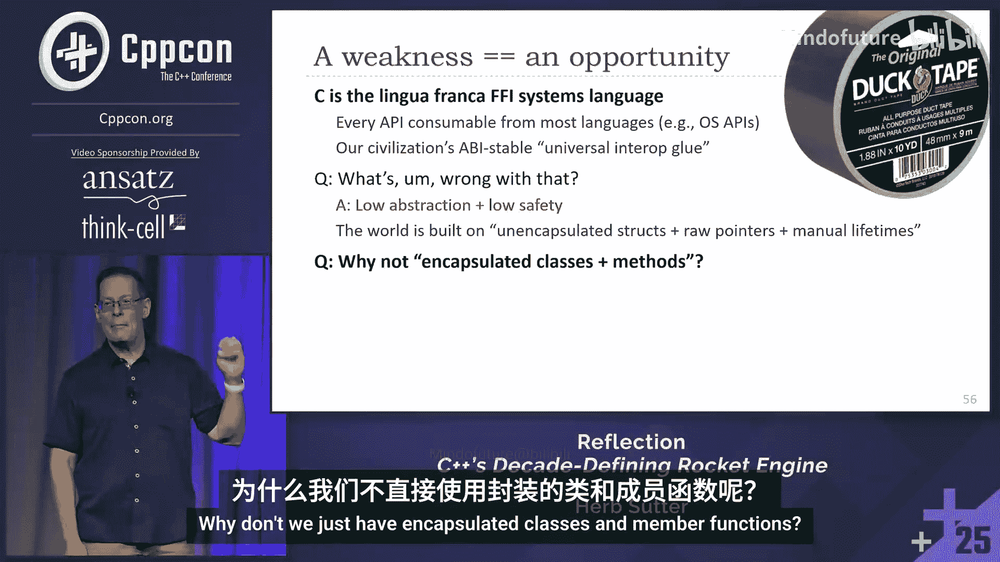

Notice I include things like the dot net runtime。 And in nowadays， you might think， well。

 that's just like C sharp and F sharpp。 that's， why would that be a lingua fca。C。

 L R stands for common language runtime。 There was a hope in the early days that many languages would be able to interoperate on this platform。

 that didn't materialize， that it could be a new operating system platform。

And we have all these things。I have no hope， exactly zero hope of this problem being significantly improved。

For the rest of my career。Unless we can do it through C++ reflection。

So let's consider this major problem。 And let me tell you why I think。C plus reflection。

 even if it doesn't work， if it doesn't work， nothing will。

 but why it has a hope and why I think it is our best chance at a solution。 disclaimers。

 the following slides and demos are proof of concept。 They do generate 100 percent。

Ordinary portable standard C plus plus code。 But I'm using C plus CPP front reflection as a proxy because it goes farther than the clang and DDG implementations do yet。

 But do please view it as a proxy for looking into the future to see what we can do in real。

 IO C plus+ reflection in the future， view it as a prototype proof of concept for that。

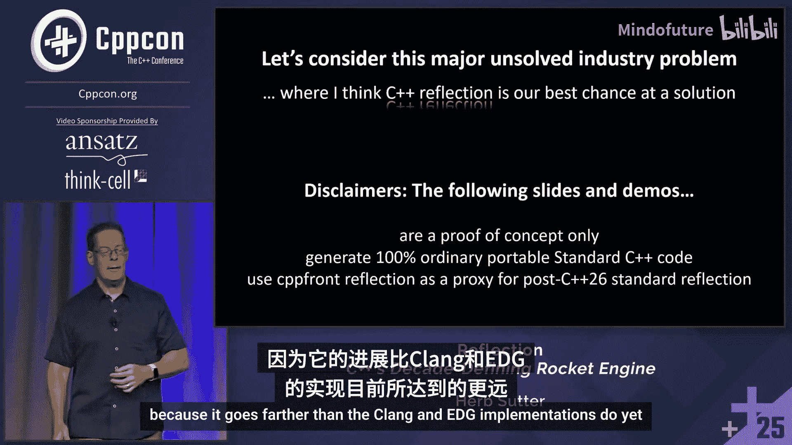

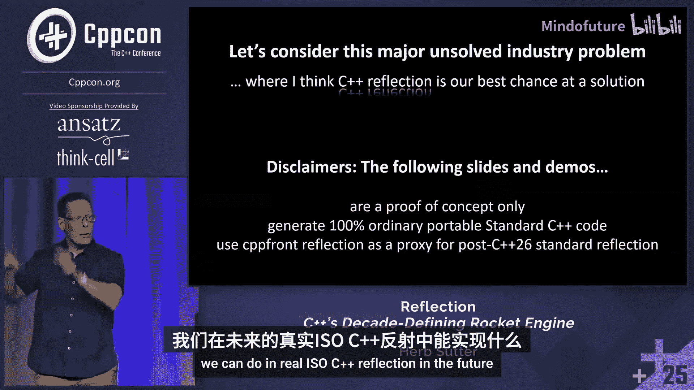

I am not the first to suggest this。 There have been other attempts。

 including with C plus S reflection。 Thank you to these paper authors。 Calllum， I think。

 is here in the audience。 Some of these other authors are too， A Dan's name is there again。

We have this idea。 I am glad people are thinking about this。😊，Let me try to show you why。

I would love for there to be a future where I could use reflection to author the class on the right。

 Does just say instead of class interfacing or class value or proxy， I could say class Python。😊。

One word。Compilile it。And have Python just be able to invoke it。Now。

 let's see if Python is feeling better。Because I would love to live demo this。

 but I have to do it in Python。So we'll try to start Uuntu one more time。If not， trust me。

 that code works。 spoililer alert。But I want to show you what it takes to do。 And let's see。

Try to reboot Uuntu。Here we are。Let's put you over here。Make you bigger。And will go to。And let's see。

 So what I want to show you next， we have the Gr one function。 Let me show you。A widget function。

That is。Widget at Python types。 This is the same as what I was showing before， just in CPP 2 syntax。

 I just say I， I'm not just writing any class。 I'm writing a Python ex colable class。

 And I may want to have these， these three functions。

 which are pretty much as I showed them on the screen。So now we're going to go。And we're going to。

Try invoking。This from Python， if Python cooperates， if even if it doesn't。

 I'll show you what we generate。 And so this is widget dot C P 2。Alright。

 so the CPfront compiler has reflected it。 But now it's calling some other things I'll show you in a second to finish generating the python bindings。

 and we're done。 Now we will have generated a python callable wrapper。

 And let's just see if this calling code。 So here's a little Python script that imports the widget library。

 we just generated tries to construct the widget because we've expose the constructor pass it 10。

 and then cough some functions。 By the way， notice that line 5 uses named parameters。

 How many of you wish for named parameters。 So if we expose our our C plus type to Python。

 at least this one supports named parameters。 Now， let's see if Python cooperates。😊。

And we're gonna write collar， execute collar dot pi。 Yay， it worked。

And notice I use the name parameter and everything。All right。

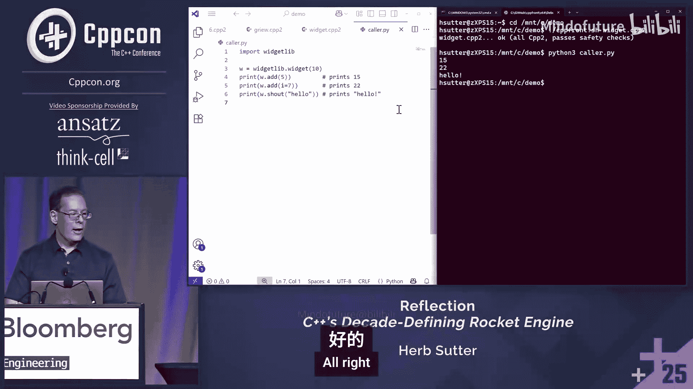

How did it work。Well， let me go into showing you what was generated。So in my widget CPP。

 because I do just generate， CPP frontron generates 100% vanilla C plus plus code。

 portable C plus plus code that any C plus 20 compile can take。

You'll notice that in my reflection implementation， I can。

 in my meta function request to add include files to the generated output。

 which I need for because I'm gonna wrap pi bind。 And I also want to support S T L types like stood string。

 So I I have that as well。 And then here's my regular widget， as it always is。

 And that's all generated code from CPP front。 all regular C plus code。

 and I generate a pi bind 11 module。 I called it widgetlib because the name of the class is widget。

 so that this is generated If Id written gadget。 This would be a gadget type。

 this would be gadgetlib。And， of course。You can immediately say。

 what if I want more than one type in， in the same in the same mod of Python module。

 you can immediately think how to write the meta function to do that。

 Just pass a parameter saying what you want the module to be named So you can put several of them in the same module。

 You can often think of the answer because it's just code。Just code at this point。

But notice what I'm doing is I'm saying which class I want。 And I'm repeating it also as a string。

 I am also going， and。Creating the binding for the constructor， for the addd function。

 with its argument name， with the shout function for it， with its argument name。

And this generalizes to multiple parameters， as many functions as you like。And as a post build step。

 I also， in this case， you can do this with CMake。 But I the CPP frontron also executes G plus plus to build the Python 3 library。

And that's what makes it possible。So the next thing you might think is。

That sounds like it was useful。 But I am a web developer， and I really want to。Right。Javascript。

So then what you can do， Let's compile this。Again， and we compile it again。

 And this time in Wiidget CPP， you'll notice that we've included Mscriptin。

And this time we've generated binding。 The syntax actually looks a bit similar。

 but it's very different。 This is an M scription binding for a widget module with the class widget。

 the constructor function and everything。 And then we go into the post bill step。

 the post bill step now is to invoke the M scription compiler。 And now， like we had。

This working on the slide， we can now have this working where we just say， oh。

 I want a class that' accessible from jascript。And that code works through Mscripted。

 If you can get Mscripted installed， which I was not able to do in time for this talk。

And scripting is huge， or I'm doing it wrong。 My goodness。

But you can immediately see how as soon as you run that E C plus plus line， this will just work。

Because Iscript and works。 By the way， we just did two languages， right。

 because Typescript is compatible with Javascript。 So we just expose it to javascript and Typescript。

 You can do the same with go。 So you can take， say take that widget and say class， go laang。

And have it be callable with deferred W dot close， all the normal things you would expect。

 So expose your deor as close。 you could， I know that you're immediately thinking， oh， yeah。

 here's how I would write the code to do that because it's just code。

We all know how to make a C plus class type available as a flat C API， right。

You just stamp out each non member function and have an explicit this。 You have a constructor。

 a make and a destroy function， widget， make and widget destroy。 And this is now callable from C。

 If I want to make class widget， class C Lang widget。

 notice I put the underbar in to avoid any confusion。In the last two weeks。

 Alan Gray at 12 D software。Decided to try this using the current， not CPP front。

 using the current reflection prototype by Dan Katz。4 generating sea sharp wrappers。

 So we talked about。5 languages。 Now， let's add C sharpp。 They have over 5000 C plus plus types。

And the current tool set tool chain is C plus plus gets lower to a generated dollar I file。

 It goes through Swwig， which is a great library。 and then to C sharpp。But there's issues with that。

 Swwiig isn't up to date with the latest C plus standard。 It can't parse everything。

 It has trouble with templates， Xter and template， which they happen to use a lot to instantiate their templates。

 It doesn't know modules at all or requires。 And also nested classes accessibility。 He had to。

 with Swig， he has to basically， if deaf。private to public， only if there're Swig， If Swig public。

 so Swig can see it else private please， in order to let Swig see the data members because it has trouble with accessibility。

He did try C plus C I， which is really good at this。 right I I， I designed it。 It still works。

 It's still in high demand， but it's only been updated to work with C plus plus 20。

 And he was using post C plus 20 features。And so he couldn't use at the time C plus C I and C plus 23 in the same file。

 which is what he needed to do。 So C plus C I didn't work。 See this is one of the problems。

 If you do something as a side compiler， you lag。 You're always trying to update and you're always going to be a bit behind。

 Never mind that you're a side tool that's adds complexity to your build build environment。

So he tried rewriting this in Dan Cat's prototype。With Dan's help， so that。

Do not expect this will go as fast unless you can send email to Dan and he will respond quickly。

 But thank you， Dan， for helping。It took three days to download。

 install and get the the cllang based C plus S 26 prototype running。

 And then one very long day in al nighter。And by the morning light。

 he was able to parse correctly all examples that had issues in swig and generate the right things he needed。

 And heres some of his quotes。 He's generating a C plus rapper prototype。

 He's transforming stood string， stood W string inhouse text class a beaster with your no windows。

 you know， beaster and calm。😊，Into the correct ref string result in C sharp。

 the outstring result in C sharp， etctera。The most stunning part is we are just sprinkling a few constyvaly words。

 then doing what we do best。Writing C+ plus code。He continued。 He stopped his test there。 It's。

 it's a prototype compiler he was trying out。 And he wanted to do the proof of concept to see if he could generate it。

Taking this forward， he says， also， reflection could generate the unit test for this。

To know the compiler has actually parsed the code correctly and generate the tests for the classes that it just generated to make sure they're correct。

 the compiler testing itself。He says everything points to reflection being able to accomplish what we need and in a way familiar to every modern C plus S programmer。

I have lost counts。 Imagine this in an Australia accent。 I won't try。 I have lost count of the Do G。

 C plus plus pars Ive written over the last 30 years to achieve source code generators。 Now。

 he does add， there are outstanding questions。 These are very early prototypes。

 They have not been upstreamed yet into clang or GCC trunk。Outstanding questions， how。

 how will efficiently will reflection handle 50 million lines of code， which he needs to do。

 looking good。 But， you know， now we're talking production scales， boundary cases。

 integration into tooling and build systems。 So we're still going to discover those things。

 It's only been voted into the draft standard three months ago。 And yet。

 he was able to get that result already in four days with， with Dan's help。😊，For his 5000。

C+ plus classes he wanted to expose to C sharpp。So if we can do that， if we can expose。

 just say class Python， class jascript， class Go lay， class C。And expose it to also to Java。

 to sea sharp， to rust， to swiftt， to ruby。What would you call that meta function。

A PI seems like a good name for me。 I'm writing an API type。 And how would you implement API， Well。

 if you have all the other metafunctions， it's just a single time liner that invokes one after the other。

 right。I know， if I could know how to， to build each one， I can compose them very easily。

Let's measure compile times。 But in principle， this is doable。

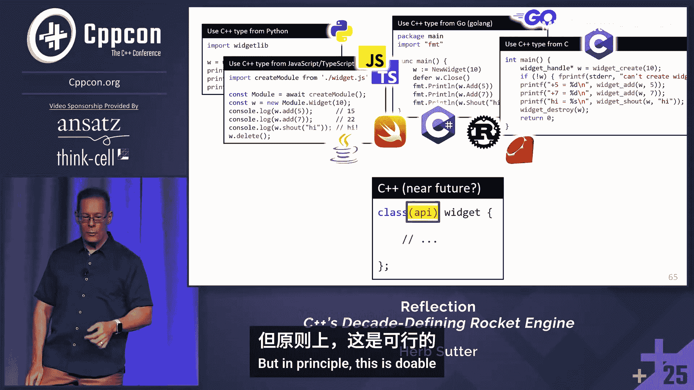

And if we do that that instead of the foundation of our civilization beingstructs and pointers。

I'm not saying this is going to happen， but I'm saying our best chance， in my opinion， of。

 if in our the lifetime of our careers， getting past C is the lingua franca。

Is C plus is to make C plus plus using reflection the lingua franca。 And that's going to take time。

 And it's going to take building out。 But if we can do that， just maybe。Just maybe。

We have a hope for our civilization to build on higher level， safer APIs。Encapsulated strong types。

 not naked drugss。Smart pointers， not raw pointers。Automatic memory management， not malikin free。

At the meeting where we voted this reflection to the standard， a few days before the final vote。

 because all the reviewing was taking place， Was it going to make it so that we could vote it in in time。

 Dan Katz， who authored the Kangham implementation。 We've talked about him several times。

 Thank you again。 Dan， for all the heavy lifting in the last two years。

 He was talking to Hamd Duakovva， also known as Ms Const Square and chair of the S G 7 Compd time programming group and a cochair of the evolution working group。

He Dan went to Han and said， all right， reflection， we're gonna make it。

 The review is being done by core。 It's on track to make C plus 26 this week。

 And I have to tell you Ha's answer。 So if， if you've know Ha， or if you've seen her， give it。

 give a great talk。😊，You know， she's。Very reserved， very quiet。

 Watch up for the quiet ones in a good way and very dry humor。😊。

Dan said reflection is on track to make it this week。And Han， in her understated way。

 just gave a little shrug。 Deadpan said。W do you like it。And that's exactly。

What reflection makes C++？

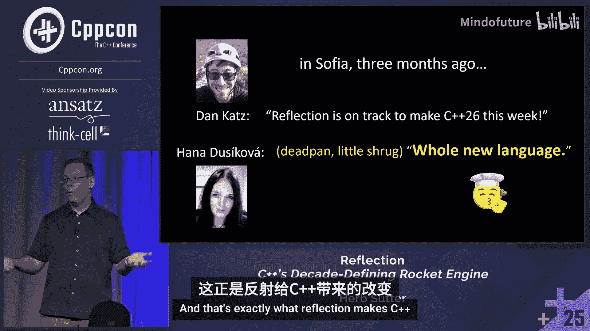

I have one last little confession to make。When I was writing this paper that I first presented here  eight years ago and have been updating since。

On meta classes， how to use， hey， reflection is really good。 We really need it。

 And here's how we could use it in particular， to generate classes。

 help us generate classes more reliably， elegantly， simply simplify C plus us a great deal。😊。

There's a story behind it。 And I'll just。For a minute， tell you the story。In 1957。

The Lockheed L 1649 Star liner entered service。 This is so early in aviation。 It main competitor。

 you'll see there on the second line was the Douglas D。 C 7 C， the Douglas D。 C 7 C。

 just to set expectations here， okay。😊，It was the first。

Commercial passenger jet that could cross the Atlantic westward。Against the wind。

Profitably and reliably。The reliability part was kind of important for passenger service。

 although it's not at our current levels of reliability， but。

We're not likely to lose a passenger this time。That was just a year before I hit an entered service。

 The Stliner came out in the next year，1957。And it was 10% more luxurious。 It had 10% more range。

 It could go all the way from Paris， say to Buffalo or Chicago， instead of just to New York。😊。

Than the Douglas D。 C 7 C。And these were the perfection of the Troprop airplane。

 but they were getting diminishing returns， in fact。They shipped。

 these flagship airplanes shipped1957， one year later。1958， both the Star liner and the D。

 C 7 C canceled production。Why were they broken。 They worked just as well as ever。

What happened in 1958。Anybody want to shout it out。

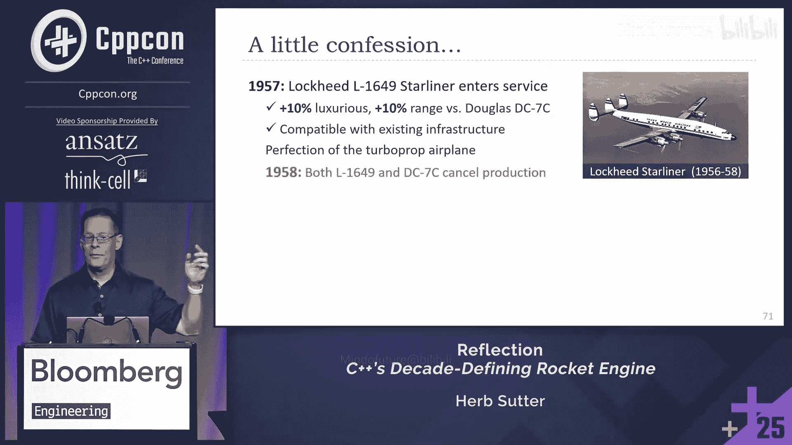

Js， which one。The Boeing， Boeing was great then。Boeing 7，0，7， started production and entered service。

It wasn't 10% better。It was too exp bad。 It had double the speed。

 could carry double the passengers and in more comfort because if you've been under a turbo prop。

 Oh my goodness， you know， the noise and vibration， the jets seemed like being in and our。

 our standards have gone up， right。 Our expectations have gone up。

 But this was like sitting in a lounge for people of that time。

 Like it was just so much more comfortable and easier and and less tiring to use as a passenger on the flight。

😊，The7，0，7 replaced all star liners by 1962， and it remained in production for over 20 years。

 In fact， do you know what year the last 707 passenger airline aircraft was retired from passenger service。

 not freight。 It continued longer for freight。😔，It was in passenger service until 2013， the 7，0，7。

And the fact that we didn't hear about it。Tells us that they were， still flew well。The 7。

07 wasn't a blimp。 It wasn't a helicopter。 It wasn't a submarine。 It was the natural。

 continued evolution of the commercial passenger airplane。

 and it was fully compatible with existing airport runways and existing airport terminals。😊。

It celebrated and doubled down what had come before。 It didn't try to replace it。

 The airliner and say， oh， you shouldn't be using airliners anymore。 Use blims now， use submarines。

 Now。 No， it was just a substantially quantum， better airliner， not something else。😊。

Still recognizably the same thing， but better in speed， in efficiencyciency， a cost， reliability。

 and yes。Use your comfort。Jet technology created new headroom to rapidly develop even greater performance and range at lower cost at at least a new era of aviation expansion。

😊，The very next year， in 1959， the D， C 8， which replaced the D。

 C 7 C entered service as a commercial jet。 The conveor 8，80 quickly replaced came to there as well。

And so back 10 years ago， in 2015 and 2016， when I was first doing my personal experiment that turned into CP P2 to say。

 how could we refactor C plus plus to simplify it in ways that C plus else itself could benefit from。

 But is there a way we could simplify it。And how could we do that。

 One of the things I learned was that the number one way to simplify C plus loss that I could find。

Was to use reflection。And to assume that there was static reflection in the language。

 And that would greatly simplify the language itself。

 We wouldn't need a class tostruct a union and Eum。

 We would have those and much more without hardwired type categories in the language。

 just the general flexible class that can do everything。 But I'm writing this kind of class now。

 And then I'm writing this kind of class and use reflection to generate those defaults。😊。

And that's why I asked John Spicer at the time。 We had not had 700 papers yet。

 but I asked that he kindly gave me paper number 7，0，7。

Because I believed then that reflection could be C plus plus's industry transforming jet engine。

To accelerate progress， while also simplifying our evolution。

 And I am so grateful for the work of so many people who've done the heavy lifting to make it possible to see it becoming real this year。

 It's coming true。😊，4 C plus plus。This is going to be an exciting decade。

Reflection has arrived in C plus S 26。 More is coming。 The frontier is open。 Let's go。Thank you。

Thank you too。We have time for a few questions。 We have mics here。 and I think here。Please。

 thank you very much for the talk。 I wanted to know using these reflections for。

Creating these building blocks on top of Cus plus for adding your。

Very nice rapper functions to target other languages is a very nice feature。

 But what do you think in respect to using built module interfaces with a standardized APII for other languages to target C。

 like allingua Fca。So I， I， I couldn't hear everything with echocho。 but I think what you're saying。

 what about instead of generating rappers having a standardized A BI that's cross language。

That would be great if we can get it。 Some of the examples that I gave e listed on the screen of attempts that have failed to achieve that。

 They might have achieved it here and there。 But Corba， the dotnet C R。

 those are kind of attempts to have a standard A。 One of the problems that you come up with is that languages are so different in their lifetime models。

 That's why Rus is having such trouble right now， Interfacing with C plus plus because their lifetime models are are so different。

 So you do have to have some sort of bridge。 The question is， how convenient can we make it。

 because right now， the bridging is limited usually to a few types。

 like every new language has this problem。 They interface with C。 They want to use C plus plus types。

 They say， look， I've wrapped。Vectctor in string for you。But I'm done。 You can use all C plus plus。

 No， you can't。 You can use vector and stringing。 So we would like to see if we could do better。

 And I think that requires assist from the C plus plus side because it's the C plus plus side that has the information。

 And I think it's the reflection that lets us program it。 This is my hope。 hey。

 it works with pie binding denimscript。 So， yes， thank you very much。😊，Please。

So this is a more practical question。With this new fancy reflection。

 And thank you very much for that， will I be able to take a namespace and descend into all sub namespaces and process all classes。

 Yes， what would go around downloading and installing to try that out tonight。 Okay。

 so you can get the reflection prototype。 search for P2，9，9，6 is the paper number。

 that will usually get you to the implementation。 You can try it on God bolt。 But， yes。

 you my understanding is you can navigate namespaces。 But remember。

 it only doesn't go to statements and expressions yet。 it doesn't doesn't do attributes yet。

 I think just annotations， which look like attributes， but they have the equal in front。😊。

I'm glad they do。 But you can you should be able to go through namespaces， classes， functions。

Member functions and their parameter list。That's as far as they've got so far。Thank you very much。

This。make a very， very quick comment about the AI。 So Saon is around here in this conference。

 And he have a paper about versioning A BI using reflection。 It was actually like it close up。 Yeah。

 So go， go and catch him。 and I talk to him And that's it。 Yeah， but but by the way。

 I started saying this last year。For the next decade。

 you will not be able to go to a good C+ sauce conference without running into talks about reflection。

That's's there are going to be reflection conferences。 And there's。

 there's at least four talks at this one， which is great。Oh， yes， we hi， I let inba slip in。

 So now let's have you。 That's okay。 I'm wondering。

 are are there any planner so to support reflection on free functions。

 Because I didn't see you are doing that， Youre only using strict class。 Yeah， so three functions。

 in this case， I wasn't doing I was wasn't showing free functions。

 but you can reflect over the three functions of a namespace。

 I'm pretty sure that works today in those prototypes。 And in C plus plus 26。😊。

In this exciting future， reflection LED world， I think we will have a very blurred line between language features and library features。

😊，I wonder how you see that and what would there be left still to develop in the language itself。

So anything that you could compute and patterns you can do by hand today。

We often get proposals for a language feature， to do that pattern。Those patterns。

 if you can write the code by hand， you can now write it through reflection。

 Those are that category of potential language features will very likely be received with first try to do it as as a context for a reflection library and then tell us if it didn't work。

 right。Im trying to think of other things。 You could probably it could be that some things are could be done as libraries。

 but might be more elegant as a language feature。 So， for example。

 I don't know yet whether named parameters can be done as elegantly la arguments rather。

 can be done as elegantly as as a reflection library So you get super nice syntt at the call site or if because people are very sensitive to their call sites。

 or if just having to write a couple more characters means now， let's have the language feature。

 So itll， it'll be a trade off between ability， Can I do it as a library， if not。

 we can still consider a language feature， can I do it as easily with the same performance。

 efficiency and usability and debugability if if I type something wrong。As a language feature。

 if I can， like I can for those meta functionss that I've implemented in CP， P front。Heck， yeah。

 let's make those libraries。 And then I don't have to wait for my compiler writer to implement the flag Eum type category or things like that。

So it's basically same as today， the same you know， decision， whether to or in the language。 Well。

 the same kinds of things apply， but it's definitely not the same as today。 Today。

 there have been proposals for flag enums。 And there's been much ringing andashing of teeth like。

 do we really want to complicate the type system by adding a new kind of type in addition to classstruct enum union。

 Now， we have flag enum。 Now we got to wire that through the type system through all our compilers because it's not a class。

 but with a comp time meta function。You can write。You could write flag you。

It to generate a class with all contexts per members of the right things and the bitwise operators。

 So you see the Cp front implementation for an example of how to do that。 Yeah。

 so then nobody will ever be asking for a flagging new language feature again。

 because we can do that one very well and efficiently and usably as a compile time library。

 It's a good example。 good question。Hi， so I saw in the examples you gave with the annotated classes that you generated basically a new type from an existing type。

 Yeah， Is it possible with reflection in the future to act to also manipulate the existing type。

So the current reflection is lets you see what's there。 It doesn't let you change what's there。

 And there's very good reasons for that。 You the one definition rule is gets a lot weaker if you can change the definition。

 And I think that's actually fine because the time where you want the hook is to in those examples is to generate the rest of the type。

 So it's okay to put it in a prototype subname space and generate the real type。

 And I think compilers will likely get good at optimizing away the unused originals。In CPP front。

 I happen to implement it as changing the the type。ThatThat exists。Including that if you want to。

 if you want to take out members and replace them with something else like the union and variant types。

 they can do that。Even there， though， it's， it's considered it's conceptually part of the parsing of the type。

 And once you finish parsing the type， O DR is still sacrosanct， it will never change。

 So I personally am okay with putting in a hook right before you finalize the type before anybody can use it to modify it then。

 But I think it's only an optimization。 And I think it's actually a good idea to not change things that already exist because now you're gonna if we wanted AI problems。

 that's where we would go to go to invent them。Yeah。

 the question was related more to the situation where you have already a library that's maybe defining some types。

 And you want to extend that。Right， so if you have existing types and you want to extend them right now。

 my advice to you is generate new types that are super sets of those types。

 and then see how you can make them substitutable。 The， the benefit here is。

Whatever boilerp you would have to do by hand to do it。

 you now no longer could need to do once per type。 You could write it once and extend all the types as you need them and just write the meta function once。

 which would make it a lot more ergonomic and easier， hopefully。Thank you。

We'll take one more here and one more here and then grab lunch。 Yes， so this is really exciting。

 And I know as soon as I tell my manager about it， one of the big concerns will be how long till the tooling catch up。

 I'm just wondering， would best practices for that gap。😊。

Be maybe using C plus plus 26 to generate C plus plus 23。 Or is there like another sort of， I guess。

 stop gap。Well it， it's similar。 It's actually not so about using C plus 26 to generate C plus S 23。

 It's generate more C plus plus 26， but。Generate more code， right， The key is because we're。

 we're forced in this mode， in this model， mostly to generate the new code in a separate file。

That's actually a good thing。 It has the benefit that we can't use it right away， But the benefit is。

 it's code。 We can debug it。 We the step into just works。😊，Right。

 one of the things that we are going to need more of is constant expert for debugging。

So the idea to be able to step through functions and we already need that for like when we calculate。

 use context for code to calculate template arguments。 But we don't have it。 So what do we do。

 We use printf debugging a lot to like， oh， it doesn't calculate the right thing。 Okay。

 we try to run it as nonconstex for and debug it that way。

 We will need visualizers to see the code we generate and we will need context pretty debuggs。

 And so I was really happy to hear jettbrains announcing a concept for debugger just a few days before this conference。

 So I don't know more about it than that headline。 but it's on my to read about list because I've been asking for that and saying we're going to need that for the last decade。

😊，Thank you。One more。So great talk。 Thank you。 Always， Love your insights。 earlier in the talk。

 you talked about reflection becoming an ability to replace a whole set of language features going forward。

 So in two parts， how do you have concerns and how do you see that affecting C plus， in essence。

 forking into many kind of distinct and separate languages as individuals create their own libraries。

 and how do you see these affecting the standardization process going forward。

 Because now you're just writing code to add language features。

 would those move into a separate subgroup would they become part of the standard library。

 What is your like longer term vision for the committee process。😊，I I've been， it's a great question。

 I've been answering that question for eight years。

 and it's important to keep asking it because now we're actually going start doing it。

Your last words。Hit the nail on the head when you said， which ones go in the standard library。

I can totally see where people say， oh， these meta class functions。

 What if I write my interface and you write your interface and they're not compatible， You know what。

 that's totally fun。 We standardize the common ones。 They're just libraries。😊，This is no different。

 This is no different from when Brna added classes to C， plus plus。Well， not everything's astruct。

 but I could write my own string class。 and you could write your own string class。

 Yeah that would actually happened a lot， right， but we standardize the common ones。

 And we have libraries but you might have your own hash dictionary in mind。 Yeah。

 we standardize the common ones。 And， you know， when you do make your own。

 It's not the end of the world。 You were able to do that。 Good for you。

 And you're now in a place that you wouldn't have been before。

 I see these as just being the next meta there。 That's why I called the meta classes。😊。

All the same answers is for classes。Amaz， thank you。Thank you all for coming。

 Enjoyjoy your lunch on the rest of the conference。😊。

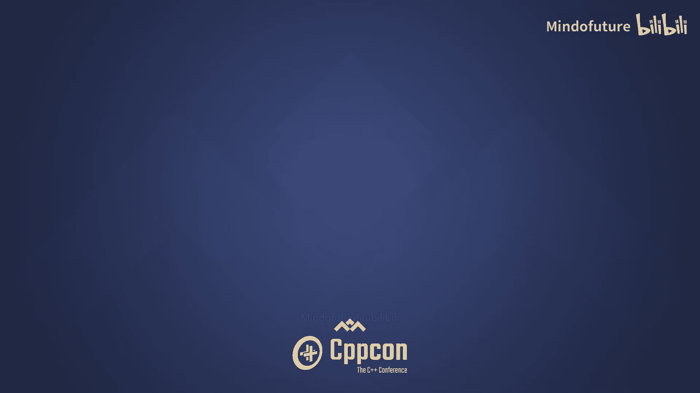