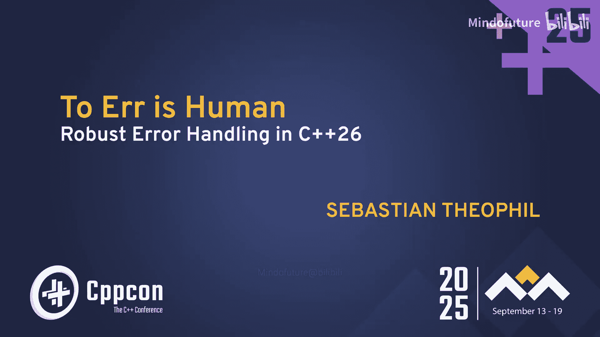
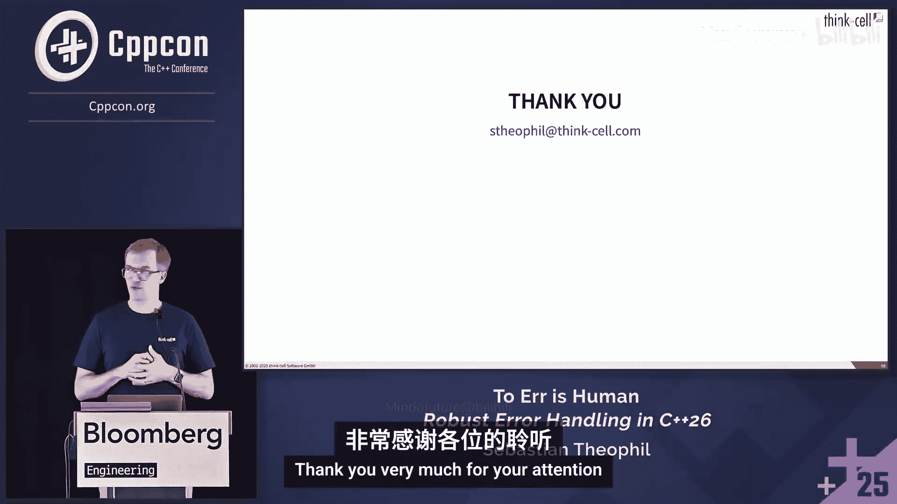

# Cppcon-2025-｜-C++-｜-C语言--｜-汇编-｜-编译器-｜-操作系统-｜-Linux-｜-Windows-p31-P31_C++26中的健壮C++错误处理-Sebastian_Theophil-CppCon_2025--BV1wyPBzrEeu_p31-

The great thing of becoming to CPPCon is you get to see many。

 many interesting people and many interesting problems that are solved。

Okay， so welcome， everybody。 Thanks for， Thanks for coming to my talk。

 I will be talking about two different things today。

 I will be talking about the tools we have and see plus plus to do our handling。😊。

And the first part of my talk and the second part of my talk。

 I will be talking more about like what errors to handle and how to do that in practice。

So I've been programming C++ for a while now， and I've been at thingstel the whole time。

 and we have a very small team， but we have over a million very active users。

 and they use our software on normal desktop computers。

 And that's a very hostile environment because we don't control it。

 People can control anything install anything they want on there。

 administrators have very specific ideas on how to configure those machines their security tools that can interfere with you。

 So long story short， in order to ship a stable product that could become successful。

 we had to have excellent error handling and our reporting just to you know get our product into a stable state。

😊，But first， before I begin， let me clarify what I mean by error handling。 That's a super wide field。

And when I think about error handling， I think about errors。 I think about， well。

 what couldn go wrong。 And when I think about systems where you have to deal with something going wrong。

 I first think of these things， right， This is， this is working in hard code mode here。

 lives are at stake。 quite a lot of them。 actually， in the kind of， in the case of this plane。

And I researched a little bit just out of curiosity。 what do how do those systems work。

 It turns out just so that you learned something today， like those modern airplanes。

 they have typically three primary computers， each of which can control the entire plane and then they have a couple of other backup systems in separate locations。

 they have different hardware。 they often implement the same software back by different teams just to make sure you're not hit by the same software bug either。

And these things must survive rampfalls due to cosmic radiation or engine explosions or things like that。

呃。What we do this is something that we typically call engineering for reliability， right。

 This is a reliable system that can survive the Well， in this case。

 probably destruction of parts of its physical system。Errow handling is something far simpler。

We deal with program error， mostly。We deal with unforeseen system configurations。

 unforeseen system behaviors， but we will assume that your RAM works。

 we will assume that your computer doesn't explode suddenly。

And if you're lucky like I am to work in a field that is not specially security relevant， you know。

 you can always fall back to doing this。So this is error handling in easy mode， of course。

So why do we bother with this， Well， like I said， we ship software that runs sometimes in unexpected environments。

 the users do unexpected things with them， and we make mistakes。 and I think I'm quoting And already。

 bad Ar handlingling greets bugs。But we can sink enormous effort into this error handling code。

But at the end of the day， we are not paid for writing perfect error handling code。

 We are paid for delivering customer value。 We are paid for solving our users problems， right。

So the goal is not writing error handling code per se。

 the goal is just to get to a stable product as fast as possible。

And going to error handling is key to achieve that。So in my talk。

 I will first go over the error handling mechanisms that we have starting with the most basic。

And then in the last part of my talk， I will talk about what we handle。

 how we handle errors at things sell in practice， what do we handle， how do we do that？

So let's start with the basics， C style error handling。Everybody knows this function。

 the Pos function to open a file at a certain path。

Now this thing mixes its return value of the file handle with an error code right because this thing returns either a valid file handle or minus1 on failure。

And if you open the man page， you will see that this can set the global error No variable to some error。

 And there's a long list of error cases that this thing can set。

From the benign that you probably should handle， you know end， the file doesn't exist。 Okay， I can。

 I can expect that to the slightly weird， E interrupt。 this call was interrupted by a signal。Okay。

 I guess I have to retry this。To the to the weird。E fault， the path was outside the address space。

I don't think I have to handle this is if at all a program error。

 probably maybe it's an uninitialized variable， but it's nothing I should handle to say。

And there's a long list of more error cases。The situation on Windows is very similar。 of course。

 create file also mixes its return value with its error code。

 It returns either a valid file handle or even valid handle value。

And it also sets the global error variable that you can query by calling getla error。

So same interface， similar problem。And there are functions like that in the C plus+ standard here string to along convert the string to along。

 of course， on success， it returns the par integer， unsurprisingly， if no conversion occurred。

 it returns0， as if that weren't valid long， it also sets the end pointer probably to the beginning of the string。

 and it also sets the inner variable。And then on overflow， similar situation that clamps the value。

 But again， it returns to valid long and sets Ernno。

They are just a lot of things that you have to check to get this correct， right。

 and to check if an R occurred。 So this is a very inconvenient interface。But unfortunately。

 this is never going to die， and we need good tools。

 at least until Herb Sautter gets this way and everybody programs with C++ and reflection。

 But as long as operating systems have C style interfaces， this is not going to die。

And we need good tools to even handle these kinds of errors。First。

 in C++ we invented exceptions to make this a little bit more elegant。

And exceptions get a bad reputation。 sometimes people call them G if I go to a statement。

 People say they are difficult to reason。 it's difficult to reason about the control flow that's introduced by exceptions that they are horribly slow when they' are thrown and caught。

And some people like the Google folks expand them in their code base。And they require， of course。

 that is certainly true， require you to write exception Sa code。When I wrote this。

 I went back to the Google C++ style guide to check what they said about exceptions， and I quote。

 they say our advice against using exceptions is not predicated on philosophical or moral grounds。

 but practical ones。 Things would probably be different if we had to do it all over again from scratch。

😊，Which I interpreted is meaning that their main problem is actually making old code exception safe。

I might be wrong， but that's what I read into this。Thank you。I can can read。

But exceptions can be exactly the right tool in some situations here。

 I have a very simple piece of code。 You see， I wrote this for CPP on C so I query the weather in Foxton。

😊，We do an HTTP request to some Jason API。 we parse the return， Jason。

 we write something to a lock file。 So every line here could realistically throw right somebody pulls your network cable。

 something returns different kind of Jason format， suddenly or your disk isful。And maybe。For example。

 in the case of the powerer。Thisarrow is detected deep in the stack of the station parcel。

So the unwinding of the exceptions， the unwinding of the stack here is actually a feature。 It's very。

 very practical。I talked to Kahalil yesterday who does this awesome work about making exception faster。

 and he told me he had people who wrote a Jason Library， come to him and say， hey。

 we want to switcharrow handling to exceptions because in this stack。

 we have to check return values so often。 it actually impacts our performance。😊，But of course。

 there were some criticisms like exceptions can make your code hard to read and hard to reason about that are entirely correct if you don't catch exceptions as locally as possible。

Like I did， I did here。Well， there are very nice aspects of exceptions as opposed to return calls。

They have more semantic error information。 These exceptions arestructs， they have names。

 We can attach more data to them if we need that。And， of course。

 our code on the happy path remained entirely clear of error handling。 So these are all very good。

 very good aspects， I think， in programming。 And not last but not least if you heard it in his keynote。

😊，Brna likes them， so what am I going to say？Some points remain kind of true。

 They are a little bit slow on the error path。Exceptions are serial。

 That means there's only ever one that can be in flight at the same time。 This can be a problem。

And of course， code must be exception safe， that's just the truth。

There's a very good talk two years ago by Pete about the misuse of exceptions。

 how it's a very good collection of cases where he found exceptions misused while he was doing code reviews and how he cleaned that up。

 very good talk that I can recommend。😊，So what would happen if we could combine the advantages of return calls。

 their simplicity with the advantages of exceptions， their semantic richness？And luckily。

 somebody had this idea that you think it would be。 And now I can ask you is， is that the first。

 did you have like prior work you built this idea on。😊，That is it， right。

Andreel Alex Sandrsco had exactly this point to make in this talk，2012。

 What if we could combine the advantages of those two。 It's a very good talk。

 And this is how St expected was born。Quote last quote， I think， let's make exceptions。

 the error code。So this is， and then the advantage would be。More more simplicity。

 We could have multiple error codes in flight at the same time。 We could store them。

 They're just variables。 We could store them for later。 We could move them across threats。

 We could collect and transform them， etc。😊，So how do we use St expected？

Here's everybody's favorite era handling example， parsing an integer。I have a very simple function。

 parses an integer from string view， and it returns unexpected。

 which is either the integer or the error condition we encountered。

 But here I'm not so much interested in how to parse integers。

 I'm more interested in what to do with this result。

So let's say I want to build on parsing integer and I want to parsse an integer and then invert this parsed integer and divide one by this integer。

So parsein returns me an expected， Exp has a very simple interface。

 I can convert it to Google to check if there is a valid value inside this expected。If it is。

 I can access this value and do something with it。And here now I compare a check if this integer was 0 because then I can't divide by0。

 St unexpected is a convenience constructor that I can just give it my new error message。

 and this will be automatically converted to the st expected of a double and string I want to return here。

And if I don't have a zero in my integer， I can return the one divide by the integer as I want。

In the else part， I can access the error as well with dot error。And convert that。

Now that's a very simple interface， but that's not how we， I guess， should program。

 That's nots how we should program with St expected。 That's not the most convenient interface。

 I think St expected also has a very elegant， monadtic and functional interface。

And there are a couple of functions I want to point out three here。

There is still expected to transform。That's a function that will only be called if the state expected contains valid value。

 and then it can transform that value。Transform error similar。

 it lets you transform the error that is contained。

And and then and then is also a function that is only called if this state expected contains the value value。

 and it lets you transform the entire state expected into another type of expected。

So here we transform the integer。We transform the error from a simple enumration to a string that is more user readable。

And finally， we do the same as before we check if our integer was0 and otherwise we divide one by that integer。

So this is a very elegant interface I find is I think how we should program still expected。

 this function now does not contain any explicit flow control statements that makes it much easier to reason about the program state makes it much easier to understand that we've really covered all cases and didn't miss a case in this long line of ifthan else statements。

 and that makes it harder to make mistakes。So I think that state expected is going to be maybe the default way how we return errors in C++ in the future because it is very powerful and at the same time。

 very， very simple。You can， by the way， if you have questions， you can ask any time。

 We have questions at the end， too。 But if you want to interrupt me， yes。

Is the transform and transformer， Could those be inverted。

 like is there a fire sort of like you must handle things first， then do the。I think I could have。

 I could have changed the transform and transform error。

And so the transform error transfers the  error type。 in this case。

 from an enumeration to the string， I， I think I had to do the and then。At the end。Right。

 because by then I already have at expected of a string。 and now I return more strings。

 I think that's I had to do it this way。So that lets me come to the next C++ feature I want to present shortly today because I also think it's related to catching and handling errors。

 even if it's a different kind of error， and that's contracts。The。

 the contract paper that I've linked to here by Tim Moore who's also here and program chair at this conference is a very long paper。

 it's a very readable paper it's a very thorough proposal and despite its length it's conceptually very。

 very simple he has written the blog post himself contract explained in five minutes and that contains the basics of the most important things you have to know。

So in short， contracts are a more flexible new standard of a certain mechanism。

And as opposed to the previous mechanisms， it's not for checking。Environment behavior。

 different behavior of my operating system functions。 It strikes press invariance in our code。

 It's to guard against programme error。 Of course， we can write better asserts。

 We can write pre or post conditions on our functions。😊。

And one of the best features in this contract proposal is that we can configure at build time what actually happens if one of those contracts is violated。

So here's a very simple example， little function。 We have a precondition that checks this argument is not zero。

 If you write a precondition， the precondition can only access the function arguments， of course。

The variable that you capture in that preconditionix is implicitly con， so you don't by accident。

 mutate one of your function arguments。We can write post conditions。

These post conditions can also capture the return value here。 capture as R。

And they can also refer to function arguments to establish a relationship between the two。

If a post transition。Refers to a functional argument。

 then this function argument must be declared cont， it' not only implicitly consed。

 you must declare as cont to make sure you didn't by accident。

 mutate this function argument inside the function body。

 this post condition wouldn't make any sense then。And we can just write better asserts。

 contract asserts。They are better because they're not just a macro that is automatically removed in release belts。

 It's configurable。So when are these things evaluated， this is all very， very sensible defaults。

 Un for C++， I know。Preconditions are initialized after or are evaluated after the arguments have it been initialized。

 of course， because you can access them。 But before the function body runs。

Post conditions must be evaluated after the return value has been initialized。

 otherwise you couldn't capture it， but before the destruction of local variables。

 which might again manipulate the state inside your function。

Contracts support exceptions in the sense that if you throw an exception inside a contract assert。

 this leads to a contract violation， again， very sensible。

 and they're also supported in constant expert context， and then they turn into compile errors。

 of course。And I said initially that contracts， the behavior of contracts can be can be configured at build time。

 And there are four different semantics we can choose from。

That define what happens if a contract has been violated。

So first is' the ignore semantics that means， well， we do nothing if the contract is violated。

We can configure observe semantics， which means a contract violation handler will be called that can do anything you want。

 but then the program execution continues。And four semantics mean the contract violation headline will be called to do logging or whatever。

 and then the program will terminate。Or we can do quick and force。

 which means we terminate as quickly as possible。And at CPP on Siege John Lake has had kind of a good he presented a good intuition which use cases should use which contract semantics。

 so in our case you know desktop application not especially security relevant。

 we have already always implemented observed semantics。

 so we do error handling error reporting and then we hope for the best and just continue。

Because the worst that can happen is that the program crashes。

 but that's better than annoying the users with error messages。And force would be Bloomberg itself。

 maybe， you know， you have and something goes wrong， you have enough time to do logging。

 you want to find out about this problem。But then you terminate because you don't want to lose millions of dollars。

Quick and force is a medical device。 Something is out of spec。 You stopped immediately。

 You don't have time for logging。And we can also customize the contract violation handler。Here。

 very simple sample code， I think directly from the paper。

 you just have to define the global function， handle contract violation that here receives an instance of this contract violation and you can check what the semantics were where and then most importantly defer to your own error reporting mechanism maybe。

 or the default implementation。Contract assertions may have side effects explicitly， logging。

 for example， sending error reports would be a side effect。

But the paper says they're not allowed to have destructive side effects。

 and a destructive side effect would be a side effect that affects the correctness of your program。

And in a correct program， contract assertions should be redundant if you take them all out。

 like with I semantics， your program must still work， otherwise you've made a very serious mistake。

The assertions themselves， of course， should also be complete and independent。

 They shouldn't have side effects that change the correctness of the future tree or post conditions。

 right that will anything is possible in the plus class， but that's not what you should do。

And they have zero overhead in the sense that if you choose ignore semantics for your contracts。

 then it should have no impact on the program behavior。

So contracts are also a huge feature that I'm very not much looking forward to and I see one very important advantage。

 especially if currently you're using any libraries like Boost for example。

 then very often you will have code like this somewhere in the very beginning of your code base that configures what boost theer does。

 and then the configure that boost theer should somehow relate to your own assert mechanism。😊。

And I hope that if libraries。Libraries use contracts that we could hopefully all get by with a single contract violation handler。

For all the libraries that we use。 that would be， that will be very nice。So the last C++ feature。

 also C++ 26， I want to mention is library hardening。

Library hardening means that we now want to enforce the pre and post conditions that we have always documented in the standard。

 The standard says， you know， the post the precondition of of dereferencing an iterators that this iterator must probably be pointing to a valid element or something like that。

 but we never enforced any of these things。 We never assert it。It would just crash， hopefully。

 maybe in release pills， maybe it would not crash。So now we want to enforce them。

 we want to insert contract asserts for all these pre and post conditions。

Microsoft had something similar for a long time， they had de bug generators that we've used all this time that helped catch a lot of bugs。

 and these will also be based on contracts in the future。So Kang supports this， GCC supports this。

 Microsoft supports this as far as I know well I guess I can't， so none of those use contracts yet。

 neither does Klang， neither does Visual Studio， they all just assert and possibly terminate the program。

 but at least the asserts are there and they help you write correct programs。AnyAny questions so far？

Everybody who ask a good question gets one of those thing cell socks。 I have four pairs。

 four pairs of socks left。So we have so many options in C+ plus so many good options。

 but we have so little time。So what do we do in practice？As I've said。

 we're not paid for handling errors， and were paid for solving customer problems。

 so we have to focus， we have to focus on the areas where it matters most。

And we want to have very good tools for handling errors， otherwise our programmers won't do it。

So we must have error handling tools that are easy to use in our own， not only the standard tools。

 but tools in our own custom libraries。All error handling code that we have must be tested。

 otherwise it probably doesn't work anyway。And we must focus all the efforts where it matters most in practice。

 probably very few areas in your code will have like most of the work in era handlingling。

So what do we do in our practice？When we program。If we use any other external API of an operating system。

 but not necessarily， we check every single API call。So here I have two examples， very simple APIs。

 getting the host name on Pos systems and Windows， the get host name function will return zero on success。

 We write this。And we， and it will also set the Arno variable if it， if it failed for some reason。

 So we have this ano macro around that that will check if the Erno variable has been set to anything。

On Windows there's a similar contract， typically Windows API functions return zero on success。

 I think。And if they don't return 0， then they will also set this getla error thing。

 So we have API R， this macro that checks for those things。

So we check every API for call and we make this very， very easy。In fact。

 we have different wrappers for all kinds of。Return code pattern that we find on Windows on Macwis or whatever。

That check this error variable， get lastarrow with one for each results。😊。

And we want to make sure even in code reviews， right。

 that's the first thing you look for in a code review。

Did the programmer think about all thesearrow that might be returnedren？

we are so trained to do this that we even have an annotation returns void。

To make sure that we can annotate that we thought about the error handling。

 But this thing doesn't return any error。 So there's nothing to do because otherwise。

 in a code review， I would immediately say， what about this guy， forgot。

 you forgot the error handling。We also use asserts aggressively。Two assert tree conditions。

 post conditions invari， and these stay in release builds。We use no except by default unless we。

 of course， know that something is going to throw an exception in that case， as with returns void。

 we also annotate function as throwing， although that doesn't have any standard。

 meaning it's just a annotation。The restaurant is Bued， do you actually check if it's buo。

Oh we might。 I didn't look for that。 I hope we do。 I hope we do。 We should。No yeah。

 as the way I know us we probably do， but I didn't check。So we use no accept by default。

 we also annotate functions that where we know this throws。

 so I didn't forget the no accept this actually throws。

 even though there's no language feature to annotate this。Wting too much no except， of course。

 might cause our program to terminate。But if I didn't know this was throwing and I'm not handling the exception anyway。

 then this would have terminated at some point anyway。 So we might terminate right away。

 What we do instead is install a terminate handler to be notified when we wrote no exception where we shouldn't have written one or we just forgot the exception handling。

 right。So now we've annotated everything， we check for all these return codes。

 what do we do with them？Well， by default， we assume that everything works。

All these functions will never return an error。 We just will catch any error that they ever return。

And the goal here is to keep the set of code paths small。

 We don't want to write error handling code where we don't need it。

 we can't reproduce it where it's not going to be tested， and that's where it's going to be wrong。

 We want to keep our program simple。And the set of program states small。 The only exception。

 of course， are the cases where you know beforehand that this is an error that will happen， right。

 opening files is the classical example。 And here， opening a file there are a lot of cases。

 And again， we try to handle them in a way that's as simple as possible。 So here。

 opening the file would return a non negative value on success。 That's the file handle。😊。

ItMight we turn an invalid file handle and e interrupt In this case， we have to retry。

And then there is a list of error codes where we know they can happen。

And that we can live with opening the file will just fail。 We couldn't The file didn't exist。

 We don't have access rights to this。 There is no space on the disk， whatever。

 the typical file error scenarios。We can probably reproduce them， and if we can reproduce them。

 then we will of course， handle them。Same on Windows， samee with the API error。

 Here's the list of error codes that I know can happen。 I want to ignore them。

If any other error is returned from remove directory， for example， error out of paper。

 I want to be notified。So what do we do now when one of those checks fails？

The first priority is we want to collect as much information as possible。

So our client application sends an error report， it automatically creates an error report that contains the entire stack as a mini dump on Windows and also as a mini dump on Mac OS and these only contains stack memories so they are only maybe a few hundred kilobits of size and we send them home our to our back。

Our server application that's just a private server for our own backend。

 would hold the threat and notify the administrator so that the administrator could look at the life system and see what's going wrong。

And the second priority， like I said， is to carry on。The behavior is now undefined。

But that just means we will disable any further reports。We do not terminate。

 especially not after asserts， we don't even show error messages for asserts， Ass are just code。

 that can be wrong。We want to make sure our programmers write a lot of asserts。

 they write a lot of invariance， and we want to incentivize them to do so。

 And if the customer calls anytime you get the assert wrong。

 then people wouldn't write as many asserts， I guess。

So this is the observed semantics in the contract world。

Now we get a lot of error reports with those million customers。

 everybody encounters a wrong assert couple of times。And we collect them in our backend。

 and we have this little application that we can use to look at them and to filter them and to find out what are the most frequent scenarios。

And very often， of course， we find scenarios that we could never reproduce inhouse。

 people where the software or clients， where the software interferes with some crazy securities software。

 where administrators misconfigud the system。Timing issues because they use them on very slow machines。

All kinds of different issues。So we can look at the operating system where this Mac occurred。

 which versions of our software we can do a full text search。For each individual block。

 we see the line in the code where this occurs in which versions in which time spans， etc。

And the cool thing here is that this database is actually establishes a two way communication between the client that encounters the problem and us。

 because here we can enter the built in which this bug has been fixed。

And when another customer encounters the same bug， it will send the bug report to us。

 The backend will notice， hey， this is fixed in this version。 it will reply with that version。

 The client will automatically download and even automatically install this update and the customer will just never have this problem again。

 It will just， in the best case， it will just be silently be fixed。And here's more information。

 which customer states， etc。So this allows us。 It also allows us to ask customers to pop up messages and say。

 yeah， you're encountering this bug。 Could you tell us more about this， Please contact support。

So we gather more information and we try to reproduce this error at home。

Because we want to add handling only for errors that we can reproduce。Right。

 so that the  error handling is testable。And in the best case， we find an actual fix for the problem。

 an actual workaround instead of just showing the message box I've shown you initially。

And we do one other thing to like customize the behavior。

 and I think the contract proposal is also working on extending contracts to enable that because we categorize the errors we encounter by their severity。

 and this affects what we do when we encounter one of those errors。So there are critical errors。

And I'll pointer access， for example， if any of these API calls failed or if an assertion failed。

That means that these are errors that are always severe and that shouldn't happen because they are always program errors。

So we don't have to write handles for them， we just want to be notified when that happened。

The program， like I said， is afterwards in an invalid state， no further error reports will be sent。

So we send the other reportss， we disable reports， we typically don't show messages to the user at all。

And the next。Less severe error category is what I would call a situation that is。Somewhat untested。😡。

It's defined behavior， but unclear how this would happen。So here's a little code example。

 We get a range， maybe a range of bytes。 And I want to extract the Unicode code point value out of that。

 And I assume here， I want to verify that this is always a valid code point。m。

Because I couldn't reproduce that this is， this is not true。But here also。

 the error handling is very simple。 I can always return the unor replacement character。

So this is like a defined behavior situation。 I know what happens if my assumption is not true。

 I just want to be notified if this is ever not true。So theoretically， this could happen。

 We do send an error report。 We don't disable further error reports。

 We just throttle them because this might happen。Often， unfortunately， if we were， wear bad luck。

 will we still continue execution as normal。One step below that still is maybe something that is a third party buck。

We are we encounter a bug in something else we are intoop with， we can handle this。

 we have reproduced this， we support this， we have tested this。

But it degrades the user experience a little bit。 So users may complain to us。

 and they may call our support team。So this is maybe something that we would always lock。

 but we would never report to our backend， we know about it already。

But if a user ever complains to our support team， we can just look in the log file。

 we see this is the problem and we can politely show them where they should direct the anger。

 so just speak。And then one priority still below that would be a weird system configuration。

 maybe so when on Windows， for example， you can configure your decimal separators and you can say that the space character should be your decimal separator。

This has some surprising effects， and not every software can deal with that。We have again。

 reproduce this， we support this， we can live with this， but again。

 it still could still cause weird problems， So that's something we lock only in debug belts， maybe。

 but again， people will call us and say， I have this weird problem and we can figure out， yeah。

 that's probably the space separator thing。So we can set our support engineers can set flag on the system that would then enable logging this even in release builds。

Because that might be the reason for the support call。Okay。

 and then we have all these error scenarios。 We recently had a talk with Tim Moore was curious about how people use like error errors in practice。

 So I hope some of that makes it into the country and the next contract proposal。And as I've said。

 we do error reporting and we send a stack to our backend。

So we have our own system that is somewhat similar like to Google trashpad。

 but we can report all kinds of errors， so whenever our program encounters a failing assert unexpected API return code。

 we launch an error handling process and we do out of process error handling and that's something you should always do because if your process encounters an error。

 you don't know what state your process is in， maybe it is not able to send error reports anymore。

So we do this out of process， we suspend the process that had the error。

 collect all the information we need， create the mini down。

 and upload this if customers gave us permission to do so。And then we do analysis on the server side。

 we symbolate， we load these miniDms， we symbolate them。

 we group them by the location in the codebase where they occurred。

 so that we can then get to this visualization and find the locations in our code that cause the most problems and fix them first。

And with that， I am。Almost on time at at the end， thank you very much for your attention。

And we still have time for questions。In exchange for socks。Yes。

 I'd love to hear your thoughts on stood error code versus stood error condition and error category and customary Here you go yes。

We don't use those and。We don't use those， because。We found they had the， They were at the wrong。

Level of abstraction。 So when we did， when we started doing cross platform programming， we had to。

 we had to remove all kinds of Windows dependencies out of our code base and introduce cross platform。

Cross platform interfaces。And we actually never had a scenario。Where we。

Wanted to transport the cause of a problem out。We captured this in a different way。

 let's say you have a file operation creating a temporary file， writing to a temporary file。

 whatever， very deep in this file abstraction somewhere you do the actual call to F writeite。

 where you have to do this error handling。And。There's just a list of things that are allowed to happen。

Space， disful， whatever。And in those cases， I throw this exception out。

There are all the other cases are out of paper that are not allowed to happen， I want to report them。

But outside the user that is trying to write to a file， he doesn't care why this failed。

 I just know Jason Parsing HB request files， they can fail for a list of permitted reasons。

But typically， I don't care why。 I don't care if it's the the request that failed or the response or。

This is something we， we never actually， we never actually did。 So。

 and the cases where we do care about the error code is very close around the operating system function。

And this is where I don't want any cross platform abstractions。

 because how does error sharing violational Windows translate to any E。Manled up error condition。

It's like， I don't even want to think about it。 So create file can return our sharing violation and I have to deal with this。

And then I， yeah， can deal with this or not。So this is something we never found it used for， we。Yeah。

So regarding S expected， I was wondering if you had any thoughts about what kind of error you would return from like a。

Virtual function。 So let's say， for example， we have a class called a runner。

 And then we have with a virtual function called Run that returns as they expected with some error。

 which try to decide。 And there's two implementations。 one is like a dog。

 So you can ask a dog to run， which we can run successfully or it won't run because is tired or it's hungry or And they have have the implementation of runner。

 which is a car。 you can Yeah， out of fuel， batteries dead。 I you know。

 dogs don't have batteries or fuel and cars don't have movess。

 So I guess like what would you think about。In this made up example， Yeah， yeah。 so my， my。

 my favorite， my favorite answer is always to other programmers when I review it its the same answer like before。

 right if。😊，Figure out if you really need this。Even for St expected， it's the same argument， right。

 St expected has very， very good competition。 And that is still optional。

 It's for something unf about。 I don't care why， right？ I mean， there are arguments。

 Maybe you you care why because you want to show a better error message and so。

I get this and then you need to transport something， something out， but if that's the case。

 you probably also know exactly what the error scenarios are and what you have to report。

So it's hard to say in a makeup example。 I don't know， yes。So before when you were talking about。

 you know， things still doesn't operate in a very high security environment。

 And so when you encounter an error writer or an insert fails， carry out。

 carry out as much as you can。 Do you see that as a potential tradeoff for security risk， right。

 once your program enters an undefined state。 Yes， something is happening that's wrong。 Sure。

 that's something could be a security， That's， if our software weren't just a simple office application。

 then then yes， you will be right。 But so far， the like the worst thing that can happen is that that the editor crashes。

 So that's。Comparatively benign。Yeah， but true。 Yeah， if we were in other environments。

 we would do something else。 Yeah， that's just one the last talk。 Now， Yeah， you got it。

 what do you think about expected， not throwing exceptions from the de is something that you would have missed or still expected not throwing exceptions from the de。

 Yeah， yesterday， I talked with Andrea Alex School course this likely class， that is the origin。

 very， very primitive origin expected。😊，And then the special thing about likely was that if through from the distractor。

 if you didn't check the error code， which is brilliant。

But people don't like the structures and know， exceptions from the structuress。 many other reasons。

But that would have make expected really， really special and not just another type of optional。ATh。

 you could still assert。 But even then I'm not sure like with all the the other cases I had where I I don't even care that much about the error code。

 I'm not sure it's a good design choice。 I can have an API that out of like because they have a library。

 If I would write a library， I would probably have to use it expected and return the error code。

 But like I said in our application， we maybe we don't even care about it just allowed not to work。

 And that's fine。 So I wouldn't check it。 if you want that， you would still use an assert， right。

 They would also work。Thank you。Yeah。Thanks for the talk。 I guess you have a no socks error。

 but if you can I don't have。Since you mentioned chor reviews， I was just wondering how。😊。

You can ensure that the developer has thought about all the errors。

 exceptions or the error codes that the function can return and handle it。Is it a manual process。

 Do you have to look at the dogs and then figure out。Or is it。

 Yes And then you have to know who you are review。 if you occasionally probe， if this is。

 this is really really all there is， yeah。It is。 yeah。 it is something you would some。

 you also have to learn， I guess， at some point， how to read this， how to thoroughly read this。

 how to distinguish the cases that can happen。 find the Microsoft documentation very， very good。

 for example， they， they often explain what， what can happen。Yeah。

 it's something that is a manual process， or yeah， yeah。

Thanks so is it like little bit is it a good idea to try and save like as long much as use of that as possible before allowing your part on the crash。

Is it a good idea what to to like try and save as much user data as possible， Yes。

 but trying to save as much user data as as possible， of course， is a good idea that that most。

 but most applications today do this， right， you crash and you open it again and you end up where you were。

 So this is luckily largely solved problem。Yeah。Anybody else。Otherwise， thank you for time and。

Enjoy the pumpkins。

