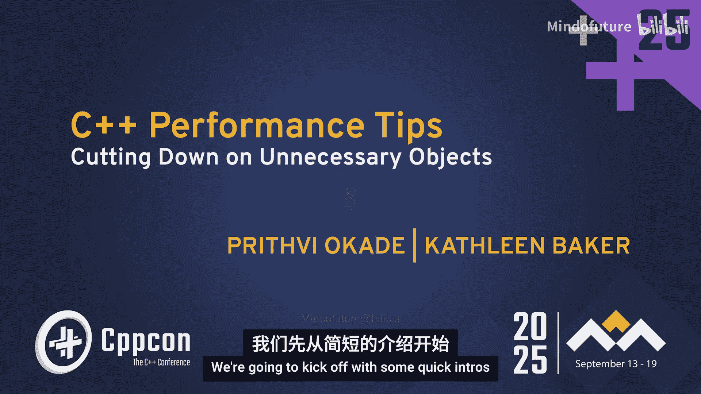
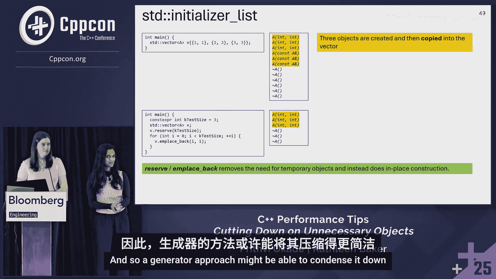

# Cppcon-2025-｜-C++-｜-C语言--｜-汇编-｜-编译器-｜-操作系统-｜-Linux-｜-Windows-p32-P32_C++性能技巧_减少不必要的对象-Prithvi_Okade_Kathleen_Baker-CppCon--BV1wyPBzrEeu_p32-

Great， al right， hi， everyone， thank you all for being here。

 We're gonna kick off with some quick intros。 I'm Fritpi Okaday。

 I'm currently a software engineer at Microsoft。 I've been here for about three years now just over。

 I work on Edge the browser specifically I work on commercial copit integrations into the browser。

 This is my second time at CPcon。 So I'm very excited to be back。

 and I'm also very excited to be joined by Kathleen。 Hi everyone。 I'm Kathleen Baker。

 I also work at Microsoft on the Edge browser。 right now I work on commercial features。

 and this is my first time at CPPcon。 So'm very excited to be presenting today。😊。

Great， today we're going to be talking about cutting down on unnecessary objects in C++ so as Kathleen and I both mentioned。

 we both work on Edge， which is a chromium based C++ project and so as engineers you all know。

 we give a lot of feedback we get a lot of feedback and over the years we've noticed certain patterns where extra objects are created。

😊，This talk summarizes what these patterns are， gives a couple tips on how to detect these patterns。

 and then most importantly， talks about how we can go about correcting these patterns。Specifically。

 we'll be talking about basic strategies to avoid extra objects in string， vector， common STLs。

 types and containers， associative containers， and we'll talk about using transparent comparators and moving data to compile time for more improvements。

Before we get into it， I just want to highlight that we have slide numbers in the top right of all of our slides。

 so if you have a question， we'll take it at the end。

 but if you could just drop down with the slide numbers that it corresponds to that'll be super helpful for us to refer back to at the end。

Great， so I've been saying extra objects， unnecessary objects a bunch of times now。

 What do I actually mean by that， Let's start by considering this piece of code here。

 So we're initializing this string stir to be hello world。

 And then we're creating a copy of it in St2。 And then we go ahead and we print out St2。

 So really all we're doing here is we're printing out hello world。 And so instead。

 we could have just done this。 because if you see out printed it out directly。

 We didn't actually need stir or stir2 to achieve this goal。😊。

The important thing to note here is that even with optimization flags。

 the second snippet here actually generates much less code。 These two don't become equivalent。

 And so these two objects during here2 are objects that were unnecessary for us。

 And if we get rid of them， we can have some improvements here。Obviously。

 this is a very straightforward example。 and we're literally initializing the problem here。

 I'm initializing Stern and St2。 Moving forward， we'll talk about how this happens behind the scenes with methods that we use commonly。

😊，Okay why are extra objects actually a problem C++ is of value Semimantic language by default as opposed to a reference semantic language。

 that means not on assignment， we copy the value， not just a pointer。

 so in a scenario like this where we have an object of our type my class and then we create a copy of it C and C1 are actually going to be different objects and that's because on the second statement here we're calling the copy constructor to create a ver new object。

😊，We're going to go into a couple of examples before we do that。

 I just want to highlight that we're overriding operator new and operator delete。

 we're just adding print statements so we know when they're being called that way we know when objects are being created and destroyed in the following examples。

First example is with string。 So we initialize this string S to be this is a hello world string。

 And then we create a copy of it in S1。 When we look at the printed output。

 we see that operator new gets called two times。 So what's happening in the second statement when we create S1 is the copy constructor is being called and operator new is being called to allocate memory there。

😊，Ideally， we don't have this extra allocation of memory because allocating memory is a costly runtime operation。

 so if we can avoid that， that would be great。That brings us to using the move constructor。

 So here we are， again， with our string S。 and then we create S1 using the move constructor in the printed output。

 we see that operator new is only called one time。 That's because the move constructor for string is an allocating memory。

 It's just swapping memory。 And so even though move is creating a new object。

 This is still a step up because it's not as costly for one time。😊，Ideally， though。

 we're not creating the new object at all。 So that brings us to in place construction。

 So here we have a function Gster。 It returns our desired string。

 and then we set S to be the output of this function。When we look at the printed output。

 we see the operator news is only called once just like before。

 so we're not doing the allocation of memory， we're not doing the cost runtime operation and this is in place construction。

 so no extra object is being created and so in general。

 we're going to consider in place construction to be better than moving and moving to be preferable over copypying。

Next up， we're going consider vector。 So here we have a vector V with six elements in it。

 and then we create a copy of it in V1。 We see here that we have two operator new calls。

 So vector's copy constructor is costly for runtime since it's allocating memory。

 If instead we use the move constructor。 we only have one operator new call。

 the move constructor is an allocating memory。😊，If we consider list here we have a list with three elements in it and then we create a copy in L1。

 When we look at the printed output， there's actually three operator new calls。

 when we create L one for each element， and then again。

 three operator new calls when we create L1 the copy constructor is called So list copy constructor is even more expensive and using move here is beneficial because we only get the three operator new calls when L is created and not again when L1 is created So the move constructor here is better because it's not allocating that memory。

😊，So to summarize， extra objects are a problem because the object's creation can cause costly operations to occur at runtime。

 costly operations are going to be things like memory allocation。

 which is what we were just looking at， making OS calls and running costly algorithms。

It can cause more code to be executed at around time。

 That's what we saw in that very first example with St and St 2， and it can need more memory。

 It can need more stack or heat space at run time。If you're wondering how much performance benefit you'll get if you do solve this problem。

 our recommendation is to measure your scenario because it can really vary based off of the code and the context that you're working in。

 as well as what you're optimizing for。We've been talking a lot about when extra objects are a problem。

 there are certain types where it's okay to create extra objects。

 typically these are for types that are smaller， so it's fine to create extra objects for plainol data types like integers。

 floats， etc， and for objects that are considered small and do not do costly operations in their constructors so things like string use span and Dpan。

😊，Diving a little deeper into what we mean by small as a rule of thumb。

 we can consider objects that the standard library considers to be lightweight to be small。

 So if you have a type that's less than or equal to 24 by in a 64 B system and doesn't have any costly copy operations。

 we can consider that to be small。 So something like string your span is 16 bys in a 64 B system and Dpan is 24 bys in a 64 B system and if you have a user defined type that's meeting these guidelines。

 you're good to go。And then finally， before I hand it off to Kathleen I mentioned at the beginning we want to give some tips on how to detect extra objects are being created。

 and so we have a list of compiler warnings and claim ti checks that we can use right now I just want to highlight WR W extra and W everything in general。

 we recommend using W all and W extra because everything will probably catch too many problems throughout the presentation we' mention these warnings and we'll mention if they're included in W W X or W everything。

And with that， we'll hand it over。Thank you， so now we'll look at some basic strategies to avoid creating temporary objects。

We'll start with a non trivial type as a read only argument to a function。

 Here we have a function fo that takes string S by value andF is just reading S。This code callsFo。

 rec'reating string S that's large enough to defeat small string optimization and then passing it intoFo。

We've also overriden an operator new and delete again to see if a string is created when we callF。

Looking at the output， the call tofo print operator new and delete。

 so it's allocating and freeing up memory when it's creating a string。In this case。

 it's better to use a constant reference in argument for fo。In the output。

 we can see no extra strings are getting created when we do this。As a rule of thumb。

 past non trivialvi read only objects as a constant reference in arguments to functions。

Stooute string is a special case and we can use string View instead。

 we'll take a look at string View later it has some nuances as well。

So we'll take a look at the same example again and see how we can use a clean tidy check performance and necessary value parameter to detect this case。

This catches the issue and suggests making it a constant reference instead。

If we use a string view instead， this doesn't get flagged， so this is good to use。

If we try making our own simple typestruct B and create a function fo that takes B by value。

 this also does not get a warning。However， if we make a change to B and move the copy constructor out of line。

 this will get a warning。By moving the copy constructor out of line。

 B is no longer a trie copy constructible type。The documentation for the K tidy Ch says it only applies to types that are not trivially copyable or have a non trivial copy constructor or destructor。

Now we'll look at returning a non trivialvi member object of a class。

 we'll create our own typestruct A。This will be our placeholder type throughout the presentation for nontraal objects。

 and we'll be using it in examples。It has print statements in all its special member functions to help us understand whether copies are being made。

So if the copy constructor is called， we'll see this printed。

We'll try to improve on that by using a move instead。

And even better is in place construction without any copies or moves。

Now let's usestructucA in our first example about returning a nontrivial member object。

 we'll define a new class， my class， which has type A as a member variable and two functions， a。

 which returns a constant reference and a nu great， which returns an object。

This top code snippet uses aO grade and below is code that calls A。

And here's the output for both functions or both pieces of code The copy constructor is getting called when we call a not great。

 but when we call a， which returns the con reference。

 no extra object is created when returning a non-trivial member variable from a member function。

 return it as a con reference to avoid creating an extra object。

Now looking at the same example with the more optimal function A that returns the con reference。

 here we'll hold the return type as a con reference。

 and in the second piece of code we'll make a small change to hold the return type as an object。

When the return type isn't held by reference， the copy constructor is called to create an extra object。

Now we'll see if a cl tidy check can be used of like this。

 we still have the same example with some minor changes。

 the highlighted code calls8 without holding the return type I reference。

 and the second highlighted line creates a copy of object。

When we use the cling ti track performance and necessary copy initialization。

 this flags both the issues in the highlighted code where we should use a cont auto reference and a conNt My class reference instead on the second line。

Our next scenario we'll look at is using range based four loops。

 We have this function get F that returns a vector of n elements of our type A。

This code calls GADVck to create a vector of two elements， and we have three range based for loops。

 the first one using Const autoto， the second using Const autoto reference。

 and the third using a forwarding reference。We can see in the output the cost auto loop creates two extra objects。

 but the other two loops don't create any extra objects。

 so it's better to use cost auto reference or affording reference in range based four loops for nontrite objects。

When we use the warning range loop construct with the same code。

 we get an error about using constantt auto in the loop， so it's a good warning to use。

Let's look a bit more into the range loop construct warning and see if we can catch all the issues we'd expect it to。

Here we havestruct A with one cons member function F and another non cons member function bar。

In this code， we're creating a vector of strings and then using a range based for loop using auto。

 and then we create another vector of type A and run two range based for loops。

 the first using Cont auto callingF， the second using auto calling bar。

When the range loop construct construct warning is used， it just likes one of these cases。

 the constant auto loop with the vector of A。When we use the cl tidy check performance for a range copy。

 it likes both the loop with the vector of strings and again the loop using Contato for the vector of Ti A。

It doesn't look like the third loop that calls bar because bar is a noncon member function。

 Now I'll hand it off to PthV for the next section。All right。

Thanks Kathleen okay so we're gonna kick off the next section by talking about structured bindings structured bindings allowed for the decomposition of composite objects so think things like tuplestructs arrays in our situation we're going to be looking at a struct here we have a struct B it holds an object of type A as well as an integer I Here's two ways that we can use structured binding to gain access to that object of type A within B The difference between the two is that the first one uses const auto whereas the second one uses const auto ref。

When we look at the printed output， we see that when we're using Cont auto。

 the copy constructor gets called， but when we're using Const auto Ref we get no copy or root calls。

 and so because of this we recommend using Cont Ref for read only structured binding variables。

Next up we're going to talk explicitly moving objects out of functions。

 so here we have two implementations of our function F。

 they both create this object of type A and then return it The first one returns it with an explicit move and the second one just returns it directly When we look at the printed outputs we see that the first one calls the move constructor This makes sense we're explicitly calling move so we expect the move constructor to be called but the second one doesn't have any move constructor calls or copy constructor calls Does anyone have any ideas as to why that might be the case。

😊，Yeah， a bunch of people are saying it's NRVO， so this is name return optimization or NRVO。

 which returns to the optimization where name objects are returned by value from a function and they can be constructed directly in the memory location of the colors variable。

 which allows us to avoid this move or copy from happening。😊。

So what's happening in the first implementation of FO here is that the explicit move is actually preventing this optimization from taking place。

 so we don't want to use new in these cases。Interview is not required by standard， but at this point。

 most compilers do implement it for such scenarios idealally though we use something that's guaranteed。

 and so that brings us to our third implementation of F here that just returns this object of type A directly。

 This actually also doesn't result in any move constructor calls or copy constructor calls because of guaranteed copyulation from C++ 17。

 and so the compiler essentially known to avoid unnecessary copying or moving of the objects。

 Coulation is also known as defer temporary materialization or unmaterialized value passing。😊。

If you're wondering how you're supposed to know that your explicit move is preventing this optimization from taking place。

 we have a warning that you can use W pessimizing Mo。

 it's included in W all and it lets you know that hey。

 moving the local object in return statement is actually preventing copy illusion from taking place。

In this scenario for explicitly moving on return， we're actually going to want to move on return。

 so we have two implementation of our function food。

 they both create this object of type B and then use structured binding name to gain access to that object of type A within and then they go ahead and they return it。

 the first one returns it directly， the second one explicitly calls move on return and what we see in the printed output is that the first one calls the copy constructor whereas the second one does cause the move constructor and so our recommendation is for nontribual types in your return type use this explicit move。

This advice isn't just re structured binding， it applies in general short turning a member value from a local object from a function。

 so in our next example here we're doing exactly that we have our object of type B and then we go ahead and return B dot A the first one does that directly the second one returns it with that explicit move and we see the same result the first one calls the copy constructor。

 the second one calls a move constructor so the same advice from a applies in this scenario as well that explicit move allows us to have an improvement here。

Okay， next up we're going to move on to lambmbda captures so here we have a function where we create this object of type A。

 and then we create a lambda that captures a by value。

 and then we create a copy of that lambda FN2 our second implementation here is essentially the same thing it creates that object of type A creates a lambda creates that copy of the Lada but rather than capturing a by value it's capturing a by reference and what we see in the printed output is that the copy constructor gets called twice in the first example it gets called once when we create that first lambda capturing by value and then again when we create a copy of that lambmbda and the second one where we're capturing by reference we don't get any calls to the copy constructor so our recommendation is to use capture by reference when it's safe so you can avoid the copy。

Diving a little bit deeper into Lambda captures we're going to modify thestruct A that we've been working with。

 we're going to add four member functions to it， they all capture to create Lambdas。

 the first one captures by start this， the second by this。

 the third captures by reference and the fourth captures by equality。

When we go ahead and we call these functions to get the lambmbdas nothing they return and then call those lambmbdas in turn。

 we see this in the printed output， the notable thing here is that when we start this。

 we actually get a call to the copy constructor so we recommend only using start this when you need it because it will make a copy of the object。

A quick note about this example is that we're just printing out hard codeed strings right we're not actually using the captured member variable so if we were to modify this example a little bit and print out a as part of the string we would actually run into this error that says implicit capture of this with the capture default of equals is deprecated。

 that's because capturing by equality was deprecated and C++ 20 so if you're using C++20 or onwards don't capture by equality。

And then the last thing we want to touch on with Lambda captures is what to do if you have a variable number of arguments So here we have five implementations of our function fo it creates this Lada that captures variable number of arguments and then calls that lambmbda when we call our functions we see this printed output the notable thing here is that the second two functions。

 the second two implementations ofF are capturing the veryic arguments by reference and those are the only two that aren't resulting in a copy constructor call and so our recommendation when use when you're usingvariic arguments is to use reference capture that will remove the extra copies。

😊，And with that， I'll hand it back to Kathleen。you so now we'll take a look at some strategies for reducing temporary objects when using string in vector。

We can use string view to stop creating strings at runtime。

 we have a function fo that takes a string by reference and another functionF better that takes a string view argument。

In this code， we create a string stir， which is created at runtime。 We pass this string hello to Fo。

 and it creates a temporary string。Each time we call food better， though。

 no temporary string is created。And here's the output。String view can handle string， cont star。

 and contstar star with length arguments without needing to create different functions to handle each one。

It also doesn't do any heat allocation。String view can also be used to create the string at compile time instead of runtime。

However， in some cases， we can't use string view。If we have a function like food platform here that expects a null terminated string。

 we can't pass the string as a string view because string view may not be null terminated。

There's no C++ standard and all terminated string view。

Chromium has its own implementation of an null termative string view type that could be used in this case。

If you want to learn more about stringview， you can check out this presentation by Jasmine Lopez and Prithy from CPPCon last year。

Let's look at an example where we havestruct A and it takes ownership of the string passed into its constructor or passed into the function sensor。

 so these are sync scenarios。Instead of using string view here。

 we can follow this D++ core guideline for will move from parameters passed by R value reference and move the parameter。

 so now we've updated the code to follow this guideline。

Looking at the same code again without the updates。

We can use the claim tidy check modernize pass by value to detect the same case and improve the code to pass by value and use move。

Right now this check only identifies this case in constructors。

 it's better to evolve the C++ core guidelines from the previous slide to pass by our value reference and use move。

 but the K tidy check suggestion is still an improvement。

Our next scenario we'll look at is using an alternative to string operator plus we have three strings we're concatenating using the plus operator。

 you can see two temporary strings are getting created and then a final third string is created。

 so in all three strings are allocated memory。What if we can concatenate strings more efficiently？

Here we have the same three strings T candidate， but instead of using plus。

 we're using a function called my string cat， you can see now only one string is created instead of three strings from the previous example。

Does anyone have any guesses about how myisterca could be implemented？Sorry。Sting stream， no。

 we're using reserve。So this is our definition of myister cat。

 we're using reserve to ensure there's only a single allocation of the string before we concatenate it。

Our definition of Meistercat is inspired by the Abbsolstercat implementation。

And Chroium also has its own implementation called STca。Now we'll take a look at small strings。

If a string is small enough， no memory is allocated on the heap because string data can be contained by the string object itself。

Temporary strings are still created though。In this code。

 there are three small strings being concateided using the P operator。

 no strings are allocated or deleted， but temporary strings are still created。

If we use my stringca instead， no strings are allocated， and we're only creating the one string。

My Strcad is still optimal in this case because it's only creating one string。

Plus is only optimal in the case where there's a single concatenation and either one of the parameters is a string。

Now we'll look at how to use string View Subster to remove possible memory allocation。

We have a function remove scheme which takes a con string reference and another function remove scheme better。

 which takes a string view。 Both of these functions return a substream using S dot subster。

And this code calls both remove scheme and remove scheme better。

We can see when we call remove scheme with the con string reference， a string is allocated。

 but when calling remove scheme better with a string view， no extra string is allocated。

If we don't intend to modify the result of Subster。

 we can use string View Sub to avoid extra memory allocation。

We just need to make sure when string view is used， the underlying string memory is valid。

So we've used reserve to prevent extra objects when coniding strings。

 and now let's see how reserve can help with vectors as well。In mean。

 we're creating a vector of size4， we use a for loop and place back four objects of type A。

Operator new is called three times first with size4， then size 8。

 and then size 16 to resize the vector to hold the objects we're adding。

The move constructor for each object is also called every time the vector is resized to move the objects into it。

Let's compare to an example where we reserve the size of the vector before em placingcing back objects。

As you might expect， when we use reserves， operator new is only called once with the size of the vector needed and the move constructor for A isn't called it all because no objects need to be moved Reser ensures there's a single allocation and no resizing is needed。

There is a clean tidy check you can use to catch this in your code if you have M placed back in the loop。

 it will suggest you call reserve before the loop。We can also use span to prevent vector creation。

Here we have two functions， food and food better。 food takes a conor reference and food better takes a span。

In this code， we create a Ct array and pass it intoFo andF better。

 passing the Ctyle array intoF forces us to create a vector。In the output。

 we can see callingF created three temporary objects，F better created zero temporary objects。

 so span allows functions to be used with C style arrays without needing to create vectors。

Using Span also allows the function to work with other contiguous containers like vectors。

 arrays and initializer lists。One thing to note is initializing the vector like this with the initializer list creates extra objects PrithV will go over this case in some later slides。

If we need a non temporary object to be graded， like in this case。

 we update A prior to calling pushback， it's better to use move。In the non move example。

 the copy constructor is called， but when we use move， the move constructor is called。

So it's better to use Mo to take ownership of the resources。And then I'll pass it back to Priiffy。

Thank you。Okay， this next section is on temporary objects in common standard library types and containers。

 We're going to start by talking about initializer lists。

 this is the example that Kathleen alluded to a couple slides ago here we're using the initializer list constructor to create the vector with three elements of type A within it in the printed output we see that these three objects of type A are created and then copied over in tar vector。

😊，Instead， if we use reserve to allocate the memory that we need for our vector and then in a loop use Mplace back to add these three elements to our vector。

 this gives us in place construction we no longer have those copy or remove calls happening。

 so our recommendation is to use reserve and Mplace back to remove the need for temporary objects in a scenario like this。

Next up we're going to talk about pair so here we have a pair with two objects of type A within it we see those two objects of type A created and then copied over into the pair This first example of there is actually from C++20 which is what Ed uses it C++ 23 this actually ensures move construction instead of copy construction before C++ 23 you could get Mo construction using make pair or by using the CToD version of pair。

Of course ideally we get in place construction and so to do that we need to use piecewise construct for pairs。

 this is what it looks like to use piecewise construct for a pair， a little wordy。

 a little more typing， but it does give us that in place construction。

Tupple is pretty similar to pair here we have a tuple with two objects of type A in it。

 we see those two objects of type A get created and then copied over into our Tple if instead use make Tple kind of like make pair this is going to give us smooth construction instead of copy construction and then also like the CTTab version for pair。

 the CTTD version for Tple is also going to give us smooth construction。Of course。

 ideally we get in place construction， but unfortunately for TupL there is no in place construction。

 so instead of copies the best that we can do， if you're curious as to why this is the case。

 why there's no piecewise construct for Tples， we've linked a stack overflow post where you can look at the discussion once we link the slides。

😊，Allright in this next section we're gonna talk about optional here we're creating an optional of type A we see here that that object of type A gets created and then moved into our optional If instead we use make optional or the in place constructor of optional both of these are going to give us in place construction actually behind the scenes make optional is using the in place constructor of optional which is why these both have the same behavior So our recommendation is to use one of the two in this case we're setting the optional value directly when initializing it if instead we wanted to defer that creation we could have an example like this here we initialize the optional to the empty and then later add a value to it and we see once again that that object gets created and then moved into our optional if instead we use inplace that's going to give us in place construction so in place is better for assignment in these scenarios a quick note about M place if you have a scenario like this where your optional is holding a value and then you want to use M place to set a。

new value and place is actually going to destroy the current object before doing in place construction for the next one。

 so here we see that that first object is created and then deleted before the second one gets created。

Okay， next up we're going to talk about expected， here we have a function food that is returning a suit expected with the success type of A。

 we see this object of type A get created and then moved into expected if instead he's the in place constructor of expected that will give us in place construction so we recommend doing this instead。

For non trivial types in a student expected success type。

Next up if we consider the error type of expected， we're going to start by creating astruct error。

 this is very similar to thestruct A that we've been working with embedded also prints in all of its special member functions。

The first that we can use the first way that we can create an unexpected is like this where we create the unexpected object and then return it from our function。

 this is going to result in us getting two moves， one when we create that unexpected object。

 and then another one because the return type of dysfunction is't expected。

If instead use the in place constructor of unexpected， this is going to give us one move。

 we no longer get that move to create the unexpected object， but the return type still doesn't match。

 it's unexpected， so we get one move there。And then finally。

 if instead we use the unexpected constructor of expected that will give us in place construction。

 we won't get any move calls， that's because now we're creating the expected in place and the return type is matching the type of the object we just created so for nontrivial types being used in the air type of suit expected。

 we recommend using the unexpected constructor of expected。Come to Mr。

Okay this next section is going to be variant so here we're creating a variant of type A once again the object gets created and then moved into our variant if instead we use in place type or in place index that will give us in place construction so we recommend using one of the two for non-trivial types being used in variant in this case we're just creating the variant if instead we wanted to change the value type we would have a scenario like this here we create our variant B。

 this actually initializes it to be an integer that holds the value zero and then later down the line we want to change it to instead be an object of type A。

What we see here is once again this object of type A gets created and then moved into our variant if instead we use MP that gets us in place construction。

 so Mla is better for when you're changing types of a variant when the type is a nontrivial type。

If instead we wanted to change the value but keep the type the same。

 we would have a scenario like this here we initialize our variant B to be an object of type A and then down the line we want to change it to a different object of type A we see here that we get that extra operation if instead we use MP we no longer have that operation so this is an improvement here So MP is performing better assignment in this non-type changing scenario as well as the previous slides type changing scenario。

Another quick note about Mplace， much like optional。

 Mplace is going to cause the deor of the current object contained inside variant before doing in place construction for the new object。

Okay， this next slide is on two array so here we're using two array to create an array that holds two objects of type A in it those two objects are created and then moved into our array visually though this looks nice。

 you don't have to specify the length that you don't have to specify like the type of the element every single time you add an element to it。

But if we do use the array constructor directly like so where you do have to specify the length and you do have to write a before each of the elements。

 this actually does give us in place construction， if you use the deduction guide。

 you get some of those niceties back you don't have to specify the length anymore。

 but in general we recommend when you have nontrivial objects in your array。

 consider using the array constructor rather than using two array。And then finally。

 before I hand it back to Kathleen we're going to talk about adding elements to vectors and other iterative containers。

 so we're going to make one modification to ourstruct a。

 we're going to add this member variable at the bottom and then we're going to print out the value of that member variable whenever our special member functions are called so for example here。

 when we create it when we copy and when we move it and see that 10 gets printed out each time。😊。

In practice， here we have an example where we're adding two elements to our vector in a loop using pushback。

 we see that the move constructor gets called each time we're adding an element。

 we see it get called once for zero and then again for one。

If instead use M place back to replace pushback， this will give us in place construction。

So that's our recommendation here if you're wondering how you should remember that there is an MPback version of pushback we have a clang tidy check that you can use。

 this is modernize use andP and this will let you know that hey there is an MPback version that you can use instead of pushback this Kang tidy check is also going to work for other iterative containers it's going to work for stock Q deck forward list list and priority queue。

😊，There's also kind of a pattern here where there is an Mplace version of push and insert function。

 so we've summarized a bunch on this slide， this is for deck forwardless list stack Q and set。

 there is an Mplace version for like things like pushback， push front， insert after things like that。

😊，All right， let me hand it back to Katherine。Thanks。

 so now we've looked at many types of sequence containers and now let's take a look at some more examples with associative containers。

First we'll look at using and place with maps here we have a map M with key type string and value type int。

 and we're creating a key string hello and setting the value to the 10。

 so this creates a string and moves it into place。Now let's look at an example with non trivial types。

 we will use our user to findstruct A as the key type and int as the value type。

We create a map and assign key A10 to the value of 10。

A temporary object is created and then moved into the map。If we instead use in place。

 we get in place construction， so in this case， the key is the non trivial object。

 non trivial object。Now let's look at when the value is the nontrial object here we have a map with key type int value type A。

 and we're using the subscript operator to assign a key of int 10 to an instance of a initials with the value of 10。

Actually， this code doesn't compile。Str A actually needs a default constructor for to compileile in this case once we add that and look at the output。

 we can see why as it creates an object using the constructor that takes an int and then creates another object with a default constructor and uses the move assignment operator and then destroys two objects。

Instead， if we use M place or try M place。The constructor is only called once and no temporary objects are created。

So we can see in place and try in place， do in place construction if the value is the non trivial object。

Let's take another look at when the nontraal object is the key in the map and see if M place and try M place behave the same。

Look at the basic case not using in place first， where the key A10 is assigned a value of in10。

This creates a and moves an object。If we use MP instead。

Only one instance of A is created and destroyed， so no temporary objects were created。

Now let's look at Tri place。 Does anyone have a guess of what the output will be？

Like EmP or like the Subscript operator。Well， it's actually the same as the first example using the subscript operator where the constructor and move constructor are called and two objects are destroyed。

So if the key type is a non trivialval object， then only M place allows in place construction。

There was a paper accepted for CS+ 26 that added support for try MP and the subscript operator that will allow them to behave them the same as M place in this scenario。

 and they'll do in place construction。Now let's look at how MP works for constructors with multiple arguments。

We have a struck B that accepts two ins in its constructor。

We'll use this in a map with a key type B and value type B。

We get a compilation error if we try to pass four in to create the two instances of B。

 so we can't do that。Instead， we have to create two instances of B。

This calls the constructor and move constructor for both instances of B。

 so let's see if we can improve on that。Here we'll use Peacewise construct with For as Tupple。

This only creates the two instances of B， so this approach using piecewise construct constructor of pair does in place construction。

If we use try and place， the key object gets created and moved。

 but the value object gets created in place， so therefore it's better to use piecewise construct。

Now let's look at when the key already exists in the map here we have a map where the key is in in and the value is of type 8。

We em a key 10 with a value of a initialized with 20， and then em another value A30 to the same key。

There's also an example for try and place here to compare it to end place。

No extra objects are created even after emplcing and try and placing different values。

For an existing key， the value type object was not created， however。

 this is not guaranteed by end place， but it is guaranteed by chart end place。

Next to take a look at insert or assign， we'll use thisstruct to see when objects are created in our map This is similar to what we used in previous slides。

 but this time it takes two ins in its constructor and it's a template so we can name two identical types key in value as defined at the bottom so we can see when our key and value objects are created and destroyed。

For this code， we can see how these types are used and when the constructors are called for each key or value object。

So using these tracks we'll create a map with types key and value here we're seeing what happens if we try to insert and assign objects to the same key。

So first， the ch K is created。Then the value 2020 object gets created。

Then the key value pair gets graded， which calls the copy constructor for key and the default constructor for value。

Value 2020 is moved into value of the pair which was inserted into the map。

 and then lastly we assigned value 3030 to value associated to key  10 in the map。

Let's compare to what happens when we use insert or assign。

 this is doing the same thing and assigning a different value to the same key。

The difference is highlighted here。Or assign moves the inserted value object instead of using assignment。

If you have a function that does both insertion and assignment。

 use insert or assign instead of the subscript operator。And then I'll pass it back to Priphy。

GreatThank you Okay， this next section is on using transparent compators to avoid extra objects。

 so this section is going to focus on four associative containers S map on orbit set un ordered map。

😊，In these examples， we're once again going to be overriding operator new and operator delete。

 we added that print statement back so that we can detect string creations。

The three methods that we're going to focus on for all four As containers are count Con and Find so clicking off with our set of stewed strings。

 we can go ahead and reinitialize this set of strings and then we create this test string。

 this test string is going to be a Ctyle chart array and we want to check count contains and find of this test string within our set。

😊，What we see in the printed output is that operator new gets called three times once for each of these method calls。

 so it seems like we're doing a string allocation every single time we call count contains or find。

First hypothesis here is potentially this is happening because our test string is of a type Cts array。

 and so it's not matching the st string elements that are supposedly in our set。

So we can test this hypothesis by trying out what happens if our test string is instead of st string and what we see when we call count contains and find is there are no operator new calls we're not doing any additional string allocations so if essentially we're not using a con stringing ref here the functions count contains in find or're going to result in these temporary objects being created ideally though we get this behavior for conchar stars for Cstyle arrays so if we go back to our broken example here。

 we see all these string allocations happening because it's converting our C styleyle test Cst chart array test string to a st string if we throw in the stew less at the top when we initialize our set we see in the printed output that we no longer get these calls to operator new。

And so student lesss here is allowing for these string allocations to no longer take place。

Just to do a quick sannuity check and make sure we didn't regress our working behavior from before we can go back to the example where a test string is a scoo string。

 it does match the type of the elements in our staff and we see here that we don't have any regressions right still we don't have any extra string allocations happening when count contains or fine or called。

And so our recommendation for sets of strings is to use stub less to get transparent comparison。

 Transpar comparators allow for comparison to happen without the need to create temporary objects in certain scenarios。

 They're identified by an is transparent type de。 So here we've copied over the stub less code from the Lipsy+ plus code。

 and we see at the bottom that we have this is transparent type off。😊。

If we're going to take a look at map， our map here has the key type st string。

 we see that we run into the same problem as before。

 so when our test string doesn't match our key type。

 we run into this scenario where we have string allocations happening on count contains and find。

If instead we do the same fix that we did for sets by using St Bless as a transparent comparator。

 we see that this problem gets solved again， we no longer have those additional string allocations。

 so we have the same recommendation for maps where the key type is a st string。

 use St B to get transparent comparisons。Moving on to unordered sets。

 here we have an unordered sets where the elements within this set are going to be of type food string。

 once again if our test string is a Ct charter array， we get a bunch of string allocations。

If instead we throw in a transparent comparator we see we solve the problem we don't get these string allocations anymore。

 The transparent compr that we're using here has two pieces。

 It has my hashing equal to equal to is straightforward right It's checking equality。

 Mying hash is a little more interesting So we've included the implementation here。

 We see that my string hash has that is transparent type def that allows it to be used as a transparent comparator and it also adds function calls to allow hashing from construct stars string views and ststr。

So our recommendation for unored sets is to use master hash with equal2 to get transparent comparison。

And then unordered map is going to be similar to unordered set so here in our unordered map our key type is once again student strength and when we call account contains and fine when our test string is aAC style CharA we see the same problem but when we add mying hash in equal to again。

 we see that problem gets solved so the same recommendation applies for unordered maps。

 use mying hash and equal to to get transparent comparison。😊，We have a summary slide here。

 this just goes over what we just discussed used to do less to get transparent comparison for C map and my hash in equal2 to get transparent comparison for unordered sets and unordered maps and with that I'll it off to Kawane to close out。

😊，Thanks， all right， so our last topic， moving data to compile time。In our previous examples。

 we were talking about how to create objects in place to prevent temporary objects from being created at runtime。

 instead of creating the object at runtime， we can create it a compile time。

Memory for compile time objects is constructed at compile time。

 which can improve runtime performance。If we have local objects like this where we have a con string or a vector。

 the constant means we can't modify them。So we can move them to compile time by making them static expert string view or arrays instead。

Let's look at global strings and vectors If we build using warnings global constructors and exit time destructors。

 we get these errors， This helps identify opportunities for moving global objects to compile time。

We can make them contact for a string view at arrayray instead and move them to comp。Oops。

So here are the global Str and vector again， these global objects are created before main starts。

One way we've seen people on our team try to defer global object creation is to make the magic statics Here we have a static constant object being returned by reference in Getster and Getbe。

The claim flag Ex time Deors will also point out magic statics。

Magic Sta fixes the global constructor issue from the previous slide。

 but not the exit time deor error。Sometimes if we move con data structures to compile time。

 we'll need to make some changes to the usage。 For example。

 here we have a function getVec that returns a cons vector reference to global array。Instead。

 if we convert global array to a constant K rate， GetB we'll need to return a span instead。

 so the calling code may also have to change。We looked at moving string and vector objects to compile time。

 but what if we have a user defined data structure？

Here we define astruct sum class that contains two strings and an int。

We have a con global vector containing objects of thisstruct。

And a function that searches for a string in any of the objects in the vector。

This code gets the compiler warning that declaration requires an Ex time de and a global de。Instead。

 if we make a new vector in get array and return a reference to it。

 we don't get a warning now the function contains stir calls getray。

Absolute no deor could also be used here to point out the scenario。

We can also change ourstruct to use string view instead of string and array instead of vector so we can move our user to find data to compile time using comps Exp。

In our code base set work， we've seen quite a few instances where we could convert user find data structures to compile time。

Another scenario we can improve is concanating streets。In this example。

 we have two concepts for string views and when we can candidate them at runtime。

 the result will always be the same。In this case， we can use a custom class。

 My compile time string Journaler， which we'll look at on the next slide to do compile time connation。

 so this gives us a compile time concatenated string。

And here's the implementation of my compile time string Journaler。

 it was copied from this stack overflow post so you can create your own class like this for your own codebase and you can also check out Jason Turner's video from C++ on C last year if you want to learn more about creating compile time strings。

Can we move set and map to compile time？There's no standard compliant way to do this。

Chroium has defined fixed flat map and fixed Fl set that could be used to create compile time set and map。

St Flmap and Fl set were added to C++ 23， and they'll be made a contact expert in C++ 26。

Once they're a constant expert， then some additional code can be written to create their instances at compile time until then you can consider writing your own simple wrappers。

And that's all the topics we're covering today。To recap the key points。

 we want to have in place construction without copies or moves to do this。

 we can pass them on trivial objects by reference， use view types like string View and span。

 use Inplace constructors for SDL types， use inplace in containers， use transparent comparators。

 and move data to compile them if possible。You can use clean tidy checks and warnings to identify potential improvements。

And a special thank you to our colleague Chandra， who's helped with this presentation and encouraged us to be here。

Also， thank you to the C++ community for other great articles and videos that made this talk possible。

And I just want to point out there are some other talks。

 other presentations by Microsoft employees at the conference。

 so if you're interested please check them out as well。

 we also have a survey to get feedback so please use this QR code or the link and as a thank you for filling out there's also a raffle to win prizes at the Microsoft booth。

Any questions？Hi， thank you for the great talk， it's really nice to have all of these present。

就说话在一个四个。什意思？Another trick that I've seen people use on projects where they don't have can cell。

Is that they would modify their STL errorss and just add explicit to all their protocol centers。

And then they get error everywhere。If。It's a simple trick but can help you if you don't have access to some。

Coで。Thank you， appreciate it。Hi， nice slide， can you go back to， I think it was slide 409。Okay。Yeah。

 so in the bottom bottom hand corner there you've got a chunk code that does in placement into a vector。

All this herflose copies， I was wondering that is somewhat verbo and perhaps more conddensedly。V。

 for example， to generate and the patent server。Would that create the copies that returning？

I haven't tried that， I'd have to test it out in like a godvat session， but yeah。

 I think it's a good point that this is more of robustbose and so a generator approach might be able to like condense it down。

Next。😊，Thank you。😊，Any other questions？

Oh， and we'll also be posting the slides on Discord。Amazing， thank you。

