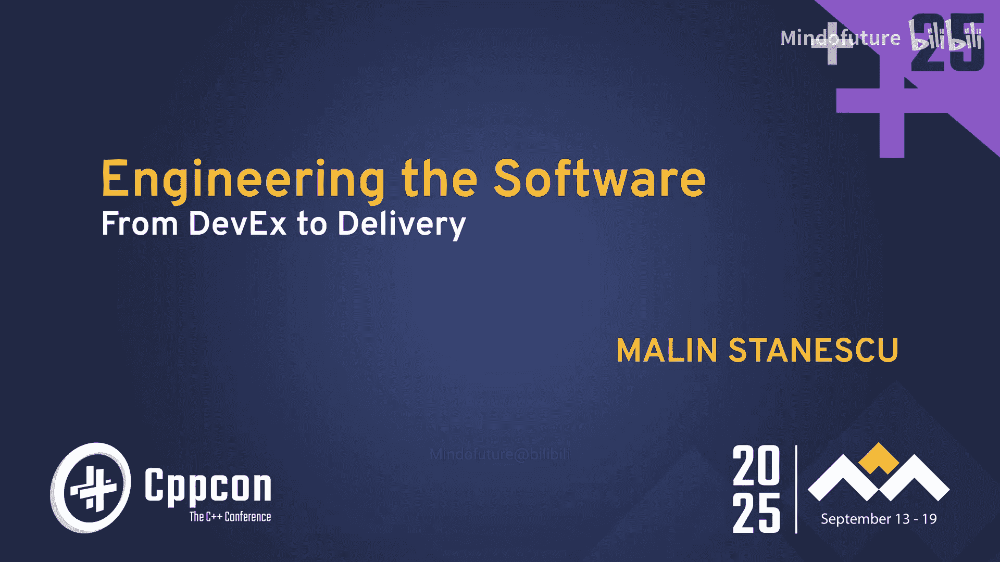
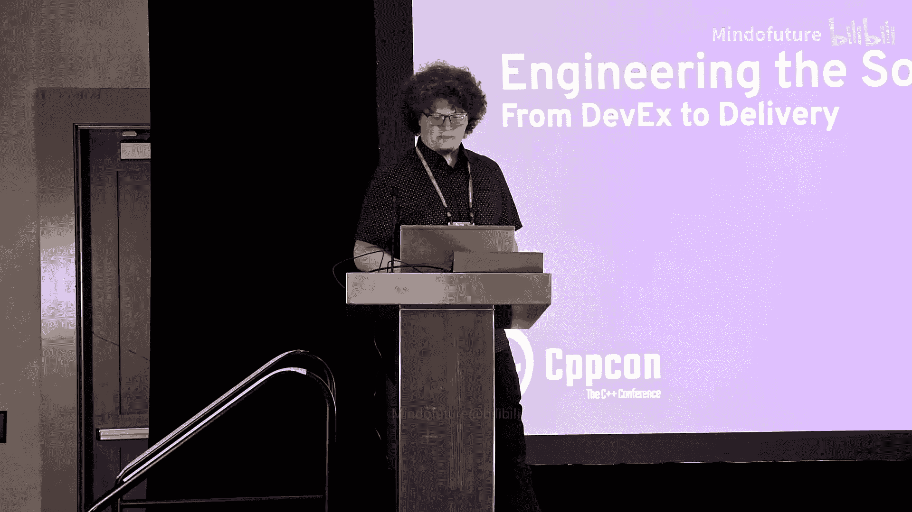
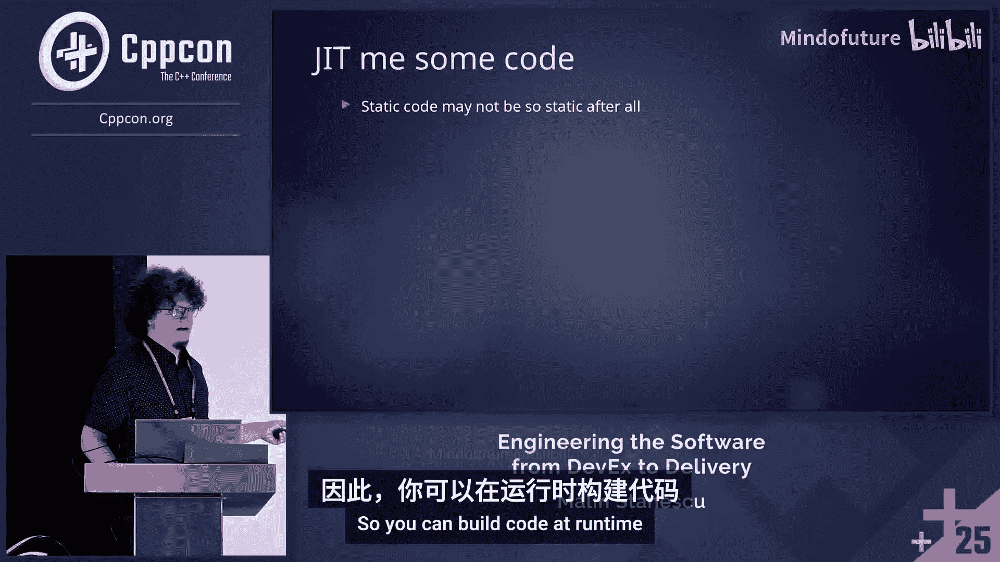
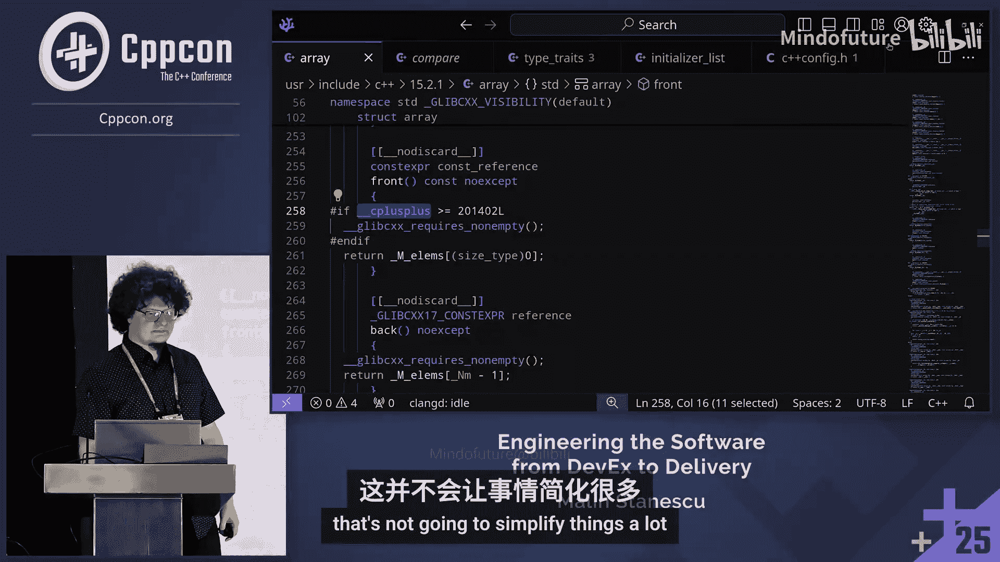
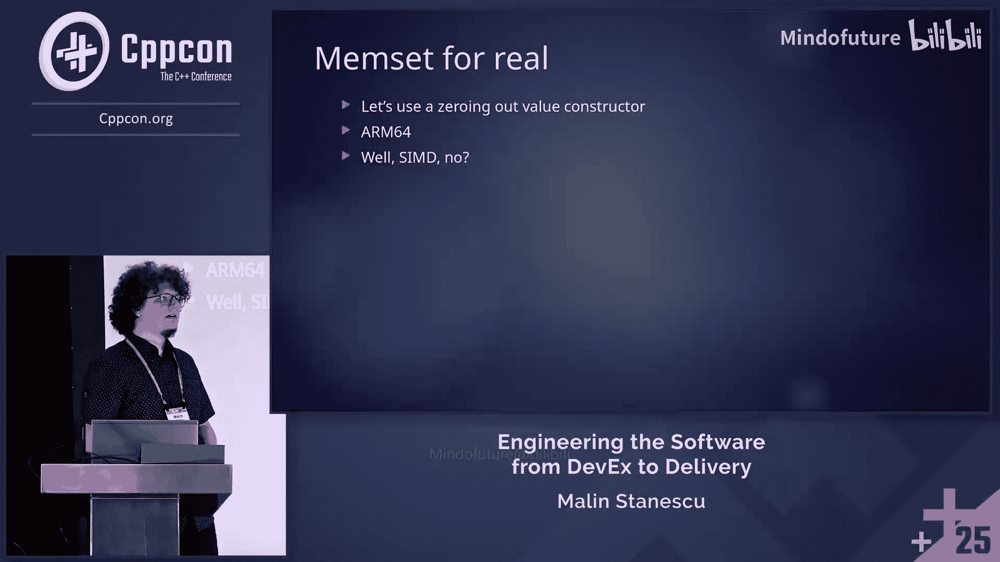
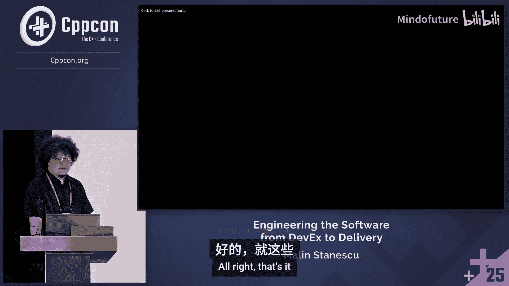

# Cppcon-2025-｜-C++-｜-C语言--｜-汇编-｜-编译器-｜-操作系统-｜-Linux-｜-Windows-p33-P33_下移复杂性_扩展C++代码的真正路径-Malin_Stanescu-CppCon_2025--BV1wyPBzrEeu_p33-

All right， hello。

So I was actually thinking or actually， there are quite a few people here。 So I'm thinking actually。

 to start with a quick show of hands before I actually get to my slides。 So if anyone here has ever。

 and I mean， like ever in their life worked， for example， in desktop。

 if you could please raise your hand。No， that's okay， embedded softwareer。Okay， quite a few people。

Much more than the desktop of any front end developments， you know， for the web。

 I know this is a plus plus， but maybe okay。All right。

 has anyone done any package management for Linuxux？Oh， okay， actually more people than I expected。

 two people。Yeah， backend， anything， okay。Okay， quite a few people， actually。All right。

 And anyone working anything related to DevX before。Okay， we have somebody there。Okay。

 so much of what we're doing in everyday life， you know。

 as programmers is being referred to as software engineering， as in engineering the software。

 this is， I think， like the title of three quarters of the attendance here。

 according to the CPPCon website。嗯。Basically， what this means。 So we take some requirements， be them。

 you know， waterfallage user stories or some kind of hard written requirements。

 and we transform them into working code。Yeah， so。As you can see。

 I'm going to talk about this and also how we are delivering software and how we are actually making our lives easier。

So who am I？Its load okay so I'm a senior software engineer at O ofer。

 which is basically a spinoff of Contental。 you probably know it as the tire company。

 We focus on self-driving cars My day is actually quite diverse at Q so I can。

 for example one day start at USB descriptors to figure out the transfer rate I could be another day using some variational principles to figure out what the requirements on the accuracy of the timestamps in the system should be。

But much of my work actually relates to the structure for motion part。

 I'm considered a geometrical computer vision expert。

And for those that are not familiar with what structure for motion means。

 even though I think there was a talk yesterday， probably not a lot of you have attended there。

 so we basically look at the environment around the car， so for example。

 we have an object here and as the car moves， we have a camera that's moving along with the vehicle and based on the displacement in the images。

 the parallax effect， we can determine the depth of that。beside Oovo。

 I've also had a research project in planetary defense， so for those of you who don't know this term。

 maybe you've seen the movie， don't look up， so basically we are looking at anything that could pose a risk to humans coming in from space usually asteroids。

Yeah。This is a project that I started a long time ago。

 I think like I've had at least 10 years since I started it。

 but more recently about three years ago we got a grant which lasted until summer last year to do this asteroid detection using new or new is technique here meaning known for like 30 years called synthetic tracking the idea is that normally when you try to detect asteroids。

 you take several images you compare them and figure out if there is any moving object in between。

 but that only works if your telescope can actually see those objects。

OfBecause large telescopes cost a lot， we can't quite use those， so we want to use smaller ones。

 and then we'd have to take longer exposures， but in longer exposures。

 you can't see the object because the mirror is smaller So what you actually want to do is to take several images and then shift them around until the asteroid falls into the same place and then you coat them together you basically add them together so that the signal to noise ratio increases。

And doing this for every possible trajectory is called synthetic tracking。 Of course。

 this is obviously very computationally intensive。 You can see here an example of a quite fast moving object。

And this is another， this is more famous because it was actually a virtual impactor。

 meaning that when we discovered it， we actually had a very small probability for it to impact Earth in 2026。

 so next year。But after more measurements， we have excluded those possible intersection paths。

 So this is no worry for us。Yeah， you'll see actually my work a lot under the title blink。

 and you miss it。 That's because the。Comp method is called blink。 It used to be done by hand。

 so you switched between images， and that was basically called blinking。

 but it's actually not the fact that with blink you can't see those objects that I'm referring to。

 It's the fact that we can actually do synthetic tracking very fast。

So when this method was discovered， it used to take like day yeah sorry when this method was first implemented used to take like days on CPUUs。

 and more recently with GPUs， you can do it in like several hours or maybe I don't know。

30 minutes or so， we could do it in in times like I don't know a few minutes， two minutes，5 minutes。

10 minutes depending on how fast we went to search for yesterday it's how many trajector is actually check。

Yeah。嗯。So the common thing about the stuff that I'm doing。

 usually is that I'm trying to first make an environment in which I can develop easily。

 and that makes it much more easier to actually create working software。

 So because I'm actually trained in mathematics， I have a B in mathematics and master's in theoretical physics to me engineering is more about tweaking and tinkering。

 So when I'm seeing this term engineering。 I'm， I'm always thinking about you know。

 getting the code and tweaking it and， you know， tinkering with it。And。

The idea is that you only have so much time you can actually work with that code。 You know。

 you have eight hours a day as a programmer if you don't have over time。

 So there are only so many things you can actually do there。

 And the question is like what do you spend them on and usually you would go for features。

 it's normal people buy software for features but you can also spend it on improving the runtime。

 sometimes you need it to run much faster than it run before。

 so you need to invest some engineering there， maybe you need for it to run on several platforms and you need to be compatible with all those different platforms。

What I my point here is， maybe you want to invest into making your life easier。

 So writing the code in a way that makes it more easy for you to actually continue developing further。

And also， you can do the same。 but for your users， which is like the ease of use of the software。

This sounds a bit like reraing the code， so when it becomes very difficult to work with it。

 you just like rewrite parts of it so it's easier， but it's not just that it's also about thinking ahead and trying to plan for how you're actually going to do it。

And why this is so important for C plus plus Well， C plus plus has quite some large code bases。

 So if we start small， you know， at one to 10 lines， you just basically don't need to care。

 It's just one liners， something all you needed utiative functions and so on。 as you go to more。

 you get functions and it's about 1000 lines， you get to class to classes。

 And for these kind of examples， it's quite easy。 everybody does demos in this。 you know。

 when when somebody shows you how to do something in a language。

 they're usually gonna be somewhere in this area。 you saw it Herb stock。 they like I don't know。

200300 lines of code。 And this is what what's usually easy to implement。

 like it's very hard to get these kind of software wrong。

 just because it's there is nothing really complex about it。

Things get a bit more tricky when you're scaling up because at some point， if you want to actually。

 you know make the software continue working， you're gonna to need to have somebody take care of maintaining it。

 So you're already thinking about needing to have a team。

 so maybe for one to 10 K lines where you basically have some small components and libraries。

 you can do it with one team， but as you're scaling up。

 you might have to either have a much larger team or you might think about splitting the workup in several teams。

So we're already looking at a bit organization， but this is still quite simple if it's just a team usually you can get an okay understanding with your teammates and things are working quite okay。

But yeah， there is a lot more。Work there compared to simple ones。

 But then you go to the much higher example。 So when you're going to closing in into 1 million lines of code。

 you're gonna have several teams。Clearly and one more thing that really matters here is how fast you actually change the code。

 So at smaller， a smaller number of lines of code， you're not gonna touch that code very often。

But if you're going at a larger number of code， more people working on it， you know， and they。

 they will be working full time on that， then the change rate is going to increase。

The numbers I've given here were by analyzing the Gi repos of some KD projects。

 and for this larger one that's coming from a paper by Google。So。

As you're going into the 1 to 10 million lines and especially 10 to 100 million lines。

 there are even more things happening here because at this point。

 you'll see a lot of projects start having their own dialect。 So it。

 it's quite famous that Linux has， like the Linux kernel has its own C dialect。

And when you reach the  one billion mark with these monoreos。

 you often also have the compiler into your repo and you know everything else。

And you also get to huge teams that you need to manage and very importantly。

While the number of teams and the complexity of the code increases。

 you also get less time to actually test your code。

 So because the the changes are coming in much faster。

 you need to spend a lot of time to actually figure out how you're gonna test this in time。

 like if you're having a CI pipeline， which once you reach the 10 K mark of lines becomes quite important。

 and especially like if you're working in a team， once you reach these many。

 many teams working together on one code based on one project。

Then you really need the C to work well because it will block everybody else。

 but you also have the issue that everybody is pushing there or at least if they don't block each other。

 they would be pushing quite quickly because you have so many people working on in the project at the same time。

 So you really need to to spend some effort。 you need to engineer for your C as well。

So one way to actually get by and try to manage this kind of complexity is to just you know shift everything up like take some code and try to make it simpler and you know。

 get more people working on several different things or basically expand without needing to increase your maintenance burden a lot。

And this is what it mean what's like keeping it simple。

 But the question here with how you implement this is what do you write this for。

 So if you're actually writing general programming。

 there sorry general computer stuff like I don't know desktop apps or maybe some parts of web applications。

 like I don't know web server， and I don't mean like parts as in the components of the app itself。

 but rather these infrastructure units that need to be put together。

 And then the most important part is to actually get everything to interact with with each other nicely。

 So usually have a bunch of requirements and things you want to achieve and。

The most common pattern that's being used here is this object oriented program。

 And it it is actually quite simple because you transform your programmer into an interpreter。

 You get all those requirements in， and you can just translate them into a business objects。

 And this simplifies quite a bit the， let's say， mental burden。

 maybe of converting the requirements into code。But you also have patterns such as embedded。

 where actually you don't need to have all these。Compatibility and what really happens is that you have a fixed set of resources and you really need to put everything into those limited resources。

So what the programmers are actually doing are compiling the requirements。

 so you give them requirements and they need to figure out how to actually implement that。

The thing about these kind of compiling requirements is that you can actually reason about the code。

If you try to do this， you know， in a regular project， you're gonna regular here。

 meaning you know the usual desktop stuff， you're going to see that you're going to spend significantly more time on thinking about how you present the data and。

That also gives you the benefits of dataient design so if you're。If you like that pattern。

 this actually helps。And of course， this comes with all those extra advantages of， you know。

 if you think about the code， maybe you can figure out a way to make it faster and so on。

But there is one more thing you can actually spend some time thinking how to make your life easier。

 how to create code that's more convenience for you and your teammates to work with。

And that can actually offset significantly the burden of you know， sitting on the requirements。

So you might actually get a better product without much effort。And to get some perspective into。

 you know， how do you want to do this and what are the impacts of all this stuff。嗯。First of all， one。

 one thing I've not seen a lot being discussed in these usual training resources are the costs of design patterns latelyately。

 I've， okay， I've seen， I think， like on。One of the sites can't remember exactly the name that they've started actually giving like alternatives and you know when you should do one pattern or not。

 but usually they're just given okay， here is the pattern that you can use and you know you can apply and this is what gives that kind of enterprise software that's you know not looked on very nicely by people working with data into design。

So as an example here at some point， I thought， okay。

 my Aure detection software consists of several modules， some of them doing detections。

 some of them doing some image processing， so maybe I can actually just put everything into one single executable。

 let's say and load different parts depending on what the user wants。

 the idea here is that I wanted to give the user some flexibility。

 not just deal with whatever my code does but。You have to spend time to get the interface。

 The interface is right。 And you also need to set up all this inversion of control。 Basically。

 you need to configure it every time you run the software。And。

This also means that when you're debugging stuff， you're not gonna go directly into your code。

 It's gonna go through whatever that container you've set up for inversion of control。

 So things get a lot more tricky。 remember here Also when I tried to do debugging。

 I had to configure my I D to start up the host application instead of the detection pipeline。

 I was going to debug。 So it has a bit of effort。 And this rolls on。

 there are there is no just one big pain point。 Theres like lots of small pain points。

 And this can actually add significant time。 I think like my project delayed by two months。

 I thought I thought I was gonna get it done two weeks or so。 know。

 just get the interfaces done and then connect everything together that didn't quite happen。

But theres also， for example， you sometimes want to think outside the box in terms of these design patterns。

Again。Closely related is dependency injection。 So sometimes you want to switch between different ways of doing things。

 and you want to do this basically from outside the code that is actually doing this， so。

The way this is usually done， you get maybe something like a class and you create derivatives out of that class and you can choose one or the other。

 but in C++ you can also do something I call like the static dependency injection。Where you take the。

C and you switch base， Yeah， switch the implementation based on the build system。

 so you can actually compile one file in one configuration and compile a different file in a different configuration。

And that means that you don't need to have any dynamic dispatch， like you do with classes。

So there is no cost with that。嗯。And depending on how you set up your ID。

 you can actually go to those。Different implementations， quite okay。

The thing is if you if you remember the slides before with the number of lines of code。

 if you have a small project， it's very difficult to do this because you need a build system。

 to switch between filess and if you don't have more than， I don't know， one two or three filess。

 then it just doesn't make a lot of sense to add a build system and test to that。

It also adds a bit of difficulty with testing normally the way you actually test this is by using CI and checking all possible combinations。

 you can also test local， of course， like building all possibilities。

 but the main idea here is that you won't have in the same build all the variants。

 So it will not be as easy to test， but the main advantages that you don't need to have all that extra machinery with classes。

Or even if you don't want classes and you are working on it with some functions。

 you can get rid of that stood functional or similar stuff。Of course。

 this sounds like it will be useful only in embedded。Because you can， you basically build once， but。

That's not always the case。 so you can build code at onetime。

Baically you can call the compiler and this is what most of the high performance implementations of various libraries。

 for example， BLA。The basic linear algebras are doing in some cases。

 they also do precompelled stuff for specific hardware。

 but it's much more common to just configure the source with specific settings and build it at runtime。

 depending on what you're actually giving to it。And the idea here is that。呃。For C plus plus。

 this seems very slow now。The build time of C plus+ is usually known issue。

 especially for somebody who have who built， for example， L L VM。

 you know that it can take like an hour and usual desktop machine depends on how powerful your PCs are。

 usually takes a lot of time。 but you can also engineer for build speed like if you need this if you want to do this。

 you can also make sure that the code that you're writing can be built quickly。

 and you can actually get it very quickly。 So for this is， yeah， this is not C plus plus to be clear。

 you can actually build a hello world program in 20 milliseconds。 Like。

 you can build it up almost at the refresh rate of the of your monitor。

 This is the kind of speed you actually can get lot of compilers。

If you're trying to use a C++ file concept actually a bit slower， this is still a same code。

 the difference here is actually C++uzzling a bit more stuff。 So it's actually a bit slower。

 but yeah， it's still quite fast。The reason why we usually have slower builds in C plus plus relates to stuff like the standard library and use of or abuse of of templates。

So how bad is this actually？Well。At some point， I've built my own the array and to actually understand what。

 what this should look like and you know why， why I did so。 Let me just quickly。Try to show you。

 Let me see if I can。Why is it not showing this， Okay， it should be showing now。Yeah。

 so this is the standard library array， so you can see this is something like 400 lines of actually 500 lines of code。

And much of it， if you look into this， is given by various macro expansions。

 depending on the language， and you also see stuff like iters。And if you go to the。

I had to the top of the value you see a lot of headers。 The thing is。

 these headers are actually quite pulling quite a lot of code。 So if you're just。Yeah。

 if you're trying to compile this now you'll see around 10000 lines of code for just for SDD array。

 which is actually a basic language feature。 So arrays are usually a basic language feature。

 They're not， you know， some fancy construct that we're using。

 This is one of the most basic data structures that we use。

So with these kind of C plus plus plugging in the holes of C。

 much of the reason why Studio exists is to give it value semantics because arrays in C have reference semantics。

Well， that takes actually quite a lot of effort。So。When I built my st array。

 I didn't bring all that stuff in with iterators or lots of the other headers。

 you could see there like comparison， which actually I think is only used in C plus plus 20 and forward。

嗯。And I just brought in， you， initializer list to be able to use the very convenient syntax word just give it the values in the constructor。

 and it would populate array based on that。There are also some extra goodies with rolling out your own array in the sense that you can fix bugs。

So in。C plus plus 14 language。 you will actually see that there is a bug in the spec。

 Not sure how many people have noticed that。 So when you're accessings that are constant。嗯。

The constant accessor is actually not con text but it it。

 it can be because there is nothing it actually uses。 That's not con text per， but yeah， I。

 I guess they forgot they they saw it's not constant。 They thought maybe， you know。

 not con context expert。 But the idea is that you actually get sometimes bug in the standard library。

 and you can sometimes fix those by pro your own stuff。 But yeah， it's not standard。 And。

That makes things a bit more difficult， also did I wrote it using value initialization so that I would be sure that all the arrays would be initialized with zero when the constructor was called because this is not what's happening in the normals to the array to the array has the same behaviors plain scene that it doesn't initialize the data inside。

But that， of course， means that the constructor is not trivial。So。嗯。Yo。

That gets a bit uglygg when you're using it in various places。Yeah。So。

Is C plus plus problematic for scaling software。 I mean， we saw the stood example well。Obviously。

 it's not very great because it just pulls on all those extra lines just for a basic array。

 but it's not that bad either。 you get static typing。

 which helps a lot in ensuring your software is correct。Which can be used with templates， you know。

 but that is usually an abuse of like if you， if you're trying to write correct software with templates that usually ends up in an abuse of templates。

 And that's like really not that extra friendly。 It's gonna take a lot of time to compile。

 It's gonna。嗯。Have difficult error messages， that static dependency injection actually is one way to avoid this kind of template abuse。

 like if you have just one specific object that you're building for and you're using a lot in your system you can avoid using templates for that。

 you can just specialize the type directly。There is also in modern C++ if you can actually use that。

 in my case， in automotive， that's not something that has reached us。 Maybe you remember。

 I think it was yesterday or two days ago， the talk about Mira and how they only got C plus+ 17 out now。

 and that was， I think， like one or two years ago。 So a lot of existing automotive projects won't even benefit from that。

But like if you have this modern C plus plus， yes， you get constraints， you get concepts。

 you got contracts。嗯。But one thing that's a bit less clear is how much they can actually help you in。

Making this complexity simpler。 So you saw that to array array would using constraints and concepts help with that from what I saw you just add some extra conditional code。

 like if if you like let me open to the array a bit。

So you can see that the way these headers are written， this is the new isO C plus+ library。

 they're actually adding all these macros and if depths because they're using the same header for every implementation。

 Yeah sorry。Yeah， let me try to see if I can。 Okay， yeah。

Yeah so you can see that they're using all these contexts per macros which depend on the version of the language。

 you see a lot of if depths with the version of the C++ and so on so you actually get all the versions into one header。

And if you're just， you know， adding on top some extra constraints， then yeah。

 that's not going to simplify things a lot。

Okay， and sometimes one of the things that I feel they're not really working so well in C++ is if you're trying to use like a multidimensional container。

 either an array or some other formats， but usually it's the arrays that are most important。Or yeah。

 the others were usually spans。They are get treated quite differently from linear array to get an iterator into those。

 you need to somehow deal with this2D addressing。And if you need， for example。

 to just copy some stuff from one side to the other。

 it's easier to just copy the whole thing and if you're getting two sets of iterators。

 that doesn't translate so easily into a plain for loop that can be optimized into just a MAm copy。

Okay， so what actually is an example of scaling the software term in a way that helps developers a lot。

 Well I think the most obvious example is actually from assembly to see。So。

What you actually get there， and I think this is one of the most important advantages is that you actually have data structures。

 There are some macroassemblers that help with this。

 but it doesn't come anywhere near what gave developers when it came with those trucks。

You also get a structured programming， which I like doing it by hand in asmbr。

 is automatic for you in C。So that makes scaling software much easier like if you want to figure like to see how much of a difference it is。

 so I saw that Microsoft has started publishing their all MSsD code and a lot of utilities there are in assembly and if you actually look at the code you'll see the kind of effort that was made in documenting all that stuff so that the function calls。

 for example， wouldn't be wrong。So he helps a lot with this。

A second large jump in in programr effectiveness was with automatic resource management。

We got this since+ plus。And I think even even more visible jump was with languages such as Java and C sharpp。

 And that's because unlike C plus+， you don't even need to care about all those pointers and everything。

 they're just handled free automatically。 I think a lot of people here are using Python。 It seems。

I think that was also a point of a talk that was given this week that many s plus plus programmers use Python as a second language。

 And the same goes there。 You don't need to bother with pointers。 It。

 it's a very rare thing to work with。😔，I've， I've seen pointers seen Python。

 but they're like this once in a lifetime kind of thing。

So this helps a lot in getting your software correct， and that helps with scaling the software。

What does or what do all these modern C++ feature help in this sense？Well。

 let's take a look at modules。Why did C++ get modules while， build time。嗯。

There are also other reasons here in that the。way we're using headers is quite fragile。

 but that's also。A bit of a feature。Because we can， with includes to。

Change the code that's being sent to us。 you can have multiple variants of your library。

 basically being accessible by using different config options。

And I'm actually going to give here two examples of how this is used。 So the first one is K andfiig。

 which is the conflict language of the Linux kernel， but also of the of other projects， I think here。

 for example， of Nex。But you also get this in Cpl pluscode。

 So Marlelin is actually a very popular software for 3D printers and to make it easy for their users to actually use this。

 you're supposed to copy these two header fileses for the printer that you're using and those configure everything for you。

 You don't need to touch any other part of the system。

 you just copy those headers in and then those control everything else that's really happening inside the code base。

 and that's done through a lot of macros。That enable and dis stuff。

 maybe some of it can actually be done with contactts per， but that I think remains to be seen。

 I've not seen this actually in practice。So。The thing with these modules is that they actually help they're designed to help with this build time。

 but they't they're not the same as the includes， and you don't get all the all that support for the coffee options。

So what you really wanted you know， to get the build times to be okay。

 and what the modules are actually supposed to do is to cache your compilation of of those areas。

Which is memorization。We tried doing this before。Maybe some of you have seen these precomped heteros used in practice。

 I guess most of you completely hate them because they work very badly。

Because what what they really do is just take everything in your headers that you're defining for this precompilation and they run a good portion of the compiler and then on them。

 and then they actually serialize the outputs or sorry。

 the internal state of the compiler and de serialalize it in the other translation units。

 This is that you never really get all the headers in all the CPP files。

 So you get pretty much a mix of definitions from various headers and that's really really bad。

 But de memorization is still an important point。 and the defining thing is that actually does this and does it with this memorization。

 they do it also actually because the way they designed their compiler。

 they can't get any reasonable speed without doing it。

 like you probably know the rust builds very slowly。

But the thing is they actually do this so they can get those bill speeds that you saw if you don't use memorization in rust。

 the compound terms are just horrible。You're talking like hours some days。Yeah。

So I'm gonna do a bit of。Deter on the safety impacts of all these。Dex and plus， plus。

 So a lot of the。Parts that help with Devex also have help with safety and vice versa for example。

 static typing it will help you in figuring out what to give to a。As an argument to a function。

 but it also means that you can't get that wrong compared to， let's say， Python。

It also powers quite a bit of the help you get when you're doing autocomplete。

 because the I D can figure out what can't be sent to that function and can actually remove those or can prioritize based on which types match and are in your current context。

 I saw this actually happen quite a bit with C plus plus and C sharp。But that's not always the case。

Rs is famous for this because you get that borrow checker that。In a lot of cases。

 you run into issues with it because some things that are valid， sometimes you get wrong things。

 and like you do the wrong thing and it tells you， but sometimes you do something that is okay。

 but the burorrow checker actually can't prove that that's right。 And in that case。

 your experience suffers because maybe there is this construct that you know。

 helps you get the job done easy and quickly and in a nonpainful way。

 And then the burorrow checker says yeah， sorry can't figure that one out。系。And。You know。

 rust is known for its safety due to memory safety。And being an embedded programmer， of course。

 I at some point， run into a memory corruption issue。hi day took some days to actually figure out。

The interesting part there is that。The language in which that happened had no pointers。

 you could not access memory。Which， you know， for us， they say， you know。

 we prevent drop point or access and so on。 But this language didn't even like have。

 you couldn't access memory in it。Obviously， in this kind of setups。

 I'm talking about configuration of an hydro accelerator， which got wrong。

 But the point is this language， it let you。嗯。Do up。

What was essentially a buffer overflow without having any of these pointers or， you know。

 anything that could really go wrong in the， in that sense。

The thing is it also didn't have any static types。Yeah it was more of a。

More of a configuration language。 I can actually tell you that that language is Plan M L。

 So I I know some automotive people are actually developing some stacks based on plant M L now。

 So I pd them。U。But yeah， the issue with that language is that you don't get any of these checks。

 So like even if you wanted to， you know。If you， if you try to create some way of checking that that's okay。

You can't quite do it in that language。 So the really important bit here is if you can actually add checks。

There is one more thing， though， regarding this， which。Its quite interesting。

The bug actually wasn't quite bug in the sense that the value was wrong in that lam it was actually that the hardware couldn't work with that value。

So the the customer， you know， wanted a specific value in there。

 but you actually need to do some engineering to。Work with what the customer wanted and make it work on the hardware。

走。That idea， you know， of having these nice language that people could work with even if they're not like really embedded programmers knowing CNNC plus plus and so on。

Well， sometimes that doesn't work because reality doesn't work that way。

 So you need to have some extra engineering to actually convert all those requirements into a working product。

And there is one more nail in the coffin for rust in terms of this。Safety parts。

 like if you're doing these kind of functional safety。You don't really want dynamic allocation。

 You will be doing static memory allocation。It doesn't have to do with pointers。

 It has to do with the fact that if you're doing dynamic memory allocation。

If your program is not fully， and I mean， like completely deterministic。

Then you are going to have memory fragmentation。 Like if you don't delocate。

 and like even in deterministic programs， if you don't delocate。Correctly。

 if you delegatecate in a wrong order， you will end up with needing to locate a larger space than。

It's currently available free， and youll need to find some extra spaces to allocate in。

 And at some point， you run out of memory。So。All these ownership and lifetime stuff that trust does really well for this memory safety。

Doesn't really help here because everything is static。 There is， there is no ownership。

 The these variables are static variables during the B， S S section。 if you're familiar with lingers。

 similarly。AndThere is no， you know， discrimination of lifetime。 There is just one lifetime。

 the whole。Life of the program， like you start the programming。The data will be there all the time。M。

Yeah， as I mentioned in， in this kind of functional safety。You don't， really。Yet。

 saw that much benefit from the Ro throat check。What you do get benefit from。

 and this is the funny part because you know I always keep hearing about memory safety for us。

 but there are other parts that are actually very useful for this safety。You can draw a promotion。

So whenever you're using small integers in。C and C+ plus they're going to get promoted to regular sized di。

And that leads to very nasty bugs I mean。For people that are doing functional safety。

What really happens is that you get a lot of static acid。You will have lines of static cast。

 which is really nasty from this perspective。Yeah， if you really want to show that you're doing better in this sense。

 you could probably start getting digital your promotion。There is also another aspect。

 which is not very well handled in many languages。 From my perspective， it's the memory alignment。

If you have embedded systems with multiple cores of different types， like maybe one that's 64 bit。

 one， that's 32 bit。You probably want to make sure that all your data is correctly aligned because8 sorry。

 64 bit integers will be accessed with an8 byte alignment on 64 bit course。

 but on 32 bit course it depends， I know for a fact that most of the regular compilers Gcc plan probably also the Microsoft 1。

 but I've not seen use that matching embedded。They actually， even for 32 bit course。

 they use8 by July month for 64 Bs。No means， but maybe you don't get such a common platform and you will not get an a byte line。

Then you might have some issues there。There are， of course， ways of。Annotating stuff， but yeah。

That some extra effort， and。Again， increase complexity a lot。

The other nasty part of all these software development nowadays is how you actually get your software to end up in an end user's computer。

 including all the stuff that you need to make your software work。So。嗯。

One way of doing this is maybe like you know， package managers。

But you have various dependencies there and。The bigger question is。

 how do we actually put all this stuff together。Well。Sometimes you just go the monorepo away。

 which is you give up trying to， you know， try to make things interact between each other。

 This is what the monorepo of the large software companies is。You can also try to maybe。

 you know use some ways of sending data between programs， these ones。 But I think after Herbs talk。

 everybody knows that these are pretty bad idea。 at least the ones on the left。

 the ones on the right。You're still quite used。YeahYeah。But to get your software to user's computer。

You first need to make sure that you can actually bring in everything that you need。

And that means that you need to have your dependencies available so one。

In one aspect here is what package manager do use， Because， for example， in CNC plus plus。

 you also have the。Sstem package manager。 And usually you get a lot of the stuff in Cpa done with that。

 But if you're trying to build stuff for yourself， you might not have the versions that you want on。

That thistro that you're using or。Usually on Windows you don't have a dis。

 just have to bring everything together。So maybe an idea is to use a language package manager that brings all those dependencies in。

 but the usual problem with this is that at some point， if your software is big enough。

 you're going to end up with a diamond dependency， Basically you have the same software that is being depended by two of your dependencies。

And things are fine if you have the same version。In both cases。 But what do you do when you don't。嗯。

This is not very unlike。How the inheritance works in C++。

 you can actually choose whether you want to have two versions。

 or if you will be using just one version for all of your dependencies。Except that you don't。

 because for example， if you're looking at nugg yet， not yet what what it does is it。

It will do the same as the virtual inheritance every time you get just one version of your software that's being used by all your dependencies。

 And if your dependencies don't work with that base dependency。Well， that fuck。

Cargo does it in the opposite way， actually， so it。Brings a copy of its dependency。 Yeah。

 each packet brings a copy of its dependencies every time。Which， I mean。

Not really the greatest thing， because。You will get much more code in。

 and you need to worry about all those different versions。

The way this has been solved in the past is actually by having a softer distribution。

So for anyone familiar with the Linux disrus， this is what， you know， the Linux diss are。

You basically just take the software and you try to make it work together。嗯。Now， the thing is。嗯。

This works only if you have。Dtro where you're actually packaging。What happens if you don't， Well。

 what ends up is being a container。 But the problem with containers is that。Yeah， you get again。

 a copy of everything inside there。And that's not a very。You yeah。

 that's that's not the greatest way of doing stuff because。You basically just duplicate everything。

 again。So this is more of a。Circle of bad practices。

You get to choose which problems you're going to live with， actually。And this is。

The issue from which all this comes from is actually how you version your software。

And sometimes it's not just the versions， it's the variance。Varance here。

 I mean that you can build your software with different options， the profiles in Gen are an example。

There is actually a pretty good。嗯。Block post， you actually have the QR coder。

 I strongly recommend reading the stuff I put the QR code on because they explain stuff a lot better than I can do。

嗯。The point there is that。嗯。You will have to figure out a way to version your APIs， and also APIpis。

In a way that makes sense。One of the points in that talk is that you actually。

 every time you create a version， you actually have a second， yeah。

 you create a fork of your implementation and you would have to keep it around。The API is actually。

Not very different， but it is simpler to fix because you can， in many cases， just rebuild everything。

 And if you are crazy enough， you can just you know， do thatit kind of thing。

 This is what managed languages do and。For me， for example， that's not really that much of an issue。

The problem。Is the API because for that。You can't do much。 Like A API is generated by computers。

 You know， you just rerun the compiler But for API， you can't do that。Well， can we fix it？

Normally not really， but there， I would say yes under certain conditions。So。

Okay I'm actually getting quite close to the one mark， so I'll be going through this a bit faster。嗯。

You have reflection in now in++， this is what's the talk of every CPP con for the past few years。

Let's actually take a look at how。Other languages do it。

 and I actually shown here an example from C sharpp。

 I wanted to actually find something that does similar， something similar to what Herb did。

 but I didn't get the time to actually update the up。

 But what this does is actually something quite interesting。

 It takes documentation from the source code。And it allows you to use it in your software。

And this is very。Living aside that it's not a lot of code， but this has more to do with the library。

 for example， No C sharpp， you can get the change extension or it C plus plus and natural obviously it is to do with the health system。

 but the more important part here is that this is just a plain in C sharp function。

 You know you don't have extra language syntax。You can do this。

 all this reflection with plain functions in the language。

Cippl both does it with the language keywords， which I kind of consider， you know。

 you have beltlls and whistles。Because somebody wants some feature。

 You could try to do it the way it C does。 but I remember at some point I can't find now the paper。

 though， The reason why they can't do this in C+ plus as easily is because of API。

 C++ usually has this worry about breaking the API。 And in case the language changes。

 if you are using。Tpes to represent， yeah。To represent your typess。

Then whenever you change the language， you'd have to change those those types。

 So that would actually lead to potential API breakage。Which is why this is not done in plus bus。

The big problem with this is something called performingity。This is what happens with templates。

 but will also happen with reflection。嗯。These are actually two separate languages。

 There is one language for reflection and one language for runtime。And that's extra complexity。

 you need to be aware of it。It basically cuts down into your runtime budget。But the thing is。

 with reflection。嗯。If you are。Treating your compiler as another piece of software。

 you can actually hook into it and use it for various purposes。And you can。

Get lot of the benefits of what all these be on since the pluspa are， you know。

 touted now just by basic， the basics of the language。In C sharpp， you can do that there is roling。

 So what I showed before was actually reflecting on the text。

 but you can also reflect on the code using the compiler。Remember modules。

 how I said that you want memorization。Well， in functional programming。

 there is this thing called functional effects where you actually represent a piece of computation as an object。

And you can actually take， let's say， the computation of header and represent it as this functional effect。

 you will need some environment information， because the compilers are not really pure functions。

 but yeah， yeah， if these transformation into functional effect is that you can make it into slightly more yeah into a basically a pure function by using also the environment in which the computation is being done as an object。

This is something that's all reactive programming。Probably a lot of people heard about the JavaScriptscript React library。

 but the idea here is just that you're doing incremental。Com compilation。 And to get these modules。

 basically， you just need to cache those functional effects。 That's it。We just need to tell it。

 you know， I want the to do the caching at this point。Let's say when you're including a header。

The mechanism is not really that easy to implement， are。

 but there are some libraries that implement this。But the biggest advantage is， you know。

 you just treat the code as data。 you can use regular functions。One important thing here。

 remember the API， what I mentioned about the API that that's really hard to actually make it work。

Well。If you actually do this runtime reflection， you can reflect over multiple versions of the software。

 You can do stuff like API Dave。 There is a tool of website。 Unfortunately， I can't access it now。

 I don't know why it's blocking me。Maybe it's down lately called forget。

Which actually did this D of APIs on all。Packages in the don world under no yet。M。

There is one more interesting thing here。Everybody knows C++ is compiled。

 How many people know that it's also sorry， it's also interpreted。The thing is。N York see， plus。

 plus。Is working on this virtual machine。 It's like this new one Newman machine。

 but that's not really what happens at the hardware lab。And。

It's when you're trying to get this on the hardware。

 you will see that all this nice sequential programming that you're doing。

 it's actually getting transformed into a set of instructions into various execution ports on the processors。

And you may think， okay， we got you know， this freestanding。

 We can run C plus plus without an OS actually you can't because you need a stack and no CPU actually starts。

 you know， giving you a stack。 You need to tell it where to。

 So you always need to run some assembly before。 and very importantly。

 the memory that you're using is a very different。 it's a different circuit。

And you don't really see that。 But it's basically on a bus that's not changed a lot since the 90s。

 And yeah， you don't have。It's also done by various。呃。Manufacturers。The interface to it is very slow。

 basically。An example of fast DM was actually an L4 caching in the Intel broad CPUs。

 where you could actually see that DRM is not in itself that slow， it's not really fast asRM。

 but it's not really slow in itself， but you also get the extra interface from being on a completely separate package。

How bad is this， So let's consider that zeroing out value construct like you have a type and you want to just clean it。

So let's go with arms  64。 You would think， okay。It's not very efficient to just go through every element。

 We would just use the compiler， and it would maybe give us some seemed intrinsics。

 and this would be quite fast。

And like even if you do this through the compiler， like having multiple elements。

 the compiler would anywhere auto toactize this so it would it would work。Oh， that's。

Quite what's happening。This is the actually the hot look of Imansa。

You'll see there is no store in this one。周。Most of those instructions are just the loop。D Z EPA。

 that's actually the instruction clearing out the memory by elimination。

 So what does it actually mean。Well， this is datac。And ZVA is like0 by virtual address。

 The thing is this doesn't use anything in the core itself process。

 It it goes directly to the data cache。 You can have a na CPU with like， I don't know128 B seemed。

 This goes with 512 B right because the data cache is like 64 by long any cache lines64 by long。

 So much， much more efficient。 And the thing is this are not even as S T CPU on S T CPU It' see even bigger advantages because you could do things on the other thread。

 while this is just clearing data with the cache。The good part is that probably this is be optimizable because if you see this kind of memory zing out pattern。

 you can just replace it in this。Comp powerers stand to do this。Okay， I guess I'm like very late。

I will not discuss a lot， but I will mention this ladder of abstractstruction。

 The idea here is that what you want to do。Is。So far， you're just like writing code。

And then you're measuring the results。But you want to be able to actually work with the code。

 see what it does and try to modify it。You know， the real programmers， X KCD comic， know。

 real programmers you know， clap their hands and the wind will actually make a。

Cosmic great hit a bit。 The thing is， this is the same of what we're doing with optimization。

Like we're just changing some lines in the code。 Maybe like， I don't know。

 put a ranger broadcast in some point。 And then the compiler with with lot of vectors。

 You don't actually tell it to vectors。 you do all these you know， mambo jumbo modifications。

And the idea is you want to be able to actually tell the system to do it for you。Okay。

 I'm gonna skip through this。And this is。That's relevant now。 Okay。

 the interesting part is when we're trying to see into the future of programming languages。

 the most important thing is。What do you actually want to do with programming in the future？

 And you want to design for that。What all these new C++ things are doing。

 they're just more adding those whistles。 They don't really change fundamentally the way we're doing things as you saw with that APID so you could actually fix those。

嗯。And even with rust， you don't see those fixes into API， API， and so on。

 you don't get to tell it to vectorize your code directly。

 you still have to change the code to fix that。So the bigger question is， what do we want？

The programming landscape to look like in the future and from that to actually think how we want to evolve the languages。

All right， that's it， thank you。

