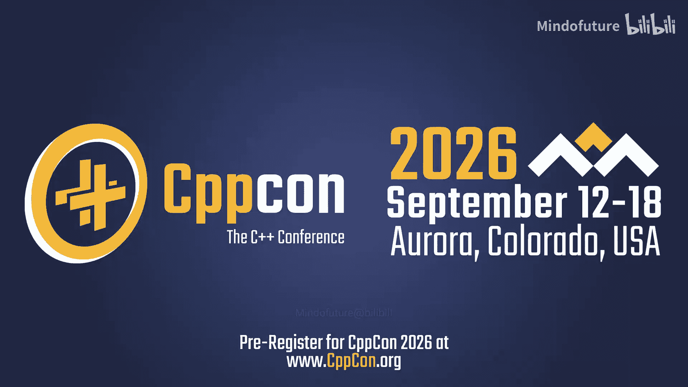
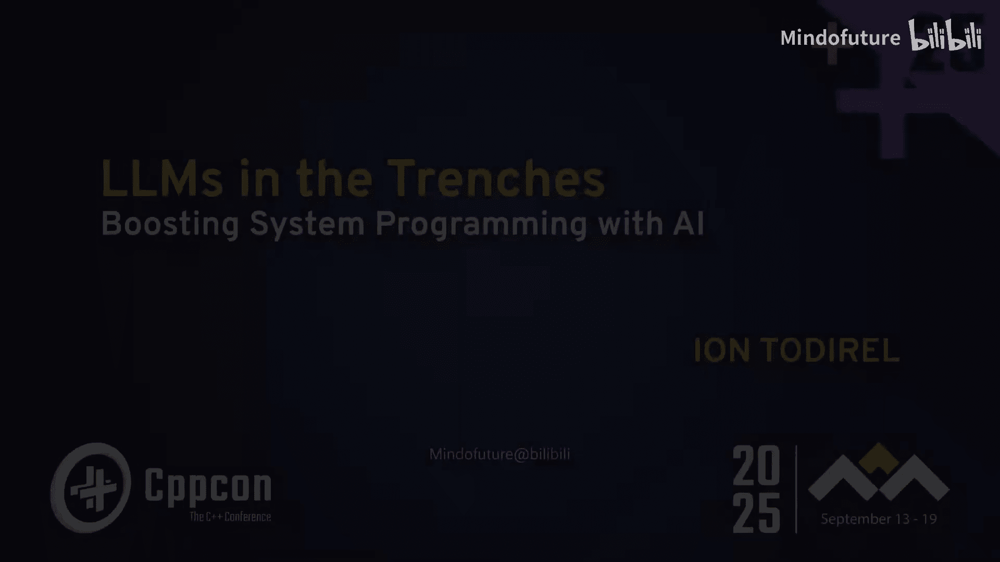
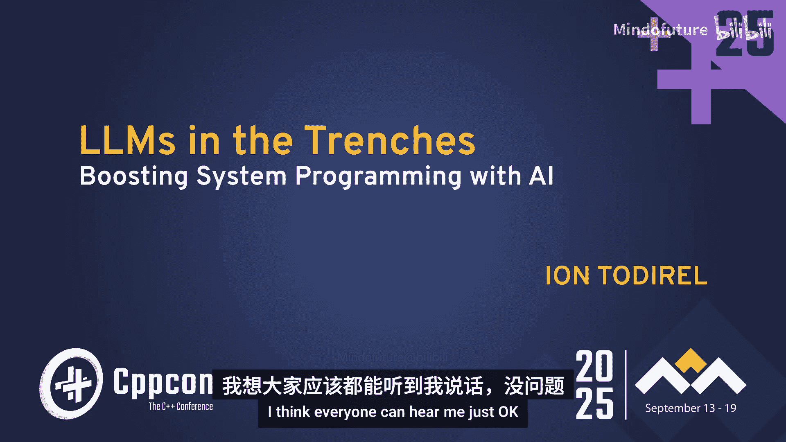
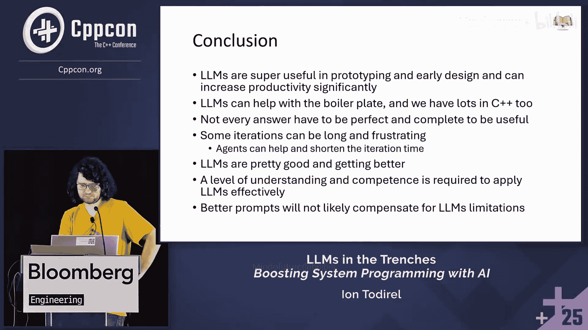

# Cppcon-2025-｜-C++-｜-C语言--｜-汇编-｜-编译器-｜-操作系统-｜-Linux-｜-Windows-p34-P34_实战中的LLM_用AI提升C++系统编程-Ion_Todirel-CppCon_2025--BV1wyPBzrEeu_p34-

I'm a big fan of how they have it divided into like subcategories and you can kind of delve for depth in one of those categories like embedded。

 for instance， or algorithmic or you can go for bread and kind of get this really big cross section There's a lot of representation in people in different skill sets within S++。

Hello， hello。I think everyone can hear me just okay。

Hey folks， thank you for coming to my talk。Today were can to talk about all thems on how to apply them for system programming。

My name is Yoonto Gerll。So I was thinking quite a bit about how to structure this talk and what would be the best way to kind of present this。

 So I was thinking like it wouldn't be very fun to start from the talk and try to find tasks that fit in the talk。

 So instead I actually to carry what project that I worked on that I built from scratch and for which I know I apply AI and solve different tasks。

 So that's kind of what I want to show you today。 So in terms of agenda， they'll do an intro。

 I'll present you the project， I'll show the project to you and they they'll go through several tasks and show you how I apply AI and based on that。

 they'll look at the solution they'll look at success opportunities and they're also gonna talk about less lesson learned。

So just liberty introt myself。 I'm my junior manager at Microsoft。

My team is part of the C++ organization， our group owns the Microsoft Digital S+ compiler and the C++ developer experience in V and VS code。

S plus pass is my have language。 I mean， I'm here， right， And I also put that on my badge。

 So if you find me， ask away， What a little about the simple plus pass。

 And I'm gonna ask you the same thing。My very first C++ conference was going native。

 this was a C+ conference back in 2012， 2013， maybe。

 and from my I understand CPP can actually evolve from those ideas。I'm very hands on。

 I love building hardware and software at home by night， sort of speaking。

 I like embedded development because I like to see software running and my hands to end。

 But I actually don't like embedded development from kind of constraints and limitations that you have to work with。

 power electronics is one of my hoist when it comes to electronics kind of love that。

 I'm also a hammer radio operator and kind of love that because it enables me to fuse software hardware together。

 And I think like you can spend your entire life just in one of the artists of Hu radio。

 I got my FCC license in 20122022 and ARS is on of the digital mode that I love。嗯。

Microsoft has a pretty big presence at Ccon this year。 We have some super awesome fantastic talks。

 If you folks have have the chance to do it or check in of them at highly recommend。

 we do have some prizes。 I recommend taking the the survey and maybe you win some of those things。😊。

co。So before starting， I just want to ask， raise your hands if you're a ham radio operator in the room。

1，2。 wow， okay。あたす。Expected。How many of your folks are using AI tools today？Wow， that's fantastic。

 How， how of the room And how many and new folks are building ya et alls。😊，Okay， and bad。Cool。

 so I want introduce to the project and kind of talk about the tasks here。

 So this is what the project is。 It's a repeater and a tracker。 It's built complete from scratch。

 So every single part by the heart but about the design。

 including the software it's built as part of not part of this talk。

 but part of the day behind this talk。 So behind the repeater。

 you can think of it if you' not a hum radio guy you can think it as a cell tower that extends the age of internet or data。

 and then the tracker is something that position。 So think of find me you can look on your phone and you can see where you are。

 So this is a day behind this。 this is fully of the grid。

 so means it works because it leverages hand radio as the communication link no internet infrastructure。

 you can run it quite long pretty much worldwide depending on conditions。

 you can do it on2 meters and so on。And this is also a very small design It can fit in your hand。

 I actually called it match box because this is the size of what box of matches。

 So that's kind of the dimensions for it。 And， and its hand held and battery operated。

Here's the hardware that I designed for this。 so it's made of two boards。

 The main board was the data mode。 So this is an a escapeK modulator， the modulator。

 and then the data board holds the repeatant tracker。 So this is the PC parameterss for that。

This is the man board architecture。 the core of it that runs the the modulator is the the modulator。

 the modulator is the DS SP 33。Uses a lot of its DSP， to do that real time。

And then this is the hardware architecture of the databoard。

 The databoard is basically the SP3 to M U because of its wireless capabilities and。

 and the main peripherals， the the clock， the GPS receiver and the environment sensor。

 everything else is just power electronics。And then super high level。

 we're gonna focus on the repeat and the tracker。 This is how the the stack looks like。

 So we have our hardware。 And then this is got layered from the you know。

 converting the binary data to talkinging to the modem into text and decoding or decoding in the case of the repeat and the tracker。

So we' talk about the tasks now。So this is kind of what I want to get through today and show you each of the tasks and how I solve them。

 how I leverage I in solving it， was the solution and what are the lessons。嗯。Fun fact。

 all of the cycles originate generatedd by by JGT， pretty cool。

 And I'm going to use it through the talk kind of to mark different pages。

 whether this is about code or about the tasks or about the goals or about the solution or about the lessons。

Before we in， I just wantna talk about sort of A tools that I I typically use myself。

 So this is framed not everything that's available to you。

 but in everything that was relevant for me working on this project。

 So I find myself mostly using the the chat interfaces， whether it's you know。

 via V code or GP or cloud。 So this is the interface where you go type a question。 you get an answer。

 you don't like to answer。 you add a comment。 you keep iter and you keep going on going and going。

There's also chat interfaces with development context。 So if in the case of the web chat interface。

 you go there and you get an answer for， a chat interface integrated in your you know。

 Ed or ID DE can take that code and patch your files as an example and the most simple examples and make changes。

There's also different integrated EI features。 For example， when you fly dogs。

 you can hover function and get， you know， a comment or a context about what that function is doing。

 Completion is super useful from a productive point of view。 So so I do use those。

Chattting agent Mo is something that can execute additional tools to verify answers first。

 So that's also super useful。 And then agents in general。So GP planning。So this is an E B to2 E。

 The official name is Yes B2 room32 E。 So this M U has 47 ps，12 ground。

7 are unconnected for can be used for GP or functionality。

 but you only no out and then six of those are strapping pins。

 meaning they kind of serve a special purpose， and usually they should be avoided because if you don't your MU and not boat。

 So lots of lots of lots of Ps to work with。I'm from constraints。

So based on the architecture of the hardware that I showed and the peripherals that we have available。

 this is kind of what we need， right， we need some GPSs to interface with the modem to detect when a packet is incoming to interface with the power system to turn the system off like like soft power off。

 we also want to have some IO like LEDs。 They're using all of the serial interfaces to interface with the modem to interface with the USB US interface and the GPS receiver as well as flashing so they can program the MC。

 the SP222。And then one S square C interface is used for kind of everything else。

So a prompt for this kind of looks like this。 right， You're starting with， okay。

 I'm using that SP 32 room 32 E。This is the plan I have。 This is what I need。 Give me a location。

 What pin should I use for one。So that that's it。 Nothing more than nothing else。

 And that works quite well。 And well look into some some of the issues there and some of the Latin。

 But ultimately， with a few iterations。 this is what the plan was from from from AI， from an an alum。

And it works。 I implemented this on hardware and everything is is called。

 This doesn't match exactly what the plan from AI was because there are additional PCulated constraints that have to be applied here。

 So for example， one of the peripherals could be too far lower。

 and it will take too long of our line to to out it。 So in that case， we don't we don't want that。

 So if you want to use another PM。 But either way， this is kind of how a GO plan looks like。

 also noting that the descriptions are human generated。Everything else is， the eye。So。

The cool thing about this is that just after a fewerations， the plan was complete。

 and it was matching exactly what the final plan ended up being。

 It was pretty cool to see that the enable P of the S2。 There was a remark done by the。

 that's a special P。 You have to have a pull up resistor。 You also have to have a capacitor to graph。

 So that's kind kind of cool。 microcontrollers are kind of system module。 especially the S to2。

 So they require very little external components。 So this is kind of the only thing you need to to run it。

😊，It also identified the the GPO on GPO on appearance。 So its said like， hey， if you need that。

 this is the one you should use because youre gonna run out of the ones that you need to to output a signal。

It also identify three of the four boians。So some， some of the opportunities on I where it didn't work so well。

So some models only identify that the GP 26 is a GPO IO input pan。

 meaning that it target everything else can be used as simple than output。Not all models。

 just from of the models。 It also consistently said that word 0。

 that's the zero pro for programming can only use for programming and nothing else。 And you know。

 actively said， hey， you can't use it for that。 You have to be careful about that because it's not gonna work。

 which is not true。 obviously can use it for for more than programming。 And at some point。

 has's also also proposed a plan that required words。

 So it taught there are4 words available and there aren't yes Peter to only has three。

It also suggested to pull up for GPO， which is really bad because if you do that。

 you won't be able to program it。 That panel has to be left floating。嗯。Beyond that。

 it also suggests that at some point some GPOs don't exist that they are not connected or they don't actually there's not such GPAO in some forms that module also has an internal flash。

 so it assumed this one has it and consistently said that he for pins are actually not available to you because you have them connected to flash So in my case that wasn't the case。

So some of the lessons for for this task is that what really worked best is to take a picture of the module。

 The one that I showed them earlier and put it with your prompt and if you say pins to avoid for example。

 the one that are string pins and if you say which pins are input only and those are really available for your from the data sheet because it's just very early one very well specified。

 it's three required iterations， but it was the shortest like two or three iterations So that works the best。

 what didn't work the best is the initial prompt， which was here's the part number。

 Here's the plan give me the plan here's the goals give me the plan one of the iterations we had you some of the things they talked about right like step by step。

 this is actually what happened。Another lesson is like some model worked best， some model didn't。

 and that's not always a common pattern， so I highly recommend don limit to one model because you can get most of if you tie the same problem across multiple models and then the main lesson here is if you provide more context。

 I hit as much as possible， you can have fewer iterations。This is kind of the schematic。

 like I mentioned， the the the the system module here。

 The the MC module here requires very little circuit here。 So it's very simple。

 And then on the left there is the the layout。 And you can say I did the the label。

 So that helps with documentation documentation a little bit。So GP programming。

 one of the next tasks is okay， I have a plan。 I have my GPOs， my Ps。 I wantna create logic。

 but I also wna w to quote against the peripherals and start writing my firmware。

 So one of the constraints here， I do want to use slots。

 So I want to use these ideas isrus know SDK for for negative development。

 don't want to use duplicatepred drivers the one mission that are the one that are card that are not ded。

And also when I interface with Openran IO， in this case， this was the battery charger。

So that requires a few considerations。So the prompt here is very simple。 Its just， you know。

 here are the pins。 You can use them for， for you know， just the the Excelel Excel table， actually。

 in a CB format， you can put it in the chat。It initialize it for me。And it works super quick， super。

 super super fast。 Everything you see here was your by I。In this case。

 it was great because I don't have to go read the data sheet。 I don't have to read the documentation。

 I can enter it very fast。 and it works。So some of their successes here。

Very fast to generate the code， very fast to get something working。 Yes22 has good samples。

 but you don't have to spend the time reading the samples。

 It suggested to correct configuration for interfacing with the open training。 I O in that case。

 you want pull up and then then the pen is activated in the charger the GPO becomes low instead of high right。

 That's kind of how it works。 And super quick to it and correct all the issues。

 So some opportunities and some of the the thing that didn't work so well。 just out of the books。

 You ask the question， generates aredu code。Which is something you can do with S to2。

 but not something I wanted。Very neat peek there。 But there is a few ways to generate con GPs。

 One of it is using the GPO config， which is high level。 I wanted the lower level functions。

 not a problem。 And just you say that， and it corrects it。It left in floatinging。 And also。

 it didn't use the G mode input on output。 The reason that's kind of important is because if you use a G as an output。

 it's kind of useful。To read the read the value。 And if you don't set it as simple output。

 you cannot do that， this is useful for thebugging。

It also didn't fully initialize the cell interface and that generated multiple compile errors。

 The core problem with that one was aggregate initialization。

 like if you look at the data structure there， for S++ if you don't specify one of those fields you can compile it right have to initialize everything。

嗯。It also recommended deprecated interfaces like Drivever I toC instead of ITC master。嗯。

And if it works， but。You do get a compiled warning。

 not any error that that's duplicate you choose the new one。

The other opportunity here is that bothGT andC in this case have a web code editor and if you look into it。

You can see the response instead of online line。 you see the whole code kind of project on on the left or on the right。

 depending on how have the how they configured it。 So that doesn't work so well because sometimes gets out of date。

So you might be fighting with the prompt asking， hey。

 that's actually not what is what you put in line and。You know。

 it's not actually what's in the in the editor。 So I usually don't， don't use it。 I unavoidid it。

So in this specific case， this is a good example where ating what can help because the six iterations I had to fix the Wa config structure in this error could could have been done by an agent iterating on every time keep doing it until there's no errors right So that's kind of awesome example where that can help。

 And then for iterations for the driver at to CM。 that's just warnings。

So another example where it could have could have helped if you had access to the build out output。

 and you could put that on account。This is also an example where I don't know if it makes sense to iterate a lot on the prompt。

 because the initial code was fairly fast。 So it might be actually faster to go fix your errorss than ask the the algorithm to fix it for you。

And then the code editor， I have a tendency of just saying， no， don't use it。

 I'll will get my code in line because I've seen rendering imageses。

 I've seen changes and in the chat don't don't match the the data response。So this is the lessons。

The next thing they're going to look at task is how to make some of the simple+ pass libraries embedded friendly。

So these are， for prototyping purposes。 those are three platforms。

 I I highly recommend for prototyping in this order specifically。

 The reason for that is because they have an awesome and developer experience， especially the Pco。

So highly recommend that。So I have two core libraries，1。 it serves as the query repeat。

 and the other one it's the tracker and the packet accounting。So。When I developed those libraries。

 I developed them on desktop platforms， on rid of So Linux。

 I developed them as had their own libraries。And I only have a small dependencies on。

 on a subset of simple plus spa， So nothing external。 So that's kind of the。

 where I started from and what the task is。嗯。What I'd like to get out of that is I'd like them to run on S22。

 I like them to run on Raspberry Pi Pico for developer purposes。

 and it will also be nice to run on Ar on on PNC。I like to have control over Hilocs。

 it's okay to locate at the beginning of something。

 but if you like if you run your router or repeater。

 I don't want to be suppressed by locations that are in that loop。

There is not a hard throughput requirement from how many radio links are usually quite slow in terms of speed。

 So in case of in this case， A iss usually like 121012 packets per minute。

So there's multiple optimization opportunities。 One is I'm kind of handling it on passing。

 so that's something we're going focus on。 and then the router has to handle a lot of other comparisons。

 and that's another area where we can optimize in eliminate copies for purpose of time。

 we're not going to look into the other ones。So this is an example of a function that takes onionma a string and just returns the the the value。

 The version on the left is the first handwritten version by me。Not very w out。 It is， it is the map。

 not in， not efficient， kind of makes sense。 You catch the map。

 but not the best code to come come up with。 So you can make a prompt to this function。

 just this function alone。 Nothing else in the prompt and ask。

 make this function faster or optimize it for for memory usage。And that's kind of the response from。

 from the first prompt。So what what it did， which kind of surprised me was it sorted out of the inum fields and stack them in an aesthetic static array。

 And then it used lower bound to， to find one of the enomes from from aing。It's pretty cool。

 It also used string view。 I think this is a very cool example of string view。

 It's quite profound because you don't depend on a container。 You can initialize a string view from。

 from anything could be a literal could be a hip locatedd container could be doesnt even have to be a string。

 just a by stream， right。So that's kind of fantastic for embedded because you're not contrainrating against something that。

Its located on on the hip。 So it's got quite flexible。The second iteration， if you。

 if you keep asking， hey， is there a better option Can I make it faster。

 that's literally the second iteration。 And I actually didn't think of that If I spent more time。

 I'm sure I would have came with this amanpher， but I didn't realize that。All， you start the Q A。

 So you actually have to compare to just one，1 character。 And that's super fast and and efficient。

 You don't have to think about anything。 So that's， that's fantastic。😊，Very fast too。

 like took under a minute。So when it comes to optimizations。

 my experience was that if you take a function and give it to to AI。

 you always get some interesting insights that you can immediately apply。

 So there is always opportunity there。The human me here didn't recognize that that could be optimized much better。

 And that Ali norm started at Q A。And then after asked for in this case。

 we are good done and save with many its。 So that's fantastic。嗯。

And all of the answers from one of the models， only one of the models。

 I'm not gonna call call it out。 There was a bias I still。 and it constantly said， hey。

 don't use SDD anything。 use the answers actually contain cons cha and pointers and so on。

 which which kind of surprise me。So that thought was interesting。

And then one of the dance used a hash of the string and had a quite complex and un readable solution。

嗯。This comparison， this is something that the router has to do a lot。

 So a call sign or an address is broken down onto the other data structure that is presented on the left。

And contains multiple informations like， you know， how many hops remaining or how many hops requested that's the。

 the lower case and the an upper case and or what's the station I D。

This is needed because you want to you don't want。 you want to。

Create something higher level that you can， you know。

 process very fast and not deal with strings anymore。

 So a comparison there to check if two addresses are the same has to not account for the used field。

 which is a star， right， It's the mark field。 So the code I had was， was this。

 you convert go to string。 What addresses。And you remove the。嗯。You remove the they used。

 This is because an address could be a cos signine or it could be a path constraint。

 like in the case of wide 1 dash 2。So that means that different， they may be the same address。

 but different fields in the and the address data structure are gonna be set。

So this is what was the the two string function that this is saw earlier。

 this is kind of the first version I wrote。 It's quite readable。 uses， uses this to string。 It's。

 it's very simple。 nothing， nothing to write at home about， right。But intuition kind of says， like。

To string， you know， I heard that's unefficient， especially when numbers。

 Maybe that all memory maybe doesn't and also con anything strings， right， Like。

 is that efficient or not。So the first iteration from AI。

 if you take that function and make a prompt and ask he you know make this function faster was this。

 which is actually quite good。 So it reserves the the maximum possible string size at the beginning that happens to be 16 characters And then because we have a constrain on the n and lowercase and uppercase that it's you know from 0 to 7。

 you don't need to do anything fine。 And then I similarly。

 like you just extract the the numbers and you don't have to using a conversion there。嗯。

The second part I wanted to to focus on is， can I avoid converting the addresses to strings and completely bypass the string function。

 to stringing function。 So this was kind of my initial attempt， I。

Kind of count every single possible case in each of the addresses。

 So this is like a pretty big function。 What you see here is just half of it。And。Difficult to read。

 it works， but difficult to read。This is the first situation， which actually surprised me。

 So what it did was just normal the addresses to make them the same。

 regardless of whether you're using this I D or using the N and N numbers。

 And just after the normalization is just a simple comparison on。 So that's kind of kind of awesome。

 something that I didn't think about。Much easier to read and this is the entire code。So successes。

Cry solution with good durability and nothing surprising there。

 What was interesting is that myto string function is actually faster than the one that you recommended by I where you reserve the memory at the beginning。

 the string and then you just you know subtract you get the character。

 So this is an example where again， if you had that T that measures performance and can print the result of of the run and densityD out an agent query that and when the solutions it can keep running that test and cell verify against the solution。

 So it could as well come back and say your functions as fast as it will be no solution。

The other interesting thing was the solutions are unpredictable。 And if I remember correctly。

 G for the very first answer was the one with the sorted array and the lower bound and GT 5 andclo。

 its， it's different。So the models are continuously continuously updated。

 What you got in the past might be different today in terms of answers。So lessons。

Best programming models are best for everything。One of the models suggested a very complex hashing solution with a cost chart interface。

 You know， cost chart is fine， but not in the context in which done this。Also in everyeration， I。

 I kind of how to fight against warnings， suggesting that a steel should never ever ever abuse innovative platforms。

 So that that's also kind of interesting。And the models are obviously non deterministic。 I mentioned。

 like in one case， you get one solution， another case， you get another solution。

 even even from the same model。嗯。The other lesson is that when you're dealing with performance。

 you can't assume dance what you're going to get is going to be the best。

 what the intuitive seems faster it's not going to be， you have to measure， that's obvious。嗯。

Performance tasks think are pretty good for agent tools because you can iterate on them and have the agent try and try and try until you get the best solution out。

And also felt like for the function that was comparing addresses， it's a pretty big function。

 It's about 200 lines because a lot of it is comments that I hadn't written to explain and document how the comparison works。

 And I felt like that really helped the model and coming up with an organization because it just had that much context。

In my case， I didn't have a very hard job in converting the library to run on embedded platforms。

 I think embedded platforms have come a long way， you can do a hip allocation location。

 you can use even exceptions like on bottom peak on split to2。

 which is kind of crazy to think on such small microcontrollers。

 so I think if you're using the standard library depending on how you're using it you a bit there and having your code portable for embedded platforms。

Okay， you you have support？So this is what a bucket looks like。😡，One of the packets。

 So we encode a lot of information in there。 It's a position packet。

 We have the information like latitude， longitude。 We have an icon。 The icon is a look up on a table。

 That's only it's only2 B。 We have the speed。 We also have the routing part for the router。

And we have a message。 So the message part of the packet can be UTF8 optionally， usually it's As。

 but can also be UTF8， but only that part， nothing else。So in the initial design。

 I was thinking kind of classic classic thinking。 I'm gonna store internal and it string。

 and I'm gonna convert different string types。 whether it's say E T F 16 into E TF 8 and then similarly returning the data out when I encode the packet。

 I'm gonna transport it right from E TF8 to whatever the ask is so。

That also means taking different string string types as an input。 So type you know， classic ones。

 double stringing， UH stringing， a steady string， and then using coivity to to convert between types。

And then I kind of evolved this andll explain how in just a second to kind of thinking。

 But I actually only need this for the message。 and I' not actually rendering this anywhere。

 So I don't need to to have it in any specific encoding。

 the more them actually consumes an array of bytes。 It doesn't care if it's a stringing or not right。

 It's just bytes。 So the final solution included it's just for everything that it's encoded ultimately it's ask。

 but it's encoded and it's different formats。 I'm just using stringing gun string view。

 So string view as an input and stringing as an output。

And then the message is accepted as different types。

 and it assumes whatever the input in codingding was。

 that's what they're going to go away without any transcoding。

 And then we start the message as an array of bytes。

And then when we want to include a packet and the tonet， we just return a sequence of bytes。

And just appear the message at at the end of the， of everything else。This is how it looks in an API。

 so theres different ways to set a message， so you can set it as U8 ETF8 st literal。

You can also say at the an of bids。And then if you want the packet and quote it as a UA string。

 you can just call it function， UA packet string and the packet type and you get it as a string。

But really， what the mode is going to use is the last overload， which returns it as an array of bys。

So different ways to set a Mac a message， different ways to get the encode packet and whatever format you want and not transcoding involved。

So what was gonna call， I I wasn't super familiar with you know， co was when I asked。

 I got a UTF8 stringing included string。 and I want to return UF 16 string code was very functional compiled。

 but what was also our shock is that very early on。

 every model I recognized that codeivity is depred and super plus 17 unred。

And I didn't pay very close attention to that。 And then when I saw that the design is not just not gonna be the best and it's gonna be sort of a monster to。

 to figure out。 And I need to go go with something else。

 I I took us step back and tattoo it to what the model said。 And honestly。

 it was got a bit of a shock like Code has been in standard for quite a bit。

 And it's not anymore at all available and suppose 20。

 So think like that's amazing that a model can just tell you straight out that。 Don't do that。

 you might have it And from your know compiler。Vor。

 but it's probably not something you want to focus on for the future。ICU is a fantastic library。

 It's kind of got everything you can possibly need for encoding for unicord support。😊。

But I didn't want to take an external dependency， but I play a little bit with it and the quote that it got back was fully functional。

 I'll work fine， so that was definitely our success。

And the other cool thing is that with just a few iterations。 yeah， I can relate to the best solution。

 So I try to walk back and ask， hey， here's what I'm trying to do here， right。

 Only the message is the part E TA， everything else is， is Asci text。 What's the best design。

 And it kind of came with with a similar design that I have in mind。嗯。few opportunities。

 some of the earlier models， like like GP 4 didn't immediately recognize the creativity is duplicated。

 So that's definitely something that has been， I will say。

 fixed because I haven't seen that taking more than one iteration。

And then it also suggested to use multite the white jar。 And without any assumption。

 I I haven't specified this as cross cloud to be fair， but it assumes that I'm on ends， right。

 So that's not maybe the best。Cool， so one part of the project is attacker。

And when building a tracker doing development， when GPS data。 And。

 and it's obviously will be not feasible to take your laptop and drive around during the development of the tracker。

So if we you want to visualize and understand how the data is consumed and how the tracker works。

 so we're developing it。And we also want to tweak it so that using the network efficiently。

 this is a Hureo channel， everyone is using it equally here。

 and also if you want accuracy because you don't want a point here and a point there and no correlation between where you are。

We also want to be able to run tests or create tests and find bugs。

 and obviously we can't only do that with something driving around。

So what we'd like to do for this is have been able to render a map so we can see the results of the of the tracker。

 We want to generate。A route from a start to longitude longitude so that could be。

 you know the position of this resort。 and then the end could be you know diversity。

 and then that's their route。They also want to generate because speed is important as part of the calculation。

 we wantna have that information as well。And then we want have a GPS simulator that feeds data real time or accelerated into the tracker。

So this is kind of how you can do it。 You can use open street maps to visualize the map。

 you can use Valhala， which is。Open source engine to generate。The routes for the GPS simulator。

 we can use the interpolation and harvestign to know the heading and play back the data back。

 and then for the GPS simulator output， we can fit the tracker and then with that we can use a Web soet server and render that to java client。

 That's kind of what's happening here。 generate that static data at once that actually happens from a python script that with the data route from file and we get all of those points which contain lot long and speed then we interpolate data route because we want if we want to do it in real time。

 if we can have gaps so we interpolate like every 10 milliseconds in this case。

 That's what the cost was then we a web soet server and then we play back we have a GPS simulator and we play we feed that data onto the tracker。

So I used the EI for this。 I knew nothing about mapping what OpenSt Maps is， just heard about it。

 but not how it works。 I never heard about Valhalla in my life。 I thought that's just like， you know。

 you evidence。嗯。So I was able to help with that， was able to quickly identify and find a container on the Internet that can host an Opent map server。

 It's kind of an amazing project and super easy to get started。 send for Valhala。

 You can take the data from like geofaric PB X。 I PB F。

 I think they're called and generate the tiles for Valhala and run a local container。

 I didn't have to run read documentation about Valhalla。 I asked the I hey I need first。

 I need that route a bunch of points that contain lot long right。

 So pattern script that that has all of that super easy you know，5 seconds。😊，And you get it。

 And then I ask a more complicated question， hey， now I need to know the speed limits based on what's known for the map。

 because I want to incorporate that。 I， I want the real simulation。

 as see if you're driving going the road， right。So it come up with the solution。

 turns out that this do site represent an open street maps as tags。

 additional information about segments， and there is a request you can make to Valhalla that's going to get you that information。

I， really was not spare。 I got that from AI。Then， based on that。You know。

 easier to serialize to like Json and then consume it it for the inpoulation function and Herine。

 Herine is needed to calculate the heating between two points。And then。

I didn't have to read any of the boost documentation As you in this case， this is for timers。

 for running timers， and then for the Web circuit server identified a pretty awesome library actually ci is the name that can with minimal codera server。

And then it's amazing at Python and JavaScript， Hl。So the client was super easy on。

 So some opportunitiesun here。It was very difficult to have a complete GPS simulator design coming up from AI。

 It completely okay with doing interpolation， completely okay with all of the other aspects。

 but having got complete implementation that follows an interface。

 you run it and it gets you the points didn't work， no matter how many iterations I tried。

 no matter how many models I tried。And thus this more complex task。

 the initial code was also not not very readable。So some of the lessons。

 although I'm sort scary good at Python and among Java script。

 maybe that's grounded in the fact that theres just so many examples。

 some documentation out there for， for dust languages for dust tasks。Python scripts。

 absolutely nothing to complain about or read home about。

 They were complete pretty much in the first iteration。And then jascriptmal， C。

 S S open open layers is the， the library that it is used for by rendering the map and interfacing with the map also super easy to rate on。

The actual problem of solving the creating the GPS simulator didn't work so well。

 seems like when you have a complex problems you know， from multiple to problems。

 maybe just you don't have enough memory or something。

 but you can't complete the task and completely。And then natural lesson is that depending on the task。

 the credibilityability may not be that that good。And this is a demo of this working。

 So I start with project in this case is open a major studio。

 So each of those points are the GPS simulator points。

 and the process is when the attacker decides to to transmit right So you can see we don't actually have to。

Do that often because they're going a straight line。 So that's one of the optimizations。 like。

 why would you utilize the channel and spend time when you're moving around if nothing is contributing to the accuracy of your track So this is kind of cool。

 something you can do when you have a setup up like this where you have the the simulated points on and you can fit that onto the tracker。

Co， and then the last task we're going to talk about is finding USB serial port。😊。

So the main board has a USB interface on a serial USB to serial interface。呃So。

One of the tasks is that you want to automate the testing。

 to containerize the system to run the repeater。And if you want to do that probably in a container。

 That's kind of my default approach。 to be able to do that。

 you need to find programmatically that part。 And you might have more than one of those boards attached to a system at the same time。

 So how do you know which one is which。Because I'm running containers。

 this is a luuxon solution because the containers have to have access to their hardware。

 in this case， the USB interface。And I also didn't want to change anything on this system。

 For example， you can accomplish this and this mapping with Ud by having a bunch of configuration files on Linux。

 but I didn't want to change the system configuration。嗯。So particular some of the tasks。

 Vionna Uni serial ports turns out U de is the tool to use in this case。

 Viionna extracts you know various part information。

 hardware information from the port like the name， the serial number， the description manufacturer。

 the hardware pad， and then Vionna identify what's unique about each so they can map it， right。

So that's kind of what the final interface looks like。 We have a function just R poles。

 It turns of vector of 3 port， super easy。 And then we get a description of each one of the parts。

 And then the the T you see over there， it's the。Vly the bagggger kind of prints the each of the。

Properties of the device description in this case。So。

I really didn't know anything about Linux system programming at this point。

 This was like maybe two years ago。And if was kind of ask them to me that I call ask he。

 I need to find a way to find port。 port and and models came back and said， hey。

 you definitely something you can use。 And it's not just something that CA dems use。 Cad des use。

 There is actually a library that you can use on program against。

So it's super easy to generate code to query。嗯。You know， the。

 the device manager on Linuxux and get each of the several port。

 It was very easy to add filter queries。 So if you know the manufacturer。

 you can put a filter and get all of the port with one manufacturer only and then。

Very easy to do just on sterilization。 So if you put this out and that's your interface programmatic interface between you know the system that finds the port and your container。

 for example， that's a good way to do。 So like that's super super automated way to use an alarm and get it。

What it didn't do so well is it doesn't quite know what you de property matches against what information you're trying to retrieve。

 so for example， you may not know that serial is actually the property name for exactly the serial number for a port or the product so quite a few hallucinations there。

But。That's something you can iterate on that is like tools Linux that can get you the hierarchy of all of the properties and you can iterate quickly on that。

 Thats not not a big deal。So kind of almost a end end here conclusion。

 I think alums are super useful in the prototype prototyping stage and early design。

 and it can really increase productivity by a lot。 I'm the example of that。

 Like I don't have a lot of time to do this kind of things。 I sometimes do it in the evening。

 Sometimes I do it in the weekends。 And I was able to make significant progress very quickly。

 I don't put a number on it because it depends。 You know。

 I could say 2 x or 10 x doesn't mean anything， right。I do think there's lot of boilerplate。

 whether it's about know writing boost code or generating serialilization code or know generating low level GP utilization。

 we have a lot of it in C+ loss， and algorithms can I think it can help with that。Also。

 I don't think the alarm's answers have to be perfect or complete for them to be useful。

I hope there's no， you know， vibe go here， but we' are all quite competent。

 And we can take a solution， even if it's imperfect on iterating it。So mutations can belong。

 and I really believe that agents or chattting agent mode， for example。

 can help and shorten it by coupling the questions and the queries to tools that they are on。嗯。

In my experience， like they've been getting better， I've been using this for a few years now。

 and some of the answers surprise me， especially when it comes to performance optimizations。

I do think that you have to be a good designer to use them effectively。

 so if you're early in career or starting up， they can't help， but they may not do the most for you。

And。This is a personal opinion， of course， but I'm not convinced that better prompts can compensate for limitations。

 like for example， avoiding hallucinations。

We are at the end of the talk。 This is just a graphic。Just want to get to K now。

Hey thanks for the talk， I just had a question about the tracking mode because this is all over HF radio essentially right。

 and so were you localizing the thing being tracked through like the radio signals or was that being transmitted through the HF。

Got it。 So So the question was how maybe who listens and how can you actually take that position info and put it on a map or how do you actually consume it in a way that is meaningful to you。

 So the digital mode used here。 it's called ApRS ApRS stands for automatic packet reporting system。

 So some of those repeaters on the network， take that information and put it to the Internet。

 So there are websites that can take that of data， because there is a radio interface to right。

 It listens， Decode the packet， extract the latitude longitude speed。

 and then put it on the internet and there is our there are websites， for example， ApRS dofi。

 if you go there， you're gonna see all of the traffic that's coming from Ham radio。

 So you can do it like that。 you obviously don't need the internet。

 you can have a local system that just take all of those packets， des them and maybe it runs。

maps offline。 You can totally do that at all。 right， But that's kind of how it works。

 So you basically control。 That's the cool cool thing about this。

 how you want to interrupt and partake of information。

 Maybe that information means nothing because it's just in the yard and no one does anything with it。

All， thank you。😊，Great talk， Thanks， you mentioned。Like not having to read documentation or。You know。

 sort of getting a creative inspiration from the LLM or maybe some other things。Where do you think。

 if you had to like bucket the benefits of using L Ms through this。

 Where do you think they mostly fall。For you， in this project。Does that make sense？

So the question was。Where is Llums most useful and is it only to get around not having to read the documentation。

 Where are there other parts where they useful。 So this project is quite complex。

 I still have a lot of work on it。I will say the way I think about it is that anything an alum can help me with to elevate my productivity and have have to let me think less about things I don't care about。

I think that's a fantastic win。 And I've seen that across the board from drinking bodyp to things like even completions。

 right， like you have a class and you need a typical， know move construction on so on。

 Like why should have that by hand。 It just completions just generated that for you in one goal。

 So I don't think theres one on another。 I think it's very depending on what you're doing on The point is that it definitely elevates you and makes you into a faster。

 better designer or a programmer。😊，Can I ask go a follow up？ Yeah。

 Did you have to spend any time like sort of debugging the language model solutions。

 or do you think you're。I got got it。 So did they spend any time debugging the language model solutions。

 I will say that I'm always debuging pod。 Like I'm a perpe state of debugging。

 I never stop not debugging。 So from that point of view， it's really not different。

 not different between using a thebuger or not because I'm always using it。 So with alums。

 I won't say it's more or less。 In fact， I will say less because most of the solutions are actually kind of complete。

So they just work and you just run and it works thanks。Hi， good talk on this。 I had a question。

 were you iterating like inside visual Studio code or were you iterating mostly on the web。

 especially when it comes down to like the ESP 32 frameworks because like in V code you could use I don't know if you have used it or not platform I what's various how do I whether that suggested by the LLms or not got it So the question was what tools I used most especially from the angle of the ES to programming what tool I use very good question。

 So from the angle of forget about who writes the code，'s the it how do I target the platform。

 I personally use the code， expressive has a pretty extension in the code。

 I don't know how it's called， I think it might be ESP idea I don't really know That's what I use It's a great extension。

 Great developer environment type a code compile it。lash it， everything works。

 So that's what I use in terms of whatI toolla use most。 I will say whatever gets the job done。

 I use everything from Vs Vs got， you know， cloud， the web client，g。

 the web client ask compile and like anything that gets me to complete my task。

 Like I'm in thisriinate in that respect， know， But when you do you see any advantage from using it inside the I versus on the web because on the I。

 you have all the models as well you can also now start farming out agents and did you play with like having different agents for different things and like maybe giving them like code checking or when writing a test and can you talk about that that's a very good question。

 I think there is nothing in the web that's not in the the in the I is it's the same interface。

It's a personal preference。 I did use chat and agent mode。

 and I did have the chat and agent mode verify the code for me。

 So way the way that looks like you're asking for a task。 for example。

 know generate me asiliitation function using and the popular just library versus plus plus the high performance1 forget the name。

 but that one right So like take this data structure serialized for me generate decode。

 And I'm also saying， hey ensuresure this compiles。 So what you actually see in the response。

 Here's the code。 Here's the command to compile。 looks at thisDD output and does that more so the tests。

 So for example， for the performance iterations that I showed。 I actually had to run the whole。

 I have like 300 or so tests run every single test to ensure that nothing is broken like the address test compile one are super is so if you don't do the don't generate the right code。

 like it will be infinite trying to figure out what。That's actually wrong And that comparison。 So。

 yes， the agent model is fantastic for for that kind of thought。😊，Thank you。i thank you for the talk。

 I really enjoyed it。 I was wondering if you used AI to do like the hardware design， you know。

 feed it in data sheets， do a schematic PCB layout， and then。😊，The most painful part。

 like the bomb building， right， Yeah， have you tried to use it for that whole workflow。 Yeah。

 I have I'll I'll I'll have a fun answer for you。 maybe controversial。 layout is how I distress。

 I don't want to put me right。 So there's there's some fun parts of the。 Yeah yeah。

 I think I have enough Southern my life that I need some hardware。 So I will say。

 I definitely took a schematic。 and I run it through through the model and see what it will come up with like I review that kind of thing。

 I have some stories to tell。 I think they will take some time to explain。

 But some examples like in one goal， you know， the model said。😊。

Actually hallucinated in the whole thing。 And that's because they didn't use the the image。

 Even though you attached it。 So then I said， hey， you actually didn't use the image。

 You give me some answers first based on earlier questions I， I asked the Ta image unrelated。 And I。

 I said， use the image。 You used it。 and you recognize the， the parts， so。

I don't think I didn't really focus on that aspect of， of this project。But I， I。

 I don't know what to say about that。 Like， I， I don't have experience that。 Okay， thank you。

Thanks for our talk。Those projects are smaller， greenfield and。Best on projects， I suspect。

Do you have So my question is not applied to this type of products。

 but more like production projects。 What about security。

 How do you how do you how do you do you have recommendations around how to create an environment where it's safe to use those models。

 and I don't know if you have any insights in like what we should do to actually use this on production system got that。

 So the question was like if you do this is a pet project right。

 So you can you can afford insecurity， you can afford flaw if somethings not working， you know。

 it's not gonna be of big consequence， But what if you use it on production code。

I don't think there is a good answer there。I haven't done that myself with an example that you know target its production。

 I will say that you humans areut to accountable fertile systems。 E I can help。

 but you shouldn't be bypass proper engineering processes that ensures that the code is secure that。

 you you don't check in something that is gonna you know expose your component or system to something that an attacker my leverage right。

 So I I will say in that case， nothing changes with a alarm alarms。

 It just if anything they have to be even more cautious and more careful。

And how about like executing alarms are you working in a vienna in a container or you let them loose on your main system？

Do you try to insulate them over？So the question was like。

 what about the task between yourself and the alum or and point you're using to to to run in my hobbybi projects doesn't really matter to me。

 Like everything I show here is open source open and hardware on on Github and a production environment I think you're gonna have to look to your I I T department。

 what you have to say about that， right， and your private system。Thank you。

So for the E SP 32 at the beginning when you got to pin out how much documentation did you have to drag in。

 Did he find it all on the Internet for the EP 32 or you have to give in context So the question was for the E SP to GPU applying how much of the documentation did I have to look through and how much of it was on on the Did you have to tell the give to the agent right but。

The only thing I got to， I think I mentioned that in one of the slides。

 The only thing I had to give the best prompt， the best prompt I had for that case was the picture from the data sheet。

 And that shows the pin out and the GPU names and the Ps So that's one information。

 The second piece was which pinNs should not be used because they are strapping pinNs。

 And that's the very beginning of the data sheet is just says here's the pins you shouldn't be using or should be careful to not use or how you're using them。

 And then the last piece was which GP are input only because that's something that the allow had trouble trouble with。

 So for that one also from the data sheet Also at the beginning。

 which GPS can be used for input on which are can use for output as well。 that's don information。

Okay， thank you。 So I will say the whole thing took maybe5 minutes for the prompt。Thank you。Go， done。

