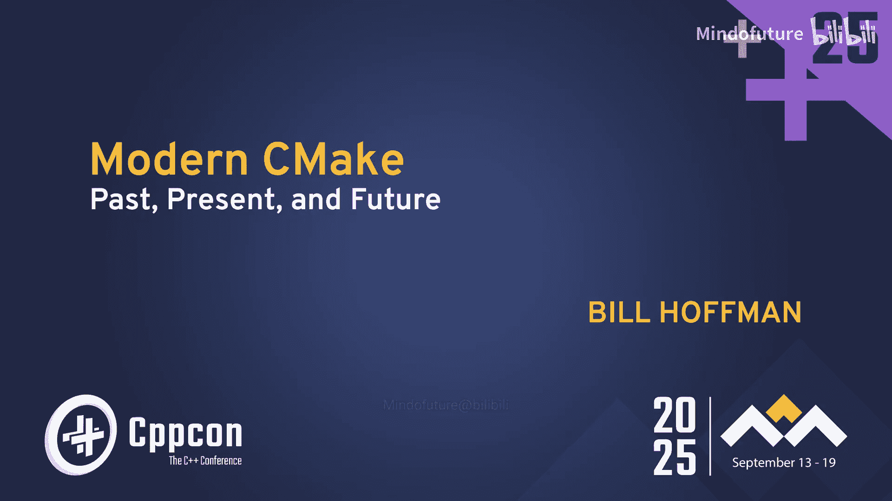
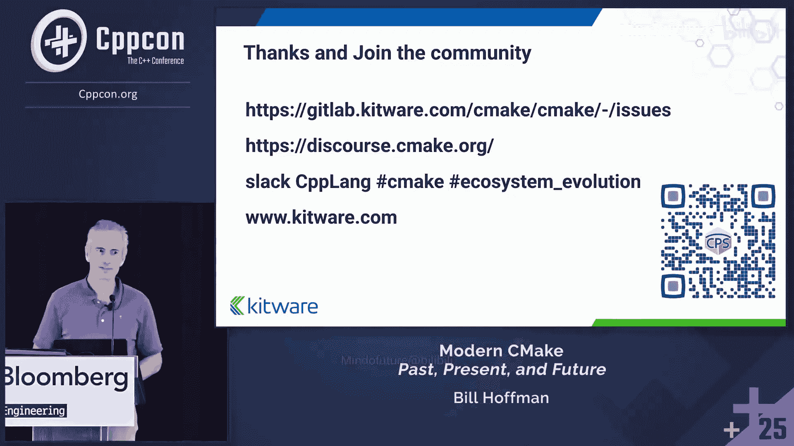

# Cppcon-2025-｜-C++-｜-C语言--｜-汇编-｜-编译器-｜-操作系统-｜-Linux-｜-Windows-p35-P35_CMake的演进_C++构建可移植性的25年-Bill_Hoffman-CppCon_2025--BV1wyPBzrEeu_p35-

I chose to go to Steve Peaccon because there's plenty of opportunities to both have a lot of fun and network you can come here to just learn and study and there's a great community behind it。

He， I guess it's time to get started here。 Mike working。 Everyone can hear me。

Awesome。😊，First off， thanks for coming to the talk。 Are excited to hear about some seam stuff。

All right， let's get going here。All right， first a little short about me。I've got a short。

 boring list of jobs。 I worked nine years at G research。In a computer vision group。

 my task there was as a recent bachelor's graduate was moving them from symbolics list machines to this shiny new C plus plus language using seafront on Soeris pizza box workstations。

 later Linux and Windows。I kind of became the software library guy doing， you know。

 GMake and auto tools。I left。朱。1999， 1998， we started Kit where I'm one of the founders in the CTO CMake's prototype CMake kind of got started in 1999。

 mostly management now， sort of pointyhead boss stuff。

 looking around to find funding for CMake to keep great people like veto happy and working。嗯。

And along the way in my early 40s， I picked up U running。

 And that's a picture of me running Ladville100 race。I that down power line？That is down power line。

Sure。Been there。啊什。We'll have to talk after。哎。What's a kitwear and what does it do。

 You might be asking yourself to。Well， hey， we collect $100 from everyone that uses CMake on our CMake subscription model。

 right， Everybody youre paid up， right。😊，A people using CMake？And you're all paid up。啊0。So let's。

 let's go to attract E T， as we do these days。嘿。How much money would I get if I get 100 bucks for every C make user。

Well， it does some figuring and stuff。 And figures there's roughly between  a million and maybe 10 million C make users。

 So that's 100 million to a billion a year。 That's， that's pretty cool。

So what does Kitware do with this 00 million dollars。Tillion dollars of sea make revenue。Well。

 we could have， you know，500 like rock stars， you know，100 average developers。

 We'd probably we right in the middle there。 you know， about 1000 developers， plus。

 I'd have my yacht in private jet and， you know， one of these fancy， ridiculously expensive cars。

And what would these000 Cm developers do at Kitware。Well。

 they would develop any feature that users wanted。They would fix any issue reported within 24 hours。

 They would write perfect documentation and provide support to any question asked。Alright， well。

 Ki where actually doesn't do that。 And I'm happy that C makes open source。

 And I love the open source community。😊，And， and actually。

 what Kitware does is consulting and research contracts。In areas of expertise of computer vision。

 data analytics， scientific computing， medical imaging and software solutions。

 And we build this on open source platforms。And the Kitware software Solutions team。

 which is the CMake I team。 They do more than just CMake。

 But it's a small team in a smallish company。Where， where did Cmate come from。

 Some of you may have seen this before， But for those that haven't。

 Kitware was the lead engineer team for the Insight segmentation and registration toolkit。

Which was created by the National Library of Medicine。 They had a project， the Visible Human Project。

 where they created a data set， that had CTMR， and then the bodies were donated to science and they frozen solid and sliced them as soon as they couldn't took pictures So they had this data set that would help advance science in medical imaging。

 but they realized that they needed because the language of science really is programming languages these days。

 They needed to codify。The state of the art in segmentation and registration。

 So they wanted to create a toolkit。Ktware was known for creating V T K。 We got brought in for that。

 And then I immediately like， went off script on the。

Statement of work and created a build system for I T K。 And the rest of you in this room。Since then。

 he makes head funding from various projects， outside contributions。 And you know。

 anywhere we can shake the trees for work。So in， in doing this talk， I。

 I found this blog that I posted in 2015。W whichch pointed out that we just had a C make birthday。

August，31 of 2000。25 years， Yikes， I was only 33。嗯。One of the main objective was， you know。

 not have external dependencies。 This is why it had its own language and was all just dependent on C plus plus compiler。

 And back then I wrote， you know， it was like， avoid what I call the Easter egg hunt of build process。

 I got to get this。 And then I get that。 And build this。 And that was。Harter and harder。

 the further you go back in time。 still not solved today。 So let's click on that first email。

 This is the announcement of C make to the I T K。Mailing list。

 I've reworked the build process in I T K。 I've created a package called CMake cross platform make。

It includes all the。Build process for building SeeMake there。

 And down here you can see I've changed a few things。

 PC builders now called CMake setup and make file that in。 Those are all called CMake list do text。

 So this is sort of the birth of CMake and CMake list text。So the arrows that seem me come on。

I encourage you to go watch this talk that veto sitting right here in the front row gave at C plus plus now。

On postmodern sea make。 And he broke it down into the sea make errors of。See you make 1，2，3， and 4。

So CMake1， the primorial flag soup。 I， I kind of refer to this ass a friends and family era。

So there was， you know， I T K， V T K， Paraview， maybe a few more projects here and there。 But。

 but basically pretty close to home。 get a bunch of compiler flags and pass them down the source tree and try to get things to all link。

 And it worked。You know， it looked something like this。 You could。Create source lists。

 and then add them to executables。Curiously enough。25 years later， when CMake 4 just came out。

 this was finally deprecated。 So， and has caused some people's trouble。

 So this is basically using a file without its extensions。 And CMake used to go searching。

If it couldn't find the file， I would like look for dot C， X， X dot capital C， not little C。

 whatever。But also， as vetto pointed out， F package was part of CMake 1 dot0。So we had。

 we had good thoughts。Didn't necessarily execute on all of them。 Yeah。

 and if I'm stealing slides from veto， they're gonna have the little veto in the corner there。

CMake 2， the world domination era， was basically me fishing for projects to use CMake。嗯。Eventually。

 I landed the big one。Which was Katie was。Kind of funny how it happened。

 There was a developer and he missed going to a。 and he was saying。

 I think we can get CMake as a build system for K D E。 He missed the conference。😊。

And he sent me an email。 Sorry， man。 I wasn't there。 I was， I was sick or something。 and。

 and they picked scs。And I was like， oh， well， you know， you win some。 you lose some。

 I'll keep fishing。And six months later， he sent me an email and said， hey， Bill。

 I think we have another chance。 Look at this email。 So on their developer list， he's like。

 they were like， it's been six months。 and we can't still build anything。What's going on here？

So I was like。All hands on deckca kitwear， which back then was like 10 people。

Let's get K T E building on as fast as we can。 I think we turn around in a couple weeks。

 and we got the core library working。 And then like a week after that。

 someone else got it working on the Mac。And then they were like running K D E apps on the Mac。

 which no one had ever done before。 And then like a few weeks later。

 someone had stuff popping up on windows。 It was， it was kind of really rapid。

 Kitty has this motto that he who codes wins。 So they ditched scs。

 which then that branch of scs became w， I think。 And anyways， So this was huge for C make。

 and it brought a lot to the project。😊，So it， it。Forced us to be very conformant to Linux installation。

 things， things like shared library version， etctera。 It also solved。

A little bit of the chicken and the egg problem， because C make was now part of Linux distributions。

Because they needed to build K D E。 So it was preintalled。And it also ended up birthing modern CMake。

 also to note in 2008， L L VM put their first CMake file in。

 They had a dual build system for quite a while。 This chart over here is Google searches of auto toolsol versus CMake and that inflection point where it just shoots up is when Katie adopted CMake。

The rest of the you people in the room were like， what's the Cmate thing， Why is Katy E using it。

And Stephen Kelly was worked at KDab at the time and a K D developer。Coined the term modern C make。

 He's got a great blog on it。 If you want to Google search that。 And I pulled out one。

Line from the blog that this simple example of Q T shows the essence of modern seaic or fine package Q T widgets。

And then target link libraries， my application， Q T 5， con Kong widgets。And this。

 this is showing that complete target model that we see so popular today and and very useful in the Q T5 widgets was built somewhere else。

 And I'm just pulling it in。 and it looks just like it was built locally。

 I'm not passing around linker flags or minus L things that I pulled out of who knows where。

 I'm actually getting an object that's a target。😊，So again， he makes three another slide from veto。

I hope you like targetrget star commands。And this really gets the usage requirement and build requirements。

So some other random things that I felt I would， I like to share that I think are really cool in CMake that maybe some people don't know about or don't know how to use。

😊，Did you know how many people knew you could do performance testing of CMake itself。

How many people would like to know why their sea makess running slow。Yeah， see， Okay。

 So maybe you'll get something useful out of this。 So essentially in this simple example。

 I went into V T K and I just added an X Q process， command sleep 10。😊，And then when I ran CMakeake。

 I said， hey， I want profiling format Google Trace。

 and I want to output it to a CMakeake profilefi Jason。And you can try this on your Cic project。

 It works really well。 It's really easy。And then you go to perfio and you load up that data file。

 and you can see。That now my configured time， half of it is spent in execute process。And even better。

 I can see that the arguments to that are command Slate 10。

Which is obviously the source of my problem。And if I just delete it and then run it again。

We're going to see that。The configuration time shrinks by 10， and we get a nice， nice output。

 But obviously， you drill in。 and this is amazingly。😊，Useful。

 like if you're having times with configure， you can figure out because you might someone might have done something really weird。

 And it's you know， calling execute process over and over again or some other problem that it's doing。

 And it can also go into the generate phase。 So if you kind of set up some system that forces Cm to do a whole bunch of work at the generate phase。

 you'd be able to see it here as well。Debugging CMake CMake actually supports the debug adapter protocol Deb。

 So any editor that sports dab can debug CMake code。This is a VS code showing on the right。

You can set break points， you can see call stacks， it shows you all the cache variables。

Shes a surprising number of them in a。I think this is just doing seaMake itself in its， yeah， like。

No， this is V T K， I think yeah，512 cache variables。And directories， you know。

 see basically a full full debugger for CMake。How many people have used seem make thebuggger。Okay。

 cool。How many people just learned there was a seamate debugger。Awesome， that's great。

 I'm not wasting my time up here。 I worry that I'm just like telling people stuff they know。

 But I suspected that they didn't。😊，Alright， another interesting feature。

 I think that was really cool that， that was added to SeeMake somewhat recently is parallel install。

 It's not on my default because it could cause problems in a。😊，In in some systems。

 if you've set up your installed to have weird dependencies， But if you haven't。

 you can set this global property to turn it on， and then you can do Cic minus minus install。

 minus J， some number of variables。 And this can， you know。

 if you have a really large project that installs a lot of files。You can speed it up quite a bit。

 And I'll get to where this visualization on the， on the right is coming from here。

 But there's actually a way to visualize the install step as well， in Cic。But before we move on to。

CMake 4。Please indulge me as we go in the way back machine when we're gonna look at CMakes webp page。

The earliest 1 I can find was 2002。 So I guess it took us a couple years to get a web page。They were。

 They were harder to do back then。嗯。But you know welcome to CMakeake。

 the cross Plaform open source Make system。 It's used to control the software process。

This was kind of interesting that had some goals here。 And I I'll get to that a little bit later。嗯。

Side note in 2002。We had C plus plus 98， and the big new things were namespaces， Bo， R T T I。

 new style cast， exception handling， and the S， T L。😊，No reflection yet。Click on about。 It's this。

 you know， talks about it。Interestingly enough， back then， it was。Make files on Mux， and。

Windows MSC files。For windows。Origins as he goes into， you know， where it came from。

 Here's an interesting note。Sort of the， the curse of software that。Developers are always much。

More proficient at writing code than documentation。

 And here we are apologizing on our web page that the pace of development has outstripped the pace of documentation。

 As a result， the best way to learn about CMake is to study existing CMake stuff。And copy it。So this。

 this will come back to bite us and， I' talk， I'll talk about this throughout the talk a little bit。

It's， it's actually review stay in it Kiwear when we're doing our employee reviews and a lot of that reflecting on goals and and see how we did。

 So， so let's， let's take a look at these goals that were on the original CMake page。

So develop an open source cross platform tool to manage the build process。嗯。

You want a standard build system。 You've got one。 It's called CMake。 This is resistance。 It's futile。

 This is Bryce Adelson， C plus plus now and。July 2021。

So I give us an A plus plus on creating an open source cross platform tool。Okay。

 allow the use of native compilers and systems。 You know， originallyin， it was just make files。 It's。

 it's been a lot of other stuff。 Fis Studio， Xcode。 Ninja， Ninja was a really cool one。

 And I think this is one of the more powerful features of buying into the C make ecosystem。😊。

Prior to， know， Ninja got released by Google。And then I think within a month or so。

 we had it in CMake。 And suddenly， anybody that bought into the CMake ecosystem。

Their builds got suddenly faster， right， like overnight。

 because this new build tool was now available to them。

 And that was one of the goals of CMake that it And that's why it used the native build tools and wasn't a build tool itself。

 because there is a rich ecosystem out there And people are developing new tools and new things。

 But with CMake， we can bring those tools to the developers and the developers don't have to go to those tools or do any port to get to them。

And then there's something new I'll talk about。 And then pretty much every compiler into the sun and some that we probably shouldn't even be supporting anymore。

 but we still are because。We like that， you know？So I'll get us an A plus plus on supporting you know。

 native compilers and systems。And might， you disagree with my grades。 You know， raise your。

 raise your hand。If you want to give me an F， I'll take it。Simplifying the build process。Alright。

 this one， this one， we probably didn't do quite as well。

 So if you look at the C+ plus developer survey light。That from 2024。

 you can see that people are complaining about managing many libraries and applications that they depend on。

Managing my Cic projects。Is a major pain for 30%， a minor pain for 38%。So， something like。Yeah。

 almost 70% of the people are like， damnn that seaic。Cures。 So， you know。

 and then if you add all these other stuff up， it's， there's a lot of people always。

 people are always upset about building systems。But you know， I'm gonna。

 I'm gonna be generous with myself and give， give it a B on this because。

Maybe something yearre too in I to remember how horrible it actually was before there was Cic。

You know， writing make files dot in and then trying to link like big projects together。

 The whole reason Cm was created。um。It was pretty bad， and it was hard， and it was。

You had to really understand how things worked。 You had to understand how your linker worked and what your command line was for it。

 because nothing really encapsulated that really well， especially in a cross platform way。Like。

 how many people here know how to create a Wam library with the Wam and scripted compiler。Yeah。

 like dude， how many people might want to use that？Yeah， a lot more people。So Seem provides that。

 and it does make things more simple。 There's obviously more work to do。

Optly provide a user interface to manage the build system。 So we had。You know， optionally。

 you can run CMake on the command line。 You can run CMake。

 which is a curses based terminal interface， the cute Gooey。But then also。

 many Is and editors provide Goies for CMakeno。 You know， Sea lion has same kind of cache editor。

 visual studio， visual studio code。So I think we could give ourselves an A plus on that that we've。

Really provided a user interface into， into configuring your Cm project。Alright。

 creating an extensible framework。嗯。I'll be the first one to admit that the C make language is no one's favorite part of CMake。

 People have done some crazy stuff with it。 Like create a ray tracer。 This actually works。

 I friend it myself。 So I'm gonna。😊，Give us a B。 It was extensible。

It just may not be everybody's favorite thing and。And it is expensive， right， it。

 It has custom commands， and you can do a lot of stuff in your build。 You can do really crazy things。

😊，So it allows， like， access to the whole。Process of the build。 I would say that's a bug。

 not a feature。😀Yeah。😊，う。I would agree。 And that'ss last why turn。I'm giving myself a be there。

A self sustaining community of software users and developers。 I think。

 I think this one's gone really well。And there's almost 1500 contributors to the C make Project。

 Craig Scott's written a much better book than we did about it。嗯。And， you know。

 I was sitting in the this is a picture I took at the Microsoft visualual Studio。

 What's new in visualual Studio code。 And probably half of that talk was like cool stuff you could do with CMake and visual Studio code。

 So that the communitys really grown。😊，And even this was 20th birthday。

 It was a shout out from the visual studio team。To the sea make。

S make Tao saying happy birthday to C make。 So it's。😊，I give us an A here。So CMake four。

What do you think C make 4 is gonna be， I think。It's really gonna to be more about implementing and defining formats that other applications can use and it making C make more accessible to the。

General ecosystem， CP， which I'll talk about about by itss adjacent file。

 and it will be available to I Ds， package managers and other tools to consume。With modules， we've。

Worked with the Standard committee to create the P 1689 scanner format， and then there's P 3286。

 which module metadata format， which is used for the implementation of import stood and will eventually be used by CP。

So remember this， you know。There's some documentation。 The best way to learn is copy it。

 So there's lots of bad Cmate code out there。So originally， when， when someone wanted to go from。Say。

 make system。To sea make， you would just。Add your CMake list file。

 and it could sit right next to your configure system。Your。

 your two build systems could sit in the same source tree， and they wouldn't cloer each other。

But now we've got the problem where maybe you want to go from sea make1 ish to2 is to modern sea make。

You can't have two to make lists in the same tree。So we added the feature to have an alternate file name for CMake list。

Because you can't have both。But you could have like CMake update thatt text and CMake list dot text。

This is implemented with CMake minus minus project fileile， and you give the project file name。

 works with Ad subdirecty。 it will fall back to CMake list if you haven't added it like all the way through your tree。

So it's intended to be temporary。 It's always going to admit a warning。 It's not like， hey。

 I don't like the name of CMake list text。 I'm for my project， you're gonna always start it this way。

 That's not why it's intended for it to help you move from one version of CMake to a new version of CMake。

😊，All right， What's cooking in seaMake， So the best place to look for this is the experimental。😊。

Documentation， you can go to CMakes master and look it up on our Gitlab。

And this has the experimental features that are sitting in CMake right now。And there are， let's see。

1，2，3，4，5，6，7 of them。 The first three are all related to CP。

 the ability to export package dependencies。And to have， you know， export， fine package。

Depenencies working， export the。Common package specification information and find import CP files。

Import stood， is one of them。 build database support the J file with that will be useful for building modules。

And then instrumentation， which I'll get to what that is。So CP， how many people have heard of CP。

Okay， good。 Most people。 So this is a common package specification。 I've done some talks on it。

 There's， there's been a lot of stuff about it。 It was actually started in 2016。

 by Matthew Woke at Kitwear。 There was a W D 21 paper in 2018，2022。

 There was a talk at C plus snow by Bret and Daniel。😊。

2022 CPPCon hallwayway track with Conan and VC Packd and others in 2023。

 there were three talks at CPPCon。2024， working in exporting。CP and CMake， that's， that's there Now。

 I did a C++ now talk this year。And the idea is to have a actually codify what a library is。

 So in you would think after。25， I't know，50 years of having binary libraries on systems。

 We would have defined what they actually are。But not really， basically， if you， if you have。

Food out S O。How do you use that， What， what you need to know include flags。

 What compiler flags are compatible with using it， What minus D flags go with it。

 There's a whole bunch of extra information that you need to know to consume a library。

And the way CMakes solve that was to export CMake list files。

 these C make config files in the CMake language。Which was great for sea make。 And it， you know。

 really moved sea make， modern Sea make forward。😊，But wasn't great for the。

 the rest of the ecosystem。 You know， the poor coning guys。

 they got to read See make list files and try to figure out stuff or， you know。

 other package managers。Really， the idea here is move that to a portable format。 Have it in Jason。

And this is being developed。In the open source。It allows for multiple configurations for a given package。

 multiple components， flexible version compatibility。

 relocatable by default transit dependencies should just work。 and here's sort of a example CP file。

So in the old way， you'd have， you know， install export。Example target。 And then I'd install the。

Dot c make files for the example。 In the new way， I just have a single install that installs the package information。

 for example。 And I export those targets。 And what's really cool is it's the same fine package。

 So we're trying to be as compatible as possible。 And to create a system that could。😊。

Be easily plug in， and hopefully， and。The next year， two years，3 years。 You know， this， this becomes。

The thing that everybody does。 And this is how we， we communicate build system。 And I think this is。

 you know， as。Brett and I said at our talk here a few years ago， you know。

 this is a first step towards package management for C++ defining this。

 the standard in this way of specifying what a library is and what a package is。

CPS can integrate well with package managers。 There's been some experimental work in Conan and SPAC。

 and it's very promising I've played around with it myself both you know the package managers can consume the CP files that CMake generate。

 but they can also create CP files so they've got some other build tool that that isn't CMake and it didn't have a CMake configure file。

 Well now they can create a CP file for that and CMake can consume it。So it allows for this。

Basically， communication mechanism between the package managers and the build system。

 And then more build systems can adopt it because they don't have to learn how to parssemic。

Which would be impossible for them to do。So if you're interested in CP， you know。

 please help contribute。 There's reference dos。 There's a project on Slack on the。C，PP L。

 Slack dot com。 there's a hashtag ecosystem evolution。 There's mailing list。

 We get together like once a month。 So if you're really interested in what's going on CP。

 I encourage you to join this community。😊，The other big thing in CMake 4 is module support for C++。

 We've got C++ 20 named modules， and we're working on getting import stood out of experimental as we speak。

 It's getting there。There's some issues with the compilers。

So a little why do build systems care about modules and what grief does it cause them。

 I apologize if we've already seen this， but it's good to go over for people that aren't completely familiar。

 So with C++ modules。 So I've got here A， which consumes B， B exports module。

 And then I go ahead and I try to compile A。And I get an error。Well， this is new。In C+ plus。

 I can compile any C plus plus file without getting an error。

 It doesn't matter what order I build them in。 It's embarrassingly parallel。 I can build them all。

In any order I want， well not with modules because。As you can see。

 if I built B first and then I built A， there's no error。 And this because。

As a side effect of building A And B， it produces a built module interface， A BMI file。On Microsoft。

 it's called IFC C file。 And then you can see here that it's created those。 And so now。

I've got a conundrum， right， because。If I want to build module files， I have to know。

Who produces what modules and who consumes what modules。So how do I do that， I've got a。

Compilile the C plus plus code to find that out。But， wait。

I need to compile the C plus plus code before I can figure out what order to compile the C plus plus code。

How's that going work， We had some experience with this in CMake。 We did it with Forranm modules。

 The solution there was to add a simple forranm parser into CMake。😊，So obviously。

 we're just going to add a simple C plus plus parser。In into CMake。Maybe with reflection you could。

No， no， no， Yeah。 So we obviously don't want to do that。That would be bad。So。

Working with the Standards Committee， piece 1689 is a format for describing the dependency of source files。

 this was created and implemented now by the major compiler vendors。So now we can ask the compiler。

To parse the file and give us this information。And then CMakeakes got this process that it does where it essentially scans the files。

 each file and pulls out the dependency information by querying the C++ compiler。And then。

 it collates them。Into for each target。 And then it knows it gets the full dependency info。

 And then it can insert that into the build graph for something like ninja。

 which we had to actually modify ninja。 We actually had modified ninja a long time ago for Fortran but they were not very interested in upstreaming that because they didn't care about Fortran。

 But when they heard they needed it for C plus plus It finally got merged and the。😊，Ability to。

 to do this is now in Ninja。So in CMake， this would look something like this。

 You'd just create a target。 And then you'd add target sources using file sets。

That's probably a C make 4 is gonna be。The c make of file sets。

 everything shall be done with file sets， eventually。And then you， you can install them。And。

 you know， specify a module directlyy if you need to。Import stood。 We're almost there。 There's some。

Rough edges， like sometimes Kang can't tell us where its module。Jason file lives。

 So we're trying to figure out a way to work around that。 But essentially， you know。

 you could say import stood instead of pound includess。 and you should get faster builds。

 never worry about include what you use again。 because you just say import stood。

What this looks like in CMake， it has to be C+ plus standard 23 or greater。

 and then you can either set the CMake CXX module stood to one。

 which will initialize all the target properties。In that project。To have that on。

 or you can set it explicitly for each target。And then when you actually compile。

Something you can see that there's a hidden target here that SeeMake manufacturers that has the we need to compile something that's got the information about how to use import to。

Okay， enough so that's， that's modules。 There's also C make instrumentation， which allows。

You to inspect at build time。 So I showed you before that you could do performance testing of C make。

Which got the configure。And the generate phase。 But remember， CMake is a build generator。

So once it's done running， it's done configure。 It's done generate。There's an ndo file sitting there。

You run Ninja in the build， how do you get information on that build Well with CMake instrumentation。

 CMake can collect data about each step of the build process， tests， build， install time。

 and provide insight into performance of your build。

 even across users and different machines if you want。

And it can generate a Google trace event files for visualizing the data and analyzing parallels and bottlene。

And that's in42 or greater。So the way this works。Is that with instrumentation enabled。

 JO files get spit out in these little fragment files based on different event types。

 and you can ask it which one you want， so configure， generate， compile， link， custom commands。

 install or test， each snippet contains data such as time start， duration， roll， output sizes。

 CPU load before and after， host memory usage before and after。So you get these， you know。

 here was the command that was run。 Here's what it was doing。 Here were its outputs。

 Here's the output size。 So lots of really interesting information here。😊。

And then at user defined intervals， CMake can automatically collate and generate snippet files。

 collate all the generated snippet files and create one big index file。 So， for example。

 after a build。 after every configure or when triggered manually with C testa。

Collect instrumentation。 And then you can have custom callback scripts that are run。

When that build file is is is done so you can get， basically， you get past this hook。So to enable it。

 you call CMake instrumentation。 You give an API version， the data version， some options。

Alternatively， you can put a similar JO file in the CMake dot dot SeeMake config file。

 You can send Vi variable， C test use instrumentation to one will enable instrumentation with a built in callback to send stuff to C dashash。

Alright， the next thing that's almost in the kitchen。

 I kind of li you can see whats cooking by going in the experimental phase。

 But this one's actually just sitting in a。😊，A merge request。

But we're adding SBOM support into CMake to generate SPDX files。So， inside See make。

You can enable this by asking for install to do S bombM application targets。 or alternatively。

 you can just do C make minus D install S bomb formats equals S P D X。

 That's the one we have implemented now。 We， we'll probably add other ones later。 But you could。

 you could imagine doing this to a。😊，Project， you know。

 that you didn't want to change your CMake list files， but you still wanted an FBm。 You know。

 and a package manager might use this to， to generate F bomb data as opposed to having to go in and actually edit the CMake list file。

And then you get your nice P P D X output that shows the S bombM information。F， this is a coin。

There's actually， for the first time in like 10 years， I guess it kind of fits in the。The epics of。

 of sea make。 And it's been a long time coming。 So I think the original pull request for that was almost like 10 years ago。

12l years， five attempts。And yeah。Edwardard Verrunan apologized I'm pronouncing his name wrong。

 I've never met him in person， but he did the Herculean effort。

 along with some help with veto getting him across the finish line。

 He remarked that Seaime has aning。Incredibly wide。Set of things it actually does and， and tests。

Right， so he was， He was amazed once that the， the breadth of things he had to implement。

 and then also the。😊，He couldn't get away with not implementing parts of it because it got caught。

 And even then， some stuff slipped through as we started， started testing it， so。

But this is really cool。 It It's a new thing， kind of like ninja。And here in it。

 But itss claim to fame is it does distribute builds really fast。 I mean， it natively on Windows。

 Linux and Mac。 And I was able to just sort of play around with that here。 So this is。😊。

I' actually cheating here。 It's actually running local on this laptop。

 I didn't grab a screen thing before。When I had it， but I did it with like my Mac and my old Mac。

And was able to， like， in five minutes， set up a distributed build。 So it's。

 it's incredibly easy to use。嗯。And then it also has built in caching of object files。So in this case。

 I've already had a build with cash on。 and I did it clean。 And now I do another build。

 And this is building CMake itself。And you can see， I always。

My build tree name is always called Myspace builds。

Becauseuse you always need to test spaces in the paths。 Always gets people。But you can see here yeah。

 it completely built SeeMake in like nine seconds。Basically， using all the cache files。

So I did some performance testing。 And actually， since I did this。

 we found an issue in fast build and made it even a little bit faster。 And it's， it's new。

 So it it does tend to take longer with the configure step。 We'll have to。😊，You know。

 the idea is to get it feature complete， get it in there。 and it hasn't been optimized at all。

 Like the rest of CMake's been very heavily optimized。But basically， the first full build。

 it's slightly slower than an ninja build。And actually。

 I think this is even a little better now with the， the one fixed that we found。嗯。

The distributed build is a little faster， turning caching on， can can make it a little faster。

 rebuild after clean。 You can see the distributed build drop things down。 That was just two machines。

 an old Mac and a relatively new Mac。And then， basically， a cash rebuild。You know， with。

我 I just showed you said。T me， I encourage you to give it a try。

 I I warned the fast build developer that he was gonna get inundated when this got announced。

 and we're gonna put out a blog that I expect him to get inundated。 But。

 but it's kind of cool that we got， got something new here。😊，Alright。

 going back to the documentation， I come back to honest。 There's a new modern tutorial on the way。😊。

Deto tells me， it's。Moments away from being ready。Could burn tomorrow。 There you go。 But yeah。

 the idea here is， you know， to update the documentation and。

 and make sure the tutorial represents modern sea make。SMake can now export serif。

With its warnings and errors。And again， this， this hits on the T theme of CMake Inter Intering with other packages and tool。

 other tools。So here's。The rest of this stuff is just stuff I'd like to see。 you know。

 Bill's dreaming， but。You know， I think let's move on see what cool things I'd like to see。

 Sea make Lnting， wouldnn't it be great if we had a sea make Lntter。

 So we have this old project here where we're using horrible things like global include directories。

 ad definitions。😊，嗯。Wouldn't it be cool if we could run something that said warning， You know。

 you should use 3。15。 a detected old style includes。Add definitions found。 Don't use that。

We'll get something like this working in the next。Year two。Y level see。え。I think we need this。

 How people think we need this。Therey。 Now， if you all paid your 10。We'd have it already。Alright。

 another thing I've learned。Its that CMake is not a package manager。And that。

Projects and complexity have grown over time。 this is a cool slide that Todd Gamlin。

 the creator of the backpack manager。😊，Create showing HP PCC simulation rely on icebergs of dependency libraries。

 some like 77 packages with168 dependency edges。 this is huge and massive。

 And you're not going to do this with external project or fetch content。

 It's just it's not going to scale。 It's not going work。

 you need some sort of package manager if you want to handle stuff like this。

 I'd like to think that maybe Cmic was somewhat responsible for this explosion in packages and interdependencies because it allowed people to build this stuff and link them together。

 you know， however they did， but。😊，But here we are。 And， and， you know。

 SeeMake isn't the right tool for this。 You need a package manager for it。

So the current CMake workflow， you know， you edit your。Source code and the source tree。

 you run See make。 It generates a build system of your choice。 Maybe it's fast built。

 Maybe it's ninja， Maybe it's visual studio。 And then you kind of go from there。Now。

 this is just totally me and it may never happen， but。I think it would be cool if we had a new step。

Called CMake provisionvision。And this would run almost like Cma can run different。

Backends like ninja and visual studio and fast build。

 They could run maybe your package manager of choice that you've configured for。 Sp， Conan。

 VC package， et cetera and。Pull out your dependencies that maybe are specified in some sort of Tammo file or Jason file that sits in your。

 your C make tree。 And then C make runs its normal way and does its fine package。

 But except that the whole environment's been already set up by a package manager。

 But I still get to use my。😊，See make。Ninja。Workflow that people know and love。

 except that I would do Seeic provision。Then C make， configure， generate， and then run my build tool。

嗯。I think this， this， and then like people have tried to do things like this。 But then， you know。

 through like external project or something like that。

 But then you get the configure step is like doing too much。 And then if you get errors。

 people don't even know what， you know， was it the package managers fault。 Was it。

 Was it something in my thing that didn't build。 This clearly did delineates the steps。 So that's。

One thing that I。I want to figure this out。 If you've got ideas， come join the community。

 I think we should all be able to figure out how to make something like this work。

Another really interesting thing that。Been talking with the spect of overs about。

Is this concept of spec developed plus C make And what that means。So， essentially。In this。

Future I envision。 you've got a well defined Cm file。Plus， a package manager will call it spec。

And then I'm able to develop libraries。 So just looking at simple examples。 I've got。You know。

 my thing it's got， you know， A through F libraries。And I'm a developer。

 I don't really care about anything， but A， B And C。So I'm able to say to my package manager， hey。

 I want to develop A B and C， and it sets them up with like my normal source trees， you know。

 get check out of A B and C and build trees that's， you know next to it and I can do my C make。

 build configure。 and the other things， you know， hey package managers。

 get them from binary cache or build them if you have to and they can be built and installed somewhere。

😊，And I can do my edit， run， debug。 And it's doing that with like a no installed build。Right。

 what I mean by that is it's actually just running out of the source tree so that when I get errors。

 it doesn't go like over to some install tree and get a copy of the file。

 I want to be working in the code。 And and I need it to be building directly out of for those packages there。

 But then as I'm going along， I realize that， you know， there's an issue in F。

 So I want to add that to my developed system。 So I go into my package or everything。 And I say， hey。

 I want to develop F2 and。Throws away， you know， the， the F from the that it got from the。You know。

 either binary cache or it built。 and it pulls it into my source area and does， you know。

 a no installed build。 And then I can edit run compile A B， C and F。 And then， you know， eventually。

 like those A， B and F kind of stabilize。 And I want to only work on C。So I can say。

 I want to focus down on C。 And I want the other things can be there。 And。

 it'll be a little faster turnaround because now I've， I've got less stuff to work on。 So that's。

That's my supervision。 I think something like this。Would be really great for C plus+。

 How many people would love something like this。😊，Yeah， lots of him。

 So you should all complain to the DOE for not funding the SIR for this。So yeah。

 basically the errorss of SeaMake one， the primerial flag soup。World domination， CMake 3。

 I hope you like targetrget star commands。 and CMake 4， I think。

 is going be all about interrupt and standardization。 So I hope you like Jason。😊。

And thanks to all of you for helping achieve the goal of developing an open source cross platform build tool without users。

 There is no project。 You have to。😊，Have users to be useful。 And we've got lots of users now。 And。

 you know， all the people have contributed to CMake。 I really want to thank all of them。

 So thank you。 And come join the community。 the way we do things in CMake。😊。

So you've got a new feature。 This， This is really important。 Let me get this message out。 like， Brad。

 can you all thank me for this。If you want to add a new feature to SeeMake。Create an issue。

And describe it first， like， hey， I've got this great idea。 and I'm going to implement this。

And then post it to the discourse and get， get a discussion going on about it。Don't go off。

 Remember the cathedral in the bazaar。 How many people read that book。 Yeah。

 don't go off and try to create a cathedral。Work in the bazaar， and。Actually， you know， work on it。

 So you don't like， spend six months of your life developing something。

 and then only to find out that， you know。Craig Scott veto and Brad just vetoed you。

 and it can't get into the Seeic。 whereasas if you talked to him earlier。

 you could probably like have worked it out and come up with a better solution in the first place。

 Jo our discourse list。 Go on Sla CPP L hashtag See make hast See ecosystem evolution。 or hey。

 you know， if you't want to be bothered with Dallas at all。

 And you just want to hire Kiword to solve your problems。 go to WW Kword com。😊，And with that。

 I will end the talk and open up for questions。

Hello， thanks for the talk。 I had questions about the Sbound implementation or the SB support。

 Is that something that pulled from external package managers and the internals of CMake for project。

 like your own applications that you're building and like talking to package managers to。

So like get your external dependencies and understand more about how they' how they're built to pull that into it like an SBM format。

O。😊，Or you can answer it over there。2。Hi， I'm veto。 to the degree that。

The package manager will tell us things。We will incorporate them into the SBOB。

Some package managers tell us a lot of things。 Some package managers don't tell us anything at all。

 We have some polyfills for things。 I'll open with this。

 The S bomb package management information is built on top of CP。

 we are extremely opposed to putting more things in CMake language。

 I don't think I have to sell anyone on the idea that putting more information in CMake language is maybe not a great idea。

 So package managers that speak CP。 we have good information good ability to import those into the SB for things like for package managers that aren't there yet。

 we are working on like polyfills and like Python scripts that you can run on your install tree to generate CP。

 and that's the status。 If you have CP， we will give you that in the SB。 if you don't have CP。

 then we're sort of like you didn't tell us anything。 so we can't put it in。Thanks， thanks。Thanks。

 freedom。I'm one of those weird people that actually likes seaMake in the language they're in。

But one of my biggest issues with CMake is when I want to spin up just a really quick library to test some idea。

 I need a copy of an existing template CMake file that I already built years ago and just modify a bunch of files。

 a bunch of names in there。 I think it would be very handy to a lot of other people to have something similar to like that。

 but my workflow for myself is very unique。Do you know if there's any tool that would allow like a templating of a starting CMake list that will get you a very basic tree that you can sayCMake build this？

I don't know something that， although L O Ms are probably getting。

Closer and closer to being able to do that for you。 So I would， in this day and age。

 I would start there。It'll probably get you 95% of the way there。Thank you。是め can you。Hi。

 a common issue that people seems to be having with CMake is that。

My thistro has only this old version available。And they cannot get to use the new features。

And when I look at other tools and languages， well I see rust has rust up， NPMs， MVN。

 basil as basilisk， and a lot of other tools that is able to provide you the newer version of Cme automatically install it with the project so you can always use latest and greatest。

Ass there any one brought up this issue to you or like the idea of a tool that we provision。

A new version of CMake for your current system so that you can always have something up to date and you don't have to。

Be held back by for all distributions that will never be updated。Unless some big corporate。

And yet he decides to drop it。Which may take many， many years。I mean， the CMake itself is， you know。

 we've got binaryaries on the CMake webpage。 You can download them。

 We can run them not even being rude。 but that's not automatic。Yeah。

 I've asked Brad King this question。 I can just answer this。 You go ahead。

 So I've asked Brad King himself this question a couple times。

 The basic idea is it's about empathy to developers who have different use cases than your own right。

 And this is always what see makes problem is that we have you say， okay。

 my environment would be really useful if this worked。

 we are generally hesitant to add features that don't work in。😊，everywherewhere。

 I don't work on the AI X machine that is disconnected from the Internet that sits in in in an office somewhere。

 right， so。If we start building infrastructure into CMake that only works on the latest MacBook that has an internet connection and stuff like this。

 and obviously， this is much more limited feature than that。

We don't like that we would like to see that exist outside of the CMakeic binary itself。

 install it with Pi pie， like build your build infrastructure， have cone and pull it down。

 have your whatever is orchestrating your build， we would like to see it there rather than built into the CMake binary itself of course and I'm never said that you should be in CMake it' is usually a site project that helps you facilitate spawning CMake and at the right version for the project was the latest one if you want。

I think that would be a really valuableable。 Yeah， I mean I think the the Python approach the that。

 And that's actually one of the most frequent download spots from CMake is that。拜摊。Yeah。Or spec。

Thanks for the talk。 It was very interesting。 I found it very entertaining。 And actually。

 so I don't have a question。 I just wanted to mention the example that you gave where you were like。

 oh， I'm gonna to make my build directory called my build with a space in the middle of it。

 Like what could possibly go wrong。 I decided to try that with my build just like what could happen。

 it immediately explode。 So so I have more work to do very much。 But yeah。

 like it doesn't even build anything。 It dies instantly。 So yeah。

 that's coming from when people contribute stuff to see make And then they they tried to do the merger cr because our C stuff usually does space in like Yeah on this platform。

 It's like it's failing do you have a space in the。 yeah， never tried that Thank you。😊，Okay。

 so I think one thing that I'm a bit like， sometimes it confused with C is like everything is string。

 So like， list a string number string and like everything is string。

 And it's strings all the way down。 Yeah， so the thing is， it's like a good decisionis。

 like if you have a time machine。 But like do you think cement make benefit。

 if we have a more a better like better type system， two type system。😊。

What is going it to cost to make CMake lunch better， What was that slide？Yeah。

 it would just be a lot of work at this point。So yeah， yeah， probably could have done better。

I'll move that grade to a C。Allright， I think we're out of time here。

 really appreciate everyone coming。 and thanks for。😊，👏Thanks for listening to。

