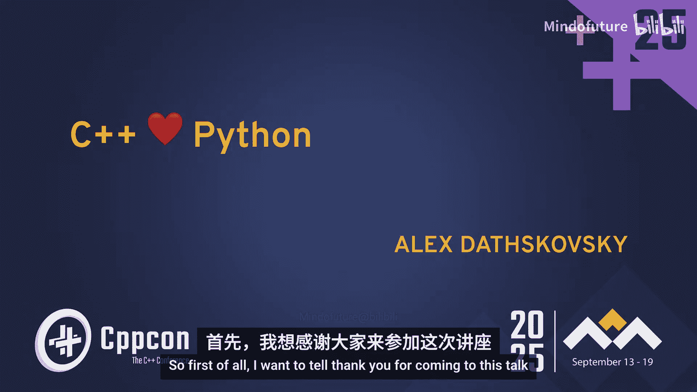
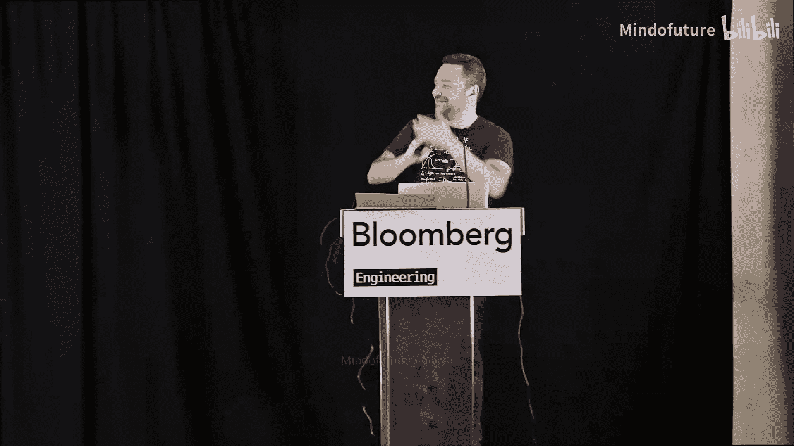
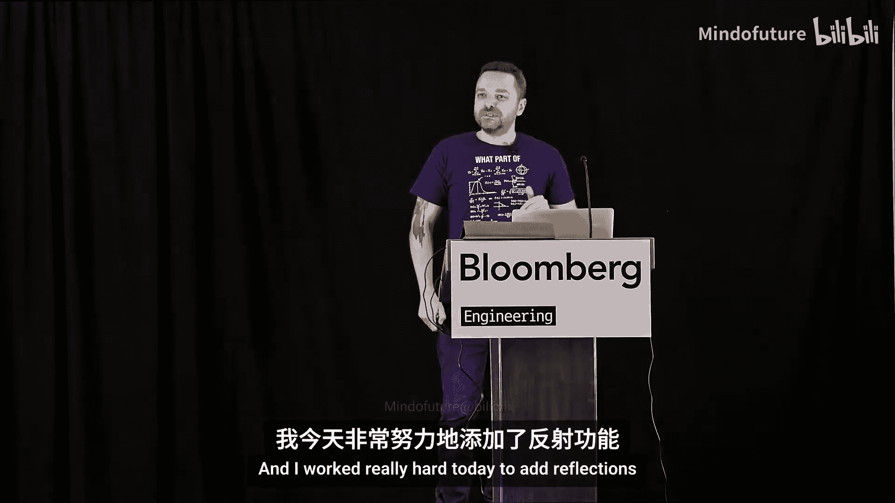
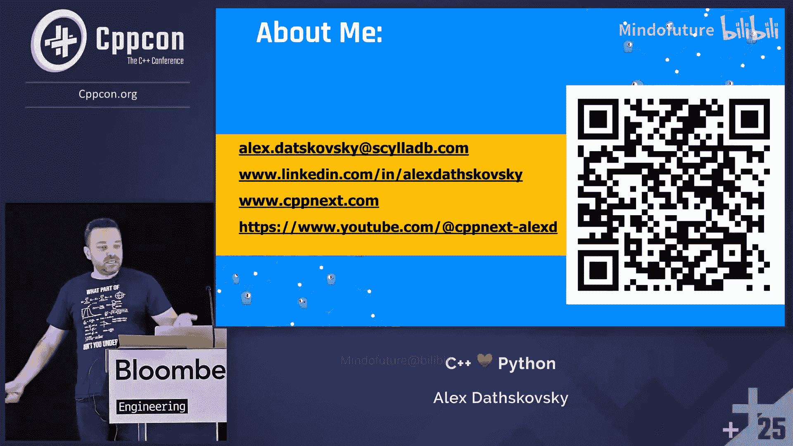
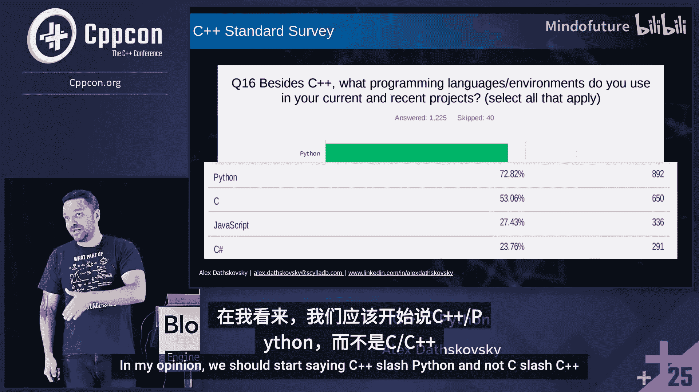
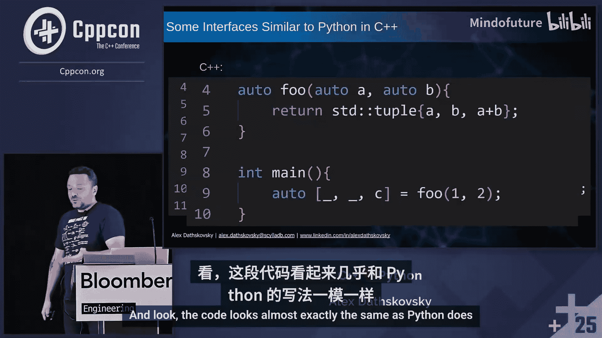
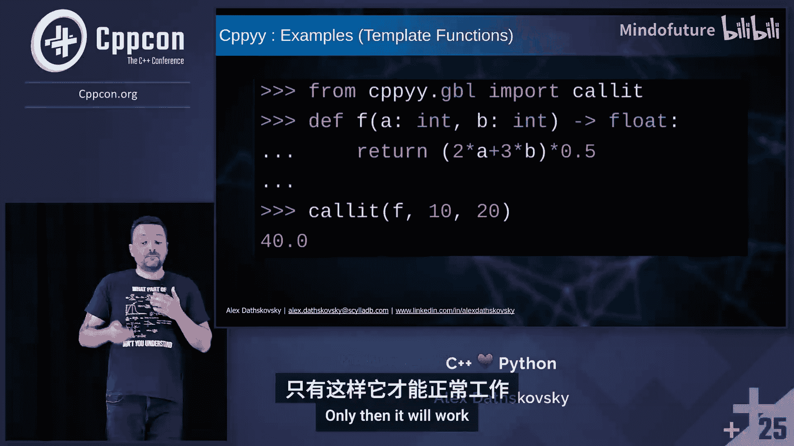

# Cppcon-2025-｜-C++-｜-C语言--｜-汇编-｜-编译器-｜-操作系统-｜-Linux-｜-Windows-p36-P36_C++_♥_Python-Alex_Dathskovsky-CppCon_2025--BV1wyPBzrEeu_p36-

Okay， let's start。 So first of all， I want to tell thank you for coming to this talk。

 The competition right now is fiercece， Andre Alexandresco and Ben Des against me。😊。

And you are still here， so thank you， Cl。

It's good to see that people like Python in the C++ conference。

 so we're going to talk a lot about Python， we're going to see Python code。

 we're going to explore how to make those things work together。😊。

And I worked really hard today to add reflections。 So Google see reflections as well。

 in Python bindings。

Let's start。 So we will do all those things that I said。 I just love LLMs。 and I'm showing this。

 and I'm talking about this because LLMs are basically powered by Python C plus+ and Kuda。😊。

Everything runs on Python because it's easier， but behind the scenes。

 everything is binded to C++ and to Kuda and it's really easy and we will see how to do that exactly。

This part of the talk， I called it shamemeless。 I present myself， and I show the things that I do。

 So I'm Alex Zowsky。 I have more than 17 years of experience in system software development。

 I worked in many， many different kind of systems from defense to medical systems。

 worked in an AsI that accelerates data。 And right now。

 I just started a new a new position in ClaD B。😊，Which is basically a database that replaces Cassandra。

 and it's on speed like 20 times faster than Cassandra。 Just pull it into your system。

 and it works the same。I have a very active LinkedIn account where I speak about C plus plus。

 I try to show how things work。 but I have some riddles there。

 So if you are really mad of people that do riddles。😊，You have to know that they do them sometimes。

I have a blog CPP Next， where I can do more in depth things about the things that I do in the LiedIn。

And I have a YouTube channel。 So after the talk， please like and subscribe the channel。

 I already have。😊，14 or 16 videos there。 So I'm working hard to make it something that is maintainable and to do something that will contribute to people。

And beside that， I'm part of the CPP committee and standardization Committee， of course。

 And now we can begin。 So let's start with a survey before I started writing this talk。

I decided to do a survey to ask people C++ developers， what is their second most used language？

I did it on LinkedIn， and I had around 600 people，600 Sus plus developers that actually answered me。

So as you can see here， Python is number one language for C++ developers。

 So if I'm doing something else that is not C++， it will be Python， not C， which is pretty nice。

Then I remembered， wait， isn't there some survey that already does that， I don't have to do that。

So C plus standard Surve does that。 I found it。 This is the latest one。

 And around two times more people answered there。 So you can see still。😊。

Python is the number one language， and it's almost a slide slideful because more people that use C plus plus use Python。

 In my opinion， we start we should start saying。C plus plus slash Python and no C C s C plus that annos mean in thin case。

 but Python fit well。😊。

So y C+ first？Well， that's a ridiculous question。 We love C plus。 We love to suffer with C plus。

 but it's a good language。 We can do a lot of things with it， and。This is a simplespa conference。

 after all。ワイパイthトン。Python has many good things to it。 For example。

 if you do want to do fast development， it's really easy to do it in Python。

What do I mean with that if you need to do a POC， it's really。

 really easy to write Python code first， you have many different libraries in it。

 you can just push everything together， do something dirty， quick and dirty。

 and you have your POC done now we can do something about performance。😊，It has simpler interfaces。

 It's easier for people that are not programmers。 For example。

 algorithm people to write code in C plus plus。 It reminds them of Matlab。

And it's an interpreter language。 So we don't have to compile。 I don't know about you。

 but when I compile， especially on a laptop。That's 45 minutes that I do nothing because the left is dying。

 When I use Python for everything， That's really easy。 It goes around。 I can do code debugging。

 I can do new code。 I can write in a Jupiter notebook and do code blockss。 And that work just great。

😊，And it's really easy to do algorithm prototyping。Because Python and C++ are so close。

 as I showed you， and more and more people that use C++ use Python and Python people。

 I guess they see C++， they're starting to be very similar to each other。 So in this part。

 I wanted to show you parts that in C++ that's starting to look more and more like Python。😊。

In Python， we have a very easy way to print and format strings。

 So here we are just formatting a string with a tople and a number。

 Everything works in the interpretation， and we get a very nice print。😊，In C++。

 we have the FMT library。We have the stood print as well。

 but I wanted to show something that will work if you don't have C+ plus 23。Here， basically。

 you can see that we can format the strings almost the same way， like in Python。

 So we are using a topple and we are using a number and we get the same print out。In Python。

 you can format。Containers in a very easy way。 So he will have two containers。 One is the least。

 and one is a dictionary。 And when we print them， we can see at least in a dictionary without doing a lot of things。

 just going at the throwing objects set。😊，In C plus plus with FMP and st print。

 we can get the same effect。 So we are printing an array， and we are printing an an ordered map。

 and we get the same print exactly。 That is pretty nice。 That is easy。😊，Yes。In Python。

 you could always return more than one parameter。 Basically。

 you had binding to parameters since the beginning。

 So here we are using a function that returns three parameters。 The parameters it's received。

 and it doing does a plus B， returns the full function。

 And we are binding the parameters to ABC outside the function。 And then we are printing it。😊。

Pretty easy。In C++， we can do the same thing。 So right now we can return since C+ plus at 11。

 we can return topples out。 Tas is exactly what returns in Python。

 But here we have to be more concrete。 We have to say that we are returning a topple out of this mechanism。

😊，When we are using it since C plus 17， we have structural binding that looks almost exactly the same。

 like in Python， we just need the brackets around the parameters and the auto。

 and the usage is almost the same。 then we can print it。 if it looks the same。

 and it feels almost the same。😊，The printout is exactly the same。In Python。

 we could always run on four each functions， on for each loops。On containers。

 it was really easy to do it。 And in C plus 2 since C plus  plus 11。

 I hope everyone knows that they have four each or range the four。

 And I hope you're using them and not index force。😊。

But the more interesting thing about Python that we had the enumerate function。

 Enumerate function is basically a generator。😊，The yields。

The value and yields the index in the same time。 So it was really easy for us to go over a container and print the index of the value and the value or to do something with those things。

And that's what we're getting in C++ since C plus plus 20。

 we can initialize a value inside the for loop， inside the arranged for loop。😊。

So here we have an example where I initiate I inside the for loop。Run over in an array。

increasecrease the I inside this function and print out the values。 And as you can see。

 we got exactly the same typing as if were using Python。😊，But that's not exactly the same， right？

That's not exactly the same。 We want something that looks and feels like a real enumerate。

So since C++ 23， basically since C++ 20 we could do it， but we didn't have the tools。

 we just had quarants and we could write something by ourselves in C++ 23 we got generators so basically we got the tools already to do what we want to look more like Python here I'm creating a generator that we return a topple of two ins。

And it receives any container inside it。 It initiate index。Then does the for loop。

 arrange for loop on the container， co yields for each value adds to the index and returns V withed because it's a post increase。

 it returns the value， then increases it。Then when we are using it。

 it almost looks exactly like Python right now because we are binding IN V and we are using enumerate function on our container and we are printing so it looks almost almost exactly the same as Python does and we get exactly what we want。

In the Python， we could always ignore values。 So here we have the function that we already wrote that returns three values out。

 but the first two values are not interesting。 So we're just ignoring them。

 and we are taking just the third value。 And that's fine。

 The underscore used to do the work for you In C plus+， you could do the same thing with stood tight。

 But it looks clutterter。 Who used to ignoring in his life。😊，Wow， usually when I ask this question。

 I get one hand or something like that。 So ignore is with us since C class plus 11。

 but still majority of people don't know about it。Ignore is a neat way to say I don't care about it。

 it gets any variable in and it just ignores it。And C is something that we actually want to buy。

 but it looks cluttered， right， It's not exactly the same as Python。 We write a lot of letters here。

 and it's yuckki。In C plus plus 26， we finally have the underscore so we can bind to an underscore。

 And look， the code looks almost exactly the same as Python does。😊。

We have to underscore。 The only thing that is different is， again， it's the auto。And the brackets。

In Python it's really easy to work with functional programming and ranges。

 so here you have a one liner that creates 20 values of random uniform numbers。

 then it filters out the numbers that are larger than five and smaller than nine and creates a new range。

Then we're printing the range here。For some reason， all the numbers are the same， I don't know why。嗯。

Uniform。And in C+， we could do the same because we have seen C plus plus 20， We have ranges。

 so we can do more things that look like that。😊，Let's ignore lines 42 to 45 is just a way to do random numbers in C plus。

But line number 47 uses ranges to initiate the vector。

It' uses the distributor and initiate each value of the vector with the vector for S， sorry。

 rangers for each。Then we're using format， FMT print， and were using nus that we created。

 pipe operator， and we're saying we want to filter that numbers to the same thing。

 numbers that are larger than five and smaller than9。Look simple and that's exactly what we want。

But we can do much more than that。This example。I thought about it。 It's not the best example。

 Do you know why it's not the best example。What do you know about stood views？They are busted。

 So basically， using stood views are problematic because they are views。

 If someone removes your numbers or objects behind your legs。

Or you will not know that and you will have problems and defined behavior， so you have to be really。

 really careful when you're using views， but it's really。

 really nice to see how it works here because this code takes a lambda that calculates if something is an odd number。

It takes， it creates 30 numbers。Pippe seat to a filter that filters out old pipe it to a view that takes 10 first numbers。

 and pipey to something that reverses the numbers， and then prints it out。

 And we got exactly what we wanted。 So three lines of code equals。😊，Around 25 lines of code。

 if we will use iterators。That's cool， right， That saves us a lot of time。

 And it looks more like functional programming。 So functional programming is a great thing to use。😊。

Okay， so C++ is becoming more and more like Python。And Python is great。 Why can't we just use Python。

 Why do we need C+ plus， Why do we need other languages。And the reason is。

 the greatest achievement of this language is the greatest downfall。 Its interpreted language。

 And it means it's slow。😊，It's really， really slow。We cannot do something in production。

 if we need performance。And if it's slow， we cannot do anything with it。So。

Besides being an interpreted language， it's a dynamic language。

 What does it mean to be a dynamic language。It decides about variables in parameters during runtime。

 It doesn't know anything about them， So it can do a lot of things， Exp numbers。

 decide something for you。 And you， it's really easy。

 People are saying it's easy in C plus plus to shoot to in the foot in dynamic languages。 It's much。

 much easier。Let's talk about the problems that we have in Python。So please be with me and please。

 I know it's the end of the day。 but let's look at this code and tell me。This code is very simple。

 what's the problem here？It doesn't return。 It doesn't return。But because it's Python。

If no one uses this function。And only somewhere in production， in some code branch。

 you get to this function， only then it will fail。 So it's a big problem。I fixed it。

 There's a return。 What's wrong with it now。嗯。こペクに。Will it work？😮，Yes。Yes。

 it will work because Python is horrible dynamic language that says， hey。

 I have B in my scope before I started using this function， so probably you mean this B right。

 I will do it for you and it will actually return what you think it will return so this is really。

 really bad you have to I had like a problem like that and I debugged it for two days because there was a parameter that I forgot to provide to a function with many。

 many parameters。😊，And there was in the main block of it exactly parameter with the same name。

 So he decided to take it， and it was totally different thing。Okay， who knows what is this。

 What is this number？Max N 32。 Yes， Max U N 32。Great。😊。

So we are creating a function here that takes a number and has a number and returns it。

 and then we are using it with what is this and one， what will be the return。

 What we will see when we print with the print， sorry。0， that motion。

It doesn't It's arbitrary decision And no， it's not arbitrary decision。 It expensive。 It's expensive。

 It says， hey， it's you Maxs you int， but don't worry， I'm a dynamic language。

 I will give you you in 64。 You are good。 So we are as a C plus plus programmers We are saying， okay。

 we need it to be 0 because it's wrappeds around and it's 0。 No， it's not 0。

 It will be you in 64 here。😊，As C plus plus programmers。

 where we sometimes want to work with binaryari blocks， right， with with beats。 We want to move them。

 do things with them。 And actually， Python provides a cool thing that's called bin。

 It returns a binaryari type。😊，But if we will look closely at the type of being。

We all see it' a thing。So working on beats in Python， it's not really working on beats。

 it's working on bytes and you're spending a lot of memory and spending a lot of time。

 and I actually saw things in code that are bloating memory because they're wanting to work with bin operations and they' are paying for it with time and explosive memory。

😊，But not everything is bad。 Like C plus plus that is growing and becoming better and safer。

 Python is growing and becoming better and safer。😊，Here。

 I want to show a couple of things that we got in Python。

 modern Python that actually helps us with it。 So since Python 3，10。😊，We have typing。

We can hint to the interpreter what we want to use。Here we have the function。

 exactly the same function。 But we are saying， hey， A is supposed to be an integer。

 B is supposed to be an integer。 and I'm returning in the integer。 So if you get anything else。

 that's wrong。😊，And here， when I try to use a floating point with it， it says a nice warning。

I expected an integer， but I got a floatat。It's a warning。 you have to see what ID does。 If not。

 that's a problem still。If I forgot the return， instead of waiting for some code block that will explode somewhere later in time。

 I can see the actual warning here， so it's much easier to debug。In Python 312， we got typing。

 which is even more cool。 We can do generic functions。😊，So Python is becoming more Ley++ as well。

 it's a templated function。Here we are saying that fo is a function that delateated on T。

 and T can be an integer or a string。😊，And then the parameter A that is using is the list of those Ts。

 and B is T as well。 and we will return list of Ts。😊，Inside the function。

 this is not scary anymore because we know that a is supposed to be a least so we can use a pen on it。

 We're using a pen safely because we know it will will be a list， and then we're returning a。

If I will use it like that， I will say fool with one and 2 and three， everything is fine。

The idea doesn't feel at me。But if I will try to use float。It will say， wait a minute。

 You told me that you want this list to be an integer or a string。

 this type T to be an integer or a string。Float is not an integerrous sting。 So please replace it。

Another cool thing is type typey is using in C+。😊，So we're using here， we're saying that U of type T。

 that U is templated on T is basically least of anything or a tableple of anything of any size。

Then we are using the function， and it's easier to read because we're saying its a is a type of view。

 and we're returning a list of views， and we're returning a list of a。 That's it really simple。

 and we can use it like that。 It's safe， It's simple。 It adds a lot of safety to the code。😊。

But as I mentioned， those are just warnings and warnings are not enough。

You need to go to your DevO team if you're using Python and to tell them， hey。

 we need Pyte MyP or any other type checker inside our CI。

 because failing in CI is much better and easier than failing at a customer。

Here we have an example of the code that takes something and adds a string to it。

 but the something is an integer or a string。😊，And we're returning this list。

 And we're adding a floating point here。So what it says is， wait。You have a problem here。

And if people run my pie， instead of just warning us， my pie will say。Hey， you have an error。

 You need to fix it right now because you are doing something that is incorrect。

 So it's much better and safer。 I'm sorry for using Windows。

 My machine with the GPU is Windows machine。But that is not enough as well。

 And here comes the fun part。 What will be a C plus plus conference without saying Ros couple of times。

 So here I'm saying， R is alinter that was written in rust。 And it is very goodlin。

 It's very fast and it does a great job， So you need my pie and thelin。 Why do you need thelin。

 Because my pie didn't see another problem here。😊，Do you see then the other problem？Basically。

 we have a logic problem。 We cannot do plus equals on those things。 And the Li。

 my pi cannot see that， but the Li can。Another cool rust thing is UV。 So basically who is using Pip？

😊，Whoever used condonda？What do you think about Conndary resolve， Thank you。I would say。

 throw it in the garbage。It's so slow。 Its sometimes if you have a lot of packages， it takess。

Minutes。Like， 25 minutes。In my case， it was 35 minutes。I started to move everything to rough to U。

 sorry。And it's amazing。 The timing became much， much pester。

 You can see here in the example that they are providing that peep is almost。😊，Five times slower。

 even more。 Conde is 500 times slower， but this is amazing。 and it actually works。

 and it's easy to use。 And if you want to use it， you can scan it later and read more about it。😊。

And if you use Python， move to UV。Now， let's talk about performance。

Not just safety is becoming better。As Python becomes more modern， it becomes faster as well。

 So here we have a comparison of Python versions until Python 3，11。

 And as you can see in each of the benchmarks， the performance of Python 3，11， it's much。

 much faster。😊，When we will see the comparison of Python 311 to Python 313。

 we can see the Python 312 done almost nothing performance wise。

 they had the little bugs that they fixed， but in 313 they actually gained five more percent。6%。

 something like that。And they even have a version without the horrible j。

 but we will talk about it later。Now， another important thing is when we think about Python。

 we say it's an easy language。 Anyone can write it。 You don't have to understand what you're doing。

 Everything will work。But if you want something to be a little bit more performant and do the correct things。

 you need to think about the inner mechanics。So here we have just a very huge list of numbers and two functions。

 functionction A is just summing up with a loop。And function two， using the built in function sum。

Then we are running it for100 k times。 which function will be faster。A or B，1 or2，2。Very good。

 It's four times faster， four times faster。 Why is it faster because。S is basically re C。

It's written in C。 It knows better about your collection。 It knows how to sum it better。

 It knows about hotspots and caching and all of those things。 So it transit much， much faster。

 another thing that you get here is that you're not using loops inside interpreted languages because loops and branches inside interpreter languages are horrible。

 They take a lot of time。😊，We can get better。 Who use Namie and。Cool。So Nmpy is a great tool。

 Let's do the same thing with Ny， where instead of creating a Python list。

 we're creating an ND array。😊，Of 100 K elements， random elements。

 And we're summing them up with MP sum。And it's three seconds。

It's three seconds that means it's 11 times faster than the the building function。 And why is that。

So Ny is an obstruction over ND arrays。 It has a really easy API。

 It's great for met functions that doing things with arrays and ten source as well。😊。

Arays are not dynamic。 Each array that you are creating， it will not grow anymore。

 So it's more sea like。And the core implementation behind the scenes， it's C and C plus plus。

 Most of it it' C because it was written way back。 but the new components that they're adding。

 they're becoming C plus+。 So it was pretty cool for me to see that。😊，And behind the scenes。

 they're using A V X， and they're doing multiple creations。

 and they're actually understanding what a CPU you're using and doing a lot of work for you to get faster。

は。But again， we have to understand how Nmy works。 so Nmy is very easy to use。And it has a nice API。

 they says。Give me an NDRA like。And I will work with it。A list in Python is an NRA like。

So let's do an example here。 We have the function with the sum， which is a building function。

 and we have function 3， which is using Ny on this regular Python list。Which one will be faster here。

2 or3。2。Great audience。Two is faster， why is two faster， who can answer that？

It's a gas that has to convert array repeatedly。It has a huge overhead。Basically， it's copies。

The list into the ND array moves it to C+ plus memory， C memory works on it。

 returns it to list and vice versa。 So it takes long， long time to do it。Okay。

So what do we take away from this？We always need to use things that are already created。

 We don't have to recreate things in Python。We have great and major libraries that do things for us。

 we don't have to do them all over again， but you do need to understand how those libraries works。

 you need to understand how Python works because yes， it's a simple language。

But sometimes you need to take more from it to make it even better。Don't abuse nice APIs。

 because Python is written for people that。Don't know how to write code。

And they always give in nice APIs， and then people are shooting themselves in the foot if they don't understand the API in the library correctly。

As I said， let's use more libraries that are already there， more modules that are already there。

 But sometimes you can't。 Sometimes you have to create something of your own。

Let's say that our algorithmic team， we have created this cool function that you all will sign an NA after this。

😊，It's a proprietary function that makes amazing things。 I will not say what。😊。

And they want to test a new algorithm with this function。

 but they have to do this function exactly the same。 They want it in C++。Luckily for us。

 Python interpreter C Python is basically a C program。Yes。

 there are different interpreters like Pipe， which is much， much faster， but it's not complete yet。

 So we will talk more about C Python， which is more distributed than more people are using it。

Because it's the same program。That maintains a state of the whole program that you written in Python。

And if uses a spy object， it's really easy for us。It's really easy for us to attach to it。

 basically creating in S， O files。Here， if we will look at how things look schematically。

 we will see that we have the interpreter inside the C Python core。

And we have everything becomes a pi object， we have inputs and outputs。

 The interpreter is reading our script file， creating the pi object， and maintaining the state。

As I mentioned to do that， we have to create SOs， we have a Python H file that is provided by C Python。

 Python H file is basically an API to Python， how Python is written。

 we can just hook inside Python and create our own functionality and do whatever we want with it。

So if we will do that and we will use it， we will get something like that。

 our core operation is almost the same， the script is written almost the same。

 but we have an external so that is connected to the pi object that is created for it and it will be used in the state of the program。

😊，Sounds simple。 but what do we need to do to actually hook to it。We have to include， of course。

 Python dot H， we have to write our C function here。Then we have to do a wrapper for C Python。

 The wrapper， of course， returns pi object pointer。

 It receives a self object because every python function has a self object in it。

And it receives by object arguments。 So all the arguments are one parameter。

We know that this function has only two arguments， so we're saying int A and B。

 we're extracting or parsing the topple of the arguments into A and B。

 actually using the full function inside it because we can do it， we can see it。

And then we are returning a pipe float from double because it returns us double and we want to be a float。

 We are creating it。Afterwards， we need to create a few methods。

Fu methods are the methods that will be used inside the module。 So we're creating it。

 and we're saying， okay， we will call this function。

It will use P for the function that we are created。 It's met VRs。

 We are saying what the documentation for the function。 We're using Sentinel。😊，A weird sententinel。

And then we need to create our model。 So when we are creating the model， we're initializing it。

 we're saying what it will do。 We're saying what is name。 We're saying here that it will be global。

 and it will use full methods in it。😊，This function is the most important function to understand。

When you do import inside your Python code， this function will be called。

 So when this function is called， it's basically telling it。

 I need full model to be created inside Python。And the naming is really important。

 so your model has to be the same name as you are calling it here。We are not done。

Because we have an extension， our setup file is not exactly the same setup file for any model that we are doing。

 So we are creating we are importing extensions。 We are creating a Python extension here that's called full model。

 we have the source provided here that is full model dot see。

Then we can do our normal setup for the model itself。

And we're just saying inside it that external model is the model that we created。

I don't know about you， I'm alaysia guy。That's too much code to write。

 boiler plate code to write to do binding for one simple function。So luckily for us， there are many。

 many different binding tools out there that can help us with it。

 We can actually use those binding tools to get what we want。I don't have time to show everything。

 but I will mention P bye and 11 and boost Python。Those are the oldest libraries out there to do the binding。

 they made things much， much easier because you could just write C++ code like C++ extension and compile it to be a Python。

 compile it to be a library and then attach it to Python。I will talk about Citton， which is amazing。

 too， it's a rich language that lets you write by a Pythonic code。

 and you can run a Python in C++ and C++ in Python。😊，You can run Python in C++ with it。

And you have another thing here， which is a jewel。 It's called CPPYY。

 CPPYY is a dynamic binding library。It's amazing。 It's basically made bindings。😊，Easier， faster。

 And if you only need to use something that works in Python and run C plus plus code。

 this is the way to go。 But C Python a Son is not far behind。Now what about performance？

The code that I showed you， if you run it in C plus+， it's 4 milliseconds。那等。😡。

If we run it if we will run this function in pure Python。

 it will run for a second and22 milliseconds。 That's， that's a long time，200 milliseconds， sorry。

If we will do the C Python code that we've done and we will run it， it will run in 1。1。

 So I think it's noise because C Python doesn't do anything here。

 The Python code in the C Python code should do the same thing。😊，By by day 11。

 which is so cool and nice， runs five times slower。Why is that。Overheads。Over， yeah。

 I was going to ask like are we are we benchmarking user microphone？I was going to ask。

 are we benchmarking interpreter startup time as part of this oh we're not wow， okay，It's pure。

 The interpreter already started。 what I did in Pth on itself is using timeit。

 So time it is starting after the interpreter started。We have overheads。

 That means that we always copy things to pi objects and vice versa。

Different libraries do different things to do this。 and Pipepe and 11， for some reason。

 decided inside their design to do everything on the hip。

Sos your hip is always growing and retracting and you have vectors inside it to grow and retract。

 and it takes time。 And just like in Ka code， you always have to think about。😊，Hot spots of code。

 So you cannot push something to cool that that does just one calculation and say， yeah。

 I'm using code。 I'm so performant like now。 No， you have overheads to go over PCI Express Here。

 We are not going for PC I Express， but we are doing cash， and we are moving inside the memory。😊。

What can we do to make it better， make batch functions that mean prepare a lot of data and send it to the function。

 Don't use one calculation。Use binding objects。 For example， you have a T。

 R T is something that's already bounded。 You have it inside Python pi bind 11。

 It's already bounded to NDRA。 so you can use that to make your code fasterster returnturn values。

 and this is really， really important。 If you are doing bindings。

 Python is a garbage collected language。sorry， garbage collected language means that if you return something from Python to C++。

 Python may decide to delete it， and then your memory will be corrupted。

 So always return with smart pointers and this smart pointer should be a share pointer， of course。

This is an example of using an NDRA inside the C++ code。So it looks almost exactly the same。

 a little bit more harder to understand， in my opinion。

 because you have to request and extract the internal pointer from it and then run on the internal pointer。

It's harder to read。 and that's the reason that I don't like to write C+ plus code that looks like that。

 There are better tools for it if you can just use other languages， other extensions or languages。

But if we will look at the performance for that， pi bind 11 now runs 1。56。0。6 seconds。

 it's a lot faster。 and that's because we remove the overheads。Now let's talk about Saton。

 Saitton is great。 As I said， it's a rich rich language that almost pythonic like。

 it has much more features than any one of those pi by and 11 and boost Python。

 you can do almost anything you want and we can the jewel here is that you can run Python code inside C plus plus。

 and sometimes it's really important and you have interrupts。😊，For some reason， many people。

 when they see Con code， they're getting scared。 I don't know why we will see Con code。

 And you will tell me that's scary。😰，Everything starts with a C plus clause。

We have a simple plus class inside the namespace important。We have virtual functions full and bar。

 and we have our virtual distractor， we have astruct re that publicly inherits from obstruct。

 we are actually defining the functions here and creating them。Inside Citton。

 you have two levels as well like C++ Ps D files are files that are resembling H files。

 So here you are saying what are your declarations here we are saying we have Cef external that's saying please import F class do HP。

 the namespace important we will use the home namespace and then we are creating something that called C C plus plus class C plus plus class C c+ plus it means this is a class that's written in C plus plus and those are the definitions that I want to take from this class。

😊，Then we're creating the serial that inherits C abstract。

 and of course they have the declaration real for the constructor fo and bar functions here as well。

Then we need to create an actual class with the bindings， so it's a C dev class。

 C Dev class means it's like a Python class， but it has C+ plus or C members inside it and here we have a member that's called serial and it's a shared pointer。

Now， P Y U X files are files that are like C plus plus CPP files。

 So here we are saying from my model that I created a P X D file。

 I want to see import all the things that I defined。 So I want to bring everything in。😊。

The cool thing about Citton， they wrapped almost the whole standard library。

 so you can use almost the whole standard library in your side your Cton code。

 you are doing here we are importing， make shirt and our point and now pointer。😊。

Citon we also will have to import from operators。 We have to import the referenceence。

 and we have to import the referenceence because we will dereence a pointer why I cannot use an asterisk inside Python code。

Well no。Sorry， it's an operator。 It's an operator that expands。

So here we cannot expand and this operator is take so we can do the referenceence And what we are doing here is basically were creating the function that we want to bind and we are saying we are dereencing the serial inside this class。

 We are getting the pointer out of it because we have this function inside shared pointer and we are using full function in it。

 pretty simple。😊，About the code， is it that scary？Okay。Someone thinks it's scary。Okay， cool。

 Then we have to compile it。 Basically it will compile。 We are saying we want to do it in Python 3。

 We want to compile it to C plus plus and not to C。 and the model that we will use is my model by X。

And then because it's so automatic right now， we can use CMic to do the work for us。😊。

What I'm doing here is I'm actually finding the pictures for Python libraries。

 I'm creating a custom command that will compile the Python code for us。😊。

It will create the CPP file， and I'm using the output the CPP file to bind it to the Ed library。

 I'm adding the library and I'm saying， okay， I need my model to be here。

 That means that my model needs to be created。 That means that the custom command will be called。😊。

And the most important part here。Is that I'm removing the prefix that is created。

 and I'm removing the prefix that is created because， as I mentioned。

 the init of the model will use the same name。 And if C make will add the leap to it。😊，We are doomed。

And then we can write a simple Python install function that just takes the setup and install it。

 So it's simple， maintainable， you can use it inside your C and you use it inside your code。Now。

 let's look at the other way。 Python to C plus。 Let's say we are working in an air gapped computer。

 and we cannot do anything。 We cannot bring conan。 We cannot download any other modules。

 We cannot do anything， but we have Python。 Python comes with J。

 and we really need to do something with J and C to write J and C without libraries。

 It's hard So it's easier to do this， for example， here， we are creating a function。

 and we are attending Cyon create a C plus plus function for us from this Python code。😊。

So C the public is basically telling it， create a C plus plus function。 Then we're using the Json。

 It's really easy in Python， and we don't have to do a lot here。 We can save a lot of time。😊。

Inside your Python code， you will have to initialize the interpreter inside your C+ pluscode。

 so well DL opening the lead Python。We're bringing it in， we're initializing it。

 we are calling the initialized function this initialized function we'll call the function that is created in siteon。

 and we can start working。😊，Few words about exceptions。

 There is no propagation between the two languages。 So if you're writing Pyon。

 you cannot throw just a regular python exception and expect it to get to your C plus code。

 So what you need to do， there is a simple solution for it。

 What you need to do is create a simple C plus function that throws a simple exception and C plus bind it with C Python that looks like with Pon that looks like that。

 and create a Python function that uses the bind C+ plus function， easy。

 simple propagates to everywhere。😊，Jill。Jill is our enemy， and we hate it。And someday， it will be。

Gill is a global interpreter。 It actually restricts。Treads from being run as threads in Python。

 So each thread， before it runs， it has to take the jail。

And that means it's sequential and not really parallel。In say， in Python 3，13。

 they supposed to remove Jill。 They have a special build for it。 They didn't remove it。

 And I assure you， this build will have so many bugs。😊，We will have Jill for a long time with us。

In C Python， we have ways to remove the G In Cton， we have an easier way to do it。

 and I don't want to use C Python because it's cluttered， it's a lot of boilerplate code。

 and no one likes it。And inside threads， we can run without J。 So let's look like。

 let's see an example。 So here we have an example。That creates a function and all we have to do in cytoton is to say no G。

 that's it。 We have created a function that we're saying it will not throw and we have no G in this function。

 Then we have another function where we are creating C plus plus parameters arguments。

We are coping pi objects into the C plus memory。We're saying creating a block for no gel。

 We're saying inside this block， we don't have G。 Don't take it。

 And we are using the function inside it。Then we're copying back the C+ plus object to pi object。

Inside the main file， we are creating huge lists。 We are running on this list。

 and for each one of the parameters， we are just creating a thread。😊。

It's faster than what we could get without using noGL， but it still has Gill in a lot of places。So。

 maybe I can save。Some of those things， what will happen if I will use the copy to pi object inside the no G code。

 Will it work。The answer is no。The moment you're starting to talk about pi objects。😡。

Gal will take effect。 You cannot do that。 You actually need to be inside a scope of C memory and C code。

And now we're getting to the binding。And this is basically cool。

 So there is a tool that was created by Kang。Cold clean。Cing is a C plus plus interpreter。

That someone took and made a library for Python from it。It's really easy to use。

 it has great features and many， many things that you can do with them lot faster and the development is amazing。

 So here's an example all you need to do to run a C++ function inside your Python code is to import CPPYY to use CPP dev to write your actual C++ function in to access GL which uses a global namespace inside CPPYY and to use the function。

 that's it。😊，Performance wise， we got under a second。

This is much nicer than any other library that we seen。We don't have to install Clk。

We don't need to duplicate a steelL because we are just using StL。 That's the fun part about it。

 full support of templates， full support of inheritance， full support of Colbes and Lambdas。😊。

It does everything that C++ does。Here we have an example almost the same thing that we've seen before。

 We have an abstract class。 We have a real class that inherits from the abstract class。

And we are defining the functions。To use it， all we have to do is to import CPPYY。

 include the H file， everything will be interpreted。To use from GBL to import realel。

 and then we can just see that realel is a class， a Python class。To use it， we have to initialize it。

 And then just to use it。 That's it as simple as that。We can do gross inheritance。

 so we have an abstract class that we wrote in C++， but we want to do another class inside Python。

 but we can use the C+ plus class to be the father of this class。😊。

So here we have a preal class that inherits from the abstract inside GBL。

 because GBL creates something that is bounded to actual Python。And we redefined in the functions。

 Another important thing here is that we are including array， which is thus an S TL code。😊。

And were using GL array， and we are creating a C plus plus array inside our Python code and just using C++ inside Python directly。

😊，Templates， it actually understands and interprets templates， so even template is hard as this。

 basically here we are calling a function that's called it that expects to get a call back function。

 a function pointer and a list of arguments， and then we are using student invoke to invoke the function。

Here's the cool part。 I can actually provide。😊，A python function into the C plus code。

So here we are creating a function with two integers in a float。

And we are providing it to a call it function that we are creating the site GBL。

 and it actually works。 The important part here is that you need to help the instantciiation of the template。

😊，Python is all pi objects。 but when we are using typing， we are helping it。 We are saying， okay。

 please instantiate the template with int， int and return type is float。 only then it will work。

 but still it's cool。😊。

Sometimes you need to work with external libraries。 so you don't have everything。

 So let's create a simple external library with a function full。

 And we have the code for the function full， which is really nice。😊。

Then were compiling it and creating so file out of it。

 And then to use it inside CP inside your python， you're just saying， okay， CPPYY。

 include my interface。😊，Load libraries that's called N all this O And use the full function。

 That's it。You have a library。Sometimes。Libraries don't come as a Os。

 and you have static libraries or archives。 So have two ways to deal with that。

 You can decompile the archive and create an so from it。It's hectic stuff， Don't do that。

But you can just relink it。 You can create your own library that has nothing inside it。

 and you're just link to the A library to the archive。

 and it brings all the symbols in into your library and havent so。😊，So it's as simple as that。

Moreover， you have everything that you have to provide to the C++ compiler。

 you have to provide to clean。 So if you are not using include pads that are in some pad and you' are not using the library pads in some default library pad that the LD library pad。

 you can actually provide and say my libraries are there。

 please look there and it can be a list of of directories so it's really cool as well。😊，Jill。

 we talked about Jill。Here， it's even easier。 So we are creating a C plus plus function。

That just sleeps for a long time。Every GBL object。Has something thats called an attribute that's called release J。

 All we have today do is to say， release J tro。 That's it。 And。

 when we are running it and creating threads， basically， this code says that I will not take the gel。

Not everything is fine and dandy， most of the things work， but beat fields don't。

So if we are creating something like that and that's funny。

 This is a bug that was open on for CP P Y Y for a long time。

 And the creator of CP P Y Y actually wrote， I knew this day will come。 I knew this day will come。😊。

Beat fields。So if we will use it。We were just including these beat fieldss。 We are creating it。

But if we want to print it， you see bogos。 it's nothing。 Python cannot reprehend what a bitfield is。

 So because of that， it's just printing nothing。The good part is it's easy to fix because the memory layout is correct。

 All we need to do is create a C plus plus function that takes our object。

 interprets it to two bys string， and then just to print the bytes together and if we will do that。

 we will get exactly what we wanted。😊，The function looks like that。

 but I want to jump over it because I want to show you a couple of things with reflections。

Those are the important things to understand operator that takes something and returns a meta info。

 the operator with the brackets， its something that takes some object of meta info and creates。

And the instance of it。Template4 is really important because it's something that runs over our constableile code and creating instantating code for us。

And all reflections should be done in compile time。So let's look at something like that。

 We have a name space with two functions inside it。We want to bind these functions。

I will use Piine 11 to do it because it's easier， so to do it with Piine 11 you have to do something like that。

 you have to create a Piine model， you have to do documentation to create a submodel inside it to use de on2 functions and as you can see there's a lot of boilerp code here。

With with reflections， it becomes something that is more concrete。

 So here we have to take the context out。We have to create a static array from a function that called members of members of will take everything from the namespace and provide us with the meta infofo objects。

 We will run on this meta infofo objects with the static array of those meta infofo objects。

And we will say if this metainfo object is a function。

 we will create an identifier from this function。 that means a name。

 And then we will use the definition inside the pipeline。 And we will say， okay， F and data。

 This is the name of my function。 And R is the actual object that I want to instant it。

 So it's providing the actual function pointer that we will use。😊，Now， if you want parameters。

It's a little bit more complicated， but it's doable。 And again。

 you can write a block of dose reflectionle and to do it for any block of binding that you want。

 and it will save you a lot。 It looked in the previous slide like it's a lot larger and more code。

 but it's a generic code that works for everything。 you just need to provide a meta info。

 and for any meta info， it will work。😊，To do it with Piine for what I just show in namespace2。

It looks almost the same， but you actually have to use pi as to provide the name of the arguments inside it。

To do it with reflections。We have to access the core access context， we have to create our context。

 we have to create our symbols like we created them before。

 we have to create the submod like we created before。😊，But here is the tricky key part。

We have to run over all the symbols。We have to create a static string from the identifier of those symbols。

We have to create all the parameters。 So we have。We don't have this function yet。

 You can do it in different ways， but it should be there soon。Parameterters of。

 then we are creating a lambda that will expand all our arguments。

 and this Lada is basically going on the namespace object or the meta infofo object。😊。

Creates an array of strings of all the arguments because it expandends it with the fold expression。

 and then it defines all the functions with all the arguments。😊。

As easy as that it's something that is more hard to understand right now because reflections are really new。

But it makes things simpler。 It removes all boiler plate code， and it makes C++ even stronger。

So in closing notes。Use bindings。 sometimes to use Con， it's easier to make your code work faster。

 Sometimes without doing anything， just Con， your Python code will make it faster。

Always understand your APIpis。 Don't abuse your APIpis。 Use batch functions。

 understand how Python works。Really avoid denering pointers。And I think。

Start looking at reflections because they're going to be very， very important at C plus plus。

Thank you。Hi， great talk。 one thing I was wondering about。 So for CPPYy specifically。

 I just wanted to restate that I did verify that I had understood。

 So it basically like it uses the C plus plus interpreter inside of lip clang like it binds to that directly。

 essentially it installs with the binding of cleaning into Python。

 and you get it exactly when you install this modeling。 So you don't need to do anything。

 You don't need to have clang on your computer， you don't need those things。

 You just need the library。 That's right the main thing I was wondering about is just that like it's built on top of the clang implementation。

 is built on top of Kang。 Okay what I'm saying is that at the end of the day。

 it's using the interpreter inside of clang。 So basically anything that clang can compile this thing should be able to work。

 Yeah that's what's cool about it。 Yeah， thank you。😊，Anyone else。1百个司。Who asked that。

 if you can come to the microphone， please？Hello， yes， thank you for the talk。 What about nanobinine。

Nanobbind， I have no experience with nanoobbin， but it's really similar to what pie bind and other static libraries do。

 So I don't expect it to be a lot better。Thank you。

What's been your experience for the debugging across those language boundaries。With which two。Yes。

 everyone。Pi bind and P Bo Python are the easiest one。

Citton is a little bit harder because you have to pay to have a debugger for it。

 so debugging is usually done with printing。It's doable。 And with CP P，YY。

 it's actually if something crashes， if something done wrongly。😊。

It will you will get a cl message out of it。 So it will say it I can I couldn't compile it because something happened。

 I couldn't do that because something happened。 something didn't run correctly。 So it's cool。Thanks。

B talk。 one of the problems that I've been having with study linking Python to simple with Python is because I need a different compiling for each Python version。

 Do you know any other way to do that What do you mean in the different compiling not not compiling。

 for example， if Im if I want to use the CP code in Python 3。12。

 I need to compile it for3 point dot12。And every time I need a new version。

 I need to have he compile my code。 if you're doing it with a different library than yes。

 because you're already like。You already took the symbols。

 You actually linked yourself with Python dot S O。 So if you have a different one。

 there's not a lot to do。 The only thing I can say you CPP P， Y Y， you won't have to do that。

Thank you。So I guess that's it。 Thank you， everyone。

