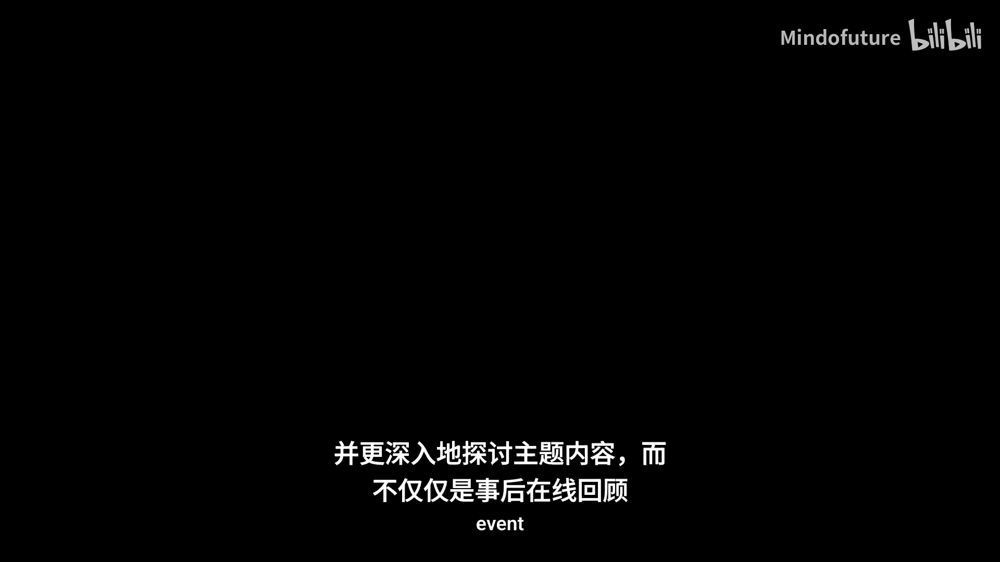
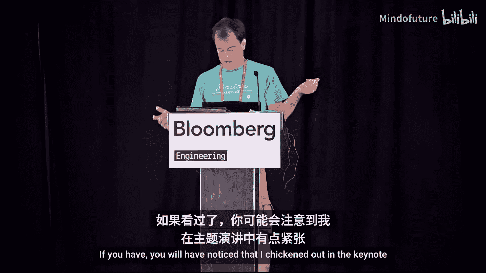

# Cppcon-2025-｜-C++-｜-C语言--｜-汇编-｜-编译器-｜-操作系统-｜-Linux-｜-Windows-p37-P37_智能体驱动的C++调试现场_——无安全网-Daisy_Hollman_Mark_Williamson-CppCon_2025--BV1wyPBzrEeu_p37-

Being able to attend CPPCon in person lets you interact with the presenters and to really get to experience the character and presentations and to engage more with the subject matter than just reviewing an online after。

I think we're ready to go。Hello。😊，So my name is Mark Williamson。 I'm from Undo。

 We do time travel debugging， and we do now AI agent debugging as well。

 And so you may have seen us in Daisy's excellent keynote。

If you haven't， we'll be recapping some of that， if you have。

 you will have noticed that I checked out in the keynote and used a video of our tech doing the right thing。

 because AI demos are always a little bit scary。

Today， it is without a safety net。 So everything we're gonna do today is gonna be live。 Hopefully。

 we'll see what happens。😊，And。😡，We're also aiming for it to be interactive。

 So I'm gonna do a bit of intro now。 Then Daisy' is going to couple to join me。

 and we are going to experiment and see what we can get the system to do。😊，So。😡，First of all， though。

 I'd like to talk a little bit about time travel debugging。 And it starts with this。

 What do programmers do all day。 My view is mostly this。

 at least when they're doing technical work and not in meetings。So。You write the code Hooray。 that's。

 I dont know，1020% of your technical work。 And then you try and figure out why the code doesn't work。

 And that's the rest of it。 approximately。 So when I say debugging， at least， I mean solving。

 you know， actual crashes in the code you just written or code Other have written。But it can also be。

 you know， it didn't crash， but didn't work quite right。 Or it did work。

 And I don't understand why all of these things or even just somebody else wrote the code。

 I want to know how it works。 All of that as far as I'm concerned。 Is this process of going crazy。

 grabping around the source code running a debugger when you can getting logs out when you can trying to piece together。

 The jigsaw。Now。I have some thoughts on debugging in a coding agent。Currently， so we actually had。

 we had a really nice panel session the other day about how you can use agent AI to help with debugging。

 They are quite good at sifting through huge amounts of logs。

 They're quite good about reasoning about your code。

 They can make some automatic use of other tools like GDP， in fact。😊，But。😡，A few months ago。

 when I started using agents to debug code， the first thing that happened。

Was that it tried to recompel my code with some more prints in so that it could trace through what happened。

 And the image that came into my mind was of some sort of futuristic terminator trying to hunt a mammoth with like a sharpened sticker a bone or something。

 I went through quite a few iterations of getting Geini to generate the images。Actually， sight note。

 I was unhappy because all of the mammoths looked really placid。

 So I told it to make the mammoth scary now。 So it look more like a fair fight。Scary mammoth。

Not quite what I had in mind， but I enjoyed it。嗯。But yeah。

 what we're trying to do and do is provide the power of time travel debugging to these agents so that they've got insight into the full state of the program at every point in time so you can get kind of the ultimate context into your context window and enable them to be as smart as their potential allows。

😊，So time travel。 We could do a quick show of hands here。

 How have you heard of time travel debugging。Oay， have you seen time travel debuing。Horay， so。

That is one of the best ratios I've seen。 I am going to show you a little demo， though。

 just to set the scene bla， bh bla， blah， blah。😊，Here we go， so。But I'll exit this。

 We'll start again from the beginning， and you can see what's going on， and also。While I'm at it。

I'm gonna do a little bit of AIing， as well。Okay。Is that right？Wonderful， let me check my other one。

These bicycle circle， right？是。I am going to run this program， which has a bug。

I'm gonna run it in two tabs。For reasons that will become scarily apparent。

 So what happens when we run this program is it iterates through a known buggy program。

 apologies if you've seen this one before， but it's a really good example for this。

 It's done a couple of thousand iterations of some maths function that an naive programme has written for us。

 And then it's exploded doing a little self consistency test。 And now it's unhappy。

 So the question for us is。Why did this happen， as always， And debugging， I would argue。

 is always a backwards process。Unfortunately， the tools we have mostly work forwards。

 But in your head， you're having to model the backwards reasoning of how did we get there。

 What's my theory， Okay， what's my earlier theory until you get back to the root cause。

So we are gonna do a little race。 And I' this is not fair because I've done this a lot of times。

 but it's also not fair because I'm not a computer。 So we'll see what happens。

 What I'm gonna to do is pull in our explain extension。

 which provides integration between our time travel debuggger and a coding agent。

 And it's going to try and debug while I try and debug。 And we'll see who wins。

 No idea what's gonna to happen because I've never done this before。

 This was Daisy suggestion just before the talk。 So you are living on the bleeding edge already。

Explain what has gone wrong in this program。 And by the way， I'm going to say as well。

Please explain in the style of a。Traitorrous grand vizier。Who is secretly plotting？ Oh。

 that's not plotting。 plotloting to replace me。And we're gonna leave that thinking about this program。

 And I'm gonna， Ill give it a start， head start。 And then we're gonna dive into mighty bugging as well。

 So off we go。So we powered up an A A agent in the background。

 and we've now turned over control of R Dbugger to the agent。12。😡，Here we go。

That's now getting to the end of time where a crash happens。 It's getting a back trace。

 and it's starting to reason about how this happened。 Now， I'm going quickly nip to my other tab。

 And so we're at the end of time。 we're in this nice 2i dashboard mode。

 I'm going to reverse finish back up the stack。 You can see on the right。

 We've got to the user's main function。 Now。 quick check in with this。

 It's got to the user's main function。 and it's gasping theatrically。 Behold the treachery。

 Your magnificence。😊，I'm going to go back here。 Right， What's happened。 Well。

 we know we crashed here because these two variables didn't match。

 So let's step backwards through this code。Then if we look here， we are just gonna be。

 Can enter that。 Maybe not。 We're just after the return from this function。

 So what I'm gonna do is step back into the function that returned the bad value。

 And there was a cache hit。 So what we know now is that our calculation failed because an earlier update to this cache actually contains the wrong value that's see how the grand Visi is doing。

 Or it's got back to the same place， actually。That's nice。 So most exalted one。

 The plot has been revealed。 Yes， Cash element 90 contains poison。Now。

 what we do at this point and what the AI is doing at this point is work backwards in time to find out when the cache entry was updated because we don't know exactly what the bug is。

 But if it there's some bad state in the program， we know the guy who wrote it is most likely to be somehow implicated。

So here we are in this loop。See how the Grand Vizier is doing。

 The Grand Vizier is now in this loop as well。 And he's looking at where the corruption was planted。

 So treachery runs deep。 It's beaten me。 So let's see what happens。We were close。The beautiful irony。

 So what's happened here is that our cache algorithm is updating actually a few adjacent entries or trying to whenever we asked for a square root。

 So obviously， the programmer thought there'd be some kind of locality of reference here。

 which meant it was worth doing this。 But there are a couple of cascading bugs。😊，So。First one。

It's iterating from number -1， which is naughty。 You can't square root that。 Also。

 when it calculates the square root。It's coming out is this。

 But the other thing that's happening is that the cache has been optimized to only fit 8 bit quantities in。

 So obviously， there is some domainspec knowledge there。

 But as soon as we get into these crazy big or negative values， all the wheels fall off。

 So what's actually happened is the process of doing the bad maths and putting in the cache has also destroyed the information that we would have needed to understand that the bad math has happened at all。

 it comes out looking like the square root of 2，5，5 is 0。

 So the only way we've been able to work this out。 the only way the viziier has been able to work this out is by working backwards in time until we get to the point of the original corruption。

 The root cause of your programmes downfall。 Perhaps if one were to use larger data types for the cache。

 This unfortunate accident could be prevented。3。That's the basic premise。

 It's time travel debugging and agent debugging all in one demo。I'm gonna return to time travel。

 So our premise here， as I've said， is that we are providing the ultimate context to the coding agent so it can be as smart as possible。

 And， of course， if you combine time travel with agent behaviors， you get something very effective。嗯。

Now， we're gonna dive into some more examples in a minute。

 I can't remember what else is on my slides。This is。This is a really good reference， by the way。

 if you don't get it， sorry， a deep cut。It's， it's one of the less popular star direct films。

It's time now， I think， to dive into some bigger examples。

 So what I'd like to do is invite Daisy up to the podium。 And together。

 we're going to play with some prompting。 We're going to try and replicate the examples you've already seen。

The keynote。 and we'll see how far we can get。And hopefully we have people ask questions of the debugger once we're moving。

 right， Absol， has's their own question。 We really know for this to get interactive。 Daisy。 I mean。

 I don't think you need introduction， but probably。A little intro from useful。

 I'm the the girl who's been talking about how great AI is the whole time。 I don't know。Yeah。

 I work on cloud code。 and yeah。My keynotes online， if you missed it。Awesome。

 so what I'm going do first。 I think Daisy we I going to do first is I'm going to stop the see Python。

 Yeah， the sea Python demo。 Okay， yeah， this is the hardest  one。 Yes， it's the hardest one。

 And I want to give it a while to do its magical work， so。😊。

This is a real bug that took like the Python community a month。It a couple of weeks， I think。

 a couple of weeks。 still Yeah， now to be fair to them， like I'm。

 I'm really pleased because it took them a couple of weeks because it makes this sound really cool。

 I'm sure they have dayd drops， but they are also experts in Python， yeah。😊。

And this is also a pretty dumb mistake。 This is， this is， this is a bit of a mind bending。

 So this isn't pyon。 but this is a nice bit of code because it looks very small and harmless。

 And then the more you look at it， the more your head hurts。

 So there's a couple of things going on here because you have Python's dynamic。

 there's a class called bass node。 And then we've got sub subclass called node。😊。

The magic that's happening here， I will say I'm not gonna try and explain it fully because I don't think I'm capable。

 but sometimes when we're talking about this next field in this code， it is a class level variable。

 Sometimes it's an instance level variable。 There is no clue from the structure of the code。

 which it's gonna be， So you have to figure it out from the runtime semantics。

 And all we're doing here is making an node， making another node。 And then exiting the program。

 And if you do that， almost certainly， if you do this on your own Python install， this will happen。😊。

So the question is， why。 And to be clear， this is， this is debugging C code because Python is implemented in C。

 So this is a bug with Python itself。 exactlyact so。

There is no reason that you should be able to write Python code and get a segphone out。

 unless you're doing something， you know， weird with C types or something。 like this is， you know。

 this is expressible in Python。 It should at worst give you a weird exception。What I'm going to do。

 clear that off the screen。 And we are going to start this process again。 I am going to run Claude。

Claud code against a recording that we made with undo earlier of this bug reproducing。

 And to make it harder for Clade， I've not switched on the Python debug build features。 So actually。

 you can make it a bit easier by doing dash dash with Pi Dbug。

 And then it will have assertions on about internal state， etc cea。

 And it won't quite get to the Seg fault。 But， you know。

 what we saw on the release code was the Seg fault。 So we'll run with that。

Is that anAre you running an optimized C Python or are you running C Python with debuim？I'm running。

 I it is a standard， I believe， release of C Python does have debug symbols。

 but it's not been compiled with super low optimization。 It's not a fully optimized build， though。

 actually， it's released。 You didn't custom compile so basically what I did was I type make。 So it's。

 its whatever that default build does。 It's not at the level of a full debug build。

 I think they offer a build with higher optimizations。 that might work here to。 I just haven't tried。

But it does have inlined things and all the nastiness。 So there's all sorts of nasiness in this。

 And it doesn't have the internal checking you get with the pie debug option on configure。

 So it's not gonna。 It's like the sort of strict binary we， we still have debug symbols。 I mean。

 you can， you can have a strict binary and you reunite it with its debug symbols。

 So that's still an option if， if you're debugging something that's been released。 But yeah。

 I am curious how well it would do without debu symbol。 So I actually。

I kind of suspect better than you'd think。 I kind of do， too。 It seems to be good at these things。

 so。It's quite a big prompt on screen。 But basically。

 I think there's a couple of things worth pointing out here。 So I last night。

 I used Clade code to generate some instructions using its subagent feature。

 And I've put one set of instructions into undo debugger do M D。

 And that's just giving it some more advice about how to be a really good user of the debug tools。

 like you required that M D but for your tool。 Yeah， exactly。 But the other thing that I did。

 is I created a named subag in Claude called the agent bug diagnosis validator in its job is to be adversarial agent that will check the diagnosis in the main agent。

Using all access to all the same reasoning， undo tools。

 source code that main agent has and tell it if it's done a good job or if it needs to try harder。

What I'm going to do is set it off on its way， and we will see how far it gets during the rest of the session。

 My hope is that without any interaction， it's going to re cause this。If it doesn't。

 we'll see what we have to poke in order to get it there。

And you did tell it that this is valid Python。 So it should because at first。

 it was just saying this is really dumb Python。 Yeah exactly。 I mean， I have a lot of sympathy with。

 I often found the default response was， you've written something bad。 Don't do that， which is true。

 and is， is probably the right answer unless you're actually a core Python developer， right， Yeah。

Indeed。So should we dig into Yeah， some other。 you want to do a doom demo。 is good。Like literally MC。

And goals like clothes。No， this is built into cloud code。 We have subag functionality。

 It actually came out of our hackathon Week in June。

 and you can set up custom subagent with their own kind of system prompt that the main agent knows how to invoke。

 So these are not you don't invoke the subagent yourself。 and in fact。

 if Mark weren't being super careful for this demo。

 You don't even have to mention the name of the agent。

 The agent contains a description of what what cloud is supposed to use it for。And it's pretty good。

 We're still tweaking the prompting， but would have been interesting to not even mention the agent and see what happens。

😊，See the sub agent。Y'all，' tru bring it up later to。

So I just I've let I've let Claude stop on you so I can say a few words about each one。

 and then I'll just tell it to and not ask again。 So the first thing it's done is called a tool we provide。

 By the way， this is from a prototype of our future un AI product So it's a bit raw。

 but it's also more powerful。What we're doing here is we're giving it the ability to reque the recording that had the bug to find out what functions ran。

 So it's effectively function level coverage， but it's being analyzed dynamically on the already existing run of the program。

What that's going to do is give it a hint where to start its investigation。

 so it's free to look at the names of all the functions。

 go look them up in the source code read your do strings if it feels like。

 think about what it knows about the nature of the problem and investigate from any of these as it sees fit。

It。That's an internal thing that we used to pass to an embedding。

 We had a vector database in this code， and we'd make an embedding of a bug report the user had supplied。

 And then wed look it up in there to provide it some extra hints。 That's not active at the moment。

 So bugg report dot T X T is really not doing much。

 The one that sitting on the disk there is just one that Clade generated earlier in order to call this tool。

Let's go。Doom。😡，So。If you're at the keynote， you will have seen something like this。

 I played through a session of doom and I recorded it with Undo。

And now I've loaded it into the debugger， so。Let me see。 Yes， I've set up on my stay。

 So just prove that we've captured the entire Oh is this the。Python or yes， is so good， okay。

Just to prove that we've captured the entire recording。 I'm going to quickly replay through。

 What we've done here is we've set a break point on the frame rendering routine and doom。

 and we're having it dump out the frame but for every time that's hit。 You can see in the middle。

 I had a panic when I saw an enemy accidentally brought the map up and couldn't figure out how to get out for a while。

So this is a complete playthrough of do。The example that we showed on the screen in the keynote was me asking a a high level semantic question。

About the behavior of the program。 So I just go for that。 Yeah， let's do that。 But we'll do。

 we'll do the just really quickly。 the one that we did in the， in the actual keyote。

 And then we're gonna try a couple more。 and then we'll like actually see if anyone in the audience wants to try has something they want to ask。

 So when is the second zombie killed during this play。😊。

What we're going to see on the top right in the frame viewer is where the agent is currently poking about in history。

 So every time it navigates through the history of this recorder playthrough。

 we'll see the frame viewer update and we'll be able to see what was on screen at that time。

Question be long。I dont know in top notess。Are we now using？Exactly， Yes， so the question was。

 are we using Clade inside UDB， yes， So what happens to。

So the other one is using undo's AI tools inside Claude。 This one is using Clade as。

 as a kind of backend provider of AI。 It's a cloud sandwich， right。

 because you you have the the cloud that you're running has access to the undo session that you're running and it's calling out to it。

 This all worked through the or will by the time you release it work through the cloud SDK。

 cloud code SD K。Y， that's the plan which Yeah， Daisy， do you have a thought about this？Oh no。

 I think I've spent a lot of our company money today。Oh， no， I would to try again。 Yes。

 let's try again。 This is gonna be。 This is going be a really interesting。😊，No， I mean。

 this is the vast majority of the problems we have at Anthropic is。So actually。

 just just one other day， is this my fault for using my key too much today or is it the other end is busy？

Usually， it's gonna be the other end as busy。 I don't know what are you on。

 Well can talk about offline。 Yeah but oh， no， this could be a problem。😀。啊。第二个朋。Oh， you know what。

 that might be to， go have a look。Yeah， actually we'll try this again as well。

 there's no harm in there。No， so this is an API endpoint failure。

So while we are so this one's still live。 So we're gonna do the next tool here。

 which is the ability to get a back trace with times stampamps out of a recording。

 So that's giving it an overview of where was it， when things went wrong when the safe call happened and a time base within the undue history that it can use to kind of branchracks exploration。

 So I'm hoping that since this has got a live connection it's going to carry on you might have to switch to signnet。

If necessary， switch it sonet。 But no， it's run， it's done a tool call。 So that means that it is not。

Yeah， that was good。I noticed that saying us and you're talking about switch Yeah。

 how well have you seen it behave on the different sized models。 That's a good question。

I'll talk about my experience， but look。Some things's come to life。All right， hope I thought。嗯。

Hope us is feeling better now。 And the exploration has begun。

 So this is why I kept the frame viewer up in terms of how it behaves。I think actually。

 we've got some quite good results out of Sonet for some of the stuff， for some of the harder things。

 I find Opus is useful。I think it's possible that a combination of the two would work well。

 I'd also love to get some summarization from Haiku in there。 And you can make Haiku subag as well。

 I think that's going to be useful for when we got lots of output to sift through。And。Oh。

 nowll just keep just say， yeah， I'm sorry。 That's all right。 it is。 We Do you。

 you want to try switching this on it and see。 I think we'll just。

 we'll just leave this going for a bit longer。 We'll see what it does， okay。啊。Yeah。

Also is there a ballpark for the token costs that like this doomed demo？嗯。

I don't have one in my head at the moment。I think it's usually。

I think we usually spend a few most a few dollars， single digit dollars on on this one。

 when we do a really big thing like the C Python demo， it can spend a lot more of our money。

 but still less than it costs to pay engineers to solve these things， I think。

I's that question at the back？So。有手还。Find things of when you， for example， like 12 find。张利永话你一白十。

About lost that the many。你要是就来。I don't see why not when the player got stuck and got out stuck in the map right when I。

Oh， try and find the spot where the player。 Oh that's interesting。 sounds challenging。

 We haven't tried it。 I' not for trying yet， yeah。Re question there is。的上。Yeah， and I don't know。

 So it will be an interesting experiment。 I think。 Yeah， do you want to go。 Yeah， we can try it。

 Do we， have another， we have another one open，So we've got another one open。 Now。

 we are tempting face slightly because Opus is already having a busy day。

 But do you have a way to switch to sign it in not mine explain or explain。 Okay， if necessary。

 I'll go edit the code。 But let's get to the end of history in this one as well。

 You can see the other one is still working。I think we could just check in on the sea Python thing because I really want to get that running。

Are you set to stay above others？Ill keep this on top so we can keep looking at it。So the next thing。

 sorry for switching back and forth。 is the function logging tool。

 So our tooling here provides effectively and after the fact log of what functions did in recorded execution。

 And what the agentss going use this for is to extract kind of the control flow of any function that's interested in。

 it can unify that with the source code if it wants。

 so can understand what actually happened during the bug。 And it'll go away and query this。

 It's basically a kind of query oriented approach。 So leave that's because you can't fit the entirety of it into context。

 exactlyact。 yeah， so。Kind of one of the fundamental principles of this is we've got huge amounts of information。

 and we cannot overload the LM of it。 So instead， and you have a to do list here， too。 Yes。

 it is it is making its own to do list。 because it's planned this up。 Yeah， fact Daisy。

 if we've done anything to make that happen or does it just do it No for sufficient It just does that for sufficiently complex tasks。

 brilliant We prompt it pretty heavily。 We use up some tokens to get it to do that。 But we've。

Decided we think it's worth it。 And that's coming from the internal prompt with code。

 And we remind it it forgets about it to do list every now and then。

 And if there's like still to do list items around like jump in in remind it be hey。

 you still have to do this items。 Maybe you should cross off to do list items before trying to do something else。

 So So effectively， your like Cla code agent scaffolding is acting as a sort of， I don't know。😊。

Supervis nanny to the Yeah， Yeah And this is， as you know。

 this is real engineering work in that you try something。

 It doesn't work and you try something else than it does。 And you're like， okay。

 this works a little bit better than this。 And so we're gonna ship this， right， like。

It's not the kind of engineering that we're used to in software engineering as much because we're not used to like。

 oh， this works slightly better than this and fails， you know，10% less。

 like that's not a test that you usually run， but it it takes a lot of work in iteration。

So we've come to another tool use here， which I'm just going to talk through and then we'll leave it to investigate on its own for a while。

 So the other tool that we've provided is the memory report tool。

 This uses the history of our recording to。Tell the L L M for all the pointers that are accessible immediately from the current function call。

Are they valid or not if they're not when were they freed and if they're， if they're allocated later。

 I think it tells you when it's allocated later as well。

 So this is using knowledge of the memory allocator to provide some more hooks into the overall history。

 So it knows when to spill backwards and forwards and drill down on things。So I'm gonna to tell it。

 yes for that。 And don't ask me again。 I think that's the full set of tools。

 So I'll probably just carry on now until it thinks it's finished。

Or until the API failure the API fails so。Keep going。And then in this other one。

 let's be brave and ask this。So please， I would like to say please。 Yeah， do you， do you find that。

 I don't know。 I just like Claude。 I like， I like too，tu。

 and we don't actually really know if that helps or not。 just feels good。 It kinda， yeah， Yeah。

 it feels good。😊，So there is some data on that。 And， and we， we really don't know。

 The player got stuck in the map screen during this playthrough。

I can't see it because I've a frame here in the way。嘟嘟嘟嘟嘟。Please， find。

The first moment that happened。No idea whether this is going to work or not。

 I don't know if there's the right code and structure in there。 but we'll go see。 And also。

 like stuck is something that requires an understanding of time。

 And that's one of the open problems in L in general， is that we don't really know。

We don't really understand why They don't。Understand time。So， let's carry on。

Did you have to repeatedly customized your tooling as you've iterated with？What did you already have？

So there's， I've got some slides on it。 If we have time in a minute， right。

We've got somewhere with doom session number one。 So if you， I'll come back to your question。

 by the way， we've got to what looks like the first point in time when I killed the second zombie。

 that looks about right。 It's early in the level。 There's another zombie on the floor。

 So I think it's done it。What has it found， So it's found my time in game ticks， level time。

 It's made a bookmark for me so I can go and review later， and。It's decided that。

 the M possess is my favorite because it figures out that it possessed as a zombie。

Like I don't know if there's any comments in the code that make it figure that out。

 or so I've seen Claude have varying opinions on this。 always think are possessed as a zombie。

 There's also a shotgun guy。 Sometimes it decides that's a zombie。

 but I've seen it explain a bit more。 and it it explicitly has said that it considers former humans to be zombies。

So it's worked out with former humans that's understood what the former humans are in the game's monsters。

 And sometimes sometimes when I do this， you'll see it stop and go， oh， wait， that one's an impm。

 I won't count that。So， it does know。ButIt's got yep， cause of death， players kill count。

 location within the game。Yeah， that and if， if you knew that there was an issue with the， oh， yeah。

 we were gonna try and prompt it to give us the address of the zombie。 Oh yeah， let's。

 let's us get that。The what is the memory address of the zombie I'm not even going to tell it。

 I mean， the second one Yeah， well， let's see。 Yeah， that's what happens。

 Well we're waiting for that。See what's happening on the other one。So if you've ever used P code。

 there's a little spinner at the bottom that uses the ged form of verbs that are randomly chosen based on what's going on。

And。They did a kind of riff on that by having a list of references to time travel movies。

 Is that right。 It's all time travel movies。 So that's Star Trek， I think for the humpback World1。

 Basically， its really a list of time travel references Ive personally found amusing at the moment。

And I keep putting it into pool requests。 Oh my God， app proving it。

 It looks like it's found the it's been at the map before where we've been talking。

 interested to see。 let's just have a look at this， though。

 So found the memory address of the second Ill be killed。 Remember it was the second one。

 Thiss got us a。A modge tea。I guess， map object。I guess so。 Do you know that for sure。

 Because I've never， sometimes I think it's movable object。 Sometimes object。 It says map object。

 I'll believe， I'll believe Claude，I think it's more of an expert in this than me。 So I guess。

Whathy cast this？To a mobs tea， we should see。 Yeah that looks out， right。 By the way。

 my original plan for all these demos way before we were even do a doing agent debugging was maybe I can step in and find the mind state like the AI of the individual monsters。

 What I found， though， was that in doom， there's not a lot of it。

 And I decided isn't gonna make a good demo。 Maybe when we move up to quake。Yeah， so' see how doom。

 But this is something you would do in a regular debugging session is that you。

 you know the problem is with the second zombie and you want to look at。

 so you're mixing user level debugging with agent debugging， exactly， yeah。

And the agent part is doing， they're doing the， the boring part of like actually finding the thing。

 And then you're doing the， the thinking part of like， what's wrong with this， exactly。

So this is actually doing quite a lot of interesting stuff。 You can see it's。

 its found the map screen a couple of times。 I think it's probably incidental。It does seem to fact。

It believes it found this auto active state。 and it's searching around for that， so。Well see。

 actually， this is looking promising。有。Yeah， this is， this is the when did I get stuck in the map。

 We are at level 0 with respect to prompting here， This is like。

 this is explain and then like just the question directly。 Yeah， So consciously。

 we're giving it quite a difficult job And this is， this is like much more of a like。

 what would you do when you're first working with the codebase？ Yeah。

 more than like what would you do when you've been working with the codebase for six months。

 You'd ask very specifically， like when did the map hit the autom active state。Yeahda， yada， ya。

 right。It's kind of a good demo， but kind of like less powerful than it， potentially could。 Well。

 actually， another thing that's worth saying on， particularly for do is that haven' got a Clade dot M D。

 So normally， I'd go in to Claude to slash in it。 and it would summarize the architecture for future sessions。

 Haven't done that here。 I did for Python。 I don't actually think it needs it。 I did it anyway。

I do think， oh， go ahead。好的。的哦。So。Tch。So technically， it could dump out the frame buffer as。

 as a data structure and look at the numbers。I haven't seen it do it。

 I haven't encouraged it to do it， but there is simply a big array。結わ。Yeah。

 if it won sick and you could give it a tool， you haven't。

 but you could give it a tool to actually turn the frame buffer into a PNG and then load it as a multimodal token stream。

Y， and and I do that with my slides， by the way， like the slides that I show I have a tool involved in that。

That when I say， Claude， make the slide look better。It goes and it will take a picture。

 and then it'll change things， and it'll take a picture。 Yeah， that， it's a pretty common workflow。

 especially on people who do front end development， which is like mostly not people here。 but。

 so actually。Whilt this is running， I saw somebody。

Comment on hacking news that agent debugging isn't agent coding isn't yet ready to say make Facebook for dogs。

 So I， I made Facebook for dogs in cord code。 and it ate my entire afternoon。

 It was absolutely fascinating。 And the freakiest moment I had was when I said， you know。

 it's not the thing isn't rendering properly here。 Yeah I said， can I see it。

 And I took a screenshot and they gave it to it。 And went， oh， yeah， I see what you mean。

That's awesome。So。It， it thinks it's found the moment。It's found the Autom activatedated bookmark。

 and the auto deactivated bookmarks has done a bit more than we asked for。

What I'm gonna to do is just step slightly forward in the code and see if it。

I did not find any evidence。No a question of， like he managed to get in out but it remained active for about 12 seconds。

 And I think it's characterizing that as suck。 Yeah， I think thats。Just fair enough， actually。So I。

 I kind of write this。 It sounds about right。 The only thing you want， Oh， yeah， okay。

 so it does seem to have found。Possibly， it's got them the wrong way round， which is interesting。

 I think it's screen update。完倍告。If you could have。Yes， you're right。 So there's。

 there's a can you remember what， Greg， as， as I've got you。Yes。Yeah， Greg's right。 And now it's。

 it's gone into my conditional break。Commands。 But yeah， that was pretty cool。 That was pretty cool。

 So， yes， it can find when I got stuck in there。 And very generously， it thinks I didn't get stuck。

 even though I I clearly did。 and I had a bit of a panic。 Your Yeah， now， that's true。 actually。

 this is kind of paying it back。 Let's have a check on C Python。😊，Oh， right。 Did get it。 Well。

 so I'm just going to scroll back and we'll review what it did。So， it started。

Way up here with my prompt。 It's gone through。 It's found which functions might be implicated because suddenly to look at any which didn't run。

 It has got a back trace at the end of time to find out what was going on at the moment of crash。

 And when all of those frames became active。Then it's gone backwards， querying out function logs。

 And you notice sometimes it will query out a full log。

 Sometimes it actually specifies a subrange of history within the recording。

 So that means the clauses decided something weird happened。

 Like one of the tools gave away something。 And it starts to poke around there。

 I've seen it do reasonably intelligent things actually here。

 So can I generate log for this function。 This is probably related to being compatible with optimization。

 Well， actually， what， what I'm finding interesting here is it looks like。

I can't see the function name because of do。Yeah， there's a couple of different functions。

 This one might have been in line， I think， but you can also see it playing around with different B B counts。

 which is our internal times stamp to find out where something happened。So， by the way。Daisy。

 something that I found while I was doing this was I I told Claude code to think hard。 Yes。

 while it was solving this。 did you say think harder， think harder。

 I think I think I said think hard right at the start。 Okay， I think thiss a bit of a trick there。

 Yes， think hard is， I believe I think this is documented publicly。😊，Think Hard is 16。

000 tokens of extended thinking and think harder is 32000。Like is we are like I keep saying。

 we're in the infancy of tooling here， the way to turn on extended thinking in cloud code is to like put specific phrases。

 you can also say ultraltrathink as one word。 You put specific phrases in your prompts。

 We like mechanically parsse those out with a Regg X。 and we turn it on if it's there。是餐。怎么？

It just take longer。Des on how human in the loop you want to be。It takes， I don't know。

 What do you think， You've probably used it。 So I'm。

 I'm very rarely using clod with human in the loop。 I walk away and go get lunch。I find it。

 to be honest， I find it varies depending on the task， sometimes。

Sometimes I want to be in the loop to see if it's gone off track。

 Sometimes if I can set it up with a nice self feedback loop。I guess， though， I my。

 my sense is that these extra thinking steps here， for instance。

 are taking a few seconds long to think very hard。Ultra think is my fault。

 I think there's a mega think and an ultra think， which I like。 Yes。

 and I think mega think is less than ultra think isn， like， it's slight disappoint to me。

 It's not S I units。 I'd love to do a giga think。😊，I will。 I will put in the the wait， Why not。Yeah。

 so I do。But tokens are free。But there are for me， you know， we're hiring。😊，I can。

 if you really want to always do it， there is an， I think， documented in documentation。

 There is an environment variable you can set。That is Max thinking tokens， I think。

 separated by underscores。And that will。I think the most you can do is 32000。

 but Max thinkinging tokins will just turn on thinking all the time。And I pretty much do that。

That's in my ZSHRC。So now is the bit。 I like doing these things。

 because I have to do a quick rerun of a bug that I'm not always very familiar with and try and read the diagnosis of it to figure out what's gone on。

 so。Spoiler， what we're ultimately looking for here is a mention of caching all the type cash。

 because that's where the bug actually is。So see how far it's gone。 So see yourself to free bug。

 That's true。It's in the Dell method。 That's true。 earliest invalid valid state。

 it reckons happens here。We'll see， we'll see what the validator agent thought about that。嗯。

This looks good。 It's found。 It's definitely found clues。

 It's something to do with time specialization logic。 That seems good。

 I don't think this has gone all the way。 So we'll see what the bug diagnosis validator told it。

 It might have spotted it。 It's confirmed by a diagnosis and pointed out some important gaps。 Yeah。

 So now it's investigating the gaps identified to strengthen the diagnosis。 So this is。

 I'd say this is really new。 Like I've only started doing this in the last couple of days because of Daisy suggestions。

 but it's pretty cool。 I think this is， this is what the future looks like。 Actually。

 this adversarial thing with agents is really useful。 and。😊，Yeah，Can we see it， So I can。

 I can bring up the full logs。 I don't think control our I don't think there's a nice way of just popping out what sub agents not currently you just into summarize mode。

 Now you're going into This is full mode。 And this is gonna be。 Oh yeah， here you go。

 So let's find the start of it。 That is the agent's response。

 at least you can see what the agent responded with。

 I don't think you can see everything that the agent did。 Well maybe you can。 can。

 So you can see it It's extracted some more logs。 It's had a poke around in the source code of the reproduce。

😊，Other logs， Mark is also on a one month old version of because sorry about that。

 because his auto web broke。 Yeah， but we're fixing it always seemed。 I know it do，Just。Yeah。

 so let's see what we actually came out with。 by the way。

 one of the things that I really enjoys watching the little clothess complement each other。 Yes。

 because they tell you that that you're absolutely right。 But also look perfect。 Yeah。

 I told you the story of the in the talk。 I told the story of how it had when it was wanted test it out。

 It had， two quads talking about Pokemon to each other。 that was back in March。

 that was back in March when I did this the first time I did this again recently。

 and they were talking about the the nature of consciousness。 So that was a little scary。

 That was that was August。😊，Why does it say I'm always right or that was absolutely。

 why did you do that？And how do I tell it to stop？We have a current。

 fairly significant known bug with sycophancy that we are working on。😊，Addressing。啊。Yeah。

 we have an entire personality team of some of the best people in the world for that。

 and they're working very hard on it， specifically for cloud personality， yeah。Yeah。Yeah。

It does occasionally， but it shouldn't be so yeah， the other thing you can do is it gets more and more excited that it has actually found the right answer。

 So if you give it a stop hook that will actually like check whether or not it has the right answer and like tell it it's wrong and it keeps going。

So I had it making teamm sessions at one point and try to validate certain things。

 and it kept naming the TMock sessions like increasingly unheded things，Verified in all caps。

 final success。 Yes， success at last。 I actually saw this。 Last night， I had two subag。

 I've stopped doing it because its slow because they have to start from scratch。

 I had a debug agent and subag and the validator subagent。

 And what we were seeing was the debug agent would say like。😊，You know， review my diagnosis。

 and then it said。Detailed review of my diagnosis。 that it said final review of diagnosis。 it was。

 you could see them sort of amping up and like setting the expectations you're really gonna finish。

 which， to be clear， is something we characterize as a bug。 Like， we do think this is a bug。

 We need to get better at it。 And and we will， but。

So I don't think it's quite got to the root course yet。 It's really close。

 What we're looking for is that mention of the type cache。 By the way。

 what was actually happening in Python。 What we're looking for it to find is that it's got a whole reference counting situation going on。

 That's fine。 It's got a cycle detector。 That's fine。 There is also this thing called the type cache。

 I think or the type attribute cache。 And that is allowed to borrow references without actually incrementing the reference count。

 And there's this particular corner case that coprovokes in which there's still a reference in that cache。

 and we didn't clear out the cache when the object was free。 So we're looking for it to get there。

While we're doing that， more'll do。Yeah， we're doing。 Let's try it。What should we try this time。

Does anyone have a suggestion。If it has access to the if you have the tool for the PG， you like。

Can you ask you to make them image？Red r or white。You need the optimal tool of turning is。

I don't think it can actually edit。 Do you have ways to edit the traces， Not now， no， Okay。

 So fundamentally， the time travel trace is deterministic。 That's kind of the value。

 So there's no way for it to make up a long term alteration for it。Yeah， I have done that。

 I don't think I'm gonna dare to try it now。 But on the sea Python example。

 I have actually had it with a little bit of poking from me。

 do several iterations of trying to fix the bug。 record it。Diagnose why it's fixed didn't work。

Tried to fix the bug again， record it。 And then ultimately， actually came up with a working fix。

 which I believe was actually s。And then it recorded it and analyzedd it to make sure the fix was invoked。

Well was cool Well I mean the undue file is a file。can't did that。 No， it's a binary。

 It's a binary file。 Claude knows nothing about what's in there。 but it can always make a new one。

 It can just record the application again。 So if it makes a change or if he wants to see if it behaves the same each time。

 basically just can。I mean， I find it seems like Claude would be able to read and try and puzzle out。

It could。 It just would have a tough day at the office to do it。 I think that seems like a stretch。

 even for the true believer。 it's a text based model right， And there's no text in there。

 no It's a binary file and it doesn't comp It doesn't actually contain the full state of the application that was recorded because。

One of the things that undo does is recompute states on demand。 So actually， to be honest。

 editing the files almost certainly will cause a crash。 They are。

 they're not really in editable artifact in themselves except your tooling。 even then it's limited。

 Probably could。 if you gave it access to the undo source code。 Yeah。

 But given that you have a product you're trying to sell。

 I don't think you're going put the undue source code up on a live demo。 Probably not no。

 Sometimes I'll show a bit of it。 But don't tell Greg。The first level。I believe so yes。

 It's the shareware doom level。 So I haven't expense doom on the company yet on。

 on count myself lucky that I can play it quite so much as part of my job。As when the player missed。

The player of lost。Get the train off。Okay。Yes， so when did the player lose the ability to get the train saw。

 Because it goes away at some point， is that the first level of do。

 as you spawn immediately run backward。If you do not immediately run backwards and gate your close you will lose access to the that is so good So this a this is a really。

 I will be surprisedep， We'll see what that does。I'm gonna just， So there's one thing that I。

 I would like to show on the other one while we're while we're doing this。

 So let me just see what we've got in the timeline of the map。

 So the timeline is showing us all of the bookmarks that have been created。

 I actually think I'm gonna。I'm going to clear those ones out because they're a distraction。嗯。

So what I'm gonna do here is， first of all， explain。 are you gonna do the the table thing。

 So I'm gonna， yeah， I'm gonna do for the two step。 So， do you think that's good。 Yeah。

 it's a great idea。 I think it's a great demo， find when。

Each enemy was killed during this play through， and create bookmarks。Now， this is， I guess。

 you said we were prompting level 0 earlier。 Yeah， maybe prompting level 0。5。 Yes， Yeah， yeah。

 this is like multi step。 Like we're trying to pull in a good set of context for the question we plan to ask。

 Yeah， so the question we're planning to ask on this one。Is。

To get it to tabulate all of the times that a zombie took damage and how much damage。

 so we get a complete timeline of the game。But to prep it for that。

 it's helpful to get it to think about each time the zombies got killed。

 so it knows that it has jumping off points。 So thiss a combination， I guess。

 of priming the L LM state and also priming the state in the tool。

 So it'll be able to navigate better。By the way， going way back to the， the Opus failures。

 I think that once so we said that you're using the cloud code SDK。

 not quite using the cloud code SDK yet because they were working on this before we release the SDK。

Now， when you， before you release this as a real product， probably will migrate。

 that will help with the exponential backup of re triesries and things like that that we all do to make this happen less often。

 which you you noticed is was not happening as often in the cloud code session。 Yeah， Yes。

 exactly So that that logic should help。 hopefully，😊。

So the bottom frame is looking for all kes at the moment。 The top frame is looking for the chainsaw。

 So let's keep an on。 Let's just go back across to the terminal and let's see what it's doing。

So it's looking for chainsaw related map object interactions。嗯。Okay， so it's having。

 it looks like it's having sensible thoughts about this。

Kind of looks like it's looking for me getting the chains rather than not， but。We turn that question。

It may have。Let we search for pay。In this level。But we'll see， I think we should give it a go。

 because it is。Surprising and spooky what it manages to come up with。And to be clear。

 you kind of have extended thinking on。 Oh， yes， we should talk about that。

There's a really interesting thing going on here， right？Yes， so I haven't in this instance。

 I haven't told it that it should think extra or think hard。 right。

 So there's no actual like of the trained in thinking scratch pads that we use in the API。Oh， oh。

Well。Where a chainaw exists in a secret air I think the player found0 of three secrets in the level。

 so I think to be fair。It can， It can find some of this from looking at the source code right。

 What it hasn't done is found the moment that you ask for。 We can prompt it some warrants if it will。

 but it's definitely verified that we didn't get it。

And that we didn't find any secret stuff because I'm not regular this。 So， I mean。

 that's a really hard thing to see。 An object went in between the player and the。is it not passport。

家庭。在发发。Probably did。 No， no， this is not This cant。 You don't have Web query on。 Well。

 I don't think so So yeah， it could be training data。 So it might be from training data。

 might be from snooping the source。 But what it has been able to do is verify that I didn't do that。

 And you can see that it's checked the data structure。 So I believe if I had found the chainaw。

 it would have told me I was wrong。I've asked it to try a little bit harder。

 and we'll see what happens。But you were talking about thinking。 Yes， sorry。

 We were talking about thinking， so。Yes， we're not using conventional extended thinking here。

 But what you can see coming up is there's this thoughts field on every call to the debugger。

 And this was， yeah， we talked about this。 one of our first meetings， right。

 is that when you specify a tool format， you have to give it a Json schema。

And what Mark and his team did was to give one of Mark make one of those fields be originally it was called hypothesis。

 Is that right， Yeah， so internally， it still is， it's just called thoughts。 O。Yeah。

 so it has to fill in a hypothesis field and then you just don't do anything with it other than display it。

Exactly， yes。 So we are basically lying to the LM effectively。

 And we're saying this tool will only work if you tell it what you're thinking about when you call it。

 Then we print it out to the user and throw in the bin。 We don't use it。 to think harder。

 And that actually， I think it makes it smarter。 Yeah， you， did。

 did you actually do any like quantitative tests on whether that helped No yeah， no。

 I think that's something to dig into。 It's kind of hard to test quantitatively， but yeah yeah。

So technically， we are at time if we can bear to， to go a couple of minutes over。

 then I think we could take any final questions。 and hopefully。

 we'll see what these all come out with。PyonSee how C Pythons doing。

So type specialization systems using cache pointers without verify verifying they're still valid。

 typepe method cache is not immediately invalidd when objects 3， yeah。Yeah， this is the actual book。

 a bit harder。 But yeah， that's really it caused it。

 So we've done it in an hour whilst doing all the stuff。 It took a couple of weeks in， in you know。

 real elapsed time for the Python developers to do it。 And they actually know how this stuff works。

 I'm reasonably pleased with that。 This is like level 1 or even level 1。

5 right That was a very extensive prompt。 Something much more like what a developer of C Python would actually right。

😊，一。And so it's not just like， why is this？Clearly， yeah， well， actually， I。

 I did put very little C Python specific information in there， which it's got the Cla do M D。

 it's got my argumentation of， here is the。Here is the reproduce， and it must be valid Python。

 but I haven't pointed it hard， except for that one prompt you saw me right in， where I said。

Why did it manage to reach that reference if it was， if it was a 0。

 Why was the optic still reachable？ And there is you didn't do the cloud empty。

 It had it already or I made it last night。 you made it。 But I just got fled to make it。

 I didn't do anything tricky。Yeah， yeah， so I I'd say in terms of prompting。

 that's probably a two step 1。 I'd like to automate the steps。 that might be future work。 But yeah。

 ideally， what you want this to do is to be able to drive itself。

 So iterate until you found a root cause， then iterate until you've got a fix that works。

 can run the whole Python test suite and it can run the reproduce as well。 and then。

tellell me it's done。 And I come back after luncheon， and we've got an answer。

 Do you want to pull up that agent， We talked about the， the subag file。 Oh， yes， sorry。

 we did promise we'd have a look at this subag。 So let's just do that now。It's longish。

 So if you want to see it in full， we will。You can grab us afterwards and we'll show you then。

 And did you write this， or did cloud Reddit， Cla wrote it。

 I think I edited a couple of things because I wanted it to be clear that it was supposed to use undo tools。

 not just whatever it felt like。So here we are。 There's a description at the top。

 There's some information on what tools are allowed， and then。

You're a senior software engineering diagnostictician with 15 plus years of experience complex system debugging。

 So these are how it's meant to evaluate bugs。 These are the criteria。

 These are the output structure they returned to the main agent。

 And how long was the prompt that you gave Claude to make this agent。 A few sentences。 Yeah。

 So Chude expands on it makes an agent。 It's really good at that。 We have an agent making agent。Yes。

 and you can， if you use cloud code a lot， you could like slash agent will default to allowing cloud to create it。

 So， and whilst we're here。The， the other agent description that I got Cla to make。

 which I gave the main agent， is telling you're an expert debugger specializing time travel debugging technology。

 knew what that was， which is nice。 Yeah from the pretraining data。 Yeah。

 provide clear explanations of the causal chain。 Be persistent and thorough never stop the symptoms。

 always find the true root cause。 I actually found Cla generated really good prompting about how to be persistent。

😊，And how to kind of keep the agent working to go to the real root course， never take， you like。

 never take the first answer as a given。 probably because it has a lot of people complaining about cloud code in its training data。

 Here we are， look assistance requirement。 So there's it generated quite a bit on that。 actually。

 that was helpful。And you actually just gave this to the main agent。 Yeah， I。

 I just gave this to main agent because I actually wanted it to I wanted the main context to be the the core debugging work。

 Yeah a separate agent， which doesn't have all that baggage to validate its answer。

 And we have people that use networks of a dozen different agents calling each other talking to each other。

 If you're setting this up in a real software engineering environment and have the time to do all this setup up。

 Then it can get quite complex。Is it also using UDB or is just looking at the text from the primary It's using UDB。

 which means the primary agent can say， I believe these things happened because I see these timestamps and this is what happened at these timestamps and the validator can then load it up and check that that is what happened and that that is the correct explanation Do you ever see the agents messing up each other's No。

 No， so they're isolated for purposes of this。 So。And your MCP server is handling that basically。 Y。

 exactly， the MCP server is managing UDB sessions behind the scenes。So we haven't got。

 I don't think we've got much further on。 Why couldn't we get the chainsaw。

 I might have a play with prompting later to see if I can like say when would they have had to open the door or something。

 but it still seems or like， are there any doors or abstractions that would explain this or something you know。

 And then if we look in the other one， we are on the way through to tabulating all of the enemies。

 I think I'm just gonna stop that and say， please tabulate what you have so far so that we can all finish this session or'll see if it works。

This is a object lesson and why I should update。Oh whoa， yeah， this is， we fixed this in like 1。0。

88 or something about that。That was quite nasty bug。Type script is。Not a great language。Yeah。

I don't have to convince you all of that， but I spend a lot of time trying to convince my team of this。

And so just， just what it' was worth here we are。 We've got timeline of what happened。

 It's even actually put the map screen opening and shutting in， even though I deleted the bookmarks。

 Yes， question， sorry。You said a timetamp though。Is it like a。Index in an appropriate thread。

So there's two levels of time stamp here。 One is the time offset within the un recording。

 And we use our own units called B， B counts for that。 But they。

 they more or less add up to how much code has run by now。It is the B B does stand for basic block。

 It's not quite the same basic block as you have in a compiler， but it's， it's about the same level。

 The other thing that's going on， though。 So in explain。

 I've actually not let Claude see the timets because sometimes there are a distraction。

 So it doesn't have access to our timetamps。 only bookmarks。

But it's found that there's this game tick counter in doom。

 and it knows how to convert game ticks to real world seconds。 So what it uses， actually。

 it uses the debugger to， to do the maths。 like it， it sends it。

 Please multiply these two numbers together。 And then it comes up with these nice little tables when it tells you how many seconds into my play through it was。

 And you didn't tell any of that。 I didn't tell it to do that I didn't even tell it it should use it as a calculator。

 It just sort of figured it out。And I let it carry on。

I think we've done some work to teach it that it's bad at math。Yeah， but yeah。

 this is these are the kinds of things that these are the kinds of things we're changing slowly in models and in。

Like it's real， not that software engineering isn't also real engineering work， but it's like messy。

 Yeah， like real software engineering is real real world real Yeah。

 like fuzzy edges awkward requirements。 Yeah， people think that the term prompt engineer is like a negative in some sense。

 And I think we're starting to come around to realize that that's actually valuable work that takes a lot of skill。

Yeah， for some from someone who's done it。So。👏I'm gonna to say weve。

 you guys have very generously stayed a bit longer for this。

 but I realize you've got other things to do and other talks to see。 So also。

 thank you very much to Daisy。 It' been brilliant。 And thank you very much。 Thank you， Mar。

 This is amazing。😊。

