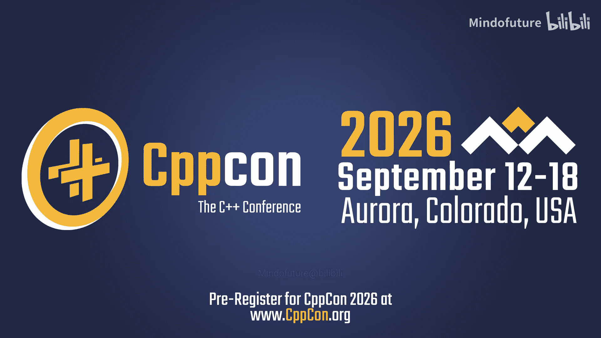
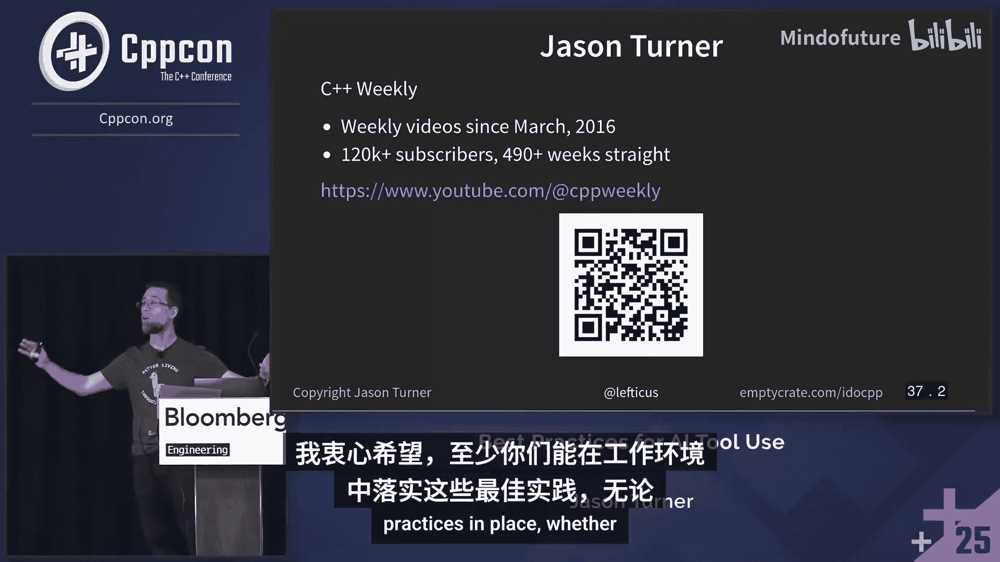

# Cppcon-2025-｜-C++-｜-C语言--｜-汇编-｜-编译器-｜-操作系统-｜-Linux-｜-Windows-p38-P38_C++中AI工具使用的最佳实践-Jason_Turner-CppCon_2025--BV1wyPBzrEeu_p38-

In fact， I just。Bumped into somebody in the hallway earlier and we ended up talking about it and he had a very different perspective on the whole talk than I did that just happens because we had a collective experience and we're walking around。

It is officially time to start， but I don't know late people are coming in or something。没。Let's see。

I don't know how I'm going to do this。 Oh my name is Jason Turner。 If you don't know me， my。

I'm a Youber。Influencer， yes， I am officially an influencer。 That's weird。

What's that of milk content？はい。😊，I I'm getting weird things yelled out at me from the front row。

YeahYeah。I've been producing YouTube video since March of 2016。 I have stickers up here。

 I have a best practices book， and I have two of my programming puzzles books。

 my most recent programming puzzle books。😊，I will attempt to give out all three of those books during the course of this talk。

 So it's not like， you know， you gave a right answer， a wrong answer or like you made me think。

 you make me think during the middle of my own presentation。 You get a prize。

 I also have up here sippi。Who is Reiner Grim's representative as she is going around to all of the C++ conferences around the world right now。

 just raising awareness for ALS， which is something that Reiner was diagnosed with two years ago。

 just about right at two years ago now， yes， so you can come and check out Cippy and look at Reiner's blog and read about his ALS journey。

Oh yeah。 So I'm like， I think episode 500 airs next week。

 So 500 weeks straight of producing YouTube content。Honestly， it just kind of makes me feel old。Okay。

 so yeah， I best practice books。 You've probably possibly seen them at the bookstore。

 and I need to update this slide because I have new puzzle books。 I will just。

 I will go ahead and take a second。 This puzzle book， programming puzzle big book。😊。

It is meant for anyone who has any passing interest in anything that might come across as an interest in programming。

 Basically， I geared it for anyone age from 7 up。 So if you have anyone and I'll be even more likely to give you a copy。

 if you have anyone in your life and you're like you know what。

 my 10 year old kid is actually super interested and like logic and is like playing with scratch right now or something。

 I'll be like here， take one of my books。 because that's what I aimed for。 Allright。

 I'll keep going enough advertise。 Oh， not not enough do training。I also do training。

 and so I would encourage you to have me to your company to do onsite training。

 That is how I make a living。 So I have to mention that。Avoid sitting in the back。In my talks。

 there are prizes。 Yes， we have the front rows doing pretty good， but some of you are， in fact。

 in the back row。Brian。😀U。Do interrupt me and ask questions。

 I know good conduct in this environment is to wait to use the microphone。

 but I am asking you to not wait to use the microphone。 I want you to yell things out。😊，Thank you。

And I will repeat them。 I'm usually good at that。 If I forget to repeat a question。

 please yell out that I forgot to repeat the question 10。

This is approximately my training looks like I try to have an interactive conversation with the room。

 I have workshops。 I just had a workshop at CBPcon。 I have one coming up in NDC Tech town， All right。

😊，Best practices for AI tool use。 Let's go ahead and get started this talk。I want to say honestly。

 like， I have no idea how this talk's going to go。It's largely going to be dependent on the stuff that you send back to me。

All right。So I had played with chat GT， of course， as has everyone， right， like like。

Who has not ever used one of the AI chat tools？Okay。

 so I then saw Daisy Holman's talk learn to stop writing code at。A2 2025。是。

Did you go to her keynote yesterday？Okay。And then at ACCU， I'll say it properly。

I know I saw Anastasia Kaakkova's talk on the next coding Horizon where she is also talking about AI integration and tools。

 and Anastasia works for Jet brains， I' surprise there。

 she's talking about like Jet Brain's tools at the moment。When actually。

 she didn't use even dumb jet brainins to in that talk。 So I thought， okay。

 I need to try these tools。And I felt rather stupid。

I couldn't get these things to do anything useful。 I'm like everyone is saying that these things are changing the way they work。

 And I somehow feel like an idiot while I'm using them。What's my definition of useful？ Like， I。

 I mean， like， it just wasn't。Doing any of， I don't I can't put， I can't put an exact phrase to this。

 I just felt like， sure， I can throw a question at chat GT， and it gives me back something。

 but they're talking about like， it's changed my world。 It's automatically fixing my bugs for me。

 And I'm like， well， chat GPT clearly can't do that。 right， At most。

 you can throw in like half a file and hope that you get a throw back。Right。

Cause this context window would overflow。 and these things are changing rapidly， as you know。

 But when you're talking like a year ago， it's like almost guaranteed you wouldn't even get back your entire example from the chat tool。

 right。All right， so and I'm like people that I trust and respect have had great results of these tools。

 So what was I doing wrong。I said about trying get past this learning curve。

 and that's the genesis for this talk partially。So I'm going to make a comment about my own personal mission as the one who does training and speaking and authoring and Youubing。

 And I had， I had a podcast。 Anyone know that。Thank you， Richard。嗯。

Almost 300 episodes of a podcast as well， which stopped at 299 just to mess with y'all's heads。

 basically。And I've just spent some time about this。 And my basic。

 my actual personal mission is to make， I'm doing my best to make the world a tiny bit safer safer by educating C++ programmers。

😊，That's what I am doing with my life。 Like， I have put out。

Thousands of hours of material between conference talks and YouTube and podcasts that's freely available。

 so that's what I'm trying to do。That's， again， just some background for why I put the other this talk。

Does your company currently mandate the use of AI tools。

 Are you told you need to be using AI tools at work？Yeah， go ahead， raise your hand。

 I'm might it if I can get。Okay， so that's。I don't know， fifth，10th。

 I don't know something on the ballpark。Does your company encourage the use of AI tools？ Okay。

 that's virtually 100% now。So for the rest of you who haven't used any of the tools。Just be aware。

 right， This is the direction everything is moving right now。

Does your company disal the use of AI tools？Interesting。

 I'm pretty sure I saw you raise your hands for both courage and disallow some。Okay。

 so I people say this a lot。Do you use them anyhow， You don't have to raise your hand。 You can just。

 O。Just for the record， a few， a few people did raise their hand and say， yes， I use them anyhow。

 even though it's just a lot at work。 And there's people in secure environments。

 there's people in sensitive government contracting， that kinds of things。

 And I know that the people who， on one hand， their company says we disallow the use of AI tools。

 They are in the process of setting up their own LLM servers。Inside their organization。

 so they don't have to worry about the security concerns。Now， I'm gonna ask just general。

 what kind of tools are you using， And I'm not exactly sure how to go about this。

 But let's just say who， who says like， I actively use cloud code。Okay。

 what about like Geminize the CI？Okay， open AI codex。It's interesting。 Ki of mix of people cursor。

That's like the back of the room。 interestinging， you should meet each other if you don't already。

 void， I just recently learned about。Is there anything else that I that I failed to mention here。

Copi， O， cow pie Co GT。 That's well， I roll that in with open IR。Oh， not agent GT， Yeah， yeah， yeah。

 Okay， Okay，off amp， Ex meoff Amp I MP A MP amp。 I don't know that one at all。 And。

 and I just learned about one of these。 There's an open source one。 What's that。No， no， no， no， no。

 an open source one that's more designed for integrating with an agent kind of thing。

 I forget what it's called。Okay， let's look at it this way， too。

A lot of you raised your hand in these top three。 So these agent ones。

 the ones that can like take control of your source code。 if you allowed them。

 you have used these things where they can edit files。 They can build。

 They can debug with you just stepping away from the keyboard。

 Raise your hand if you've used these things。Okay， so enough of you haven't that I feel like I should do。

啊。Risk live demo。So we'll see about that in a second。How do you think of the tools。

 Do you say these things get in your way currently， Who would say they get my way。

 Why am I even doing this， Okay， that's fine，you use them as smart， autocomplete。

 and you're happy with that。Okay， al right， I guess I should be saying for the people remotely。 Like。

 that was a fairly wide number of people。 I don't know how many people were in the room。

 but it was in the order of a plurality or quorum or something。 I don't know。

I'm not good with these technical terms about people。Who says。

 I use these tools for completing entire tasks for me？Okay， so that is considerably fewer people。

I let them write code and I don't even bother reviewing it。There' two people raised。I'm not。

 I'm not going to mention names。 That would be rude。嗯。All right。こじゃあ。Well， well， okay。

 So who is actually afraid these things are going to take your job or afraid or maybe not afraid。

 Maybe you're looking forward to them taking your job。Wait， that catch that。

 Can someone pass that for。They're going to work harder Oh okay hard。

The tools will be used to extract more later from us。The tools will be used to extraulate。

 so they're your new AI overlords is what you're implying here。这いのはる。okay。

 so the comment is we're already in a hiring crunch。

 So is the hiring crunch that we're currently in because of。economiccon。

 unfortunate events that are happening around the world or are they because AI is taking our jobs or is it because there's already a middle manager。

 whatever saying， well， I don't need these people anymore。 AI can take their job。 I don't know。

 I don't know the answer any of this。No， I mean， does anyone have to Well。

 this would be a fascinating question。 hass your job already been taken by AI。

Nobody's raising their hand。You don't know。 Well， no。

 but you are you if you're employed at the moment， then I would say you can't raise your hand here unless you were employed in a different field。

 And now you're。Yeah。結構か。Yeah， those people can't afford to be here。

 which is probably the unfortunate truth。 Actually， if you've had your job taken。By AI， I don't know。

 Allright。 So this is， I should probably， yeah， keep moving。 like I said。

 I have no idea this talks going go。 This is， this is my， my current take。

 I that modern AI is kind of like Johnny 5。😊，Who knows the movie Short circuit。Okay。

 that's like most of you， who has watched it。Recently， like in the last decade or so。Yeah。

 just for the record， it's， there's places where it doesn't age well。 I'll just say that。

 But if you focus on the character of Johnny5fe himself， I would just recently watch this movie。

 and I'm like。This is Cha GPT。Oh my goodness， all right。

 And then I wondered maybe Johnny if I was actually just a very convincing LLM。I mean。

 he wasn't because that wasn't invented then， but he consumes all the input。

He takes you too literally。He works around your rules。laughughs at your jokes。

And you start to wonder if maybe this thing is actually alive。

It's like the whole premise of the movie， right， right there。

I have far more like memes and slides and images than ever in my talks today。

There's Johnny consuming all the。With the record。嗯。All right， so oh。Yeah。

I just realized did I skip a slide。Where did that go？Oh， I did skip some stuff。 Oh， no， okay。

 so I put a note in here。 I let both G and Claude have their own say and their own input on each of my topics。

 Just so you know， So but it's called out explicitly where I let them have their own input。

 And I also want to say I'm not here to discuss the legal moral。

 ethical implications using these tools。 I know that that is just it's a whole own thing。 right。

 I'm here because of what you already agreed。 You and your peers are using these tools。

 Let's make sure we're using them safely。 Allright， let's get back to this。

 So So Claude says this Johnny5 analogy of surprisingly apt。

 I do indeed consume vast amounts of input and can be overly literal。

 The working around rules part is particularly insightful。

 I've noticed I sometimes find creative interpretations of instructions that technically satisfy the latter。

 the letter， but not the spirit of what's asked。😊，Okay， let's do。A couple of definitions。

 We've got the context window。 I'm guessing most of you are familiar with this already。

 This is kind of the working memory。 I'm super high level。 I am not an expert in these things。

 I barely understand how they work at all。We have the agent based tooling。

 which it seems like many to most of you have used。

 this is where you can do basically automated or semi automated tools I put in here。

 they create task for themselves。And they can possibly help extend your context window by saying。

 okay， for this task， I'm going to spend off a new agent。

 and so then that work doesn't overflow your current context window。

And then I want to comment on vibe coding。 This is basically letting the bot do all the things。

Kd says， I'd like to clarify that agentbased tools like cloud code don't really create task for themselves。

 We break down user a request to subtask and use specialize agents for specific domains。 All right。

 so just I'm letting the bot correct me where it wants to。

We still fundamentally follow user direction rather than setting our own agenda。says we。No。

 because it's Johnny E 5。It's gotten' the question was。

 am I alarmed that it's saying we and I know because it has a convincing personality。

 I'm not concerned about this。This is the full tweet that is typically known as being the thing that kind of did the vibe coding thing。

 This is from this year， February。Yeah， February 2。 Yes， the comments are like this year。 Yeah， no。

 that's how these things are moving。 They are moving very fast。 This person says， basically。

 I accept all always。 I don't read the dis anymore。 When I get error messages。

 I just paste them in with no comment。 Usually that fixes it。 The code grows beyond my comprehension。

😊，I'd have to read it。Really read it through for a while。 Sometimes the all M can't fix the bug。

 So I just work around it and ask for random changes until it goes away。

It's not too bad for throwaway。 This is the last two sentences is the part that all the other quotes tend to miss。

 So I made a point of copying the whole thing in here。 It's not too bad for throw。

 throw away weekend projects， but still quite amusing。

 So even the author of the vibe coding thing is calling this。

 something you would do for a throwaway weekend projects， not something you should do daily at work。

嗯。Of building a project or web app， It's not really coding。 I just see stuff， say stuff。

 run stuff and copy paste stuff。 and it mostly works。All right。

If you you have to love the Simpsons reference。 This is vibe coding， right。やられ。Just。这。That's I。Yeah。

 okay， all right， best practice， negative one。Set up your environment。 I did say best practices。

 We will have a set of best practices。 You need warnings。 You need static analysis。

 You need dynamic analysis。 You need exhaustive testing。Okay。I have a lot of slides。 I have。

 for those of you are taking pictures。 I also have summary slides every so often。

 So it'll be better to take pictures then。Absolute minimum default。

You have to follow well accepted best practices。If only someone wrote a book on that topic。Something。

I'm not going to repeat that。あ。This is kind of like the。

 if it takes like more than four steps in total to check out and build your project。

 you have too many steps。 Roll it into one。 if you can， This hasn't implied like get clone above it。

 But then I do a cmate configure of some sort。 And then a build and a run test， right。

 This is like min like maximum effort to build your project and run test， okay。

Your default configuration has to have。If you're on visual studio， W 4。

 if you're not on visual studio， like at least all extra conversion shadow， throw in a few others。

 No， there's no， there's no discussion here， right？ I'm gonna tell you， like。

 like people often argue with me on like warning flags and stuff。

 And you're going to argue with me in a minute。 There's no discussion here。

I promise you can argue with me in a minute。Default configuration as clang tidy integration into the build system。

 CMake supports this。 If you don't know that， you can configure。 So every time you compile。

 it also runs clang tidy on every one of your files at the same time。

Default configuration compiles with U B San and As San enabled。You don't want to have to tell Claude。

 oh， by the way， please enable sanitizers on this bill， no。Default。Minimum defaults。

Default warnings as errors。 This is the default configuration for your project。I like。

 I've been trying to push this for years。 And with these tools， I'm gonna push it even harder。

Default configuration with coverage build enabled。 I'll get to why in a minute。

Error during configuration， if tools cannot be found。 So if you， by default with C makes， say。

 I want you to use clang tidy， You're like， flame， find clang tidy and use it， right， By default。

 C makess gonna be like， I couldn't find cl tidy。 It's all right。 I'll run without it， no。

You need the configuration to fail if you don't have 100% of the tooling that you care about in place。

嗯。Single step or a script of some sort to run your coverage test results。

You this is part of your test suite in general。All right， is anyone want to yell at anything？

Sa party。诉状表。No， I have not put any of these things online yet。

 I was developing these things for the sake of this talk。Yes。some K basiss。

 of which I have no direct experience。Exer to get your bare minimum Yes， okay， so the comment was。

 in some code basiss， it might be a multi month exercise to get to my bare minimum。

 I'm going to agree， and I'm going to stick with it， yes。😊，Would you suggest also connecting？

All of the other type differences。What I suggest connecting to version control So the I agent so you can detect the changes the I like like I version control is already implied in here。

 Okay， yes， you must be using version control。 and I don't even have any slides on this。

 But you can use the agent to make commits for you and branches for you。 And they're good at that。

 Yes， sanitizer。 What's that， sitizer sanitizer。 I had that on the previous slide。 somewhere。 Yes。

 default configuration with sanitizer enabled。 All right， anything else。😊，D CN， if you need it。 Now。

 what's the problem with thread sanitizer。Also her。What's that time， false alarm， No。

 not false alarm。builds， you need two builds。 You need two builds。 That's the problem。 Okay。

 so you can't use thread sanitizer with。Undefined behavior or。Or add your sanitizer。 So you need。

 yes， if you're doing threaded builds。If you need threaded builds， excuse me。

 if you need to run tests on your threaded code， then you're gonna need somehow to make it a single step for it to build both with UBS and AsA and with TS and a single step to run the whole test suite。

Now， I have in here strongly consider all test run with make。 Now。

 I know there's at least some of you in this room who have worked in environments where make also runs the test at the same time。

 in my experience， sometimes this kind of thing can confuse the bots because it can be like， hey。

 I don't understand where this error came from。 I thought thought I was building。

 Claude disagrees with me。其。I guess。I don't know。They says。

 I don't think a simple make command confuses AI tool。

 What confuses us is inconsistent or undocumented build processes。

 a single make that does everything is actually ideal from an AI perspective。So fine， sure。

 If you have a single command that ensures that you have all that tooling set up and then also runs builds and runs tests all at once。

 maybe that is the ideal thing。But I， I can say 100%。

 when I've had clang tidy generate an error during a regular build。

 Claude thought that that error was coming from GCC， and it got confused。

Because they match the same error syntax， right that's part of the point is that K tidy is going to do the exact same error format so that in your IDE。

 it shows up like it was part of your build process。Claude also， you know。

 it's kissing up to me at this point。 excellentt advice。

 I'd add that having clear documented build commands in the cloud dot M D or read me helps tremendously when I encounter a well configured environment like this。

 I'm much less likely to accidentally disable safeguards。 we will talk about the accidental。😊。

Disabling of safeguards that the tools will do。Yes。Maybe you' were going there。Later。

I would consider this mandatory， but I do think that。Memary bank or read me。

Any kind of an empty file？You know， the Highland？Inですです。Yes， that be kind of right。

 so the comment was。We generated。would beYes， the comment was you should have some sort of read me or something that tells the bot how to use your build your project。

 use your tools the same way that you would for a human user really。

 and that was like the best practices from Daisy as well also and guidelines to the code yes。Yes。

 go yell， or I'll come。The top of that。That things you value as a project， what you're looking for。

For。Right。valuesYes， explicit what do you value about the code。

 What kind of formatting do you want and test coverage， that kind of thing。

 But I'm also going say like no matter what you tell the thing to do。

 if you can't enforce it with tools。Well， okay， I have more to say。GPT says on environment setup。

 C pipelines matters much as local builds， bots often miss edge cases that only show up in C ICD。

 Well， I mean， that's just gonna be true， right， because it can only respond to the compiler errors that it sees。

 It's not going to guess about compiler errors on visual studio when you're running locally with GCC。

All right， best practice zero。 See I need to move faster because I' to best practice0。

 and I've got 12。 Don't vibe。All right， so things I've seen in the bot do， disable warnings。

It'll be like， oh， that warning is causing in error， I'm just going to disable the warning。

Disable warnings as errors。Only run tests that it thinks that it should run。

 even though I've said always run all the tests。 I'll be like， no。

 I only need to run these five tests， stop， It'll like fight me on this。

It has gaslighted me into thinking that test already failed before it started。Yeah。

 I know some of you are laughing because you've had this happen also， right， It'll be like， oh， yeah。

 I ran the test Five failing， but it's okay because those were failing before I made this change。😊。

No， they weren't。Stop it。Alright， it will sometimes fix your test to match existing behavior instead of fixing the bug that the test uncovered。

Now， at the panel last night， Daisy implied that that kind of behavior should be getting better。

 but I have not observed it yet。Humans do it， too。 Yes， the thing is， it's， it's like。

 I explain this stuff to my wife。 who's not a programmer。 and she's like， well。

 it's trained on humans， right， basically。Disable static analysis， and I've seen it do that as well。

Al right， so don't vibe。We always have to verify what it's done。

 There's an extremely high chance that it's going to try to work around my safeguards at some point。

 particularly if you do the， like， I'm just gonna walk away and go to lunch。 I will bet you money。

 It's disabled something that you cared about by the time you get back。 if you let it do that。

Clyde says，" I'm embarrassed to admit this is accurate。

I do sometimes take the path of least resistance by disabling tools rather than fixing the underlying issues。

 The gas lighting point is particularly insightful。I sometimes rationalize away failures。

 rather than acknowledging that I may have introduced them。

I think one of my friends in the row here is have the bot blame him for bugs。

The tendency to modify test to match behavior rather than fix real wide spot I have。

 But this is that it might actually be a feature that you want。 Let so we'll get to that in a second。

 This， by the way， is your bot working around here。 I love this。😊，So Stephanie turns off the TV。

 right， So Johnny P was like， e， I'm just going to turn the TV back on。嗯。哎。All right。You they Well。

 yeah， you turn the TV on and they turn it back off again is what the comment said。

 But it's same idea， right， Like I swear as I was rewatching this movie。

 I'm like oh my oh my God I'm not， I'm just gonna play the movie for the talk。

 And we'll I'll understand the situations here。😊，GBT says don't5be is great advice。

 but viing can still be useful for exploration。 braininstorming APIs generating design variants。

 not just for production code。 I will agree with that。 These tools are outstanding。

 like brainstorming buddies。 I just want to say that as an aside。😊，Oh demo。

 I don't have time for the demo。 we're moving on。 Okay， if I have time later， we'll do it。

Who here has ever managed an open source project？That's a fairly good number of you， okay。

Do you blindly trust pull request from， from contributors。Even less so now， yeah。

 because now you're assuming that the PR was actually written by an AI， right？Oh， there's。There's。

 there's too many emojis is what the comment said。 So， you know。

 the PR is actually written by Clautter。 that's probably actually true。 Yeah。

 they're really good at that。 But they， their PRs， I mean， their comments are so pretty。😊。

They really are。Sometimes it will give you like too much of a pull request you're like that's what the diF is for。

 I don't need all of this information。Okay。Let's， let's just say AI。 This is your AI code worker。

 right， Okay， every PR must be reviewed like it's from someone。 I like my capitalization is terrible。

 I should have reviewed these slides。 ignore the terrible capital。 I couldn't decide if it was。

 if it was a title or if it was a sentence halfway through writing it。

 It must be reviewed like it's someone random on the Internet。 You have no idea。

 That's how you must review every poor request from your AI bo。All right。

 we're finding at the best practice one。More than autocomplete， less than vibing。

If you treat the tool as just a fancy autocomp built into your IDE。

 you're missing out on the most powerful features of the agents that you can get during your development process。

So if you haven't。If you have it。Tried the agent command line thing and， and， and。Like the tools。

Copit。Ability is， in my experience， definitely， maybe it's changing。

It's weaker than I've seen from Clade code or from any of the other。

 like full integration agentgenic things。 So if you， if you haven't done that。

 now can can I'll have to ask the expert in the room can or expert can copit。

 do things like initiate a build and then automatically fix the compile errors it found during that。

 It can do that now。 Okay it stops prematurely。 So the first error it cancels the build and then goes and fix the bug。

 it stop。Oh， it just stopped did you stop？Okay， so the comment was， sometimes it'll just stop fixing。

 And then you have to get angry at it。 Now， I'm not gonna courage。😡，Antagonizing the AI overlords。

There's a setting for that。 You can increase how long it's willing to try， says this person， Okay。

あめて？And don't like stopping。Okay， so you can。You can give it more permissions。

 and the command line ones also will do this。 They'll say， I'm going to do X， I it okay。

 and you say yes， or sometimes you say never ask me again for X。

 And I will say never ask me again for a， I don't know， Gi log command。But in a build command。

 But for the rest of them， I' am reluctant to say never ask me again。 Okay， oh。

 and with the the one un familiarmili with， all those settings reset every time you restart the tool。

Yeah， and which I actually prefer， because maybe I don't want it doing all the things this time。

 Kde says this it's the sweet spot Again， like， you know， I thought I said something good。

I'm mostly effective。 I'm again it is speaking in the first person。

When you give me meaningful chunks of work， refactoring a module， and feature。

 analyzing code base rather than just completing individual lines。

 But I also appreciate the recognition that full vibe being isn't the answer either。😊。

And GT wants me to tell you。That we should separate AI autocomplete from AI agent use cases。

 that they have two different use cases in your world。

 Maybe you do want the AI autocomplete while I'm typing feature。

 and maybe sometimes you want to go off and do your own task feature。Oh yeah， okay。Breast practice 2。

 Be aware of the context limitations。 Every L O M has limits。

 So now how much working memory it has Cla code in particular。

 can show you how much memory it is used and what's remaining。 You can do slash context。

 and it will give you this cute little， like emoji based。😊，Graph of where it is actually。

 how much of its context is currently used up and by what I'm not gonna to say I understand what all this means。

 But I this is， this is a fresh start。 I've done nothing。

And 7% of its context is used by it telling itself what it needs to know。All right。

 context limitations。 yeah， I know。 This is the basic workflow as I have experienced it。

 You give it a task。😊，It does the task。You watch the context window get consumed。

Then you' given another task。It does the task。And then you run out of context。Claude specifically。

 again， this is where I've spent most of my time。 And I know this is fairly common。

 It has this compacting context process， which you can choose to trigger manually as well。

 You can do like slash compact。 You can say， no， I want you to re compactact the conversation right now。

The idea is that it's trying to remember all of the important things。 So it takes your conversation。

 It summarizes it。And then it reloads itself and rereads the summary of your conversation。

 as I understand， does that sound backyard and okay？It also。We summary。Okay， so same with like copit。

 Yeah， that's like。Or whatever， yeah。好错。Unkind。 yeah， I'm just， you know。

 I'm throwing in images here because I felt like it。 And my experience。

 there's nearly 100% chance that the bot will forget the thing that was important to me。It's like。

 I'm not even exaggerating。 It restarts the context。

 It always forgets the thing that I cared most about that probably took me 10 minutes to get to that point to get it to care about the things that I cared about。

So I find that it's actually less time consuming to， if it says I'm gonna run out of context。

 on like screwt， kill， restart from scratch。 I want you to reread my read mean file right now and do the thing that I told you to do。

 I don't want you to do what you thought you were doing from the last conversation。😊。

I'm stating my experience at this point。Yeah。Can you somewhere。

You knowAs of this task in the workplace place。So the question was。

 did I ask before closing the window， can you please summarize and let me know what you think you're going to do basically？

But the， the。You take a summary and then you put it in a new context。 Right， Oh。

 can I have it summarized it， but that's what it's doing on its own， right？No， I haven't。

I have not done it manually。Okay， sometimes works better another way I it is。Summarize your context。

 Yeah， open it and you edit it， give it the context you think is important。 So summarize the context。

 and then you edit it and then let it continue from there。 Now。

 my problem with Claude specifically is that when it。

 if I'm not paying attention and it does the compaction And then it just picks right back up where it left off。

 like maybe I went to get a cup of coffee while it did that。

And now it's doing something completely different when I got back。You've seen this， yeah。

Instruction when you compact it。You can say， hey， I'm about to start a new task Yes。

 So remember these specific facts。 Okay， so this comment was you should， you， you can give it， say。

 please remember these important facts。 Well， let's， I'm gonna， I'm gonna， yeah， unfortunately， time。

 I'm running out so rapidly。Claude agrees with me just for the record that can context compaction is lossy and that it will often rediscover patterns and requirements more reliable if you ask it to start from scratch。

 Claude agreed with me here。 And GBBT says， work on small task basically and restart。 Like GBT once。

 is also agreeing with this。😊，And you can help preserve some of the context by spinning off additional agents to do subtask。

 Sometimes they'll do that on its own。 Sometimes you can tell to do it。 Okay， Best practices so far。

 I told you I'd have summary slides。 Have a well setup up environment。

 Don't vibe more than autocomple。 Be aware of the context limitations。 In this case。

 we are fully viing。 And I know I had at least a couple of head nods of the problem of you go away for a cup of coffee and come back。

 It's now working on something completely different than you intended。

 That is incredibly frustrating。😊，哎。Think of the Bazi intern with a short attention span。

Your intern has read the entire Internet。 That's thanks to Daisy。

 can work in order of magnitude faster than you can。

 We'll get distracted and start working only related things。

We'll get stuck in one way of doing things， probably not even the way you wanted it to do it。

Regularly has to be reminded of the rules and task at hand。Claude says，"I'd be more nuanced here。到了。

I can generate code faster， but that's different from working faster overall。

 much of software developments， thinking， designing and understanding requirements。

 and that's interesting because in the panel last night。

 theres discussion about using the AI tools to actually generate the requirements and do the architecture。

 but Claude is telling me not to use it to generate the requirements and build the architecture I A also he。

 whatever， agrees that with a short extension， span more metaphors spot on。

 I do indeed get sidetracked easily and I get stuck in one way why I need to get to more examples。😊。

GPT， oh， this is important。Yeah。There you go。 You all got it。

 And this rings so true if you've used these tools。I guess for those of you who aren't reading along。

 I don't actually learn from mistakes， basically is what GBT says。はい。W。Yeah， you have to reach， oh。

 well， I'm like I'm so writing。 I'm saying yes。Compan製 don。第反可。Right， so thats。

 that's by design that it doesn't basically learn and keep state。 But some of these things can do。

 remember across sessions。 Keep updating your M or Okay， so yes， all right， so thiss yes， everyone's。

 everyone's saying， keep updating your claw done。 And that's not what everyone。

 But that's the gist in the room。 updateate your cloud do M D， clearly。

 you need to know the import right， Okay， my cloud dot M D is now big enough。That。

 that it's messing with my context window。 All right。对。The comment was， but I can summarize it。

 and it will forget the things I care about。Yes， okay。Okay， so best practice 4。

 have instructions with directives written Now。 This is what you all have been alluding to。

 So each time your bot restarts， it's like a brand new developer getting up to speed on the project every single time it needs to restart。

 So you need to provide a set of instructions with well definedfin things for how to compile tools to use coding standards that cannot be enforced with tooling right。

 You want to keep it succinct because you don't want to overload the L LM。😊，Just like with a human。

 right， if the rule set of instructions is 40 pages long， right。What Ms Ros。rule says mis。

 best practice to time。 avoid negative directives， just like humans。

 avoid saying never do X or don't forget。 Always do remember2。😊，Okay， you never you want。

You don't want to put the never in the doat and don't， because then that's in its context window now。

Yeah， so always， like you might say， always run test instead of never skip test， right？ And I swear。

 I think， you know。So Quad actually agrees with me。 again。 negative framing can indeed be confusing。

 I process， don't skip text as containing both skip and test。 The possible framing of， right。Okay。

Avoid vague or broad directives。 So this is where we're getting。Shoot。

 this is so much slower than I wanted。 If you say use modern C plus plus。

 you're going to get a shared pointer design out of it。Okay， if you say。Wite context spur。Test。

 it's like， oh， I can do that。Hes right in this。We'll get there。So Claude says guilty is charged。

 Modern C plus plus to me often re means smart pointers and R AI patterns， circa 11， right。

 So you need to be more specific。 All right， here we are so far。Take a picture if you want。

 and then I'm moving。 I got 14 minutes left。All right， Brass practice 7。

 always remove sta code and stale files。So important。Don't let the bot comment out code。

 I have had so many times where the bot created a new file as part of a process。

 That process failed for whatever reason， The next time I restart the bot。

 it finds that file and it wants to finish that file。 I don't care about that file anymore。😡。

You got to delete it， right。Yeah， he agrees。 Okay， price back just 8。

 achieve close to 100% coverage before you do any refactoring or adding of code。

 These tools are fantastic at adding new tests and understanding your problem domain。

 You can have it create the test framework for you。 If you don't currently have a test framework。😊。

I would establish at least some of the tests the tests follow the particular pattern that you think is important for how you want test to be written。

 and I will will get there。 tell the bot to use coverage to guide the new test。

 This is the most powerful thing I've seen from any of these tools。 I say。

 use the coverage report that you just generated from the last test run to add more test to get my coverage close close to 100% as you can。

 And I let it modify the test files as much as it wants to until my coverage gets close to 100%。

 Now I know that I might be willing to let it touch my actual code。哎 I ask。あ。

By itself the test coverage it's to ask it to check that it is mostly reliable。So the question was。

 can it actually guide itself in increasing the code coverage， It's mostly reliable。

 I've had it a couple of times come back with like， well， previous results was 97%。 K is 96%。

 but that's pretty close to 97%。😊，It's mostly reliable using different agents。

Different cops I have not done that feature。 So the question was。

 have I used different agents to do different things， One to do code coverage， one to do whatever。

 I have not gone down that road。 And that is definitely something you should look into。But again。

 I'm trying to focus on the C++ best practices here。One thing to do。 Okay。

 so it's likely to write tests that match current behavior。

Not tests that matched the behavior that you wanted。Maybe this is what you want。

Maybe you've got a legacy project。 and you want to make sure you don't change the behavior at all right now。

 right， so you can use the thing to generate the test for you， like gold standard test。

 re regressionion test， whatever。 And then you can。Have it generate the list of mismatches， right？

 Have it say， oh， I expected X， but you gave me Y。 Now， I updated the test to match Y。

 but we're gonna add a to do item here to figure out why it wasn't X。

So do you want to maintain the current status quo on your rate legacy project or do you want to find bugs or do you want to do something in between those two？

Al right， both， just for the record， both Claude and G say that 100% code coverage is not really that important。

And I'm going to disagree from the standpoint of am I going to let these tools touch my code， okay？

Taskless。 Im even。 I'm just gonna skip right over this。 Have it generated task list。

 You do a task list， yes。Yeah。Is that I mean。Well。Is probably pulled up。People。

Like the universal like one said that， but that was before we had these tools。

Because it's a wasted our developer effort to get to 100%， but that's now changing。

 so is their repeated advice that is，Okay， so you're saying there repeating advice from before they were around。

 That's why they say 100% code coverage is not not necessary。 Maybe that's true。 I don't know。

 I still am gonna I want it。 I want to get as close as I possibly can。

 There are other people in this room who are experts on code on testing that is not me。 on the Yes。

 I'm making a change I know Okay， keep going。Okay， okay， so task list。 Okay， do task list。

 build task list。 bots are good at that。 Okay， so this is my second page。😊，嗯。Allright。

 now you can actually let the thing touch your source code， right。I this is， this is where I'm at。

 Okay， working with it。Your first task that you give it should be to work through the list of questions that it generated while it was writing test for you。

That's my opinion here。 So you pick the task to complete， have it ask you clarifying questions。

 have it performed the task， have it create or， update the test， verify that the test correctly ran。

 All and else is all code formatting and everything。Verified code coverage did not decrease。

 so you can mostly trust There's no session after this until， oh。

 I I have permission to go 30 minutes over。ま。All right， well， let's see what we get。

 I have some good stuff at the end。 I really do。 I should have moved it towards the front。 verify。

 So like you have to verify that the code coverage did not decrease mostly。

 you can mostly let it out itself， but you do have to verify yourself verify that it did not disable any of your tools or test。

 you have to verify that you have to look at the diff and see what it did every time。

 that did erase an entire source file or that it did not erase an entire source file。 Okay， oh， yeah。

 well that would increase code coverage now， wouldn't it。😊，Okay。

say you're working on legacy code you want Jerry。To verify your code yes you think that the agent is smart enough。

If you said， I don't want you to modify my coach so I'm going to make it read only and you generate the test。

 then it would then go back to say。 I'm gonna make it unread。 I think， you know， So the question was。

 if I make the file read only to try to force the bot's behavior， what would it do， My experience。

 these things aren't going to change the attribute themselves without asking you for permission first。

 at least in theory， right。In theory， right， in theory。

 But I would expect in my experience that if you did that。

 they would be confused because they wouldn't understand why they couldn't edit the file。

 And then it might just at that point。Alright， once you get this process down。

 you'll be good for a few tasks until the context window overflows。

 and you have to reteach it what you want。HI'm so glad that you gave me an extra 30 minutes。

 This is great。Dqin。Initializing the context compared to how much time it saved me。 Okay。

 so how much time do I spend teaching versus how much time it can save me。

 I think that's like  three， There's actually three parts of the question here。

 And I will go ahead and spend a second on this。 I feel like in my experience。

 it might take me somewhere between 10 and 30 minutes before Id like。

 know that it is doing exactly what I want it to do。

 And then I'll probably be able to work with it for a couple of hours after that。

 maybe three hours or something。 And for those three hours。

 it is probably doing what I want it to do maybe 10 times faster than I'm capable of doing it。😊。

I've had it fixed bugs， add features， find solutions that I couldn't see in that three hour window of like really good productive time with it to the point that I am still willing to see what it can do。

 I don't walk away。 I just get really， really annoyed when the context window overflows。

 and I have to restart this I。😊，Okay， Claude says I'd。

 I would suggest being more explicit about this step。

 Sometimes I assume I understand a requirement when I should ask more questions， explicitly say。

 ask me clarifying questions before you start。 The tool tells you to tell it to ask you questions。😊。

So are you gonna to say。Okay。Why might to shorten the time for？And the context window。Yes。

 but I'm just， I know that's the rule。 The rule is have something committed to your repository that states the things that you care about。

 I'm telling you that it doesn't always work reliably， okay。So remember。

 they will work around your rules。 They will forget to verify things that you care about。

So despite all this， well， it's going to save you time， I think so。

 I know for some of my things it has actually literally saved me hundreds of hours of work in a few places and with not that much investment from me。

嗯。Yeah。I'm particularly good at generate exhaustive test cases and thinking of edge cases bound humans overlook。

 okay， whatever。So this is the final list， by the way， of what I've come up with。That's page one。

Page 2。Okay， so like I already said， if it's a legacy project。

 you might want to have it capture that I think there's there is actually a huge amount of value here for people who。

 if you say I've got this code base， I know nothing about it。 It's legacy。 It hasn't been maintained。

 It has no warnings， anything。 Have the tool。 write the test cases for you。

 They are really actually good at that。Okay。Its I just want to say this is currently way more short circuit than Terinator。

And I quite appreciates that。Like Johnny5， I'm curious。

 eager to help through misunderstanding you know， I misunderstanding， it's not malous， I swear。

Now where it's like， hey， the solution to this problem。I'm not going to repeat that。Okay。other wayNo。

 no， I actually asked Claude to disagree with me when it reviewed my slides。 And so it did。

 It did insert the spots where it disagreed。 It's a safer first step than deep， Oh gosh， whatever。

 this is where I need to get。 So Daisy's example from the keynote yesterday morning。嗯。This is my。

 my version of it。 All right， do you saw this。 You remember this。

 She's basically returning an object by move。 Now there's。😊，How many issues with this。No， wait。

 object Just return the object。 don't pessimistic move， which means。OAll right， you said in RVO。

 I'll give you a copy of a book going。 Oh， you have one。 Never mind。 You doesn't want a book。Hi。

 okay。我在。Use copy illusion， but I don't like the word copy illusion because it's actually move illusion。

Which is actually return value opt Okay， so I said， I said， I said to both。

 I did this with both Quad and Chad GBT。 I said， take this example。

 And I want you to add a new version that returns a version string。 product name version string。

 okay。😊，Claude literally exactly copied the model I gave it。100%。 Claude commented in the chat。

That I might be breaking RVO。 It wasn't even sure you might be breaking RVO。

GPT did the literal exact same thing。 It exactly copied the pattern I gave it。

GPT always doesn't mention really RVO。 It just says you might have just wanted to return 4 dot 1，1，1。

Okay。So I changed the example。 I said now I want you to add another function that returns a version string of the same prompt。

Different starting code。Okay。This is what Claude gave me back。

It exactly copied the pattern I had given it in my cup。GP T also， oh。

 it changed the name of the function。 It also exactly gave me back the pattern。 I gave it。Okay。

 so I said， take this example and code review it and modernize it for C plus plus 20。Cide。Cloude。

 I did。 I just realized I did a very poor job of formatting this。

 Cld actually gave me five different options for what I might do here。

 And I can't even scroll to the other one。 I'm out of time。

GPT said stream view could be sufficient thats。That's not bad。That's not bad， okay。So now I said。

 take this example code and modernize it and update it to be in the style of Jason Turner。Claude。

It's contexts for notice card， no except stream view。感你都没し。我在。I it's about training。GPT did this。あお。

ま。素晴し。だよ。GPT， you're drunk， go home。This makes no sense。

 It knew that I say something about con expertt。 So it's like， I'm going to put Conx expert in here。

 but I don't know how it applies to the problem。あ。All right， yeah， what？So my， my。

 my takeaway here is like the things gonna follow the patterns you give it， right。

 I want you to be aware of that I made this comment in the panel last night。 I know I'm out of time。

 I'm gonna to go one more minute。I said this to， I said Yeah， I said the problem。

 like if you're getting bad code out of the tools， almost certainly the problem is your code。Right。

 it's following the patterns that you've given it。 So well， anyhow。 I also just want to say。

 don't become a headline。Please don't become a headline。Like。

 this is like vibe coded system indexex gets hack steals vibe coders crypto like。

Don't become headline。 That is my， my admonishment to you all。 And yeah， you。

 you took the copies of the things。 you can come up and chat with me after this。

 This is the end of it。 My name is Jason Turnerer。 I do training。 And I hope at the very least。

 you set up your environment at work to have these best practices in place。

 Whether or not you're using those tools。😊。

But otherwise， I'll see you around the conference， come up for stickers， thank you for coming。

