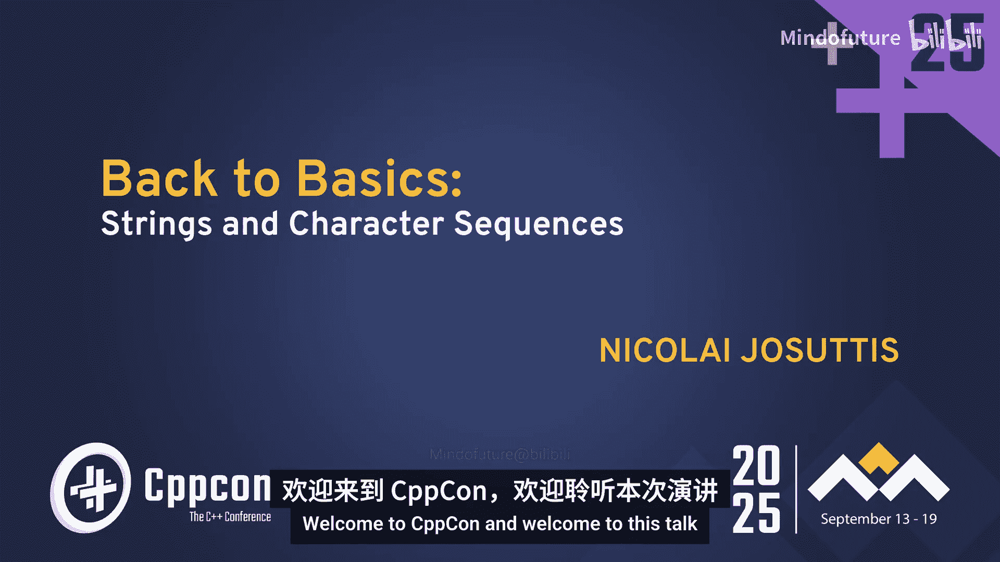
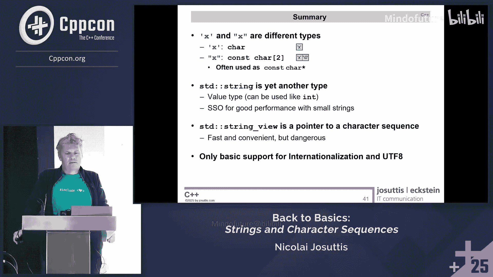

# Cppcon-2025-｜-C++-｜-C语言--｜-汇编-｜-编译器-｜-操作系统-｜-Linux-｜-Windows-p39-P39_回归基础_C++字符串与字符序列-Nicolai_Josuttis-CppCon_2025--BV1wyPBzrEeu_p39-

。

🎼。Okay。Let's start on time。

Welcome。To CPPCon。 and welcome to this talk。 This is yet another talk。

From this series of back to basics。We think we know C+ plus， we at least think we know the basics。

 but sometimes we don't。So let's see what we have to say about strings and character sequences。

My name is Nikko Yuotz。 You might have heard my name or I'd have read my name on some books because I'd be with C++ for more than 30 years now。

 also standardizing C++ and。嗯。I do sit as possible of all living。

 especially teaching and explaining all the pitfalls and traps and whatsoever and featuress us。So。

 this is about。Character types。Character types， strings， etc cetera。So what do we have there and C++？

Oh， I didn't try out my。Remote control。Now it works， yes。Character types in C plus plus。

 The first thing is you have a character， and the type of that is a chart。And if you。

 if you have started somewhere in your program， you somewhere have an age or something like that。

 start somewhere。If you assign that to a variable like Alto， C here。The type of that C is a char。

That's an integral value。 We star the corresponding value of that character in this value。

This is different from。A string literal。A little where we start characters， one，0。

 or even more between two double quotes。In that case， we have。An array。This is an array。

 and that array consists of all the characters of the string。Plus backler zero。

 the so called nu termminator at the end。So that's always the case。

 And that's not the fault of C plus Bs。 It's the fault of C。

 the programming language C invented this idea of how to store characters and how to deal with characters and how to deal with springs。

 So if you assume when usually ask， what is the type of a spring little。

 a lot of people say it's a sharp pointer or con pointer， No， it's not。That's not correct。

It is an array， an array of a couple of characters。 It is sold somewhere in your program。

And you can take even the address of that string to see where it is stored。It can often be used。

As a character pointer。And。But this is a different thing。 If you have a character pointer pointing。

 pointing to an array， we have in the pointer the address of the first character。

 So you see it here on the slide， when we initialize P。

 P is initialized with the value of this littleer， the literal starts somewhere in your program has an address。

 It's a sequence of characters， P is the address of the first character， even if it's automatically。

 we there。 the address。Then in C plus+， we have other types。 So this is type spring。

 We have classes now in C plus plus。 And that's the difference from C that we can define user defined types with data and behavior and。

Here we have S this string， and a string is a full initialized holder of all necessary information about a string at。

 So a sequence of characters stored and having its own lifetime， Everything is stored in this string。

 It's a value time。 It can be used like an end， for example。😊，And then， we have string view。

If we have string view， then we have something special。

 which is it's a pointer that looks like a string。And it is， in fact， a pointer and a life。

 And that can be used in various places to have better performance than。That using strings。

So there is the talk， we， we will talk about this in detail。About these types。

So let's go through it step by step。And we have to say more than that that was said about the first slide。

So as I said。The type of high， the string little high is an area of three constant characters。

 Its stall like that。If you assign it to a pointer。Which you can all already do and see。Yeah。

 you have the address。 This is not。 The thing on the right has a different type than the thing on the left。

So we say that's my pointer。 And the same happens if you assign it to auto auto to automatically initialize with when it's initialized with an array。

The type of the object you initialize as an as type auto is a corresponding pointer type。

So that's a rule in general。 So let's look at some source code。And let's see whether I'm right。

 I write or wrong。So first of all， it's， it's not so sometimes not so easy to see and see really what I。

 what I tell that it's correct。So here you have an example。 Let's print out a string little。 Well。

 not the string little of itself。 Let's print out its size。 How many bytes are used here。

And then later on， we initialized P。And Q，1 as a pointer，1 with alto with。That string at all。

And then we print out the sizes of that。So let's see what we have。

 We have few compilers here where we run this code。 This is G C latest compiler。 This is Kang。

 This is Microsoft Little C plus plus online compilers。 And you can see， yeah。

 the sprinkled tool has the size 29， and P And Q just have 8 because it's。😊，A pointer。

 that's the size of the address。Now， you might say， okay， my compiler should know。

That the string litol is a pipe It's not a pinter。 It's an array。And for that。

 I have done something here。 One good playway to get what the information。

 What is something is false an error about it。😊，So get an error message with this thing。

 So let me assign hello to end。And let's see what the compilers tell me about this。

 with its not allowed。So， let's look at。GCC， oh， that's an invalid conversion from a Ksha pointer to end。

Oh， thank you very much。 That's a chunk I pointer。No。Jesus is wrong here。 That's all。

They have a mistake in the compiler。 Don't trust them all time。 So you can see it when Kang。

 Kang says， no， we cannot initialize a variable of type in with an L of type con 6。

So that's correct here。It's。Givets the correct time。 And visual C plus plus doest same。

 It says you cannot convertgra from a conscious sixth to an end。

So don't be confused just because your compiler says this is a point It might be not。

If it's a string little， it's an array。When you specify such string letter， you can use。

A specialial syntax， which is the raw spring lit of syntax。So here is an interesting string。

 The string has a character sequence。 Let's have double quotes， then a back slash， then， and n。

 and then double quilts。😊，Because。Back slash and double quotes have special meanings in string at alls。

 You have to quote， you have to escape， put an escape character。

 the back slash in front of the double quote and in front of the back slash。

 So two back slash represent one。Back such as data。

So there's one thing you can do in C plus plus since C plus plus 11。 you can say。I don't want that。

 I just want to write down the characters S A R， as a value is。And this is how you can do that。

Use a capital R。Quotes。Open parenthes。 and then the value。And then at the end。

 you close with closing parentheses and double quotes。 These two three lits are equivalent。

 It's just two different ways to say， I want to have I want to store the combination of double quote back and then double quote in my value。

This is the syntax between our double code and the opening parenthesis。 You can put a delimiter。

To specify the end， because。The end of a raw string is closing parenthes。 double quote。

 But what if inside your string， it could happen that closing parentheses and double quote is part of the value。

For that， you can set up to 16 characters。That， in addition， have to be used。

 And that should hopefully work most of the time。 So this is a raw string Direct。

 This is a backta and。 Now， here we use a star between double quotes and opening parenthesis so that the closing sequence has to be。

Closing parenthesesis。 and then the star， the delimiter we did in front and the double quotes。

 And here we say the closing sequence must be closing。Penthes， barbecue and double quilts。

 And you see inside a raw spring， you can even have new lines。 You can split the line。😊。

We're all new lines， and that will then be the value you see on the right。That's great。

 If you have something like raw S H M L spring littles or late code or X M L stuff， etc ce。

 Just write it as it is。 forgetge about escaping the double quotes， etc ceter。

 Just put an double quote opening parenthses at the beginning and the end， the closing stuff。

 And that's it。😊，That Cy works。So far for raw strings。

 we come to them back a little bit later on when we talk about internationalization。

Which I will skip until the end of this talk。Next type we have is straights。Okay。

A spray is something you can initialize， or you can declare it always has a value。

The default value is it is empty。And by the way， it internally storess a back 0， at least。

So in case you need it as a switch string。It has already the trailing nu termminator prepared。

So you can extend it。 You can print it out。 You can have the index operator。 As usual。

 we don't check the index operator。 You have to make sure that you do something correctly。

 So check the size。 If you don't know if the index is valid or use a。Like4 vector empty output。

 And you can convert it to a C string and pass it to a C function。

 So you get a pointer to the real memory inside。😊，So you have to be careful if you then change your internal memory of the screen。

Your sea string point time might no longer be valid， and that is a problem。For that， you might say。

 well， let's reserve enough memory。 So if I extend the string， it's big enough。Okay。

Here's how it looks internally。包。Let's start a little bit naively about that。A string internally。

Has two different informations。 One is， we have a fixed。Structure of information， which is。

How long is a spring。How many。Characters， can I store in the memory I currently have all the value Cap it's called。

 And then the data pointer， that is a pointer to the memory the spring holds。😊。

So here we have imageized string with data。 So that means， yeah， the string value is DAT T A。

We have backslash0 at the end automatically in case this is passed to a C function。

 we have it already。It's only for that purpose， there。 And then our length and capacity is both for。

 We have enough room for for characters， and enough。And the current length is far。

 This string will automatically， automatically， internally allocate memory。Which is expensive。

Mem allocations are expensive。 Heap memory allocations。 So。

 but we will improve this a little bit later。So， but this is a full spring。It has its own value。

 It has its own lifetime， all necessary information for this object together combined one from the outside one black box thing。

If you copy it， you get a copy of the whole screen。带着。So if you modify the source。The copy is not。

Involved because the copy has its own value， which means the copy has to。Alllocate memory again。

We can print that out。 We can compare， you know， comparison in the string is， is not trivial。

 Compar of two strings is， let me first check whether the length is the same。If not。

 we know they are not equal。But if they are equal， then thats start a loop and compare character by character until we are either at the end of all the characters。

 or we found a difference。 or we found a difference。 We know it's not equal。

That's how the comparison operators implemented first straight。

The interesting thing is if you allocate more characters。

 you have memory reserve for four characters plus extra 0。 If that's not enough， we need more memory。

😊，And that will happen automatically。 The string will allocate new memory。😊，He had S？

Free the old memory。 And in case you don't get any value， you just。For example， a panda character。

 The old characters are copied to the new memory。That's all done internally， in the spring。

But this assignment can therefore become a little bit expensive because we allocate new memory and with free existing memory。

Because both allocating memory and freeing memory is expensive。If we then， later on。

Assign a shorter value。 We don't remove that memory and go back to the old size。 We say， oh。

 we have enough memory。 still。 that's star here。 for example。

 data is now we use have we use of this memory， we use only the first four characters plus x 0。

 So we still have room for 8 characters， but only four of them are used。 So in case we later on。😊。

Asign a longer value。 again， we have enough memory until it's too long。

 And then we have to allocate memory。When this was standardized and then implemented。

 or it was first implemented and then standardized， we had。Some concepts。

Because it meant that even every time we create a spring。We have to allocate memory on the heap。

 and that's expensive。So。Imvimentations try to deal with different ways of optimization， here。

 internally。The optimization that's now used everywhere is called the。

Short spring optimization or small spring optimization。 S， SO， whatever the first S stands for。

How does it work？The basic idea is。Then in practice， a surprising amount of strings are pretty short。

So think about your name。 Think about Denver。 Think about zip codes。 Think about custom Id。

A surprising number of times， something like。8，10，20 characters are enough。So。

Wouldn't it be useful then to reserve memory for a few characters only allocate memory in case that's not enough。

😊，And that's exactly the approach。The springs internally allocate memory for some amount of characters。

😊，So， for example， the value might be 15 because。It's pretty often useful to allocate 16 B of memory。

 But one is for back 0。 So 15 is left。So that would be the content of the swing。

 And please note that this brain no longer needs heat memory， which makes it very fast。

Copying is also no longer allocating heat memory。 It's just copying 32。Bs or whatever the' some size。

 So the 60 B plus the two informations， length and capacity are。Still different strengths。

Can print it out。 And now let's assign a long value。And that long value is more than 15 characters。

 We only have room for 15 characters。 Oh， damn。 Now we need memory。😊，So the。

 the way this is handled this is now the spring allocates memory。😊，And stars and you value that。

Again， if this is a plus equal， it might copy all data from the existing internal memory to the new memory。

But the string has to know where the new value starts。 So we need an additional attribute。

 The attribute is， where can I find。The value。On the other hand。

 we no longer need the old memory for storring the value。So that value。

 that memory is now reused for different pepper， you see the same memory。

 the same 16 bytes are now used to store the address of the value of the string。That way。

 we don't need even more sized test for an additional pointer。

That's more or less how strings are implemented today in all the different compilers。

We don't require that in the C+ plus standard。 it's a way that is done in practice。And。

As we don't standardize it， we also have no requirements like it should be。

 it should not allocate up to 15 characters or to 50。 It's up to the compilers。

How exactly they do this optimization。 And you will see in a moment that they do it differently。

Let's first finish this a little bit more。 Let's add data， again。Again。

 we have already memory assigned to this string。 It's still good enough。 Let's keep it。

Because for two reasons， freeing memory also costs time。And we might grow later on again。 So let's。

 let's keep it there。 So we have now capacity for 31 characters。 Oh， we only had here 18。

 So that's also another thing that compilers might do。 They might say， you need。😊。

Space for 18 characters plus back 0， 0 would be 19 B。

 Let's round it up to 32 B because that's a natural way memory is is managed in the system。😊，Now。

 interestingly， let's， let's copy tea。 Let's copy and create a copy of this thread。That copy。

Looks totally different。Because。Kly， we don't need memory just for historic reasons。

 T has memory allocated。And when we copy it， of course， we don't also need Ne。

 We also don't do not need memory there。So the copy has a totally different layout。

Because here are the invites。In the metal， at the end of the car object， which is start on the stack。

Is either a pointer to the value or it's a value。 But these two strings are equal。If I compare them。

If I find out， do we have the equal value， then again， we check length。 And if it's equal， we have。

 we check character by character。 And that means， but we first have to find out that the characters for T are somewhere different than the characters for you。

That's not。Tricky to implement。 But it means there's something to do more， more than just。

Simple a loop over both。Springs at the same location。You can see that， in all these cases。

The strengths need memory。For example， here， we might see that all these strings need。24 bys。

It's probably a 16 B platform。 Probably we come to that in a moment。 or maybe not。

 because 16 B here plus 4 here plus 4 here。 That's for length and capacity。 That's 34 B。

On a 64 B platform， it's probably 32 B。Well， unless it's not。Let's see that。

 And the capacity tells you。How much memory is used。Now。

 the interesting thing and the obvious question is。

 which values are the different compilers using here， I told you。

 we don't standardize how short string optimization is used by compilers or implemented by their libraries。

So。They are free to do it， however they like。So let's create an empty string。

And print out how much memory is used。 That's the first question on the stack。So you see。

 GCC allocates 32 B or not Is， Use 32 B on the stack for this spring。 Kang uses 24 B only。

A originaliginal C++。Needs 32 bys again。On a 604 bit platform， these are the current numbers。Now。

 let's spread out size and capacity。 And that's also interesting。 Of course。

 the size that's the number of characters， the number of elements in the spring is 0。

 but the capacity is interesting。 Capacity is here 15 here，22 and here 15。

 So G and little C plus plus seems to have the policy you just saw。

 They allocate or they need32 B of memory。😊，16 are used for the character。 One of them is back to 0。

So that's 15。 And then they have twice 8 B for length and capacity。

 which is thought as a separate member。That seems to be the case。But Kang， does something different。

 What are they， What the hell are they doing。So backta 0 needs 1 B。

Then we have 22 other bytes for the characters all the value。 So only one B is left。

To store length and capacity。Which means kind of， yeah。

1 by means4 bits for each of these information。Which looks like they can never stall。拉。

Strings with more than， I don't know，16 characters。 No， they can because they change the layout。

They change the layout when they allocate memory。And when they allocate memory。

 when they don't have allocated memory， they have one bike used for both length and capacity。

When they have allocated memory， they have more bytes used for length and capacity。

 That's how this is implemented。 And you can see that。 Let's set S to a pretty long screen。

 And here you see the numbers。 These are 51 characters。😊。

So GCC seems to allocate exactly the necessary memory for that。

Cang and visual C plus plus do something more。 I think visual C plus plus is always allocating a multiple of 16 B。

😊，And Kang has this internal internal of way to see that things。 I。

 I don't know exactly what the policy is。You see。Shortspring optimization is implemented differently on different compilers。

Which has our interesting consequences。Because it means， for example。

 when you come when you switch from GCC to Kang。Then your software might be faster。

Because strings having a size between 16 and 22， no longer need heat memory。Trusing。

But it could also go worse。 So let's use strains where we use two Btes for a character。So16 bit。

16 B characters。 In that case， you see， they still say we are starring the whole string and 32 or 24 or 32 Bs。

😊，But， of course， now we not， we have the same amount of memory available。

 but each character needs two bys now。 So what we can store now is 7 and 10 or 7 Bs。😊。

Without allocating memory for the string。 So 7 or 10 or 7 characters。 sorry， I should say。

 and each character has two bites。And it gets worse if each character has 4 Bs。

Then the thoughts spring optimization on these platforms platforms starts to allocate memory when we have more than three characters inside。

 which is pretty often the case， I would say。😊，So that's just that you know how the implementation of strings is done on these platforms。

 And if that's critical for you， you have a problem。

You might not be able to use these standard spring type implementations of this platform。

 or you code by using your string type， improve your performance。 I don't recommend to do that。

 I just want to point out that you understand what's going on。Okay， yeah， again。 we could。

 this is not theory。 or this is these are numbers。 I， there's no official documentation I， I found。

 but maybe that。 But the， the link I have here。 you can see the exact behavior， what I had here。

 for example， what I have here on this slide。 So here， for example， we say， yeah。

 size of on a clang compiler for all the strings is 24 B。

We are using 60 for bit clang on an X in 68 platform， latest trunks and。Yeah。

 and you see the numbers you last saw。Good。😡，So far， strings。 Now， let's talk about string views。

 What are string views， Str views。Are completely different than strings。

 While strings are value types。 They hope everything。

 everything they need to store the value to deal with the value。 Str views do don't do that。They are。

 in fact， just pointers to a character sequence， but they don't own the character sequence。

 The character sequence is somewhere else， which means。It's a very cheap object。Just a length。

 and a data pointer。But it's a very dangerous object because the lifetime of this object uses memory。

😊，Where which has different lifetime。And， of course， it's a problem If you use to string you。

 and then the underlying memory is used by something else。

 It's no longer there what you thought it is allocated。 And please note a few other things。

Strering wheel might not have a back ring at the end。 so don't pass it to a sea string。

The the C C string member function is therefore not available。 and if they might have no value。

 which is not possible for string。 strings always have a value。 And if it's the empty string。

 C string views might not even have the empty string。 So no value at all。

 You can see that if you ask the data pointer。 Can， can you give me the address of the sequence。

 the return value might be not pointer。But they are incredibly fast。

 So if you have a string little stored in your program and you have a function 2 1 that takes a string。

 then。😊，Because food needs a string。 That s pool is converted to a string。Allocating memory。

 at least if the short string optimization is not used。Which depends on the size。And then。

Copying all the characters。 And that is sent past as a temporary object to food。

If you have a full function， F2， which uses a string you。We don't allocate memory。

 So all we only have to do is we initialize the object with the legs。

 So we have to find out how long is this latereral。That's significantly faster。

And there's an interesting thing。 A string view can refer to a string。So here you have a string as。

 and we call Ph food2 with S。 But S is a string。 We expect there string view。

 There's an implicit type con from a string to a string view。

 And what that creates is what you see on the bottom。

 It's a string view that points into the memory of this string。😊。

Beware the spring allocates new memory。 The screen view is no longer there a valid。😊，So。

Beware if you do things like that。Well， if you have a string view pointing tool a string level。

 that's fine because screen little are available throughout the whole lifetime of a program。

 They are stored in memory。😊，And the data segment。The benefit is this。

 Let's have a simple function that takes two strings in the traditional way。

 con stringing reference so that they are not unnecessarily copied。 We only want to read them。

 read access to them。 So let's call and pass it with two stringr wordss。

What the compiler has to create is code that at runtime creates two strengths from that from these two string littles。

 maybe allocating memory。😊，In this case， we have pretty long strings。 Well。

 we have 16 and 17 so on clang。 This would not allocate string memory on GCC and Google C plus plus。

 this will allocate memory。😊，And be。S啊 therefore。Okay， then we have the strengths。

 and then we can deal with them in some way internally。

 It doesn't matter what the logic here inside is。You can implement the same function differently using string views。

 So print2 here is the same code or roughly the same code using string views。 you see， by the way。

 string views are still cheap。 It's just a pointer in the size that we declare them by value。

 because when we pass them， we just point pass a pointer under value， and that's cheap。😊。

So now you can pass the same thing because as an implicit。

 you can initialize the string you from a string at all。 and we save two memory allocations。😊。

That's good。 That's worth it。 if， if we do that a lot of times。

And it still works for strings because strings can be used as string views。

 So it allocates as before。 by well， we had already allocated it。 We can use the strings as A up。

 We just temporarily point into the memory of these。😊，Spres。

Please note that a string view has two interesting things。 First of all。

 the string view cannot be used to modify character sequences。 It's only for read access。

And it does not support class。 So here on the bar at the top， we used class。 but on the bottom。

 I had to do something different。Because of that， in this case， it's very true yeah。

So the recommendation is， if you are keen on really good performance and you have a function taking strings。

 you might think about using string views。😊，As long as in this function， you have only read access。

 you don't pass these to C functions expecting back0 at the end。 or if you use a data pointer。

 double check that it's not another pointer。So some constraints out there。

 But just readex is usually okay。Good， here has the API。

 The API is more or less exactly what a string is。 You can also say a string view is a pointer and a size with a string like API。

 That's it。😊，And yeah， only two things are in addition to string， to the strings API。

How good is that。 So let's use it a couple of times。

 Let's have some vectors initializing some element that have a prefix of one or more characters。

 and then some value。😊，And then we want to the elements。Works fine。 We solve from begin to add。

And but。We want to ignore the prex， why we got Saudidi。So how would we implement that。

The naive implementation might say， let's call salt。And we have a sorting criterion， which says。

 whenever sorting asks me， when should one spring be in front of the other。

 according to the sort criterion。Let's take the subsp of this spring。

 A And B are the two strings that are compared to find out above the right order。

 Subsp will then ignore the first epifience， the first n characters， which is one in this case。😊，So。

If you do that。You see that the performance is significantly worse than before。So Z may， my。

 may take for 100000 elements，22 something milliseconds， nanoiseconds。 I don't know。

 depending on your platform。 S swing， this version takes double or for 1 million elements。

 even three times the amount of time。Because。What happens here is substr creates a temporary。

 additional string。With。Value。 So we copy all the characters。

 And if the characters have significant size， we even allocate memory for each sub。

 which is a nightmare。😊，Whenever we compare。So here's a trick。Well， let's say， no。

 let's convert the string into a string view and then call up string。

That is nice because what happens here is sub that string view is just a pointer to the memory。😊。

And for the string view， the。Subsp function thus says， oh， subsp of one character， for example。

 adjust just as the point I1 bite。And deccraments。The来。No memory allocation。

 No characters are copied。 It's just like we are using raw pointers。 Yeah， we are using raw pointers。

 A screen view is a raw pointer just with a string like API。😊，And see what we have。

 the previous performance or even a little bit better because we skip one character。

 which we have to compare。😊，Or more， depending on how big the prefix is。Of course。

 lifetime should be O， but， I mean， we temporarily create spring views and why the springs exist。

 why they're being sorted， That's O。😊，Good。Awesome。😊，That's another thing that's important。

The string implementation is so complicated that optimization is an issue。

While string view is pretty forward。 just a point on a length。 optimizationim works great。

So let's do something crazy。 You don't have to understand what I do here。 The important point is。

 I take a string and do some processing with this string。

 I compare the first character with the last character on something like that。 Yeah。

 I think whatsoever。😊，Let me call this。And。Once we use strength。Once we use Springhi。And then。

 let's see。How the resulting code looks like。Here it is。So theres a the version using full string。

 So we， we con， we convert the string level。 It becomes a string。

 and then we do the processing we need Here iss the same。 but were using a string view instead。😊。

So now let's look at the code。 We have O2。 So we are optimizing。

 This is the code that we have for full spring。 So full spring is pretty O。 Look at main。😊，In total。

48 lines of sameda code。Now， let's do the same here。Out。Wow， well， in fact。

Main found out that effectively， nothing happens。And we just returned 0 in this program。

So everything was optimized away。 Everything was optimized away。

 because Ma could see by using string views that looking at all the things that are done here。

 that nothing relevant for the functionality of this program happens。While for string view strings。

 they could not see that。So here is the main function in case we're using a string。

This is not optimized away。 Let's see， B C plus plus。That's a cold and visual C+ plus。Using string。

 that's the code using string view。So it's just an example， but it。Says tells you something。 It's。

 it's a little bit funny。 We have the short string optimization to improve the performance of strings。

 but sometimes it's counterproductive because the resulting complications lead to the fact that code cannot be that easily optimized away。

😊，Surprise， surprise。Good， anyway。Be careful with Spring view。 Spring view is as bad as Pits。

 or even more。😊，Because it's a pointer。 It is a piner。 What would you not do。

 You would not use a pointer as a return value， for example， when it points to a local thing， but。

Be careful that can accidentally happen pretty easily。

So this is my favorite bad example for using string view。

Spring view initialized with the spring little high。 You see it here。So capacity is simplified。

 It's not used here。Oh， no， sorry， I'm wrong。 That's string view。 Yeah。

 length and pointer and length。So somebody in your code base has implemented an operator。

 string view plus string view。So you can con an two string views。And the result， of course。

 is a string。 It's a new thing。 We need memory for that。 So that has to be a string。😊，Now。

 somebody in your project has written a very simple function template。Let's compute the sum of2。

 two elements of type T。By just computing the sun。And return that。 Well。

 n plus n is n string plus string is string。 So the return type is T of course。😊，🤧But。

If you have stream view。You have problem。Because now what happens？We passed twice this string wheel。

 twice as。And then we compute plus here。 and plus called this function。Which creates a string。

So that string here is returned by this class operation。But what we return is a T。 and what is T。

Here is a rain view。Which is not the string。 It's a view to the string。

 which is a pointta to its memory。😊，So when we， when we pass back the return value。

 we destroy local objects。 And that means。We have， we return a pointed to memory that was freed。Oh。

 not good。So you have a runtime error。 You have no idea what will happen。 Everything can happen。

Probably it works until you deliver it to your customer。Who has made a mistake here， by the way？So。

The person who implemented the application code， the person who implemented the template。

The person we implemented the pla arena， or the C+ for Standard committee。

Because we have allowed implicit type conversions from string to a string view， which is in some way。

 violation of good principles。 You should never automatically convert to a more dangerous type。

But that's so nice to use。 You have seen the example。

Where we have a print function where we can pass both screen and screen view， and it just works。

We have to decided that we are fine with that。You now know the risk。Well。

 that's a good transition of C plus plus。 The programme I has a risk。You know the world snap。

But if there's somebody who made a mistake， My personal opinion is because I'm start a committee。

 I cannot be it。Yes。Well， here's an interesting assumption made in the template。

That's the sum of two Ts is a T。Which is not always the case in reality。

And especially not for screen view。So you should have better double check。For example。

Setting us up is that x plus Y is that the same S。Oh， use Alto。 Alto is your friend and templates。

You don't know what you return。 So you better let the compiler find out what you return because this is generic code。

 Alto is your friend as return types。Okay， we can discuss forever over beer。

Whether I'm right to say that he is a person who made him mistake sick。I don't know。

The important thing， you understand what's going on and what is standard I and C plus plus。Okay。

Final 10 minutes， internationalization， last topics about strengths。

Internationalization is a nightmare。Programming would be so nice if we would not have the reality of this world。

That， especially applies to internationalization。Think about length being yachts and centimeters。

And now we also have character sets。And we have a basic character set inventor。 I don't know。

 several years ago，20，50，60 years ago，7 B American Start Institute。 Well。

 because that was a langra f of the world using only 7 B for each characters。 We had 128 characters。

 Well， a few of them were special like new line。 and that was enough。😊。

Because we were ignoring that there are things like olas。The Euro symbol or Asian。Characters， I。

 I don't even have a name for in the world。We have way more characters than 200128。

 So the eighth bit was added。 for example， here， you see NJ A Omlaud。 And that's a Euround。

 That's a European currency sign that was invented。嗯。Not many years ago。And，20 or so， Oh 30。

 And you see， for example， yeah， we now use the8 bit for have to have that。 But for the Euro symbol。

 Windows and Ia decided differently。 What is the official value of the Euro symbol。And in IO。

x it' hexabademal A4， and Windows knows at hexabadeimmal A0。So if you store in a character。

 the hexadadeimal value 8，4， it will print different characters on your platforms。Then you print out。

And。This is still not enough。 We have a lot of iso standards。 If you。

 if you run this on in a Irish environment， a unla might even be mean something back some galaxy sign or whatsoever。

 And then we have China and Asia and these characters from there and the。Greek characters and so on。

 which are totally different。So for that， sooner or later， we need more characters。

 especially if we want to support all and all of them at once。 This we can split between。

Iand and maybe Germany， but。Running software that might run in both countries is a problem。

So we came up with new solutions saying， well， each character has。6ix in bits。Or30， even 32 B。

 because even 16 B is not enough for all characters in the world。

Especially as we now have every week，10 more characters。Be costs off。Emojis， yes。Good， so， yeah， we。

 we are not using all， all4 Bs for all the car interval。 It's not that bad。

 but a lot of them are used of these values。But that means we waste a lot of memory。

So the question is， how can we do best And one approach not to waste too much memory。

 but still to support a lot of different characters is U TFA。 U TF A has the approach that。

Major characters use only one byte， minor characters 2。Minina Min character 3。O。

So characters use different number of bytes to be used。 And， yes。

 the decision was made from American perspective。And so A O out has two bys， Euro，3 and。

ML G is 4 bytes， for example。several of them。Good， the only problem is， this is。

Where is the 10th character。Well。Except with U of aid。

 we can immediately find out and jump to the 10th character。 But with U of aid， you cannot do that。

Because you don't know how long， how many bytes each character in front has。 So yeah。

 really have to pass。By by， bite， character by character， some of them。2 Bs。

 So we look at certain bits of this character。 You decide is it's one or two Bs that are valid for this character。

 And that that's the way you jump， You jump。 you iterate to the 10th character。It's not good。

 So for processing， UFA is not great for storing and exchanging data。 U TF A is great。

 That's why it's used everywhere in I T When we exchange data， store data and databases， etc。😊。

So how good does C plus pass apart？Well， we supported it somehow。In general。

 compared with other programming languages， the support is。Poor， very poor。Okay， so we， yes。

 we have different types。 So we have bite， car， which then work in the first approaches。

Then we have Shah 16 T and C plus was 11 for2 byte characters。

 Shah 32 T send C plus was 11 for4 byte characters。 And then we have a few other interesting things。

 So one is U TF 8， U TF 8 support。😊，We did in the past Cha， saying this is an array of 1，2，3，4，5，6，7。

8，9，1011，12，30 characters representing only 1，2，3，4，5，6，7，8，9，10 real characters。😊。

So it was an area of 30。 We have changed the type for that。It's now since C plus plus 20。

 this uses its own type。Chahar 8 T， please note。 Char 8 T is not the full character。

 It is1 B of this character。So， but the point is， we now have a data type that shows us， oh。

 if I have an array of Cha 80， Oh， that's a U TF8 string。

 I have to deal with it differently when I have to jump to the 10th element。So that is now that。

 But that's the best thing I can say about that。So。

We have a lot of support in different C++ versions。 it came。Prefiects you and string little old。

Switchs to U T F 16 characters。 So chart 16 T arrays of Char 16 T capital U4 B characters。

 Then we have the capital L， which was we thought a good idea， which used W chart T。

 The only problem is W chart T was not defined whether it has two or4 Bs。

 So it's not really portable what you do that。 but it's used to lot long windows。😊，Then we have U 8。

 that's for you to have A character sequence。 Please note that's an array before C plus was。

20 of cha。 It's now an area of cha 80。 And then we have U A characters。 But that's one bite。

So it's only valid if this is a U TF 8 character that has only one B。If it has multiple bytes。

 that's undefined， that's invalid。 So if I try to right here between the single quotes。

 the Euro symbol， hopefully， my compiler says that's not allowed to do。 That's invalid。So。

Strings are templates。They are templates of basic string， for the character type。In fact。

 there are other temple parameters like。Basic operations to deal with the characters and how memory is managed in the stream。

 That's not important for now here。Now， we have in the C plus plastic spring， W spring。

 U 16 string you U 32 spring。😊，For basic string of the different types。 But remember。

 we still don't know exactly the encoding， especially if we have S TD spring。

 It might be the Irish encoding or the German encoding or whatsoever。

 So different characters might be printed。 and the same， by the way， we have for string view。

How good do we support conversions？Almost nothing can be done。

So we not even have IO functions to print out a U 16 string or U 32 strings。

Using the output operator there is not supported。And we， we had tried to convert。

From U 16th string to U 32 string， it was the design of that library that it came B was it。

 I think C plus past 11 or 14 was removed after that。 It was immediately depreccated and said， oh。

 no， that was a bad idea。 And we are still working on that。 No， you might say。

 why the hell are you not having a good solution。It's your fault。 C plus Plus is community driven。

 There's no company doing that。So if you want to have better support for that， do it。 Come with that。

 help us to do that。The remarkable thing I should， I w to say at the end is。

 if I have something like U 8 A A R on b or the currency euro currency symbol here。

 that's an area of four characters， because three characters for the Euro symbol。

 according to U TF 8 plus Bxter 0 at the end。 And the type has changed in C plus was 20 from this to that。

 which might break。😊，This is code when you use internationalization in your code。

 If you deal with that， here are some things about documents that shall help you。

About how to deal with that situation。韩达。These were the basics of springs。And character sequences。回来。

Single quoted X is a different type than a double quoted X。 One is a cha。

 One is an area of two constant chas。Very different layouts。Often used as con pointer。

 but it is not a con pointer， the second one。Strayring is， yeah， another type is none of them。

 It's a different thing。It's a string holding its own value。 It's a value type。 It's good to use。

 It has a pretty O performance until it gets really interesting with short spring optimization。

 which we saw can sometimes for optimization， be even counterproductive。😊。

Scrring view is a pointer to a cha sequence， character sequence。

 fast and more convenient than raw pointers， but dangerous。 You have seen that。

And then we have only basic support for internationalization and U TF aid。That's it。

Thank you very much。 These were just the basics of character sequences and strengths。

 Thank you very much。 if you want to see more。😊，Not sure we have time for one or two questions。

You caseCR。Com through the mic。啊，O。で are。嗯。If you mentioned， you。

 the community is not pushing for UTFA internationalization support。How would a community do that？

Well， the way we standardize it， somebody comes up with the proposal。

 discusses this with the other people from the Standard committee。 We finally say， yes。

 we want to have that。 So we have now a couple of persons who finally came involved into this。

 and C+ was 20 having its own character type value UTF8 is the first result of that。😊。

So we have them。 So if you want to join， contact me or others。

 and I will guide you to the right people so you can work together and help us to improve the situation。

Dang。Any other questions， yeah。First of all， thank you for the talk。

I had the unfortunate experience of dealing with strains in our code base。

 and it pretty much hit all the pain points you mentioned。 Good。 So what he's saying is I was right。

我要带你。One of the things that you briefly touched upon was the use of string waves。

 I was very pleased when string waves made it into C plus plus 17。😊。

And I tried changing our APIs to use string views。 And the biggest hurdle was interfacing with C functions and some functions that required non terminated strings。

At every such place， I had to pretty much convert it into a string and add a non character at the end。

 and then you see string to pass it。To the function。With destroyed performance， again。

 like was thinking what's the point of doing this。 There's another There's another thing you can do。

 A character sequence can be binary。Even before the trail back has 0， you can have back 0。

So you might think about saying my string view holds a string liter。

 and that string little that data has extra 0 at the end。Or in the middle where just it will end。

 So then you can even use string view and pass a string view to a C function。

 because you have ensured that back 0 is there at the end as part of the size。

 then the size includes back 0。😊，This problem opens new problems。It might be an idea to think about。

And just to follow up on that， does the implicit conversion from string to string view include。

The backslash net numinator。The implicit conversion from string view to， to to string。

 always as the the official API of strings and string is as binary， as I said。 Yeah。

 So we don't care about the value of the characters we have。 If a string view has a size of 7。Then。

The size of 7 is is then might include the be0。 If it's part of the value。

 If you initialize a string view with the string little， then actually， I'm not sure it works。

 Probably not。It depends。 You have to look very carefully on the constructor。 You have to look。

 you cannot use a constructor that use a con pointer because that ends with vector 0。 Yeah。

 But if you use the constructor saying here's an address and here's a size。

 and the size includes the back 0。 Then this vector 0 is is part of the value of the string view。

 and that length in the string you will then include the back 0 value。 right。Does it make sense。

 Yeah， yeah， okay， good。 you I think that's it。 have a good fun。

 Have a good time and see you if you like on tomorrow。😊，At 12th， I have the book signing here。

 if just in case you want come。 Thank you。

