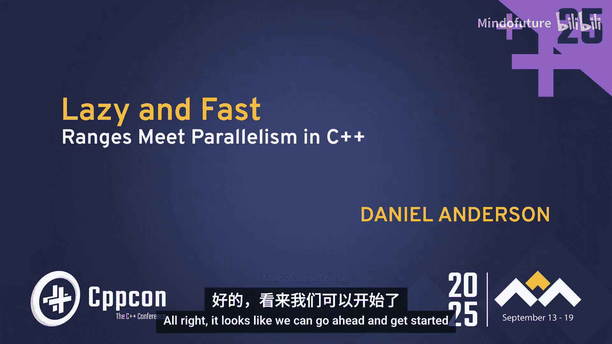
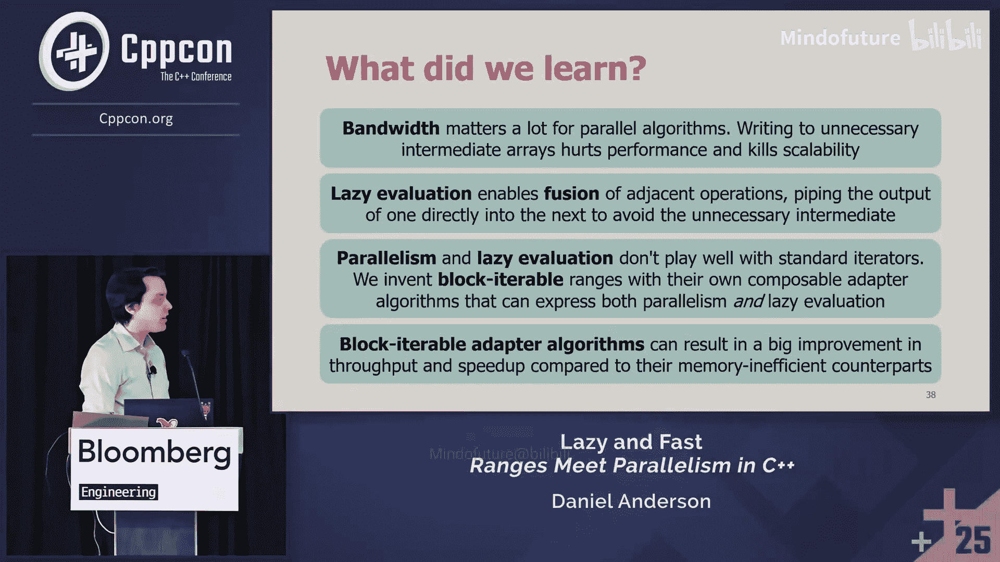
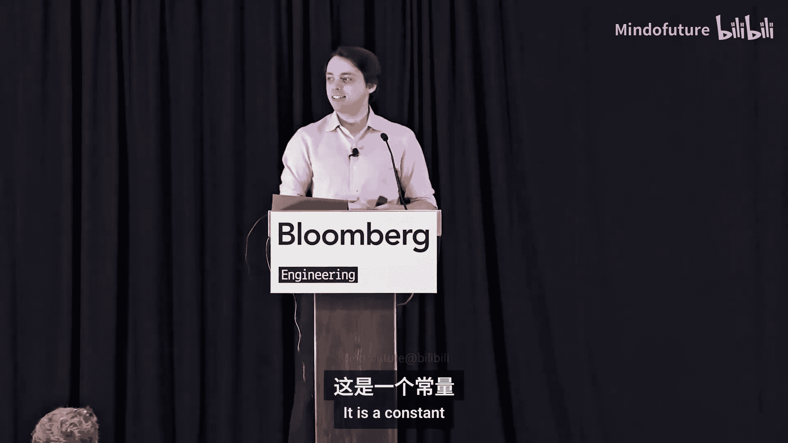

# Cppcon-2025-｜-C++-｜-C语言--｜-汇编-｜-编译器-｜-操作系统-｜-Linux-｜-Windows-p40-P40_惰性与快速_C++中范围与并行化的结合-Daniel_Anderson-CppCon_2025--BV1wyPBzrEeu_p40-

Pretty much everyone who has done something。

Very， very important in CL++ is here at least every other year or so。

Directly interfacing with those people is just an incredible boon to your career。

 especially early in your career。Getting to pick people's brains on things。Just hanging out。

 talking with people that you can't put a price on that。And you don't get those online。🎼。

🎼。

Alright， it looks like we can go ahead and get started。 So hello hello everyone。 I'm Daniel。

 I realize I forgot to make a slide saying who I am， so I'll just tell you who I am。

 I'm a teaching professor at CMU I teach algorithms classes to graduate and undergraduate students and in my spare time I like writing C+ plus libraries for parallelism and concurrency。

😊。

So today， we are going to be talking about parallel range algorithms。

 not to be confused with another talk， which is also about parallel range algorithms in just a couple hours。

 I only found that out on the slide。 I'm seeing waving in the back。

 So we've got another one in just a couple hours。 I don't actually know how similar or dissimilar the two talks are。

 So， you know， maybe check out both， but hey， mines first。 So， you know。

 if they are exactly the same。 Well， at least mines first。 So I got lucky on the schedule。😊。

Yeah， so we are going to talk about parallel range algorithms today and how to make them fast Okay。

 so what we're going to learn about， we're going to really start with the core of the problem。

 which is what is the brick wall for parallel algorithms， what causes them to stop scaling？😊，Okay。

 something， something goes wrong。 and I'm going to figure out what that is。

 And then we're going to talk about laziness。 Okay Laziness is going to be the cure to all of our problems that we're going to encounter。

And then we'll talk about， well， why currently parallelism and rangeangrs don't play super well together yet。

 Okay， so we can't quite implement， our cure that we want。But we will talk about how to fix it。

 We will figure out an idea that will fix it and get us the best of both worlds。

And then we'll go through some concrete algorithms， we'll talk about algorithms for our parallel。

 lazy ranges。😊，And finally， of course， I have to prove to you that， well， it actually works。

 that it actually makes things faster， so we'll do some applications and some benchmarks to show that it actually makes things faster。

 it actually solves the problem that we hypothesized was a problem， okay。😊。

So really to dive right into what is the problem， well。

 scalability right so when you're writing parallel code right what you want is you use more cores and your code gets faster right that's kind of the idea right。

😡，So。I I just went ahead and I benchmarked some simple parallel range algorithms， right。

 my implementations of them， not standard library ones。 These are my implementations。

 but the performance would be pretty consistent with any implementation。

 these is a very simple standard algorithms。 So I have here some benchmarks for reduce transform。

 scan and filter if you don't know what scan is right。

 scan is a fancy name for prefix sums right so you're just computing the sum of every prefix of your range。

 Okay a fancy fancy term for that is a scan。😊，So I have here a performance graph。

 so this is showing throughput。😊，Right， because throughput graphs are better than runtime graphs。

 because if you plot runtime against core， they go down and then you can't see the difference。

 like they don't look as good。 So throughput is easier to see bigger means better， right。

 as opposed to run time， Small means better。 So you can see， okay， as we add more cores。

 I guess the performance。 it goes up。 But you know， at the very beginning， it goes up a lot。

 right Like at the very beginning， we're very happy。 We're adding more cores。

 getting a lot more throughput。😊，But very quickly， we start to hit a wall where we add more coreres。

 and we're going to get a little bit more throughput。

 and then we add more cores and we get barely any more throughput at all。So， you know。

 the scaling here is not so good， right？And， you know。

 I want to emphasize this is very important If you're working with， you know。

 high performance computing and you're using lots of cores， right。

 If you're only going to use four cores， this is probably fine。

 you probably scale well into four cores and you are totally okay。 So know。

 if you ever go to any talk on parallel algorithms。 And they show you a scaling graph。

 But they stop at8 cores， tell them to make the X axis go more right Like。

 you want to see what happens with a lot of cores， right。😊。

Everyone has at least eight cores these days。 We want。

 We want to really look at big multi core systems， right。

So we can see this even a little bit more clearer if instead of just plotting the raw throughput。

 we look at the actual parallel speedup， so the parallel speedup is just defined to be like how much better is the throughput compared to that same algorithm with just one core。

Right， so this is just how much faster is it compared to when we didn't use multiple cores。

 So a perfect ideal parallel algorithm， right， it would be a straight line with gradient one， right。

 like twice as many cores， twice the throughput，10 times more cores，10 times more throughput。 Now。

 you can rarely get perfect， right， But we'd like to get close。😊。

But what you can see here is that we're not even close， right。

 We are very much not even close at 70 cores here。72 actually， where you know。

 just we're still not even at a 30 times speed up here。

 or're only 20 something speed up in in the best case， in the worst case， you know，1516 for 72 cores。

 that's not good value for money， right， You throw 72 cores at something and you get 15 times faster。

 right， you question whether you should have bought 72 cores doesn't seem like it's really doing its job。

Okay， so something's going wrong。 What's， what's the bottleneck， right， We threw more coreres at it。

 We want it like we got more cores。 So we have more compute power。So what are some hypotheses here。

 what's going on？😊，Compute operations。 Well， no， I mean， these algorithms are taking my word for it。

 They're all work efficient， right， They do。 work efficient is a fancy term。 That means， you know。

 asymptotically， they do the same amount of work as the sequential algorithm。

 So they're not like accidentally doing more compute when you add more cause。

 They are doing a good amount of work。Okay， so that's not the problem。 Maybe。

 look maybe my code's just not parallelizable enough， right， Like my parallelism is bad。 Well。

 you know， I claim again， no these， these are good。 theoretically。

 these algorithms should scale well to thousands of core。

 like there is enough parallelism in the algorithm that they keep scaling。Okay， so if you've been to。

 you know， talks about performance， right， especially C plus plus talks about performance， you know。

 usually right now， there's one word that people will start thinking of like。

 I know that other thing that causes performance problems that isn't just how much compute that I'm doing。

What's the word every performance talk is going to tell you about someone shout out a word？

Cash locks， if you're doing concurrency， Yes， but we're actually not doing any concurrency today。

 So but yeah， cash， right， that is the word you think， cash。 It's always the damn cash， right。

Actually not quite in this case， although it's close， this answer is close， but it's not quite right。

😡，These algorithms are all cache efficient， actually， they read left to right。

 they read everything that they put on the cache line。

 They're not just bouncing around random access。But as we're close， I mean， cash is about memory。

So we were really close， the answer is about memory， but it's not cache。

 it's actually main memory the not cache memory， it's actually memory bandwidth to our DRA okay so essentially we are running out of memory bandwidth。

 Our algorithms are so fast right they're so efficient at computing that they can't actually read the memory fast enough like they read some memory they compute the answer and they say。

 cool I need more memory and they actually have to sit and wait。

 they're actually not getting memory reading fast enough to compute what they want to compute so they're actually simply running out of memory bandwidth。

 they cannot read memory fast enough。😊，Okay， and you know， we have sort of a term for this， right。

 because this shows up all the time， right， So an algorithm like this is called memory bound or bandwidth Bo or memory bandwidth bound。

 you know， some combination of those words。😊，If the primary bottleneck for its scalability is memory bandwidth。

 Okay， so you're just running out of memory bandwidth before you can actually utilize all your cores。

 So throwing more cores barely helps you because those you don't have enough memory bandwidth to feed all the cores with data to do something with。

😊，Okay， and， you know， as a general rule of thumb and， this is a generalization。

 So someone's gonna complain in the YouTube comments。 But as a general rule of thumb， most simple。

 like data parallel algorithms are in this category， right。

 This is the most common thing that will bottleneck， your parallel algorithms， right。

 If you're doing data parallel processing this is 90% of the time gonna be the bottleneck for you。😊。

Okay。😊，So we can actually kind of verify this hypothesis right know if you don't want to take my word for it。

 if you don't believe me， we can kind of verify this actually by looking at the numbers。

 we can look at our relative performance numbers， so I'm going to bring up this graph again and we're going to talk about how much memory bandwidth these algorithms actually use。

😊，so here's that the plot again and we can think about how much bandwidth these algorithms actually use so reduce right reduce just sums up all of the numbers right so reduce here is like the most like efficient algorithm here because it does the fewest memory operations It pretty much just needs to read all the elements in the input it does negligibly few write to input because the outputs just one number so this algorithm pretty much just does nish reads for input range of size n and negligibly few write。

😊，Transform， on the other hand， does about N reads and N N writes because it reads everything。

 applies the function and writes out the answer。😊，And it turns out that on most machines。

 probably almost all machines， at least on mine right rights tend to be slower than reads。

 So the bandwidth to do writes is it takes more bandwidth to do writes than reads So write are slower So we would expect then that transform should be like even worse than like twice as bad as reduced because not only is it doing twice as many operations。

 Nreads and writes versus just N reads， those rights are slower So if rights are about 70% slower。

 which is basically what we've measured on our machine。😡。

I don't know how this translates to other architectures。

 but you know this is this is an old like Zion processor。 So on this machine。

 we've measured it right， so about 70% slower than reads。

 So you would expect you know transform to be about 2。7 times worse than reduce。

 And if you look at the numbers。😊，That's pretty much roughly what they what they show up as。

 Similarlyly， scan。 So we'll talk about how scan is implemented in a bit。 But for now。

 take my word for it。 scan in parallel takes about two n reads。

 You actually have to go over the input twice， and then you write out the n answers。

 So you would expect this to be， you know，3。7"ch times slower than reduce。

 And if we just normalize our plot now right So instead of throughput。

 we kind of plot like normalized bandwidth。 So we account for the fact that like how much bandwidth they're actually expected to use。

😊，They， you know， within some， you know， noise and random， random stuff going on。

 they pretty much line up。 So this provides some evidence that bandwidth is， in fact。

 the dominating factor。 Like it is what is causing all of these algorithms to sort of peak and flatten out。

 right。So this is some evidence that I'm not making that up， right。

 that the bandwidth is the factor here for these algorithms running out of scalability before we run out of cause。

Okay， so memory， memory is the problem。 So how do we attack this， right。

 How do we reduce the amount of memory that we need to use our algorithms。

 And there is a technique for this。 And generally， right， comes under a few names。

 we're going to talk about fusion and laziness。 Okay。

 These are the techniques we're going to try and look at to help us reduce memory consumption。

 right reduce memory bandwidth。😊，So let's talk about composing sequence operations。

 because the effect of this is even， it becomes even more pronounced when we're not just doing one。

 but doing many operations。So let's say I have a vector right with some data in it and I have some temporary vectors。

 B， C and D， where I'm going to store temporary stuff that I'm computing and I'm going to compose a bunch of sequence operations so here's my A I'm going to do a transform right for every element double it and add one so we transform the elements we write them from A to B then I'm going to do a scan because scan is cool right so that's going to compute the sum left to right the prefix sums we're going to write those into C。

😊，And then I'm going to filter the results， which is called copy if rather than filter for some reason。

 so we're going to copy if make sense we are copying the elements so we're going to copy from C to D for all the elements that are divisible by three that satisfy this predicate。

Okay， so by composing these operations， like if I just do it like this， right？😡。

This doesn't look great， right， Each of these operations individually is going to compile into a loop。

So this algorithm， right， if you can call it an algorithm， I just made it up。

 but you know this thing， this code does about3N reads and writes to main memory。 Okay。

 that's a lot of reads and writes。 So we will call this code extremely memory inefficient right。

 It's doing three loops where it's like reading and writing basically the same stuff over and over again。

😊，So that we have a technique for this though it's a fancy name it's called loop fusion。

 right it sounds cool right and the idea right if we took the code on the previous slide and we handwrote it or we approximated what the standard library would compile that into。

 we would expect that code to be roughly the same as these loops right we're doing the transform right for each element in a double it and add one。

😊，Then we would do our scan， which is this is just a prefix sum right。

 you're keeping a running sum left to right and adding the next value at each iteration。

And then the filter， Aka copy if right， again， goes through the sequence C and for each other if it satisfies our predicate。

 right if it's divisible by three， in this case， we write it out to D Okay so that those you know three standard library algorithms on the previous slide would。

 you know， roughly morally do the same thing as these loops， which we can write by hand。😊。

But if you see these loops by hand， you may see， well。

I don't think I need to do three separate loops here I mean they're kind of。Reading something。

 writing it， and then in the next loop， reading it back and doing something else。

 we could actually combine these three loops into one。 This is called loop fusion。 If we do that。

 We might end up with code that looks something like this right color coder to see which loop is which。

 but essentially right that transform and that scan and then that filter。

 they don't have to happen one after the other。 They can happen at the same time because they are operating。

 They're each operating on like the same range and they're operating in there just the same order left to right。

😊，And so now this code， instead of needing all those temporaries， just goes straight from the input。

 and bam， it writes the output， right， much better。😊，So this fused version of the code。

 it only does like N reads and Nrites instead of three n。 So this is like。

 you know three times more memory efficient。 Okay， great， we love that。😊，But on the other hand。

 right， you know， this is C++， we like using abstractions， we like using standard library algorithms。

😊，The the moral of this talk isn't don't use standard library algorithms。 They're slow。

 just handwrite everything because， well， it's more typing for you。 And it's also you know。

 more complicated algorithmically to figure out how to write these， you knowfusesed loops。

 It's even more complicated in parallel， right， We haven't even hit parallelism yet here。

 right This is sequential。 Man fusing parallel stuff is very tricky。You can do it， but it's hard。

 so you know we like having algorithms in our library that do the hard stuff for us。

 so we we want to keep our abstractions but still get this benefit here。😊，And you know。

 what do you know we got lucky a few years ago when C++ 20 introduced views？😊，Alright。

 so views in the C plus plus standard are essentially defined to be cheap to copy ranges。

And essentially they are forced by contract。😊，To evaluate things lazily。

 because they are required by the standard to be constant time， constructable， copyable。

 even calling begin has to be constant time， which causes a nightmare for there are other talks that talk about why that's a nightmare。

😡，Essentially， by contract， they are therefore forced to evaluate things lazily。

 They can't compute the answer and save it somewhere because that would not take constant。

 They are forced to compute on the fly as you iterate。

Which also is really great for memory efficiency， because it means that they don't have to write all these results to a temporary vector。

 They just compute on demand。 So there's no wasted， temporary space。

So our previous algorithm could also be written something like this right using the cool like overloaded pipe operator right for the view adapters you don't have to use that。

 you can chain function calls， but this looks cooler So we're going to do this right our previous code is know morally equivalent to this right we're doing a transform double it and add one we're doing a scan where we add things and then we are filtering out and keeping the。

😊，sorry odd the divisible by three elements。😡，And the nice thing is， right。

 because these views get evaluated lazily， they are by contract。

 not allowed to do linear work and store the results somewhere。😊。

These things fuse together automatically， and this code essentially does justN reads and writes instead of 3N once again。

😡，So big take home message here is that essentially doing lazy evaluation and then composing things effectively gives you automatic fusion。

 right if everything's evaluated lazily。😡，They can't， by definition。

 ride out all their results to some intermediate storage。

 they have to go lazily and they therefore will fuse together。Okay。

 so it seems like weve found we've found a tool， weve found a tool to reduce memory consumption。

 right， automatic fusion， lazy evaluation， this is how we're going to reduce memory bandwidth usage right we're no longer writing out things to intermediate arrays okay。

😊，So two key messages so far then。😊，Most simple parallel algorithms are memory bound and lazy evaluation right this gives us automatic fusion。

😡，And this reduces bandwidth consumption。 So if you look at these two things side by side。

 you're like， well we've done it right， we have solved the problem。

 let's just use lazy views for parallel algorithms。 and and we've done it right， that's it。

 That's the whole talk。 No， I'm kidding。 There's a lot more。 doesn't work。 That's it。

 So unfortunately， it doesn't quite work out like that。

 So we we have to sort of dig into how ranges work a little bit more under the hood。

 We have to take a detour and look at range categories for a second。

 So if you look in the standard and you look at ranges。 Rangers and iterators have these categories。

 which tell you like what you can do with them。 So we have the top contiguous。

 this is not used very much like， this is just everything is stored in contiguous memory like vector or array。

😊，The more important ones， right， random access， right random access means in constant time。

 I can look up any element in my range。 Okay， that's important。On the other hand。

 we have forward and bidirectional where you cannot in constant time look up any element。

 you can only go like left to right or right to left bi directionional， okay。

 you can't just jump into the middle of the range in constant time。

 you could go one way or the other。😡，And， you know。

 now we have a bit of a problem because if I want parallelism， right？I need this。

 I need to be able to jump into lots of places within my range because if I can only go left to right one at a time。

 I can't parallelize anything okay so we kind of need random access for most parallel algorithms。😡。

On the other hand， if you're evaluating lazily。😡，You don't have every value ready to go。

 You're computing one by one。 So most lazy views produce these。

So our parallel algorithms need random access or better。

 but our lazy views are only going to typically give us forward iterators or bidirectional。

AndWe're not even going mention， input and output iterators because they're even。

 they're even weaker。 They're not going help us today。Okay。

 so it seems like we're in this bit of an incompatibility here， right， we want laziness。😊。

And we want random access， but they're kind of incompatible， right， because let's， you know。

 think of some examples， Think of， you know， a lazy scan， right。

 You're tracking your rolling sum as you go left to right。 If I want to random access and say， right。

 what's that one， right， what's the fifth one。Well。

 you don't know unless you've already done the sum of the previous elements。

 So either you've had to already iterate up to that point or you've had to precomp it and save the answer。

So that's not lazy。😡，嗯。What about a filter kind of a similar issue if I ask you all which element comes in that position in the filter？

😊，You need to know how many elements before that position got filtered out because your position right depends on well。

 how many elements before you disappeared because you're going to move across that many and for the same reason。

 right， you kind of can't do that both random access and lazy， you kind of get one or the other。😡。

So we're at this bit of incompatibility here we want to be able to jump into the middle of a sequence to do things in parallel。

 but we can't， because from any of these ranges， the value or even whether an element is there or not depends on stuff that comes before。

 right It depends on knowing what happened before， which means you either have to have iterate it there or stored the answer。

Okay。So you know here we are again with our iterator categories。 So what do we need， Well。

 random access is too stringent， we can't satisfy random access and still be lazy。

But being forward or bidirectional is not good enough for parallelism。So we need a new one。

 We need a middle ground。 We need something in the middle between the two， right。

 something that is more powerful and forward so we can actually parallelze split work across threads。

But something that is weaker than random access so that it's not so stringent and impossible to be lazy。

😡，Okay， so what on earth does this middle ground look like Well。

 we're going to just take inspiration from the algorithm how parallel algorithms actually work so we're going to do an example of how a parallel scan actually works and use that to inspire like okay。

 what do we need like what does this algorithm need to be efficient？

So the way that parallel scan and many parallel algorithms tend to work。

 of course this is a quite general technique， start by breaking our range into blocks。😊。

And now we can process all the blocks in parallel right so we can hit one worker for each block。😊。

And they will sequentially process each block， and they'll compute the sums of the blocks。Okay。

Now that we have our block sums， now we want to do prefix sums of those block sums。😡。

Which itself of course is another scan， so there are two ways about this。

 if the number of blocks is small， just do that sequentially。

 if there is a large number of blocks you can recursively scan again to compute those prefix sums。😊。

Now， once you have the prefix sums。And we're we ready to write the answer。😡。

Those prefix sums essentially tell us the starting value for each block。

And now we can once again in parallel for each block。😊。

Each block can then just sequentially fill in the sums， right， going left to right， like so。

So the idea right， is split into blocks， process blocks in parallel， but then within each block。

 you're just doing something left to right， right， you're doing something entirely sequential。

 So we don't need like complete random access here， do we right。

 We're still processing blocks sequentially。So this is actually you know quite a general pattern。

 many parallel algorithms fall into this flavor， right。

 you do some local past where you process all your blocks in parallel。

 you do some sequential computation on the block。😊。

There's then some kind of global aggregation where you take the summaries per block and combine them right like doing a prefix sum on the block sums in the case of scan。

😊，Then a second local pass to go through and use that global information to figure out the answer in each block。

 So we get this sort of this picture here again。 So this is a very nice technique， and it works for。

 know not just scan。 It works for lots of parallel algorithms。

 And the key idea here is that blocks are what matter， right B are the unit of parallelism here。

 We don't need to be able to parallelize over every element I don't need random access to every single element。

 I just need blocks。 Each block can be sequential right left to right。

 As long as I can get my hands on a bunch of blocks in parallel。😊，That's what we need。

 that's the interface we need。So we're going to define our new middle ground here。

 we're call it a block iterable range， so a block iterable range is a forward range。

 but you get random access to the blocks so you essentially get random access to a bunch of checkpoints in the range and those checkpoints are the starts of the blocks。

😡，And that way， you can parallelize over the blocks because you get random access to those blocks。

 but within each block， there's still forward ranges。

 so there's still room there to be lazy and not actually precompute everything up front。Right。

 so essentially， we're just extending， you know， the， the range concept， right。

 a range is just something that has begin and end， which return iterators。

 We just also need to be able to say， begin block， right， give me the I block。 And you know。

 for symmetry， we can also get the end of a block。 But， you know。

 the end of a block is just the beginning of the next block。

So really all we're adding is one extra thing， give me a block， random access， and that's it。

 right everything else is still a forward range， everything else is still forward iterators。😊。

And you know is this it is this enough and claim yes。

 this is what we need so why does this do what we want Well we have blocks that we can random access。

 which means threads can now work on separate blocks in parallel so we have our parallelism。😡。

But because each block is just a forward range。We can be lazy， right。

 We don't have to know that whole forward range up front。

 We can compute it on demand just like we would with a sequential right St rangers views algorithm。😡。

So we get this like best of both worlds here。 and you know this turns out to be what we need for a lot of nice real life parallel algorithms on ranges。

 so not just scanned， many algorithms can can fit this pattern here where you do some pass through your blocks。

 you do some global aggregate information and you then propagate those back to the blocks and best yet right these are composable as long as your blocks are the same size。

 which is just something will enforce right in our algorithms， you can compose them。

 which means they can fuse together you get this nice pipeline where everything fuses together just like in the sequential stood rangers views and we get everything we've ever wanted。

😊，Okay， but let's actually see now， well， how does it work， Can we。

 can we implement it and does it work？So。I'm going to talk about the algorithms， right。

 how do we do this？😊，So。What we've got so far right， our library has these operations。

 You could add way more， but this is already a really good starting point that allows you to implement a lot of interesting nontrivial algorithms and see the benefits。

 So we have transform Aka map in our library because I guess it was inspired by functional languages。

 but unfortunately， C plus plus calls dictionary a map。 So we can't call it that。

 So we've got transform， which is much more characters to type We've got scan。

 which we've seen before， right Those are just prefix sums with fancy name。 Of course。

 scan doesn't just have to do literally plus right you can give scan any operator。

 You can do a prefix maximum minimum。 You can do any fancy associative operator time permitting。

 I'll show you a really cool one at the end。😊，We have flatten， also known as join in ranges。

 Rs calls this join， but this is just you have nested ranges and you want to glue them into a single range。

 So like you have a vector of vectors and you just want one range， So it's not nested anymore。

 that's called join or flatten。 I'm going call it flatten because that's what it's called in our library and of course。

 zip anyone is used Python knows zip a very nice， convenient little function where you can just iterate over multiple ranges in lockstep So you have multiple ranges and you get to iterate over the first element of all of them in the second element of all of them and so on So Python program is one of their favorite little abstractions。

 which is also in C pluspa ranges now， I forget if it was added in 20 or 23， but we have it now。

 we have it by now。😊，And we also have terminal operations。

 which are instead of taking a range and producing another range， which are what the top ones do。

 these take a range and just give you a value or something that isn't like there isn't another adapter so you either can do a reduce which just folds you down to one value or two sequence which is essentially to materialize it into like you actually going to write the answer now it's not lazy anymore。

 you're just going to write out the answer。😡，Okay。So what is the typical pattern right。

 how do we implement these things Well， we said this is our sort of typical you know framework for parallel algorithm here。

 doing some local pass， some global aggregation， and then another local pass。

So we said that our goal is to add some laziness， but we already sort of established。

 it's not possible to do everything lazily， like we can't be completely lazy because for like a scan or a filter。

 you need to know some information about what came before you。😡。

But we also don't want to just write out all the answers and be done with it because there's no laziness。

 So our key idea， the big idea here is we are going to be a little bit lazy。

 We're going to do some work up front Okay， unlike St rangers views which do no work up front。

 they required by contract to be constant time， we're going to do some work up front。

And then defer the rest lazily。😡，And we're going to put the split here。

 so we're going to do this like first local pass immediately。😡。

As well as whatever like global aggregate information we need。

 because that global information is what each block needs to know its values， right？😊。

And we'll do the second part lazily。Okay so instead of being completely lazy。

 we're being a little bit lazy， it's like you know you wake up， you're feeling tired you're like。

 I don't want to do all my work today， but instead of doing none I'll do some of it and I'll do the rest later so we're doing that right we're just being somewhat lazy' we're getting a head start and deferring the rest。

😡，So the typical pattern will look something like this。

 right our adapter's constructor right it will go and process the blocks in parallel。

 it'll compute whatever per block metadata it needs like the block sums for scan。

 then it'll aggregate those and it will then remember the aggregate。

 So it will store those in the adapter so it will store something again it's not completely lazy just somewhat lazy。

 we're still going to store a little bit of data but notice that the key here is that we're only storing a little bit of data instead of storing the entire answers So we're going to use much less memory and therefore save bandwidth That's the punchline coming up。

😊，And then when we iterate the range right well when we get the iterator beginning to a block。

 it's going to look up the metadata for the corresponding block。

 it's going to remember that in the iterator and then as you iterate now you compute lazily within each block so the key here is each block is still computed completely lazily on demand we just need some preprocessing just to give the blocks the starting information they need to begin that process。

😡，Okay， and so， you know， for technicality， this does mean right that because our constructor does like。

 you know， usually linear work， it has to read the sequence。

 This does mean that it's not constant time to create one of these， which means technically。

 according to this E plus standard， this is not a view。 So I unfortunately cannot call these views。

 right， They don't satisfy the definition of view but they are going to be。

They're going to do exactly what we want。 They're going super useful。 Just can't call them views。

So let's see some examples， right， So block iterable transform， Aka map。

 This is actually the simplest one。 So this is actually one that doesn't actually need to take full advantage of the block structure。

 So the state for a transform， right， we have some， some range。

 It just needs to remember that transformation function， right。

 the function you're applying over every element。 And so all we need to do is actually store the function。

😊，So map is kind of a simple one where it doesn't actually need that two pass algorithm。

 it actually only needs one pass， so this one actually can be completely lazy。

 This one does not need to precompute any metadata for the blocks。😡。

RightSo this one actually is technically a view right It' the one that is a view technically。

 And so iterating this just， you know， iterates through each block in parallel and applies the function to the element in the range。

 okay。😊，So this is one of the few that actually preserves random access right if you give transform a random access range。

 you get back a random access range which is not the case for most views which tended to give you back forward ranges so this is one of the few that actually works and preserves random access which you know this is already in the standard library right like St Rangers has a transform view which takes a random access range and gives you back a random access range。

😊，Okay， so that' that's the simple one。 let's see the nonsimple one。 So let's look at scan。

 right our favorite parallel algorithm。 So we have our input our blocks。

 Now what do we need to store in the adapter。 Well。

 for each block right to be able to iterate and compute the scan each block remember it needs to know it's starting value that's what our parallel scan algorithm computer before So we're going to have to compute that when we construct the adapter right So we're going to compute the block totals just like we did with the parallel scan。

😊，And then do the prefix sums。And then pause there， right That's the construction。 So， you know。

 think of it as we are just doing like half the algorithm。 We're doing half the scan algorithm now。

 and then we're deferring half the algorithm to be lazy and going to do it later as we iterate the range right So that's giving us our middle ground。

 right our best of both worlds where we have to do some computation upfront。

 but we get to defer a bunch of it to later where we can be lazy and therefore save a lot of memory。

😊，All so once we go to actually iterate the range， right when we grab the beginning of a block。

 we get our block start value from the prefix sums。😊，And then iterating the range， right now。

 it just looks like a sequential scan， right， you have your starting value or your start value for the block。

 And every time you increment the iterator， you add the next value onto the prefix sum。 Okay。

 so it's just our parallel scan algorithm we saw before。 but we're just cutting it off and saying。

 look， just do， just do the first part of the algorithm now， say。😊，algorithmgorithm to be lazy。

So we do some work up front and we do some work lazily。

 that is our middle ground that gets us our best of both worlds， okay？😊，Pretty cool， all right。

So we can keep going with ideas like this， okay， so we can do flatten as well， right Aka join。

This one's a little harder to wrap your head around。

 especially in the picture because remember flatten takes his input a range of ranges and remember that a block a block iterable range。

😊，Is a range you can split into blocks。 So we now not just have a range of ranges。

 We have blocks of ranges of ranges。 So we have three levels of nesting here。 So this one。

Writiding the code for this was kind of painful to remember which of those three levels you're。

 you're currently iterating through。 But， you know， we can， we don't have to write the code today。

 We're just going do with pictures。 So pictures are much easier to understand than the actual code。

 Feel free to look at my code if you want and flame me for it， but。😊，You know， we take as our input。

 a range of ranges which themselves split into blocks。😊，So to do a flatten， right。

 what we need to understand， right， what we want is essentially just an iterator。

 At the end of the day。 We want an iterator that will iterate through all of those inner ranges as if they were one range。

So our state essentially needs to be。😡，A pair of iterators here。

 We need an iterator to the current element in the inner range that we're looking at。

But once that iterator hits the end of the current inner range。😡。

It then needs to know like what the next one is。 So it needs to jump up to the outer range and increment that iterator to jump over to the next range in the sequence。

Okay， so our state essentially needs to be for each block， we need to know not just one iterator。

 but a pair of iterators， right， what's the current inner element we're looking at？😊。

And which of the ranges is it in so that when we hit the end。

 we can jump over to the next one So our whole precomputation algorithm essentially has to compute where those are like okay where are those positions which iterators are those and what makes it challenging remember what I said before is that for these algorithms to be composable blocks must always be the same size So the output of this algorithm needs to be something that gives us blocks of the size we want So the goal here is essentially just to find checkpoints within this nested sequence of evenly spaced elements So like in my actual library blocks need to be pretty big because you need pretty big blocks to make the overhead of parallelism worth it So in the actual library blocks tend to be like 2000 size on my slides they're going be5 because we can draw that on the slide So imagine conceptually what we want is to essentially find iterators to every fifth element in these input sequences so given this nested range of ranges。

We want to essentially locate every fifth element。That is the that is the challenge。 Okay。

 so to do that right， Well， we need to know the sizes of the ranges。

 So we're gonna compute the sizes of the ranges， which we can actually do， by the way。

 that that's actually a transform， right， that's a transform from the range to stood ranges size of that range。

 So you know， we can already start to reuse some of our previous algorithms in here。

And now similar to scan we do prefix sums again because we need to know essentially for each range。

 how many elements come before it because if we're trying to locate， say every fifth element。

 well I want to know how many elements came before me if it's a multiple of five。

 I am one of them right I am one of the every fifth elements。😡。

So then we essentially just take those prefix sums。😡。

And we try to find every fifth element and you can do that different ways to do it one way is to binary search on the prefix sums。

 Okay so you can binary search try and find every fifth element if you don't like binary search。

 you can also do it essentially by linear searching。

 just left to right over the outer ranges just searching over those。

 keeping track of the number of elements you've seen so far， every fifth one。

 you write it down right you save it in the adapter so that you know where your block starting values are so you can compute those right。

 you find those either by binary search or by like left to right searching pulling out iterators to every fifth element。

Okay， so it's effectively a load balancing problem， right。

 You're given a whole bunch of not evenly sized things。

 And you want to like pretend they were evenly sized。

 You want to find every fifth one so you can break it into evenly sized things。 That's a classic。

 like load balancing style problem。Now once you've found all these iterators。

 that's the final part of constructing right that's the non lazy part， that's what we do up front。😊。

Now， this is still memory efficient， right， because remember。Of course on my slides。

 there blocks are size 5， but in the real library right blocks are like thousands of elements。

 So the actual size of your adapter is very small relative to the range right if your range has n things。

 you need like n divided by 2000 iterators。 So the amount of space you need for this is very small。

 And remember that's what we were trying to do in the first place as we were trying to save on wasted temporary memory。

 So you we've basically gone from eating n memory to n divided by 2000 memory right So know that's pretty good savings。

 that's 99。95% memory savings。😊，Okay so that's our adapter state and then our iterator， as I said。

 right once we've actually constructed this and we want to iterate over it。

 our iterator just contains two iterators right it knows the inner iterator of the element it's currently looking at。

😊，And to advance it， right when you hit the end of one of those inner ranges。

 you look at the outer one so you can jump to the next one。

 right you know to jump to the next range that you're concatenated with。Okay。

 so you just look up those starting iterators that are stored in the adapter。

And use those to iterate through。And that's how flatten algorithm and this I want to point out how useful this is going to be。

 we'll see on the next algorithm， why this is particularly useful。

 but what this algorithm is essentially doing is taking a bunch of like unevenly sized things at these inner ranges。

😊，And converting it into a bunch of things of the same size， right， It's trying to load。

 balance them into equally sized blocks。 and this is going to turn out to be really useful because by definition。

 our block iterable algorithms to work need equally sized blocks。

 So this algorithm is going to be super useful for taking nonevenly sized blocks and making them evenly sized。

 So this algorithm is going to be useful， not just for like its own purpose。

 but for building other algorithms。😊，And I'm going to show you that now with filter。 Okay。

 so you could imagine in your head like， okay， a parallel algorithm for filter。

 I look at all the blocks。 I count how many algorithms survive the predicate。

 Like I mark which ones survived the predicate。Then I'm going to have to do prefix sums and search for like where。

 you know， the fifth survivor is， the10th one to do the load balancing。But hang on。

 that sounds like it's gonna pretty much do the same steps that filter had to do， right。

 to find every fifth element。So instead of actually writing all that code again。

 which is like 90% of the code for this would be duplicating the same code as filter。

Why do we have to make it， does flatten Why does filter have to be a first class adapter。

 Let's use flatten to implement filter。And I want to point this out because it's a really cool trick that once you have just a few of these adapter algorithms。

 you can implement tons of them by composing the ones you've already got。

 you don't have to write very many of these from scratch once you've got a handful。

 you start to realize that all the other ones you wish you had are just compositions of the ones you do have and I want to demonstrate that here because you you might say。

 well isn't this marginally less efficient like yeah。

 maybe it it's wasting one extra iterator So it's like gonna be like a 1% slower maybe but you know I want to demonstrate this idea that you know you can save on rewriting everything from scratch。

😊，As soon as you've got a handful of these things， you can start to compose them and build so many more things。

Okay， so the way our filter works， right is you have your blocks within each block。

 you go through and you find the survivors， right， the elements that satisfy the predicate。😊。

You now like remember where they are。 So in my case I save iterators to them。

 so I just save the iterators pointing to the survivors。Now， in terms of memory efficiency。

 this is good if not too many elements survive。 if every element survives， okay。

 then this is basically the same memory efficiency as if you just did a regular filter。

 So this is good， right， I mean， in the worst case， it's no worse than the previous algorithm。

 but in the best case， you save a lot of memory because you only have to use memory proportional to the things that survived here。

 instead of a temporary memory that would be the same size。😊。

So all we can do then is just take our survivor blocks。And flatten them。

 Because now what we essentially have are blocks of survivors。 Well， that's just a range of ranges。

 right？ So I can just flatten them out and notice that what flatten is doing is it's doing that load balancing。

 It's doing that thing where I said， look， blocks must always be the same size for these to be composable。

 blocks have to be the same size。 So filter can't just take in a bunch of blocks and then output the filtered blocks because the blocks are now smaller。

 having had things filtered out of them。😊，So the flatten is what comes along and reload balances them and makes the blocks the same exact size again。

Right， so this is really cool。 right， We save on repetitive， redundant code。😊。

And we get our algorithm like in a few lines of code， essentially。

And you know technically since we're storing iterators here， to make this work， of course。

 I don't want my user to call filter expecting， you know they put in a range of ints。

 they expect a range of ints back， somehow they get a range of iterators。

 I need to dereference them for the user。We have that。 that's a transform。

 right We can just pipe this into a transform that dereferences for the user。

 So we've built our filter adapter。 It's just a composition of a flatten and a transform right The transform just gives it that Lada which says。

 look take the iterator and dereference it for the user so the user puts in a range of ins。

 they get back a range of ins。😊，They are happy。 Everything works just like they want。

 So I want to emphasize how useful this is， right， We're not just implementing all of these from scratch。

 Once you have a few of these， I mean， we only implemented three so far。

 and that was already enough to get a fourth one just by composing the ones we already had， right。

 We didn't have to write them all from scratch。 We just did a little preprocessing and then composed existing adapters that we'd already written。

😊，And so once you have these views right， sorry they're not views。

 that's illegal right they're not constant time， once you've got these range adapters。

 nonconstant time range adapters， you can start to compose them and get new ones and you can really start to build up a nice library of these algorithms。

😊，Okay， so that's how they work under the hood。😊，Last thing we want to talk about， of course。

Like do they work， right， like what can we do with them。

 are they actually useful and do they make my code faster？😡。

The answer is gonna be yes and yes as a spoiler。 But let's let's prove it。 So here's。

 here's a cool example。 I teach algorithms。 So we're gonna do some algorithms examples。

 So let's do a bread first search in parallel。 So we're given a graph。

 They don't remember what a bread first search is。 We're given a graph。

 and we want to label each vertex with its distance from S。

 And the way this works is we essentially just compute vertices in sets of what are called the frontier。

 Fronier is just the current set of vertices at the current distance we're looking at。😊。

So the initial frontiers is S distance zero。😊，The next front is everything a distance， one。

The next frontier is distance two。Distance 3， distance 4。And so on。

 So what we're gonna do is we are gonna compute frontiers like one by one。

 That part will be sequential， right， I don't think you can make this completely parallel。

 right I don't think that's possible。 So our algorithm will， you know。

 be still sequentially by the diameter of the graph。

 But we're going to put all the parallelism in the computation of each frontier。

 So we're going still get plenty of parallelism。Okay， so how do we do that， Well， we have a frontier。

 right， we have the current frontier。 We're going to say each vertex has an atomic label， right。

 We're going to need to use the atomic。 This， this is the one tiny bit of concurrency in this talk because we're going have our label B an atomic。

😊，Okay， so the goal here now is to go from the previous frontier to the next frontier。😊。

Using as much parallelism as possible。So how do I do that？ Well， I start with my previous frontier。

I need to know all the neighbors， right， every vertex in the current frontier。

 I need all the neighbors because they're the candidates to be in the next frontier。😡。

Because all my neighbors are either the next frontier or they're from a previous one。

 and I want to ignore them。Okay， so we can do that。 That's a transform right。

 just transform from a vertex to its list of neighbors， Okay， so we take in a vertex。

 we return the list of neighbors of that vertex， okay？😊，But now this is not a range of vertices。😡。

It's a range of ranges ver is' right because each vertex yields us its neighbors。

So we want to flatten this。 We have flatten。 let's do it right We have flatten。

 So we take our lists of lists of vertices and we flatten it out。

 So now we have all of the adjacent vertices to this frontier。 but possibly with two problems One。

 we may have vertices that already we've seen before。 they may be from a previous frontier。

 We don't want them。 we also may have duplicates right notice that several of our edges can point into the same vertex。

 So we want to make sure we get rid of duplicates or we would quickly blow up and this could be exponential time if you keep duplicates in。

 So we want to get rid of duplicates and get rid of anything that already has a label。😊。

And that's the reason we have this atomic is we can kill two birds with one operation。

We can just do this is， this is the clever part。 We can just do a filter here。

 I'm going to filter my my candidate vertices。 The criteria is that I successfully write the distance with a compare exchange。

😊，So if that vertex was in a previous frontier， this compare exchange just definitely fails because it wasn't an unwritten。

 So I'm just using negative one to mean like not labeled。 We haven't seen it yet。

So if the vertex was previously labeled， the compare exchange definitely fails。😊，If it's a duplicate。

 if multiple vertices are adjacent to the same one。

 only the first one that succeeds will return true and survive the filter。

 So this will get rid of all the duplicates。 So we've killed two birds with one range adapter。

 right we've gotten rid of the duplicates and we have gotten rid of anything that's already being visited and then we can just like turn this into an actual sequence。

 we can stop being lazy and say， well， here's the next frontier。So algorithm's kind of cool。

 kind of clever。 But what I want you to focus on right， the most important thing。

 this isn't an algorithms class。 right， You're not， you're not in my algorithms class right now。

 You don't need to understand it completely。 but what I want you to take notice of。😊。

This is just a composition of those lazy range adapters that we just wrote right this is just a transform piped into a flat and piped into a filter and into a terminal operation so we can do this using our library that we just talked about that we just wrote so we implement this。

😊，And of course， we're gonna measure， did it work okay we're gonna measure the performance we're going to do some benchmarks because otherwise you won't believe me。

 whether it's fast So let's compare what would the like materialized version be So if I actually just wrote the intermediate range at every step rather than being lazy well since we've got all of these steps right。

 we would essentially take about you know four rights per vertex right like we'd use like4 n memory for in vertices in the frontier right now。

 four per vertex that's kind of a lot right。But when we're lazy。We're still doing multiple reads。

 but the key thing is remember by being lazy， most of the intermediate rights get fused away。

Most of those rights are going to be fused away and if you go through and look at the algorithm。

 you can essentially see that we're going to  fus away half of the rights so the filter is still going to keep writing。

 it has to， but essentially the transform and the flatten no longer have to do their temporary rights so like two of the four stages of the pipeline。

 get completely fused away and get rid of their temporary rights。😊。

So we're doing basically half as many rights。 We're using half as much memory here。

 So if we're right about our hypothesis at the beginning。

 that memory bandwidth is going to be our bottleneck。 and we're now using half as much memory。😊。

Probably predict about twice as good scalability， right if I'm right？😡，So let's look at the graph。

 And yeah， that's about two。 right， It's about twice as good of a speedup。

Because we have gotten rid of half the waste of memory， right， half the memory is gone。😡。

Half the bandwidth wastage is gone。 So we get about two times better scalability， right。

 So this is both， you know， showing you that the block lazy trick works。

 also showing you that our hypothesis that memory was the culprit is still right。😊。

Because we' still doing we're still doing about the same amount of compute in both cases。

 We're just not saving the results to wasted temporary memory。Okay。Cool， okay。

 well now we've got one more application， then we'll wrap it up。 So parallel integer addition。

 This is cool。 So let's say you have two very big integers， right， millions， you know。

 hundreds of millions of digits。 So you can't represent them in an int right。

 So you're going to use some kind of big int representation。😊。

On my slides I'm going to use base 10 because we're going to understand that the best as humans。

 but of course in actual code， don't use base 10 you will use a bigger base that actually uses all your bits。

 so if you store each digit as a character you might use base 128 for example。

 but as humans the example is going to be base 10。😊，So how does this algorithm work Well。

 we know how to add numbers from grade school right like we know how to do this except maybe we don't quite know how to parallelze it。

 but we know that we can at least try and figure out the idea。No。

 we know we compare pair wise add all the digits。Okay， not quite done， though。

 because there's no 10 digit in base 10， right or in 11 digit。

 So some of the digits are going to go too big。Those digits have to cause carries， right。

 They have to increase the digit next to them。So there are two ways you can carry。😡。

If the digit before you was too big， if it went over nine， you get a carry， that's the easy one。😡。

But they notice that， also。The eight， right， the second biggest digit also got a carry。

 even though the guy before it wasn't too big。That's because the guy before it and the guy before it got to carry。

 And when you carry over a9， it propagates。 We call this carry propagation， right， Like， you know。

 if you， if you do 9，9，9，9，9，9，9 and you add one， what happens。

 The carry jumps all the way over it The carry propagates， goes like this。 jump， jump， jump。 we。

 There it is。So carriess jump over consecutive 9， so that's the tricky part about paralyzing this algorithm is figuring out how to do that propagation because sequentially。

 I mean， easy that's a loop， but how do you do that propagation efficiently in parallel。

RightSo once you've got your carriesries， now you just add your carriesries to your original value right and mod 10 so that you don't have digits that are fake。

Okay， so that's the algorithm。How do we paralyze it now I don't expect you to understand there's some clever math that goes on here again。

 I'm not concerned about you know teaching you the clever math。

 but what I want you to see is what the algorithm is doing， right what tools is it using？😡。

So we're going to start by doing those pairwise editions。

 Now I said before we can define new adapters by composing our existing ones。 A really nice。

 convenient one is called zip width So zip width just essentially does a zip and then applies the given function to the zip elements right so in this case literally pairwise adding。

 I'm saying zip up A and B and add the corresponding elements right So you know the version is zip with is essentially a composition of zip transform and then apply to actually like explode the tuple into the parameters of the function right。

😊，Yeah just think of zip with， it's just composing zip and transform。

 right I am applying this function to the zipped up tus in my range Okay so that's the pairwise edition。

😡，Now the really wild， clever part， how do we do the carry propagating part。

 like how do I figure out， okay， the guy before me was bigger than nine， that's easy。

 but how do I know if like the guy before me before me before me were all nines。

 there was a streak of nines and then there was a carry before that。😡。

There is a clever algorithm for this。 Again， don't worry about the math。

 But the turns out the punchline is this is an associative operation you can scan over。Essentially。

 the operation is just check the previous thing， right， Check， check， okay， is it a 9。If it's a 9。

 take what came before it， because I want to see if there was a carrier that jumped over some9s。

 If it's not a 9， just take the current value。Okay so again。

 don't worry if the math is a bit kind of like what because this is magic when you first see it。

 but essentially right this is a clever bit of math that essentially propagates those carries it says if there's a nine。

 take the thing before it jump over， otherwise just take whatever's there that's the carry propagation algorithm there and it's just a scan。

😊，And finally， our result， we just do another pairwise ad， right， We just， again。

 paywise ad our sums and the carries。 right， So again。

 we can hit that with a little zip width where we just add the sum to the carry。😊。

And output the result。 So again， the math is kind of complicated。

 I don't care if you want to understand the math。 You can ask me about it later if you do。 But again。

 what's the punchline here。 This is just a composition of our range adapter。 zip， scan， zip， right。

 That's it。 It's just a composition of these algorithms。 So we can do it。

 and implement it and it will automatically fuse and be faster。😡，So again。

 similar to the last time right， if we were to do this writing out the intermediate values。

 we would essentially do like three rights per digit。

 we'd have to write out the three stages of the pipeline， but if we do it lazily。

 all the intermediate rights they're gone， they're fused away。

So we only need to basically write one result per digit。 We just write the answer。

 those intermediate zips and scans gone。 they're not written to memory。😡。

So we do like a third as many memory rights。 We use a third as much memory。

 So we expect three times better scalability。 And what do you know， three times better scalability。

 I'm not lying to you， right， This is really everything， right， If you reduce the amount of memory。

 you reduce the memory bandwidth by three， you get three times better scalability。

 I said bandwidth is everything right if you if you take one message home from this talk， right。

 It's that bandwidth is everything。 It matters so much for scalability。😊。

So that's the end of the examples。 If you want to check out， I do have an implementation of this。

 you can check it out on Github as a disclaimer。 I haven't actually implemented the pipe overload thing。

 So you don't get that nice cool syntax。 you actually just have to chain function calls because yeah。

 I didn't have time to implement the overloaded pipe operator So that will actually be easier with C plus plus 20 because I wrote this with C plus 17。

 So we could add the overloaded pipe operator and have the cool syntax。

 but the algorithms are all there。 You can have a look as well as the documentation。

 That's the second link。😊，So right， amazing what did we learn today so take home messages here well bandwidth matters right again。

 if there's like one message you take home from this。

 if you didn't quite understand some of the algorithms， the math。

 just a worthwhile message that you can take home from this talk is that bandwidth matters right it is the bottleneck for most parallel algorithms。

😡，But lazy evaluation comes to the rescue。 It saves memory by fusing adjacent operations。

 so we don't have to intermediate wasted stuff。But unfortunately。

 parallelism and lazy evaluation kind of don't work together。

 so we had to invent block iterable ranges， this cool middle ground between random access and forward ranges that let us get the best of both worlds。

😡，And then， you， finally， we can implement these algorithms。

 run them through some benchmarks and show that， hey， they really do give speed up， right。

 You have the amount of wasted memory bandwidth。 You double your speed up。 It's just。

 it's just that cool。 And that's everything we've got for today。 Thank you very much。😊。

美心ぞ。简在也。 we'll take questions。Yeah， thank you for talk。 I have a question about how you。

How you compose the laziness， For example， you find if you pipe a scan to another scan。

So that when you construct the second scan， you need to compute some perfect sum， right。

 then you have to materialize the previous scan。 Okay， so how do we so the question is。

 how do we the laziness， right， The example is if I do a scan of a scan。 The second scan surely。

 like it has to compute the sums， which means it has to materialize the the first scan， right。

 That's the question。 Yes， So essentially， that the key difference here is we don't have to materialize it。

 We do have to compute the first scan， But we don't write it down anywhere。

 We don't save it to memory， We just keep it in local memory as we loop over it。 So remember。

 we're not trying to save compute。 yes， we are still doing that scan。 We're still doing the compute。

 But we were never trying to save compute。 We're trying to save memory。 So we do do the scan。😊。

But we don't write it down anywhere。 We don't save the answer。 That's the key difference。

 That's why we save bandwidth Then we get our better performance。 you compute twice。

 we compute twice。 Yes， that's more or less required for a lot of parallel algorithms， right。

 to compute twice， because like for scan to be able to parallelize and like， no， okay。

 what value am I here， I have to know the stuff performing。

 But the key is that we don't actually care about wasted compute。 Like computing twice。😊。

I am totally okay with as long as I don't。😡，Wasstefully save the answers from the first one to memory。

I'm doing more compute because that's okay because remember， we're bottleneck， not on compute。

 You saw how many wasted core we had。 We were bottleneck on bandwidth。 So like。

 I don't care about wasted compute because we bottleneck on bandwidth。

line is the was compute you have right， Like I have scan scan scan scan scan。

 you have to compute n times for each element。But you'd have to do that anyway。

 if you did the non lazyzy one， right Like it's no worse it's the same amount of compute as the nonlazy one。

 But you're saving memory。 The headline is just same amount of compute save memory。

 that's a huge win when your bottleneck is bandwidth。

 the second question the way you implement the join view。

 you only the iter But in range is not non range。 you the dangling good Yeah。

 So detail of of my flatten or my join， right， What if the range is a PR values。 Yeah。

 so in my actual library， I have an overload for that。 if it's PR values。

 then I materialize them because otherwise we're dangling。

 Yeah So essentially yeah if you actually look at my actual library code。

 it has a lot of like selected overloads where it checks。 if things are PR values。

 sometimes you do something different to avoid dangling。 So yeah。

 the code I showed you was the non PR value version。 If it' PR values， you're completely right。

 you do have to do something slightly different to not d。😊，So the actual code does do that。

 Just not the slide code。 Thank you。 cool。Hey， thanks for talk。

 I actually have some comments and question。 So first of all， the comment。

 this talk has almost zero intersection with my talk。 So you're all brilliant algorithms。 Excel。

 That's good。 Yeah that's good。 The second question。

 The second comment is zip from the standard library also preserves random masses。 So that's true。

 zip is， zip also preserves random。 didn't show you the code for zip because it is kind of boring。

 right The point is you can use zip for new API with parallel range algorithms today。 I mean。

 not today， but release that the C plus plus 26。😊，With it， There is no problem with that。

 The question is， maybe I missed that。 How do you determine the block size or is it like controlled by the user。

 How do we turn the block size， The answer to that is really boring in my library。 It's hard coded。

 It's 2000。 I see It is a constant。

It's just a constant right now。 you could make the user choose it as well。 But for simplicity。

 I didn't。Okay， and I have to get off the stage。We can keep talking later。

 but I have to get off the stage I'm being told。

