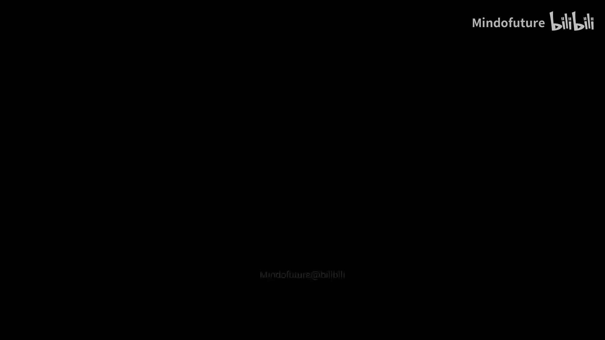
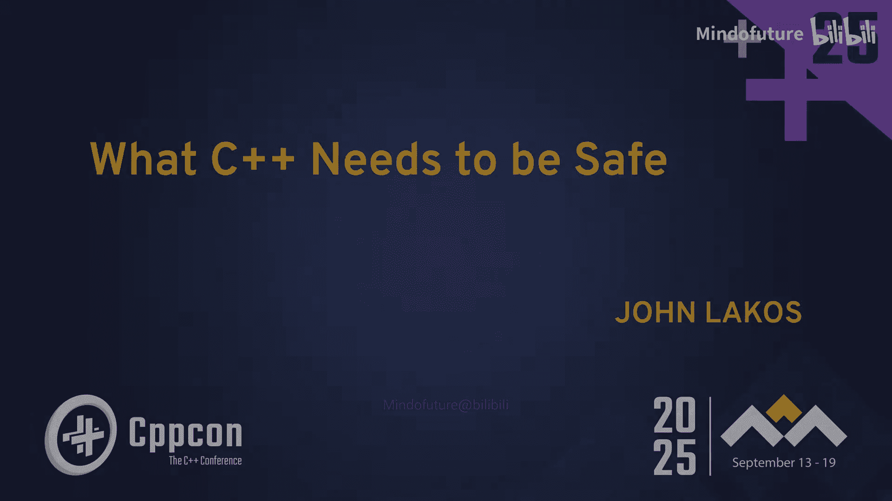
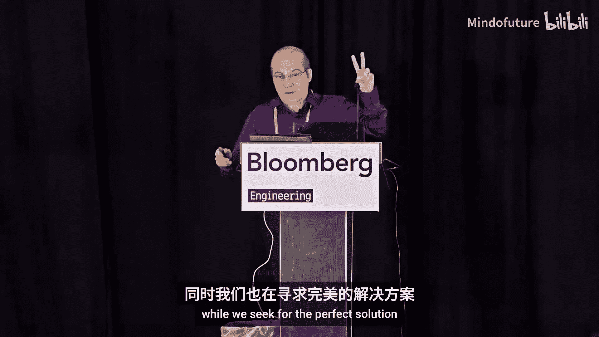
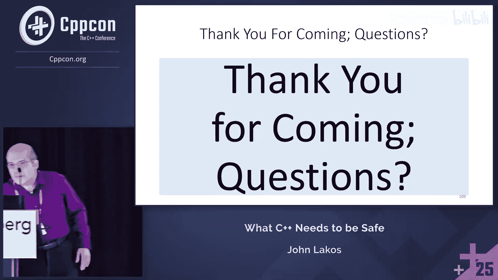
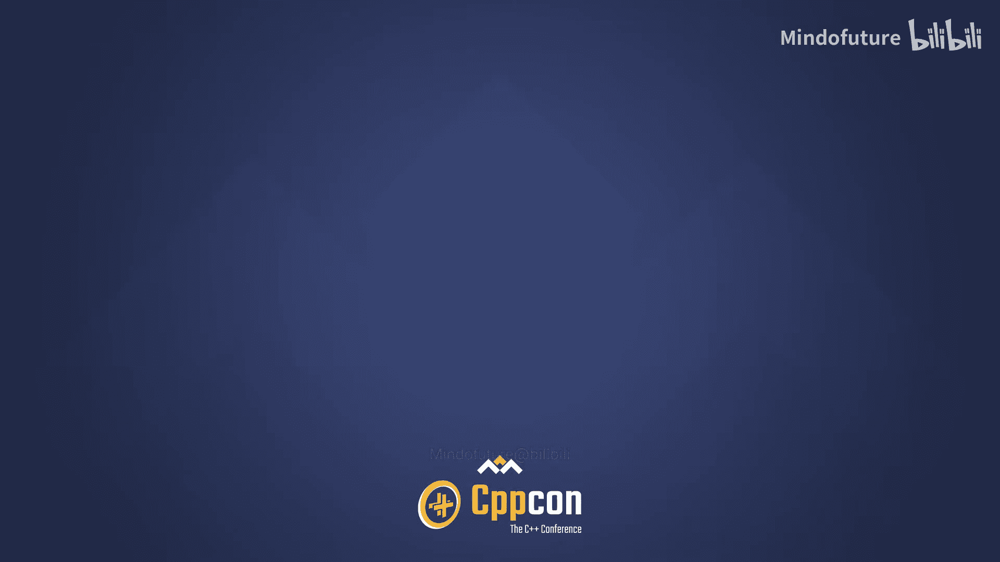

# Cppcon-2025-｜-C++-｜-C语言--｜-汇编-｜-编译器-｜-操作系统-｜-Linux-｜-Windows-p41-P41_使C++安全、健康且高效-John_Lakos-CppCon_2025--BV1wyPBzrEeu_p41-

It was amazing meeting all these people from all of these places who have been facing similar problems as me or as the company and it's nice just talking to people in the hallways after the talk during talks between talks。

Okay， everybody， welcome。My name is John Lakecos from Bloomberg， and I'm here to help。

啊。Seriously， I think people who are coming to this talk have some concerns about C++。

 how many people who are at this talk are nervous that C++ is in need of a little bit of love。

That's more than a plurality。That's the majority。About three years ago。

 it became clear that somebody needed to do something。

And I started brake glass pullever at my company。 and at the time。

 it seemed like what C+ plus is perfectly fine。 We use it all the time。 It's not broken。

 What's wrong。But there was a trend and unless you're on the ground and really know what's going on。

You might not see it at the highest levels， so this talk is the genesis of that and what I intend to provide here。

😔，Is a lot of history。A lot of currency and then a goal of what we need to do。

To make the title of this talk true， and there's a little bit of a double ontra。

 what does the talk mean what does C++ need to be safe？Was it need to be safe to use？

What does it need to be saved from rust？那慢。Both， really。

Because for people who are really invested in C plus Plus， for example， Bloomberg。

 And let's be honest， Google and Microsoft and Adobe and all of these people have millions and millions of lines of C plus plus going to another language is a problem。

So we need a solution。That preserves the trillions of dollars of software capital that exist in the world today and incrementally make it better while we seek for the。

😊，Perfect solution。 So that's what this talk is about。

 I'm going to just try to bring you all on board and hopefully that'll work。

 So there's a lot of bureaucracy in the world。 You can see by the layers of the slides that I put up for the different organizations。

😊。

The abstract is here， but you don't need to see that。

 The only thing I want to emphasize is the green on the bottom line。

 which is we're going to talk about C plus plus 26。And beyond。Introduction and motivation。

 you all know this。C++ has come under criticism， Rust is out there saying， look at me， you know。

 regulatory agencies are saying， hey， why are you guys writing in a language where they think can just run off a cliff？

Government and cyber cybersecurity organizations are legitimately saying we've got a people who don't even have a degree in computer science writing highly secure code that could have race conditions。

 like who allowed bad， that's crazy talk。So people are moving away， Google， Microsoft I。And Adobe。

 they don't want to。 But imagine if you're Adobe and you have all of these people writing multi threaded code and the multi threaded code。

 like， it can't just corrupt the whole system。 Now， some systems。If there's a problem。

And it doesn't do what you want to do， you know， something blows up。 But in other systems。

 if it doesn't do what you want to do， it's not so bad as long as it doesn't provide a security hole or corrupt the entire system。

 In other words， that it's contained。 So people have different understandings of what safety means。

 And I've had a lot of people read my slides and coach me to help me understand the difference between the way I think the way other people think。

Everybody thinks about this problem differently， and that's why people talk across each other a lot。

So our top level strategy。To get C++ back on track。Is to reinvigorate it。

 that means all of the companies have been walking away from C++。

 they're walking away because they don't think C++ has a future。

 We think it has a future and we know how we need to do it specifically we want to make it more safe。

 healthy and efficient。I picked these names after a lot of thought。

 and there's only one acronym that makes sense and it's the right order。Okay。

Three primary areas of focus， safety， Oh my goodness， correctness。To me。

 as a software engineer at Bloomberg， correctness matters。Security matters。

Those are two things that matter if if somebody can poke a hole in your program， it's not correct。

By our definition， but even if they can't and you get the price wrong， it's not correct。

And a program that is well defined behavior that does the wrong thing is incorrect by my definition。

 Not everybody agrees， not others not， it's not safe。😡，By my definition。Safety includes correctness。

 Some people do not do that I just want to make it clear health， the ecosystem needs to be supported。

 There are many ecosystems that are much， much more rich than C plus but even the ecosystem that we have people aren't putting money into implementing it in compilers we have a problem and then there's two kinds of efficiency C+ has to be second to none inef。

 nothing gets between c plus in the metal and human efficiency we want c+ to be efficient so in terms of development there are many things that we do right now in C plus that are not that efficient in terms of development yet super efficient terms of performance So making C+ safer correct What does that mean。

The essential behavior is as intended。 Essential behavior。 Remember that word。

 That's the behavior that's in the contract。I promise if you satisfy my preconditions that I will do this for you。

Okay so we also want to detect any defects I mean that's part of the goal of making C++ rich and robust and secure and then we do have a defect we don't want somebody to be able to go and poke into it and do some very evil things but that's a different mentality as a pure academic I could write a really wonderful hash function it's perfectly correct and yet it could submit to a denial of service attack in an environment where where it's set up exposed to that so you have to ask is security important in most cases it is but it's not the same as correctness okay？

Making it healthier， we just want to make everything healthier。

 and I'm going to skip over this fairly quickly because this is not important。

 we just know we need to pour money into C++ to make sure it's caught up and then efficient。Again。

 the programs need to run fast， so everything that we do。

 we can't slow it down because we want it to be safe。

There isn't a contradiction between runtime efficiency and safety。

 There is a contradiction between runtime efficiency and runtime checking。

 I just want to point that out， there is a good world。

 but you have to look at it a little bit like this， and then it's a good world。 It really is。

The humanefficiency is， and I think AI might be coming into this。

 we might get a lot more human inefficiency by just making the boilerplate code that we have to write a little less tedious。

 and there's all kinds of ways we can do that in the language。

 what we aim to achieve is make C++ easier to use securely and correctly。

 close the gap with safe languages， blunt the desire to migrate away from C++ if all you knew right now that C++ 32 would be just as safe as rust。

Would you really be so excited to run away？Think about it。Improve the typical user's experience。Yes。

 that is a goal。But not at the expense of giving away。Needed performance。

 as long as you can get it back， that's good。We want safety。

 but not at the expense of needed performance。 So default to be safe， but be able to get it back。

 I think everybody agrees。This is the way C++ was designed。I hope so。 And this is important。

I want to set an example for other organizations so everything that you're about to see in this talk。

 we started， but we want help。 The purpose of this talk is to get companies who actually want C++ to thrive for the next。

Indefinite period， we all should pitch in like NATO。And get it done。Seriously。

Doesn't have to be 5% of your GDP， but it should be something。

It really should be even if you're volunteering。This is medium to long term。

 There are people that demand that we get results in the next six months， one year。

 That's not how it works。 And I need to show you some stuff about how the standard works。

So this part of the talk is how the sausage is made for real and how we want to get it made better。

 That's why you're here。 By the way， a shout out to Sherry。

 Sherry Sane reviewed this with me yesterday and the one comment she made was tell people where they are and why they're here and what they're about to learn so that day don't start looking at their phones。

So I'm tell you now。Timmer Dumbler back in ACCU wrote this little caricature of what happened with contracts at the standard。

And it's a very， very cool little chart， which I'm not going to go over， but I am going to animate。

 so somebody had an idea back a long time ago in the Snow Ages and it died。

And then there were a lot of papers written， and then the papers stopped。

And then I submitted a paper on something that I had thought was a good idea。 It was macro based。

 and somebody else had some alternate ideas， and then they both died in plennerary and Bos， sorry。

 about it very bad。So then we started a new one and Bjorn Strestrop was on board because he thought this was very important。

 and lo and behold， we made some progress， we got the proposal into the C++ 20 working paper。

And then we got to take it out in 2019 because a lot of people weren't so sure that we got it right。

And then we started S G21， which is the contracts working group。

And we worked really hard and we got this proposal。

 and then we got it through the EWG and finally in February of this year。

 we got it into the standard。And we made it through one plenary cycle without taking it out。

 This is good news。😊，We're optimistic this time because many people believe that this particular feature is the most studied。

 most principled， most mathematical， most demonstrated just most anything you want to say。

 correct feature that ever was entered into C++。I don't say that lightly。

 I'll explain why I think that。We are here。And by the way， Herbs talk on Monday。

Was nothing short of brilliant。He had a few concerns that I don't， module of that。Perfect。

And it was very motivating。And he called covered a lot of material， and if you missed his talk。

 please go see it。Now， on the back end。I invented what is now contracts in 2003。Myself at Bloomberg。

 in 2004 it started being used all over。omberg， and then in 2009， I took it， I said， you know。

 this is really， really good stuff。 Let me productize it and give all kinds of usage examples and make it really available。

And then。Where did I go the wrong direction？No， here we go。 Then here we go。

 And then we open source it then。In 2014， we discovered something that if you have to crash your program when something goes wrong。

Then you can never add contracts to legacy code that's running。

 you never do it because you put it in the program crashes。And you lose money。

 You can't just observe it。 So we realized that our system had now gotten to the point where it was being used so much。

 we needed a new semantic called Ob。Which is why assert。Is no longer good enough。

That's why this is this is the kindergarten introduction to contracts。

 but just understand it is a deep subject that is so easy to use， It's like a car that drives itself。

 but building that car is okay， so we're going along anyway in 2020。

There's a lot of reflector traffic。And then in 2022。

 Bloomberg realizes that we need to start taking a lead。 Now， this is not brag about Bloomberg。

 We noticed that we started， We started being helpful。

 and you'll notice that we started sponsoring open source environmental things。 And eventually。

 we got to。We start， we actually had a conference on safety was at the beginning of this year。

 which we arranged。 And then finally， and this is from our CTO Sean Edwards。

 We are planning to support the ecosystem and prototyping new features。Going forward。

 this is a very important statement by Bloomberg， the CTO。 So we're serious。

 that's what this whole talk is about now。Let's look at the timeline。

What happens when you get an idea， This is what actually happened。 You get an idea and it blows up。

 Okay， fine。 You get another idea， makes it away。Whoa， it makes it into the standard。

 You start prototyping it， and the prototyping keeps going。

 but then something happens and it gets taken out of the standard。 So that whole proposal dies。

We get another idea。And it goes on for a while。 But the prototyping pays us back。

 That's what got us a lot of advantage because the prototyping showed us that the ideas in C+ 20 were really good ones。

 Not perfect。 There were a few bugs。😊，But， but almost exactly the right idea。

 So we took what we called a minimum viable product， S it down。

 which grew and grew and grew and grew and grew back， but not as big as it was before。And。

That new thing， 2900。Was prototyped and made it into the standard in。February this year。

Hopefully this stays。Then eventually， it'll make into the annual compilers and hopefully。We're good。

 Unfortunately， because every company is way behind in using the new compilers by every， I mean。

 every large company that isn't like really on their game， they'll start four years from now。

 So if you look at this， this is how。This is how。Unappealing it is to be in the Standards Committee。

 You get an idea It fails a number of times。Then it finally gets to someplace five years later。

 Then a year later， it gets into the compiler and then。Four years later， it gets into production。

 If you're a manager， you're going to send me to the Standard Committee knowing that 10 years later。

 you might not， you might be retired and maybe I got you something。 So this is just。That。But。

 it's reality。Could we do it better？This is just ongoing prototyping。 by the way。

 could we do it better？How about canonical， what could be like a little bit better？

When we get an idea， we think about it。We start doing compiler prototypes。

 and we prototype them until we get something into the standard。And then it's in the standard， yay。

 and then the next year goes into the annual compiler versions and let's say we're on our game。

 we've been paying attention because we haven't been waiting with that delay and maybe a year later we're in production。

This seems like a reasonable goal， but we can do better。What Bloomberg wants to do。This cuts it to。

Four years， we could shape off one year。By we get to this point。Immediately， put the。Prototype。

 even if it's not production ready。Into the compiler。

 into the use compiler so they can be used against the current code to get the code ready so that when the release happens officially。

😡，Done。 and that means three years， a three year cycle。

It's just one delayed from the three year cycle of the committee iss not。It's not great。

 but I don't think we're going to be able to do much better。All right。

 I took a lot of time to explain that， I'm going to p up to speed up a little bit。

But I just wanted to make sure that the beginning part， everybody understands what we're doing。

 We're trying to frame what's going on。 What does it mean to be safe means a lot of different things to different people。

And I'm just going to put this out so you can read it because you can read it faster than it。

This is something that I want to talk about， surprisingly correctness isn't considered part of safety。

As long as you want to drive your grandmother home， as long as she gets to some house， it's good。

 does it have to be her house？Just don't let her have a flat tire。 and if she has a flat tire。

 don't let it blow up the car。I must take a pause。Okay。

So I believe that correctness is an integral part of safety because if I get a price wrong。

 we have a lawsuit。What memoryHas anybody ever heard the term memory safety。

 I'm expecting a few hands？Good， that's about what I expected。 So memory safety。

 a language is memory safe if it does not permit access to unallocated on an initialized memory。

Seeing good。 Can somebody find a flaw in that because there's going to be somebody in here that goes wakeake butt。

But。了解。How about this， you're right。Am I okay now。But what's next？Accessing something that's so。

place you access D and A。That just sounds like it's incorrect。But that's not memory safety。とアセ。Okay。

 what was just said is。You're right if you have。You're absolutely right。

So there's an inch more to this。 And on the next iteration of slides， I will try to make that point。

 The point being made is。The language， if it's memory saved。

 shouldn't allow you to index outside the bounds of array that happens to land into a proper allocated or initialized。

 I think I was cheating by saying that that was the type stuff。 Maybe I wasn't。Understood。

So these are garbage collected languages， they solve the problem by not letting memory go away。

 functional languages don't let it happen in the first place。

Languages that enforce the law of exclusivity， rust， lifetime borrow checking， and Swift 6。

0 happens to use reference counting， the same idea for avoiding race conditions， but Swift。

 as I understand， it gives you a little bit more breathing room when it comes to the algorithms you write。

Now， I'm not a Sw writer， not a rust writer， but studying it。

 but the methodology they uses is automatic reference counting。

 which is different from compile time exclusivity。 So well just。

 we'll just understand that for most purposes， rust and circle。

And Swift do the good deed of making things memory safe。

 where Swift gives you just a little bit more oxygen。😊，Without doing anything else。

 I'll explain that。Okay。What memory safe isn't and this is important because memory safe has often been told John。

 memory safe is like that's good， is your ice cream memory safe， no， memory safe is not this。

It doesn't imply the absence of all undived behavior。 And so， for example， in this wonderful example。

We have this thing that's going to overflow an it。And。Indiger overflow。Is UV。

 but it's not a memory safety issue per se， right， okay？So what are we trying to achieve？ Now。

 this is the big print。 Remember that everything I say in this talk is what we're trying to achieve。

Except what we've already done， I'll show you what we've already done。I'll show you what we could do。

 and I'll show you what we're trying to achieve。So security。

 every C++ program can be built such that no core language you be is ever executed。

That's what we're trying to do。User defined functions can be written such that the plain language contract。

 preconditions and post conditions are optionally checked redundantly， typically at runtime。

We're trying to do this。And there's a little asterisk。And this is， this is part of。Engage。

Entertain and educate where I engage。Not all plain language contracts can be checked at runtime。

 Theyre for the human being。 Can somebody name something that emphatically cannot be checked at runtime。

Complex。Complexity。Okay， imagine I'm talking about a precondition。

 a precondition for a function that cannot be checked at runtime。What the function pulse。

 the function， function returns， the function return。 It can't be checked at runtime。 Okay。

 so absolutely you can because that's what a post condition is。We can check what it returns。

 I'm think about something that you couldn't check。 that will return。

 You can't solve the whole problem at run time。Okay， so suggested， you can't check。

 here's what I'm trying to say that I want to check。

That no undefined behavior is executed as the result of a precondition。That isn't satisfyatiing。

 in other words。You see what I'm saying， I'm a function。And I'm saying。

 is there something where you're going to give me an argument and I can't check it at runtime。

There's no way。Poiner me。O， it depends on how much information you have。

 If you have enough information， to check everything。I just want to point something out。 This is。

 this is not a trick question。 The more information you have in theory， you can solve。

 you can check anything。 What you can't check is something that's outside the program。

 Like have as your your CFO sign the license to your vendor that you can use the function。

 That's not something you can check in a program。But anything that's part of the program。

 you get all the source code， you get everything else in theory。I didn't say in practice， in theory。

 check anything。Okay， but that's a different story。 The halting probe， Does it halt no。

 But did you give me， like， if you pass in something and says the precondition of this thing is this function halts。

 that's a good answer。 I like that。 I'll remember that。 Thank you。This was good。

 We may not get through the talk， but that was good。What are we trying to achieve， Okay。

 we're trying to achieve that without any source code changes， we don't execute UB。

 That's what we're trying to do without any source code changes。😡。

No source code UB will ever be executed。It's what we're trying to do。Okay。

 we want to provide the tools so that but besides just the standard library。You can do it yourself。

And that includes third party libraries。 So basically， all the code。

 except that little bit of code you write near mainine has all of this beautiful stuff over here。

 I'm sure everybody here。 they never write anything。

 but there's a few lines of code to reuse their reusable libraries， right。That's the goal。

 That's what we do。No change to client code。 What's the biggest problem with rust and circle and Swift？

You would have to change your code， a heck of a lot， right， you'd have to rewrite it。😡，E。What if。

You didn't have to rewrite your code。 What if all the code you'd ever written。Now gets checked。

And let's say it doesn't get checked 100%， only 99%， well guess what， Ru doesn't catch signals， oops。

Anyway。So these are the tools， the six tools that we know about that address UB。

Runtime contract checking， error， erroneous behavior， symbolic contract assertions。

Source code subsetting previously known as profiles。

 compile time enforced exclusivity and runtime enforced runtime enforced Reverence county。

 which used to be runtime enforced exclusivity。 But it turns out that。

I'm trying to model the different kinds of things we have。

 And the compile time exclusivity is what circle and rust do。

 And the runtime exclusivity is more like。What Swift does。

 even though it does the race condition checking exactly the same way as Circle does with with the bar check。

So these are the six things we're going to quickly talk about， I hope。What's a contract。

 plain language contract。 It's a natural description of what agreement between clients of agreement between clients and libraries。

 contract assertion is C plus construct that identifies something that must be true in a correct program。

 No， put a contract in a program。 whether you check it or not。

 It's a true statement and an AI can read it。 and a static analyzer can read it in a human being can read it。

 It's additional information。 The more information you have in a test driver。

 the more redundancy you have， the more redundancy you have， the better the test。

 So if I put 100 assertions throughout my code。 They all have to be consistent。

 And an AI or human being or a runtime checker can take advantage of it。 So let it。

 let it not be thought，That， that。Having an assert that isn't checked。Isn't good。It's good。

And then if you check it， it's better。ButYou have to check it all the time。Because think about it。

You know， it's sort of a hideous description， But suppose you having a very old house。

 had a lot of food in it Turn on the kitchen and， oh my God， look at all those things running around。

So when you turn on the thing。The， the assertions when they're on。

They effectively check all the bugs。So then you fix them next time you turn on the light。

 There are a few bugs running around。 F them。 Next time you turn on the light。

 there's one running around Next few times you turn on the light there。 nobody like two weeks later。

 there's a bug to fix it。 The point is that the value of checking goes down。With the checking。

 so the more you check， the less you need to check。

And this is why the approach that we're going to take scales， because with sanitizers。

 you have to check the whole thing。 What we're going to propose is incremental thorough checking。

 and instead of doing one thing at a time the way sanitizers do。

 we're going to check everything in a small region of your program。

And we're going to do it without breaking A。Is this a research project？Okay。

C++26 MBP feature for contracts， it has precondition and post conditions。

 this stuff is well you can learn this anywhere else there are four semantics。わか？

A fifth semantic that's controversial， but is awesome。 Don't let anybody fool you。

 They were scared is assume。 Everybody knows， right that if you do something nasty with pointers。

 it's under five behavior， right。The compiler can assume you're not going to do that。

 If you call a standard function like square root。If it had any， UB in it。You don't。

 you don't even need to call it the compiler can just go， oh。

 you're calling it with a negative number now， I knows the standard square root doesn't have that。

 But if there's any UB at any standard function and the compiler can determine a compile time that that would be UB doesn't have to call it can do time travel。

 So assume is part of the standard。 It's part of the language and it optimizes code。

And the funny thing is when you have contracts。You can have code， and you can。Observe it， enforce it。

Ignore it or actually benefit from it by knowing that it isn't broken。

 so you can assume it isn't broken， but you do it in that order。

 You don't just assume it that it's cr， crray。 You assume it。After you prove it。Okay。

I just told you that。Syple use case。 And you guys know this。 I'm just going to throw it up here。

 This is a function declaration， this essential behavior， This is undefined behavior。

And just for clarity， this is a plain language contract。 Is that clear plain language contract。

 Everything is defined by the plain language contract， everything。And that comes from here。

And where does the test driver come？From here through the plain language contract。

 Where does the code come from here， through the plain language contract。

 They're all independent representations of something you all have to agree。

 When you put contract checks in， comes from here。Not from the code， from here。

 And they all have to agree。 if anything disagrees。Ask your AI to find out if they disagree。 Oh。

 they disagree。 Great， We have to fix it。 It's broken， O。So precondition， post condition。

This isn't a very interesting post condition。 Can we do better？ Think about what a square root is。

 if you took the square root， youd like the square root to be as close to the actual square root as possible。

 right。Okay。So recallco， we have this this next after function。

 So what we kind of like to do is we'd like to say whatever answer you give me。

 it's either the same number or it's a little bit below， but the next take up is above。

Or it's a little bit above。 and the next decup is below， right？ We'd like that to be true。

 It's not good enough。 We'd like that to be true。 so we can express that in a post condition where we check both sides。

 We check if it's the same， if's less than it's greater than that， That's a lot of code。

 Could it be a bug in that， you bet Post conditionsition are not my friend。Testing。

Unit testing is my friend。 There are reasons to have post conditions when you have properties。

 you put those properties in the test driver and test them。 don't have to put them in the code。

Never mind， that's another story。Now， because we've checked this， we have to do something horrible。

 because we've checked a parameter。 We've done something that absolutely makes me ill。

 We have to declare a by value variable constant。This tells the compiler that it's not allowed to change it in there for non virtualrtual functions。

 it's all in the same thing。 So it's kind of like， it's all in the family。 But for virtual functions。

 you get that in the interface。 And if you make something。

 put a post condition check on a virtual function with this mechanism。

You have to make spooky changes at a distance。I hate this。

One of the reasons why virtual functions aren't yet in the standard。

 but better we have another way to do it that doesn't cause that and we still have the worst case where we all right。

 your C++ you want to mess up your whole client， we'll let you do it but we told you we gave you another way。

 we'll talk about that。So。That's just one ugly thing that's part of contracts。 I'm sorry。

 Post conditions。 We didn't have post condition。 By the way， this， this。

 is this post condition good enough。 Turn out it's not。

 Turns out that if you use this post condition， it's possible， this one is on this side。

 The one bigger is on the other side， but it's closer。What do we write？Well。

 I spent two months analyzing this problem， I kid you not。

 two months because it can be part of the next buy in my book。And here's。How you write it。

 We're writing it with a contract to。 It could be written with a post condition。

 and then just call it。 But it's a lot of code。 What we're doing is we're going to look at the。

 the deelta。 and we're going to say if it's less than we want to make sure that the deelta on the upside is。

Is not less than what we have。 And， for the moment， assume that that that。It says for the moment。

 assume that the above squared is above x。Because it could be that we have something here and then we move up one and it's still below。

 but we didn't check that it was on the other side， but so just assume that it is。And the same way。

Here。Now I say just assume that it's going to work。

 and then I give you this proof that it does work because if what I just said were the case。

 the number would be negative， which is less than 0。

 which is less than the absolute value of the distance from the other one， which isn't zero， blah。

 blahlah， blah， the point is。When you write post conditions， you're writing code。

 it could have a bug。You got to get it all right。 That's hard work， right， test drivers。

 don't do this。It's crazy talk。Okay。Now， it so happens that if you use the previous method where it checks the squares。

In the subnormal range， it's horrible。But this one works very well in the subnmal range。

 You'll get within one tick。 That's why it took two months。Okay， most important usage。

We want this on square bracket。 We do this on square bracket。On， on standard library implementations。

 we will get 65% of the security defects。In the standard library。For that one thing。

 it's like why are we even having this conversation， It's not part of the standard。

 It's part of the standard implementation。 People need to implement their code so the undefined behavior goes away and it goes away without having to get permission from the C+ plus standards community。

 it just goes away and the author of the code gets to decide how much runtime checking they want to trade off for performance and where in the program in 29。

 where in the program they're going to be able to trade that off。😡，🤧。

Why do we call contracts assertion ghost code， anybody。It's not the primary function。

It's not the primary function。 What， what can can assertions do Can we depend on assertions in our everyday lives？

 Do we know they'll be there。Reリ。So one of the things you must remember that assertions of any kind are redundant。

 And if you're depending on them for any reason， you're wrong， The code is broken。 So ghost code。

Is code that might not be there。 You cannot depend。 It can depend on you。

 It can't mess with your essential behavior， but it can depend on you， but you can't depend on it。

 Think of Casper， the friendly ghost。Right， might not be there。Okay。Another sip。

So teaching Kate Safe contract assertion praise， remember I said that contracts are very。

 very easy to teach。Is this simple？政治的。What do we don't do？No side effects。

 Has anybody ever thought that side effects in standard assert was something we really want。

 We want those side effects。 do we。They happen sometimes。 And there are reasons why they happen。

 One of the things about this code， this design is every single assertion is independently controllable across every other one。

 So the power set of assertions are valid。 If you have a program， no assertions。

 If the programs correct， it's correct。 Any subset of the assertions then in the program are checked。

 the program is correct。 If that's not true， the program is broken。 and there are reasons for this。

 having to do a scalability well beyond what most people would ever deal with。 Remember。

 I've been doing this for literally a quarter century。So I thought about it， written many papers。

 many books， we lived it for 20 years。This is the right answer， there's no question。

 this is the right answer， and is what was said in the AI talk was it yesterday？Or is it， yeah。

 or is it the day before， anyway， what what was said was if an AI can look at it。

 they can do something with it。 even if it isn't quite right， and human being can look at it。

 even if it isn't perfectly employed。 Even if there's some corner case that we still need to fix。

 get it out there。 It's it's not going get any better until people start using it and quite frankly。

 I think it's。Garni near perfect。 And there's nothing we would change。 Now。

 We would simply add to it。 That's another thing I want to say if you have something that fixes half your problems today and there's no reason they couldn't start fixing them today。

 Why wait until they fix 80% of them in three years。That makes no sense。

So we should start using the data， again， sorry about the advertisement。The advanced discussion is。

You're not allowed to make any destructive side effects。

 What this gives license to is if you're writing， push back on your vector。And you have a bug。

 and you put a print statement in your vector， and it says pushback called， well。

 that's a side effect。Do you really want the whole program to go into a， you know。

 tailspin because of that No， so the answer is。Printing。

Printing pushback was called is not an essential behavior of pushback。 No in the pushback contract。

 Does it says， Does it say that it does it or that it doesn't do it。

 So remember that things that that it says it does， it must do and things that it doesn't said。

 say it does must be handled by Q O Y means。It would be bad QI for there to be profanities in every pushback that you pushed。

 that would be bad。So。A destructive side effect of alters essential behavior。

Essential behavior is implied by the plain plain language contract。 So remember。

 essential behavior is implied by the contract。 And if you mess with it in the assert。

 it's destructive。Okay。We're gonna have some availability to do other stuff in 29。

 I just want to give you a quick highlight。 We can enforce things right in in the spot。

 So regardless what anybody else says， this is gonna to happen。

 something is very important to people。 We've got you。We have this notion of audit that says， wow。

 this is an end square check。 I don't want it in my program。 Oh， wait， my program's broken。

 It's 4 AM。 Y， I do want it。 The third one is， instead of doing that horrible constant thing。

 we can do a capture on a post condition。 So you just say， just copy that value here。 Don。

 No spooky behavior。And fourth， we have requires clause， and that says。

Everything that I want this to apply to has to have a cost function。

 If your type that you're passing and doesn't have a cost function， well guess what？I don't care。

 It doesn't。 It doesn't count。 It's Fs out。So that's something that's important for certain kinds of programming。

 and we've got it all coming。This is something very exciting。So if you look at this。

Does anybody remember screw strips？Remember he was talking about how we can check for arithmetic gum。

Over over over， yeah， narrowing， narrowing。 But there was also another one for。

 for arithmetic overflow。In any case， there are things that happen in the standard library and we can write a lot of code。

 a lot of code。To check that， we have a bug in our code。 We're going check for the bug in our code。

 And when we find the bug in our code， we're going to throw an exception that somebody else handle the bug in our code。

This is nonsense。We get that for free with simply turning on a switch that says。

 I'm checking that at runtime。No， and then you can tell the handler， do this。

 but you should never have had that bug there in the first place。

 because if you can put code into your function that will cause an overflow。

 then your function is broken。 you need to protect it with a precondition that says I handle some handle numbers from  one to 2767。

😡，And that's it if you order tooth the day， I'll have a bug so you can't do that， so that's nonsense。

You don't have to change your source code at all。Look at this paper， P31，0。

0 R for we're implementing this is happening。 So everything that you heard about that is unnecessary。

It's extra code， it's errorprone。 It's a source of bugs。

We're not going to wait core language does not， I mean the standard library doesn't have a say in what we do with undefined behavior。

 so we're just going to make it available， you can just check your code and it'll just check it。😡。

What， you mean I can just have it check my indefined behavior？Today。Well， soon。

 as soon as we get it in， but yes。What do you think that。I think this is just way cool。

 very relevant and very current。 We need to think along these lines。

 write code that's correct and have automatic ways of determining when you fell off the boat。😊。

But not till your program。 Allow it to continue until you fix it， but fix it。This is the future。

Arrorious behavior。 This is another technique that we use。

 This is more about security vulnerabilities when we're not actually doing the expensive checks。

 making sure that something happens。 Important， the use remains correct。

Uninitialized reads was the example。 We were just going to say anytime you put an int on the program stack。

 its， it's going to be0， but that would hide intent。 That would create bugs that were。

 you would need a human being to determine rather than a sanitizer。 We said no。

 we to create a new kind of behavior called erroneous behavior。

 which is just like undefined behavior， except it's defined。But it's still wrong。

 but you can't time travel off of a bug that's erroneous。That' said。This is an example of it。Anyway。

 let me just， I'm gonna to have to speed them because I got only 15 minutes。

 But I think it's gone well so far。 So I think I'm making some good points。

I'm good at speed up the end。 I give five minute lightning talks for whole hour slides。

But the point is we have this nice Ven diagram because we can either check the preconditions on the integer overflow or we can just give it some behavior。

 We can do both。We will do both。 And That's what Rus does。There's other things。

So the rest of these are kind of less important because they're really not going to happen。

 something else is going to happen。 I'm going to go through quickly， you don't follow。

 it's no problem。Core language example is begin end。 And look at this。

 This is one of those things where we're passing in two different arrays。

 They need to be contiguous memory。 So if we put in this pretty symbolic， it's just a symbolic thing。

 It tells the client compiler。 high compiler， this has to be true。

 This is a simple case isn't going to work in all cases， but it's true。

 And now the client compiler just observes this and goes， no。那。😡，It's just an example。

 So a standards example， it's the same idea。 I'm just going to put it up so you can see it。Same idea。

But a harder example would be if there's some runtime code going on in the middle might obscure it。

 So this is where stuff gets to get hard。 And this cute example falls down。You see that。

What's happening is there's some runtime stuff going on in the middle。

And biotime stuff doesn't work well when runtime stuff goes on in the middle。Okay。Profiles。

 very quickly。Has anybody ever heard of Es？Theorio stuff。

 so profiles are just a way of what they are now is subsetting the kind of C++ you'd like in your house。

Don't put this in my house。 It's too dangerous。And that's really all it is， You put this in。

And it's an error。 Nothing to worry about， Nothing to see here。It's just another technique。

 exclusivity enforced at compile time。 Here's several hours。 Here's a day talk。

 We won't even talk about it。 The law of exclusivity in a nutshell。 Well。

 I'll leave it up for a second。 The law of exclusivity in a nutshell is basically saying you have one writer or some number of readers and no writer。

 basically。And it's enforced to compile time by something called a borrowrow checker in rest and circle。

Ands what。So here's an example。This is ill formed because even though there's no likely chance there's going to be a problem。

 there could be a problem， and none of the compilers are smart enough。

 we could reserve a bunch of space。 Now， we know there's not going to be a problem。 By the way。

 in case you didn't know the for loop binds， It doesn't keep growing。 It's not one of those things。

 I learned that。 It just。It's done。 So there's no， there's no infinite loop here or anything like that。

Anyway， doesn't help。 So circle and Swift， excuse me， C and rust won't deal with this。 but。

 but but a solution that was based on on garbage collection or or or automatic reference counting like Swift could possibly deal with this。

 So it's a little bit more air。Okay。Reference counting， enforcement runtime。

 That's sort of the thing。 So my boss's boss told me about this thing called box data， which is not。

Optional， and I wasn't able to find it online。 I I' not found anybody else who's talked about it。

 but it makes sense because it's data that's in the box。 So I'm good with it。

So box data is essential behavior and what it does is it keeps track of stuff that isn't part of what you should be keeping track of it。

 but it's going to keep track of it for you。But it's necessary information。

 And so the same thing that we saw before works fine。And this time， by the way。I。

 I forgot to mention on the other one。When you're using a compile time exclusivity。

 you can't use the standard library because it's not designed for that。

 So I failed to mention that in the other one。 I'm mentioning it now。 compile time exclusivity。

 We need an S D L， too。Here， look at this， we don't need an SDL2 for this particular property。

And we don't need to declare it safe。 It's not special。So that's good。

 The other one we had to declare it safe。 There's this safe region It's using safe code， bh blah。

 blah， blah。Sorry， I forgot that。 but you can go back in the slide and look。

 That one has to be SDL too。 That's one of the reasons we can't use it。

 And this is another example of iterator and validation。Oh。

This is inherently not compiled time checkable。But it still can be done with reference counting。 Now。

 this is important。If you don't want the problem to happen in the body of the code。

 just put a precondition on it that doesn't let it happen。

Now you'll never have a bug in the body of the code because at the call site with the precon goes。

 oh no， we don't accept that， sorry， and then the client will know where the client went wrong。

Because you'll say in your plain language country， don't do that。Preconditions guard you be。

Can I invalidate UB。Be cannot be。G data。Okay， this is the， this is the punchlight。

Optional information made available to multiple contract assertions at various granularries。

 EG all assertions within a particular function inplication that would not otherwise be representable in the abstract machine。

😊，Here's a unicorn for you。Imagine you're able to transmit sufficient information across。

Translation units without changing the AI， such that there' is enough information locally so that you can detect all U。

That's a unicorn， right， Doesn't exist。Maybe it does。

I am not promising you that we are going to be able to solve all you B。By 2032。

 but I'm going to promise you're going to try。We do have a plan。Just say。

Why do we call it ghost data？It may not be there。 Yes， it may not be there。 And when it's not there。

 it costs you nothing。This is the important stuff。What we're doing is we're doing the analog to contracts。

 In fact， it's contracts on steroids because the framework of contracts remains the same。

 We're going to add more information under the covers so the contracts become more powerful。

 It's like putting a supercharger in your car。 Now， we can check more than just array bounds。

 Now we can check lifetimes。Now， we can check data races。 Now I had a long talk with Timmer。

 and he kind of put the a little bit of the kboache on me。

 We have all kinds of sanitizers that do this。 We just， they do it on at a global level。

But even sanitizers can't check everything。 So if you don't have sequential consistency。

 your sanitizers will have bugs。But the thing is， if you're writing code that doesn't have sequential consistency。

 then you better have a few smart people looking at it and stop relying on a compiler to check your code。

 I mean， oh my dear God， that's a very， very， very small crowd。

 And there's oh so much other code out there that could be checked automatically。

 Let's not let the tail wag the dog here。And just say。But anyway， so it's not 100%。

 I'm going to say it right now， but neither is rust because it can't handle signals。

 So we have to accept an incremental improvement to something that's starting close to perfect。

It's an active research project， these are the people that are working on it。

Since I have only seven minutes， I'm just going to go through the slide so you can see what's going on。

 This is the important part of the talk and the rest of it really isn't current safety projects。

 just to give you an idea， the vector array is 65% contract violations from the written stuff is that we might do on our own code is another 20% we might get 10% from erroneous behavior and then there's other things like lifetime and。

What else， data races and finally signals and crazy stuff that happens outside our control。

 The point is that we're， we're going after the big stuff now， but we're not going to stop。

 We're going to go after all of it。 So this is really the takeaway slide。 We've got all these things。

And the point is that ghost data。Is maybe it's the scope of everything。

The runtime Refer County is a little bit more air over the compile time exclusivity because it can do a little bit more。

 but it's the same kind of safety what we're talking about with G data is that we're going to check everything that we can at runtime。

Everything， well， everything that can， in other words， our goal is check everything at runtime。

 but to the extent that we have enough information where people have written their code in such a way that it would have been able to have used a borrow checker。

 we want to incrementally reduce the amount of runtime code until it approaches and reaches the amount of runtime code that would be if a borrow checker had been used trying to say that just right。

 So it's a continuum。 the more information we have。

 the more we know the more annotations we have the less runtime data we have to preserve。

 you can think of it kind of like a compiler where it solve it's reading a line of。Of1 tokens。

 and it see these tokens， and it reduces it to a higher level symbol。 And when it can do that。

 it gets rid of that runtime， It reduces it to a solve problem。 And we want our。

 our system to do that pretty much the same way。😊，Anyway。

 I'm going to fly through the slides because I want to be done by my time。

 And I think this was a good， good thing to do。 Other projects we have。 We have bug fixes。😊。

Not worth talking about。I'll just put this up。With're through the important but memory allocators。

 you know that's my thing， and we're working on making that automatic。

 but that's not at the very top of our priorities。Trivial relocation is important。

 and I'm going to put this up here very quickly because I think either you know or you wouldn't care too much。

 And what's wonderful about trivialallocation is it just widens tremendously the amount of of objects。

 we can put in a vector without having to do this churn of deleting and reallocating。 right now。

 we can do it with simple things like like strs。 we can do much better now。

 And you'll just see this from this animation。😊，This is what eligible means。

 and then as long as this property holds。It's all good。Now。This is the new world。

So this is the example of the old world， this is the new world， so we have the same thing here。

 and now what we've added is a magic word that says I' got this。So。What happens is。Has no virtue。

 yep， yep， yep。what， that's not true anymore， so this is no longer a candidate for trivial relocation。

And now it is。Because we have clause B， so you could say either。

You do it yourself compiler or trust me。 So this is not a safety feature。

 This is a performance feature， but it's a big one because now a whole class of types can end the standard without cheating。

Be trivially。Relocatable。Does that make sense？There are other implications as well。

 This is essential for expanding this set of relocable types。Oh， so。And the good news is。

No destructive moves are called only byte copies。 and then I need to make the nerdly comment that there are particular platforms where it's not strictly a byte copy。

But anyway。Nottri relocation， it's the same idea， I'm going to skip over this because I have no time。

 but I think we did well with the time we had。And relocation。And reflection。Okay。

I'm just going to skip over this too just this is just a picture of what we're doing。

 I just want to show you the different projects we have。

 the black dots are the things we cover completely。

 the yellow as we cover it's sort of in the white s whoops。

And the whites are we cover it a little bit， but it doesn't matter。

 But these are the projects that we're working on。 just so you have it。And summary in conclusion。

 we need C++， C++ needs us。We hear you， somebody should do something we are。North Star。

 this is important， make C++ such that we can and want to use it 25 years from now。

 that's what we want。😡，We don't we want it to be a go to language for high performance。

 multi threaded computing， does' everybody be Lee has to be A。Okay， we're not trying to hurt rust。

 trying to help ourselves anybody who has a huge code base C++ has no choice。

 they must rely on C++'s existence for eternity。There's more C+ the world runs on C++。

So our top level strategy， you know this。This is our strategy。Contracts， Ronnie' behavior。Right。

Healthier bug fixes， C plus plus 26 conformance efficiency， allocators are for the machine。

 trivial relocation， relocation are both and。Reflectctionions for the human。Now this is just。

 I'm just going to show you these projects because I should。So if theres this stuff we' working now。

 this is automatic， I'm going to take a sip。And I still have about 51 seconds left。

Visit the dinosaur fe。I just want people to see that we do have plans。All right。

 so I still have 24 seconds left。These are the people that are working on it with us。I mean。

 we don't know for a fact how far we're going to get， but we know we're going to get a long way。

 And if we get close， that's all that matters。Join us。That's me。 I still have5 seconds left。 So， 3，2。

1， Thank you for coming。

And any of you are free to leave， I negotiated that I could have another five minutes if you had any questions。

Thank you for the talk， John， I'm going to be difficult and I'm going to be the double's advocate。

 you go for it。You mentioned at the beginning that many companies are moving towards rust。

 and you also mentioned that many companies are going do this because they have huge Cs plus legacy code baseases。

 but you also shown examples like Google and Adobe， which have UCos legacy code baseases。

 but they are still moving to rust。So my question is， does it make sense， like。

 what is the reason why all this effort is being put into ring the rating C+， as you mentioned。

 instead， for example， into improving the intererability story between rust and C and then moving to rust while still maintaining C as a legacyacies subset of the code base。

 Is it emotional attachment to C+ plus， there's something that is， in your opinion。

 fundamentally wrong with rust that couldn't work for a company like Bloomberg。

 or is there any major reason that maybe we are missing here。Okay， a fair question。

 so let me start with this。For companies that are just starting out。Rt is a perfectly good solution。

For companies that have enormous amounts of legacy code and legacy people。

It's the other side of the coin， if you look at Ctadel， if you look at Bloomberg。

 we have no interest in moving to rust， not because we're emotionally attached。

We have expertise in those languages。 we have software capital in those languages。 Also。

 if we move to rust， it doesn't help us not maintain the code we have already。

 The interoperability story between rustt and CF is horrible。

 not only in terms of the runtime interoperability and just sort of the mechanical interoperability but the way in which rust is written is a different mindset moreover to get the kind of performance。

 the kind of things that you want out of rust， you have to limit the kinds of code you write severely。

 and that has an effect on performance too， so the highest performance stuff is still going to be written in CF anyway。

 and yes， if you can use what do you call it a system where they all talk via some external sort of way through an external system where they're all plugins that's fine too。

 but when you're talking about stuff like Adobe where where they're actually。

Really depend on that very tight coupling。You can't do that across rust and C++ the interruptop is through like a straw。

 So the bottom line answered to your question is it's not emotional。

If I had a choice between rust and circle， I would take circle over rust and work to make that because that interoperability is at least halfway there。

But imagine if I had a solution where I could apply it to all C++ code ever written。

Turn on the checks， squeeze out all the bugs， turn off the checks and just leave it that's worth。

100 trillion。 That's all I can say。 And I'm striving for it。 Sounds good。 Thank you。Hey， John。

 thank you。 I'd like to propose a scenario and hear your thoughts on what the interaction might look like so。

Let's say perhaps I have a function calling a。Factory that's producing a unique pointer。

In this factory method that produces a unique pointer。

 maybe I want to put a post condition that says it shall not be nu pointer because it's factory。

 it's supposed to produce something。And the function receiving an I'll pointer probably also wants to do its own check to make sure that the thing that it gets back is not pointer。

 so I could see a couple scenarios in terms of what that interaction should look like。

One option might be， oh， you know， the contract and the plain language contract。

Says it won't be an no pointer so I won't check it it's fine that's the agreement option two might be I'm going to check it anyway because per your point and Hers point as well。

 contracts should be redundant。if I'm relying on it。Option three might be。

 I'm also not going to check it because maybe there's some standard library or compiler guarantee that if it is null pointer。

 it won't be that bad anyway because some expected results will come out of that。

 What do you see that interaction looking like And if I do check it also in the receiving function。

 maybe I have two error paths for the same scenario because I have to deal with it if it's the post condition。

 I have a scenario that checks for null pointer and I also have the caller condition that checks if it'。

This is， okay， I think this is the standard case of contracts。 First of all。

 the owner of Maine gets to make all these decisions。

 So every application developer gets to be their own boss。Second thing is， you can identify。In 29。

 not quite yet。 but in 29， you can identify each and every situation and treat it as you need over time。

 Third thing is， you have what's called a a a violation handler。

TheVi handler is called when what you claim to be true isn't true。And what was made。

 the point it was made， I think， in Herb's talk， is the more sure you you are that it isn't wrong。

 the better it is to check it because if you are wrong， oh my God。

 So what you do is every single checkable precondition that you have。Should be codified as such。

And then used as needed and depreciated over time because once you've checked something100 times in a program。

 not in a library， in a program， and you never see a defect， the value of checking it goes to zero。

From the condition， from the like post condition standpoint。

 would you still imagine the interaction has a check from the receiving caller， even if the。 So。

 so the post condition thing， as I said earlier， I'm a big fan of unit tests。

You can do everything that a post condition does in a unit test。There are cases。

Very rare where post condition is a thing to have。That we waited till 26 on post conditions is。

 is a shnda to use my wife's terminology。We don't need post conditionsition。 We need preconditions。

Okay， thank you。Okay， thanks for the talk。 I have a question regarding the compile time exclusivity。

 The examples you showed were part of safety， plus， plus with the。Circa compiler and to my knowledge。

 this is no longer working on the proposals， I mean， So how。

Confident are you that borrow checking actually will get into the safe C plus and the standard C plus plus。

 Okay， the question is， how confident I am， given that circle is probably not on the fast track for C plus plus。

 Circle solves a different problem than I'm trying to solve。Circle solves a problem， it says。

 if you constrain yourself to this subset of C++ with these new libraries。

Then I will help you at compile time， make sure you don't have a race condition， that's that promise。

It is absolutely useless for Bloomberg and Citadel。Because。

We have too much code that we rely on that doesn't do that。So it's not useful。

It's useful for companies that are starting out with new kids that don't really understand race conditions。

This will stop shooting them and their boss in the foot。

So that's what that's for One day way long when my children are in an old folks homes。

 we may want to adopt circle for the subset of people who are writing new code that need those guarantees。

 but today we have rust for that。And I'm trying to save 40 years of legacy， buggy code。Yeah， okay。

 thank you。Are we over。 We got one more。 Okay， I think this is the last question because we've been going for a while。

 Yeah， thank you Mr。 Do。 So my question might be a bit more abstract。

 So you have this nice plan about eliminating undefined behavior and come into memory safety in the next 10 years。

 but it still feels like this is plugging hundred holes in C plus plus。

 and it's not changing in underlying attitude of C plus+ that we have standard。

 We have behavior that is defined and every sense if we don't explicitly dimension in the standard is undefined and hence may cause problems when compiler decide to exploits that for optimization purposes。

 So like it feels like we are trying to validate inputs in order to avoid Sql injections instead of actually modify something with our attitude and not embedding user input inside SQ queries。

 I that makes sense。 Well， there's two parts。 First of all， I should have said this。

Input validation is not a use for contracts。 If you're validating input input like you know， oh yeah。

 we just want to make that clear。 That's a very important point。

Your point was we're plugging 100 holes。That is exactly right。 We have identified all of the holes。

 We have them all。We have a list。We are going to systematically instead of having your program be consumed by the cookie monster。

You're going to get told， that's wrong。That's a beautiful thing。 Now。

 your program can either continue or can stop， but it's on you to fix it。

So I don't think it's the same thing as just putting fingers in a dike。

 I think somebody's come over and they're going to put a steel plate over the dam boom theres going to be a switch that says checked。

And you'll never execute UB again。Okay， thank you。 Yeah， All right， I have to stop。

 to thank you all for coming and managed to survive my goal。😊。

