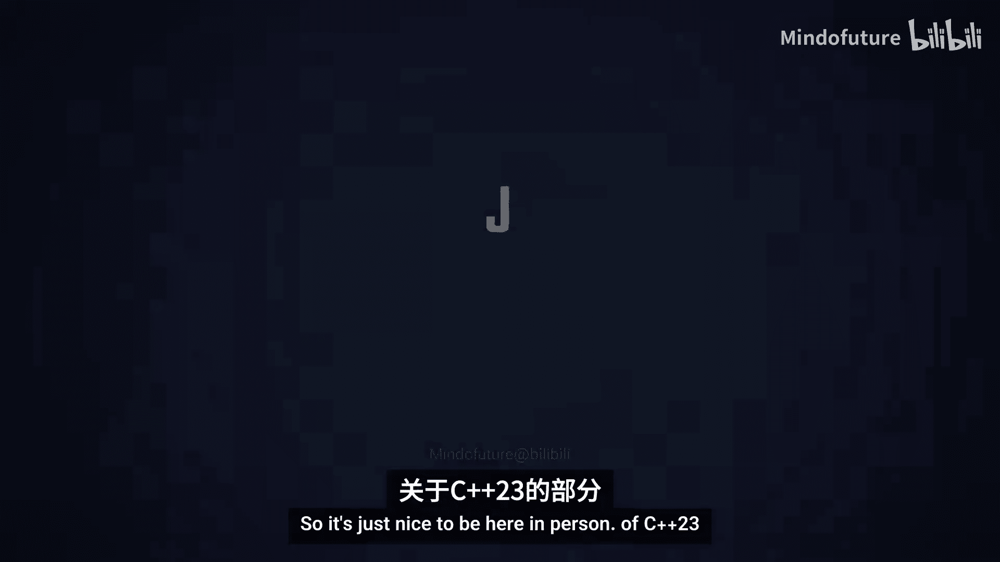
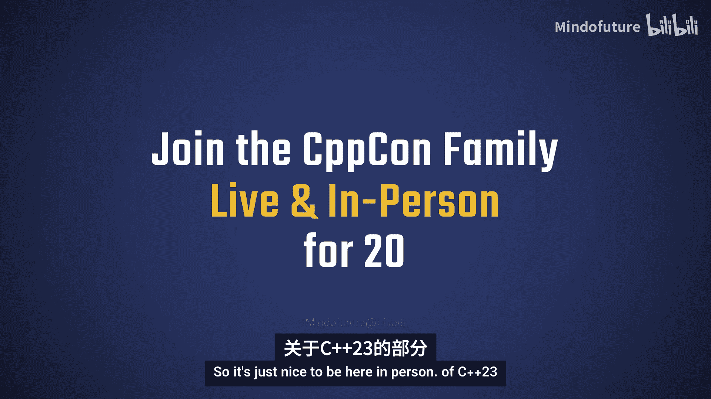
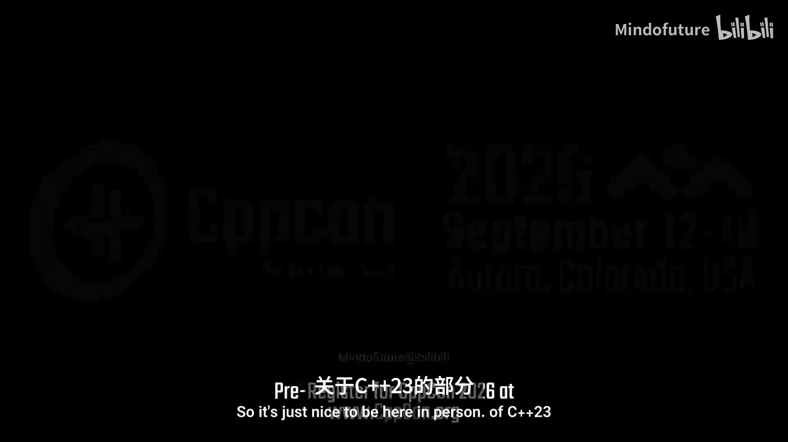
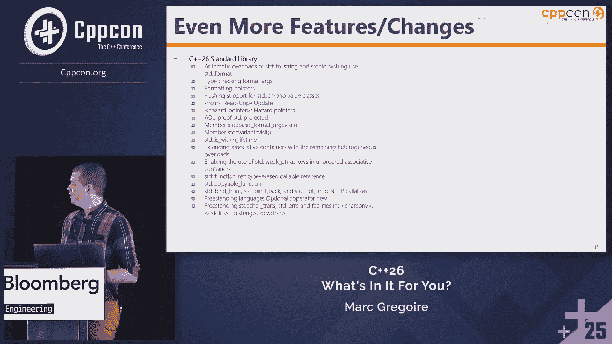
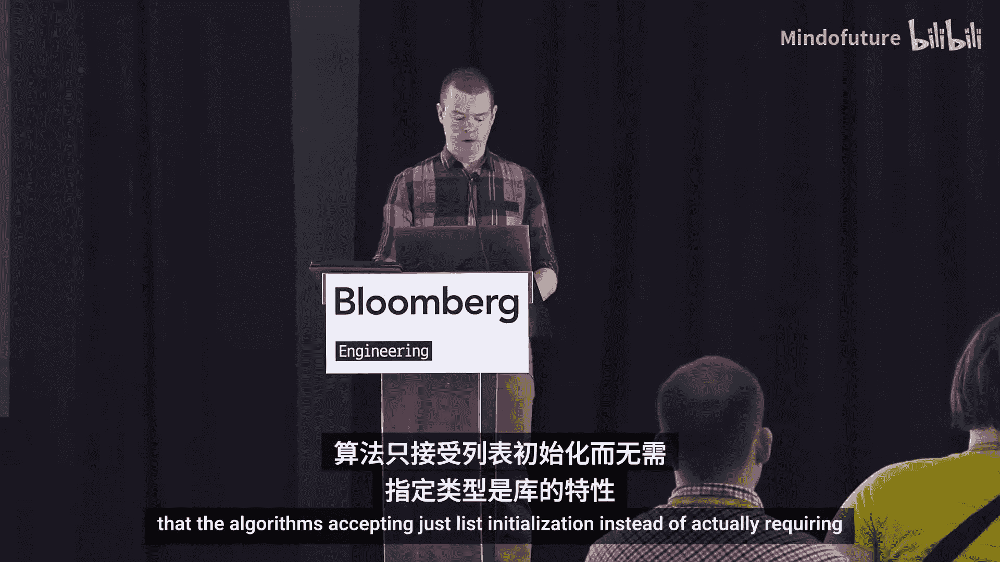
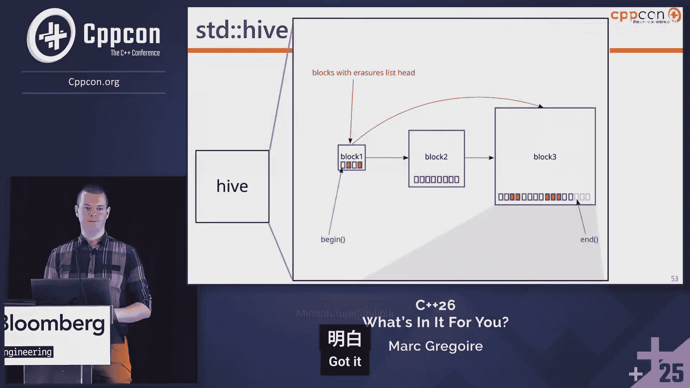
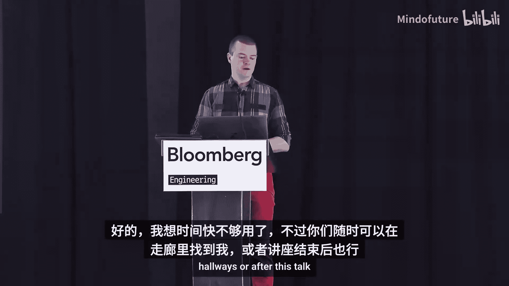
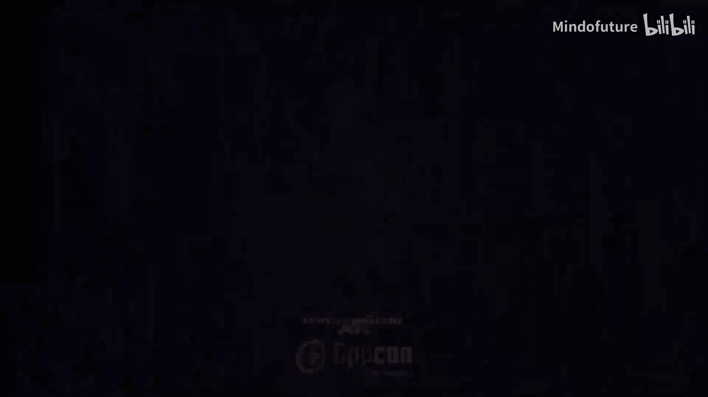
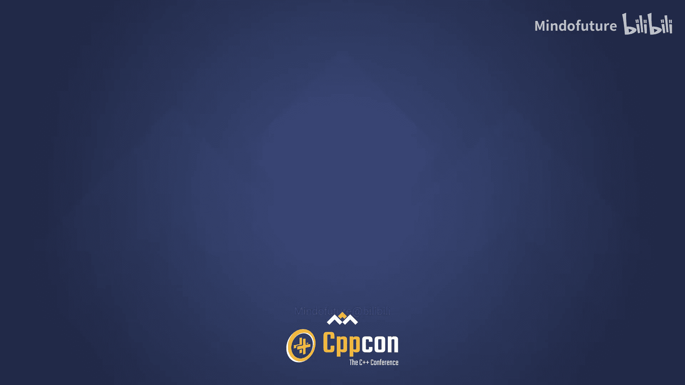

# Cppcon-2025-｜-C++-｜-C语言--｜-汇编-｜-编译器-｜-操作系统-｜-Linux-｜-Windows-p42-P42_C++26_为你带来了什么-Marc_Gregoire-CppCon_2025--BV1wyPBzrEeu_p42-

🎼I chose to attend because there are other talks that I think just being that in person really helps you engage and connect with people who have some law interests and even different perceptions。

 So it's just nice to be here in person。😊。

Which of C plus plus 23。It's already available in Chinese。 And next year。

 it will also be available in Korean。

I'm also the founder of the Bel and C++ users group。

And we try to organize like around four events Every year。 they are all free。

 and quite a few attendees are attending these。Alright。

 so I'll be giving an overview of a look of new core language and standard library features that are coming with C+ 26。

😊，The 26 standard is quite a bit bigger than compared to 23。

 And this slide lists all the topics that I will be talking about today。Obviously。

 it's not possible to， to discuss all of these issues in detail in a one hour session。

 but that's not the goal of my talk。 So the goal is to give you an overview of what is coming。

 You will have a lot of keywords that you can use to search for more information on the Internet。

As you can see， I have a lot of material to go through。

 so please keep your questions for the if time permits。

 and in the lower right corner there is a slight number that you can use to refer in your question。

Alright， let's start with the C+ plus 26 core language features。First one， it's a big one。

 It's one of the big ones that's coming with 26 is static reflection。

We get an initial set of features to support static reflection。

First component of that is a structure， data structure st meta info。

 which represent program elements via constant expressions。 and these are called reflection values。

To create， to create a reflection value from an opera， you use the reflection operator。

 And that's a double hat。Next to that， we have a whole bunch of con evil meta functions that work on reflection values。

And finally， there is this thing called a splicer that creates a grammatical element from a reflection value。

 And you see there， the syntax。😊，Let's first look at a rather contrived example just to show you the syntax。

 So in this first line， we are using the reflection operator to get information from type in。

And we store it as a reflection value in R。Then we can use a splicr to define x。

 and the type of x will be the same type as the type that is stored in the reflection value R。

 In this case， x will be of type int。Of course， you can also combine the splicer and the reflection operator together。

 So here we are defining a variable C。And the type of this。

 we query by using a reflection operator on type card chart and then using a splicer。Of course。

 this is a bit convoluted。 You're never going to use it like this。

 But let's look at the more useful example。So we want to write a function that gives you the name of an enumerator。

 This example， we have here， a color enumerator with three values。

What we want is we want the function E to string。That just returns as the string of an enumerator。

 or。If you give an invalid number， we want unnamed。So to start。

 we write a con expert function template that accepts an enumeration E， in this case。We use， we。

 we constrain E to be an enumeration。And next， we use a template 4 to iterate over all the enumerators of the enumeration。

 And for this， we use the。Reflection operator to get information about our type E。

 and we pass this reflection value to one of the new beta functions called enumerators of that gives you a collection of all the enumerators。

 and we use a template for construct2。Loop over all these enumerators。

Template 4 is also new in C+ plus 26。It's called a expansion statement。

 And that is a loop that happens entirely at compile time。

So what do we do in our loop for each enumerator。That we are looping over。

 We use the splicer to create value。And we check if that value equals to the value that we passed in。

To the function， if it's a much。Then we use another meta function called name of。

To get actually the string or the name of that specific enumerator。If we don't have a match。

 we return。Lost my pointer。 We returned unnamed。What is also new is that you can add annotations to your entities in C plus plus。

And these annotations are can be queed using reflection。 The syntax is a double square bracket equal。

 So it's kind of an attribute except for the equal sign。 And again， so in your。

In your reflection code， you can query for these kind of things。 So can。

 you can do something special for a certain type that has a certain。Annotation。

So this is a very brief overview of static reflection。

 There is much more to tell many more meta functions and so on。

 So there are in the lower right corner。 There are two interesting sessions that you can attend or watch later if you' are more interested in that。

😊，The second big addition to C++ 26 is contracts。This。

 this feature introduces three types of assertion。 The first one is preconditions。

 post conditionsition and assertion statements。 So let's look at all three of them， one by one。First。

 threeconditions。 These are assertions that need to be true when a function is called。

And most important use case for this is to make sure that the input values that are passed into the function are valid or that member variables of a class are in a valid。

 state for the function to work。And in this example， we state。

 or we require that the input variable I is larger than than 0。

We can't just use unsined int in this case， because we require I to be larger than 0。At this moment。

 you cannot specify an explanation。When an assertion is failing。

 but you can use this trick with the double am percent。

 which you could use in a past as well with static asserts。

And then if you're violating this assertion， the compiler will output this string and makes it easier to see why you violate this string。

 the assertion。M up post conditions， these are。A certain that must be true when the function has finished executing。

 So in this case， we have a clear method on a my container。Class。

 and the post condition of this thing verifies that the function has actually done what it's supposed to do。

 So when we call clear， if you afterwards call empty， it must return through。

 and this post condition is asserting that。As you can see in the post condition or in any assertion。

 you can call other member function of your class。You can also assert or include the return value of the function in your assert。

And you see the syntax here。 So what this post condition is doing， it defines an R。

 which is the return value of the function， and we can save in this case that the return value of the function must be larger than or equal to I。

These precondition and post conditions can be combined， however you want。

 and you can have multiple preconditions and multiple post conditions。

The final kind of assertion are assertion statements。

 and these are state assertions that you can put in the middle of your function when you want to assert anything。

 It's similar to the existing。Assert macro。Let's look at an example that combines everything。

 So we have a function F here accepting an X peri。Precondition is that x must be not equal to one。

Post condition says that the return value must be equal to x， and the return value must not be 2。

And in the body， we assert that x is not equal to 3。 Of course， is is a rather contract example。 Its。

 yeah， it's slight， slight good。If you call it with zero， there are no violations。

 If you call it with one， we are violating the precondition， calling it with two。

 You're violating the post condition。With 3， you're violating the。

 the assertion statement in the body of the function。And finally， if you call it with four。

 there is no problem。Evaluating these， these contracts。

 there are four strategies that are defined in a standard We have ignore。

 observe and force and quicken force， ignore。The name is， is self explanatory。

 All assertions are simply ignored。Observe when there is a contract violation。

 then we call a so called contract violation handle。And if that tur returns normally。

 then we continue execution of the program。And fourth， if there is a violation。

 we again call the handler。 If the handler returns normally， we terminate a program。

And quick enforce， if there is a violation， we don't call the handler。

 but we terminate the program immediately。This contract violation handler is called。

 It has a predefined name。 It's called handle contract violation。

The stler doesn't really say what the tunnelr must do。

 but it recommends that an implementation outputs a diagnostic message。

And whether or not you can replace this violation handle with your own。

 that is implementation defined。If you want more to know more。

 there are two interesting sessions in the lower right corner that are happening this week。Next。

 unnamed placeholder variables。 So sometimes you must invent some random name for an entity。

 and afterwards， you never use that name anymore。 So let's look at an example。 if you use loggar。

 you have to give that thing a name， even though you will never use that name。

Or sometimes you use a structure binding， and you don't care about lot of the binding。

So you have to invent the name before C plus plus 26 with with 26。

 you can use the underscore placeholder as， kind of an unnamed entity。Before C++ 26。

 the second argument to static As had to be a string literal， as you can see here。With with 26。

 it can be any constant evaluated string。 For example。

 it can be a string view from a constant evil function。What does this allow， It， It allows us for it。

 It allows a couple of new use cases。 The first one is sharing of strings。

So I can define a comess expert string and then use it in multiple asserts。

Second use case is it allows for computed strings。This code right now doesn't work with C plus plus 26 yet。

 But one stood format is called expert in a future standard。

Then you will be able to write code like this where the static assert message is actually computed。

 using a call to sit for it。Equal delete exists since。St plus plus 1， not sure。

 but now you can specify a reason。 So here we have a new API， and the old API function is deleted。

 and we explain why。An interesting use case here is if you have， for example。

 move only types where the copy constructor and copy assignment operator are deleted。

You can add an explanation of why these are deleted。 So in this case。

 we say copy construction is expensive and so use move construction instead。

C+ plus 26 introduces several improvements related to structure binding。

 And the first one is that you can now specify attributes on individual bindings like here。Maybe the。

 the introduced binding Y is unused so we can market as such using the maybe unused attribute。

A second structure binding improvement in 26 is that you can now use them in conditions。

Before they could only be used as a statement on their own or in range based for loops。

 But now you can use them in the condition of an if statement， a while statement。

4 statement and switch statements。Let's look at an example。So here we have a function F。

 and the return type of F can be decomposed into， into ABC。And with C plus plus 26。

 we can decompose the result of F into ABC。 And at the same time， check the condition。 Of course。

 this only works if。The return type from the function F implements an operator bull。

So this is roughly equivalent to the following。 So we call F。 We store the result in some variable E。

Then in the initializer of the if statement， we decompose it into ABC。

 And in the condition part of the if statement， we static cast E to bull。So the the new one。

 the first example is much more。Much more readable。Another example of its use。

 if you use the two harsh function of the standard library。Often。

 you will write code like this where you call two hearts。

 and then you decompose it into a pointer and an error code。

In the initializer of your if statement and then in the condition。

 you check if the error code is an actual error or if everything was fine。With C plus+ 26。

 you can now just do that inside the condition。 You can decompose the result of two hearts into a pointer and the error condition and do the condition at the same time。

This only works because C plus plus 26 also introduces an operator bull for the the result the result type of two heart width。

 which is two harsh result。A third improvement for structure binding is that they can now be cost expert。

 as shown in this example。A foric improvement of structured binding is that they can now introduce a pack。

 They can only introduce one pack。 So let's look at an example。

 We have a function of here that returns a topple containing an x， A Y， and a Z。So before C+ plus 26。

 this is valid code。 Of course， you can just call F and decompose it in X， Y， Z variables。

Now in C plus plus 26， you can write something like this。So F will be decomposed into a pe。

 which with a length of  three， and that pe will contain a value of type X， Y， and Z。

You can also combine it。 You can say decompose it into x and rest pack。 In this case。

 the pack will be off length 2 and only contain a Y and a Z。If you decompose it like this。

 that's also valid。 In this case， rest will be an empty pe。If you try to decompose it like this。

 that's a。 You can only introduce one pe。A next equal plus plus 26 feature is pack indexing。

 and it allows you to easily access information or a specific element from a parameter pack。Previous。

 that required complicated code or that is much more error prone。 Now， it's rather straightforward。

 Here we have a function bar that accepts a parameter pack called arcs。

 And it's very easy as you can see to get the first element out of that parameter pack。😊。

The index can be also of constant。A constant variable。 It cannot be a non constant。

 So this last line will cause a compilation error。let's look at a few more useful examples。 Here。

 we have a function template element at that accepts a veryatic number of arguments。

 and it returns the element at a given position。I。With 26， this becomes a simple one lineage。

You can call it as follows if you call it with three elements。

 you can ask it for the element of position 0， which is 3， position 2， which is 9。

 if you try to call it ask it position 3， then it will be an out of bounds error。

A second example of this is this function template structure binding element at。

 which accepts a tuple like structure， and again it returns the element of a certain index。

What the function does， it simply decomposes the， the given and double into a parameter pack。

 which we have seen few slides back。And then just uses the pack indexing to get the height elements。

So if you have， for example， astruct A having two fields A and B。

You can easily query for the zero element or the first element and assert that you get the right value back。

Next one ish hash Mba。 This is a new preprocessor directive。

 which makes it very easy to pull in all kinds of data。 Most it will be used for binary data。

 I think here you see an example where with hash emba， you import。

A P And G file straight into an array of unsigned ya。

Sometimes the source from which you want to pull your binary data might have unlimited size。

 And for that， you can specify a limit。 this case， we limited to。2，5，5 B。

And we are pulling data from de U random， which is an unlimited。Resource on Linuxux。

With C plus plus 26， it becomes very easy to grant friendship to all classes in a parameter pack。

 So if you look at this class fo， it just does two templates parameters， T N U。

 and we can easily print T N U。 But if fo accepts。A variable number of types。

 It's very hard to f all of them。Now， with 26， you can easily do this。 The syntax is just。

 you just write front。D， S dot dot， dot。26 adds a lot of context per improvements。

 both at the core language level and in the standard Library。Itself。

 so now I will focus on the quarter language editions。

 First one is that now in constant expert context， you can call or you can cast from void star。

This only works if the void star add pointss to exactly the type of object to which you are casting to。

For example， again， this is contrived。 We will look at a more detailed example on the next page。

We have an integer V with the value 42。We store a pointer of。2 v in a void star pointer。

 And then we can use static cast to cast it back to an in pointer。 As you can see。

 it's all comes expert。And what this allows， it allows for， for constant expert type erasure。

 let's look at an example of that。I hope this is readable。 This example actually comes from。

 from the standards proposal。 So what we have here。

 we have a sheep and a cow with a single constant expert member function to speak。

We then have an animal view class， which， as you can see。

 just stores an animal as a void start point。And it stores a speak function。

 a pointer to a speak function。We have a constant expert constructor。

 which stores the animal that it receives or a pointer to the animal it receives in the voidd star An pointer。

And at the same time， it constructs a speak function using a Lada。 And inside that Lada。

 you see a static cast。To cast our。To cast our animal。Our voice start， there is a typo here。No。

 that's fine， sorry。So to， to， to cast our voice star animal back to an animal star and then call our peak function。

Here。So this is the thing that is now allowed。By C plus plus 26。And then next。

 we just have a constant per Sp function， just calls the stored speak function。

 and it passes a void star animal pointer。Next， we have a dope function that accepts any kind of object that implements our animal view interface。

 and then you can call it， for example， on a cow which implements the animal view interface。

 and it all just works。 and this line。It works with C plus plus 26， before you will get。

A compilation error because static cast is not allowed。So this example is。

 is functional equivalent to standard polymorphism。But we use typepe erasure here。

 and it doesn't require any free table。And what this will allow in the future， in future standards。

 this will allow to make things like state format， function， F， function any。

 and probably many more to make these functionalities constant expert in the future。And so。

 once format is。Its constant expert， then we can use the static As with computed strings that I mentioned before。

Next， it's now possible to use placement， new in constant expert in constant evaluation。

 Just as a reminder， this is the syntax of a。Of placement new。

Bigger is that it's now allowed to throw and catch exceptions in during causal evaluation。

 So here we have a divide function。It throws an exception invalid argument when you're trying to divide by 0。

And if we call it with the arguments 5 or 0。Before C plus plus 26。

 this will result in a compilation error because we are throwing during constant evaluation。With 26。

 this will still result in a combilation error。 But this time。

 because we are throwing in an exception and we are not catching it。So if we write another function。

 also comes expert check divide。 and we just wrapped the call to divide in a throat in in a tricach。

And then when everything is fine， we return the result of the division。 When we divide by 0。

 we return a no optional。Calling it with the same arguments 5 and 0 before C plus plus 26。

 Still compilation error because we're still throwing during constant evaluation。Since C++ 26。

 this will compile fine because yes， we are throwing， but we are catching it in check divide。

 and we are transforming the exception into a null optional。

One thing that C plus plus 26 introduces a new behavior。 Everybody knows about undefined behavior。

 There are， There are actually quite a few other behaviors as well。 New is erroneous behavior。

 And this always is caused by incorrect program code。 What an implementation。

An implementation is allowed to diagnose this。 But it is not required to do so。So。

And what is erroneous behavior right now， For example。

 reading an uninitialized variable is defined as erroneous behavior。 So here we just defined D1。

 and we tried to read the value and store it in E1。 This is erroneous behavior。

Sometimes you don't want this new behavior。And if you don't want this。

 you can use a new attribute called indeterminate。If you look at this this function F here or the function G。

 it defines a Y and then passes y to F。 This is errone behavior because y is not initialized。

 So we are trying to read an uninitialized variable。If， however， like in this case。

 you define x with a new attribute in the termm。Calling F and passing X。

 this is undefined behavior not erroneous behavior。And when would you use this， for example。

 in this case， when you define an invariable x。And you don't care what is in there because you're going to override it anyway with。

 with input coming from Stut S。 Then you can just mark X as indeterminate。

That's it for the core language features。 That's already quite a lot。Now。

 let's look at the standard library changes or some of the standard library changes that are coming。

 First one， And this is a big one， just like static reflection and contracts。

 the execution control library。So brand new library to make it easier to work with asynchronous resources。

It's all defined in the execution heater。And why do we need this。

 Because asynchronous execution is everywhere。 It's used in networking。

 It's used in graphical user interfaces， file Io， accelerators literally everywhere。

Before C plus+ 26， you， you had functionality like acing， future promise。

These are building blocks and not always。 It's not always easy to use these correctly。So the。

 the execution control library has a couple of key design choices。The building blocks。

 the building blocks must be composable and generic to allow code to work with all kinds of different execution resources。

 So the the code。It shouldn't think about it， whether it's running on。

On a GP or a CPU or things like that。And common asynchronous patterns， they must be encapsulating。

 encapsulated and easy to reuse in some kind of pipeline。The whole point of this library is。

 that its。Easy to use correctly by construction， which is not the case which stood asnc and promise and so on。

During the design of the execution controller library。

Care has been taken for all reasonable use cases， domains， platforms， and so on， important。

Errrors need to be propagated correctly。 and not only that。

 but it should not be a burden to handle errors correctly。And finally。

 the whole thing should support cancellation。There are a few key abstractions that you need to know about。

 First， you have the execution resource。 That is a place something where work is execute。

 This can be a GPU。 This can be an FPG。 This can be a tadpool entity。Next concept is a scheduler。

 that is a lightweight handle that represents a strategy for scheduling work on some execution resource。

In a few slides， we will see this in a practical example。 It will become more clear。Next。

 we have a sender， and As sender is actually describing the istherlinkous work that you want to execute on your execution resource。

An a sender can send a signal。 A signal can be either a value， if everything went right。

It can be an error if some error was encountered or it can be stopped if a cancellation was requested。

And that signal is then sent to a receiver。 and the receiver basically serves of the glue between the different sends。

 It's basically a callback supporting set value， said error and set stopped。

 but similar likes it promise that promise support set value and set exception。

These schedulers and these standards are defined by the standard as concepts。Next。

 we have several asynchronous algorithms。 We have standard factories， standard adapters。

And sender consumers。 So let's look at them one by one。 sender factories。

 They are algorithms that take no sends as parameters， and they return a sender。

So the first example here， execution schedule。That's actually a center that starts the whole tassi graph。

 We will see that， in an example。We have a sender factory execution just that is just a send without any completion schedulers。

 it just sends a given value and just error similar， it just sends a given error。Sender adapters。

 it takes one or more sends as its input， and it returns on other sender。

Whose completion is related to the the input centers。One example is continuous on。

That is a standard that allows you to transition from one execution agent to another。

D is a center that invokes a given coable with the result。Of the an input center。

 And there are many more。 You have starts on when all and lots of others， other standard adapters。

Finally， the， the final asynchronous algorithm is a standard consumer。That takes one or more sends。

 and it doesn't return any sends。 So the standard defines only one。

 It's defined in this thread sink weight。 It's a standard consumer that just submits the work that you've constructed。

And it just blocks until its execution is finished。Let's look at an example。

So the first thing you need is a scheduler。 Dole starts with a scheduler。

 So here we just use a track pool scheduler。Work on scheduler is started by calling this schedule。

P method， which， which is， which returns the center on the scheduler。 And then we can。

At work to this。Using the done。Sa the adapter。 So this thing accepts a collable。And our initial send。

It doesn't return an anything。 So the lambda that you pass to our sender adapter doesn't accept any parameters。

 In this case， the Lada just print something to the to the conzola， and it returns an integer。

We can then add more work again， weve done。 And since our previous standard returns an integer。

 this new。The the new standard adapter， the Lada here must accept an integer。

 It must accept what the previous standard in the pipeline is returning。 in this case。

 this standard adapter just returns whatever it receives and adds 40 to it to it。And then finally。

 we can start the whole execution for this。 We use this this threat sink weight standard consumer。

 So it just triggers the execution and waits for the execution to finish。 So up to this point。

 up to this goal， maybe nothing has executed yet。 It's always synchronous。

 maybe execution is finished， maybe not we don't know。

 but here we just wait until the execution is finished。Alright。

 C plus plus 26 introduces two new containers in place vector and hive。 So first。

 let's look at in place vector。 It's defined in in place。Hower file。

 it's a dynamically resizable vector， but with the capacity fixed that compile time。

And it uses comptiguous in place storage。 What does in place storage mean means that the elements for the vector are stored within the vector itself。

Why is this useful？ Well， sometimes memory allocation is not possible。 It can be expensive or not。

But expensive as the second one。 Maybe it's not possible。 Maybe on some embedded systems。

 you cannot allocate memory。And maybe you require that the storage of the elements must be in place。

 for example， if you want to serialize with manmcopy。So what is the different pitto array。

And in place， vector T， N can store up to an n elements。Wireless it array always stores and elements。

So in place vector is dynamic。Simple example here， we define an in place vector with capacity 3。

So fix that compile time， restore two elements in it。So the size becomes2。

 restore a second or a third element in it。 sizeize becomes3。

If we try to put a next element in there， we will get an exception。 We will an exception of that。

 eoc will be thrown。If you don't want exceptions in your use case， you can use Tri pushbe。

If you do this on， on an effect that is full， it will return no P T R。

 It will not throw any exception。Hve is the next one。 So it's defined in hive。

 It's typically known as a bucketary， or an object pool。

Concept is that you have multiple memory blocks of elements。

 and every element has a booleion to say whether the element is still valid or has been deleted。

 This is typically called a skip field。 Why skip field， Because if it is true。

 that means the element is erased， that means it will be skipped over during iteration。

When all the elements in a block have been deleted， then the whole memory block is delocated。

And if all the the blocks are full， then we just add a new block。 So let's look at it graphically。

 So here we have our hive。 If you zoom in， you will see there are multiple memory blocks， block 1，2。

3。With the number of elements in there。And all the rat elements are erased。

 So these are ready to be reused for a next insertion。

How exactly an implementation implements this skip field that is not defined by the standard。

Benefits， there are no reallocs when you erase something。If the memory， if the。

 the hive is full and you need to allocate a new memory block。

 there are no real locationss of existing elements。So basically。

 all element memory locations stays stable， and iterator stay valid even if you erase or insert。

Using it straightforward， if you use any of the other containers， you can use hiif。

 So we define a hi here with two elements。 We add two additional elements。

 and now we just print it in a range based for loop。Z+ plus 23 introduced M D span。

 and I 26 introduced a new function subM D span， which returns a view of a subset of an existing M D span。

 So let's look at an example。We have a function here，0，2 D2 D grid， which accepts a rank 2 M D span。

 and a rank 2 and D span is two dimensional grid。 It just loops over all the elements and puts all the elements to 0。

And then we have a function called 0，3D cube surface， excepting air rank 3 MDD span。

 which is a 3D cube。And what the function does， it is going to put all the。

The values of the sides of the cubes to 0。And to construct a view of the six sides of the cube。

 it uses the subm D span function。Next， we have saturation arithmetic。 So normally。

 if you do our arithmetic， it's mod2 N。Now with 26， you can also do a saturation arithmetic。

There are four new functions defined for this for this to add， to subtract， multiply and divide。

Values using this saturation arithmetic。 Let's look at an example。

If you are representing pixel values as unsigned charge， then。2，5，5 means it's a white pixel。

If you want to brighten an an image or this pixel。And you add 4， for example。

 to it with normal arithmetic， the result will be true， which will not be bright at all。

 It will be very dark， actually。So in this case， you use the new function at set to use saturation arithmetic。

 And then when you add 4 to 2，5，5。You get 2，5，5。All right。

So 26 allows construction and reization of string streams and bit sets using a string view。

So this line of code that already works。 So you can construct a string， string string from a string。

 You can now also construct it from a string view。You could already re initialitize it。

 re initialitialize it using a string。 Now， you can re initialitialize it using a string view。

And similar for a bitset， you could already construct one from a string。 Now。

 you can construct one from a string view。Textingcoding is also new。

 It allows you to retrieve the textingcoing used by literals in your code and the texting code encoding used by your execution environment。

Simple example function here that verifies if your environment supports your D F 8。

A more complicated example。 We have a function print suffix that prints a duration to an output stream。

A duration in microseconds。 And we would like to use the actual micro character， if。

It is supported by your environment。 Otherwise， we fall back to outputting US。So first。

 we check if the literal encoding support is U TF 8。 If that is the case。

 we check if the encoding of the output stream。Supports you with the F8。 And if that is the case。

 then we actually output our micro character。Otherwise， we fall back to it outputting。US。

Native file handles， C plus plus 26 provides access to the underlying O native file handle for output streams or any kind of thing。

It's defined by a new type alias it's called native handle type。

 and your compiler will map this to the right type for your OS， for example。

 on Poss it will be mapped to int on Windows， it will be mapped to a handle。

And then the basic classes， basic file aboveuff， I F streamam， O F streamam， and F streamam。

 they all have a new method called native handle that returns the native OS S handle to your stream。

Let's look at an example。Here we have a last modified function that is using the postex Ftt。

Function to get some information about a file。 So that requires an int。

So this function accepts an in a file descriptor。Then in Ma。

 we use an O stream to create an output stream for file photo T Xta。

And if we want to call our function last modify， we need to pass it to file descriptors。

 So the underlying native handle。 And so we just call native handle and pass that to two。Last modify。

As mentioned before， C plus plus 26 introduced a lot of constant expert。

 new constant expert functionality， core language， standard library。

 the core language we already discussed。 Let's， let's look at what's new in the standard library。

 first thing。These stable sorting algorithms， stable sort， stable partition in place merge。

 they are now constant。So using them is not different as as currently。

 So I'm not going to show an example of that。The C mat and the complex headers。

 they have much more constant expert functions。 They have functions such as the three autometric functions。

 many， many more。 They are all constant expert。 now。 again， using those is trivial。

 So I'm not going give an example of that。EMost methods of s atomic and s atomicgraph are now constant expert。

The specialized memory algorithms like an initialized value concept， an initialized copy。

 an initialized move， they are all constant expert。As we've seen earlier。

 you can now throw and catch exceptions during constant evaluation， and for that。

 all is standard exceptions such as bad cost， invalid argument。

 and so on are all constant expert now。Finally， all the containers and all the container adapters are an now constant expert。

 That includes deck， priority queue， map， spend， in place vector， all of them。😊。

Except for the new hive， that is not constant expert。In 2022。

 there were four new S I prefixes adopted。 So  C plus plus 26 now adds them to the C plus plus standard。

And these are for extremely small or extremely large numbers。 They are called。

Know how to pronounce them， Cuueta， Ronna Ronto and Cuuectto。And implementation only defines these。

 if。The intmax T of the implementation can represent the denominator or the numerator。

 This is nothing new。 The existing Yokto， Zpto， Zeta and Yota。

 they are also conditionally defined only when the intmax T of that platform supports them。Debuing。

 There is a new debuing heater。You can now easily and platform independently check if thebugger is attached。

You can programmatically trigger a break point， or you can programmatically trigger a break point only if the Bhar is attached。

 All of that is no platform independent。New Heather L Al。

 it introduces a whole set of free functions for linear algebra computations。

 and it is based on the basic linear algebra subroutines library。

C+ plus 26 only supports a subset of the BL A S standard。

 so it supports these things like elementwise vector sums。

 multiplying all elements of a vector or matrix by scalar and so on。

 including generating and applying plane rotations。So this is all very mathematical。

 So I'm not going to give a detailed example of this。 I'll just look at a very。

Trivial example in a couple of slides。 But let's first look at what are the features of this new library。

So it uses three functions。 It doesn't use overloading operator overloading to represent matrices and vectors。

 It uses stoodut M D pen， which was introduced in C plus plus 23。

It allow implementations to optimize for mates and vectors， with small compile time dimensions。

And implementation must support mixed precision computations with matrices and vectors that have different element types。

Finally， it must be possible to provide an execution policy to， to every function。

To allow the implementation to factorize it or parallelize it。Let's look at an example。

Here we define a vector of 40 elements。 We then use the existing otta algorithm to just fill the vector with the value starting from 0。

 So it will be 0，1，2 3， and so on。We use Stut M Dpan to create a view on our data。

 So this view will be the sequence 0，1，2，3， all the way to 14。

Then we use one of the new linear algorithms called scale。

 and we scale all the values in our vector by 2。 So this result in 0，2，4，6。 We can do it again。

 We can scale again。 And this time， we pass a execution policy。P uns to multiply everything by 3。

 So the result is 0，6， draw of 18。New and S plus 26 is that you can access complex values as if they are topple like values。

 And what this allows is。You can use structure bindings for complex values。For example， in the past。

 you could do something like this。 You can use a reinterpret cast to cast a double to an array of doubles of two doubles。

 And then you can use a structure binding to decompose it into the real component and the imaginary component。

 This is ugly。 and yeah， this is not， not very readable。With C plus plus 26， it's trivial。

 You can just decompose your complex value into the real and the imaginary parts。

26 introduces a new view factory。 It's called view is Conca。 So what does it do。

 It takes any number of input ranges， and it creates it returns a view that is the concatenation of all the elements in the input ranges。

 For example， we have three vectors here。Initialize with own values。 And we have an array。

We can then use the View Conca view factory to concatetate the three vectors in the array together in one big view。

 and if you would print that， you get the elements 1，23， all the way to8。

There are new overloads for operator plus to allow concatenation between string and string view in both directions。

 So in this example， we define a string and a string view。

 and you can see that you can add a string view to a string or you can add a string to a string view。

 Both work just fine。List initialization for algorithms。Let let's immediately look at an example。

 We have a simple point direct here with two fields， X and Y。

 and we have a default operator equal equal。We define a vector of points。

 If we want to put a point in our vector， you， you can just write it like this。

So you can already use list initialization to add a point to our vector。

But if you want to call algorithms like finds or fill。You had to specify。

 You had to specify the point type with C++ 26， don't。 You no longer have to do that。

 and you can actually use list initialization force to find for ranges filled and for all the other algorithms as well。

There is also a new view adaptive to catch the result of a last D reference of an underlying iterator。

 Sounds complicated。 but let's look at an example。We first defined two lambdas。

 a square that simply print something to the conzola and returns to the square of an input value。

Second one is even again， print something to the consolezoole and returns two or false depending on whether the input is even or not。

We create a vector of five elements。We then use views transform to square all the elements。

 and we use views filter to only keep the all the even values。If we now output that， remember。

 we are outputting something in our Ladas here。If we output this。

 you will see that transform is sometimes called multiple times for the same element。So here。

 transform is called for2。 And here again， transform is called for two and the same for4。

So sometimes this might not be optimal performance wise。 So in C plus plus 26， you can fix this。

 What you see here is exactly the same code as on the first slide。 Nothing has changed yet。The。

 the only， the only thing that we change is we add this single line cacheching latest。

 If you now look at the output， you see that transform is only called ones for all of the elements。

There is also a new range based algorithm to fill a range with random numbers。

 It's called arranges generate random。So in this example， we are defining an array of 42。

Integers we define a Merscent twister and seat it with a value from a random device。

We define a uniform in distribution to only generate numbers between 0 and 100。

And then we use the news to arranges generate random algorithm to fill our array with random numbers generated by this Merrccent twister。

Cours that are also iterator based overloads。And talking about random numbers。

 This is the first time since C plus plus 11 when they introduced a random heat。

's the first time that a new random engine is added to the standard。 In this case。

 we are adding the fireux engine。There are two predefined engines。 You have filelux 4 x 32 and 64。

What are the benefits， they have a very small state。 So the phylux 4 x 32 has only 10，32 B elements。

They have a very long period。Pilox 32 has a period of 2 to the 130。

They are easy to factorize and paralyzze so well suited for CPUUs， GPUs， FPGS， and whatnot。

And they are already very broadlyly used in， in， in， in research for Monte Carro simulations。

Using them straightforward if you can use any of the other random number engines。

 So here we just create a phylx 4 x 32。Seated with a value from a own random device。

We use a normal distribution， and we generate a random number using that new engine and the normal distribution。

With C++ 26， it becomes easy to format a file system pad。So so you can format it with stood format。

 print， printer and so on。 So in this example， we create a path for user bin。

We output it using St format， and you get the output that you expect。

This all works with U TF 8 file names， as well as you can see here。

 This example is was executed on Windows。Z++ 26 introduces very small little new feature。 In fact。

 I was surprised it wasn't there。 at the time when they introduced print land in C++ 23。

 If you want to print a blank line up to now， you have to do it like this。

 print a end and specify empty goods。C plus plus 26， you can omit the empty quotes。Small feature。

 but I think it's very nice。Finally， there is a new heater called Cdi。

 It defines a bunch of data parallel types and operations， all in a portable manner。

So we have two data types。 We have data par CD and data par C mask。

 CD mask is basically a CD data type where the type is e boolean。

And we have a whole bunch of overloaded mathfunction that work on such data in parallel。

And all these operations can take advantage of the Cdy instructions that are available on all of the。

 the latest CPUus。This is again， rather complicated topics so I'm not going to。 In too much detail。

 let's just look at a very easy example。So here， we define a date。Simdy。X， we define x of type C D。

 This case， it's 16 doubles。It can be initialized using this syntax where you just pass a the lambda。

And if you， you can also just pass Sdy value straight into print All or format。To output them。

 And in this case， you will see that they are initialized using the slumda。 the result will be 0。

1 to 3， all the way to 15。And then we can use overloaded mat functions that are all defined in CD。

 Here we are calling some trigonometric functions。Actually， we are calling this formula。

 If you apply this to all these values in our。Sequence。

 then the result is that all of them will become one。 And you can see if we output it。

 you get a sequence of 161 values。Sorry。All right。That's it。

That was an overview of a lot of new updated core language feature and some of library features。

But this over is far from exhaustive。 The C plus plus 26 to is really， really big。嗯。

Just to give you kind of a sneak preview and a lot of keywords。 If later on， you look at the slides。

There are many more code language updates。You have things like unevaluated strings。

Were adding some new characters to the basic character set。We are also。

 we are removing several features。 I， I didn't actually exhaust list what we are removing。

There is a distinct called Oxford Vaatica Coma。 We have trivial trivial unions。

 observable checkpoints and many more。 And that's only additional core language features。

 We're not even looking at additional standard library changes。That's this。

It's a huge number of even more changes to the standard library that's coming with C plus plus 26。

 It includes things like hazard pointers and read copy update。There are lots and lots of。

Updates for free freestanding functions。There are additional changes to the Rangers library。

 We have the standard library hardening and many， many， many more， so。

Have a look at these slides later。 And you have a lot of keywords。

 You can search more information for it。So to conclude C plus plus 26 is a very big update，That's it。

I have a few minutes left for questions。Hello。You said that the。Algorithms， accepting just。

List initialization， instead of actually requiring like the。

 the type to be specified as a library feature。 Was that facilitated by expanding the rules of the language or did they just add new。

Overloads that are more generic somehow or how how did they allow that entirely it must be the latter one。

 right， it's， it's pure， it's pure standard library update。 Okay。

 maybe initializer list or something。 Sorry， Maybe initializer list Maybe I don't know exactly how they they done it。

 but it's pure in in the in the standard library。 It's， it's no core core language changes。 Okay。

 thank you。So I have a question about to initialize the unpacking in if statements。

So I'm not really clear about the syntax use set， this is。

I can drop now the second statement in the if。But on what is the if condition actually evaluated on the last element in the unpack or on the return of the function。

 return of the function。 So in this case。We have a function F that returns some kind of data type。

 which can be decomposed into， in this case， A， B and C。

 But that the data type of this return must support an operator bull。Okay， and you。

 you can see that also on this example here。So two hearttz， it actually returns。

A data type called stood2 heart results。 This is not new。 This was already the case before。

But what C plus plus 26 adds is an operator bull for this data type。So then if you call it like here。

It， is being decomposed into a pointer and， and an error code。

But the condition is actually going to call operator bull on the return type。

 It's maybe easier to see， on this light。Here， where I'm decomposing and。

 and the condition on in in in one。 It's roughly equivalent like this。 So we call our function F。

We store the result of F in E and the type of E is exactly the type what function F is returning me。

 And then in the initializer of the if statement， we are just decomposing it in ABC。

 and in the condition part， we are calling static co blue of E so。This type must support this， this。

 Okay， thanks。 It did not go as roughly equivalent， too。 Thank you very much。Hello。

 for the high container， I just wanted to know like。

 what is the time complexity for random access and。Toide right through it。 Sorry。

 the time complexity of for the hive container time complexity of random access。Or accessing like。

 based on index。Right， right。As you can see。F。So the hi exists of several。Disjoint memory blocks。

 right， They can be scattered into blocks in in memory， but。Yeah。

 I guess it's not mandated by the standard how they are implement。

 but I guess one block will point to the next block will point to the next block。

So iterating over them is yeah， linear， yeah， okay。And yeah， benefit， again is。

There are no no real realloc happening ever。 So if。

 if you have like an iterator to one of the elements， it stays stable。

 even if you add elements to your hive or if you delete elements to your hi， it stays stable。Go。

Thank you。

Alright， I think we're running out of time， but you can always find me in the hallways or。After this。

 this talk。 Thank you。

