# Cppcon-2025-｜-C++-｜-C语言--｜-汇编-｜-编译器-｜-操作系统-｜-Linux-｜-Windows-p43-P43_C++中的Rust特性运行时多态-Eduardo_Madrid-CppCon_2025--BV1wyPBzrEeu_p43-

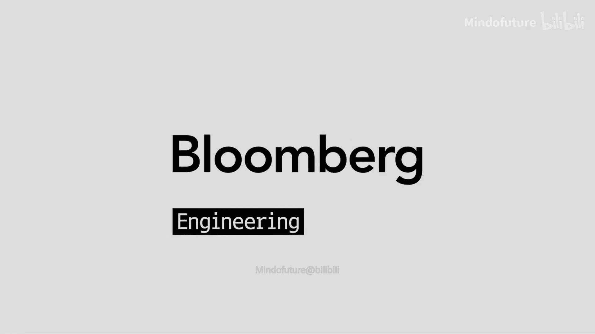

All right， thank you very much for coming So we admired that we're going to talk about is how to do the same thing that we do in rustT for runtime polymermorphism and capture that in C++。

 which will give us a lot of advantages and options that we can profit from。

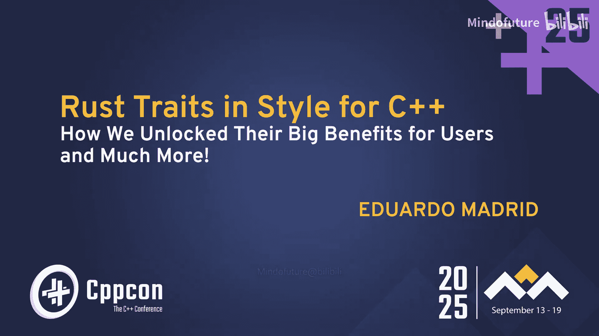

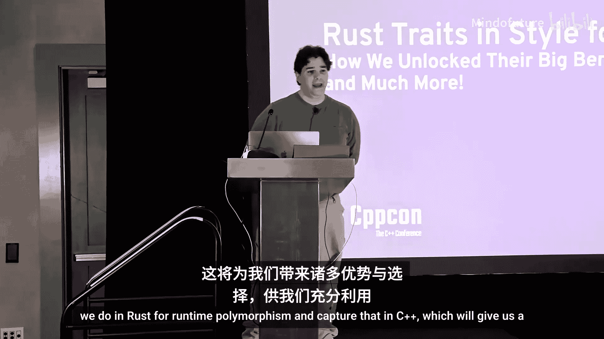

So。Who are we， What will we do。Myself， I am the lead of the open source library called Suu。

 as in the namespacesu， we have done published things that have been communicated to the community in several presentations by my collaborators on I。

 including S， Ipie or Hah table based on the Robin Hood invariant and all the things。

Before it was a team lead or a tech lead at companies such as a snap and hedgephones that do automated or highrequisite trading。

So there was an environment that was very challenging because， for example， in a snap。

 object code size matters a lot in the mobile space。AndAt automated trading， low latencies are。

Butmount。And the things that I try to communicate with the community are。

Tings that are amazing that can only be done in C+ because of the specific characteristics of the envelope of abilities that C++ gives us。

😊，And just to， to let you know， I am Ro as skeptic， but I hope that we all can learn from。

 from good ideas from other languages。 And I， I want by show of hand。

 Please tell me who among the audience is a fluent Ro programmer。😊，Okay。

 I see about a third of the audience。 So that's very promising because that is more or less the target that that I was aiming for。

So we're gonna go about showing you a little bit of rose code so that you get familiar with it and get the the the flare rate。

 But it's gonna be very simple flcentric。And also， we're going to be going over things that are more or less on the theoretical nature。

 because in my opinion， we're going to be straddling such a cultural gap between Ross and sus laws where we better know in depth the concepts that we're going to be talking about。

 And I hope that that's going to be helpful to you because。In in。

 in one to one trial rounds or some bits of this presentation with friends that I used to get feedback。

 they have told me positive positive feedback about a little bit of refreshing way to explain things that that we have been studying for a long time。

Okay。I'm going make the abbreviation in the slides of R P for runtime polymermorphism。

 It is a mouthful and sometimes will not say it。Yeah。

 there is a series of presentations in which have covered this topic。 And there are other， like。

 for example。The presentation by Feor Picos at Cyruslo now last year of Te demystified。

 which I'm going included in the series because they mutually reinforce。

 there is some overlap between them， and they mutually reinforce。Okay。

 what we're gonna be doing today is something that is nearly impossible。

Instead of the feature for wrongtime polymerism in the language， which is a virtual inheritance。

We're going to use user code， in particular， the typeas framework。

That allows us to see the thigh benefits from the rust。

Programming language feature to do runtime poleover fuism， which is Ro ratess。While stealing C+。

And if we survived the challenge of understanding all the necessary things really well， which is。

Truly important。 the part of really well。 Then we're gonna get a best of all worlds combination。

And that in implies better performance， better object code ties and more model empower to。

And meaningan that we can represent what we want to represent。

With greater ease than what any of the individual languages will allow us to。So how is this possible？

 Well， it's because of C plus+， of course。He he has the characteristic of performance preserving or increasing even abstraction。

 because when you use the mechanism of s， you inform the compiler of many more things than other languages。

 and therefore， it can optimize fooder than in other languages。😊。

Sproos has this attribute of not committing to any particular one true way of doing things。

 It is a skepticical of itself。 So it lets users do things that might rival the internal mechanisms in the language at times。

It is also because of our community's resistance or tolerance for outstanding complexity。

 So that doesn't scare us too much。And I'm telling you this because I really hope that this presentation shows you the value of coming to these conferences。

How we gather each other， how we gather so that we can help each other。O。

We have to arrive to nearly the， the， the proficiency of language designers。

 Let's start that journey。Before our focus is what we are not going to talk about is the compile time powers of rawrate things like concepts like mono of for fation and。

 and， and those things。We're going not talk about the runtime polymorphism and the style of royomes that resemble standard variant。

We're not gonna be doing comprehensive coverage of all the features and options。No。

 we're gonna be talking about Ro to C plus loss bindings。

 Was anybody expecting that we were gonna be talking about ro and C loss bindings。

I see that nobody raises the hand。 That's， that's quite a relief because I didn't put that in the abstract。

 and I regret not having to。Yeah， so the real focus is on guidance on how you guys can able are are empowered to do what I'm gonna be showing you by example。

 So what I'm gonna show you is just an example。 The idea is that。

 you can do it on your own with some other type framework if you want my my type framework that doesn't matter。

😊，What is the style of grandtime polymermorphism of ro Strs， Alas， I cannot tell you。The style part。

 But let's start with what is runtime polymerism and why it is good。

 I know that everybody knows runtime polymerism and why it is good。 But let's review that。

The issue is quite simple， in my opinion。We need to identify the essentials。

To not have to deal with the relevant details。 So it is an exercise of focus。And what do we do when。

 when we captured the essentials of something， among all things that we understand it much better And therefore。

 that helps us tremendously at every single step of the way。😊。

But if we use some cell mathematical reasoning， there is also an idea of reusability that is very true。

 And I want to flesh out in more detail。Which is， if you have any implementations of a mechanism。

That your code base wants to use in M different ways。 Then in principle。

 you you're gonna have a combinatorial quantity of combinations of the implementations and the uses。

 So you're going have to have the multiplication of those two dimensions the pieces of code。 now。Efa。

You do the work to come in with a good abstraction。 Let's call it an interface。

Then perhaps you're going to have the same n implementations and the same M uses。

But the total amount of pieces of code that you're gonna be doing is one plus n plus M。And。

 of course， if we get it right， that's going be a huge win， right。

So it is really important that we have all the tools necessary for us to come up with great abstractions。

Attractions that relieves us of work as opposed to introducing work for us。啊。

And what we're going to be doing again is abstraction。

 That process of identifying the essentials is very much what we can talk to as abstraction。And also。

 if we get good abstractions， we get conceptual leverage。Now。

 runtime is simply that the actual implementation is not known when compiling the code。

So that that you're gonna see later that the， the code during his execution discovers what are implementation that he wants to use。

 Therefore， they are not known when you were compiling the code。Ber motivationt face him， well。

Hear me out because this is subtle。 And I hope that at least some of you see this for the first time。

The whole idea is that no matter what implementation is， that you can substitute any implementation。

In the code and things will just work。So the multiplicity is the part of polyan。

 the morphism is the behavior。So there is the Lico sub principle。

 which was named after the inventor of the concept from UCLA Barbaraissco。

 and I say UCLA because I live in Lossaists。Were you all already aware of the lecop institution principle and Barbaralico。

 please raise the hand。Okay， I see about three quarters of the audience。O， in the style of traits。

 I cannot tell you what style means at this point in time。 It's better if I do it later。

So lets start with part1。 the intro， the introduction is over。

We're going to have the concept of a type， which is what we normally refer to as an interface。

And the subtypes are going to be implementations。Warning。Most languages including C plus flows。

Conflate both things， subtype in relations with subclassing relations。

And we will see that that is precisely the bulk of the problem they are going to be solving。And。

EThat's what we are not going to be doing。And Laroa interviews everything by a simple example that hopefully is going to be familiar to all of us。

 which is the example of serialization。So let's say that we have this interface of serialization。

Are you able to see they read， read the slide from the back。I see that there's not a problem， O。

So I hope that this is not unfamiliar code for any of you， right。

And what we want to serialize is an integral。But integralger does not inherent from the interface of serialization。

So。We had to start doing basic work， which is wrap our integers into a rapid type that inherits from the serialization interface。

We're cool。 We will write the inter wrapper has a template。

 Sos all the same issue of wrapping for everybody。 Well。

 we are and we come up with something like this。 don't focus too much on the the details of the code。

 because I assure you that when you see later the slides or the presentation online is pretty much what you will expect。

 It's a template that takes an arbitrary type。 It called a serialized wrapper because that's what it does。

 And it fleshes out two routines， which are the As defined in the interface。😊，No。

What are the problems for civilization has apl， We just stumblemble with one major issue， which is。

If youre soty in relation。Is invented or discovered as needed after you have written very good types。

Then you're in a bind because either you reexpress， re do， rework。

 retrofit the inhabititance relation to the existing types。

 or you had to come up with wrappers for them。And。These these can get very quickly， very nasty。

Because let's say that you want the same time to participate in other。

Sotyping relations and participating in all of them simultaneously。

Then you had to have wrappers for each of the individual interfaces。Meaning。

 that one raper needs to implement all of the interfaces。

 So every time that you use an order sub type in relation， you had to retrofit。

 That's the type in relation to all of the rappers that you had before。Well。

 I really like that growth rates don't have these problems。

The tragedy is that subtyping has subclassing is the most popular and the worst way for doing subtyping。

 okay， so。This is something that our colleagues that designed rust。EThey。

 they knew better than than falling into that pit。 And they gave us something that we're talking about today。

Al right， How does that look in rust， And I'm very happy that two thirds of the audience more or less told me that they are not very fluent rust programmers because。

😊，Perhaps some people might see these things for the first time。Okay。

 I declare a trait that I call it serialized。And I put in there one API that does the work of taking the self。

 This is the equivalent of the D parameter， but has a a nonmable reference。

And because it's gonna mutate the， the， the thing that it's gonna write to。

 it takes a mutable reference。 And then it， it produces a mode of result return value。So。

After you had declared that。The slide shows how to give something that is primitive that that that predates the trade。

How to give the capability of serialization to something like an interview。

Or any type for that matter。 And what you do is to say the implementation of serialization for an integralteger is to do what the code shows。

And if we want to see more robust example， this is compilable Ro， I believe。And。

We are defining a user type， called point。And we are making it so that it's kind printed within parentheses and a coa。

And we keep the serial like or the for that we show a moment ago。So。

What are restrains an opting mechanism for types to participate aim subtyping relations。

This is not related to inheritance。Which is a structural property in C plus plus。

It does not need base classes。 it does not need the rapids。 So those things are。

 are absent from the universe of problems that we have。

So Ro rates have a lot of interesting things for compilation time because unlike， for example。

 E C plus flow that if you invoke a function that has overrides， So that is virtual。😊。

Even if you wanted no， I， I really want to execute the， the， the function defined find in this type。

 the dynamic dispatch is gonna be activated。 and it's kind of tricky to， to， to get that。

So you can do that in in， in in ro at compilation time， which is good。

But that's out of focus of what we're doing， because in C plus， we have such。

Phenomemenally powerful things for compilation time that。

We don't have to embarrass Ro by making the comparison。 Okay， so another thing is that it， it。

 it truly captures the essence of the benefit of Python's do typing。

 which makes Python one of the reasons why that Python is very popular， in my opinion。

It's just that you have to be explicit in the binding between the objects and the interfaces。

 Allright， that's quite an acceptable trait that I'm happy to， to， to endorse。😊，No。

Let's see something that is a world of hurt C， plus， plus。That we try to use as a member variable。

 not a reference a pointer be a smart or do pointer。

 something that we want it to be to have the capability of runtime polymermorphism。

But at the same time， we are member variable。The problem is， of course， itslicing。And let's say。

 as an interface。Rontime polymorphic interface typically， is empty of all data。

So its size is just the virtual table pointer。But any implementation will， almost for sure。

 will add data members into it， right？ So if， if you assign something that is bigger to something that is just an interface。

An instance of an interface。Sure， you're gonna feel properly the， the， the， the。

 the parts of the interface， but you're gonna damage all of the siblings that are right after the。

 the remembering your data layout for the user type。And to make things worse。

Your code can pass unit tests can work in production apparently。

 but as soon as those corrupted sibling data members are are needed。

 Then you get a catastrophic error。 And that's a henbo。And the compiler lets you do this because。

 well， again， in Cplos， we can do whatever we want。 So we better know what we're doing。And。

 another problem is the， theherit， the intrusive nature of inheritance。Number one。

 it forcess an structural property just for the sake of infusing something with a runtime polymmorphism。

And I think that is not an acceptable thing to do， because。

The structural property of inheritance is to describe a relation of E A not can do what this interface requires。

 So we are like using the wrong way to express things for the purposes of infusing run temple overphaism。

 of course， this was the signal what，45 years ago or thereabouts。

 because its not when it was released to the polying。 but。When it was designed and。

 and and thought about， well。Okay， another， another problem that I just show you concerning the slicing is that these forces referential referential semantics。

 So not just that you have an indirect that requires an location and a lifetime management explicitly and so on。

 right。😊，But that you're working with a reference and that incentivizes sharing the state disables local reasoning and a host of other problems。

 So when I was writing the slides， there was a number least overflow。

 And now there is a softed overflow， which is I should stop talking about this because I have monopoliized the time of other presentations on just this topic。

Okay， so。They sub in pains art。That we need to wrap perfectly good types to put them in a hierarchy。

 And that's busy work。And the typical example is wrapping integrals in something like a serialization interface。

And you've already explained the problem of retrofitting and the problem of ava launching when you want your。

 your types to participate on several。So typeping relations simultaneously。

 So it's much better that both of them are a separation of concerns， principle away from each other。

Another problem that I see with with inhabitance and virtual is that is specific way which it is designing to the language。

 I find a fault defects on that the， but it is a ticket to leave it feature。

 something that you cannot argue with。 you cannot modulate in any way。 So like for example。

 there are several teams that altogether disabledable the generation of any runtime type information because the rules of the language make it so that every time that there is a virtual there has got to be a th of R T T I that is completely useless are worthless。

 but it has to be generated because it is part of the design of the language。

So there's no way to tell the language。 Okay， I won't be。

 but please don't bother with the RTTI part because I'm not going to use it。For example， okay。

And there are many more problems。And I can。 I haven't watched this presentation because it happens that when we wear at Cus doesnt C Nikcolio Sus and myself We at the same time slot。

 but I'm really confident that Nikcolio Sus did something great。

 And the YouTube video premieres in 14 days。 And we can make a party to watch it together。😊，Okay。

 so how do you use a trait in rust。In general， you just make it a member， right。

 And you have to use some magical incanations， the the dean part。😊，And outside of the dean。

 the box part， right。And these are technicalities of rust。The。

 the should offer the thean is necessary， because。The， the。

 the serialization is going be used in dynamic dispatch。 And the compiler， when it is compiling this。

 it doesn't know what is the size of the actual type of object that is going to be。

Ting under the trait of serial life。And the part of box is， sort that you， you tell。

In your specification， exactly how you want to， to， to keep it。

And this is basically so called fat pointer in which internally he has the pointer to the value and the pointer to the virtual table that implements the runtime polymorphic APIs。

And there are other ways， to hold the value， like you can have an Rce。Reference counted and， and。

 and so on。The， the thing is that I didn't put it in the slide that's on mission。 the。

 the box actually has value semantics。 It has an indirectction。

But because it is exclusive ownership and so on。 that is the the indirect from the point of view of semantics is transparent to you。

 Therefore， it is value semantics。So you have the the really bad part of needing an allocation。

EAnd having an extra indirect that makes everything pointer chasing and is lower。

But at least you didn't lose value semantics。In the solution that we're gonna see in C plus plus。

 we're gonna see that you can get value semantics。Most of the time。

 if you want universal or absolutely， all of the time， if you disable altogether。

 the possibility of having to use the hip。So it's your choice。

And this is just a declaration of the user type。 And now this is the implementation of the user type。

 And then we're going to see more details of rust。Like， for example。

 in the part of a T serialized plus a static like like this part here。Cial di aesthetic static。

it is Ro is culturally different to C plus plus。 and you have to be careful of not looking at things having references to objects that don't belong to you。

And static is a way to say， yeah， this is not gonna have views references into things that are outside。

And don't get scared too much about it， because once you begin into programming in Rata， heflows。😰，诶。

Or or this is not something that that that becomes a hindrance。And the。

 the way to use it will be very trivial， Right， Like if you want to mutate a buffer and you want to mutate a user type and。

That's the way that you invoke a civilizationization。 you re the trait to some other object。

And again， use a runtime polymorphic。That it offers。Now。

 they in the style of part of the title of the presentation。

 there is a big gap ideological between Ros and C plus plus。

 So the things don't translate one to one。Ro is very serious about mutability。

 and itgates the problems of mutability by requiring you to do something called borrowing a reference。

And then there is a borrowor checker that guarantees this property。

 There can be one mutable reference。Or as many as you want to。E non mutable references。

 You cannot combine it， to。And the thing that enforces that is the borrow checker。In simple sort。

 of course， we do whatever the hell we want。 So it's like。Very different。And of course。

 that roster has to allow the programmers to to， to do things that the normal invaris and and conditions。

 So that are guaranteed by the compiler and maybe even the run time。 And for that， there is unsafe。

 right， which is basically trust me。 I know what I'm doing。

typey of code and should only be used when necessary as opposed to liberally。

Another thing is that inross moves are that the fault and implicit and the copies are obtained。

And the reason being that that really helps with rust error prevention。

There is no implicit copy on pass or assign for own in types。

There is a very clear split between copying that they make it mean just a trivial copy。

 like the bit bit wise copy of the values versus cloning that a copy ofstructure and might have to do some work of allocating a new resource like a new member buffer or opening a file or whatever。

 right。That， and the borrowing rules make it so that the compiler prevents youth after move an eliasing box by construction。

So， they cannot happen。Unless you， you， of course， destroy the guarantee by using onsafe in the wrong way。

So， roasting。In a sense， has a lot of restrictions。So that you carefully。Work around them。

And that saves people from the typical food guns on， on， on sto that， you know。

 we don't have feet anymore。 We are all cs because our feet have gotten so many shots that we had to replace them with something severe。

 right。So box by construction。There is one major limitation that we have that。I cannot help。

 Or I don't know how to help。 I haven't seen a way to express the rules and the borrow checker so that we can benefit from breast error prevention。

 This is a feature of the language and syntheizing the feature of the language in C plus flow via。

 the user code is doable， but it requires a very serious amount of word to， to。

 to make something that is practical to use。Also， we can learn from the style of rust and constrain ourselves has adopt that as a discipline。

By the way， thisstruct user type that I show you is move only。

 Now that I have explained that moves are by default and implicit。

 and the copability is an opt that takes work。 Real work to to， to do。

 Eric can tell you that that structure is move only。Okay， so now what's going be the solution。

 Hows going， How are we going to， to adopt those benefits of nonintrusive runtime polymermorphism into C plus loss。

Well， we're going to use the technique of type era。

And the precursor to typesure is that there is a design patterns called external polymermorphism that allows you to。

 from the outside of the type。Give runtime polymorphic capabilities to a preexistent type。Now。

 if we also do external polymermorphism of the ownership routines。Destruction。

 moving and potentially copying if you want them。 Then we have absolute control of the object。

We can do whatever we want with it， right， because we have a cell control， then。

That's what we call typeeration。And I， I I went and made a presentation now out of the apparent contradiction between。

Dypareration， which I call it internal， external polymermorphism。

That's Cpress online and Cpro close now this year。So the best description of external polymermorphphaism I have ever seen is in the book C plus Los of what designed by Klaus Eagleberg。

 who is a frequent presenter at CPP con itself。😊，This is the cover of the book。

 and I wholeheartedly recommend this book， the part of external polymermorphphaom means really well explained。

 The part of type ratiosure is the best explanation of type ratiosure。

 but there is a conflict of interest because he mentions my work in that chapter， so。

Take you test you want。Express of traits in C plus+ to synthesize runtime polymermorphies in a different way。

 we will use。In general， the， the gist of what we're gonna be doing is to use the excellent compile time polymermorph capabilities。

 O C plus plus。😊，To synthesize runtime polymer facing capabilities。

And the way to do that is to basically imitate or one way among the many。

 But this is truly practical is to imitate the way in which the compiler creates a virtual table and does all all those things。

 When I say virtual table， do I leave everybody on board or。Yes， okay。

 The people didn't even bother to say yes。But it was very clear that it was unanimous， okay。

How to build a virtual table is something that we absolutely need。After that。

 we need to devise either five pointers or the type array containers。

 or they are the same thing that manage a value and link them to their virtual table。

 Why do they need to link the values that they manage to the virtual table for the obvious reason that they have to perform their virtual dispatch or the dynamic dispatch。

😊，Sorry， I said bit dispatches。 I should have said just dynamic dispatch。

A mechanism for the users to be able to extend highpe containers with the equivalent of their raw traits。

Okay， so。There exists a type framework。How would a user use their trade in that framework。

Let's say that the user wrote a serialized affordance。serial lies forments。That's the user trait。

And okay， how， how， how would the framework allow to the incorporation of that capability or affordness into。

 into runtime polymorph， Allright。So let us read from the bottom up。 they so destroy。

 so move and so copy are just the basic affordances， the basic capabilities。

 the ones that that flesh out keep。呃。Tration。Among other things， if you don't use Su copy。

 for example， then it would not be copyable。 It would be move only。 if you want it to be copyable。

 then you put su copy in。 If you want a different destroy mechanism， for example。

 are destroy that does nothing because those objects will be taking care of by program finalization anyway。

 So why put all of the binary object code of the the structure or things that you don't care about destroy because the operating system is gonna take care of wiping everything out you can make the selection of destruction ofance that does nothing。

安涉我。Then the void pointed there。 that is the ssification of the local space。

It's not that you're gonna have a void pointer。 It is that you're gonna have something aligned and and of the size of a void pointer to work locally to。

 to put values there or perhaps a pointer to the hip， okay。And those things are given to the。

 the policy builder in the framework。And you can make the substitution of configuration for policy。

And in this line that we're defining the container。Were justta indicating。

The policy has the argument to any container。 So any container has the name suggests is。

An extension from standard A。Not that extension Roman in sorry is isn't inspired by a standard N E and to a significant degree。

The way to use the serialized straight is you pass it has a con reference。

 a value or whatever you want。And invoke the members here into the。Into that container。

 And somehow that's gonna activate the runtime polymorphic API。And if you want to make one。

 you can construct it， or you can write a make function that in this particular case。

 is just going make a likes a lot of an integral。So。I hope that this is relatively understandable。

 Any questions。Okay。Now， this is the entirety of the code of an affordance。

This wall of code is actually less frightening when you inspect it in detail。

 And that's what were gonna do momentarily。😰，But that's it。

 Like this is the civilizable trait expressed to be used with the Suux type ratio。Now。

 once we have done the， the trade。We， we can see in the part of the dynamic dispatch and the virtual table mechanism。

 right。In particular， an object of a type that is serializable。

 something that can go inside a serializable will have a virtual table with pointers to the implementations of the functions for serialization and length。

 According to what we defined at the beginning of a serialization interface。

That's not the only thing needed because we need to have full control of the thing。

 So we need destruction and movability and optionally copability to。

All of these runtime polymorphic behaviors will be activated by invoking the function pointers in the virtual table。

Then the objects most must have all of their state and appointed to the virtual table。

 That's why they are fat pointers because you had to refer to the object some， in some way。

 and at the same time， binded associated to the virtual table point。And by the way。

 that's the same thing happens with virtual and overrs that implicitly your memory layout of your polymorphic types begin with pointed to the virtual table。

 right。And， of course， that this is taken off by the type ratio framework。

 So how is it taken care of。We're going to see this live later， but let first。

So within C likes affordance， which is the wall of text that we I glossed over a moment ago。

 There is a soup structure， a soup type。😊，That is called。

 it needs to be called the V table entry because it is picked by the name V table V table entry in a way that I'm gonna show next slide。

And what he says is for any runtime polymorphic object that has the capability of me。

 then please put two function pointers with these signatures in the virtual table。So' good questions。

Okay。So。The the way in which the framework does remember that we were giving these to the policy builder。

 the policy andas for， for this structure。And this is structure takes the holding model。

 how you want to model the， the local space and avariic pack。Or a pack of affordances。

And so the V table is the composition via inheritance of the V table entries of each of the affordances。

And it has some ergonomics， like the ability to do an opcast。 And in some other place。

 there is a template that from the the， the， the， the， the total， the global， not the global。 sorry。

 the， the complete virtual table for the container to refer to the part of each individual affordance by using the affordance as a template argument。

And this line， by the way， is， of course， the same thing has overloaded to be used in。Vant。

 but the lifting of that idea to a scenario in which you are doing composition via temporary parameters I。

 I think that this is probably the most successful line by career。😊，And by the way， we have done 70。

70 slides already。 I hope that you are enjoying yourselfsels and that sum of value has already happened。

😊，I I， I show the number because， of course， if you later have a question。

 take notice of the slide number and。We will refer back to it because we are stepping up on complexity。

 okay。Now， how to implement the virtual table。The framework is going to tell the functions。

it's the framework is's gonna tell the the affordance。The concrete value manager。

That is gonna be managing the， the， the object that is gonna be doing the work。 by the way。

One of the reasons why it is the concrete value manager as opposed to avoid pointed to the object that is being managed is because a concrete value manager might not offer the value。

They can do things like scattering。 They oriented scattering。

And so the fields are gonna be scattereding to a raceer of a structure。 Sorry， in an array of a。Of。

AStuc of a erazor of fields。So the the， the， the framework by itself does not commit to have to maintain the object somewhere。

 It can give you a proxies to the fields that it has。Okay。But in this particular case。

 this affordance is prepared to use the concrete value managers that have the function of value。

And now it is a good time to inspect the signature of the。

Function pointers that are being initialized with noncap Ladas here。

 And you're gonna see the use of con void pointer or void pointer。

That's because a void pointer is a universal pointer。

And the concrete value manager is the one that is gonna tell the affordance。

 What is the concrete type， hence the name of what it is managing。

And so the the code obtains the pointer to the value and uses it。

That's what the slide means without having to， to， to read it in greater detail。

So now we have runtime polymermorphism。We're really get we're， we're， we're。

 we're getting really far ahead。So how is Sir。The dynamic dispatch mechanism bound。

To the user observable capabilities。The affordance， the user affordance。

 the trade equivalent needs to provide the user affordance。Member。

That is templated on the complete container in this particular scenario。 if we go back。

 a few slides would be any container on that policy。

And it's gonna use the curiously the recurrent template part in downcasting or sorry no is。Yes。

 it is downcasting from we because usage affordance becomes a base class of the。

 of the whole container。 you can downcast to that container。 And that contained in unfortunately。

 I chose the name of container to refer to the value manager。 But that's what container means。

 So value manager and the value manager。Allows you to have access to the virtual table。

That will be here。Allows you to have access to the virtual table。And you can access the。

 the serialized implementation。 And that's how you get the， the pointer that you want to call。

 And there is the invocation that ties all of the facilities that we architected。

ETo be made available to the user。Okay。So let's recapitulate in particular。

 I want you to observe that this identifier is。What we use。On serializable。

 which isn't any container。So the lies lives in any container， and it has the member function set。

We can go to the compiler Expr questions。Well， oh good。 and， and they are， they are not asleep。

 by the way， so。Things are going well。Back in planet earth。

We I have shown you that we do the same things that rorates do。

We have subtyping without subclassing the nature of this runtime polymorphism is opting。

We are also using overloads and templates to implement the trade for all types to satisfy a property。

 For example， being insertable to a stream。That's what was taken care of in the implementation function。

Like， there is an implicit。え。C all that is the function how to serialize。

That takes the pointer to the value。 No， doesn't take the pointer to the value。

 takes the reference to the value。And this reference to the value， of course。

 it has the full type of whatever it is contained in the， in the any container。

And Ro allows you to accomplish what I showed you a moment ago in C plus+。

has so called blanket implementation for all types that implement the trade， so。This will be the。

 the， the， the， the way to do it。So the impulse P column display is restricting the what we would call the template parameter T。

We have a concept。Of display， by the way。Formerally。Rostrates are similar to simplepl flow concepts。

 It's just like， I said that we were not going to talk too much about。

They compile time capabilities of that language feature。So， we can recap。

We can capture runtime polymermorphism， the style of rorates。

 We have succeeded that making it obtain sub typing without inheritance of or sub classing。

 we have completed size depth to all of the problems。 but we have advantages。You saw， for example。

 that in， in my my framework。It is absolutely transparentpiring to the user。

They have value semantics through and through。 And because the user can configure the buffer to what they think is best。

 they can perhaps choose to use a a configuration for the local buffer that is very， very large。

 So you would almost never。You have to point to the allocation on the hip or you can make it so tight that the only space wheel is for appointed。

 So everything is gonna go on the hip and therefore。

 box and such a any container will will be basically identical。🤧嗯。

Another choice that you have is to not use the， the， the the， the big policy constructor。

 which is a S policy。But put the bits together in your own way。 I。

 I can show you an example of that if you want， so that you altogether disable HIA location。

 for example， so that you are， from that point on， it will be a compilation error to try to put something that won't fit in the local buffer。

Or vice versa， Or maybe even do something really cool， which you cannot do in Ros。😊。

Which is that your value manager is not on the hip。Has a reference by a normal pointed or local。

 But there is a third option of it being a shared pointer。

And then you can share the actual object via some other shared pointers and so on。

 I have shown these in other presentations。 So I I'm just mentioning that all these possibilities are。

 are available。And， and I want you to， to， to really think about something that I believe is the most important part of it all。

 okay。That we are syntheizing。Programming language features in user code。

That's why we have so much power， so much in terms of。

 of capabilities and modeling power and even performance， or wide performance。

 because we can make the optimal choices for our needs。

The choices that cannot be offered to us by taking it early leave with the。

Program in language feature。And then。You have the wonderful characteristic that we remain within C plus。

 plus。😊，And the conclusion is that C+ is that powerful。Thank you very much。 I am ready for questions。

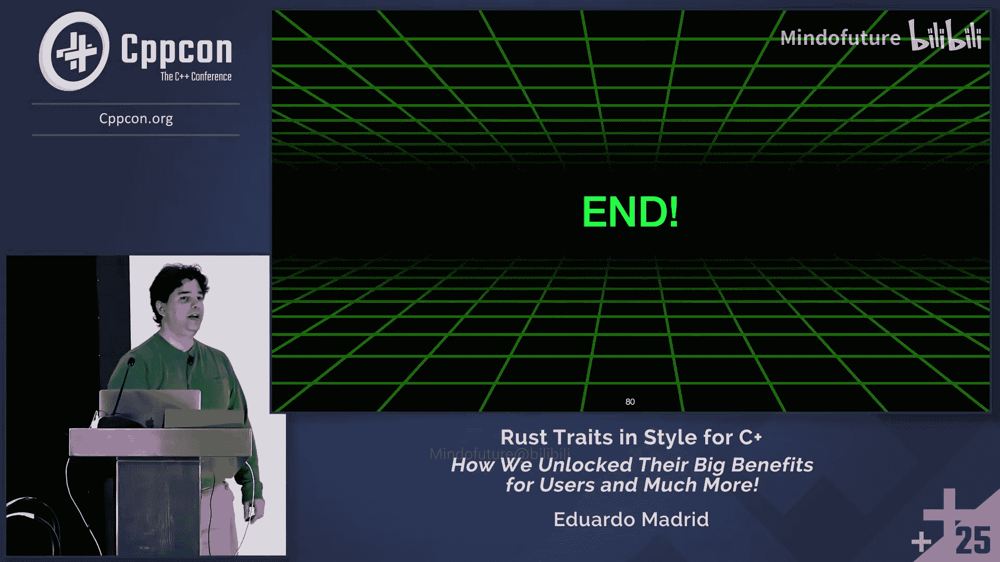

👏And。👏And。

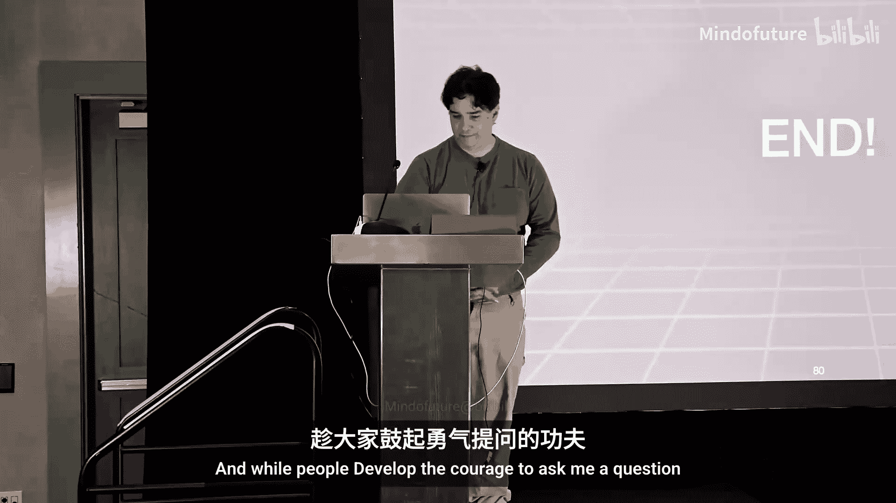

While people。EDevelop the courage to ask me a question。

 I'm gonna go back to the links on the compiler Explorer and get them ready。

 because we have time to see some of that。Yeah。I had to unb for a moment because I don't。

 I don't want to。If if somebody wants to tell me their rule number and last name， I can't use it。

sorryrry about that。 This is going to be disrupting。

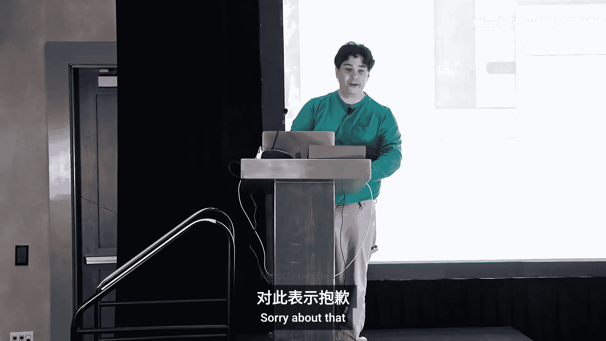

I am pasta the。你挪应啊。Advertisement。Okay， do you guys pick up the computer again？

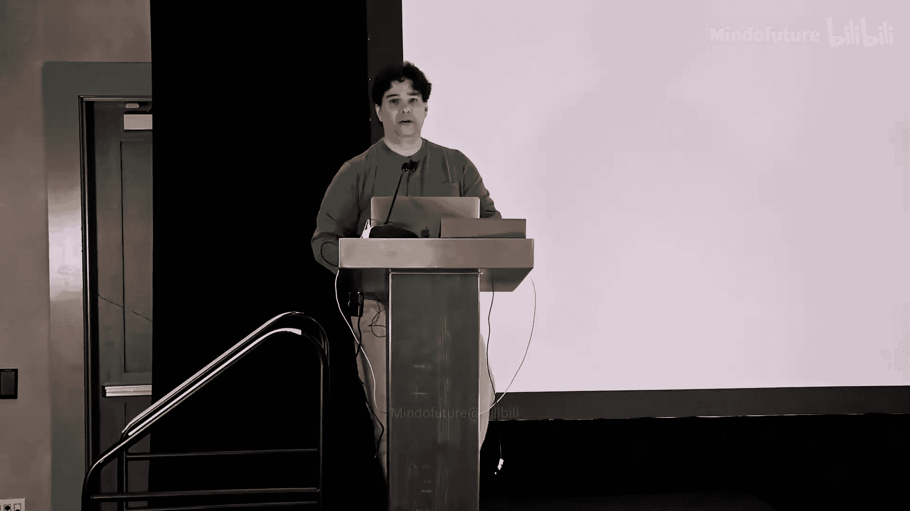

All对。Yes， so maybe Tronca is not working at the moment， and we can use one of my preferred ones。

 Cl 20 is going be good。Yeah， so these compiles。 So when you get the slide deck。

 you're gonna see a link and， and the the link compiles just fine。

 And you're gonna see the assembly and so on。 Right， and like。

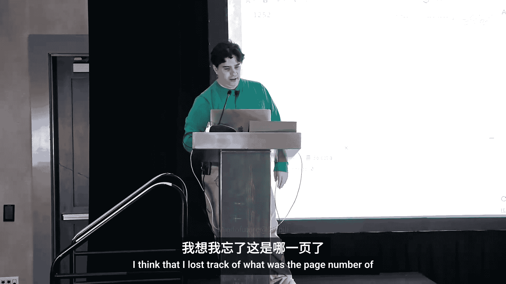

系。

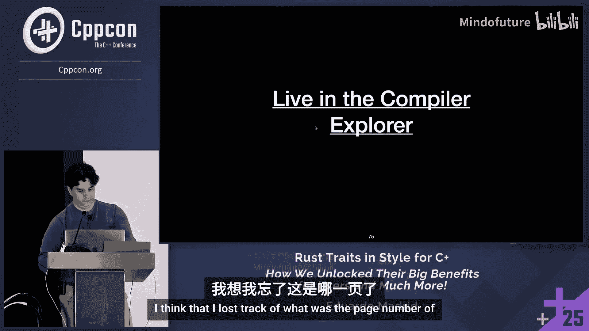

I think that I， I lost track of what was the patient number of。Where I。

These competitors Oh questions。有。何して。Do you have like where it's put together， I guess yes。

 lesss a good like what are you doing of this。嗯。😊，thank you for that。 So it's， it's very easy。

So GithHub， the CPP Z。And you're going to get to the Sux library。

And my recommendation would be to always start with the test directory， okay。

 because the test directory is out of line from the the thing the heaters。

And it has unit tests in catch2 that illustrate how to use the things， okay。And look。

 this is can I show you。嗯。嗯。This is another affordance。 But well， you can see affordances in in here。

 So this is a user affordance。 You can also see the， the， the infrastructure code affordances。

And again， it has every table entry。 The default， this is 4 default constructed containers。Basically。

 what you gonna do if you are involved with something that doesn't have a value in it。

 Are you gonna creak with a。throw an exception， for example。Oh， by the way。

 another thing that we have has an advantage of doing this in simplestore as opposed to in rust is that we don't have to abide by the bo of result。

 We can use exceptions。again， this is her operation， something that is for advanced use。

The user are found。 So you can see here that in principle， S guys is going to be something that。

 So I am running out of time the。2 tipbit that I wanted to， to tell you before we end is that。

Both GDPGPT and。And cloth， in particular， which are the ones that you have run the tests。

 If you pass it， the， the， the， the the， the， you pass it this， what you see in the。Oh， no， no， no。

 sorry。 No Not the compiler exploded the code that is cells contained。 If you paste it into， into。

The L L Ms， and ask questions。Miraculously， they are going to give you almost certainly correct answers。

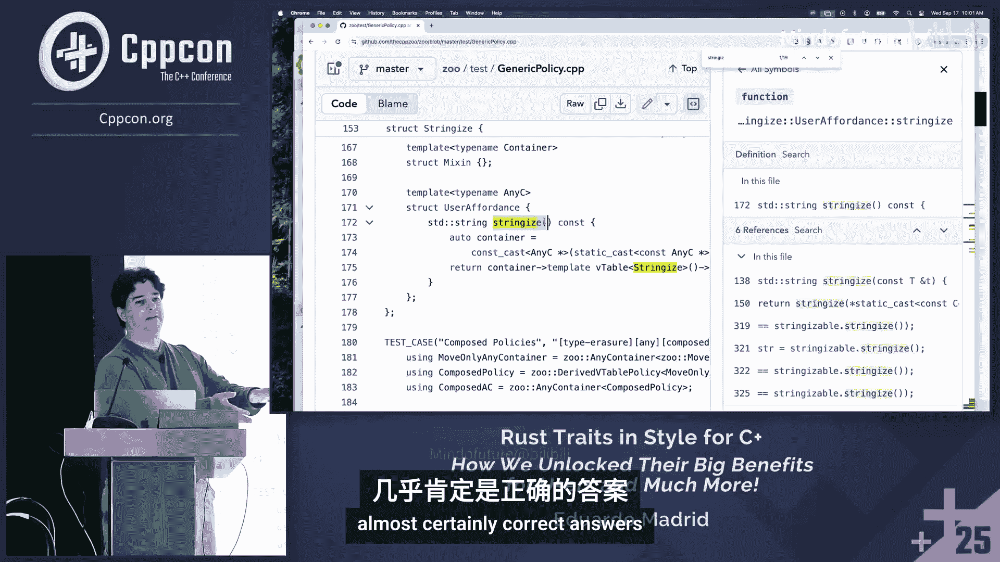

And is。I， I'm really interested in in another recommendation is if you want to use these， contact me。

 Okay， because this code is uglyly and incomplete for a reason and。The way to。Good。

 so thank you very much for the attention， guys。 I hope that it was of your benefit。😊。

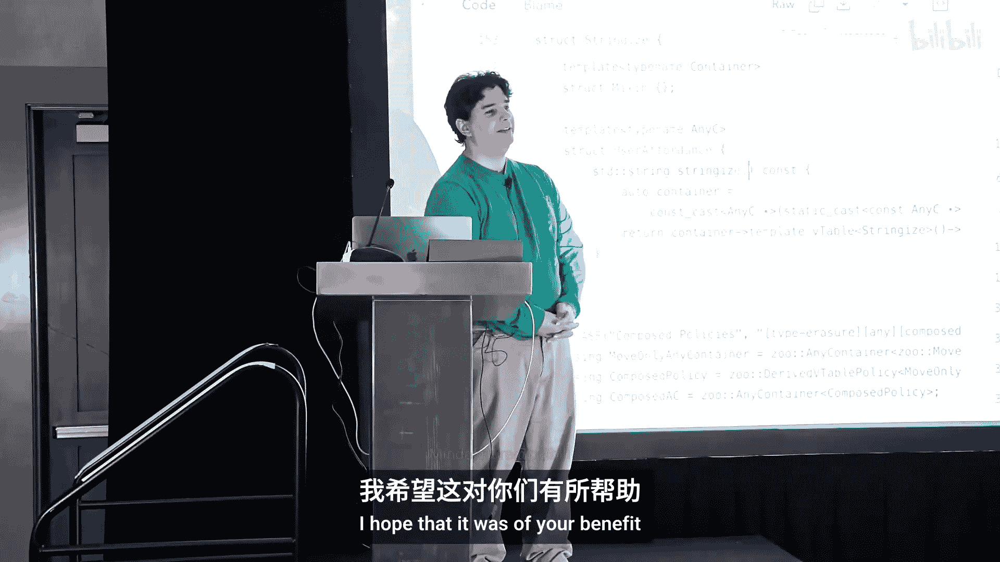

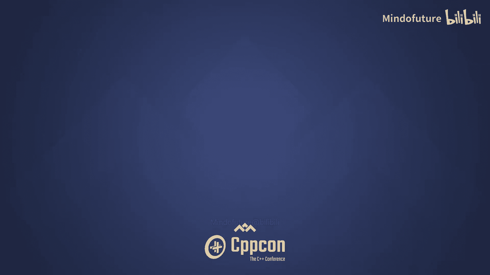