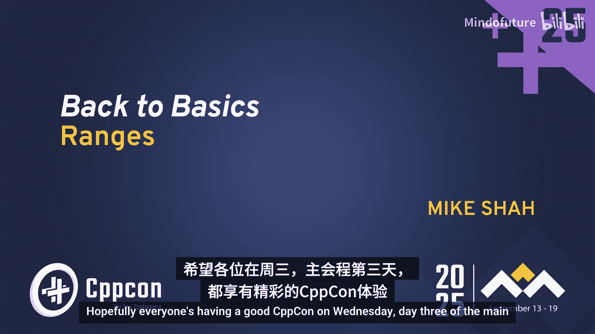
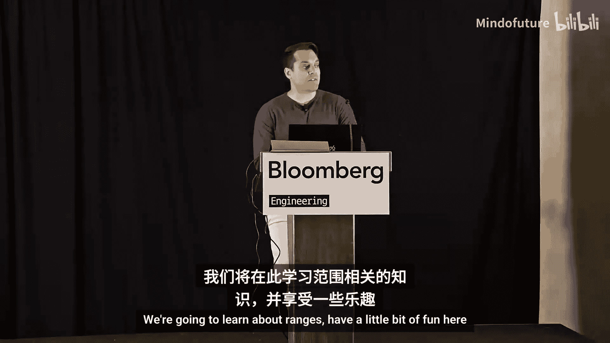
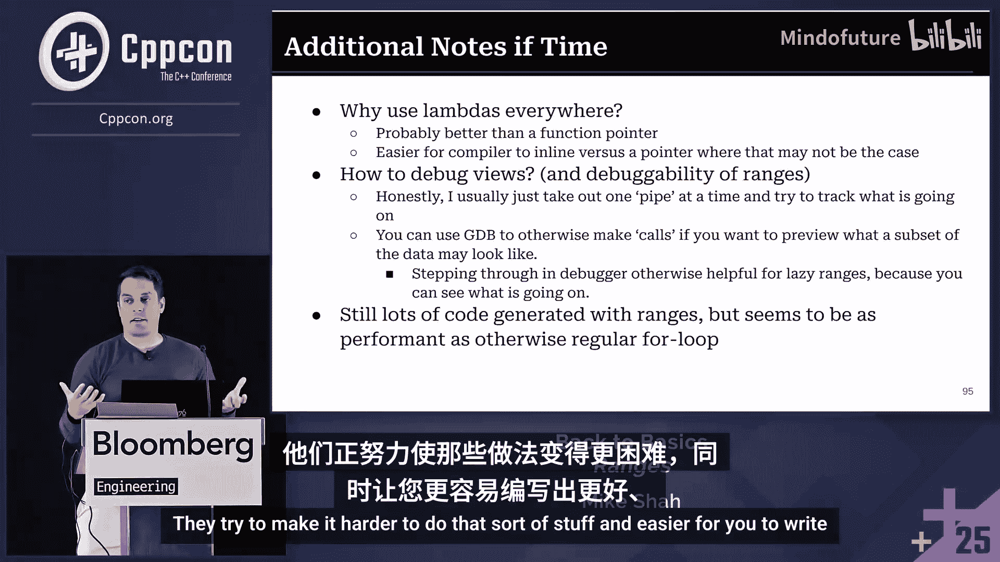
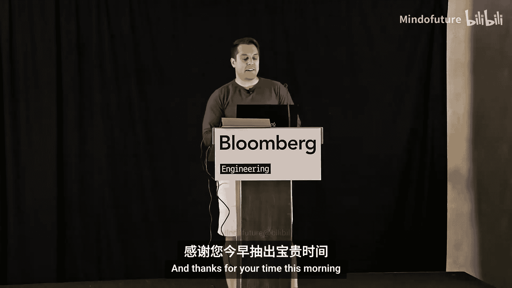
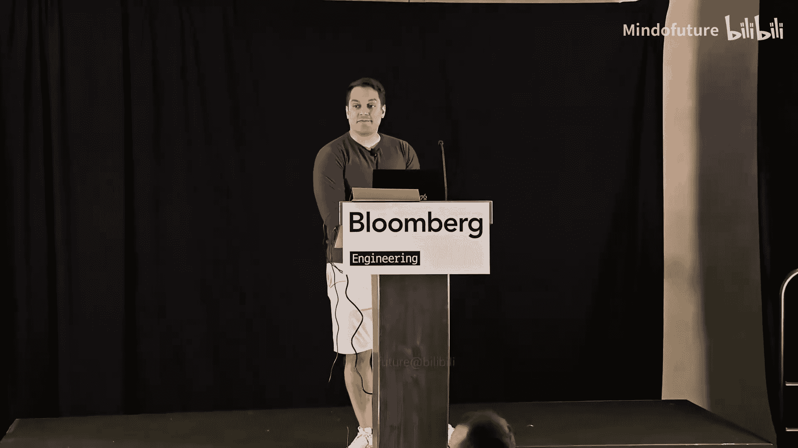

# Cppcon-2025-｜-C++-｜-C语言--｜-汇编-｜-编译器-｜-操作系统-｜-Linux-｜-Windows-p44-P44_回归基础_C++范围-Mike_Shah-CppCon_2025--BV1wyPBzrEeu_p44-

🎼，All right， welcome everybody。Hopefully everyone's having a good CPP con on Wednesday。

 day three of the main conference， welcome to Back to basic Rs and thanks for coming and choosing my session out of all the ones who could have chosen this morning here we're going to learn about ranges。

 have a little bit of fun here。😊。

So again， my name's Mike Sha， I'm gonna to be with you the next hour giving you a little introduction to ranges。

 Just a quick question for folks curious how many folks are using C plus plus 20 or later right now at their work。

 maybe in school。 Okay， good number of folks， How many are in C plus plus 17 or earlier。 Okay。

 so you're thinking about ranges， maybe you're hoping you' you'll get access to them Asome。

 awesomesome， So weve got a good good mix of folks here。😊，Okay， so。Hopefully。

 you read the abstract and just a note here on my website。 Give me about an hour after this talk。

 I'll post all the slides。 There'll be a link to the Github of any samples。

 so feel free to play around with any of the code that I'm gonna show。

 And typically if you Google Mike Shaw， computer science or something， you'll find my website。

 butsha Iio there。 right So anyways， we're gonna have a nice gentle introduction to ranges。

 And I hope for the folks who already are in C+ plus 20， if you are using ranges。

 I've tried to pepper in a bunch of resources， know。

 interesting things where I learned more stuff about ranges or some of the standard template library stuff otherwise。

 So again， hopefully you'll get something out of the talk in that way otherwise。😊。

A little bit about me， my role here is helping chair the back to basics track in the software development track so hopefully you've been enjoying those the past few years there's lots of other previous range talks as well so amongst all of those hopefully that'll be a way to build up your knowledge for those of you who are able to use ranges in your code otherwise I teach at Yale University that's my primary job day to- day job and some other things about what I enjoy here otherwise。

And of course， you can find me on YouTube， big guess what the next topic is going to be on YouTube over the next few weeks。

 maybe ranges， all right， so you can find more stuff there as if you wish。Okay。

 so I wanted to start off with something， you know。

 I was thinking about many years ago when I was in graduate school。

 this paper came out in 2012 and kind of stuck out in my mind and again。

 might be interesting for those of you if youre already are a range expert or using them this paper on algorithmic profiling And part of the idea of this paper or this tool that they were building was to figure out the big O complexity of an algorithm know study this or maybe if you've self-tued a little bit of your algorithms。

 we learned about how complex algorithms， and they did sort this empirical evaluation。

 It was a really， really neat tool But the thing that I took away from it that was interesting at the time or the insight I had as a grad student was oh yeah algorithms are basically just loops。

 So I should look for loops in my program and that's where I can identify maybe there's something interesting happening or code base that I'm not familiar with。

 Maybe start with looking at the loops and figuring out where is the computation actually happening So anyways。

 that was just kind of。😊，Interesting insight that stuck with me thinking about loops and thinking in general about what computer science is and this is a really maybe simplification of it。

 but maybe in some ways comforting that half of our job is computer scientists， programmers。

 engineers， developers， etc cea is just to transform data and maybe the other half is to store it's the ultimate simplification perhaps but if this is what we're kind of doing in our day to day job and thinking about that。

 then we should make sure we have some good abstractions for doing that transformation and storage of data。

 which again is kind of the point that we're going to arrive with with ranges to help us do that job。

So anyways， loops are a fundamental tool， one of the fundamental tools is I had this insight into what an algorithm is and maybe where I should pay attention if I'm looking at unfamiliar code or writing my own code。

 So that was the idea here。So my goal today is going to be to show you or build us up to being really comfortable with just looking at this sort of code if you've stuck around here in the hallways or heard people talking about the algorithm headers or ranges or these types of things and how we should use them and you keep seeing this joke about rotate or no raw loops or these types of things。

 you'll sort of understand you know why we might want to write our code in this way where I just have maybe a vector of something。

 and then I can just call some sort function， and then we'll want to graduate to just having the ranges version。

 which says， hey， I have this collection here。 whether it's a vector array string whatever it is。

 and I can sort it and just one call here and then print out the result and then of course we' want to start looking at stuff like this that says okay that's cool if I can just sort things but how can I build on top of that What is the composition meaning I can call one function after the other And that's sort of this example at the bottom which we're gonna see and build up to so we can。

😊，Compose algorithms and we can use them within loops or maybe just on their own and get rid of the loops in our program okay to hopefully make our code maybe more understandable。

 maintainable， these are sort of our goals with the abstractions we're going to present today。Okay。

 so iteration kind of gotta start from the beginning here。

 Now I'm well aware everyone probably understands what a for loop is。 but again。

 it's that fundamental building block where algorithms begin。 you have some sort of initialization。

 a condition and some expression that you're evaluating And again。

 you can really play with four loops and do all sorts of interesting tricks if you want。

 but ultimately our goal is to define the start and end of some computation and do something with the data。

 print it out， change the values etc cea。 right we've had this forever。

 So here's another example just traversing the contents of this character array here。

 message here and again printing them out one at a time with I should have asked if folks have C++ 23。

 you can use standard print now， which is a great to great revelation here。

 you'll see me mixing streams or see out occasionally but I like print now。 So C++。😊。

If you're able to use that， that's great too。Okay， so anyway， there's our for loop。

 here's the same example this time using another container standard array。 again。

 these new sort of C plus plus or newish features and C plus plus 11。

 a little bit more of verbose but you get the idea here。 I've broken out all the contents here。

 and then we could do stuff like dot size on the message and this is why again。

 you'll see maybe on your journey your talks here as preferring arrays they don't decay to pointers they're nicer to use。

 So we want to again use some abstractions that help us transform and store data in easier ways an array again。

 being one of them。😊，Okay， so again， probably a better tool string than just writing these all out in a character。

 So again， we have all these different data types， containers as part of our standard template library Okay and this is kind of part of the containers string here again。

 hello everyone welcome and again just printing out all those messages Okay。

 so I think we get get the idea there。😊，Now， again， if I'm writing some program again I as mentioned。

 break it out into or think about it in terms of where I have the loops。

 those are where my algorithms are and those are the things that have potential to maybe be abstracted in the ranges algorithm that we're gonna to learn about whether we're writing our own sort of algorithms or otherwise just building on top of what we have here。

 here's an example of two loops here with a fun little Car cipher again。

 just performing some little algorithm here， but again。

 if you can identify your code and kind of highlight where those loops are。

 those are great places to start practicing and saying okay。

 maybe I can change this into an algorithm that I'm gonna to learn about today。😊，Okay， so you know。

 all those are pretty simple examples that I'm sure should be familiar。

 so again I'm going through them a little bit more quickly。😊，But kind of an interesting thing， too。

 is to think about different ways to iterate the data。 So of course， you know。

 I tend to or have tended to reach for for loop for most of my programming career prior to learning about some of the stuff we're going to talk about today。

 but we could also loop through the data in this manner here。 So again。

 here I've gone back to my array we could do this with a string just shows a little bit easier with an array。

 but this time what I've highlighted at lines 13，14 and 15 is I've got data here。

 and I'm just getting the underlying data of the array， which again。

 you could do with a vector or string or any other data type。

 But this time I've created this pointer here。 and I've said。

 okay set that equal to the first position of the data here or the first address And then I have end here。

 I'm just saying data plus whatever the message size is that's where the last element is so now I'm using pointers here to basically iterate through my data instead of the。

😊，Individual indices。Simple enough， if I run this program。

 it's going to print out the same exact thing。Okay and again。

 our conditional statements changed a little bit。 I've kind of moved on the outside at lines 13。

14 and 15， that initialization step， so that's just empty in my for loop。 I'm just saying wow。

 the pointer is not equal to the end， just keep incrementing that pointer so do a little bit of you know pointer arithmetic here to get us through to the next character in the array again。

 same result printing out the program， hello everybody welcome Okay but just another way to do it but you know thinking about things just a little bit differently with these pointers。

😊，So you know the reason for using a pointer here is to kind of show that I can generalize a little bit how I iterate through my data structure here I mean again。

 at the end of the day， computer science， all we have is data so I should be able to just look at addresses。

 which is what a pointer stores and kind of increment or iterate through it in my for loop to present the data here。

So again， then the question is or the question that folks， smarter folks than me and C++ thought of。

 well， in the mid 90s， let's say they came up with this idea of saying， hey。

 we could actually generalize this idea of just incrementing a pointer value。

 maybe we could wrap that into some sort of object， okay。And again。

 this sort of makes sense because what if we have some data structure like a tree or graph where it's not necessarily as trivial if we want to again iterate through our data structure to just do plus plus pointer to move to the next indice？

Because a graph has a link structure with many possible paths that it could take so how could we again generalize this And again。

 the answer folks came up with is they said， hey， what if we create an object type to represent iteration and that's exactly what a iterator is or the general idea that we come to so。

That's the idea。 So then we get this。 we get these free functions here and we also have member functions as well。

 which I'll touch on， but standard colon colon begin and then I just pass in my container and then standard colon colon end and then also my container ideally the same container so that's the beginning and the ending here but the same idea and this free functions gonna take care of Tommy me where's the beginning of my array and where's the end of my array here and then these types here which I'll reveal in a moment are iterator objects okay now all I have to then worry about is doing the plus plus pointer and whatever the underlying implementation of the iterator says is for operator plus plus that will determine how I move forward maybe that is just an index that we're incrementing or maybe it's something more interesting like a graph first algorithm you learn about B first search step first。

😊，Search， level order Tverseor or whatever it might be。Shortest path， etc ceter。And again。

 this even works for our nonowning containers， things like span， M span， string views and so on。

 So so this is kind of nice。 I just have to remember this now。

 I don't even have to think about the point arithmetic or messing that up so much。Okay。

 so this gets us into iterators， which again are a generalization of pointers。

 I mean that's the first you know phrase I've stolen here from CPP reference here。

 but this again allows us to have a way to iterate or navigate data。

So iterators and C++ let's take a look at these， so again。

 what is an iterator in C++ just an object that allows you to access elements in a collection。

So if I'm looking at this particular collection here， let's pretend。

 I mean this looks like a contiguous data structure as I've drawn it out， maybe a vector。

 let's say I've got a iter and then there's a member function that begin that'll point me to the beginning of that collection which is a little strange it'll point me to the one past the end here。

 but that's kind of how we know we're done with the collection okay。

And I'll mention that in a moment here。And then again。

 all we really care about is with this iterator abstraction is what we can do or how it navigates the data structure。

 meaning it can move us forward if I increment this beginning pointer or backwards。

 maybe I can do minus minus， depending on the iterator type， or maybe I can jump a few spots。

 if I have a random access data structure， like a vector。

 meaning I could just index into it anywhere， but that's the idea and then that power is sort of held or abstracted in the object。

 whatever this iter type is。Again， one of these questions that might come up with iterators is to say okay why is it one past the end。

 well my understanding is the decision there was to make it really。

 really easy to make it handle the empty case so if you get a begin iter in an end iterator you can see if they're pointing to basically nothing and have an empty container。

Okay， so most containers again provide dotbeg or dotend member functions。

 or if you wrote your own data structures， you could also write begin in end member functions and again the job of those functions is just to return an iterator to the beginning and the end of that particular container。

I will make the note and you'll see me switch these around for the most part I should try to be consistent。

 I like using standard or stood Col and call and begin， which is just a free function。

That will effectively just return if I have a vector vector dot begin。

 whatever that actual implementation is doing。 Okay。

 maybe there' will be more cleverness with some other data structures。 But that's the idea。

 The reason you're gonna to see me use this。 or if you're looking at other tutorials and people use this。

 generally speaking， it's more generic， meaning only some of the containers have a dot begin dot end。

 but not all。 So again， but if I use this free function， there is。

 you know some overload for all the containers thatll do the right thing。 Okay。

 so just a little note on that。Okay， so then as mentioned。

 iterators can advance the next element in some manner again。

 usually you'll see that with some increment pre increment operator or maybe a decrement。

 there's other free functions， things like advance that you can also use that I'll show in a moment and again。

 it really depends on the iterator type for what power we have again。

 just like when you're accessing list versus a vector you're aware of how you would traverse a list sort of one element at a time versus a vector where you could jump around。

 So again， iterators have different categories， not going focus as much about that。

 but there are some videos on resources if you want to see that in action。Okay。

 so generally speaking， if we want to define where our computation happens， again。

 that is a pair of iterators with a beginning an ending pair。

 it doesn't necessarily have to be the beginning of the container。

 but just wherever one iterator points to representing the start and one iterator points to representing the end and that pair of iterators we call a range we've always sort of called that range other languages might have similar terminology but that's the idea beginning and end of your computation you see these other languages as well。

We'll find out too that a range， a standard range is subtly different。

 but the same basic principle here。Okay， so let's see where we left off here。

 but hopefully we understand this code， again， just a small code example here where again。

 I've got my array with all the characters painstakingly typed out here just to be clear here that we have this message but now when I have this begin。

 it points me to the beginning here。 So to H and n points me to one pass this exclamation。

 meaning you know we've reached the end of our data here Okay so now I just keep iterating this pointer each step of the way here。

 but again and by pointer， I mean this is an itererate our object as we move forward。😊。

Now just another nice thing here just to show how this generalizes。

 I'm going to flip between these slides a few times。 I have my array message。

 but I can switch this to a vector here no other code has changed other than the include in the vector but again。

 with this begin and end pair very nice I have this ability to just swap out data structures so if all of your data structures again。

 you know working with the STL is great， but if you're building your own library someday or want to build your own iterator or ranges just keep that in mind having a common interface gives you this nice power here so for whatever reason I decided a vectors more useful because now I want to expand。

 I can just do that and iterators again， help support this idea of writing generic code。😊，Okay。

 and again， by generic， if I'm throwing that out， just meaning code that will work with any sort of data structure or algorithm。

 it's just， you know the job that it's going to do is very。

 very simple so I can use it like a building block okay when I'm using generic。Okay， so again。

 just to show some more examples of working with iterators， I can do things like highlighted On 15。

 I can just do plus5 and that will move me five times because this particular iterator type supports forward iteration and movie okay。

 so I can use+ five。I could also use something like advance。

 there's a member function for that if you prefer could use advance from the end here。

 which I've switched okay my end initially is pointing to the beginning and of course I could do this with fewer lines of code。

 I could have stood column and colon and begin message where end is and just kind of embed there that would be fine if that's a little bit more clear。

 that would probably be a little bit more clear just with the naming here how you name these things。

 I could also do minus5 here if this truly was the end so again。

 you can just use your arithmetic there to move around。Now， of course。

 we do have to be a little bit careful with this right if I'm an advancing my iterator just because I have these and object doesn't mean I'm immune from segmentation faults and these types of things If I just all a sudden decide。

 hey， I want to advance plus 500 and there's clearly not 500 characters here we're gonna to get some sort of crash。

 So you know， we do want to check the bounds here And again。

 we can we can do this by maybe keeping track of the actual end here and try to prevent ourselves from crashing or dereferencecing an iterator at line 18 so。

😊，To again， make sure we don't access memory that we don't Okay， so you still have to be careful。

 even though we've wrapped things in abstraction and again。

 there are versions of safe iterators and things that will balance， check and so on。

And I just want to put a little note on this example again， you're gonna see me use auto a lot。

 but you know that can always be a doubleedd sword in your code base。

 It's one of those things folks have differing opinions about and my general opinion on it is you be explicit when you know exactly the type you want。

 that's good。 I usually tend to favor that for slide where sometimes auto does sneak in a lot。

 but I just wanted to show you at line 13 where I'm using auto here for pointer to begin。

 This is what the type expands to。 So standard Col Co list of characters。 That's what I have here。

 It might not be obvious too modern C plus plus got really smart。

 So at line 10 stood call colon list within the template parameters it can deduce them that this is a character。

 So again， you might have wanted to be or I might have wanted to be explicit there just a match with my iterator。

😊，The one reason I also mentioned being sometimes explicit with your types is then when you get your error messages and you see Stud Col and call list。

 char， colon and colon iterator， whatever， or in your debug。

 then you'll grab your code maybe for that data type and be able to find it where that might be a little bit harder with auto so again just just a little tip there or at least when you're first starting to use these tools。

 try to be explicit at least when' you're practicing so you know exactly what the type is。Okay。

 but you'll see me use auto more frequently， but if you have a question about it。

 feel free to raise your hand and I'll try to clarify if you see something interesting on the slide here。

Okay， so again， iterators， I just wanted to show another example in case you haven't used them with a map。

 so here is a map type again a little bit more interesting。Let's see at line 14， again。

 just showing you for these things that might make your life easier in C++ but I'm having a using statement here to say what a string int map is。

 so a key value pair with strings and integers and I'm just sort of using that as an alias or sort of like a type def depending on your familiarity with these features as you know this textual or this replacement here。

 I should not say textual but type checked replacement here so then I can just use string inm create my map。

😊，And then at line 21， if I go just a little bit lower。

 I'll highlight with my laser pointer string int map， Co colon iterator。

 Well that's this full thing expanded。 St Co map， my key type， string。

 my value type int and then Co and colon iterator here okay and then within my for loop I can just use begin and to navigate Okay so just a few things you can do there。

So don't forget about your tools like using and namespace to make your life easy。Okay。

 so here is to kind of put things together our iterator。Everything in a single for loop here。

 doing our iteration， as I've highlighted， so we can see where the bounds of our computation are great。

 Okay， so I've got iterators here。😊，Now， this previous thing that I highlighted here。

 this pattern of us saying， well， I want to create an iterator。

 I want to start through the beginning。 I want to go to the end and I want to increment one step along the way or call whatever the plus plus operator is on my iterator。

 It's so common。 so common that and C plus plus11 we said， hey， this is a nice idea。

 let's add rangebased for loops。 Okay so again， getting more power to our abstractions and hearing that word range here basically what we can do is just transform this block of code here that has all of this iter begin。

 know setting up our end here and again， maybe I should have used stood Co and call end。

 but I had to think about it or be explicit with this type。

 whatever let's just simplify that and just change it to this。

 rangebased for loop so4 again I'm gonna use auto to just kind of pick out the pair of。😊。

Key value elements here from my map。 Okay， that's going to do the exact same thing from begin to end。

 And then I could just print out my pair here。 Okay， so much more nice。

 much more concise in expressing the intent of our code here。😊。

We also have other things like structure bindings to make your life easy。

 not going to spend the whole talk on that， but again。

 you could do know key value here if that's easier to just kind of separate out instead of again wondering what did C++ do is this a pair where I have that first that second now just use key value or something。

mightight be a little bit easier on you。And if you have types that expand out further， again。

 unstructured binding， just little hints， you have dot dot dot syntax too to unpack further。

Now behind the scenes， if you see or I should mention this。

 if you see Andreas furtag at the conference， I think he's giving some talks。

 you should say thank you。 Thank you for this tool。

 CPP insights because whatever abstractions that I'm showing you or if you say， hey。

 I don't understand or what was that auto thing actually expanding to you can paste into this tool and it'll give you the verbose information。

 which is actually I think useful for learning and might be a little bit of noise here。

 but I've tried to highlight out on the left side， this is the code we wrote rangebased for loop just looking through our elements and the vector but eventually you'll see what the compiler actually does is creates a new scope with the curly braces and it creates these begin end pairs just like we learned for our range maybe it'll be dot begin if those are member functions or maybe stood cool and cool and begin whatever the compiler chose was the best option there。

😊，And then you'll see a for loop， just a good old regular for loop， and we spent some time on that。

 you know that is already， but you can see that's all range based for loop is， some syntactic sugar。

 okay。So sometimes， again， a lot of these abstractions， including with iterators。

 we just build on top of them to give us new， more powerful tools。

 but we want to understand the full sort of tool stack here。All right， and then again。

 you can see the structured binding， what that came out to be a pair and so on。 So anyways。

 you can thank Andreas for that。All right， so quick recap。

100% certain everyone knows what a for loop is here。

 but hopefully we saw this sort of interesting development or this buildup or how we might think about our computation and ultimately we got into iters。

 okay which was one of the things we have to get to here。And of course。

 you can write your own iterators from scratch if you have your own custom data types or building your own library for different things。

 I see folks do this a lot in the boost libraries or geometry libraries or whatever type of data that you're iterating through right you can write your own iterator and plug them into the STL okay no problem there。

Okay， so iterators themselves just to recap the benefits of what we've learned here。

 they are one of the classic behavioral design patterns。

 let's say from if you've heard this term of the elements of reusable software design patterns book or the gang of fourbook because there're four authors that basically talk about the benefits of iterators and it's kind and nice to just mark your computation with begin and end in where you're starting where you're ending and generally speaking。

 it's easy to modify your code right you saw me just swap out a container without changing anything else。

 So we could get better performance or maybe that was a debug version of the container or whatever。

 you can do that easily and not have to worry so much and from a codegen perspective because folks always ask about performance typically if you pop this in a compiler Expr example like this。

 it should generate the same assembly code there might be some noise from importing a different or including a library。

😊，SomethingBut the code Gen should be equivalent。 Of course， do your own experiments。

 You could maybe contrive a good or a bad example。 but that's the general idea。

And generally speaking， what we now want to talk about is iterators are very powerful for otherwise decoupling what the algorithms actually or how we're moving through a piece of data from the algorithm that's actually going to execute and then all the traversal code and sounds just encapsulated away in our iterators。

😊，Okay， so this gets us to our standard template library again， there's been a lot of great talks。

 including at this conference on the back to basics track about what the standard template library gives us。

 we've already seen a lot of it in the talk anywhere where I've stood cool and coal and of course probably familiar with our containers for example。

 vector， string and so on， iterators， which I've just been using or begin and and so on。

 but then we have our algorithms and these are our generic building blocks for otherwise replacing loops。

 and hopefully making our code more maintainable or easier to read or more composable or maybe just interesting and or better in some way。

😊，So let's see how these two pieces work together， our iterators。

 or we define where our computation is， begin to start in algorithms。

 which specifically meaning the standard template library algorithms or these building blocks that we can use to perform some computation。

Okay， so if you haven't seen a standard algorithm or include algorithm。

 we have a lot of them that we can use and benefit from。But again。

 bringing us to one of the first examples that I showed you。

 we can actually use our iterator building blocks and pass them into a bunch of these well algorithms so for example。

 at line 23， you'll see stood Co and colon and sort and that algorithm just takes a pair of iters V begin the end so from the start to the beginning or excuse me from the starting to the ending point right we want to sort this vector and we could modify this we could do V begin plus two or something if you know we know part if it's already sorted or whatever so we have a lot of these algorithms already we have sort stable sort partitioning algorithms and so on which we'll see which we can use。

😊，Okay。And there's all sorts of cool algorithms they're defined in algorithms and again if you haven't poked into these you'll also want to poke into numeric。

 that's the other header that has a bunch of the algorithms defined。

 so those are the two where the bulk of things are defined otherwise if you're starting your exploration into the algorithms and the standard temp library。

Okay， so I just want to show a few of these in sort of just you know maybe you've written some of these yourself。

 you've learned about these in class or something or whatever。

 but we have a bunch of these available。 So do kind of a rapid fire and maybe point out something that's interesting。

 but we have partition So again， if you want to sort of divide up your data and some sort of interesting way again。

 a pair of iters and then the test or predicate which you'll see half as a lambda function that says hey partition。

 this collection from V2 in the beginning to the end around whatever this predicate is at line 10。

 So stuff that's less than four will go on one side stuff that's greater will go on the other side greater than or equal to 4。

We have other algorithms like copying so from the beginning to the end into a destination。

 so I have this kind of funny thing here called back inserter。

 but basically what that's doing is I am saying hey。

 copy in my original vector from beginning to the end， so all of it into this new data structure。

I guess they just called original underscore V。 sorry it's covered up a little bit there。

 but back inserter is basically a output iterator。 That's a special type of itererate it says， hey。

 I'm going to write out to this collection or these are the rules for writing out data as I increment through。

 but for all intensive purposes， you could probably just think of this as pushback into V here or V dot pushback。

 Okay that's probably what it's what it's doing。 And there's front inserter and these other types of things too。

There's ways to shuffle your data again， if you want to sort of randomize things and you can pass it you know some random number generator here or however you want to determine that object so you can shuffle things around。

As mentioned in the numeric。Or sorry this is still algorithms rotate right So if you hear jokes about rotating。

 this is what we mean again， sort of rotating our collection or thinking about our data going around to marry go around from one start to a finished location。

 now， I mean， in this piece of code that I've highlighted。 it's a bit noisy。

 I would say and this is one of the things that ranges will help us with。

 but I have this standard call andqu rotate。 And then I'm calling this upper bound algorithm here say。

 okay go from the beginning to something else here。

 Okay so so basically this is doing a sort algorithm in a clever way。

 that's a little bit ugly and maybe maybe not clear。 It's a little bit too clever code。

 So we might want something better than that。 but we can compose these standard algorithms in some way。

 Okay that's the point of this slide。😊，We can transform our data。 So again， from beginning to end。

 hey， here's something new。 C begin。 C end。 Well， those are iterators that are con。 Okay。

 so they're not going change or I'm not going to like。You know。

 iterate them or reassign them in some way。 Okay， so C begin C and you will see a few different flavors again。

 they're just objects。 we should make sure we match them though if I have a C begin a con begin iterator and a con and iterator make sure we have those and there's other variant。

 R begin for reverse R and for reverse as well。But back to what Trans is doing。

 taking in our range pair of iters， that back inserter again and saying， hey。

 we want to write out somewhere and this is our Lambda function that's you know taking in our character that we're traversing through this data and converting it to uppercase so we should get uppercase mic。

 loud mic。Text here all on caps。Al right， transform， reduce。 So again。

 there are various more algorithms here you can check out product going into the numeric side for inner product。

 Cartesian products and so on。 so various flavors of those。Min Max， I mean you get the idea right。

 we're not going to go through all of them。 We've had some excellent CPP contact from 20 where there's at least 105。

 I mean， at that time， algorithms， I think now there's 200 plus especially if you start counting the range ones。

 so chances are if you're writing some algorithm you know you probably have the building blocks that you can replace in your standard type of library。

 probably no problem there。 Okay so hundreds and hundreds of these so。You know。

 and the other observation though， that I want you to see is pretty much all those algorithms that were defined were of the form。

 I mean， here's just another one， generate， take a iterator to the first， you know， your start。

 and then the end， which might be called last and then take some predicate or maybe something that changes the behavior。

 Okay， so that's always a pair， almost always。There are exceptions。

But there are some problems in pitfalls with iterators know they're fun。

 we still need them even in C++ 26， which you'll hear about。

 but a few things to point your attention to。First， you know。

 if we're inserting things into some collection like a vector here。 Okay。

 so maybe this vector is really important。 And I have some iterators pointing into it。

 Like maybe I'm keeping track of， you know， my favorite number in this vector or whatever the reason is。

 And then I start pushing back in another routine some data。 like it do pushback 7。

 what's gonna happen。 We know vector dynamically resizes， right， So then I get this new collection。

 this new heat allocated memory somewhere in my vector。

 But wheres my iterator point to my old iterator。 Well， it still points to that old heat memory。

 Okay， so this can be a problem。 And we call this iterator in validation。

 Our iterators are no longer valid， right， They're pointing to something。

 and these can be tricky to catch because。😊，I mean， maybe that memory is available。

 maybe it's going to get overwritten later。 So again， this can be something tricky to catch Now note。

 there are safe iterator libraries you could imagine implementing something that checks if I'm pointing to an old you know keeps track of the memory location I was in before something。

 but we do have to look out for this。😊，We can have the wrong pair of iters。 Okay。

 so here's a little example。 I have V1 V2。 and you know， I'm a Vm user。

 so maybe I accidentally did control A and incremented to V2 or something。 I mean。

 you can mismatch these things。 you usually catch them hopefully relatively quick。 But again。

 you know you've got to be right or correct two times instead of maybe once， which would be nice。

 but it's not always as easy And Jason Turner， he gets credit for this from his C plus plus weekly。

 You know， if I have some。😊，Fction here。 I just called it download data that's returning me a result。

 and I say okay， I'm getting a result。 That's a vector。 okay， the return type at line 8。 and I say。

 okay， since I'm getting a vector back， I'm just gonna to do download data do begin download data do end the names match download data。

 but it's actually a function and that functions returning copies to maybe two different pieces of data。

 Okay so maybe it works sometimes maybe we get lucky。 so again。

 sometimes it's hard to match the pairs。 so。😊，Now there is some consistency and by consistency things that we have to pay attention to。

 meaning that the and this isn't a STL fault， so to say it's just that hey in the rotate。

Standard type of library。 There is a first middle and last parameter。

 So it's not just beginning and ending。 Okay， so we have to pay attention。 sometimes， you know。

 maybe it could have been first last， and they could put middle at end， but that's kind of confusing。

 So again， you just have to pay attention sometimes。 And， you know， we had whoever made this had。

 had to make a choice。 so。And there can be other issues like not enough space to write into if you're doing a back inserter。

 sometimes you have a vector which dynamically resizes。

 sometimes your output being your or have an output iterator to like a fixed size array。

 but the collection or the data that you're traversing is larger。 So again。

 these are just some things to look out for。Okay， so iterators aren't perfect。

 I have the rather dramatic title iterators must go get rid of them。 not quite。

 but we do want to improve on them and we did。 And Andre has given a lot of great talks on this。😊。

And the good news is we can okay how ranges。 Okay， so our answer to this。 So so again。

 we know what iterators are the pitfalls， how they help us in loops。

 how they combine with algorithms。 and now we get to ranges the new stuff right so how do we improve our interface。

 so of speak to writing algorithms。 Okay well， again， first， let's define what a range is。

 you can include the ranges header file， but nothing sort of changed in our definition。

 or range still is just a pair of iterators， right we have a begin。 we have an end Okay。

 so you could write your own range if you wanted or look at the standard template of library would probably look something like this。

 a little bit different little subtle difference that I called it you know the start and then just like a sentinel value to represent the end here。

😊，And in our range， we might stuff some other stuff in here too， or we could。

 but that's the basic idea here。Okay now really， you know， folks have been writing ranges libraries。

 there's a relatively famous when ranges V3。 So that one's available。

 I think is early as like C+ plus 14。 so for those of you who rose your hands and said hey。

 maybe my work's not using it yet you can use ranges V3 which is a library that a lot of the standard template library to my understanding is based off of and start getting practice with this but really I think the thing we're waiting for was a thing called a concept。

 now we'll have a back to basic talk on that， I think at some point if it's not later today。

 on concepts and basically you can think of a concept as like a constraint。

 something that must be enforced so if I want to define some range algorithm or say something represents a range well at the minimum I need it to represent sort of a begin and an end to iters。

 a beginning and I start to the computation。Okay， so that's the idea。

and concepts were one of the tools we kind of had to， we got C++ 20， again。

 you can check them out or you'll learn about them a little bit this week。Okay， so ranges。

 How do we use them。 That's kind of the fun part。 We don't necessarily need to right just to start practicing。

 you don't have to understand all the nitty gritty details， but that's helpful。 but basically。

 we can include the ranges header And then if you include algorithm， you will notice we have sort。

 And then we have ranges， Col colon and sort。 So you get the T plus plus 20 version of it。 Again。

 is what you need St sort ranges， Col colon and stable sort。 So again。

 time invested learning algorithms was not waste at all。

 It's just now you have to type a few more characters。 in front of it。 Again。

 use your tools using or namespace if appropriate。😊，So anyways， there's our observation。Rangs。

 however， let's look at an example。 the one I started with， they take one less parameter。

 Okay so I'll draw all your attention to the bottom left of the screen here where I have the ranges sort。

 which I already kind of showed here and I just pass in a container here V2 versus passing in the begin and end iterator pairs here so this this is kind of nice。

 I only have to remember one thing here it also kind of indicates， hey。

 I mean this is a container is a container begin end pair you know， maybe I lied about that。 No。

 I mean it's just a container is a range of sorts right So a container things that are sort of container like again like spans and so on。

 those are ranges so I can just pass that in and say sort my vector just do it and then I can print it out here。

 and that's really nice。 It's very clear what that code is doing and I don't have as much of an opportunity to mess up So that kind of helps improve our safety on iterators。

😊，は。Okay， and you might also hear， or if you're searching around Google or doing stuff with AI。

 you could search constrained algorithms， that's sort of what you'll see in CPP reference， same idea。

 the range version of the algorithm。Okay， so now let's see what else is going on here。

 Let's look at another ranges algorithm again， just to see some more of these this time using find if Okay。

 so I have standard con con ranges con find if I pass in my range which in this case is just the container and then I have my lambmbda function here。

' it's embedded all in one line here but I'm basically going to say。

 hey return if I equals equals one here。 that's my test then I could print， I found one or whatever。

 but you'll notice find if what is it doing it is returning and sorry I used auto here but it is returning in iterator here so we don't want to totally abandon all of our knowledge of iterators that's why we tried to build this up from scratch today the long way around。

 but then we use okay we have this iterator that I'll point us to you know where one is and again。😊。

Otherwise， if we don't find anything in this container where there's a one。

 we can use standard cone cone range and and compare against our iterator。 Okay， So if it's not that。

 we must have found it somewhere。 Okay， so hopefully that makes sense。 here's another example。

 just with a different type。Okay， so， you know all and the the other point of this is to say， hey。

 we spent that time learning begin an end， standard call and call begin， standard call call end。

 we have the same thing with ranges begin ranges end okay， so again， all that knowledge is useful。

 So here is our good old。 if you want to write a for loop。

 or if it makes more sense or whatever domain you're working in right， it makes sense to have total。

 total control。 You can just use the standard ranges， call call begin。

 I called it like old or old way， fine way。 if you you know whatever makes sense for it。

 but you can still do this。 Okay， so again， not all knowledge was not lost here。😊，Okay， and again。

 my notes that you can use these with containers， not owning containers， string views。

 these sorts of things it all works。Okay， now there's this other new stuff that came in。

 I think we understand ranges pretty pretty well begin NP pair。

 but now there's this thing called views， and there's also something called an adapter。

 range adapter。So again， we saw our previous algorithms， things like ranges sort。But now。

 if we look at the ranges library on CPP reference or maybe it'll stumble on it in tutorials。

 you'll also find this term views and adapters。Okay， well。

 a range adapter is a thing that turns some range， a container or two pairs of iterators into what's called a view。

In a range view is basically a lazy way to access and range。 Okay。

 I'm just viewing a sort of window into that range。 I just want to see a chunk of it。 right。

 It has that word view， kind of like a string。 I mean。

 you can kind of think of it like when you're iterating through Well'll just think of a view like looking at a window。

 But you can only just see a subset of the world。 I think that's probably the easiest way to describe it here。

😊，And what's the significance of this idea of a range adapter and a range view and then just this idea of ranges and range algorithms that we've been talking about well again our sort of back to basic example here。

 range is sort I told you that this just sorts our vector right away same as the other our traditional algorithm and it just sort of eagerly evaluates it the algorithm just says go go go okay I'm going to sort this whole thing from beginning to end very conveniently。

Okay， so again， that's eager evaluation， but range views allow us to execute lazily。 So again。

 just a small view into our data， one you know element at a time。

 perhaps and that means we're executing lazily now this could be very good for performance in many ways。

 but lazy execution， if you haven't heard that term， but basically it means that。😊，Again。

 we're just looking at one element at a time。 this enables things like if I have an infinite range or a container that just keeps expanding forever and it's not very clear where beginning and we ending is well。

 it doesn't matter because I'm just looking at one tiny thing at a time and I can just keep tacking on growing my container or my view or whatever So it's probably easiest to just look at this example for a moment I've got stood vector V4 in this example and I've got a bunch of ones5。

6，7，8，9，1011 so some data。And what am I doing here， Okay。

 I'm gonna create a view into this thing here。 Okay， again， apologize for auto。

 but toss this in a CPP insights。 but greater than 5。 Okay。

 so this is gonna be my view of things that are greater than 5。 I'm gonna say equals V 4，oo。

 and I got this new syntax。 this pipe syntax or， know， operator pipe。 And basically， that means。😊。

Now this is our syntax for composing。Or range algorithms together okay so I have V4。

 that's just this data here and I just want to view of it where I'm filtering out elements that are not greater than five as a way to read this right that's the test that I'm passing in。

嗯。So how does this work here in the for loop。 Okay。

 well I'm iterating through and then I call this greater than5。

 this standard con colon ranges is what the type sort of evaluates out to， It's a filter。

 And each iteration of a loop。 It's going to just look at the very first element， one。

 and then it's going to run the filter and say， is this greater than 5。 No。

 I'm not going to do a thing。 And I'll look at the next thing。 and the next thing and the next thing。

 next thing。 And I'll just keep doing that in this loop。 one thing at a time。 right。

 It's view into the world is just one element at a time。 So that's the a lazy evaluation。

 It's not taking this right， greater than five hasn't already been produced。

 This isn't a vector or something that's6 or7 elements long however that is， right。

 It's just a view one thing at a time。😊，Okay， so that's the lazy execution， that's pretty neat。Okay。

 so let's look at this again and kind of get familiar with our pipes here that we're seeing this time。

 an example with some strings， Mike， Bob Miguel， Mariissa， Mary， etc cea。

 Im to look for strings that begin with M and are greater than four。 Okay cool。

 I can actually pipe these together。 maybe you use other languages D Python jascript that have sort of this chaining syntax right we can just do dot call this function dot call this function or builder pattern in C plus plus here we can just compose things together with the pipes Okay so that's cool。

 I can just do views， give me all the things that start with M。 Okay。

 Mike I'm gonna take a look at that。 and then longer than four oh I'm out of there。

 so now let's look at the next one。 Bob。 that's in my strings filter starts with M。

 Now Bob does not out of there。 Do I even need to evaluate if Bob's longer than four characters。

 Nope， don't need to do it right because I did that lazy evaluations。😊。

So so we can get some efficiency out of this right so lazy evaluation can be very nice。

 I mean if you want as a little exercise right try to see if you can figure out how many times this is going to execute or how many times the function is going to be called the way to sort of prove this is to open up GDP and step through it right and and see what's actually getting called。

😊，Okay， so that's the idea that we can now more easily write these lazy algorithms， yeah， question。

Is this an operation do it in place or you make a lot of copies of script？So this is。

 let's see if I go back here making a in general copy each time， yeah。

 the idea is if your computation is small right as you're doing this window or look into things。😊。

It could be making a copy Now well we can always avoid copies too one of the talks I'm going to mention。

 I'll just mention it here by Simon Kaoff talks a little bit about how all the views and ranges algorithms pass things in by universal reference so that we can kind of decide how to be efficient that's actually kind of a requirement of making all this work so we can still be performant now again。

 the algorithm that it's running is however long that takes， I guess。

 but we can kind of think of it like constant time one element at a time。Yeah。Ary。Now。

 one other thought you might have is say well， okay， I've got this view。

 which is this temporary thing。 What if I want to actually produce。

 you know or collect these in a vector and we were able to do that before we had like back inserter。

 which is like outputting into some collection with that， we have sort of the equipment。

 which is ranges too That's probably the next place I would start here。So in this example here。

 standard vector collect okay so you can see on the left side here very clear with the type that I want to collect a vector of strings。

 okay I'm taking my whatever my strings to collection is。

 Mike Miguel Merenary and I'm running my sort of algorithm here composing together my filter things that start with lowercase M longer than three characters and the very end here ranges column Q2 vector and that'll force or sort of snap this into a let's say eager valuation or say okay actually write this out to this collection here so now I have my vector of strings from this result and then I can use that however I'd like。

😊，Okay， so again， this is kind of cool and I think the composition with the pipe operator is one of the cleaner。

 nicer things we have here， so this is definitely very， very good for us。Okay。

 so a few more examples as we're you know just to show you or know for self- study using transform and you can kind of compare this to the other algorithms one。

 sorry that's flickering a little bit there， but you know hopefully this looks cleaner and I can pop this into a for loop two。

 just as I've been doing you know range based regular for loop doesn't really matter。

Here's some other stuff， there's all sorts of fun things and theve views this one's D while。

 so this will basically give us a starting point into our range。

 there's other fun ones like chunk buy and so on zips and transform so there's some new stuff or neat stuff in there as well。

And again， as you mentioned， I think there's over 200， so I don't have time for all of them。

 but hopefully kind of get the gist here and one of the main takeaways here Okay。

 so you got two minutes so just kind of wrapping us up here。😊，You know， roughly in the order。

 I would watch if you wanted to watch some more talks on this to just get more examples or practice other perspectives。

 Here's a pretty good list， and I tried to list them in order of how I would follow them if you were starting from scratch。

 So you know decide where you're at after watching this one maybe you're in the middle somewhere I want to know a little bit more about something but each of those will go a little bit deeper into some other topics。

 I think the last one's also interesting comparing different languages， C+ plus D rust。

 how they do iterators and ranges。 So we could really think about or learn from these as well。

So in summary， if you're able to， I say prefer ranges know over the oldtyle algorithms or if you can transfer or transform rather your loops in your code into something of this style。

 it tends to be more readable， more maintainable with the ranges， API we're using concepts。

 which again is its own talk， but typically this is going to also give you better error messaging into why something didn't work you can directly see which concept or which constraint was or wasn't met。

 So again， it could clean up your code quite a bit。

 you also get this easier power of eager versus lazy evaluation。

 so you can start thinking about things like performance and maybe there's optimization opportunities there。

 and if you look at know C+ plus 23 26 later versions that are going to come out we're going to keep getting more power added into our ranges。

 more things that we can do。😊，So just keep an eye on that。Some additional notes again。

 just you saw me using Lambdas everywhere because you compilers tend to like those debugging views。

 just a few notes on that using GB thinking about what calls are being made or if you have a really large algorithm that's sort of composed you can try to take comment out except of that pipeline one by one to see what's going on So that's the issue here ranges aren't perfect you can still run into issues of say iterator invalid and some of these that I covered but it's harder they try to make harder to do that sort of stuff and easier for you to write better and more performant code So if that I'll hang around for questions now or later thanks for your time this morning。

