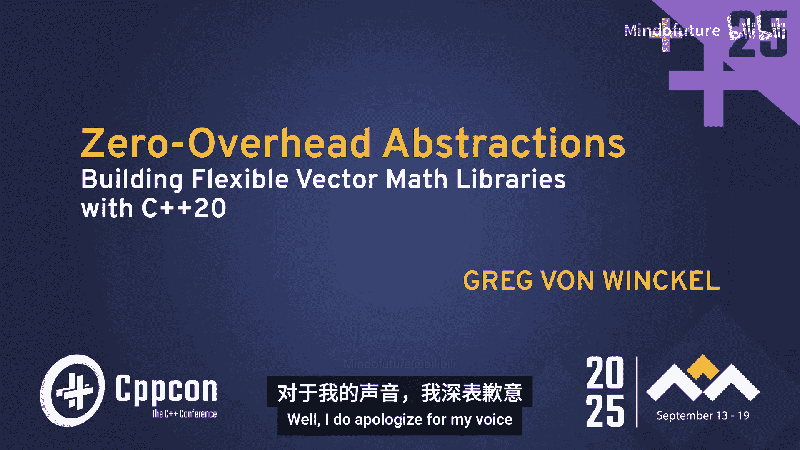
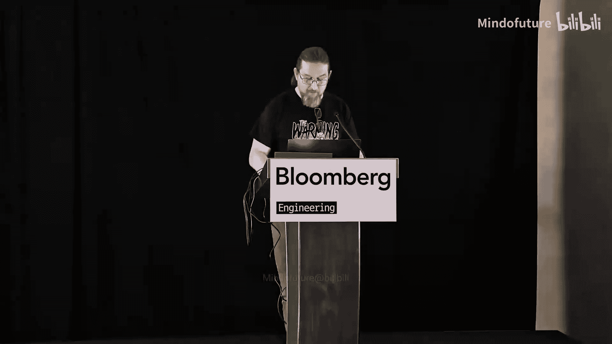
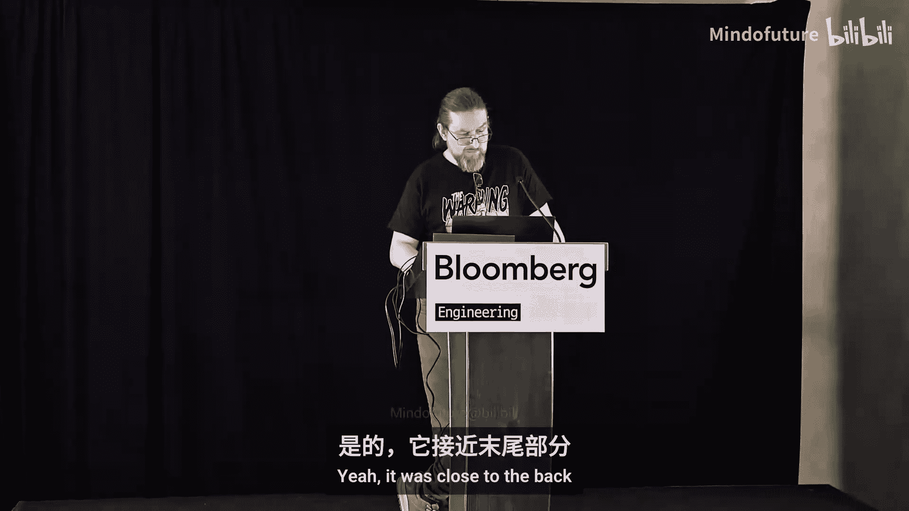
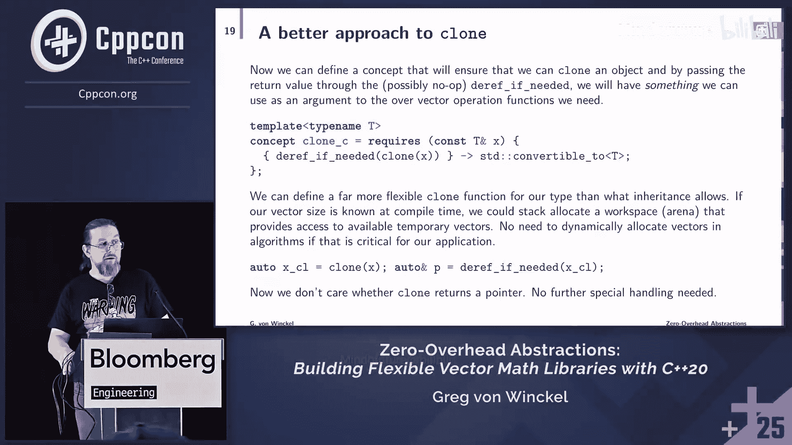

# Cppcon-2025-｜-C++-｜-C语言--｜-汇编-｜-编译器-｜-操作系统-｜-Linux-｜-Windows-p45-P45_零开销抽象_使用概念和定制点构建向量数学库--BV1wyPBzrEeu_p45-

我手。Well， I do apologize for my voice。 This is not the way it normally sounds。

We it'll get through this。Um， it is an honor and privilege to speak to you this morning about a topic that is near and dear to me。

 which is。

Scientific computing specifically vector computations。嗯。For a long time。We have。

Had the goal of being able to write generic code for purposes of doing。Bath， physics simulations。

 things of this kind。 we would like to be able to reuse this code and。In some sense。

 the promise has been there for decades， but the reality has not quite followed。 I mean。

 I have books that date back to the 90s， which speak of。

Doing this in a generic way in terms of object oriented programming that did not really deliver on that promise。

 not going to name names。But today， I want to talk about some things that have。

Have happened in the language in last well， since since C++ 11 at least and more so since C++ 20。

 that make it possible to do some of the things that we would would like to be able to do。

 So here's our sort of model problem。You want to write a library。

That does a bunch of math operations and you want your library to be able to use an arbitrary type。

 but you don't want your library to depend on， say the headers for that type you dont want to make it a necessity。

 So how do you go about doing this。Well。There are several possible approaches。

 and I'm going to look at a few of them， and I also want to compare like what happens if you come at this from the traditional object oriented approach and what frustrations does that lead to？

And then I'm going to show a tool that I developed that makes certain aspects of writing this kind of code much more。

Finless。So why do we care about vector computation。

 well it's basically everywhere and so when I say vector computation and'm talking about vectors of real numbers。

 not endtegers or complex numbers， these appear all over the place。Certainly the AI and ML boom。

Ws timer going down for some reason？My personal interests are in scientific computing。

 so PDE constrained optimization is one thing I'm particularly interested in。

 but this also has applicability。Ges， graphics and image processing and so forth。So the。

 the problem is， of course， and this is not specific to C plus plus。

 but it certainly something that we all have to contend with is that there's always a trade off between。

Going for performance and going for abstraction that you can write。Things exactly for your hardware。

 but then of course it's not portable， you can't extend it readily， you can't maintain it readily。

 on the other hand， if you go too far in purpose in search of abstraction。

 then you can also have other problems。So there are a number of。

De lengths approaches that can be used here， and I'll just mention a couple of them。

 So I will be mentioning CRTP， which I assume most people are familiar with。

 the curiously recurring template pattern。There's one way to get around some of this。

 but it doesn't have that。Necessarily the flexibility of。What we would really like。

 we'd like to be able to write algorithms that work for anything that we consider to be a vector。

There are of course， expression templates， so if you've used een or Aradillo or software like this。

 you're probably familiar with this， and if you've ever written your own expression template code。

 you've probably generated compiler errors that are in excess of1 thousand00 lines along。

 that's always fun to debug。And then there are， of course。

 other approaches involving say traits or function templates and policies and type erasure and so forth。

Okay， so my personal motivation for this is for a library that I've worked on at Sandia for let's see about 11 years now。

 just called the rapidpid Optimization Library， it started。Before I joined it is a general purpose。

 numerical optimization software it's focused on gradient- based optimization though and the original motivation was for very large problems so things where you know you're optimizing over distributed parameters。

 say material parameters in space and you have like a finite element or a discontinu scor in detization and this shows up as a generally nonlinear equality constraint or dynamic constraint and then you formulate a constrained optimization problem for this and my colleagues and I when we wrote this you know what we knew was object or program we knew how to do inheritance we did not know。

About， well， many things that are now possible。And this is。

There' been there's good reasons for using object oriented programming。

 at least for portions of this kind of infrastructure。For example。

 most numerical optimization software fits inC or Fortran or whatever。

 you will invariably have to copy your data between。

 say your application code and the optimizer and if you have inheritance。

 well then you simply you can encapsulate that data in a class that inherits from an abstract vector class。

 and then you don't have to do that。And this is fine。

Under certain circumstances where you know that the types of operations that you need to perform are somewhat constrained。

 sort of like typical linear vector space stuff， but then once it starts to become more exotic。

 you run into some difficulties。And flickering over there， a particular example of this would be。

 you know， if you want to try to run things on a GPU and you certainly aren't going to be doing virtual lockups you。

 on the GPU or certainly not not recommended to try to do that。Okay， so when is object oriented good。

 there's a question that came up about this earlier。

 and I'm not sure I'm going to be able to give you a more definitive answer。But in some sense。

 you want to use object directed programming when when you need to ask the question repeatedly。

 right。So what you don't want is to say what is a vector。

 what is this function and the answer is always the same thing that means you've probably chosen poorly in scientific computing。

 this is often the case， you know this is your container type。

 this is what you are going to be using and it's not going to change and certainly you're not restricted for making runtime decisions。

 it just means that you don't have this particular mechanism for performing dispatch which is very convenient under particular circumstances。

In a lot of the codes I've worked on， I've seen。Object oriented programming used specifically because it defines an interface。

 And that was how the authors knew how to define an interface。Maybe that's something to do。

 but in general， don't do it just because you need an interface。 There's other ways to do that。And I。

 I'll just say over the years， I've seen many blog posts and so forth。

 which malign object oriented programming somewhat unfairly because， I mean。

 it's like reading recipes， reviews where somebody changed all the ingredients。

 you used the thing wrong。 and you made a nightmare for yourself。 And then it became a。

A maintenance problem out of curiosity， Who here has ever worked on a project where there is an object class that is over 1000 lines long。

How about over 10，000 lines long。Oof right， this is goes beyond the realm of human executive function。

 even like keep on top of what all that stuff is you give it to an albumlum and you just like blow out the context window happens to me too。

Don't want that。That said， you know， in defense。If you're doing the kind of thing where it makes sense。

 it's tough to be right if you've ever tried to write your own virtual inheritance from scratch as a program exercise。

You're happy to not have to do that。Okay， so what kind of algorithms do we want to work with Sos a motivating example that's going to take conjugate gradient。

This is great because it's math。 We like math。 Well I do anyway need to turn this thing into code somehow。

 Some of these symbols have direct representations in code and others do not。

 So the idea that a matrix is self a joint or that it's a spectrum is positive and all the sort of stuff this is difficult to quantify in terms of code。

 but the fundamental operations， we need to be able to scale a vector by a number a real number or compute an inner product or add vectors together these kind of things。

 and be able to apply some kind of a mapping a self mapap from the vector space onto itself。So。

If we look at this。We need to have these kind of methods at the bottom so inner product scale in place add in place。

 you probably want some notion of dimension so that you can ensure that you're doing an operation compatible between your opera in terms of dimension。

 and then you need in general you need something like clone or deep copy or all or whatever you want to call it。

 which is not mathematical in nature there's nothing in this algorithm that says hey。

 you need to have some kind of scratch pace。Which is a little bit frustrating， But， you know。

 it is what it is。 So what you don't particularly want to do when。

 when writing code from algorithms like this is to have to spend a lot of time accounting for all of the things that you might need later on。

 you'd like to be able to get them a scratch vector on demand and not have to think about， okay。

 well， I've used this。 And now I can reuse it and so on。

 this makes this distracts from the whole like translating the algorithm to code。

 This takes away from。What you're really trying to do。

 which is to just write something that you can use for any kind of vector type。So heres。

 here's our five basic operations。 There are others that we can have。

 but I consider these to be the essential ones。 So we be able to add vectors， scale vectors。

 take inner products， check dimensions， and then have some way of being able to make available space for a intermediate computation。

Okay， now if you went at this from the object oriented perspective。

 things get to be frustrating real quick， so we think of having a base vector class that defines a pure virtual functions for the interface。

 these add and scale inter product mentioned， you get to clone well。What do you do here？

By inheritance， really you can only return， well a reference or a pointer to a vector unless you have a covariant return type mechanism set up。

 you don't want that， you probably want a smart pointer but this already kind of restricts what you can do because you might like to stack allocate memory that you could reuse well。

 this doesn't really let you do it。Or you might like to be able to return to view or have some kind of memory arena or something like this。

Okay， so let's say for。Purpos of simplicity that will return a unique pointer to a vector when we call clones。

 or at least that memory is managed and somebodys responsible for it。

So if you think about trying to implement conjugate gradient method using this class。

 you'd have some kind of interface like this， you saying the solution to this thing that I want to compute is X。

 and I'm giving it some kind of a mapping a righthand side B and maybe some parameters for the tolerance of a number of iterations。

But then you go through the algorithm and you see， oh， okay， well。

 I kind of wanted to apply A to X and take a difference。

 and it becomes very tedious because now you have to do multiple steps。 you have to allocate。

 you have to apply， you have to scale。 you have to all these things take away from just implementing the algorithm。

 Think， oh， okay， maybe I should add like an a speed。 that's a pretty typical thing。 Okay。

 so you go back to the drawing board and you add another method to the base class and you realize that this is probably going to be a slippery slope。

Yes， so you can do this， you could provide a default implementation。All right。

 this would be our default implementation。 So now people who want to write theirr own don't necessarily need to implement this。

 but it would be advisable because you are allocating and delocating memory every time。

And that's something you'd rather not do if you can help it。Allい。So。Yeah。

 what we'd really like to do is。Is something where we don't actually have to say what clone does exactly up front。

All that we need is a notion that clone is going to give me another vector that I can do something with。

 or at least give me access to a vector that's not previously spoken for by some other entity。

You can look at some of these different approaches for implementing these kind of methods。

I will just say， okay， objectiented is going to get frustrating in a hurry。

You can do things like CRGP or traits。 The frustrating thing about these。 mean there's a few things。

 but one of them is。They're not completely generic。

 You can't really like use concepts for CRTP class or trade class。

 You basically are going to specialize for a type or a dependent type。

 And what you'd really like to do is be able to say。You know。

 I want this algorithm to be defined for everything that implements the operations that the algorithm needs。

Of course， you could use free function overloads。 And if many people have walked this path where you started off doing object ored programming。

 and you read the advice that you should prefer free functions and you go out and you do that。

 And then you realize that 80， oh， it's a problem you never had to contend with before。

That can be also hum to get into that。Okay， so we heard about concepts this morning。

 so I'm not going to。Go into too much depth， but here's the idea for each of those。

Pure virtual functions that we had in our base class for the vector。 we're going to have a concept。

 And the concept is just this， that I should be able to add a vector to another vector。

 So given some sort of mutable reference to something and a accountss preference to something。

 there should be a signature called add in place。That does something。And does not return anything。

Okay， and。How to deal with the clone problem？I don't know if I want clone to dynamically allocate something or not。

 Well， I don't need to。 So what I can do is I can define a thing called D ref， if needed。

 which basically is just a little wrapper that。So what's the issue。

 the issue is this you write the algorithm and you need to know where do I put stars to dereference things or where do I use arrows to access methods that are belong to a pointer object you don't want to do that you just want to write the algorithm in a uniform way and so whenever you clone something if you apply Dra if needed。

If that thing happens to be a pointer， well， then it will derience it。

 make sure that you keep it in a scope so you don't get a dangling reference， but if it's not。

 then nothing happens， it just passes through and that lets you write uniform code for both cases。

So then we can write a concept for a thing that can be cloned and a thing that can be cloned。

Is something that I can pass to a clone function and take that result and apply D reference if needed and get something back that is convertible to the type that I started with。

Right， so this gives me a notion for。How do I？呃。Implement a clone constraint。

Dimenssion pretty simple， you apply a function， you pass it to a function and it gives you an integral value number for how large is that vector。

You can define a type alias to go with it。Inner product， right？

You you have two constant references to the same type。

 You pass them to an inner product and you get something back that that satisfies what I'll call real scalealar concept。

 note on notation。 I'm using underscore C for everything that's a concept， which is not not standard。

 but I just find it to be easy to keep track of。What each entity is that way。All right。

And here we go。 So scale in place。 Same thing。 Now， you need two parameters。

 There's one parameter that would correspond to your vector。

 and and that would correspond to your scalar。The relationship between these two types is not specified in the concept。

 that's something that we will pin down more precisely later。All right。

 you put these things together。And you can define a real vector concept。

 This is a type T E satisfies the real vector concept provided。 It implements add in place， clone。

 dimension， inner product， scale in place。 And that the scale in place。

That second argument is now specified。Ty the element type of the vector is what you get from performing the inner product。

 So this says that if I take that type that the inner product function returns。

But I can scale all the elements of the vector by that type。

 and that is something that's well defined。 So once you have this。

 you have everything that you need to write down the constraints for an algorithm like C G。

 These are the operations that C G needed。And so now you can use this on the signature。

 So why not using， why do you not want to use free functions Well。

 because argument dependent lookup really， so if you're not familiar。

 argument dependent lookup is a mechanism that was added largely initially so that you could have these synctic sugar of operator overloading and not have to be writing you know scope names based operator plus all that kind of stuff that kind of undermines the little purpose of being able to write things in that concise form。

It has the consequence of looking for matching functions in a variety of places that can be difficult to keep tabs on and can lead to unexpected。

Results。Z。What are qualified unqualified names you probably are familiar with things that have。

A scope on them like instead or some user name space。

 or they're associated with an object as a member function or member variable。

 These kind of things are qualified。 unqualified， don't have that。

 So there are two different mechanisms that the compiler uses to identify。The unqualified types。

 And I will apologize for the somewhat tortured metaphor。

 I spent a long time trying to think about which detective was better for which and did not come up with a completely satisfying。

Solution， but ordinary lookup， as they call or just unqualified lookout without any。

Any the specification， it looks for all the kinds of tokens， not just functions。

 whereas ADL only looks for functions。And it starts。

 the ordinary starts out locally and it works outward until it finds。A match。 And then it's done。

 whereas ADL can actually find a number of possible candidates。 And then it has to figure out。

 you know what， what's the precedence for these。嗯。So yeah， using declaration's work。

 you can't turn it off if it's ordinary， whereas for ADL， you get the complete set of matches。

 and then you can sometimes get some very confusing compiler errors if there is a collision and there's no way to disambiguate。

So。嗯。This motivates what are called customization point objects。

 So this is a thing that looks like a function and works like a function， but is not a function。

 And the consequence of that is that AL doesn't see it。Okay。So。

Here are some examples of ADL in action， right ADL would find a function in this case。

 where if I've defined my ad in place。Right， in this case， it would find。

It would find this addd in place because it is defined in the same namespace as the type。

 my vector of T。Similarly， it would find it if it is a friend。And。

This gets still be a little bit nebulous， but namespaces that are associated with template arguments。

 and there are a number of ways that a type can be associated。

 or namespace can be associated with a template argument。Things it doesn't find。

symbols are function symbols that are not in this related name space。嗯。

Or they're in the global namespace。 But the type is not in the global namespace。

And things that you only get through a using declaration。So。Most importantly， for this talk。

 the another thing that they don't find are funcors。 So you can create a funor。

 which is a function object like this。 write astruct and。

And write a template method for the call operator and then instantiate this thing with inline contextt per and I use the I use this non-standard notation instead of tag or whatever to indicate that this is a funtor。

 so underscore DOR， whereas the instance of this object。

 the customization point object doesn't have any kind of extension。

So this add in place object is something that can now accept two arguments of the same type provided the constant conditions satisfied。

And you can you can。Yes， you can define what happens inside of this call operator here。And。

This would be some add in place that you define in your own library。And it is not。

 It is not the same as the one at the bottom， because this thing， oops， colonologies。

Let's see if this works。Right， nope， I can't highlight the a in place that is inside of the call method。

Is seen by80 outs being a function， whereas。This is not scenes being a function。

 so there's no kind of recursive behavior here。All right。

You can also simplify or condense the syntax slightly and write something that maybe looks a little bit funky。

 which is say in line context per struct。Put it all together， that's fine。All right。

 so where does the compiler look for this ad in place， Well， whatever your type T was， right。

 it will look in that namespace where that type T is defined。If T is a class。

 then it'll look at the name spaces that are associated with the base or base classes of that T and any kind of。

 if you have any kind of template instantiation， the name spaces associated with the template arguments。

Okay， let's see。 Yes。 And then this little。No， at the bottom right。If you have no unique。Best fit。

 Well， then the standard says you get a compiler error。All right。

 so this is a so called traditional customization point object。Which does not use tag invoke。

 which I'll talk about in just a second。That you define the interface。

You have some sort of mutable reference， some constant reference， call with thing add in place。

 and it disspatches to some implementation。it relies on ADL to define this。嗯。And typically， you know。

 if， if you don't have a。If you don't have a function that can be dispatched to the usual practices to write what's called a poison pill。

 which is sort of a deleted function that catches everything so you at least get a clear compiler error。

Okay， so the problems with this are you can run in name collisions。

 add in place is not the most unique thing possible。

 so you have a large project with a bunch of different dependencies。

 more than one of them could use the name add in place， you run into some trouble there。嗯。

And you do have to write a lot of boilerplate， although not quite as much as you'll see in just a minute。

If overload resolution fails。 Well， the the error may not point to exactly where。

 where the problem is。 What you want is the the error to point to。You know。

 the signature itself and say， well， you couldn't call this in the first place Ca you didn't satisfy the requirements。

So tag andvoke is a approach that sort of centralizes all of these dispatches to a single function that takes an additional argument that corresponds to the customization point object type。

嗯。So in this case。We have our a inplace functor。 and then this thing would then dispatch to a tagganvoke where the first argument is an object of this a inplace。

 FT R type。And then the user would be responsible for defining。This implementation。Okay。

 so this does buy you a number of things， right， cleans up the namespace。

 You now have a single extension point。The diagnostics can be better。

 you don't really pay anything extra if you're passing things by reference and you shouldn't be paying anything extra for this。

 whether or not you get copy of if you're passing by values。Not entirely clear。

But let's take a look now。Here we have。Some sort of vector type。 And we wanted to find。

Something like axby that dispatches to other stuff。

 So what we could do is we could define this tag invoke right here in the same namespace。

 And then it would be found by ADL when we come down here。It' a collection of references。

 which I suggest looking at。The main issue with this approach， I mean。

 it seems to be kind of the best thing that we have in the language at the moment is very cumbersome。

 It does result in needing to write a lot of sort of code plumbing just to connect the CPUO and so on。

 and the compiler errors well they're maybe not quite as bad expression and template errors。

 but they can be pretty bad。So to that end， I wrote the tool which I put up on the Sandy Las Gitthub a few days ago。

 which is called tinin Cup， which is a tag andvoote customization point tool。

 essentially what it does is it defines a CRTP base class that you can then derive from for all of your customization point objects and it provides Python code generator using like Ginja templates and so forth that will automatically generate the boiled platelate for you in a very concise way so that you don't have to think about it。

 and I'd say think of it as kind of like how CMakeake makes and make file you just generate some stuff and then you don't touch it。

So what what does it look like in action。 So if you would run it from， say the terminal。

 you could pass J to it， you'd give it the name of the name of your customization point object that you want add in place and then you could specify the arguments that you want to take。

 So I use this sort of shorthand that generic types get a dollar sign。

 So that means anytime there's a dollar sign， there's probably going to be a type name or something when it gets expanded。

 And if you are like me and you use Vim， you can do this even more concisely So there there's a Vm plug in for this there's also a C line and VS code plug。

 So you just go into Vim and you hit colon CO add in place and type this stuff and it generates a whole bunch of code for you。

So this is what it gives you。This is not the kind of thing you want to have to type by hand over and over again in a lot of the stuff。

 you know it's just the same from one to the one customization point object to the next。

 So that's one sort of virtue of this tag invoke approach is that you do get very uniform syntax。嗯。

So I do populate this with a few things Here。 One is this using declarations of this is the fallback。

 So if you try to call this funtor。And in place with incompatible arguments。 Well。

 it will check to see if they're they're compatible by looking for a tag and vote that can take the appropriate types。

 And if it cannot， then it will then call the。The call method in the CPU pace class。

 And then this implements sort of。Enhanced diagnostics。 that tells you。

In sort of common use cases where you did something wrong， what you did wrong。All right。

 so each of these things can now be implemented。Each of these things are also generated automatically。

 If you want to use them， If not， you don't have to， right。

 This provides all of the concepts and type aliaes that you can use。This is what the actual。

synyntax of the CPO generator does。 So if you pass in a， like I said， a dollar sign。

 then it generates template type name， it keeps track of L value and R value and forwarding references。

 keeps track of。The veryatic arguments and con， the order doesn't particularly matter。

 You can write con dollar sign to your con。dollar sign constant and so forth。

 same thing with volatile。All right， and just to say this。

 you know this CPU tag is there's no preprocessor black magic here。

 this is just basically for purposes of being able to make clear compiler errors and being able to make it easy to gr through code for places where this thing exists。

All right， so what is in the base class？It inherits from two things。

 There's one thing called CO introspection， another， which is called CPO diagnostics。

 And it implements this one veryatic。Gll operator that says， well。

 we were not able to find a tag invo that we needed。Let's see what actually went wrong。Alright， and。

嗯。This does have a potential virtue， which is that by using CRTP。

 means that you can also use ADL look into the space namespace。

 they have implemented some trades classes so that you could specialize trade classes that are in the tin cup。

Name space for your type as opposed to using the standard tag invoke as appropriate for what you're trying to do。

Okay。Yeah， let's see。 I'm going skip that one。 Al right， so here's the concepts that it generates。

Checks to see if you can。Use tag and Voke and it will check and see if it's no throw and what the return type is for that。

And then in the introspection class， it defines。嗯。What are the valid argument types that you can use？

Whether it's no throw， what the return type is and。All that kind of stuff。

As far as the diagnostics code， things I've implemented so far are this。 If you pass in a， say。

 a pointer， smart pointer as an argument， and that is invalid because you forgot to dereference it。

 the compiler will tell you， it will say it will check。And each of these things has。

Has a setting on it that you can turn selectively turn on and off with like C make or mason parameters for how much work you want the compiler to do to determine what errors you made。

So if you have them all on， it will say， okay， you tried an argument， this is invalid。

 but if you would dereference it， it would actually satisfy signature。

Or you passed a thing that was constant and the signature expected something that's non constant will it will check that and tell you or if you。

I've only implemented it for two， because I don't want to do it for lots of arguments。

 But if you put the arguments in the wrong order， it will also check and see if you had switch the order。

 would it have， Wouldt have satisfied the interface requirements。

 And if you have the wrong number of arguments。 So these are sort of the kind of typical goof ups。

And it can also do a superposition of these things， so if you pass a con pointer。

 you were expecting a non con not pointer。And if you compile with C+ plus 26。

 then you get sort of more explicit error messages because you can use。

Static strings in your static assert messages。I did put this a number of examples of this on compiler Exper。

 if you would like to play with it， and it shows this thing in action。 So here， you know。

 there's some sort of struct vector that has two elements of type T and that I generate。

A customization point object， normalize。Just basically give me the normalized version of this vector。

has all this code blbing stuff here。And then down in the dragon Vo。You compute the norm。

 compute the square root of sum of the squares of the elements and return a vector that's appropriately scaled。

 and then at the bottom here， I generate a unique pointer to a vector and try to normalize it。

This generates a compiler error as it should。 But importantly。

 it generates a compiler error that gives you some clue of what you did wrong。

Not have to sift through hundreds of or thousands of lines of compiler message it says that in the argument types are incorrect。

And that at the bottom。 So no valid tag invooc overload was found for the CPO。

 But there is a valid overload for the de referenced argument。 So you probably just forgot to。

To dereference your argument。Gives you something。You know， to。

 to to act on those' sort of more advanced features as well， so you can specify。

Additional arguments to the C so that that， well， there's several ways to use this。

 One would be you could essentially make multiple。Fs or what behaves like multiple functions for the same kind of arguments with difference static string values。

 or you could use them as a compile or runtime switch。 So if you're。

Interested in doing like an execution policy， right。

 You could specify what the different execution policies are in terms of this。

 Jason with these options， say sequenced in parallel。

And this will then generate rather large bit of code where each of these things get a different tag that is a member of the CP class。

And it will generate。An array of string views that contains each of these compile time strings。

And then you can use these in two different ways， One of them would be to use the type directly so that this defines different overloads for the methods you do compile time dispatch。

 or you could also have it basically delegate to runtime dispatch so that for each of these possible values。

 values that are known at runtime， it then dispatches to a different instance of tag andvoke with these different types。

Present。Okay， and let's just skip over that So then。

Well how can we use this to make our life easier There's a second repo which I put up this called real vector framework that uses tin cup to basically generate all of the different customization point objects that you need and the core ones add in place clone dimension in product and scale in place。

 but also some more advanced things can actually binary unary， so this would be apply。

An arbitrary function element wise to， to a vector。And and very addicts。

 so if you have multiple multiple vectors that you want to use as inputs in an element wise fashion。

 and then a couple things that are relevant for AI stuff。 So there's a relu and softmax。

Also implements some tools for。For memory management， so instead of having clone。

Generate a unique pointer to a vector。 This provides infrastructure for sort of managed memory arenas using observers and so forth。

 And there are some benchmark numbers on。The repo and the dos directory that show that you can get。

 hundreds or thousands of times speed up by reusing。

TheMem arena type vectors as opposed to continuously using clone to allocate and delocate memory。

 not terribly surprising， and there's also a few algorithms that are implemented so I've implemented the conjugate gradient。

Limited memory BFGS， which is an optimization method。They use line search。

Projected gradient descent and a truncated CG trust region method。

 and there's also a few transformer models。Okay now if you。OneOne of the virtues of this approach。

 as I mentioned earlier on XA using。C， R TP or traits where you have to actually specialize for each particular template parameter is that you can use these in kind of a generic way。

 So anything that satisfies broad criteria such as a to range as rate。

So that means that there is a begin and an end and a size and that it's copy constructstructible and so forth。

 that you don't actually need to implement anything。 all the methods are provided automatically。

also illustrates how you would do it for your own type so if you have range。

 then you know the default implementation for all the tagging pops are provided in terms of things that are from the algorithm and functional headers。

Right。And， let's see。🤧。Right， so。Inner product usesmer。And scale in place。

And then once you have all of these things together。

 you can go back and look at what did you need to do to actually write the conjugate gradient method in terms of。

嗯。Real vector concept instead of an object。So this method， this function。Takes real vectors。

 things that provide the five essential components and something that performs a mapping。

 So there's another concept called self map， which just means that it maps a vector from space into the same space。

And then the implementation of this。You know， it's actually not terribly different from what you would write if you were writing object oriented programming。

 The main difference is that， you know how what look like free functions Theyre actually functors。

And that。Instead of having say O dot method ags， right， you now have。Fununk to her name。

 O and then arts。 Otherwise， it's very， very similar。嗯。Yeah。

 it looks a lot like the math scale in place， add in place。Take square roots。 I've， I've。Over。

 I've made。Customomization point objects for a number of elements of CMM。

 I will get to all of them eventually so that you're not restricted to using float double and long double。

 but basically anything that you want that works like a real number so if you want to use MPFR or something like that。

 you can do that。嗯。This is the syntax I mentioned earlier for clothing this is maybe one annoying thing。

I don't have a better solution for this， but you want to ensure that you don't get a dangling reference so that you。

 you， And this is probably the only time I would advise putting two commands on or two statements on a single line because they go together。

 right， you clone。Which maybe does nothing。Right and then UD reference， which maybe does nothing。

It depends， but by following this procedure， then now you don't have to worry about dereencing or anything like that。

 code becomes independent of whether things are pointers are not going in。

It looked an awful lot like the math version of the algorithm。That dispute do Axby， axby。

 compute or products and scale。All right， so yeah， if you want to do urary functions。

 you can use the CP generator here。So this would just take an extra template parameter。

 so another dollar sign F funk。Or possibly this actually should have。

There should be authoritying reference here。嗯。Yeah。

And then this will check and ensure that every element or the element type associated with your V。

Is admissible as an argument for the callable F。And here's the， let's see， requires unary in place。

 invocable that F can take， say， a stood ranges range value T of R that you put one of these into F and you get one of them back。

Right。And similarly， for binary functions。Same principle。And more generally， forvariad。

 So if you would have arbitrarily many vectors。You can write a CPO like this。嗯。

And it will generate this code here。And also， yeah。

 so here's is the implementation of like how you would do very added transfer。🤧Yeah。And let's see。

 I think that wraps it up。 Yeah， so what are， what are my next plans for from this point on。1 is to。

Basically， flush out the real vector framework more provide more algorithms， basically going to take。

The rapid optimization library that I mentioned from the beginning and and rework it to use Cs and ant invogue instead of inheritance。

嗯。And then as far as the Cs themselves， I am going to try to write a clang extension to sort of do proof of concept。

To show。If we did have this as a native language feature， like what would it look like。

 how would it work， there were proposals using， say， keyword。

 virtual or customizable or something like this，Outside of a classco。

That would be used to indicate that this is a function that can be customized。

Now that I have the infrastructure that's implemented in terms of combination of C++ and Python。

 can this all be wrapped under the hood in in a clang extension for proof of concept and then hopefully share it and get feedback and see。

How feasible that is for， say 29。喂。That's it for me， here's Reappa if you're interested。

Don question。Please go the microphone。You知 on系。Seperity。Maybe a dumb question， like your talk to you。

 by the way， why couldn't you just put the statement that clones as the argument in the second？

Part of your。Two statement， one。Sorry， where was this？

It was the only place he had two statements in one line Oh， I want to Oh okay， yes。

I there some subtle things， I guess， that need to be appreciated。You know， easing something。Actually。

 maybe that was further back。Yeah it's close。

Yes。Oh， like down， down here。Why couldn't you put clone。Inside。Yes， the BR is if needed。

 just put in the clone X。Okay， instead of it Sccill。All right， well， so if x is a。Let's see。

 So if clone returns a。Smart pointer。Right， and then that that only lives as the argument of D ref。

 if needed。What， what happens to that outside of that。Oh。Sorry。Yeah， so right， so you create。

 you create a pointer。That only lives as an argument， going into that function。Then you dereence it。

 but you've dered something that doesn't exist anymore。 goes out of scope。So， yes。

 I did try a lot of tricks。 I tried making like a rapper class and things like that。 And I。

 I concluded。As annoying as it was， this was the most robust and least error pro approach to ensure that you。

 you don't have like a dangling reference or anything like that。 Yeah， makes sense， thanks。

Hi， lets talk I just wanted to ask if so if somebody told me that I had to implement lots of linear algebra operations。

 my first instinct would be okay， I have to overload operator everywhere for example。

 and I noticed several places in your talk where that seems possible， for example。

 the add in place operator could be naturally done the plus equals operator inner products with star operator matrix inversion with the carrot operator and so on was there some reason you didn't do that why did I not use the operator notation I mean。

 largely just didn't very explicit and actually I would say that that is a good approach to maybe put on top of this like as a facade because if you are working with as I mentioned。

 libraries like Iigen and so forth right？Those symbols mean different things。

That they don't do what you think immediately they create an expression that can be lazily evaluated。

And so if I say a plus B right， what do I mean by that。

 like did that actually create a container a new thing So when I've had to overload operators before a plus operator generally allocates because it' to return some sort of R value。

 but a plus equals operator should never allocatecate a whole new object。

 it may have to reallocate the target like for example。

 if you do like a matrix vector multiply that changes you know that may change the dimension of the target you know you may have to or or actually a matrix matrix multiply better example where that may actually change the dimensions of the result So that sort of allocation would be allowed but not like a whole new allocation right and you know and that is great to have because it does make it look more mathematical。

 but I would my instinct would be to to put that on top。Um。

And be just be terribly explicit with what you're actually doing under the hood。

That makes sense thanks。Yeah。Oh， if that's it， oh， what okay。Does this work with cocos？Yes。Yes。

 it does。 It works with anything。Totally agnostic。 So I mean， in a way， this kind of， you know。

 follows in the the idea of the STL， where containers and algorithms are completely agnostic to one another。

 right， or're decoupled。You write one algorithm and use it for all the containers that satisfy your concept。

Then in fact， this is used， customization point objects are used in ranges。Hello， hi good talk。

 I had a few questions that are more， more general。 So C plus plus 26， we're getting。

 I think vector like types。 So your're。Your blast stuff。 the matrices and stuff。

 Are you going to be using those at all， or you mean like stood Lynowg， Yeah， the Lenow stuff。 Okay。

 I have not used those yet。 That is something I will I will definitely look into。

 You know how to make that compatible。I guess one thing I neglect to mention as I was talking about this is that by using。

嗯。You know，Gingja templates and so forth and Python to generate this very uniform。

ode it makes it possible to refactor in a fairly straightforward way。

 provided you don't touch it after you generate it。

You used the recipe to cook something and you leave it there。

 and then as the standard changes and other things become available to you。

You have a fairly straightforward way of updating that code in automatic fashion because you know exactly how it conforms to design。

But that is a good idea I actually should take a look at Stland I and see how。How that plays Okay。

 also a second question。So we're also getting reflection Yes。

 would you consider using thatably fun yeah， that is something I definitely want to explore as well。

 I haven't done it yet。So the code bases I usually have to work on are kind of stuck in C++17。

 unfortunately， but this is 20， but it is forward thinking and so yes I'm going to look at。

Leveraging reflection。Awesome， sounds great， cool。Allrange。嗯。We。

'll be here all week if anyone wants to talk。

