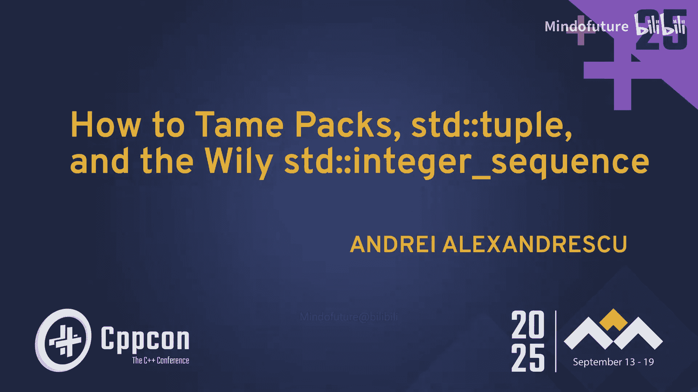
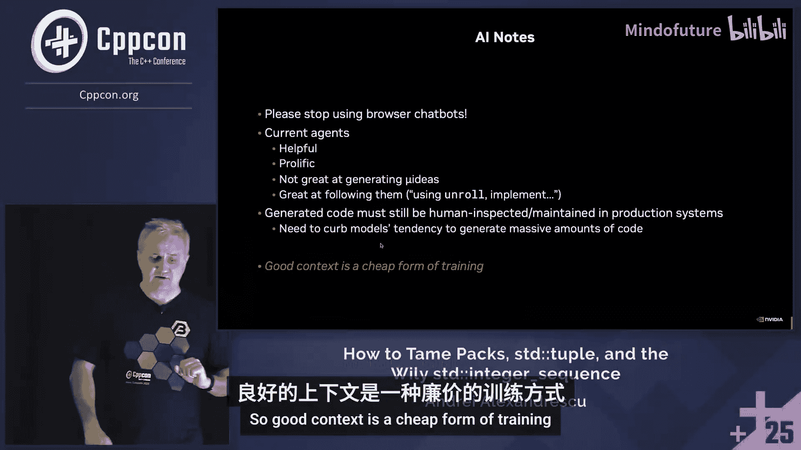
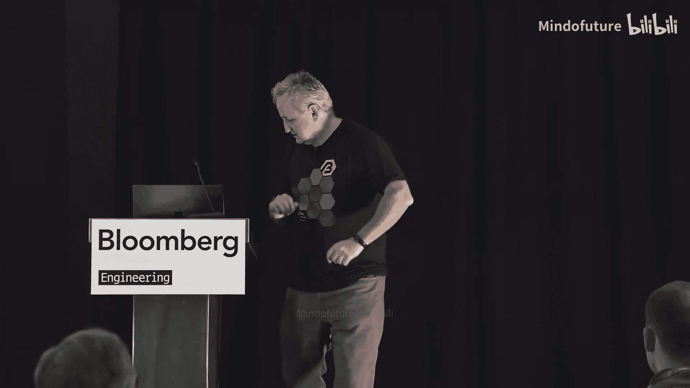
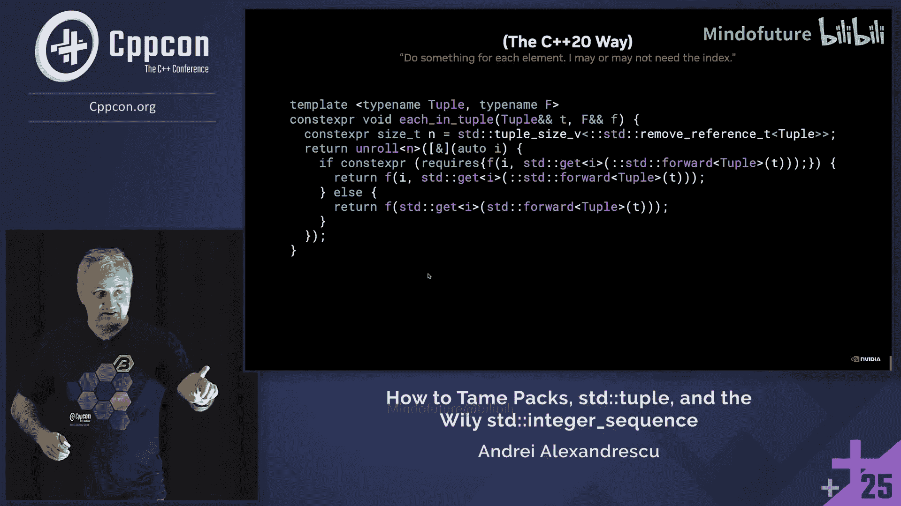
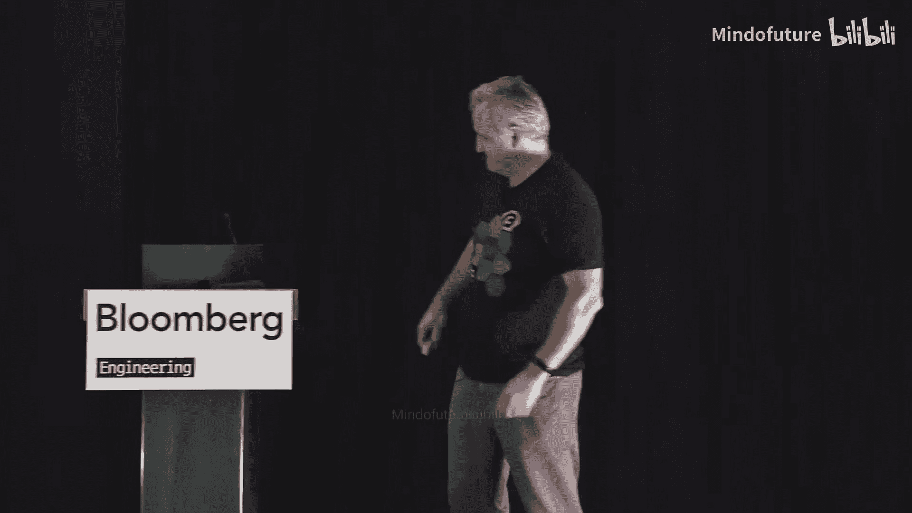

# Cppcon-2025-｜-C++-｜-C语言--｜-汇编-｜-编译器-｜-操作系统-｜-Linux-｜-Windows-p47-P47_如何驯服包、std__tuple和狡猾的std__integer_sequence-Andrei_Alexandrescu--BV1wyPBzrEeu_p47-

Right， we may run a little late。I have too much on my chest。

So。Stay with me， please。 Okay， if you need to go， you can go， but please stay with me。

 The best slide is the last。I'm not kidding。All right。So， this is about。This。But， I want to make。

Clear。That we have your rights。Okay给。Europeans are vital regulation。And they regulated。

Your rights as a conference attendee。 You can ask。How does this stuff help my AI coding assistant。

Every talk you go to can the first minute， you can stand up and say， within my rights， given by crap。

That's the abbreviation。I can ask these three questions， okay。And because there's a lot of you know。

 fake news and all that stuff， I put the reference down there。And the most in bit here。

 although this talk is not about AI coding helpers。I'm telling you， please stop using chatbots。

Stop using the guided chat bots。Stop using them。Use agents。ok。To prove theres this public。

 there's this public PR I made on my employer's website。Repoitory repository。

 And the way it works is a coer wrote me。The slack messaging they said。

We have this We found this bug in your code， Then it only manifests itself in G C C 14 on this particular Linux version。

And， you know， it's only one of our containers。 And it's a very narrow thing。

 And G C 14 is wrongly assuming you're using something。 and initialized it's not the case。

 but you gotta kind of finale the code just a bit。To make it work。 And I wrote my coworkerer back。

And I said。I'm on Windows 11， with WSL。I havet messed up Docker installation。On Windows。

 and I have another distinct messedtop installation on WSL。And I'm terrified。 I level with you。

 I'm terrified of using Docker right now， on this machine。Right。And they said， well。

 you gotta kind of make it work。 And I said， fine。 So I'm gonna run it straight without the machine without the doctorcker。

 I'm gonna run it straight in the WSM WSL machine， which has a Bo to 22。

 And guess why GCC 14 is not available on Bo to 22。So， that didn't go well。So then guess what I did。

 I took my dialogue with my co。To whom I， you know， I， essentially， I， I candidly told all of my。

 you know， problems in my life and marriage。And I put them in the prompt in cursor。 And I said here。

 here's cursor。 here， here's my situation right now。You know， analyze this， right。

 I know it's a mess。But， you know， can you and， you know what， Cursa said， you know what。

 I'm gonna fix it for you。Let me run first。 What version of WSL you have。 Like。

 it started me from the very beginning。 It started me with my childhood。Alright。

 start from the very beginning。 It said， what WSL do you have， Let's see your docker。 Let's see this。

 Can I actually kind of figure out a lot of stuff about my machine that I didn't know about。

 The thing is the assistant， the agent can actually run things on your machine with your approval。

 Our security team has， you know， some settings， you can only run if you can of click run for each command。

 which is boring， but a lot faster than typing it yourself。

 especially when you have no idea what to type。😊，Right， so then you figure out the docker。

 It started the do。 It debugged my stuff inside the docker。 It ran G It ran G， D B inside the docker。

Several times。And then it said， I' find your problem。 Want me to fix it。And I said， yes， please。

Right it said， sure。 So it changed a couple of files。

 And without understanding the bug and without understanding what the hella was doing。

 I had the bug report with MOjis in the Github message。And only this one last point。I mean。

 how can anybody compete。With somebody who with， with a machine that generates nicely formatted Github PR messages with emojis in them。

Right， so。The the motivation of this talk in particular has nothing to do with AI， although it does。

Because every， every cell， I'm going sprinkle a bit of information on how you can use this with。

With an agent。Right。It turns out that Ts， packs and all that nonsense are instrumental to a bunch of scientific code。

Pupils are used to model tensors。Which are the basis of a lot of scientific code， including。

 of course， AI。 And you know， to do so， you need inevitably to deal with parameter packs。Now。

 parameter packs is kind of a distinct thing with a prior status。 You can't copy a parameter pack。

 You can't define one。 You can't。 You can't do a lot of things with them。Right。And it's kind of。

 you know， it's kind of a mess so。He started he couldn't say， you know， I have a pack。

 Give me the second element of it。That's difficult。That's difficult to grasp hopper， right？And then。

 you know， people kind of started using packs for a variety of things。

And there came SDD integer sequence。You gotta imagine like。

 what kind of mess in the programming design language design space do you have to be such that integer sequence sounds like a good idea。

😊，Where should it be and what dire situation in your life do you have to be。

 I remember when I learned about them。 It was 2014。 And this conference was back in Bellevue。

 Washington。Greaty digs， right， Too small。So I was there Stefa and T Lavave。 You know him， right。

 the is T L。He was explaining me in the hallway howG SD integer sequence works。 And I remember。

 I remember distinctly。He was explaining to me。 And as my mind started to work with fibriility。

About the consequences and the implications。And the future that I was facing。Now。

 remember thinking at that very moment， I thought。If I run。10 m through that window。Yeah。

And fall to my death。😀I'm gonna have a future in which I， I a short future。

 albeit in which I don't need to write any one line of code with E js。But then， reality kicked in。

Were on the floor one。And that window， you know， double pain， you know， you can， you know。

 or every would have gotten was at the best concussion and still a bad memory of vestD integer sequence。

So that didn't pan out。 So then here we are， like， you know， fast forward。 And here we are。

 like in Anino movie。Right， so not too good。 It has all the disadvantages of packs。 plus a few more。

 By the way， did you know that you can't implement a integer squencing negative C plus plus。

Except you can， but is going be pig slow。 Thank you。 It's going be pig slow。

 All implementations are like， yeah， we know it's a great idea。😊，But it's too slow。

 So you're gonna make it a primitive and intrinsic or whatever， right。However， it's not all bad news。

 I'm happy I didn't jump through that window。Because T 4 is coming to C plus 26 near you。Right。

 and if you go， if you want to manipulate a pack， you can do it very nicely by means of。

 I'm going to use a  template 4 right now。And Im going to iterate a pack or I can make an array。

 I can iterate a tuple。 I can iterate a variety of things that are difficult to iterate。Better yet。

 that iteration is a pseudo iteration， because， in fact， what you're doing。

 what the compile does is going to paste the code several times for you as opposed to， you know。

 generating code that iterates at run time。That's nice。 There's one more element of the future。

 which has an awkward name。Structure bindings can introduce a pack。It's it made it in 26。And it。

 it took 10 iterations。So it's R 10 that that made in a standard。In all of these 10 iterations。

 nobody saw they have the wrong capitalization here。But。be that as my， as it may be。

 it's a really nice feature。 Thank you， Barry Revin。😊，You can actually bind。

A local de pseudo variable to a tuple， for example， And you kind of unpack the tuple that way。

 And then you can use one of those fancy。Dat， dot， dot constructs that come straight from Venus。

Right。And you can inline things。So I'm not going to present to your competition for dedicated libraries for metal programming。

 But what we're looking for here is some a collection of very simple。 I'm talking 1 lines。😊。

I'm talking like， like the whole talk，50 lines。That you can take and using your code and be very happy using them better yet。

 your agent is gonna love them。😊，Because agents are very bad at creating new idioms。

 They're very good at using them。It just， it's a fact of life。 I'm not sure why。

 but that's how agents work。An agent will never generate the code that I'm going to show you here。

But once you show it to them。Yeah， yeah， that makes sense。Good job， you laundryy， yeah。You did it。

 I'm gonna use it。 And you can actually explicitly tell it。 Use this idiom to implement that stuff。

 right。😊，So， that's being nice。So let's start with some some basics。

 which I'm sure many of us have been going through。 First of， like， you know， we have a。

 we want to define a function that does some some， some， you know。

 some iteration over over a pack or a tuple。And as I'm sure you know。

 the first thing that any agent will do， including a human agent sometimes。嗯。

Print tuole implementation， right。And then you have green tual。Right， theres two。 Its always。

 it's always two functions。Right， the， the， the postman always rings twice， right。So you have this。

 first all， like， I have this namespace detail， which will just once make me want to kill myself。

 But that's fine。😊，And then you say， I'm going to pass one of those index sequences。

 And from the main function， I'm going to pass the index sequence into the second。

 And that's how the cookie crumbles， right。So this would be what every agent is going to recommend for。

 It's I want to unpack a peopleple。 I want to mess with each element of it。

 And then it says it takes it like， you know， it's it's a highly optimized path in the。

 in the neural brain of the model。 It's going to output this code。😊，Actually。

 this is copypi pasta from， from that very thing， right。Fine。

 but there is a simple way that I wanted to show。Which uses a lambda in sequence 20。

😀Im I heard the chuckle somewhere， but this is not chuckleworth， my friends。This is serious stuff。

 So you define a lambda with an explicit sized data that I。 and it takes an index sequence。

 And the deal is， you're going to call it yourself。 It's like an idiot。 Remember， back in the day。

 you had to write yourself a check if you wanted to take any cash from the bank。😊，😀Okay。

 theres nobody's laughing because everybody's like， I wasn't born there then。 So why do I care。

 right， It was the case。 I'm not kidding at Citibank。 You would go into the bank。 in the bank。

 There is， there is a thing you go in the bank。😊，Right， and you write yourself a ch like an idiot。

 And then you give it to the cashier and the cash she says， Okay， so I'll give you the cash。

 and all of the transaction took only like 30 minutes， right， plus the drive and whatever， right。😊。

So， similarly。You call your own a land like an idiot with the appropriate index sequence。

 And that's how the cookie cruumbles once again， right， fine。There is one other trick that。

I would love to， I would love to give credit for。 There's a simpler trick that works close 17。

 If nobody claims the credit in 3，2，1， Okay， I claim credit for it。

There's the following trick you can use。 But by the way， this is not the gist of the talk。

 So it's just a little thing。 I don't care about this， right， So don't。

 don't pay attention on your phones。The trick you can use is， okay。

 I'm gonna say template of timing T and the size D size D dot， dot， dot， whatever。

And you take it defaulted。As the last parametermeter。Defaulted。

What I think ice is if you call the function without that default argument。

What do you think the eyes that， da， that are going to be， please。Anybody。They're good Yes， please。

 Thank you very much。 The empty set。It's gonna create an integer sequence。 That is the empty set。

 is the empty integer sequence。 It has nothing in it。 And the size of that， da。

 da that thing is going to be0， right， fine， So I'm getting the default parameter And I inside the function。

 And here I make a test very widely test， which is， well， I read the right size or not。😊。

If you're not the right size， then I'm going to call myself again writing the check to myself with the right size。

 Why not， Why not check for 0， Because I'm very happy yes， Thank you very much。

 And good to meet you again。😊，Why do this room， this half of the room。

 Why do you think I'm not chicken against 0。吓。Now， because safety friends。Yes， please。

Is irrelevant in the people？There could be 00 elements in the two。 Very nice。 Thank you very much。

 Actually， I didn't think of that。 So it's kind of an awkward moment， but I have I have other reason。

 which is what if some， some， you know， safety friends security of software。

 What if some user decides to call this function with the wrong index sequence with the wrong size。

 I have a triple of size 5， They call it with index sequence of size 4。😊，And then my check。

 if I check against 0， would pass without having， without needing to pass。 It shouldn't pass， right。

 So therefore， very clear， And I say， are you the right size。

 And if you're not exactly the right size， no more less， I'm going to pseudo the recurs to myself。

 Does's not recursion， is it。Doing， we don't need to explain this。 There's not recursion。

You don't do that like the stack frame all that nonsense。 No， this。

 you call a different function because that instance is gonna be completely different。

 except in the case when the in tuple is zero size。 Thank you very much。 In that case， actually。

 it is recursion， which is kind of funny。😊，Agon with an endless loop。😀Alright， so I。

 I gotta confess something。 So， you know， I'm sure some of you have given public talks。

 When you're given public talk， you are in a state of severe cognitive impairment。

 You can't think of your feet。 If you told me I was 42 times 7。 I can't， I can't tell you。Alright。

 nor can you， apparently， that silence。 Do you see how awkward this moment is right now。😊。

So I said I can't think of my feet。 So please somebody， by the end of my talk。

 tell me whether the code is going to be liable to look forever or not。Thank you。

So our disposition following this these discoveries is that fine。 We don't like the verbo version。

 The workarounds are still bulky。 We want to stay as far from S TD integer sequence as possible。

 And that's going to save us。 Nves is going save us。😊，Mental health is gonna keep the doctor， the。

 you know， the shrink poor， okay。And then we're going to build some other primitives that are simple。

 nice and beautiful。😊，So let's write a function that are roll some code several times。

 I say I roll of five。 I rolled the same code five times。 That's all I want。

 And the first one that comes to my is。 Wait a second。

 There is a thing such as an R roll pragma in many compilers， right？ You've heard of it。 heard of it。

 our roll pragma role。😊，Alright， so few people do parallel programming， friends。 So few people。

All right。There is。 It it exists。No fake news here。 So then I'm going to say prime my roll。

 And it's gonna roll it for me。 Ca closed or is it No， because if I want to actually pass that。

Look variable as like， I want to get the ice element of a tuole is not gonna work because it's a runtime integer。

 not a compile time integer。What I want for true unrolling is I wanted to call my Lada with the0，1，2。

3， et cetera。 and I want to use inside the Lada that's 0，1，2，3， et cetera as a compile time constant。

Because the next thing I wantanna do is S T D get of 0。

 Give me the zero element from that tuil and S D get one and give me the first and so on so forth。

 Thank you for the odds， yes。😊，Sorry， index with index。M P with index。I don't know what that is。あ？

Thank you very much。Even though， you know， even， you know， there is a thing in every talk。

 There's some guy who knows more than you。 And you're that guy。 Thank you very much。😊。

Let's do the second take。Which is going to do something like this。 I'm going to use my trick。

 whatever our role。 And then I'm going to say。嗯。F of I， you know， da， da， dat。

 and I'm going to enroll F very beautifully。 There is something still wrong with this。😊。

It's still bad because if I want to say on row 2 and I want to pass use a tripleple with I here。

 I is still an integer， therefore a runtime variable and therefore not suitable for compile time evaluation。

Although everybody in this equation knows I is going to be 0 and one， right， I know， you know。

 the compiler knows the optimizer knows everybody knows except the kind of the rules of the language。

 if you wish， right？ So they're gonna be like， well， you're using a runtime variable here。 No Bueno。

 right？ What's the solution to this。 Yes， please。 cost。 Thank you very much。😊，Inteegral con constant。

I wasn't mistaken。 Was I Oh， okay。Alright， that's maybe the second shame。

 So the first shame I got there。 Okay， so I， I， I have this integral constant trick。 and I say。

 actually， if I create an integral constant here and I iterate it through all of the eyes。

 then very interestingly。😊，The lambda is going to get here carefully， it's got to be auto。

 If it's not auto。 If it's size T， you lose information。

 you converted the compile I thinking into a runtime。 think you don't want that， right。

 So what you want is okay， so I'm going to take an auto。

 which is going to be integral constant of whatever0， integral constant。

 whatever one and so and so forth。 And inside the function very interestingly。

 you have an integral constant， which converts automatically to integralteger。😊。

And the conversion operator is constant expert。So you can use it during compilation。

 or you can use it as a regular integer dynamically。 So you have the best of all worlds， right。😊。

Not my idea。No my。Exactly 35 people had the same idea at the same exact time。Alright。

 it's a quantum superposition kind of thing， right。35 people。 But the point is， too few。

Because the models didn't get it yet。So please read more and publish your code on Github so the evidence can pick it up。

 right。😊，Fine， and all of a sudden， we have a very nice primitive event。 we're like， oh。

 I can't use unrolling instead of all the answers with integer sequence。 I can just pass the Lada。

 The Lada takes a auto。 I get the index， and everybody's happy。

 except sometimes there's a problem with TMI。😊，Too much it。Right， too much it。Can see。

 I want to find something in an array， and I iterate。 And if I found the element。

 then what I want is to kind of stop the search and be go home， right， be done with it。😊，So。

How can we change things So I actually get the benefit of of an early termination。

One convention I could go with is how about the lander return instead of returning void It returns bull。

And if it says true， then I continue a rating。And if it says false， then I'm done with iterating and。

I'm not that editing anymore， right。All I need to change for those of you with very sharp eyes is going to be this one little。

Double1 percent。Right。Should circuit get friends， right？So you use this use this dot dot。

 dot expansion， except instead of karma， as we had before， if you go before。So if you go， if you go。

 if you go before we had the comma here， right。And sorry here。 where am I。Here， instead of the come。

 I'm going to have an am percent， double m percent。

 which means I'm going to evaluate until the first one is false。

 And by the imable loss of logic logic， I'm going to stop iterating， right。Fine。

 which one do you like more。By means of applause， do you like the first more with void。

YeahThank you very much。 Its nice。 So that like the second most。A bit more， you see， you see。

But percanos dose。Why don't we like both。Why don't we like both？

 instead of writing two functions like an idiot， Why don't we write one function and use a little introspection。

 my friends。For my life。Right a introspection there that is going to take me to where I want to be。

 because inside my function， I can say， is the Lada returning void， then I know what to do。

 It wants to iterate everything。 Does it return bull。 Then I know what to do something else。😊，Right。

 how about， how about the apples。So， I go with。Here I'm going to say， are you avoid is void V。

 By the way， is void V is a fancy way of saying。 no， that's not。Loud， what is Evo V。He say time V。

 whatever come avoid。Right， why does it exist。For this slide， Thank you very much。

 So it makes a slide smaller。 The perfect。 that that's actually pitch perfect。 So then I say， okay。

 so ifhan's text if Khan's text， very careful， right， If Khan's expert， is it void。

 then I'm going to use the comma。 And otherwise， I'm going to use the double 1%。

 And you'll have to forgive me for the slight repetition of code。 There is a bit of repetition。

 right， But not too much because it's in library function， then we can use it a million times， right。

 So not too bad。😊，So that's a micro idea。 Again， no model could。 I couldn't convince a model to。

 to build this， right。But once it sees it， it's like， I know what you did there。Right。

 it's a bit frustrating， to be honest， right， So so far， we went from to the following progression。

So we have our role of ven with Lada， fine。We use the integer sequence trick。

We pass the integral constant to the Lada。 and now we have the optional determination。

 and we are in absolute awe， right。😊，Fine， let's also create some stuff。

 So we know how to enroll things and to， you know， expand land us。

 But let's also create a few of these tus compileama arrays， collections of things from packs。😊。

And let me introduce to you a filtering， make Tple。A filtering makes people。

 Fing pack is very difficult。Because you can't return pack。也需要当声。You， you can take a pack。

 but you can give up。 You cannot give a pack。 So you can say I'm going take a pack， filter it。

 and then give you a pack。 You can't do that， why。Actually。

 I don't know the answer because this is the way。Right， this is the language。 It's the way it is。

 right， can cannot return a pack。So that's why packs are price of。Of the civilro language。But。

 you know， I have this little idea。 How about we create a special empty truck。

 which is called null field。😊，It's a type that refuses to be。Part of a du。Interesting。

 so let's create a make people that while it's making things， it's also going to filter its stuff。😊。

And it filters it in such a way that whatever， whenever it finds a nu pupil inside。

 it's going to not put in the peopleil。 It's going to filter。The du。Okay， so why do I maybe unm this。

 Do you think maybe unused。Because there's， there's a bug in the compiler。

I'll tell you exactly why there's a bug in the compiler。 It shouldn't be there because it's used。

 It's used because I'm taking the type of X。So any。

 I'm creating a little lambda here just to be fancy。 And I'm going to say。

 are you convertible to cast now field reference。😊，There is a。

 there is a particular pattern here that is very important that you know about。

 which is whenever you want to say， you know， are you of this type。

 but it could be castt our value reference you know， L value reference with with you know。

 without reference could be R value， whatever。 So any variations of these things all convert to castt T reference。

 So whenever you want to say， are you some variation of this guy， you just say cast guy Mpers。

And that's going to catch everybody Yes。 Don't tell me volatile， plea for。Okay。

 what you're about to say， not using S TD D K because it doesn't I'm not using ST TDD K because。

 you know， fluoride is not good for you。That there's so many jokes in that， right。🤧嗯。

So now I'm going to say fine。 So I have a filter in make peoplepot。

 which automatically is going to remove anything that is a nu field。

 And just as an aside for everybody， I think there's a thing here。😊，This new， null， whatever。

 you know， new topple field。 It's kind of a weird thing on first look。 But anybody。

 any of you who who has used C plus loss in anger for a while， is going wait a second。Wait， I see。

 there's a general pattern here。The bottom type。The unit。Anybody who's coming from other languages。

 gonna wait to say， I have unity has why don't have unity in C plus plus， right。

 So there's a thing which is called a null object pattern。

 And object that null object pattern means there is one value that is singular in this realm of types or theres a type that is singular among types and has special properties。

 It specifically has negative properties。 null is not a pointer。

 null P R T is a singular type that has essentially points to no object。😊，You see。

 and once you start looking for these， you find them all over the place。Monay。No manner state。

It exists。Moana state。 It's a tie that is like， you know， I'm a type that does nothing。

 I'm guaranteed you have no state。That it it defines itself by means of a negative， right。

 We have ignore the absence of mutation。 We have non opt T。 We have TD ranges， dangling， etctera。

 etc cetera。 So in this panoply of of great artifacts， why can't we have an out field as well？

 I don't want。 I am not the field of a tuil。😊，Right。Awesome， so that's an interesting thing。

 And by the way， I just found out literally today。 I found out today that there are talks about adding a button type to C plus plus。

😊，What is a bottom type。But not is that void， void type， void type。 No， button yes。Yes。

 button type is a type that converts to anything is the is the subplus of all classes。

 the subtype of all types， the ultimate target for conversions。 It's a type that is so particular。

 it has no instance。Okay， I this， I I blew away in time。 I kind of destroy your minds right now。

 Okay， it's a type that I'm not kidding because in Java right object like Java is a type that's so general。

 It encompasses all objects。 bottom is the opposite of object。 Luccifer of objects， right？

 It's a type that is so particular。 It doesn't exist。It can't have any instance。I， I。

 what I hear right now is like， wa， this is deep。 You know， I'm 16， and this is deep， right， okay。

Awesome。So let's put this stuff to use。 So then we say， what if I want toroll to tuple。

 So I want to call a function。 And instead of just calling the function。

 I want to put each result of each call of the function into an element of newly formed tuple。

 And I say fine。 So let me make Tple of S integral constant。

 And then I'm going to call it several times。 So essentially it's a transformation that cause a function against the integral constants and then it's going to call make tuple。

 not SD make tuple， therefore I'm going to eliminate anything that is a nu field Con。

 whenever your landda by which means you want to create a tuple wants to ignore something。

 you return nu field。 So let me show you。😊，So let me show you。Right。How about the map here。

I create the tu。 and I want to say， I want to insert。I sorry， in the first case。

 I want to remove the first element of the tuple。 So I create a tuple with three fields。

 And then I'm going to say， if constants per I greater than 0。

 then I'm going to simply return the respective things。 Otherwise， I'm going to return the now field。

 And as promised， that's going to disappear from the result。So I。

 I get to easily remove things from a de。All of these are。

 I'm sure anybody who's worked with people knows incredibly annoying things to write。😊。

Without a bit of support， right。Very annoying。 What if I want to insert。

 So I have a tuple of two elements。 I I want to insert into that tuple of somewhere in the middle。

 So I'm going to say our to tuple of four。Right far。Did I insert 2。 Okay。

 so I thought I inserted just one。 So in this case， I never return now field。

 I'm just going to return good things。😊，Yeah， this is correct。 Sorry。 I thought these two elements。

 It three elements initially， and I'm going to I'm going to insert one leading to a total of four elements。

 And essentially， if constant per I different from one。

 then Im I'm going to simply return the element from the tuple。 And otherwise。

 I'm going to return whatever I want to insert。 and I'm good。 By the way， you know。

 this is get of I minus I greater than one。😊，You know that these。

It's a convoluted way of expressing something that is obvious。

 But this is slide where I had to fit in the slide。 Okay， it。

 it really means if it's less than less than1，0， if it's greater than one， you know， what follows。

 etc cetera。 So it's kind of I'm just using convoluted logic for， for the sake of brevity。

Something as familiar to anybody who's done any work with Kuda is I have some multidimensional arrays and tus and tensors and whatnot。

 And I want to initialize them by sizes and ranks。 So I'm going to have。

 I'm going to deal with some SD array instances。 And in this case。

 I'm going to be able to fill a race with the appropriate stride and and extent。😊，And again。

 this classic code that whenever you move to the next dimension need to multiply by the extent of the previous dimensions。

 And that's， that's how it works。 So very easy to use androll for a variety of purposes。嗯。Now。

 there's something。Quite a bit more interesting because it applies， again， a bit of reflection。

And what I want to implement is each in twoal。And each in tuple takes the the， you know， the tuple。

 and it also takes a lambda。And what's interesting about this this case here。

 this example is that the Lada may or may not need the index of the iteration。

 along with the tuple element。So maybe the landda is like， I want 0，1，2，3。

And I want element 0 element，1 element 2 element 3 as two separate arguments， right。

Or I don't care about the in the indexes indexes。 I just care about each twople element。

So itching people。 And again， I'm going to use a bit of introspection， a bit of reflection。

Let's say poor person's reflection， because poor man's reflection is not good， right。

 Poor person's reflection。 And by to do that， I'm going to call a invocable V。Can I evoke。

An F with the decal type of y and the decal type of all of this stuff that I'm going to use it subsequently。

And if so， I'm going to just do so。 Otherwise， I'm going to just pass the current element in the twoil。

 Now， question for everybody， is there a simpler way to do that is invocable V thing。

C plus 20 experts。 Yes， please。Very nice。Very nice。 Alright。 What's your name。Madhave， man have。

 Mad have Mad have。 where are you from， Sydney， What school did you go to high school。😀Yeah。😊，Okay。

University of high school。 Okay， let's start with primary school， please。さ我。 all right。 I。

 I I had the promonition that you are a complex person。😊，So。He was right。 Re clause。

 We can actually use and sort of a neo line concept here that says requires that if essentially like a compile time try does could this code compile。

 And notice there's even a semicolon in there， which is kind of looks awkward， right。

 lookss like why is the semicolon drink。 Its like， you know， a good semi in a bad neighborhood。

 But it's gotta be there， right。😊，And if that actually works。

 then I'm going to essentially call the function with two arguments。 Otherwise。

 I'm going to call the function with one single argument， right。

And that actually makes a variety of things easy， such as I want to convert and to a Tple or vice versa。

 And it's super simple because all you need to do is， yeah，m sure， are to Tple of three。

 And I'm going to give a Lada that returns each element in turn of the， of the Tple。

 and I get the array， right。😊，Sorry， I get the du。 So it makes a lot of annoying chores really simple。

Finally， last but not least， we got to implement a small vector。

 of which there are a couple of of implementations online。For Invida。

 we had to kind of fi a little bit。 But I'm not saying this is kind of a new artifact。

 It uses a small vector optimization， right。And。Essentially， it， it has the S TD vector interface。

 But for small size， it's going to store the elements right in the vector object， right。

And beyond like few elements that are， you know， you can choose。

 iss going to use backend of a normal SD vector， right， So actually。

 it turns out it's very good for performance in a variety of cases。

 But what I wanted to tell you here is that this was implemented in two hours。

What took me at Facebook， sorry， I met Facebook。 What took me like a week。I've done in two hours。

Right。Because I said， you know， just generate me the whole， you know， I told， I told you what to do。

 and initially， I didn't want to。So are serious like， you know， there's dot， dot dot， like， you know。

 I， do you mean the whole SD vector interface。Because that's a lot of work。😀It。Yeah。

 that's saying' giving it to you。Yeah， it is a lot of work， yeah。You know it works。

If this doesn't get done， the Taliban will have my head。

And he's going to make sure I'm gonna do it for you。 and he did in two hours。And this has， if you。

 if you look at it， it has a couple of interesting tibits about it。

 one of which is even the small size， Sometimes you want to unroll like， unroll。

 like duplicate a code。 But sometimes if the small size is too big， you actually want to loop。

 So there is a check there。 and there's a use of unroll and everything。

 So it's kind of's kind of a cool thing。😊，Anyhow， that that entire discussion takes us to partial unrolling。

 which is a completely different beast， right。We are at partial rolling now。

 Part rolling is quite different because instead of I want to enroll this code verbatim and times。

 I'm going to have， I want to enroll this code these many times， but modular a bunch of other times。

 and you take care of the leftovers。😊，Right， that's partial un rolling， right。Very useful。

So make sure that making sure that everything kind of stays in check and is efficient and everything is quite a bit harder than it may seem。

 I should actually mention one important thing。Many people what， Okay， question to everybody。

 Why do you think partial iron running is good， Why does Why do you think it generate good code。Yes。

 please。The compile knows the index。 It doesn't know the index really because it's a dynamic index。

 It has a static component， but it's not entirely dynamic。 So there， there will be a more finer。

Victorization， there are compiles that are gonna try to do that， but there。

 there's not gonna be a vectorization in a GPU because it's already part of vectorization。

 There is a simple answer。Yes， please。It avoids the check in the folder。It avoids that's one。

 So it avoids overhead of checking the the end of the for loop。

 although in the presence of of a prediction of branch prediction， actually。

 that's gonna be a branch gonna be very well predicted。 So， yes and no。 Yeah。

 there is a simple reason。 I'm gonna， I'm not gonna kind of you know， pro launch this。

 this cliffhan too long right， too much。 It's it's resist allocation。It turns out that if you unroll。

piece of code that's gonna be a more contiguous what they call a basic block without any test to for the compiler to look at。

 And it turns out that the register usage is gonna be much better， especially in a GPU。

 which has a bunch of registers and register location is a big topic in GPU coding。

 And it turns out that if you have a loop， it's gonna mess up the dependencies and everything。

 But if you have like a bunch of straight line code。

 then the the register allocateator is gonna do very well。

 So there are good reasons to do partial rolling friends。So， let's do it。Take one。

 as I should't know from my past talks， whos， who has not been in my past talks。Al right，0 hand。 Oh。

 come on。 Keep the hand down。So as you know very well from my past talks， the best。

 the fastest loop is an infin loop。😊，Always do an infinitefin loop if you have fast code。

 There's no fast code without an infinite loop， right， So do an infinitefin loop。

 And I'm going to check if I have a full multiple of down rollinging size here。 And if I do。

 I just unroll reusing nicely my previous code。So I'm reusingarrow。

 right from the from what we just discussed。 And I'm going to move to the next iteration and so on。

 So that's going to do。 Let's say the unrolling factor is 8。 We're gonna do 8 by 8 by 8。

 until I get to something less than 8。 And when I get to something less than 8。

 I'm going to do the leftovers。 And in this case， I'm going to stop early by meaning by means of that boolean return that we discuss。

 Remember， we're doing introspection the return time。 If you return a bull。

 it's liable to return early and I'm using it。😊，And it's a beautiful case of reuse because in。

 you know， in these1 lines， I wrote a very nice partial en rolling engine， which is bad。😊，Because。

There's going to be one test for each leftover element。It turns out if you're in GPU。And。You have。

 let's say，15 elements。Itererate by 8。 So you do 8。 And it turns out if you do 7 more。

 that's gonna essentially double your running time。Right， if even if do， if you do a bunch。

 if you do 10000， it turns out。The code is going be so paralyzed that each。

 each little thread is going to get a little chunk of the input。

 And then that tail is going to double its execution time。

 And if each little thread is going to double its execution time。

 the whole loop for 1 million elements is going to double its iteration time。 It's execution time。

 I'm not kidding。 I have coworkers who came， you know， who said this， Who said， you know。

 because why do， why did you have one more element in that matrix。

 Because then instead of waiting for a day， you wait for two。I'm exaggerating for dramatic purposes。

 but actually， can you are liable to double iteration time。 So very often。

 it's a measurable overhead， right， So this whole， by the end， thing is kind of a problem I。😊。

Pmise myself to mention some cases in which that is the case。 Who knows what F H， F， H E is。

Fully homomorphic encryption。 It's a very trendy thing that computes a plus B in as much time as it would take to do it a billion times。

 It's extremely slow， but it's encrypted。 essentially。

 you get to do math on things that you never decrypt。😊。

So you can process data that you don't have even the processor does have access to。

 So it's kind of a fascinating field。 And it turns out that if you w to use it。

 you got to paralyze your code because it， it's incredibly slow。 And if you want to paralyze it。

 you're gonna have a bunch of small kernels。😊，So we want to solve this problem。And。😊。

When you want to unroll something cleverly， by section comes to mind because let's say I'm rollinging 16 way。

And if I'm running 16 way and I test against 8， if I'm greater than 8。

 I can do 8 without ever checking。Right， because it's gonna be at least 8。

I don't have to do a greater than aggregate than than you know，16 aggregate than 15 aggregate No。

 aggregate greater than 8。 Oh， if it's greater than 8， do eight times。Makes sense。

If I by means of bisection， I test against 8。 If it's great than I， I do 8。

 and then I test against 4。 If it's great enough I'm gonna do another  four。 And in three tests。

 I'm done， right， which is pretty nice。😊，So in log and test in the general case， I。

 I can actually in line unroll and， and chunks of code。So instead of 6 tests， I'm going to do  four。

 sorry， not 3，4。So let's go this good stuff。So we're going to define this function Ar roll leftovers。

 And we pass the limits of the R rollinging to it。And this I， I apologize。 I it's late in the day。

 this is the larger slide。 This is the most dense slide。Okay， I don't expect it took me。

 it took me like a while to write it。Right， so I don't expect it to be very clearly understood。

 You can， of course， look at it later。 Saly， you can't kind of pause and look at it right now。

 But sorry， you're not on YouTube。YouTbe people， you can do that。 But in essence。

 what I'm doing is Im， I'm checking for the half of it。 And there's an important pattern here。

 which is I have an and an if。Right。I have an Ethan else。And on my even and and else here。

I say I'm going to enroll the the lower part sorry， the yeah， the higher part or the lower part。

So this kind of， if you do any binary search， binary byse， whatever， you're gonna see this pattern。

 I'm I either dealing with the upper part of the the lower part。

 But what's important is that there's a runtime if。 It's not an if con expert。 It's a runtime if。

And because it's a runtime if， guess what the compiler has to do。It has to generate this stuff。

 and this stuff。Because the computer doesn't know the was that a runtime was gonna happen， right？

 So it's going to generate both sides of the， of the， of the branches of the if。

 which is our problem。 Why do you think that's a problem， friends。Cd size， Who said code size。

 Thank you。 I'm not gonna to ask what school you went to because we get into a long story here， but。

😊，But， yes， the， the， the generated code is going to be humongously large。

 It turns out its going to be 128 codes for 16 way enrolling。Because forensic。

 I'm going to generate two basic blocks。 of when I say basic blocks is like without test。

2 basic blocks of length 8， because E else。And then  four basic blocks or length 4 and then 8 basic blocks and so on。

 So I， I can't go 128。 Now， the compiler， when it sees this nonsense， is's gonna be like。

 this guy's an idiot。What can I do here？And believe me， it does， because instead of 128 calls to the。

 to the Orlandda， I looked at the asemr。 My compiler generated 92。I'm not kidding。

 It kind of figured out some common sub expression， whatever。 And it said， you know what。

 I You ask me for 120。 I'll give you 92。And the code was a bit like， it was 8% smaller。Then。

 you know， that the ridiculously big， right， whatever。 So still not good。

How would you address this problem？ And this is like， we're getting to the end of this， friends。

 We're getting to the end。 And this， remember， I told you at the beginning， this is the best slide。

The best light is coming， friends。And he's going be awesome。It's going to be awesome。

I hope he's not this one'。It is。 This is the best light， my friends。Okay。

 what is the difference between this slide and the other is that instead of if else。

I have a portion that's common to both branches， and then I have a specific portion。And again。

 I'm not， you know， I'm not asking you to say， oh， let me look at that little commer。

 I'm not asking you to understand the full code。 But if you see this pattern。

 it means theres reuse in the sense that here I'm having all of my basic blocks of length 8。

 There's one basic block of length 8。 Everything has go here is going to be less than 8， like 4。

2 or 1。Right， which means I join the basic block of size 8 exactly once。

 And then I'm going to join the basic block of size 4 exactly once and size 2 exactly once。

 And then here's the my kind of the， the， the recursive call。So because of instead of if and else。

 I have common portion and if。I got the function down like to 10 x you know。

10 x smaller is going to generate only log n log n calls。

I can read on your face that you're not mightly impressed， as I thought。By this baseline of。So嗯。Well。

 be that as it may。However， I， I think you can appreciate the subtlety of the。 I mean， you know。

 they do look， actually， this looks a bit simpler， but not a lot。 I mean。

 it looks ely similar to this guy， which generates 10 x the code， right。So there's some。

 there's a lesson there。 And by the way， just before we get into a summary， just， by the way。

 models can't do this for you。They don't look at the assembly yet。 I'm not， you know， I'm not。

 I'm not sure changing them。They don't look at the gen code。 They don't do this。

 But if we give them this function， they're gonna be able to look at it and kind of make statements about it。

They can analyze it， right， They can make salient assertions about the code， right。

 but they can't discover it。You got to do it yourself。So to summarize。

We got some really nice partial and total enrolling by combining a few simple micro ideas。😊。

We use very expansion to effect unrolling all that dot dot dot co or damp and whatnot。

 Very nice expansion fold expressions。 They up the need for a bunch of template inis。

 very friendly to the compiler。 We encapsulate and hit all users hide all users to S Dte sequence。

 Please do that in your own code。😊，Don't fight with it directly。

 Put it in a few few library functions and hide it from your view。

And we got to use a bit of simple introspection to assess whether thelandda is ready to exit or if it takes two arguments or one or whatnot。

 Before we end， I gotta make a few more notes about AI。So as I said in the beginning。

 stop using chat bots。And when I， when I first said this， there are like a couple of people like。

 yay。And I， I can only assume those are the ludites。Right， the people who did not like AI encoding。

Alright， please don't be that。 Don't do that。Coding is going to be changed fundamentally in ways that we have no idea。

And by there， remember the rights I told you in the beginning， like， you know。

 how can I use this with my eyeol， How does this help me with and， you know， that kind of stuff。

 And actually， at this conference here。Why do you， Why do people go to。Back to basics。

Because back to basics， is， it's not going help you。

 Its not the agent knows all about back to basics。Why do you go to back to basics。Okay。

 did nobody in this room。 did nobody went to back to basic stock。 Yes， please。 Why did you go to bed。

It keeps changing， but you can ask your model about it。Right， yes。

 how do you know if the models right？那个方的门。Why how do you know whether the models right。

 You have to have the fundamentals。 So there's two aspects of this。 Thank you very much。 indeed。

 So number one， models nowadays， and probably in the foreseeable future and by foreseeable， I mean。

 within the next couple of weeks。😊，They're going to be only able to amplify whatever， you know。

 but not kind of do the insights for you。 like our micro ideas that we discussed here。

 So Mars are going to be able to do a lot of stuff as long as you have a good notion of what to ask。

😊，What to tell them to do， how to assess their output and that kind of stuff， right？ So in that case。

 you have to be able to keep in your mind as much as you can。

 This actually goes away from what engineering has taught us because engineering teaches you。

 you should know in which book you're gonna look up the formula。That's what they teach engineers。

 But you got to approach things in a my， more like a philosopher。

A philosopher wants to keep in their mind the stuff。You want to keep in mind stuff。

 You want to kind of have a good notion of what you're doing at a high level so then you can have the machine do the details for you。

Right， so that's one reason why you should go to back to basics。 Of course， to the extent you。

 you know， you， you're in a position to want to learn those particular things。

 And there's a second element， which is the human touch。

People are going to go to people conferences because they want to see people teaching this stuff。

They want to see me sweating， right， You wan to see the instructor familymbling on the stage， right。

 youEssential， there's a need for humans to talk to humans about things， right， And this， I。

 I gotta tell you this year， back to basics， huge enrollment。😊，Not as much as the previous year。

Because fewer travels from abroad。I don't think I like the country。Of Well Salvador。

Where they would be de poor if there， there's any anything wrong going with their passport， right。

So let me tell you this。 current agents are like an intern on a high of sugar， caffeine， aerol。

And a bit of cocaine。Okay。They're always there for you ready to help you。

 ready to do stuff If you pay some money。 That's fine。 But they're always there for you。

 And they're going to be very good at following you。

 They're very gonna be very good with your micro ideas。 And the generated code is going to be still。

😊，Inspeced by you， you are going to be the judge， right。And giving a good agent context。

Giving them context is actually a cheap way of imagining you're training them。

Because once you tell the agent， here's the download function。 do S T D vector with it。

 They know what to do。Right， so in a way， you train them on the job by giving them the primitives that they you want them to use。

 They're gonna understand and they're gonna use them。 Daisy Holman's keynote today was very。

 very apropo about about that。 So good context is a for cheap form of training。

👏And with that， we're done。 thank you very much， people。 Thank you。👏We。

 we are just like literally on time。 So we have， you know， we could take a couple of questions。

 if you have。Yes please。 Yes， So for the problem of unrolling another common solution of this is just to expand the last element out or the last set out and have a bunch of essentially null operations out there。

 So you don't have any branches。 I this something the。 like if you， if you have like blocks of 18。

 but you have or blocks of 8 and you have like a few blocks of 8 and then a 4。

 you just expand that last four by another four and then have kind of null operations there。

 So there's no ifs like no ops。 Yeah， no ops。 still getting a few instruction cache。But can you。

 can you possibly at compile time， do something like that where you expand things out。

And do something funny with the lambda or something like that。 is that。あのルバのぐでにや。Yeah。Okay。

 I don't know。 please don't know it。So you got your answer， thank you very much。What yeah。

 thanks for giving us a few days to connect。 Poibly module3。

 I wanted to ask about one thing about this something class that you object。 Yeah field。

 Yeah is there a chance it should better be fine out because maybe I don't final class final strike maybe you would like to prevent someone like deriving from that class that is kind of special maybe not Yeah。

 thank you Barto asking。 So the question was， you know， how about that which is right antistruct。

 So would you like to and while you're maybe we think of making it copyable nonmovable etc cea So this is C plus plus。

 So in a way， you're right， but in another way， it's like a bit too much complication。 So yeah。

 I would agree making final would prevent some really， really。

 really bad people from using it the wrong way。😊，But， but then they。

 it would prevent them from making non tuple book types of their own， right， right。

 because now they can。 Yeah， this is my very special thought。 never put it into a tu。

 and to be honest， now people is in my slides。 But in the production code， I use monostate。 I just。

 I just reuse monostate。 Reuse baby。 right？ Asome， thanks。 Thank you。 Ruland。😊，Yeah， hi And。

 actually， great talk。 Thank you。 But I don't have any questions。 I have a small correction。

 So in your ifcon text per， it's not requires clause。 I'm gonna put my C plus plus nerd head。

 It requires expression because it requires expression。 It returns you like true or falses。

 requires clause as a constraints that we put on classes and functions and requires expression。

 It actually calculates the expression。 That's why we have requires requires。

 But my comment doesn't have a practical meaning。 So you might not just listen to me。

 I appreciate it。 But I have a comeback。 Stay there。 I have a comeback。😊，Its a requires expression。

 but remember， it has a semicolon in it。Every was supposed to laugh right now。 It's like。

 this is Yeah， let's laugh。Goodness， it has the same e， of course， because there's。

 there's a statement on his side。 But the whole thing is an expression。 thank you very much。 Yes。

 so basically on the same slides， the same thing， you have not provided the same thing twice。😊。

Directly after each other。 are you comfortable with this， So on the。

Take me to the slide you talk about。 Yeah， which you require， this require。 Oh， yeah， okay。

 I know exactly what you say。 And it's annoying me to know。

 And you're completely right with the requesting。 Yeah， yeah。 So I know what you're saying。呃，给。

It's a ways back。 Where is it。 Yeah， this is it right？ So you have You have this code。

 then you have the same exact code。 that's kind of a does it compile。

 And if it compiles actually compile it， right， It's a source of endless anyance to me as well。

 And it it happens D language is the same。 And actually。

 it slows down compilation because the way the compiler does it is it's gonna try the whole thing。

 and it's going to compile it in so calledled gag mode in gag mode。

 the compiler cant emit errors and stuff。 it is just gonna silent to try to compile it。

 And it doesn't， It's going to return and turn the gag back off And then it's going to continue execution。

 So it's a very slow and unpleasant way of doing things。

 And I completely agree it would be really nice if there will be a shortcut。

 But I do have a shortcut for you。 Put a macro。😊，How about that？I also wanted to suggest that。

Thank you。I use that to create a tu in is called a。Use that to create a table and call apply on it。

Alright， so， there's a rule。 If you are not on a microphone， you're not entitled to speak。

The First Amendment only goes this far。 Yes， please。

A question that has been bothering me for about 10 years。

 How does parameter packs compare to template parameter list from modern Missipplpa design with what with template template template lists from your book。

 kindly from my book。 Yeah， Okay， so first of all， my friend， Okay。

 so you're saying a stakes pretty high right now。So he's saying it's some I ask myself for the past 10 years。

Right， it's like was the person of life right now。 I， you know， who am I， right。

 Ivan from from Dostosky。Okay， so first like， you know。

 the typists and stuff were macros and whatnot。 So they had the problem that they were kind of awkward to。

 you know， difficult to， to use。There is a need in the standard for a typeless type。

 Everybody uses tus that they actually don't instantiate， don't use as objects。

 but they use tus to store  typeless in them。 I've seen this many times。 People are like， you know。

 what are the basis of your class。Right， well， I have like three bases。 Fine。 Give them to me。

 How can you return three types to somebody。Use a tu。

 put them in a tu and give the guy the tupot because he can't return a pack。Right， you can。

 you can say alias like， you know， using type equals like in S T， right。

 inside inside the vector using element type equals T， right。

 And from out from outside the vector can access the the the type of the element， right。

 you can do that with multiple types， right， type sequence。 sorry， S TD type sequence。

 S TD type sequence gonna be is' gonna be up。 Okay， so。You guys take it。 fight it out。

 So there is a when I don't know。 It just idea。 I just occurred to you Okay SD type sequence。

 is it So they compare there should be a type list in the standard。 There isn't。

 So everybody is seeing people。 And I'm a bit bum， but not too much。

 I'm more bummed about this stuff actually that requires the duplication。 Yes， please。 on this slide。

 Y is remove reference instead remove CV R T。😊，Because you are smarter than me， my friend。

 I should have used removed， remove C F T， right， So because's's volatile。 I'm gonna have trouble。

 right。I appreciate you。 Thank you very much。Last question。Okay。

 don't you're gonna let me hanging right here。All right， we're good。 Thank you so very much。

 Have a good evening。😊。

