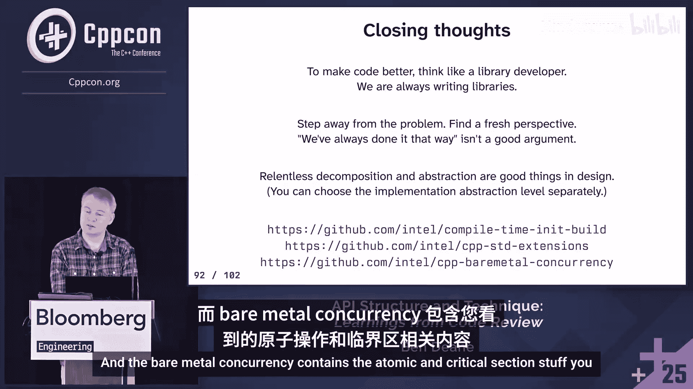

# Cppcon-2025-｜-C++-｜-C语言--｜-汇编-｜-编译器-｜-操作系统-｜-Linux-｜-Windows-p48-P48_API结构与技术_从C++代码审查中获得的经验-Ben_Deane-CppCon_2025--BV1wyPBzrEeu_p48-

🎼You are losing a lot of value。 If you can't make it。

 there's an enormous return on investment for any company that's paying a developer a reasonable developer wage and sends their developers here。

I can't tell you how big of a mistake it is not to send someone to CPPCon。All right。

 I think we are ready。

And I'm live， obviously。So let's get going。Hello， friends。And。Enemies。呵。First of all。

Let's get rid of that title slide。呵。And you use the real titles life。All right。This talk is。

Fairly long。 You can see I've quite a lot of slides。 Do please ask questions as we go。

 How long the toolki depends on how much interaction I have。 So I'm just gonna go through it。

 And there may not be time for questions at the end。

 So if you have questions on the particular slide， shout out。

 I'll just do my best to control the time， okay。Yes， you can use the mic for questions。

 You can come up at any time。 if you forget， I will repeat the question。To keep your recording happy。

Okay。All the code on these slides you're going to see is real。

 it is licensed so you are free to use it however I may have made mistakes in translating it slides the usual disclaimers apply。

 assume also that you know I've removed craft so assume it has no discard and no accept maybe put it and called it expert and things like that。

But if you do spot errors， please point them out。For those of you who don't know me。

 I used to work in games。 I started programming C plus plus in the mid 90s。

 had quite a long career in games for a while。 I work in finance。

 Now I work at Intel with Michael Case and Luke Valenti and an awesome team。😊。

And this presentation is the story of。Me learning things from reviewing the code of my team and figuring out how to make their jobs easier。

Sometimes I achieve good code and I always strive for it。So， you know。All code is bad。 Does anyone。

Believe different， but as humans we're really good at copying patterns right and when we're working in a domain when we're domain experts。

 we don't realize that this code is bad because it kind of works， it does the job， we're used to it。

 we don't see the pain points。😊，In our own domains， right。

And it's really difficult for us to step back from that。

And take a high level view because when we come to solve a problem， we always think about。You know。

 I know， okay， here's a problem in my domain。 I know the domain really well。

 I can figure out how to solve the problem。 I'm a good engineer。 I can figure it out。

 and I know how to implement it， and I go away， type， type， type。But a lot of what I do。

 a lot of what I have done over the last two， three years， and it helps coming new onto a team。

 sometimes coming new into a domain。I'm seeing what people are trying to do。 I'm spotting patterns。

 I'm spotting use cases。 I'm figuring out ways。That we can raise a level of abstraction。 right。

 People have an intent。 That intent is correct。Sometimes。

They don't realize that there are easier ways to do things or the easier ways might not exist yet。

 and it's my job to make them。And like I said， in some ways。

 it actually helps that I'm kind of new to the embedded space because I don't carry with me a bunch of。

Past knowledge about how to do this thing， this thing。So the environment I work in right now。

 it's embedded， it's bare metal， there's no OS， it's super low level， but it is still C++ 20。

 it is still contemporary C++。😊，Now， most of my team， to their great credit。5 years ago。

 most of them were writing C， and they were thrown into。By Luke。And by Michael， and then by me。

 they were thrown into this contemporary C++ code base， which is full of contemporary C++ idioms。

 some template meta programming， lots of under the hood tricks。😊。

And they came up speed really quickly。That's to that great credit。Now。

I work on firmware a lot of times the hardware spec bleeds into the firmware。

 and we get this kind of overspecation problem where we actually want to step back because firmwareare is software。

 even though we don't use that term much。 And we want to figure out what the real problem is we're solving and abstract it a bit oftentimes。

 right。Now。You might think you know what it means to write C plus+ un embedded systems。

The truth is most of the advice and the code you find out in the wild has not kept up with the pace of C++ in particular C++ 20 and beyond now I'm not even talking about things like prohibitions on exceptions or runtime allocations。

These are still legitimate choices， but the gap here is like。

Well you don't want to use string at runtime。It's totally fine to use it at compile time， right。

 Things like Lib format have an interface which involves strings and the except header。

 and it does compile time formatting。😊，Right， never hits the runtime。

 perfectly fine for use on embedded， for example。But if you don't have that header in your tool chain because your embedded tool chain provider doesn't provide St except。

 because why would you use it？Well， obviously， you don't compile， but you can use it。

 So we pretty much use all of the STL at compile time。 That's the mindset here。

So we want to get away from。Magic numbers， magic operations， having to think about state。

 We want this kind of best sense of abstraction。Now。

 we tend to be quite happy in programming with the idea that magic numbers are bad。

 We'll introduce a name constant or whatever we'll go about our business。😊，We're less observant。

 We tend to be less observant in the idea of magic operations。

 So we still are quite happy to say shift here， add here， mask there。

 We think nothing of it because that's what the spec says to do。 Like I said。

 the hardware spec bleeds into the actual code， but there's often a better way to express ourselves。

😊，And this talk is a collection of those better ways。😊。

So let's start with the small stuff quite literally， because oftentimes we're dealing with bits。Not。

 not bytes， but embedded code is full of bit masks， bit calculations。 By the way。

 how many people in the room are in some kind of embedded。Deev Ro， yeah， maybe more than a third。

 probably slightly less than half， by some estimates。

 it accounts for about a third of C+ engineers in the world。So here's a really common thing。

 like I say we're starting off small， you have N bytes and UN32T is the vocabulary type that the hardware uses overwhelmingly in our case。

 so it is the sort of lingua franco data type that we use everywhere。😊。

So you have bytes and you want to compute how many 32 bit words you use。

 so who's written code like this？Yeah， many who recently， even。II mean， yeah， people do it。

 People do the first type。 If you're lucky， people do the second type quite a lot。

 It's an easy thing， right， It's very easy。 It's close at hand。

 It just does something that you need right now to calculate something that。You know。

 you need right now。 And does it matter if it's using some magic numbers。 Well。

 this is perfectly readable， right？ Well， maybe it is readable。

But instead I would like to have a more general solution and you're free to criticize any of my current solutions by the way。

 that always are work in progress， but here's what I have right now。😊，Is it more readable， well。

 it might be more readable but less legible in a sense。😡。

But it says we've got T's and we've got n of them and we want to know the size in use。

And this is correct now in every case and it's。Dependable。 Now， if you know this at compile time。

So also you can do convenience aasees like sized8 for sized U in 80， for example。

If you know at compile time， you can also use a UDL， for example， and you can be very terse indeed。

You can say something like this， I have 48 size 8 things and I want to convert to size 32 things。😊。

And I use Z for a size UDL just。Because that seems reasonable。And it's available。😊，So you know。

 you might think。😡，This is。At first glance， not something we're used to。

 but I think it is quite readable。 It's Terse。 It's a simple operation。

 We want simple operations to be Terse。If anyone disagrees， you can。

 you can argue with me at any time。Now， as well as that， we do a lot of bitwise operations。

 so it it's 2025， I still see most example code to be honest。

 for interacting with hardware that does manual bit shifting， manual masking。

 who has that kind of thing in their codeb。😊，Yeah， a lot of us， I mean I do too， like to be clear。

 I'm trying to make it better， but there's a lot of this and we think it's easy to read because we're used to it。

 but I would say it's not typically easier to read than if we have the good abstraction。😊。

And it's also not typically very safe。Unless we put static castcining， we'll see that in a minute。

This is typically how we might make a bit mask， right， We've got some field。

 which is from bits 7 to three inclusive。So we're just making the mask of the most significant bit。

 we're making the mask of the least significant bit。

 we're taking the one away from the other and it gives us the mask。Between those bits， right？

Now that's okay， ish。If you've got， if， if you can ignore interte your promotions。

But it gets much more hairy because what is the type of X here？😊，We're taking away two chas。

 I live at you， Barry。That's right， it is int。Obviously， yes， obviously， it didn'。 right。 Now。

 now A time you promoted it。 and it's signed in at that， right。

 And we're mostly using with unsigned type， even if these were unsigned you in 80s。😊，It still in't。

And of course， people want to be safe。So， they do strange things， here's another thing we see， right？

because we are wanting to compute something involving that very top bit， we might see code like this。

Everyone knows what's wrong with this。The clue is in the title of the slide。 Yeah。

 it's undefined behavior because we're shifting the type by its width。in this case， 32。So， you know。

 these these problems are very obvious when I put them up on slides， right。

 But when they're buried inside a multiple hundred thousand line code base。

 they are much less obvious。So how about if we want a bitm， we just ask for one right。

 and we can do that with compile time values in template parameters。

 or we can do it with runtime values in regular parameters。

 and we'll ask for the type of the thing we want back。A UN80。Now， I think this is nicer。

 this is more readable code。This is safe in all cases。 I mean， actually。

 the safety depends on whether or not there's a runtime check underneath sometimes。But also。

 you know， we have tests and we run tests with U B San。 So that helps， too。Now。

 as well as making masks， a lot of the time we do bit packing and unpacking right and we do things like this。

 And if I were to ask everyone to raise their hand again。

 I'm sure half the room would raise their hand that they have code similar to this。

 So so I see a lot code like this。 Of course， Atie， I don't see code like this。

 What I see is code like this。😊，Right。Does this look familiar to anyone Of course。

 dear audience member， you know that not all of these cast may be necessary in this case because you were here at CPPCon。

 you are a sophisticated savvy， modern example of a C++ expert。😊，But in the real world。

 authors and reviewers of code， they just want this to work。

 they don't want to be concerned every time with thinking about which interteship promotions happen and knowing that my shy。

And somebody like me comes along and turns up the warnings and turns on the li。

 and they want it to shut up so that they know their code is okay。 So they just put the cast in。😊。

Now， I don't blame them， but I do want to keep thoselines and warnings on。

 and I want to make their life easier。So when they're doing bit packing like this。

 I want them to just do bit packing like this。 right If they're doing bit packing。

 you might as well say， let's do some bit packing again， ask for the type we want。

Put the high and low bytes in there or the high and low words in this case， right。

 because this and we can bit unpack as well， right， same kind of way。 And again。

 we'll ask for the type we want those two high and low values to be。

And we can write nice overload sets of these that take， you know， for example。

 you can pack four bytes into a 32 bit word or eight bytes even into a 64 bit word and you can make the overload sets and then you have this abstraction and it just works。

Of course， just like this， it works for all sizes that you are likely to want。

And it's just a nicer way to say it， like I don't know any other way to make it clear， really。😊，Now。

 this is for packing and unpacking on， of course， the eight bit boundaries。😊。

But sometimes we have non8 bit boundaries to work with right。

 sometimes you might have a register that's got some fields in it。

And you might just want to say destructive the thing into the fields。 Well， we can do that， too。

We just call it bit the structure， it works exactly the same way as bit unpacking and you say where the boundaries are。

😊，And of course， you say。2 boundaries， if you want three items。Right。

 and then you get the right things out。 Now， put them on the 8 bit boundaries here。 So it's easy for。

 for you to see what's going on and not have to figure out bits in your head。 but they work。

 they work anywhere。Taking this even further。😊，We end up of course。

 with whole definitions of fields and whole definitions of messages which can be overlaid on arrays and they can read out their fields as you want。

 and it looks something like this， but this is really going down the rabbit hole。

 which is another talk。Yes。Anddianness previous。 Well， yes， what about Indianness， You've noticed it。

 So when we bitpack these things， this is big Indian， right。Because we're saying1，2，3， four，5，6，7。

 eight。In some sense， it's high to low。In this slide， it's low to high。That is completely correct。

 Now， that is a current design choice。 that might change， right。

It is that way to be least surprising in a sense。 And you definitely want the unpack to be in the same order as the pack。

 and you want the pack to be in the same order as you would write the number in text， in code。

 So that's why that decision is that way this time。 Thank you for the question。

 The question for the for the recording was， what about ending in this。But in this case。

 because we say because it's natural to count up from 0 in the bits of the template arguments there。

In this case， it is a little Indian， you might say。But you know， these are things that。

Are designed somewhat for least surprise。 Theyre， they're always open to change。

 if I see in code view people having problems with them， right。But for the moment。

 that's how they are， but thank you for the question。Okay， so you know。We've seen simple things。

 the point for this talk is that there's a lot of utility in these simple constructs that just replace somewhat established patterns that people think are easily readable。

 but in reality those patterns are just easy because they are historically what we've done。😊。

Here is another common pattern so how many people do this so you want Enum bit flags。

 it's a thing right so well how many people do this so you define an enum or anumstruct with power of two values and are you still with me？

You overload some bitwise operators， are you still with me？Yeah。

 maybe you jump through a bunch of hoops， Maybe you use macros。

You convince yourself you have what time。 You definitely form an opinion about ADL here， right。何。

You know， I think maybe we've been doing this wrong and there are multiple talks and libraries that help us do it wrong。

And blog posts， even。So I mean， is everyone okay with this expression？It's fine， right？It's fine。

 looks fine。Okay， this I'm starting easy， right， So if you're， I'm assuming you're okay with this。

 you're okay with this as well。Yeah， sure， sure， you're okay with this。Is Dan in the room。

 If you're a chemist， you should be fine with this。 All I've done is relabel things。Sulur is 16。

 Nitrogen is 7。 Vanadium is 23。You're okay with this？Same thing。 All I've done is relaed。

 If you're a Pomon trainer， this makes complete sense。Right。But somehow we're okay with this。 right。

 I didn't even like there is a Pokemon at number 23。 There is an element at number 23。

There is no element of E at number A or B。X is not even a naable member of the enumeration。

 the space is not dense。😡，Is this type safety？I don't know。

 I think we've been confusing labels with numbers。Now， under the hood。

 the register value is a UN 32 T。What we actually want is to name the bits， right？

But that's separate from pretending the names are the values。So。You know。

 why haven't we been using Biet？I， I think stood Biet just doesn't offer the interface for this。

 And that's the only reason。 But if we want to treat a registered like a bit set。

I see dust in nothingdding。 have you done this as well， Yeah， it's kind of like。

 I don't know why people aren't doing this， and indeed some people are and they probably have the same thoughts。

😊，So let's just use the interface that we want。 We want to name the bits。

 So let's just name the bits in enumeration。 Let's make a bit set over that enumeration type。

This is not a standard bit set。 So we'll tell it to set the bits A and B。

And then we can index it with， with B， or we can ask it just set C。

 We can use the bit set operations that we're used to。

And then when we come to pull the number out of it， we can just say。Give me a number。

 Let's have a two operation that's that's templated on the type。 right。

 I think this is better type safety。 We didn't need to shift those bits in the Eum。

 We didn't need to pre computeute a thing。 We just needed quite convention a max， in this case。

And it's really not very hard to make a bit set that does this。

 It's just that stood bitet doesn't do it out in the box。

 The interface of stood bitset and many things understand。 They're a bit weird because。

They represent use cases that people who proposed it had。嗯。

But I think this is just a lot less hassle。Okay， let's go from bits to bytes。We've dealt with bits。

 Qui often。 we need to do with bytes。 So let's examine a use case。

 Here's a very common use case we have。Some table of data that's provided at some well-known address。

 It's， it's to be interpreted， right， It's， it's， it's a table of data。 It's an array。

 but sometimes I'll need to look at a bite there。 Sometimes I'll need to look at a 16 B word。

 some depending on what that is。 Then I might need to look at a 32 bit word， etc cetera。And。

 of course。The code looks like this， doesn't it because of course it does。

 we've all seen code I think that looks like this， it happens all the time。

 so we've got a table at some wellknow address and we're just interpreting it so we're looking at the byte based on that value。

😊，We might need to read a different size thing。And this is， a course， using reinterric cast and。

When we use reinterpret cast， what happens？Unfined behavior， It wasn't Jason， but。

It is practically certain that you have UB anytime you have reinterpret cards in your coat。

 if you doubt that， go talk to Jason Turner。It is so， so difficult， even when we think。Things like。

 oh， it's okay to read from a bite point or a cha pointer。No， we keep， it's not。 actually。

 we keep on discovering new ways that the standard is deficient here， and it's not。嗯。

It is basically impossible currently in C++ to access the underlying object representation of an object。

And the reason for this is that we don't just run C++ on hardware。

 we run it at compile time in the Exp virtual machine and the interaction of that is what's caused us to look carefully at these things Basically there's no getting around using Memco or bitcast。

And our mental model of those objects backed by an underlying store is just wrong when it comes to how the compiler treats context for stuff。

So anyway。People want to do this， so I'm like， well， let's try and make a safeway。

 so I call it byerator， of course， because it's an iterator over bytes in some sense。

But it allows you to peek， read or write any。Instegral type。By using read U 8 and things like。

 you know， peakak U 16 and things like that。And now we have a safe way to do what we actually want to do。

 Like， like I said at the top of the talk， like。The domain expert's intent is correct。 right。

 I'm not stopping them from doing what they're trying to do。 I'm just trying to make it easier。

And safer。So byterator can do these things。 And under the hood。

 there are very few functions which do this， and those functions are tested with UBS and the use Mem copy。

 and hopefully they do the right thing。 There's always a chance that I could have made a mistake。

 but it's a lesser chance than having reinterpret cast。So this is about the best we can do， I think。

 at the moment。 It has some nice features。 like we can control the return type， right， so we can say。

 read a U in 80， but return it to me as a U in 16 T。 This is really useful。

 especially when you want return value as an enumeration type。😊，Okay。

 let's talk briefly out stood optional， we want optionals in our interfaces。

 we want deferred construction which is a great use case for optional， these are useful ideas。😊。

What's wrong with stood optional。 Well， many things， some of which Steve is fixed。

 but in the embedded sense， a stood optional uses more space than it needs。

 Sometimes this is a problem， right， You put an extra ball in there and you know。

 alignment and padding means that you typically have a doubly sized integral type。

A lot of the time we have a sentinel value that we can put in there。

 so or a tombstone value as it's sometimes known。😊，So I have an optional that allows that and。

People can use it and it's just the same interface as optional。

They can do it by putting in a tombstone value at the time they want to actually it declare it。

Or they can override a tombstone trait for a particular type。And then it will， then it will use that。

So characteristics of this optional that make it suitable for embedded work。😊。

There's no exception use here。If you access a disengaged optional or you don't get an exception。

 you get the Zoostone value。And I provide。Default tombstone values for null for pointer types and for floating point types。

 Now， the obvious tombstone for floating point types is naan。Why did I not use Nan here。

This I do mail。Nan no， Nan is not a considered special。 Yes。

 you cannot compare Nan to the tombstone value。 So that's why I use infining。

So extras multi argumentment transfer might have a whole talk about that， but it's really useful。

 the standard keeps on putting things in member functions which kind of binds it to being single argument。

😊，But， you know， if you want to do kind of functional style programming。

 you want multi argument transforms。🤧あ。So we put this in and then we recognized another use case from codeVi a lot of times we're just using optional for deferred construction。

😊，And so since we're doing that， we want to specialize the way to point out the code。

 and we call that cached。And it's an optional underhood。

 it has really the same kind of interfaces optional with a couple of extra things。😊。

And it just takes a Lada that when you access it， it will。Call that and do the deferred construction。

Yeah， because you cash does it inpoli or it's more like a lazy option。Does it imply invalid。

 It implies that， yes， you can。 you can choose to invalidate it in two ways。 So， yes。

 it's a lazy optional。 It's optional。 is's a lot of times used for deferred construction， right。

 And that's what cache does。 sort of， that's the idea of cache。

 But there are two ways to invalidate it。You can reset it， and that will mean。It lazily。

 Next time you access it， it lazily computes， or you can refresh it。

 which means it recomputes right now。Now， again， after we introduced this。

 then we discovered another use case。 Well， a lot of times we have a cache thing and it's only ever cached once at load time effectively。

😊，So we just made a small variation on that and we call it latched。😊。

So this is cached without the reset or refresh functions now this being C++ you can always pull tricks like you know destroy and reconstructing place to get around this。

 but if you did that it would stand out in code review right。😊。

And you can always start with latched and then move it to cached if you discover that you need to reset it like they're basically dropping compatible。

 it's a pure extension on the interface。😊，All right， let's talk about time。Time is trickxy。

Especially in the embedded space so here is a scenario， for example。

 your microcontroller has a 32 bit register and it just continually counts up microseconds This is a fairly common thing anyone one programmer microcontroller like this。

😊，Several people。What's the problem here， Well Well。

 the problem is that 32 Bs worth of microseconds is not very long， really。

And because you really need to treat time as signed。

You're gonna have half of that bit space in the past so that you can know when things have expired。

 right， And you've got half in the future。 It means you've only got 36 odd minutes。Total。

In your time universe。And you still need to know when a timer has expired。😊，Now。

The problem with 36 minutes is it's way too long as a human to wait for something to occur。

 If you get an error and you then have to wait 36 minutes。 No good。 On the other hand。

 it's way too short。For a timescale of human things， like。

 you could go away from your computer quite happily for half an hour， get a coffee， come back。😊。

And you， something is screwed up。We see things like so what we're going to do here。 Fundamently。

 we see these things like half range checks。 right， So again， this is not perhaps the way that we。

 as a savvy crowd of C plus plus experts， would write a half range check， but it happens。

And this code is kind of fine， right， but then someone comes along and they helpfully refactor it and they say。

 oh， I can inline that into there。😊，Does anyone see the issue here？So if Ts U in 32 T。

 we're still okay。But if T is you in 8T or you in 16T now？When you say not X。

 that's promoting to an int。And。Half of the like。Half of the max， the max is going to be minus1。

 right， all the bits because you're just bitwise noting it。And now -1 divided by 2， well that's 0。So。

Ins promotion is not， not your friend。 Now， I know you w to say use numeric limits or whatever write it differently。

 And I absolutely agree。But the fact is， things like this exist。 It's real code。 It happens。

 and we don't want to see these kind of things causing bugs for whatever reason。

So we just want this kind of thing abstracted into a type。And that type is a rollover T。Now。

 the idea is that you've got this 30 second，32 bit microsecond time when it's rolling over， right。

 So you need， you want to type to represent that。 You want to type where half of the bits are going to be in the past and half are going to be in the future。

So a rollover T of your unsigned type supports this。

 and it supports all the normal arithmetic operations， mod 2 to the N。Now。

 if you have half of your bit space in the past。Which way is the past from your point of view？

I think it's over there。So you in the past， now is here， some bits are in the future。

 and that window is always rolling， right？U。And you want to compare。

 right now that behavior is easy to implement， I mean， it's not easy， but it can be done。

I chose to delete the comparison operators on rollover T。 Does anyone know why that is。

Like operator Le than is deleted。Because。Seriously rolling。IHave a situation。

TheT value in the future is。Certain really less。Yes， if it， it， it might be integral。 Yes。

 but the less than operator takes account of the half range。Sure。

 it's maybe more like to register ballot。Dont read。Okay， keep that mind yeah。Atomics。

 no atomics aren't the reason。 Here is the reason。 And we'll go through it on the 3 B counter to make it really easy。

 So imagine this scenario， you've got 0 less than 1，1， less  two， etc cetera。7， less than 0， it's。

the less an operator is non transititive。Now， that's a thing。

 but it's not a good thing to pass a nontransive compression operator to sort。Right。

So we have a comparison operator， and it's called， I call it Com。 He's a member of the class。

It's like rock paper scissors， right？Operator Le than would not fulfill the requirements required。

By algorithms like sort， it would be dangerous to leave operator less than lying around。

So I don't leave that lying around。Now， in general， I don't want to outlaw danger。

 which is why I still have come if you want to use it， right， As a library writer。

 it's not my job to tell you you can't do that。Because you're the domain expert。

 you know what you want to do， your intent is correct， you know what you need to do。

 and sometimes we need to do dangerous things， right？

I don't want to prevent you from doing dangerous things。

 because that would prevent you from doing clever things。

 But I do want to provide you with a safe interface for everyday use。

And I do want to make sure you know when you're doing something dangerous。Which is why I do that。

I want you and your code reviewers to be deliberate and informed when you are doing dangerous things。

 sometimes we need to。😊，But we shouldn't be doing it without knowing that it's dangerous。

And so if you know your data is suitable for sorting。

 like you know that that rollover case won't happen。

 that that non- transititivity won't happen because all of your data is collected into sort one half of the bit space。

 you can totally still sort it。But by the same token I don't want dangerous interfaces for everyday use right and there's another problem with naive time interfaces。

 So here's a very simple part of an interface that might be in a harder abstraction layer。

That just allows us to say， what time is it now and you know。

 schedule something to run in the future？嗯。What could be more natural than this。

 We have loads of things we want to do with this。 right。

 We want to wait some time before doing something。 And this interface looks clean， contemporary。

 nice。😊，But there's a problem。 Does anyone see the problem。Prom only maybe if you're working in。

Embbedded space where you have interrupts。At the point where you compute the time out， you're fine。

 but then。Other things happen in the world。 Then you might even go to sleep。

The programmer closed the lid of their laptop went to get coffee。 They come back。40 minutes later。

 passed that roll over time。 And now the thing that was slightly in the future is a long way in the。

Past， but now it's a long way in the future， right it's kind of rolled though it would have been a long way in the past if they'd come back before that 36 minutes。

 but because they just overran it， it's now a long way in the future。

 now they're waiting forever for something to happen that should happen in the next 5 milliseconds。

Any interface that allows us to compute a time point separately from scheduling it is going to have this problem and it's incredibly difficult to find these problems。

😊，In the small scale， they only show up。In the final system。 And they do show up， don't they。

 Michael， in the final system。Because humans， we humans are very bad reasoning over time。

So instead of dealing with time points， let's just deal exclusively with durations。😊。

This is what we wanted to express anyway。 we wanted to say run the thing at in5 milliseconds。

So why were we computing the timeout and then say run then rather than just saying？Run after that。

Let's not be wrangling timeouts manually or better we could even use as senders based interface。😊。

Interface。And we can say， give me a timer schedule there for 5 milliseconds in the future。

Schedule it and then do my thing。Or in the second case， we can say， give me a time of scheduler。

 I want to do something periodically。RightSo now control over those timeout computations happened under the hood。

 where danger can be limited where we can have one implementation that we test to Helen them back and we reason about properly in one place instead of these things being spread all over the code and having to reason about every code review。

😊，We want one place to reason about these kind of things where interrupts can be tricky。All right。

Any questions before I move on。Any observations， anyone who thinks is a terrible idea。

No one willing to speak up。Okay。Let's talk about thread safety。Or in fact， interrupt safety。

 which is really kind of the same thing of different guys in the embedded domain。Now。

 the embedded domain often presents us with primitive constructs。

 which we need to build abstractions out of， right， We don't have。

Even the fairly low level constructs in the standard library， things like muteex barrier， Semapho。

 Theres a still fairly low level， like they， they're not sort of allowing us to reason at task based level。

 but we don't even have those in embeddedbed。 So we do what we can。We basically have one tool。

Many times we can turn interrupts off and on again。 Luckily， this happens to be very cheap。

So basically we have this global critical section。😊。

So let's see what we can do with that abstraction。Well， we can。Provide a function saying just。

Run this function that I'm going to give you under a critical section。That's a very。

 very thin layer of abstraction on what we just saw。 Nevertheless， we'll build on it。 In fact。

 it's slightly more than that。 Oftentimes， we want to run a function when a predicate is or becomes true。

So we'll allow the user to pass some predicates in。And then we have code that looks like this。

 We naturally can write an an R AII type that disables interrupts。

 Who was in Ben Sax's talk yesterday。 Ben gave a really good talk about implementing atomic that touched on some of these same ideas。

😊，Okay， so this is fine。The issue with the abstraction here is that it works fine on our platform。

 but we also want to test it。 right， If this is really raising the level of abstraction。

 we should be able to run this on desktop tests。Now。

Almost all of the work that we do that Michael and I do involves handling concurrency。

Like on the slides at the beginning， there's almost no number crunching because these microprocesors don't have much capability。

 but what they do is martial IO like crazy。And they do it， you know， So 95% of the code is doing I O。

 and it's doing it concurrently。 and it's wrangling interrupts from different places。

And the problem is， how do we test this on the desktop， How do we turn this into a desktop test well。

We have this global muttex or critical section idea。

We don't have parallelism of hardware level parallelism， but we have concurrency。

 We don't have any of these other stand standard things。

And so here are some of the problems that we see if we just have this abstraction。嗯。We have。

2 unrelated pieces of code， two unrelated pieces of data， right。

 But because the lock is sort of global on desktop。

 we wouldn't necessarily really recommend that because it's contending。

 but this passes byer noticedoticed on the platform hardware because it's all there is right But this isn't really the best way to write desktop code。

😊，We might have brittle correctness， right， we might on the platform accidentally use shared data in two different places。

 and it happens to work today because these two different places happen to be called from different priority interrupts and they don't actually stoump over each other。

So we've got accidental successes happening。 We don't want that either because you never know when that's going to break fall apart again。

 usually in the whole system， not in a unit test， where we actually evident。

We have other kinds of brittle correctness。To on platform that interrupt often and on R AI is actually like a recursive mutex on desktop。

And that。I don't know about you， but whenever I think I need to use a recursive ear text。

 I just feel bad。I just， I just feel like I haven't structured my code properly。 and And yeah。

 you don't want to be doing that a lot。 I I feel。Anyway， so on desktop。

 we could implement this critical section。With single global recursive muttics。 And that would work。

 But for those reasons， I don't think it would be much good。 in particular。

 the reason of like accidental success。 Like， I don't want to write things in the brittle。Because。

Even in the world of micros， things are getting more powerful all the time。

 They'll come a day when we have actual hardware and currency。

 They'll come a day when the constraints I thought about today no longer apply。

But I want the same interface in both places， so here's what I do。I inject the concurrency。

I use this global API injection pattern。So this is what the call and critical section function looks like。

We pass it a function that we're going to call。And it delegates to this policy。 Now。

 how does it find the policy？It finds the policy。😡，Through a template， through a variable template。

 which it gives some dummy as。Right there， those dummy as are for any given call site。

 That's always going to be an empty pack， but it still uses it to find the right place。Now， oh。

 and there has this unique template parameter。This is doing the job of。Of a Mutex， if you like。

 this is like naming a mutex。 So by default。It's different to every cool site， because。

It's a defaulted template parameter。Of course， parameters come from call sites。

 and parameters are no different。 Every call site will get a different lambda here。

 so every call site will get a different type。But if we want to use the same type， for example。

 in a queue structure， we can just make a tag type， call it muteek， call it my Muex， whatever。

 And then we use it。 And now on desktop， this is accessing the same muttex， right。

 So this is actually one mutex protecting what we want to protect。 This is correct on desktop。

 And on platform， of course， it's our implementation。 It's fine。

 Now this is still only per type and not per instance。 You know。

 we're not quite to the level of granularity that we totally want， but it's way way better than。😊。

Than what we had。Now， the desktop test policy， like I said。

 it just uses a mutex and that type selects which Muex it uses。

And it does what you'd expect a lot guard and then return the function。 I omted the predicates here。

And on platform， well， we just use our interrupt disabling our AI type。We saw that before。

That's all that's available。Well， now this works pretty well。

 So desktop tests now can have the same calling code。 They can have the same thing。

 The only thing it changed is that very low level implementation。

And we don't have any working by accident code。 We don't have any more recursive locking reliance。

We can run thread sanitizer on the test。 That is huge。 right， If you can run thread sanitizer。

 if you have threaded code， you ought to be running thread sanitizer because it will find bugs that you would have no hope of finding otherwise。

What we've done is， we've turned。Interrupt race conditions into data races in desktop tests that can be caught by tooling。

Huge。Now， I mentioned Ben's talk about atomics yesterday。

Turning off interrupts is not quite the only way to ensure thread safe data， because we do on。

Various embedded platforms often have some form of atomics。But， there's a problem。

And let me illustrate the problem。 What do you understand by this code。By which I mean。

 what would you expect on writing this code？Just there's no tricks here， just a plain all atomic end。

 and we're incrementing it。Is this supposed to be 43？X is supposed to be 43。 Sure。

 I think beyond that， what will be your expectation of the generated code？

You would expect probably that it uses atomic instructions， Am I right？

Whatever that means for the platform。Doesn't this tell us that the like we are programming to an implementation。

 not an interface when we use atomics。 This is， this is the problem。You expect atomic construction。

The problem is that your embedded device probably doesn't have very many atomic instructions。

 It might have one or two。It might have an atomic exchange of a 32 B value。And that's all。

 for example。😊，Yes， so stotomic suffers from this confusion of interfa and implementation。

 we use statomic expecting an implementation strangely。

 but that implementation just might not be able to exist。😊。

You might not have Betchad or any of those other things。

 you should watch Ben's talk from yesterday because his touches on some of the same points。Of course。

 the other problem with atomic is that it lies at the heart of the C plus plus memory model。

 It defines how actions become visible。And， and that also is part of the interface。

 And its not shouldn't be locked to one particular implementation。

 So we expect these two things from atomics。 We expect non preemptiveness。

The operation should be atomic， right， unable to be divided， literally from the etymology。But also。

 we expect visibility。From the C plus， plus memory model。

So still atomic is this sort of confusion of ideas， we're programming to an interface。

 to an implementation， not an interface， and of course， on platform you might just have。

 this might work right， except that if you forget to align the variable。

 you get a process or exception， I've seen this happen。😊。

Because your exchange instruction requires alignment。 Now。

 you might say this is a problem with the tool chain。 And I agree。 there's a problem with tool chain。

 nevertheless， it exists。It could be also that exchange has more constraints than you first realized。

 now you align it properly。 but because it's a ball and the next three Bs in memory or something else。

 Well， the processor is going to generate an exchange instruction on the properly aligned 32 B value Now。

 when you do that exchange is going to clo the next  three Bs in memory。 I've also seen this happen。

And of course， the problem of you just don't have that very many actual atomic instructions。

 there's no single instruction that does。Ft Chad， in this case。

Stud atomic is in most tool chain implementations。It's really trying to use atomic instructions。

 And if they can't do it， sometimes it ends up calling intrinsic functions in the tool chain that implement these operations comparatively。

 really expensively， what you actually wanted was。Atomic access。

 visibility guarantees from the memorable as cheaply as possible。 And， in fact。

 it would have been way cheaper to do that simply by turning interrupts off and on。In many cases。

So yeah， atomic has a meaning for the interface， not the implementation in this sense。

 I don't actually care if it uses atomic instructions。 I care about if it does things。😊。

Correctly and efficiently。So again。My implementation of atomic。

 is very much like what Ben was talking about yesterday， except I swap in a policy under the hood。

And so these top level functions do the same thing of using the dummy Ag pack。

 which is always going to be empty to select the policy。And then they call the policy function。

 right， And then， and then the atomic type is just reflecting like it's a regular value。

 but we just access it atomically using these policy operations。And， and just like in Ben's talk。

 the critical section here turns off interrupts。 And it also does the memory fences。 right。

 It does the asm volatile thing。So now I can also do things like。Injecting。

Tight overrides so that when I ask for an atomic bull。

What I'm actually going to get is something that looks， walks and quacks like an atomic bull。

 but under the hood， it's a UN and 32t because that's the only thing the platform can do with exchange It's aligned properly。

 I get the atomic instruction when I need it。 and when I have something else that the platform doesn't support。

 then then I get the policy operation， which is just turning off the interrupt and turning back on。

 for example。Nobody has to remember to align these variables correctly。 Things just work。Well。

 now I have at toc。What would be really useful？We've already talked somewhat about it。

At toomic bits set。I don't know why we don't have this in the standard yet， really。

 And it's just Biet plus atomic。 Now， now， in the standard， of course。

 you can wrap atomic around anything so you could wrap it around Biet。

But this what this really came for， this came from a make code review， where someone was trying to。

I forget how they were trying to do it。 They were。 they were trying。

 They were trying to use a bitet and they had some tasks which they had to wait for。

 and they were represented in the bitset。 And when they would come in and be completed。

 they would clear the bit。 and then they would go on。 Well what they really wanted was atomic bitset。

 They wanted one thing that does it， right。嗯。So， so why would I choose to say atomic bitset and not atomic of bitet。

Well， a few reasons。For one thing， it's a bit simpler。 But。

 but a big reason is some operations have to be removed。 right， in particular， Biet allows you to do。

Binary or， binary n， binary X or， things like that。

If you have two atomic things and you do a binary operation on them。Now。

 you need some higher level way of assuming that's an atomic operation， right。

 And you don't want to bake that into。The， the idea there。But basically。

 anatomic bitset looks just like a bitet， and you can do several things with it just like a bitet。

 Most of the common things you want to do are supported。By。The underlying atomic interface。

 So that's fine。Yeah， but it does have some limitations， some limitations， like I said。

 are because the semantics would require you to think about this at a higher level anyway。

 like the binary operations。😊，Shift operations are not yet part of stomic。

 and most platforms have no instructions for that yet。The other limitation here is that。

Because it's atomic， the underlying thing， like in a bit set， you can have an array under the hood。

 right， A bit set can be as big as you like because you don't have to worry about keeping those bits coherent。

 It's not atomic， right， But when it's atomic。How are you gonna keep coherency between all of the bits in the array？

 So at the moment， it's， again， that would involve making a decision。

 which I think belongs at a higher level， right， You can always。

Have a regular bit set that you use under a log under calling critical section。

So atomic bitet is a bit more specialized。All right， now。I don't have time to cover logging。

 That's a whole talk in itself。 On Thursday morning。

 I'm doing an open content session on how our logging library has evolved。 but here is a sample。

This log line you see。Everything here happens at compile time。The result of this is， is a。

 a log that says hello see pecon 42 is nt。All of the formatting happens at compile time。

 You will notice that 42 is a value and int is a type。

 but I'm still passing them both as if they were going to this info function， of course。

 which is a macro。 So there's a bunch of。Things that happen in logging that I'll talk about on Thursday morning。

But this is what the call site looks like。 You will also perhaps figure out that 42 is while it is a perfectly good compileine value。

As soon as we would pass that to a function， it would become not conexra。

 We don't have conor function parameters， right， And yet。Like I said。

 this entirely happens at compile time。There's no reason there should be any runtime cost here。 Now。

 if there were runtime variables， then they would be formted at runtime。 But in this particular case。

 there's no reason it should be any runtime cost。 I don't want people to have to remember to wrap 42 in an integral constant or things like that。

You know， even if we have the more modern ways of doing that。

 where they don't have to spell interval constantly to put， is it C， W。

Constant wrapper something like that。 But， no， they don't have to do that。

 They don't have to remember to do that。 I've seen cases where， perfectly reasonably。

Humans forgot to wrap things up， and it ended up in a runtime value where it should have been a compile time value。

 so。I have fixed that。So in the end， you know， if the question， what is Cpl good for。Well。

 if you Google this question， you find out that C+ most of the internet thinks that C++ is good for applications that demand high performance efficiency。

Such as these well represented at this conference。The top answers is are always performance。

 performance， performance。嗯。This isn't a really good answer to me， because。C++。

 let's face it doesn't have a monopoly on good performance。

 and in fact it's not really good at raw performance because if you need super high performance。

 you always have to care about hardware。😊，Yes。You always have to know the level below your programming。

 and that is。Most times the hardware， you always have to pay attention to details outside the language。

😊，Conversely。More or less， any compiled language can get within about 20% of the forran。

 If you write it， like it will forranm。That's not my quote。 By the way， Alex Stepanoff said that。

So what is C++ really best at？It's a combination of things， right， it's all of these things。

 we have layout control and low level access that we can actually reason about。We have Me program。

 which， which allows us to write composable systems。

At compile time so that we get the maximum runtime efficiency that we can。

And we get to build up abstractions。 We get to， they might be small abstractions。

 They might be large abstractions。 Either way， we can build up the abstractions and the affordances and make them composable so that you can express something at a very high level and it compiles down to nearly nothing。

 right。The combination of these things to me is what makes C+ plus a winner。Now， in closing。

 I would like to exhort you to think like a library developer。

 even if we are writing wheelwright functions， I assume， that makes us all， in some sense。

 library developers。嗯。A good， a good thing I do is just step away from a problem。

 Find a fresh perspective。 Try to think outside of the domain， Try to avoid。

Jumping to an implementation idea， right， And， and we've always done it that way isn't typically a very good argument。

When I sit down to write code， I try to。Think。Abstractly as much as I can in Bianna's keynote。

 he said， don't do abstraction for abstraction's sake。

 I would say abstraction for abstraction's sake at the design phase is essential。😊。

That doesn't mean I have to implement things abstractly。

But I like to think about things abstractly so that I can uncover new insights， right。

 And I it might influence my implementation。 It might not。

 I can decide separately how to implement something from。How I understand its design。

And we just have to try really hard to， to free ourselves of thinking in terms of implementation。

 But we just have to keep trying。So you can find most most of the code snippets here were from these three libraries。

 the compile time initialization and build library。 It's been mentioned before in several talks。

 There's a library called St Exions， which is kind of like the way to make your us folder。

Publicly acceptable， I suppose， you make it a library and call it nonstuod or stood extensions or something like that。

And the bare metal concurrency contains the atomic and critical section stuff you saw。

So thank you very much。 And I don't think I have many time for questions because we took them during it。

 but I'll take your questions in all。 But thank you。

