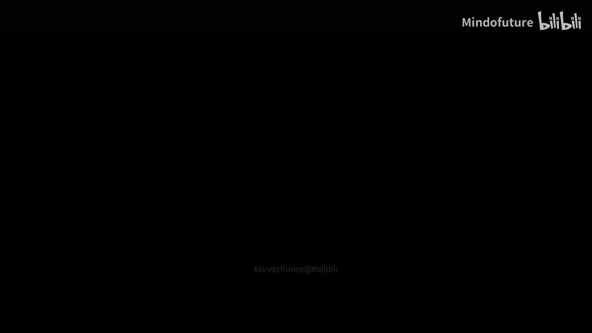
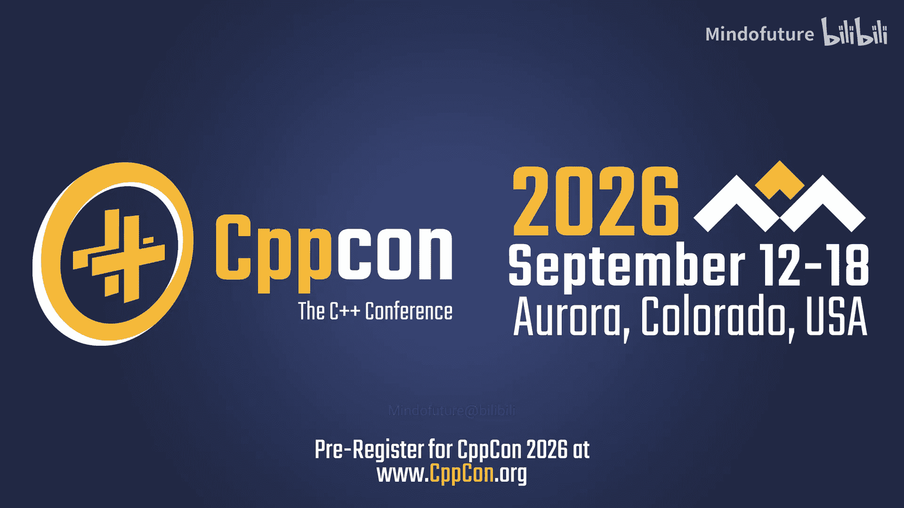
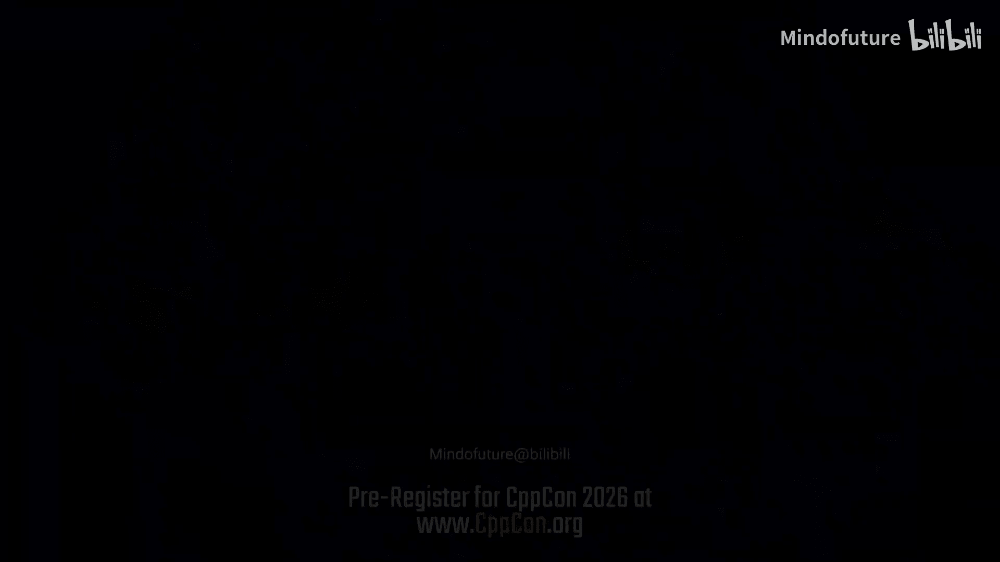
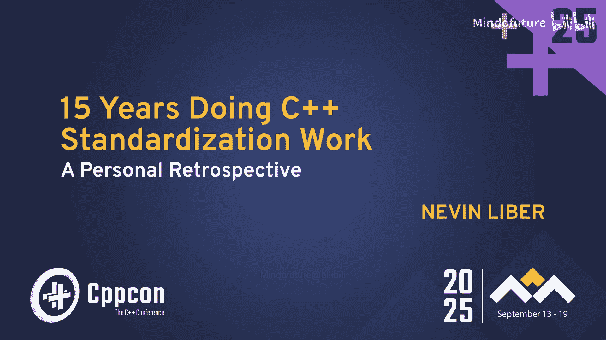
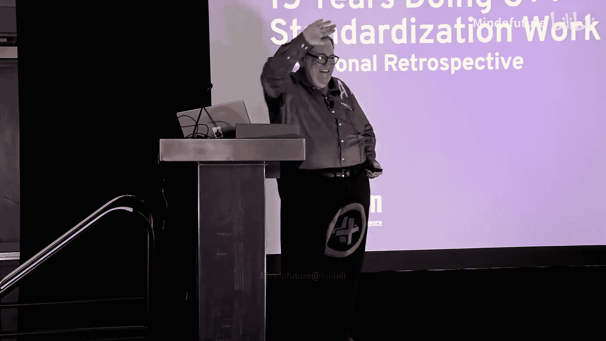
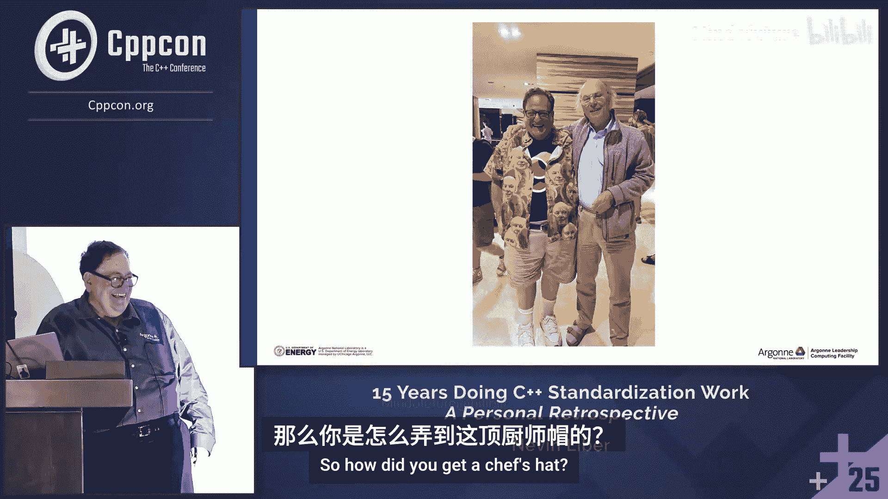
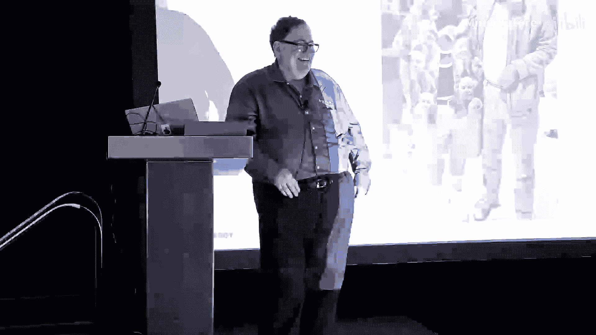
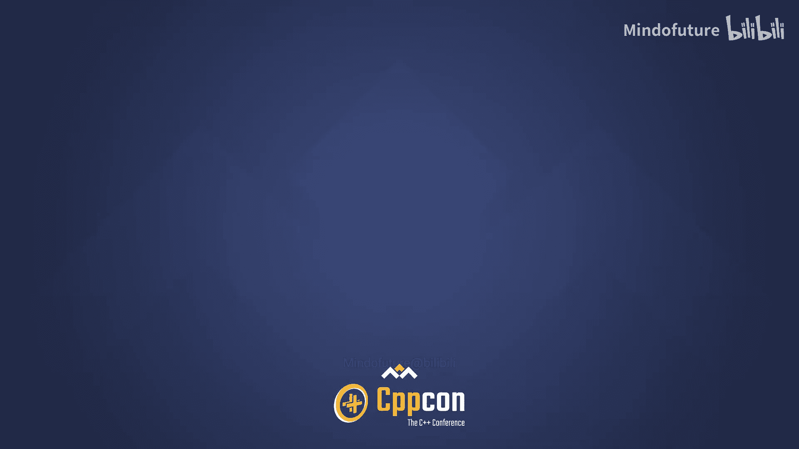

# Cppcon-2025-｜-C++-｜-C语言--｜-汇编-｜-编译器-｜-操作系统-｜-Linux-｜-Windows-p49-P49_从事C++标准化工作15年_个人回顾-Nevin_Liber-CppCon_2025--BV1wyPBzrEeu_p49-

🎼The networking opportunities here at CPPCon are well above and beyond any other C++ conference that I've ever been to。

Yeah。😊。

Just closing the door。Hello， everyone。Hello。

So this year， I got a little bit reflexive。 There I am right there。I am Mevin Lieber， right。

This is my picture from the first Bo con with the only chef's hat in existence。For CPP con。😀M。😊。

We can talk later。So I am the profiler of twin boys， who。

 despite my trying to get them hooked on C plus Plus from the moment they were born。

 refused to follow in my footsteps。Rightい。I'm a classic rock fan。 like the week before this。

 like kind of poor planning。 I saw like both the who and Rgo star。

 like Rno can jump like a foot in the air still like a couple times at 85。 I hope I can。

 I can do it now， but。😊，But。More important， you know。

 I am also the coch of the Library evolution working group incubator。

On the I O WG 21 C plus+ International Committee。And I'm also the vice chair of the US delegation to that committee。

And this is。Noting me my story， right， I， I found like， I talk to people a lot I。I'm a people person。

 I talk to people， and I find out， like。They all believe， you know。

 a lot of them believe they can never be on the Standards Committee， right， They're not good enough。

 They're not smart enough。 They're not expert enough。

And it bugs me because whenever I hear any of that， like， I want to change their minds。

I to change your minds because you some of you are on the committee， but not all of you。

And I think the best way to do that is for me to tell my story。So let's go all the way back to。

 you know， when I was first getting started， I was working at A and T Bell Labs at an Indian Hill facility。

 That's the telephony division。 That's in Illinois。And I kind of like， backed into C plus plus。

One day well get a good friend of mine from Apple gives me a call and says， hey， Nvin。

 what do you know about C plus Plus， you guys have Bell Las and Benedt。😊，I knew nothing about C++。

 at that point。But that was enough of a spark like to get me， you know， I need to find out more。

So I start asking around。And I find there's an engineer in another building。I'd never met him。

I hop in my car was like a brand new mazda。First stick shift car ever。Drive over there， you know。

 I'm knock in the door。 And that person is Jim Cole， Co。 he would， for instance。

 later on coined the term curiously recurring template pattern to CRTP。You know， in， you know， the。

Not the earliest days， but， you know， middle days， right， you know， he was， was great。

 And he was very enthusiastic person。 Like， he was very happy。 like。

 I wanted to play with C plus plus。 So he he had a sea front compiler on a tape。

 He loaded on one of the bell app systems so locally so I could play with it。 And he said， you know。

 ask me anything。😊，So for weeks， I would like， send them email questions about the language and。

Like with seafront， it helped me figure out the object model because I can see the C code being generated。

 And I also learn a lot more about C than I thought I was going to know， too。

 because things you could do。😊，And， and I don't remember any of the questions I asked him， however。

I do remember the question he could not answer。And it was this。I couldn't understand why the eye。

Was still in scope， was still existing。It， it didn't make sense to me。 It really made sense， right。

 The scope should be until curly。Cpe didn't know the answer either so。Who can we ask。

There's only really one person。😀The person back there。There we go。Great， be honest Joe Trump。And。

 and like， I don't know him。 I've never met him。 Like， he's， you know。

 many states away from where I am。And so I am sweating for two days， agonizing over this email。

 and I'm writing and rewriting that I'm going to send them， right， And， you know， very deferential。

 you know， I。😊，But I have to answer， you know， my question， right， you know。

 I don't understand this why it's like this。 You know， I think this should be out of scope。

And like the end of the second day， I send off my email and I go home， Wait。

 I don't want to think about this。Next day， email is waiting for me from Brna。 It's very polite。

 very， very friendly。 And like he goes like， yes， I understand， like， like， this is， you know。

 this is a mistake。 It should the scope really should go。 but I have users。

 and I can't break backwards the credibility。😊，And to me， like， that's really the first lesson。 And。

 and it made a lot of sense。And there were only 200 times I even remotely interacted with Brna while I wasab Bell Labs。

The first was， I would have Bell Labs buy me the books from all the like Kernhan， Richie， Brna。😊。

I would throw them in company mail with a little note and say， could you please autograph this。

 And then they would send them back。So have a nice collection。

And the other time is Brna came to Indian Hill， our facility to talk about like using C plus+ instead of C。

And I remember from that talk。He had said like they recompile the 5 B S S telephonephone Sw code。

 which at the time was one of the largest software projects in the world。

 about 50 million lines of code。And because C plus+ had function prototypes and C didn't at the time。

Soound 3 bugs。因因为。I got to meet him。 I got to shake his hand that day。We those bug fixed。

 I hope my colleagues did it。 I， I don't really know it because that was coincidentally ended up being was going to be my last day at Bell Labs。

I was leaving to go work at Apple。And by the way， before that， you know。

 they actually published an 98 standard， this did get fixed， so。

So this would be a great story of like， I just became like this huge fanboy for C plus Plus and an addict。

😊，At this point， but。Really， that wasn't where my passion was at that moment。I was more。

 and I wouldn't be for another decade。I was more curious about different programming languages。

It worked at Apple。 eventually went to grad school， the University of Arizona。

 And I went there because。Ralph Griswal， the inventor of Snowball and Icon， was there。

 And I wanted to learn from him。I tried Java， like while I was doing this stuff。

 I even tried a language called mumps。It's undoubtedly to be a very terrible language。

Very glad to leave it behind。And so while I with T， A， right。

We have a comparative programming languages class。And there's a seat that someone can't compile this piece of C plus plus code。

And I'm looking at it's like， looks okay。 I don't get it。 I don't remember you。

 I think I'd forgotten why。And as a panic T A， right， I go to our department library。

 and I'm looking at every book and magazine article on the shelf about C+ plus to try and figure out like what's wrong here。

And for those who know， right， what you need is a space at that time。

 you need a space between the two， right， It's the maximum montrel。

 Maxim montrel is that it's going to tokenize that as a right shift operator。You know。

 I gave the guy an A because like he found an actual problem， right， And there's valuable， you know。

 it's value in finding problems。And I had been reminded like that night also， like。

 I had read a lot of Burna stuff。 when I was at Bell Labs。

 they had hit a bunch of telling reports on C plus+。 And I loved the writing of those。😊。

Cause unan only， said， here's what I did。 But， you know， here's why I did it。

 And here's the other options。 And here's why I leave this。 one is better。

And I thought that's a great way， you know， to do things like language design and all sorts of things。

And at that point， I'm realizing like， I want to start coding in C plus plus， really。

 like professionally。You know I'm going to my next job， that's what I'm going to be looking for。

Leeave grad school。 if you， yeah。And eventually， my fiance at the time。

 not my wife finds an ad in Chicago Tribune for a C plus plus engineer like。

 for the youngsters in the crowd write newspapers like this paper thing and like， hey， friend。

 And you got to like put your resume in a letter and an envelope and a stamp and send it off like。😊。

You know that that's the era。And， you know， I had been reading， I had been reading other ads， right。

 And a lot of ads would ask for C slash C plus plus programmers。And I know what that meant。

 That meant， you would be writing code in C。 We just can't get。 We just get higher enough。

And I really didn't want to do that。But this ad really intrigued me work because it really was a Cequ plus plus shot。

And WMS S gaming was a slot machine company。I didn't have been there for 10 years。And， you know。

 it was all about C plus plus。 And they we were running a full video slot machine on on an 81。

88 with 640 k of Ram，64 k of battery backed sorry，640 k of Ram and 64 k of battery backed Ram。😊。

Right， and， you know， a cyber right， Some people think slot machines are easy， right， and。

The thing is， if it's got money on it and you pull the plug and put it back in。

 it can't have forgotten any of that。There， there are regulatory agencies looking at every line of code。

We have to get things certified， especially like random number generators。

 And it's expensive to redo any of that stuff。So we need， we need a good， lean， solid code for this。

And that's why they were looking for good C++ people。And as engineers。

 like we knew we were pushing the boundaries of this little system。Like， I'm， actually。

 I'll give didn't have for that。 I， there was a protocol。 And like。

 we'd moved from version 4 to version 5。And actually made the code smaller。 Like， they come like how。

 how much rh is like， oh， Ill give you back like like 100 bytes。

Cause I just like saw a switch statement that repeated the same code everywhere。 It's like。

 just factor， refactor that。You know， that stuff mattered。

But we knew we were pushing the limits of the system。

And we remember we're pushing the limits of like， you know。

 our programming knowledge because we're all。Roughly， you know， like in their 20s。30s， you know。

 we're same age。 And， And so whenever I would ask。You know， if I want to go to training。

 I want to go to a seminar or a class and C+ plus。Right， my management always said yes。

And my teachers， you know， at that point， then became， you know， Scott Myers， Dan Saacks。

 Herb Sutter。Andre， he doesn't addressed you。And Steve Diers。

 those were the people I was now getting to learn from。They also sent me to the first Bo con。

 sorry for the logo。 I couldn't find the 20071。 This is the first one was in 2007 in Aspen。And I met。

 you know， Bea Ds， the founder of Boost。And he was the first person who said， hey， Nevin。

 you should go to a standards meeting。 There's going to be a local one coming up at Fermiabb。 You。

 you should go。In three years。And I'm briefly thinking like， you know， I can say， wait， wait， wait。

 I， I can go to a standard。 You know， I don't have to wait three years。 I have a job。

 I can fly somewhere， but。I didn't again。 I didn't think I was good enough or smart enough for expert enough to go。

 like， I， I didn't have the nerve。And so， I would wait three years and see what happens then。Now。

 maybe I would have been a little less intimidated had I known like the Standards Committee is ruled by the same people who are。

 you know， creating consistency in pipe threads or outlets or toilet paper。But I didn't know that。

Dan sexs。Right， who was there in the beginning， shared a little bit of the history。

 And I'm going to read this。You know， history about how this group built upon standardizing parts for factories ended up ruling C and C plus plus。

During World War2。All manufacturers of tanks， ships and planes needed to be in sync。

So they came together to create a national standards body。In the 1970s。

 that evolved into the American National Standard Institute， Ansy。

Which developed formal rules for creating consensus in industry。In 1978。

 Jim Brody at Motorola was asked to write a reliable C compiler。😊。

Based on what had been published by Cnahan and Richitchie。

Only the description of the language was too informal to be the basis for a reliable compiler。

He poked around and found out that other people had the same problem。

So you needed it a national standard。Jim you have the idea to reach out to Nancyy？In 1983。

 following their checklist， he put a notice in the trade press inviting anyone who was interested to a convening meeting。

 That meeting LED to the C Standard Committee。When C plus plus needed a standard。

 the C committee decided to take not to take it on。 They declined。 right。

 It just wasn't what they did。 It's not their area of expertise。 So the process was repeated。

 and the first C plus plus Standard Committee meeting was born in a one day organizational meeting in December of 1989。

Now， I don't know you know， if that history would have mattered， right。But I didn't know any of that。

 right， to me， the committee is some， you know， really smart， sharp people like figuring this out。

 You know， they're more brilliant than I am。 They're， they're high up on a mountain， figuring this。

 you know， how to make the language better for the rest of us。😊，But the other part of me says， Lee。

 I was， I wanted to learn more about C plus plus。And I was running out of places to go。 Like， Id。

 I'd been to her see Fl seminars to just。There were no meetings， classes or seminars， you know。

 for advanced topics that I hadn't already taken。 They just didn't exist。Right。

 so it was becoming my motivation to come to the meeting so that I could learn more C plus+。😊。

And around this time， Scott Myers gives my name to a company called D R W。

 which is a li latency trading firm in downtown Chicago。And they're saying。

 they can't find good C plus plus people。 You know， you know， Sa can't。 Can I give them your name。

 which is a huge ego boostose to me， right。And I say， sure。 And， and I。

Pass the phone screen they say， you know， send us a resume and come in for an interview。

 And I go like。I don't have a resume because I wasn't looking。They said， come on anyway。

Past the interview， they want me to come back and meet a partner。And they hire me。

And as part of that， right， they agreed to send me to them to the meeting later that year at Fermmi Lab。

 which is， again， local Chicago。So now I have to figure out， well。

 how do I actually go attend a meeting， right。you know， I know herb a little bit。 that's curb。

So I sent her an email。 He says， you know， hi， Evanvin。

 we welcome people to attend for a meeting or two as an observer。

 This lets you participate and argue and do most everything。

 except only you can't actually cast a vote。😊，I'm C C Steve Clage， chair of the US Committee。

 who can provide more information about attending as an observer。 Thanks， herb。😊，So really。

 I was just needed an invitation And， and my national body to approve it and。

Those rules haven't really changed very much。 That's about the same。You know。

 if you want to join them today， right， you know， you do what， you know， how I started。

And then there Steage writes to me。 and to me， the most important part of this is， you know。

The meeting might be boring。And， for a couple of years。

 her would say the same thing of every meeting。 Like。

 we're just crossing the Ts and dotting the eyes。 You know， meanche don't， you know。

It's not going to be very exciting。Every meeting has some excitement。

 we don't know where it's going to be。 They've never， to this date， been boring。😊，So， this is like。

We weren't great pictures。 My friend Rob Dougsip's pictures at the first meeting。And。

 I show up first day， Brna is there。Herbstarutter is kind of there in spirit。 He。

 I think he got sick and he couldn't make it。 So he heard his voice over a rapy speaker in the conference room。

 like kind of like the voice of God， which， you know， seemed to work for me。😊，And I'm。

 I'm watching right， you know， the committee is， you know， getting into it right there。

 debating default， you know， the rules for default。

 for copy constructs and movie constructs being defaulted， right， And it's， it's a very heavy debate。

And I come up with you like， I have some technical things I want to say。 But again， I'm。

 I'm still scared。 I'm terrified。😰，Now， it turns out at this meeting。

 I have a friend of a friend who was a committee member。 So I would say。Send an email。 Like。

 could you just bring up this point。 And he would go， never， you should speak up。 And。

 and for five days， I was doing this， right， I， I couldn't get the nerve to， you know。

 speak up at that meeting during session。Just。It wasn't going to happen。So。

I have to have some fun inside， right this is， you know， the age my kids around this time。😊，うんう。

So we came back to D RW， And I asked， can we join the committee。You know， and。

 and they agreed since it was only $2000。It was good to be in finance。Like。

 this would never happen in， you know， W M gaming and slot machines。So then， you know。

 I took the next step and like， I had D W joint insights。

 I talked it over with the lawyers becauseuse we had to sign a legal agreement saying we're not gonna give any of our。

 secret sauce away。And， this is the same group that sponsored me as a guest。But because， you know。

 we are now members， right， I am in the I the ISo Global directory。

 which means I get a vote on this committee。 right， I am a member。There， there's some weird rules。

 But， you know， it's about， there's really no magic to joining， right， You， you know， you pay。

 you can join。 every country has different ways If you want to go and you can't afford to。 We。

 there are other ways to get in like through the C plus plus Foundation or through boost。So。

 we get to Madrid。There's John。m。And， right， I'm， and I'm impressed， right， right， I， I'd read his。

 you know， large scale， you know， C plus split design， right。

And and what John is doing at that meeting is that he has a paper about about wide contracts and no exception。

And he is going small enough at that point。 He's going around to each individual， you know。

 and with his charm and his logic and breath trying to convince you that he is correct。

And Im a member of this committee， right， So he comes to me and he， you know， the host sp。And he。

 he convinces me he is correct。Right， and I you know， I truly believe that。

Until we actually get to the plenary debate。This very subject， very heated plenary debate。So。

 you know， I'm， I'm looking around。 and， and all of a sudden， my brain goes， wait。

 this doesn't quite。 There's a problem。 This doesn't quite work。And， you know。

 I'm looking around the room and nobody else is， you know， coming up with this point。 So it's like。

I now have to speak， right， heated plenary session。 I have to speak。

And so what it was is if you violate a precondition。

The standard says you now are in undefined behavior。

Sator also says that means the standard no longer applies。

So even if you have a wide contractburg no accept， you can throw through a no accept clause because the standard no longer applies。

There is a compiler expert just behind me。 He goes， no accept Trump's undefined behavior。ふ。I。

 in some sense， I disagree with him。 I， to this day。He is correct， you know， in the， you know。

 practical world that we all live in。 But in the theoretical world of the standard， right。

 I to this day， do not believe he was correct。But that's okay。 I was okay with you， because I。

 the people in that room had listened to me and they understood what I said， right。

 They thought about it It wasn't just， you know， taking with service and。To me， that's enough。

 I make my point， and I say it。 And that was fine。And。

I believe contracts in C plus plus 26 have actually like finally addressed this。 And but I。

 I am a wholehearted， you know， supporter of contracts in C plus plus 26。😊，So。You know。

 two other things happened at the Madrid meeting。 I mean， the first was， you know。

 even though I don't even know John remembers， I was taking， you know。

 I kind of blindsheaded by switching positions。But you know。

 John and I became friends at that meeting。And know， eventually。

 I would become friends with a lot of other committee members。And the other thing is， you know。

 I got to vote on the first new standard for 13 years。And it was weird， It was。 It was Thursday。

 right， was Friday meeting。 and this was the fourth day。😊，And we have a tenuous consensus。Right。

 all the open issues we had left for seat plus plus 11 had been resolved。So herbs， you know。

 took what I thought was going just be just some quick poll。It turns out， no。

 that was actually V vote to say like， you know。You know， like kind of like in shock afterwards。

 like， I guess we just voted this in。 Yeah， one for the picture。😊，And took the next day off。

 You know， one day in 13 years seems okay。So a year goes by， right。

 And and the next standard is starting to take shape。 And I'm starting to find， you know。My。

 my comfort and my role inside the committee at that point， right， It's taking shape， too， right。

I'm like， I'm the guy who's like， I'm finding the small things that aren't quite right and trying to fit。

 you know， ways to fix them and。You know， over the years， and this。

 this part's not quite crronological with the rest。 There's a bunch of thing， you know。

 I took some credit for like。The first thing I did。

There was on the mailing list against the core language people right。

 this just really not makes particularly。I found out that bitfield that were marked I N T could behave differently than bitfield that were marked S。

 I， G， N， E， D， space， I N T。Ither us from sea。And at one point， like， like。

 it was me against everyone in court。 like this like because they're going like， okay， we all agree。

 we're not gonna do anything with this。 And it's like， I don't agree。 This is still wrong。

And then like the whole room， yeah， they shifted over to like my， my point of view。By way， fun fact。

 I was just at the C meeting and they're still debating this。I'm going have to go do this again。

 but it like。Another thing I did was stream view of a no pointer value，Basically。

 I'm defined behavior。 That's not the same thing as an empty string， right， I was。If Iing Google。

 we had a big gigantic thunderunderdme session to debate this。F in Robertsville， Switzerland。

And I successfully debated this。One of the things， you know， Matt had found。

 Facebook Mac cowbble at dare W。Is that vector M vector bull M placed back didn't exist。

So I now had to go argue， like， I have to go to the committee and nobody wants to deal with Dr。 Lo。

 But I have to go to the committee and argue that we need this for consistency and then。

Alster Meredith points out， yeah， And you know， I don't know should be very bad。 And he goes， yeah。

 because it could be 0 or 1 parameters and still have to do it。So， so， again。

 it's still an improvement， right， It should be even though vector rule isn't that consistent with the rest of vector。

We should make it as consistent as possible。And like another thing I did， there were for 23。

 there were kind of two proposals。1 was to make the function call operator static。

 and the other was to make the square bracket operator very attic。

But there was no proposal to do both。 like each paper said， well if we do one， the other one。

 we should。Make them do the same thing。We didn't。 We forgot。It fell through the cracks。

 and it's like。Okay， I'll kind of push this for C plus plus 26。

And I was having dinner with head of delegation from Canada and says， no， no， we should do this now。

And then Ga Alman like had dinner with him later。 And he said， no， no， we do this now。 like， well。

 if you guys are also gonna to write national body comments。

 which is how we get things changed at the end， like where we are now in the process。😊，I'll write 1。

 too， and I'll push for this and we fixed it for 20， for 23。And， and these were very satisfying wins。

 right， you know， I'm making progress when I'm making things better。😊，However。

What I also remember are， you know。The losses， right。They hurt， right， And。

 and from some of those debates， you know， there are still wounds。

 Those wounds lasted a very long time。And I'll tell you the story of like the first big， you know。

 thing that。I lost for a couple years， and。So at the time。

 like my main hangout was a newly formed library evolution working group。

And they were debating a proposal called Op。Right， optional is a type that adds one extra state。

You know， it's， it's a kind of model like like， you may not have data yet。 you need it electrically。

 you need a variable for it， and you need。eventually fill it in or not。

 You need something less than the scope for life。I mean， it's a very important type。 like。

 it was a very important type。 A DRW is an important type when I worked on slot machines。Heck。

 there are even songs written about optional。 Like， I can get you YouTube week later。

 I'm not kidding。 I found that out this week。😊，So the debate for this started on the mailing list。

And like， for instance， some people were uneasy about optional T ref because the assignment semantics are kind of surprising when you have a reference。

And the authors， to their credit， said， okay， let's pull that now。 We'll put it in later， you know。

 because we want to gain consensus。 we want to get optional into the standard。

But that revision wouldn't be enough。Right， at the Bristol meeting in 2013， like we。

Trying to get through。 The one big issue was， how should comparison operators work。

And for regular types， you know， normal things like integers。

 that's easy for things that have weird rules， like floating point types， that's not。

So one of the problems with floating point types is that they have a state called a N， right。

 not a number。So if you have two variables， both Nans that do not compare equal because Nan is defined as。

Doesn't match anything， including itself。And so， okay， if we add a state， like， you know。

 are we still preserving equality and inequality and then relation operators and。More generally。

 what if we have other types that have， you know， weirder rules than that， like。

 how should this work。And we couldn't come with consensus， so。On Tuesday evening of that meeting。

Starting at  Seven，30 PM， we went into our LWG room。And argued until 1，15 in the morning。 No breaks。

You know， tempers were， you know， the very heated arguments， you know。

People just kept repeating themselves and people refused to answer questions， right。It was very。

 very frustrating。 So by the end of that， we figured， okay。

 the only thing we can get into C we to get this into C plus plus 14 is we will remove all the relation operators except for equality and less than like not equals is gone。

 greater than gone。 all the rest。😊，We will figure that out later。

And that worked in the full committee。 We actually voted it into the C plus plus 14 working graph。😊。

And this is just this is like design freeze right after this。I didn't realize。

That wasn't the end of the story。 And that wasn't going go well。

Because something happened that almost never does。 is that at the very next meeting。

 which was the one D W hosted in Chicago。We pulled。Optal， out of the standard。Because of this issue。

 I mean， I， I was arguing keeping it。 I remember John arguing to keep it in， like like。

We couldn't persuade。 And so they said， hey， let's form me。 Let's do the technical specifications。

Or as I like to put it purgatory for proposals？嗯。AndAnd the reason I call it purgatory。 I mean。

 the the practical reason is。Everybody， you know， if you're doing production code。

 you know that's an evolutionary dead end， right， even if we put it in the standard。

 we're going to change it。 And if the language of vows， we're going to change it。

It was did check no specification。 We're not gonna touch it。So people don't adopt it into their code。

 They just don't。Which means we don't get the feedback in the committee that we are desperate to get because no one's using it。

And really， you know， it language for， language for three years in the library fundamentals technical investigation。

That was bad， right， right， it， it burned me out。 It frustrated me， right， I had no fight left。And。

 you know， I just， I just。Didn't have the， Did't have the energy or didn't think I would have the energy。

So about that time， Matt and I are working on variants。 like。

 we had been using the variant and boost。And it wasn't quite meeting our needs。So we figured， well。

 let's try to， you know， see if we can design and a better one。 And， and we had。And we， we。

 we started going through the process that we can open source this。You know， and we fully。

 we were going to standardize it。 our namespace was D T S， which is FTD backwards， right， You know。

 this was the intent。😊，But Matt doesn't isn't on the committee。 I am。 and like I。

I don't have the energy。 Like， I， I can't do this now。 I haven't recovered。Yeah。

 I don't know if I ever can do this， right？So。Funny thing happened。Axel Neyman from Ct。

 about a year later at the Uana meeting。Comes with a proposal for standard variant。

 which is pretty close to the one Matt and I had invented。It's like， great。 We can finally get this。

 And then it's like。😊，Oh， but this paper isn't that good。 He made some rookie mistakes， right。

 He didn't explain how he got through his design。 He just said this is what it should be。 And like。

You need to teach the committee。 They're， they're experts on C plus plus。

 but they're not experts on the thing you care about。 So you need to teach them。Okay， it's like。

I know how to get this through， but there are going be some pain points causeuse I remember the part that。

 you know， mannihilate， like the hard design part。 And like that。

 the committee is not gonna go for that easily。So， but it actually helped knowing there was someone I had never worked with before。

Right， came up with basically the same idea， you know。

 the same design that that Matt and I had come up with， right， That's kind of validation， right。

 I'm not in this alone， Right， There'll be other people。So I started doing a lot of work。

And I was going to fight the battles in all the name only。 like Axel asks， like。

 if I want to be a coauor because I'm doing all this work。 and I go。No。

 I do not want to be a coauthor for the sole reason that if I were debating it， right。

 I can't take it。 I want to be able to leave the room。 And if my names on that paper。

I can't leave the room because they stopped debating it。Becauseuse again。

 I the wounds from Op were still like it's still hurt。So the next meeting wasexa。

 And there were like a group of seven of us。 we got together。😊，We worked out the issues。

 We came the consensus， like。And now we need to figure out how do we convince the rest。

 both the rest of L WG and eventually the rest of the committee of this。That was a whole not matter。

So， and it was a little bit technical stuff。 Right， So here's the issue， right。

 You have a variant that has an object of type A。And you want to put in an object of type B。

 So you destroy the object of type A。And while you're trying to create the object of type B。

 it throws。What state is the variant in， And， and that's like the fundamental issue。

 If you can say what that is。Right it dictates your design。

The committee had dozens of ideas on what to do with this。There were over 400 email messages。And Im。

Probably wasn't working as hard on my actual job at the time。 trying to like， like， keep up。

And keep people focused on this one issue， because it would go off on tangents everywhere。You know。

 and I'm gettingash my teeth， right。 I'm really scared。

 I'm going to like crack a tooth becauseuse like， I'm just getting very， you know， frustrated。😰。

And while I didn't make it to this idea Listen in， like in Koa， they had an gigantic evening session。

To to basically debate this whole thing out。And it never really substantially changed from the original design。

And two years later。In Finland， we got variant， but。And when variant was first proposed。

 it was targeting the library fundamentals technical specification。

And we complete with one of the national bodies say。

 don't even think about putting this into the standard first。You know， as he head of a national body。

And。Just before this meeting， both optional got in and another sum type called any。

 which can hold any copyable type。Comes from Boost originally。 It's one of the earliest boost types。

 I think Kvet Ho did it initially。And those who gotten into the standard， and。

Daavid saying only an impassioned plea that we should go directly to the standard。And。

 and they asked to him。 And Maccalbusi asked me ahead of time because I wasn't。

I didn't know I wasn't gonna be in Finland at that point， but。Like， if you can make it happen。

 go for it。 Like， I totally agree it really does belong in the standard。But we got it， right。

 We got it into C+ plus。17， all three some types we wanted。 like。

 so the first time since the original C Union， like C plus+ has like real sum types in it。😊，Oh。

 and that other thing， optional T ref， I told you about later。

The talk in the slides up before was by Steve Downey。

 who had just gotten it in is one of the last things we put into C plus plus 26。

So we do eventually get to later。So in， in these events， kind of， you know。

 solidified my next identity on the committee， right。You know。

 I was like probably as stubborn as John， right， but Priic， you know， I'm trying to be effective。

And you kind of need all that to for the next job I'd be given。 We had。

It was going to be an incubator。 We were getting too many papers， so we need to。

Basically triage the papers and get them into good shape to the rest of the group。And so， you know。

 became the gatekeeper， right， either we accept proposals to move forward or we say， no， no。

 here's what you need to improve your paper so we can do that。And this is the San Diego meeting。

 And we set up two incubators， one for the language side， one for the library side。 And I helped。

You know， I spent all my time。 It was asking。 I spent all my time in the library incubator at that meeting。

You knowHelp shape what we would be doing。And eventually， I was asked to coch that。

 And that's where I am now。And， and it was nice to feel， you how appreciateci it， right， You know。

 people want you to do more。 that， that's a great thing。😊，And the other thing that happened。

Was fellow committee members， Daisy Holman， give have keynote And Hal Finkel， who's。Real over there。

They pulled me into where they were working in the national lab system。

 And they got me how hired me and got me a job at Argo National Labs。Right， because， you know。

 they saw like， I had more to commit to often than just being a committee member， right， You know。

 smart figures things out like。This is good。 So now， you know， I'm working on supercomputers， right。

This is a big leap from slot machines。So at Argon， I work in a library called Cocos。

And this is dedicated to performance portability， Right， So what we need is。

 and it's pretty popular inside the national labs， And it's starting to get more popular around the world。

😊，And what we need is， right， you know， you know， every couple of years。

 there's a new super computeruter。With a new architecture。

Scientists need to be able to port their code to the new supercomputer。

But even more important and easily。 But more important than that。

 they need similar kind of performance。 They have bad performance。 Forns was a hell。 It's just not。

 It doesn't work。So that's， you know， that's one of the things I work on。

 And because of my committee work， I make sure our needs in that community are met by this committee。

You know， I， I won't go into them detail like trivially copyable。 Like。

 I did not understand why that was important。Until I got here， now， I understand。

That's how you transfer things between a GPU and CPUU。

 and I would explain this to members of the committee， and I still do that。Right， and I also work。

 I work on a thing called Sickle， which is another performance portability layer。

 I worked on standardizing that。 And very recently， like， as of three weeks ago。

 I am on the C committee helping to standardize that， too， because we， we have interest in all that。

😊，So。I hope my story convince some you that you can join the committee， too。And you should， really。

And not just for what， you know， but what you're willing to learn。 I mean， you。

 I get a lot out of this。 I mean， and I learn how to argue with， you know， people I learn。

Technical stuff。Right， and you could have been in the room with us。 But this isn't Sophia。

 This is Herbs that are counting the votes。For reflection。I mean。

 and I'm very excited about sequence plus 26， right。😊，Besides reflection， right， you know。

 we have contracts in erroneious behavior and hardening to help address safety concerns。

On the library side， like， I work， you know， I'm one of the coauthors for linear algebra and for in place factor。

 And I helped Shepherd get those in。😊，And we have standard execution。 And we have Cimdy like， like。

 this is an exciting， good， nice release。😊，Right， and you again， you know。

Our committee is 540 people， about 200 of which show up in a meeting， right， right。I mean， you know。

 there's millions of developers we're affecting billions of people， right， You know。

 iPhone has plusco on and Android does， too。Right， and you， you know。

 there's 200 of us voting from 25 countries， making， you know， making the difference。

 making the world a better place。And you can still show up， right， There's a median1 in March。

 where we're gonna be。Signing off on C++ 26。😀You can get in the picture like。😊，Now。

 herb might tell you it's gonna be a boring meeting We're crossing like like。her was brilliant。

 don't get me wrong。 And， and， you know， we really。

 theva West community really does owe him a debt of gratitude for， for his。Enthusiasm and technicals。

Ingenuity for the last 23 years as convener。 Hes， he's stepping down。 Guy Davisson is stepping up。

 And I believe he will also be a great convener for us。

But if herb tells you it's going to be a boring meeting， don't believe him。

If that's not enough to convince you。 our next meeting is in Hawaii。 Come to Hawaii。 Come to Hawaii。

Right， and again， you know， you can come with a proposal。 Like。

 if that's what you need to get your company to send you， do it。 You know， we。

 as chairs will prioritize your， your paper because we know that's what it takes to get you。You know。

 the funds to come to a meeting。And， you know， you。

 you have time to nurture and research your ideas and， you know， learn from the people around you。

 I mean， you will learn a ton。And you can drill down into whatever really interests you。I mean。

 it's very much like the hallway track here at CBP con， right， It's the hallway track on steroids。

And I didn't look closely at this shirt。😀Yeah。But that's another story， too。And。

 and I really do wantan to give a special thanks to the committee。 right I I don't。

 I don't want this to sound like like， you know， I am holding up the committee。 That's。

 that's not it。 right， all these people， they have stories， right， Some are like。

 in some ways like mine， in other ways， they're totally different。😊，Right， and in some sense。

 we're all just cause。 right， If I were to leave， I'm pretty sure C++ would go on without me。

But together， we are all making a real difference， a real positive difference。

 And there's a lot of individual effort， But really。

 it's the collective proof effort that makes the improvements of C plus plus happen。😊。

Someone took like like a white photo on a iPhone。 So that's why we have them。😊。

I do want to give a special thanks to Sherry。 like for she's literally spent， you know， camp hours。

 like days of her time。😊，You know， helping me make this， you know。

 the best target can be and helping me hopefully convince you to like， come to standard meetings。

 please。And Sherry， since you haven't seen the next slide， I have a question for you。Mmhm。😊。

If I can you to come to a standards union。Hey， can you use a journalrles。Yes， we can use。Now。

 you can tell us if our， if what we're writing makes sense， I mean it's。Anyway， thank you very much。

嗯，很好。Let you go back to the bur on the shirt。あま。That's my question。 You're taking questions。 Yeah。

 so I'm taking questions。What's the story about the， the shirt then， I don' know， Okay。

 so'cause there was a CPP con connection to this， so。We were emerging from a pandemic。Right， so like。

 well， I get， you saw like the chefs hat， right， I have goofy things made Like。

 I'm going to get a Hawaiian shirt with Brna's picture on it for the Hawaii meeting。😊。

And so I take like 1 hundred and 50 pictures of Brna giving the keynote here。

 So I have a really creepy photo roll of Bna， right。

 I don't use any of them because none of them are actually really good。 like。

 I find two older pictures I have of home。😊，And then he doesn't。

 He can't make it to that first meeting。 So I get another year before he gets to see it。

 And so for this actual picture with B R， I， I think this was in Varna。He said， you know， normally。

 you know， people come in， you know， want a picture with me， but I want a picture with you。

So how did you get a chef's hat？So were we were。I mean， I've known John K for many for many years。

 right， And， and I was helping the plan with M and a bunch of others plan the first boostose con。

 right， and or TV con， right， it's like。😊，You know， I think we should do grilling the committee。

 right， This is what became the firesideight Cha。 And it's probably better as a firesideight Cha。

 It's not confrontational。But， you know， I said， you know， we should grill the committee。

 and it was like。I'll get a just hat made， you know， if we do go， where'， where's the logo， right。

You know， he， he sends， you know， totally the person who has it。 He sends the logo。

And I find a company。 and it's like， you know， I give myself like， okay， a 100 budget， right。

 And like the chef's house was like 25。 So I had， I had an apron me， too。😊，And。

They were This was back when it was in Washington State。 So they were supposed to ship it there。

Orship to me。 And they said they could get me just before I was leaving。

 And it was a company out of Portland， Oregon。And they shipped to Chicago。 And it's like， no， no， no。

 no， I I just laughed。 like I told you what I was leaving。 Like I told you like， you know。

 Friday night， I'm out of here。 So they have to， they paid， I think。

$90 to Fed exit from Chicago to so that I could have it for like the grill the committee session at the first was gone。

 sorry， CPP con。😊，How are you fortunate enough to end up working with Matt Godbold on the variant？I。

 I don't know who traditional recruited you。 I know。 I interviewed， you know， I interviewed you， and。

 and you know， it was one of the enthusiastic people saying like， yeah， we need to hire him like。

 let's just， let's just do it。😊，Cause Matt is like one of the most you know。

 enthusiastic people Ive I've ever met。 And he's really smart。 I mean， you know， this is。

 this is someone I wanted to work with is really what it is。😊，😀Yeah。And， and I'm glad I had。

 you know， an opportunity maybe in the future， we'll have an opportunity to do things together， too。

😊，😀And our birthdays are four days apart。 I have fun facts everywhere。😊，Thank you。

This has been a good talk， and it has been pushing my thoughts about the committee of which I am not a member and。

I have a question because deep inside perhaps。Very scared of the future。 in many ways。

 And with Google and Apple decreasing the investment in C plus plus Bloomberg being very invested in in the in the language and the。

And the， in the ecosystem for now， switching to more and more Python in the stack。I'm afraid that。

You maybe not too a far future。 C plus plus would be the new cobal。

 meaning a lot of old men maintaining old code that needs to be maintained because for some reason or another。

 the world has moved along， And I would， I would be very sad if that happens。

 But but what are your thoughts on this， Because because the answer to that question will also affect me。

 So how do you see this， So over the years， I， I had the same thoughts at times， like like。😔。

Before joining the committee， like， you know， I didn't see C plus going anywherecause the committee wasn't producing anything。

 They couldn't get concepts。You know， it's like， maybe I should switch to Java。 I don't know。 Like。

 what do I need， you know， career wise。Or another thing， like at the first Bocon， like。

 I am walking with Sean Perin and I think John Calvin and a few others were walking to lunch and Aspen。

😊，And Seann's going， you know， C plus+ will collapse under its own weight。This was 2007， right。

 It still hasn't collapsed。I mean， we have a lot of challenges。 Don't get me wrong， right， you know。

 certainly， safety and security are very big issues。 And， you know。

 I personally believe not only things like profiles， but we need detection mechanisms like。

 like Sean backxter your circle stuff or something， you know， inspired by rust。😊。

We need both those things to move forward。But we've been good about meeting those challenges as time goes on。

So I， I， I don't， you know， I wouldn't。 I'm certainly not， you know， I'm not writing it off yet。

But there are definitely challenges。 And yeah， it's hard when big companies stop giving。You know。

 as many engineers。 But for instance， you know， the hardening stuff came from Louisiana from Apple。

 right， you know， So they're still really contributing。

 Our project editor is Thomas Cope from Google。 So there' are still people contributing from those companies。

That's it。Hi， thanks， thanks for the talk。 I'm like find myself attending a lot of these things about how the committee works and stuff。

This is a purely practical question I mean。Serving on the committee is not a paid position or anything。

 So when you have to go to Hawaii or Munich or all these places， you paying that out I mean。

 how does that work is a company So a company working for you helping that So my current company。

 It's a great question and my current company， like like it's kind of part of the mission of the national labs is to make the world smarter。

 Like I am in the leadership computing facility， right。

 we are trying to lead the world in software development。😊，And so this is。

 this is kind of part of our mission。 like to give talk。 Like when I started there， like go， okay。

 yeah， never， you'll be doing like three committee meetings a year。 And I knew that。 And they go， oh。

 we should like， you know， join the sickle committee and like。😊，You should go to those meetings。

 Then we were。 Those had three meetings a year。 And then like。Oh， yeah。

 you should give talks at conferences。 And it's like。

My kids were only seniors in high school that was like， wait， wait。 This is。

 This is starting to add up in terms of travel。 Like， like， it's one year early at me， but。

And but in other jobs， right， it's， it's a harder sell。Right， because the。

 the time frames are not instant right there。 They're years away that you get the benefit。You know。

 I mean， at DR W， I nominally said it was for recruiting。 And， and I'm sure， you know， our boss。

 right， Derek Ruez like kind of went along with that， right。But， you know， and a lot of it is。

 you know， if you're a good engineer， your， your company wants to keep you happy and they will send you because that's part of what keeps you happy。

 right。😊，I mean， I mean， I think a great way to manage people is figure out what motivates them and give。

 you know。If you can't indulge or motivates them。Thank you。Actually， it's from a thoughtt。

When we were talking， you also made the really important point that。

Self interest in the committee room is valuable。 Can you， can you explain that。 Yeah， it's， its。

 it's okay to come to a meeting and have， you know， here's what I want， you know。

 for selfish reasons， because we don't know your point of view。You know， that's， that's the you know。

 I've been in， and I can't think any examples offhand。

 But we've been in committee meetings where someone just asks the question， like。

 I don't understand something or how can this work or I don't think this is quite right。

 And you'd see the entire room switches position， including the author， like， oh。

 I hadn't thought about that。 And， you know， even just saying， like。

 I don't understand something because。You know， half the people in that room also don't。

 but they're too afraid you speak up， right， We， we're kind of all afraid of being judged。

 And we really don't judge you on the committee， right， we， we may judge your idea， but it's not。

 it's not a personal judgment。What different industries。Yeah， I mean， so， I mean。

 I started coming becauseuse like users were not represented on the well on the on the committee。

Compiled vendors were library writers were right。 I was just representing users。

 every user base for whatever company I was working at。And we need a lot more of that。Thank you。😊。

This is awfully high for me。Okay， hi， I have kinda two questions that are kind of interdependent and kind of similar。

 So I'm somebody who's like very early after your career。 I started my career like two months ago。

 I started getting interested in。How the standardization works and what in college。 And it's a。

 it's a big。 it requires like it's taking it you have to， if you want to be in the committee。

 you need to show up like twice， No more than twice， like three or four times a year for。

 for a week and it's expensive even if you're joining as， as a guest。

 because if you want to actually talk to people， you probably want to be in the actual office。

 Like what is do you think a great way to ease somebody in into this standardation process because they cannot have this time commitment and。

So first of all， see， see if you can come once， right， You can the committee is not。

 were not allowed to charge money to actually attend a meeting。 And。

 and there are free ways besides just being guest of the convener。 right， you can go。

 The C plus plus Foundation will add you as an alternate。 You know， Bo may add you as an alternate。😊。

You know， come once， make connections， right We， we're human beings。 We're social creatures。

 We need to make connections， right， This was kind of the worst part of the pandemic。 Like。

 we actually got a lot of work done during the pandemic， too。

 But only because we had these personal relations with each other for a couple of years。

 And you could tell near the end of that the pandemic。

 we were getting more snarky with each other because we had forgotten that。😊，And， you know。

 once you're， if you're doing this， like， you know， you can attend virtually。

 I'm not saying it's easy， right， right， Hawaii's three time zones from here。

 It's four time zones from Chicago， right， if Europe right， It takes， you know。

24 hours to get there and it's half a day， I'm not saying that's easy。 It's not。 Ive Ive。

 there are times I couldn't make it to the media。 and I've had to else。😊。

Roughly stay up all night so I could pay attention。And。

I think those two questions change together quite well。

 and like as students or I was student like nine months ago， early career person。

 I'm really interested in some of the like design decisions and like why choices are made and how they are made。

 Is there an easier way good way for me to access these discussions outside of seeing the vote to understand why design choices are made。

 Do you have any books to recommend I mean， the early decisions B throw strs。

 design an evolution to C++ is an。So the committee notes are not public。

 And the reason they're not public is because we want to allow the free exchange of ideas and if people like think it could be called out to their company or something else。

 it wouldn't be fair。 So if you were a committee member。

 you would have access and then you can do all the archaeology you want。

But there's really no way if you're not a committee member to be able to do that other than talk to other committee members。

But I， I， you know， in the hallway conversations at like Sanders meetings， I find out like。You know。

 you know， why is you know， standard deck in there， right。

The other the story I heard is the reason De is in there is because Steppenov came and they started depicting him。

 So he came up with the data structure that they would all nip and they would give him everything else。

 And it turns out they gave him everything， so。I guess that's the story I heard， right， Like。

 I know everybody have their trip reports， but I guess this is in my suggestion to the is。

 And it's hard to game like committee， by the way， it really is like。

 although Matt and I successfully did it with clump。 I have to I still have to keep going with that。

 but that。😊，I want a small vector， and I wanted to think of a name so bad that they would give us。

 They would give a small vector。 And two days later， you and I were just brainstorming。

 He comes up with clump， so。😊，Mmhm。Later， this hes the great。

But I don't think my questions is answered。 So you without being a committee member。

 you really can't get to that information。 Okay， you take this question as a suggestion to the committee then we don't know how to do it again。

 We're we're all volunteers， right， right。No one has the time to write that。 All right， right。

 because we， we would have to filter it and either filter out all the names or get permission from all the names on those discussions to say what。

 you know。Associate what they said with。You know， we make public whatever we can。

 like our poll numbers are public， right， They're available on except during the actual meeting。

 They're available on Gitthub。But I wish we could do better。 I you want to be open。Hi， sir。 Ho。

 Nevin， first time speak first time the microphone。 Yeah， it's a little tall。

 I think people are favored the taller people。 I'm kind of a little short。

 I have a terrible chest coat。 So excuse me。1 of all， I just want to say。

 you're up against Andre Alex and Drscu。 I know。 together， we came up with the idea of engage。

 entertain and educate。😊，I am thoroughly impressed with your person。 Thank you。

 That's why you're a good friend of mine。 Your presentation skills are amazing。

 And Cherry's fingerprints are all over you。 You're gonna have to go take a shower。 Anyway。

 But I did want to say this。 Someone got up and said that they're concerned for C plus plus。

 So I'm going to shamelessly make an advertisement。 giving a talk tomorrow at 9 o'clock。

 And I'm going to be talking about what C plus plus needs to be safe。😊，And by that， I mean。

 safe to use and also safe from rust。And seriously， the slides have been refined quite a bit。

 and even though I'm a little under the weather， I really wanted to be because I saw your talk。

 I want to be more like your talk， which is engaging and entertaining and less not educated。

Diainosaur Pe， Come on。I know， I know， that was exceptional。

I learned a lot about that trust but no seriously because I would like that talk to have more of this flavor and less of my typical oh you must learn this now because there's an overall arching thing is that if we work together we have Bloomberg we have Ctadel we have tanium and we have the C++ All are now all working together to produce something that will hopefully our goal is to eliminate UB by 2032 and that's a goal I didn't say I could do it but we have a plan So if you're interested。

And and by the way， I don't mean using compile time exclusivity because that wouldn't help Cadel or Bloomberg with our gazillion lines of existing code。

 So if you're interested in what we have and where we're going， come to the talk。 It's refined。

 And thank you again for this。 you underestimate that he is a really good speaker。 Okay， well。

 you never mind me。 I going need to get some coaching from Sherry on the next one。

 But this talk is little room is a gem And I strongly recommend that everybody in the room tell a few friends to watch this talk because it's priceless。

 Thank you。 you。😊，Yeah。😊，😀Yeah always hard that I know。😊。

Sometimes it's hard to follow up after during but also。Okay。

 so I'm going to ask about something you briefly mentioned just before。

 So to what extent do you think we are currently managing to cater after， you know。

 the needs of the masses and not just the experts。I think we try very hard， right， the the masses。

 you know， let's say， you know， like， I'm stuck on something， right， and theyll come with an idea。

 But we have to be the deep thinkers to see， does that。Actually worked。

 Does that actually fit in with the rest of C plus+。And， and those are not shallow conversations。

 Those are deep。 They're very hard。 You know， those cause a lot of debate。But， you know。

 that that really is our job。 We need to hear from those users。 We， we need to find out， you know。

 what are their problems， right。You know， they may come up with a solution， but we need to， you know。

 really think about like， is this a solution to their problem， Is it going to cause more problems。

 right， Those are hard trade offs， right， I don't like when I look at proposals， right。

 I don't see like， you know， I'm writing， you know， you're wrong。 It's like， no no。

 we see the world differently because we've had different experiences。

 So you and I are going to make very different trade offs based on that。😊，And like， you know。

 you'll see， I mean， sometimes on the committee， like certain， you know。

 a company will be accused of like， you know。You're just trying to bias things like。

 this has happened， you know， the Microsoft and the Google。 And if you watch the people in the room。

They are not all voting the same way， right， It's just， they see the same kinds of problems。

 So most of them are kind of voting the same way because of that。

 not because they're trying to bias the vote。And I think， you know， that's， again， we need。

 we desperately need more users。 We need the input。But we need to， you know。

 we need to do the analyzer as， as the deep thinkers。Yep， thank you， thanks。Great talk。

 really enjoyed learning about experience。 I was curious how the different working groups in the standard committee work and which work the different working groups。

 Okay， so how they evolved over time， I guess。😊，So on Monday morning， we have a big plenary session。

 and the convener kind of sets like， here's what we're going to do for the week。

And then we split up into a bunch of different。 So at least usually at least five parallel sessions。

 right， there's。The evolution group， which is brand new proposals， the Library evolution group。

 which is brand new library proposals， evolutions for language。And we have the core working group。

 which is， I don't want to see the wording group because they're really checking it over， right。

You know， this is fit in the language。 Are there issues we missed。

And the library working group does the same kind of thing。 And， and they will push， you know。

 if we're missing things， like， you know， did you guys discuss this， If the answer is， no。

 they push back and。We have to go discuss it。And then there's a bunch of little study groups。

The best， the biggest one is concurrency and parallelism。Until recently。

 they used to also meet for five days。And there's， there's one for contracts。

 There's one the two incubated， are study groups。 There's one for numerics。And we'll。

 we'll bounce proposals back and forth。 So， you know。

 numerics needs to look at this or Unicode needs to look at this。 Like， that's just typical。

 That's normal。And eventually， it goes to the working， you know。

 the library evolution working group or the evolution working group or both some papers cover both。

And if those get approval， it goes to library working group with the core working group。

 and they figure out the word， and they figure out， is it all together。 And they're the ones who。

Put up the motions that we actually， as an entire committee， vote on。And if we， you know。

 if it gets consensus， it gets put in the standard。And， yeah， so if you come to a meeting and。

 and every room has a different flavor， like like。My real happy place is library work。

 Jeff Garland is is， is one of the chairs there。 And it really is， right， It's a really friendly。

 relaxing place。😊，You know， the evolution groups tend to have more friction because it's a harder。

 It's a harder。 it's not a harder job， but it's。You know， you're really debating things。

 And so almost that consensus。And yeah， so if you ever do。

 get to please to come and visit every room。😊，Thank you。😊，Especially since you were。😀嗯。😊，Yeah， we。

 we， we， we can talk to Mike and give them this on you。😀ふふ。😊。

So on the topic of C++ collapsing under its own weight。

 it is got to be by and large the most complicated language in existence。

 and I do static analysis and I am currently working on implementing the rules for when a implicit copy construct should exist or not。

Every complicated aspect of the spec refers to some other complicated aspect of the spec。

 I'm curious， you know， when we maintain large applications。

 that it's very challenging to delete old code。 And you started off with the example of how difficult it was just to change the the scope of integer or。

 declare before loop。 So I'm curious， your perspective as a committee member of what C plus+'s future is in terms of continuing to do breaking changes。

 actually， default constructors are also on the list there， right。

 I mean it's hard right we don't want to break users you know， library vendors are not hostile。

 The committee's not hostile。 We don't deliberately want to break users。But， you know。

 my personal thing is， is we have to figure out ways forward。 and that may involve some breakage。

 I mean， you know， even C plus plus 11 and move semantics。

 like it broke some really uncommon cases in in vector。 Ve initially， the only way in。

 in idea D8 to put things in a vector was to copy them in。Right， that got relaxed。You know。

 you can move things in or you can just， you know， create it in play like。

It turns out that's actually a detectable breaking silent change。 But the code would be really weird。

 But， you know， if you have a shared pointer， right， if you copy it。

 you just get more of the reference count。 But if you're just initializing one， you don't， right。And。

 and like early on in my committee career， like， you know， I brought up like， we can't， you know。

 we can't just keep adding to the language。 And， and I was playing live， right。

 But I we don't know how to， we don't know how to do it because like everyone says， yeah， you know。

 we， you should cut the， you know， cut the extra stuff。 I mean， not the stuff I'm dependent on。

 obviously。😊，And this is a common refrain in our committee。 Like， like， you know， you know， we。

 you know， we should have less proposals。 like， you know， say no to more proposals， not my proposals。

 obviously。 but， and， and we how， we don't know how to do that and scale。 And we。

 we don't want to break people and。the only， even more stringent requirements than us is C， so。

We are willing to do it， but。The bar is pretty high still。

 And I think it has to be because that's part of the Y C plus and see our successful languages。

It's a hard， challenging problem。Hey， hi， how's it going， great talk。It interesting stuff。 By way。

 I wasn't bothering you up about LWG。 It really is my happy place。😊，No。

 we try to try to have a shell room。 I did want to make one tiny correction。

 The C++ foundation right at the moment is not accepting people the boost foundation is。

 but we are changing our name to the C+ plus collective so But if you do want to participate。

 please find me and I can help you。 so we have about 25 alternates right now。

 But if you're interested in doing that he've been leading the charge for that for years now。

 we really don't you know really don't want money to be the reason you can't come especially for things like the actual feed join insight。

 Yeah， and especially from the point of view of there are a lot of things you can do remotely now。

 which is different than it used to be four or five years ago。

 and I guess the last thing I would mention there is thank you very much for the time we've spent。

 yeah， it's been it And， and I I've made friends with with you， too， I yeah。😊，Thank you very much。

