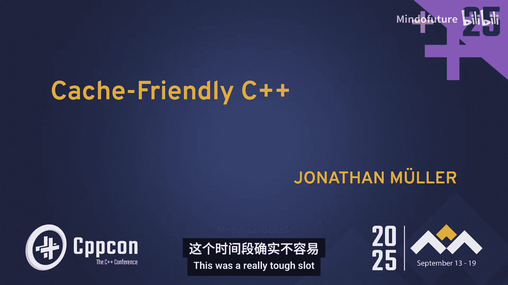
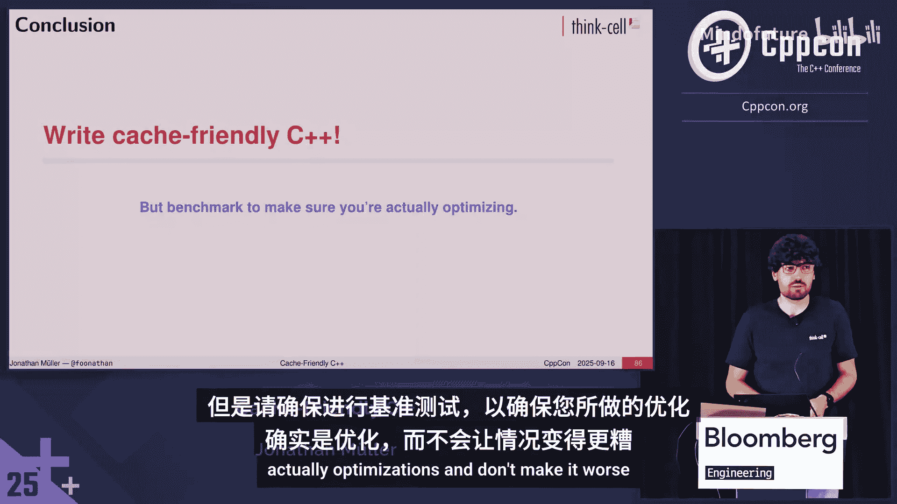
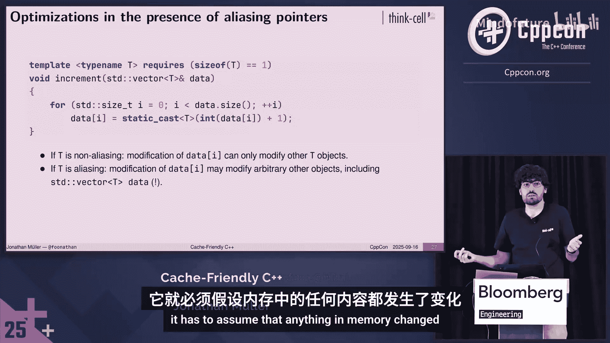

# Cppcon-2025-｜-C++-｜-C语言--｜-汇编-｜-编译器-｜-操作系统-｜-Linux-｜-Windows-p50-P50_缓存友好的C++-Jonathan_Müller-CppCon_2025--BV1wyPBzrEeu_p50-

Okay。Good afternoon， everybody。 This， like this was a really tough slot。

 I'm really happy that I'm speaking at the slot because otherwise I wouldn't know in which talk to go。

 So， you know， I'm not really happy that I'm speaking。

 but I'm not happy that I don't have to make that decision。😊。

So this is going to be an introduction to Kesh friendly C++。 My name is Yoonat Cha Middleow。

 and I work at thinker。😊，So thanks we sell a plugin for Microsoft PowerPoint that is sort of the industry standard。

 Everybody who does PowerPoint slides for a living uses a plugin because it just makes it so much easier and so much faster to create slides。

 We've got custom diagrams types， a bunch of advanced automatic layout algorithms and stuff like that。

 We sort of heck into PowerPoint to provide a seamless experience。

 So there's a bunch of reverse engineering in there。 And then we have like a high。

 really a lot of C on top of it。 We have like a custom standard library that we use that has a bunch of cool stuff。

😊，Which I actually maintain as my data and we solve a bunch of really fun and challenging problems。

 So if you're interested， we are hiring and we do offer relocation to Europe in case that's something you're interested in。

😊，Some。This is somebody to talk about performance。And as such， it features a bunch of benchmarks。

But it is not a talk and how to properly benchmark。

 because I essentially did the benchmark approach the entirely one way around。

 I had results that I wanted to demonstrate， and I kept trying to write benchmarks until I had the results that I was trying to get。

 And this isn't really how you're supposed to do benchmarks。

 But I wanted to tell the story in this talk。 I wanted to demonstrate some effects。

 So I gained the benchmarks in such a way that I got the effects。

 I also picked CPU architectures in a smart way to get the results。 So some of them were on laptop。

 Some of them were on Apple M1。 just to really get get good results。

 like like I'm presenting two numbers。 I'm presenting true effects。 But like。😊。

This isn't like just you really need to do your own benchmarks before you make any optimization decisions and don't take anything I give you on my talk and just apply that blindly measure yourself。

So of that， why do we care about CPU catchs？So。For motivation。

 let's consider the task of writing asset。😊，The standard library provides two set types。

 We've got SDD set， which is a binary search tree。 So it has the classical old do and lookup and insertion and stood on another set。

 which is a hash table。 So it has amortized a one lookup and insertion。😊。

But we can also just simply use this。And once we have a third vector。

 we just push back to insert elements。 and then it's just an O N linear search in order to find。

We could also be slightly smarter and use a sort vector。

 and then we can do a binary new search on it。 So we have lock and lookup。

 but O N insertion because we need to find the position to insert and then shift everything over to insert so that makes it O N。

 However， if you're inserting n elements at the time。

 we can be a bit smarter but just depending them at the end and then sorting and this makes us in log in。

 And you can even do some optimizations there by knowing that you only need to sort the things that you're adding at the end and then just doing emerge in order to put everything in sort order。

 But like this isn't relevant here。😊，So let's benchmark this。 as a setup。

 you're just filling our set containers with N random integers。

 And then we're just gonna repeatedly look up a random integer and measure how long it takes。😊。

And purely based on the like big O complexity， we'd expect that stood another set。

 which would be the fastest because it says01 looker。😊。

Stut set and vector above of our lockin lookup， so they should be behind that。 And finally。

 we have the unsortted vector of the linear lookup。😊，Now， if we look at the actual results。

 first of all， yes， the unsorted to factor， we can clearly see a linear growth and the orange line。

 like as we increase the number of elements， we linearly increase the time it takes to search them。

 What is slightly odd is that if we are at 64 elements。

 the unsorted linear search is actually faster。 than all the other set containers。

 So that's kind of weird。 And also the01 order set in green is consistently beaten by the sortest to factor in red。

😊，So what exactly is going on there？Well， and the answer lies in CPU caches。😊。

So what are CPU kitchens？To demonstrate this is another benchmark。

 And here we're having a bunch of random data。 And then we're doing a random modification somewhere in the data。

 So it truly random memory exists， like we roll the dice。

 pick a random index and modify something in there。

 And then we just measure how long it takes as we vary the size of the data。😊。

And while you might naively expect that this takes the same amount of time regardless of how much data we have。

 this isn't the case。 Like as we increase the size of our data。

 the time it takes like the speed we get drops off。😊，In the beginning， in the blue region。

 it's like constant。 So like for the first couple of kilobytes。

 it doesn't matter how much data we have。 it stays the same。 But then in the green region。

 So from like 80 to to megabys， it drops off as we get more and more data。

 And then in the orange region， it drops up significantly faster as we increase the data。

 But then like even out flattens out towards the end。😊，So why is that？Well， naively。

 memory access might work like this。 So we've got the CPU on the left and then all the way on the right。

 we've got the random X memory。 And then we want to execute a bit of code。

 So we want to like load the value at address 2 into our register。 And for that。

 we need to do memory access and load the value all the way from where into the CPU。😊。

And then we want to load to address 5， so another memory access load all the way into the CPU。

 and now we need address 2 again， so another memory access load all the way。😊，Now。

 if this were really how your computer works， you wouldn't be very happy because main memory access is slow。

 it's like really， really slow。😊，This is just some data I've got from Wikipedia， so on the Apple M1。

 the Ram axis is almost 70 gigabytes per second。😊，And it has a performance of 2。6 tail flops。

 which translates to doing operations at 10000。10000 GBB per second。

 So the actual performance the main memory access is 100 times slower than compute。

 So if we were to get to main main memory every time we needed to do an operation。

 we would be 100 times slower。😊，And so memory memory doesn so this like memory model doesn't look like that。

 we have caches。 So the idea is we put some memory that is faster。 put it closer to the CPU。

 It's like physically closer to the CPU。 So we have less speed of light delay in there。

 And now when we do memory X， we leverage the cache。 So we want to get address too。

 It's not in the cache。 So we've got a cache miss。 So we put it in the cache though and then transfer it on the CPU。

😊，And likewise， when we want memory ats 5， it's not yet in the cache。 So we have another cache miss。

 So we load it into the cache and then put it into the CPU。 But when we've got it 2 again。

 it's still in the cache so we can avoid the main memory access and just directly load that into the CPU。

😊，So the smaller， faster memory close to the CPU serves as a cache， speeds things up。😊，Unfortunately。

 it is smaller。So if we do a bunch of memory excesses and completely filter our cache。

 and now we want to allow it to address  one。 address one isn't currently in the cache。

 but the cache is full。 So we have to evict something and replace some entry with the entry at memory address  one。

😊，Unfortunately， the entry we just evicted is the one we're just about to need。 right。

 So now we need address 5。 It used to be stored at the address we just evicted。

 So we've got Nada Kashms we need to evict something else and load it in there。

 And so this might make the problem worse because now we might have evicted something be needed in the future。

😊，So the caches are really small。And to avoid going to the main memory every time we have like exhausted the cachehe and we have a cachem。

 we have like a hierarchy of caches， caches get bigger but like somewhat slower to access。

 but it's still not as bad as going all the way to main memory X every time we don't have the data。😊。

So on the M1 again， so we've got like an L1 cache pair code between 64 and 128 kilobytes。

 and we can access it in about three cycles。😊，Once we have a cache miss on the L1， we go to the L2。

 it's 8 to 12 MBbys， its shared so multiple core share and L2 cache and we can access it in about 18 cycles。

 There's also an L3 cache。 It's shared with the GPU 8 mebytes and we can access it again in 18 cycles。

 but there's a latency of 10 to 150 nanoseconds。 and even if and only if we exhausted all of those we truly need to go to when a memory access。

 it's big like 60 to 32 GBs。 but it will be pay an additional 100 nanoseds to go there。😊。

And this explains the benchmark。So in the blue region， our data entirely fits in the L1 cache。

 It didn't really matter what we existed。 It's always in the L1 cache。

 So the speed stays the same until we exhaust the L1 cache。 Once we exhaust the L1 cache。

 we do a bit of performance。 and in the green region， it entirely fits in the L2 cache。😊，However。

 as we increase the data further， the probability that we hit data that is already in the L1 cache decreases。

 so we have more and more L1 caches while we're in the green region。

 so the speed drops further and further， simply because we have more and more L1 cache mees。😊。

And then when we go in the orange region， we've exhausted the L2 cache and again。

 so we pay a penalty for that。 and as we go on， the probability of an L2 cache hit also decreases simply because we have more and more data and so it flattens out and if we continue measuring in the end we will have the speed of main memory axis because essentially every time we get a random number it's an end cache miss on all levels and we go to main memory axis。

😊，Now， every time we catch something， we have to worry about like cache validation and stuff like that。

 And in particular， what happens when we write an address that is currently in the cache。

There are two models。 The simple one is every time we write to address that cache。

 we updated both in the cache and also in main memory。 This is called a full cache。 However。

 we have to pay for additional memory excesses in this model。

 So a smarter model is a write that cache。 there we only update the cache。

 and then we only update main memory once the cache gets evicted。😊。

And because of this being a bit smarter， CPU caches are usually right back。 This， however。

 will have fun consequences once we talk about multiple third。

Now the takeaway is this main memory exists itself， it's like really， really simple。

And so we can avoid many access by using caches。 Cas are faster， closer to the CPU。

 and we cache frequently accessed values on them。😊，However， the caches are small。

 so if you want performance， you need to ensure that as much data as possible fits into the cache。😊。

So how do we make efficient use of the cache space？So heres an example。

 we have a bunch of ages of people or something， and we want to compute the average H。

 So I'm using a strongly typed integer for H。 And then we just loop over all the data。

 compute the total， and then the average。😊，Now we want to optimize this and make sure that we use as much data as possible in our caches and one simple way to do that is to simply use a smaller type。

 If we use an insL H， we need four bytes， but we can store ages between2 billion and plus2 billion and like people don't get that old so we can go to a shot only using two bytes or even an unsigned8 bit integer only one byte and then we can still represent all ages of people in our dataset set。

😊，So let's benchmark it for various sizes of ages。 And as we can see， the short beats the int。

 So be faster， simply by making sure that more of a data fits in the cache。

 But if you then go to the un and 80。 we are still faster than the int。

 but we are not as fast as the short。 Even though more of a data fits in the cache。

 So what's going on here。 And the simple answer is on this CPU。

 the amatictic on the UN 80 is apparently slower than the ametic on a short。 So again。

 I want to reiterate， always measure before and after optimizations。

 because even though youre improving one metric， you might lose on something else。😊，Now。

 optimizing the type size for primitives types is quite simple。

 Just you pick a smaller primitive side， like signsha or short。

 you float instead of double and specify the underlying types of your enumerations。

 It defaults to int， and you will not have like billions upon billions of entries in your inum。

 So you can use this smaller enumeration type there。 And because you're not doing a mistake on it。

 like shouldn't affect the performance that much instead you just save some space and therefore space in your cache。

😊，Now， one thing you have to be careful about is about the 1 byte integer types。 So first of all。

 I particularly said use Scha。😊，Because actually three distinct one byte integer types。

 there's S cha， which is in 80， there's unschar， which is unit 80 and there's plain cha and plain Cha is a distinct type with implementation defined signness。

 So on some architectures assigned on some it unsigned。

 but nevertheless it's a distinct type and this is a specialist thing for cha normally when you put signed like a signed in and a sign short that's just the same as in or short。

 So nobody writes it。 but for sign cha， this is actually a distinct type。

 and I have no idea why this is the case。 But anyways we've got three distinct one byte integer types。

 And when I said three obviously meant 5 because we also have cha 80 chart 80 is a type meant for UTF text。

 and then we have stood byte， this is an enum class that's meant to be used for memory excesses。😊。

Now， all of those are 8 bits。 All of those are 1 by types。 Let's benchmark them。

So this is a function that just takes one by type and increment it。 And I have to you。

B the increment a bit ugly because spiteite is an inim class and it doesn't have operate class class。

 So I have just have to cast that on in， do the ametic， cast it back。 So it works on all types。

 But like this all boils down to the same CPU instructions。 So it doesn't really matter。😊。

And if you benchmark over various types， you'll see that all of them have the same performance except Cha80。

 Cha 8 is faster。😊，And that can be it。 So does that mean that you should use the UTF A type to do one by arithmetic。

 maybe because it has one advantage。So the reason It is faster， has nothing to do with CPU cachees。

 has nothing to do with the actual assembly instructions used to manipulate them and also do with the optimizer。

😊，And so C process will construct LSing。If you have an object of some type that lives at some memory axis。

 you can only access it using a pointer of some compatible type。

 So if your pointer has the appropriate type， same as the object， It works。

 If it has the signed or unsign type， it works。Or if the pointer is appointed pointer to cha and send cha' the plate。

That means that if you have a pointer to and send Charles to bitete。

 it can point to anything in memory， not just to objects of that type。C as a similar rule。

 C however doesn't care as much about which specific flavor of cha you use。

 It just allows cha and Sencha and s cha。 and usually the optimizers don' differentiate between C and C plus pass。

 So they all assume that a char pointer or a centchar pointer can also alias anything。😊，Now。

 what this means for a generic code is that if T is a non aing type and we modify data I。

 this can only modify other T objects。😊，So。That's all good。 However， if you have an aing type。

 then the modification of data I may modify anything in memory。

 and vector T is something that is somewhere in memory。

 So the optimizer has to assume that modifications to data I may modify a vector。 And in particular。

 it may modify the size of the vector。😊，So in the loop， the data at size。 if it's non aliasing。

 they come the opts I can see， it's not changed and they can hasist that out of the loop and doesn't repeatedly call it。

 But if it's an aliasing type， it has to assume that the assignment could potentially modify the size。

 And so as it has to wheelload the size every time we are going over the loop。😊。

And this explains the performance benefit that we get with the non a in cha。

 simply because the optimizer was able to write it better。😊，So of course。

 you can still use cha and Signcha or whatever。 You just have to make sure that you apply the optimization yourselves。

 So now we've manually hosted it out of the loop and now the data assignment can no longer modify it because nothing took it at。

 So the optimizes just free to put that in a register and never we load it。 or of course。

 you could just use the follow。😊，And in either situation。

 you will now finally have the same performance。😊，So again， benchmark。

 be really careful when doing any kind of optimization。

 especially about the one byte types because of strict aliaing。

 it's really unfortunate that they have this property and that we don't have one byte aemetic types that we can just use to do ametic without having the optimizer mess with us。

😊，Now， if you want data that's smaller about that， than 1 byte， you could use bit fields。

 So here we've got a widget。 A widget can be enabled， It can be visible。

 and it has one of three states。😊，And now if you put all of the members in a respect。

 widget is three bys because a bull is 1 by and the enum with the underlying type is also  one by。😊。

However， we don't really need three bytes because we have one bit for enabled。

 one bit for visibility， and two bits to represent the state。😊。

So we can use bit fields and just say behind the column， this is how many bits we actually need。

 And then the compiler can like pack them together in one bitete。😊。

So our size of widget is only  one B， and we even have bits to spare to put additional fls in there。

However， no the excess is slower because every time the excess it bit low to byte and then we mask off the bits we don't care about。

 So any effects we might get from having more widgets in our cache can be completely negated by the actual overhead for the excess。

 So we have to benchmark that。😊，One optimization that's usually free， though。

 is simply rewarding the members。So here if we got a message， it has an a bit type， a 302 bit length。

 and an unial data pointer。😊，It also has a 16 bit checksum。On the 64 B system。

 if we add off all the sizes， we end up with 15 B。 So we have 15 B of meaningful information in abstract。

😊，But the actual size of this product is 2ti4。And the reason for that is alignment。

So the alignment is simply a requirement on types， and it replaces restrictions on the address it can be located。

 In particular， the address has to be a multiple of the alignment。

 So if you have a 1 by aligned object like our unit 80。

 it can be put any band memory but if you have a two or4 or 8 by aligned object。

 it only has to live at addresses multiple of2 4 under 8。😊，Now， if you have astruct。

 you need to ensure that all the members are properly aligned。So first of all。

 you pick the alignment for thestruct， and this is simply the largest alignment of any of the members。

😊，And then as you place the members down in memory。

 you have to ensure that each member is properly aligned by putting padding bys。

 So you have to ensure that the offset of each member starts with a multiple of the alignment。

 So you put an internal padding bys to make sure of it。 And then at the end。

 you have to put tail padding to make sure that if you have an array obstruct objects。

 you want to make sure that each object in that array is also aligned。

 And so the alignment of thestruct essentially has to divide the size。

 Otherwise your array object get misaligned。 So you add tail padding until the size is a multiple of the alignment。

😊，So for our message in this particular order， that means that we start our UN and 80 at address C then we need to introduce some padding until we find an address that is divisible before for UN and 3020 then everything works out。

 But if we reach by 18， that is not a multiple of the alignment which is 8。

 so we need to introduce some padding bytes at the end to make sure it's a multiple and it works。😊。

However， if we simply reorder the members of our message from largest alignment to smallest。

 then we get the most optimal padding。 In this case。

 there's only one single padding but at the end to make sure that the entire thing is aligned to8。😊。

So this is just essentially a free optimization in many situations where and we now have a 16 bad message instead of a 241。

 and we can fit more of them now cash。😊，But we can leverage alignment even further。

 So if we have a pointer to T， because T objects have to be properly little aligned。

 the pointer always points to multiple of a line of  two。😊，That means that if you view it in binary。

 the lower bits are over0 because that what it means to be a multiple。

 right So if you have an object that has to be at an even address。

 it only has to the last bit is over 0， right and have div visible before the last two bits is 0。

And because we know they're  zero， we can use them and store whatever information we want in them。

So for example， suppose you're having some set of dom or whatever and Tesla containers or text in them。

 And now you will need a type that needs to store either a pointer to a container or pointer to text。

 And the naive way to do it is you to a booleium and a avoid pointer and then you just cast to the appropriate one in the excesses。

😊，And this type has 16 by。Which is really unfortunate because the actual data it stores is like an 8 by puncter and 1 B。

But you can't store 1 B。 You have to store an 8 additional by to make the alignment。

 And this makes me really sad every time we blow up like 8 B just to store 1 additional bit。 Like。

 that's really unfortunate。But if we can assume that both text and container objects have an alignment of at least two。

 we have a spare bit in our point。So by just storing a single un pointer。

 so like an integer representation of the pointer， we can say Iple is the pointer to the object with the last bit set to one if it's a text。

😊，And so it's a container。 if that last bit of0 And so when we get it as a container。

 we just cast it， get it as a container。 But if we want to get it as text。

 we have to mask off the last bit because it's one。 and the address has to be a 0 in there。

 And then we to cast it to a pointer and now we sort everything using only 8 bytes and avoided thete。

😊，So if your types are smaller， more of them fit into the cache， so use short instead of int。

 use float instead of double， specify the underlying type of enumerations， consider bit fields。

 we order yourstruct members to avoid pedding and consider using tweaks like the pointer alignment bits to really avoid a bunch of pedding to store additional bits of information。

😊，However， all of this means that the axis of the data now is potentially slower。

 So you have to benchmark it and see whether you really gain anything out of it。😊，Now。

If you've been paying attention。You might be wondering， why did that actually help。

In the averagever to H benchmark， when we made the H type smaller， Why did that actually help。

 We are only accessing every address once。 right We don't go over the data again。

 So we are only accessing everything once。 So why does it matter that more of them fits in the cache。

 Everything should be a cash miss anyway， because we haven't accessed the data before。And also。

 the cash。So far doesn't explain West effective was faster than stood on under a map in the motivation。

And to look into when that is， let's not benchmark only random access。 So like in the first one。

 but also linear access both forwards and backwards and to make the comparison fire in both sequential excesses。

 I'm still computing a random number and throwing it away just so we pay for that every time。😊。

And now we see something interesting because if we do sequential x。

 we have the same performance no matter the size of our data。

 and only if we do truly random access do we do above。😊，And the reason for that is simple。😊。

When we access some address X， we usually also add access the next address and the address after that。

 right And the people who design our CPUs know that。 So they introduce the prefi。

 It's something that preemptively loads addresses into the cache。

 if it's likely that we're gonna access them in the future。 So in a sense。

 it sort of like predicts the memory access pattern that we're gonna do and make sure that people won't have cache misses by preemptively loading。

😊，But， this isn't all。So in this benchmark， I again have random data and I'm accessing it randomly。

 but I'm accessing a random chunk at a time。 So I pick a random start at with chunk。

 and then I access all the indices of their chunk in random data in a random order and do something with it。

 So here by accessing random chunks from our data and we're accessing data the chunks randomly as well。

 But like still only relatively small chunk size compared to the entire data。

 and now we measure this by wearinging this chunk size and see what we got。😊。

And the result is that as we increase or chunk size， the performance goes up。😊，However。

 it goes up slower。 So if we look at the forward difference。

 we see that if the chunk size is already in the like 400 B。

 making it slightly faster doesn't get us as much performance as initially， right。

 So as we increase the chunk size， it has diminishing returns。😊，So why do we have this effect。Well。

 and the answer is main access is slow and so while we accessing main memory。

 it doesn't really make sense to only access one byte right so we access an entire cache line of data a contigious byte range usually usually 641 another 28 bytes is accessed into the Ram and loaded into our cache。

 So in this model， the cacheline size is too。😊，That means if we load our address 2。

 we not only load address 2， but also address 3， put both of them in our cache and then set the register with the value yet address 2。

😊，Likewise， when we do address 5， we don't load just 5， but the entire cacheline。 And in this case。

 the cache line consists of addresses 4 and 5。 So we load both of them into the cache and sent the address 5 to the CPU。

😊，And now when we need address 3， even though we've never actually accessed address 3 before。

 it already happens to be in the cache because we've added we've fetched the entire cache。😊。

And this was sort of demonstrated with our chunk access。 as we did the chunk access。

 when we had only a  weD small chunk， we loaded an entire cache line。

 but throw by most of the information。 And as the chunk size went up。

 we used the cache lines more and more efficiently。😊，So the CPU not only caches it。

 but it also wants to minimize Web access， and it does so by preemptively fetching entire cache lines。

Also so it learns our memory access pattern and refs it。And so if you want true performance。

 you want predictable memory access patterns that have a high locality。😊。

And one easy way to achieve that is to use cash friendly container。

So we want to leverage prefetching and cache lines。

 what this means is that we want predictable excess patterns。 we don't want pointer chasing。

 so if we need to load D referenceence pointer， the prefeter has no idea what we are just loading because it has to know the value of the address first。

😊，Instead， we want sequential memory access， just access the memory sequentially。

 and then the pre future can help us。We also want to make sure that we have high locality。

So that means we want to minimize the size of our types to make sure that more of them fit in a cacheline。

😊，And we also want to， on the flip side， make sure that data we don't care about lives somewhere else。

 And so we don't want to waste space in our cacheline。

 So data we don't care about shouldn't be in our cache。

And stood vector of T as a prime example of cash friendly container because it has a bunch of values。

 and they all live contiguously some in Mai。😊，So we don't have any metadata thats based in our cacheline。

 We have just have a very contiguous memory layout。 And as we iterate over them。

 we iterate our word sequentially in memory。 So the prefes are our side and everybody is happening。😊。

And similarly， like stood away， also contigious memory in place vector and everything else where have contiguous memory access。

On the opposite spectrum， we have stood list。Stoout list is the linked list of node。

 So each node consists of the value and pointer to the previous node and to the next node。

So first of all，' be having， we don't really care about the pointers as the use of the stood list。

 So theyre just based space in our cacheline。 And then also as we iterate over them。

 the notes can be in any audience memory So the prefiture also can't really help us because we're just following pointer around as we it it。

 So this isn't really cache。😊，On the middle end， we've got something like the tank of T。

 which is logically a vector of pointers to airways。 So we've got contiguous blocks。😊。

So within a block， we are contiguous。 now metadata。 So the pre is happy。

 And only when we switch from one block to the next， do we have to do a bit of point of chasing。😊。

So if the block size is big enough， the the like transitions between blocks don't really matter that much。

 So we still care friendly。 But if the block size is too small。

 then we just have a linked list and where we just follow point。😊。

And it's unfortunate that in at least one standard library implementation。

 the block size is too small to get any meaningful cache benefits。

 so it wouldn't necessarily rely on Stt， it's in theory a useful container because it provides pointer stability of the elements as you add more data。

 the addresses never change， but if you need it， then you should probably well your own because you can't rely on the standard library version having a big enough block size。

😊，What's so not cache friendly is the standard library implementation of map and set because it's a binary new search tree。

 So like the linked list， we have node with left and white pointers。

 and then we have to do pointer chasing。 It's from a memory layer perspective。

 it's exactly like a linked list。 It's just that the pointers have different semantic information。

 But either information， the prefecher can't help us。

 We're having metadata and the cacheline that we don't care about。 So we're wasting valuable space。😊。

And really， unfortunately， un ordered map and are also not cache friendly。

 This is because they use closed addressing， which means that it's fundamentally in a array of buckets。

 And each bucket is a single linked list。 So we have having a vector of node pointers and each nodell pointer has the key value pair。

 and it points to the next one with the same hash value。😊，So when we want to do a lookup。

 we compute the hash value。 We pick a bucket， and then we follow the pointers until we found the key value pair of a thing。

 right， This isn't great for the prefeture， the space space in our cache line due to all the met data。

 So it's not very cache friendly。 And that is why in our benchmarks for small enough values。

 the sort stood vector beat the the O1 thing because it's a bit better for the prefe。😊，Now。

 this is unfortunate because you can make H table faster。Right， you just have to use， for example。

 out addressing in out addressing， you're just having like stood vector you're having a flat list of elements。

 And then when you hash， you go to some random to like the appropriate packet。😊。

Check whether it's the value you care about。 And if it's not， you look at the neighboring ones。

 right And that is now really cash friendly， because you don't have any pointers。

 You just look at neighboring addresses in some ways。 So they can be a lot faster。 But unfortunately。

 the standard library doesn't provide an implementation。So in general。

 you should prefer containers that use big contigious chunks of memory because that is very better for your caching effects。

 It's more cache friendly。 The preferred trouble will help you。

 You don't wastee your cache line with unnecessary metada。

 You're just having the data you care about。 And so in almost all situations， you the vector。

 You can also use some implementation that the take of tea。

 if you care about the properties it has and you can use hash tables with augment missing。

 because all of those are cache friendly。 if they use the big contigious chunks of memory。😊。

Unfortunately， this ist all。Now， one thing。After I took test measurements。

 I like looked at the data sheet of the CPU and the cache size I measured for the L2 cache didn't match up with reality。

 So like I somewhat abitarily picked the line after2 kiloby2 mebyte。

 but the reported cache line was4 megaby。 I could say， okay。

 maybe next it is also part of the green regime， but definitely the drop off happens before we reach four meby。

 So what's going on there。😊，Well， on dis simple is， code is data2。😊。

The CPU instructions your program consists of also live somewhere in memory。And main access is slow。

 Therefore， it's avoided using faster caches。😊，And these are the instruction caches。

 So on the L1 level， you usually have separate instruction caches compared to the data caches。

 but on the L2 cache， they're usually unified。 So you have one cache to both cache。

 the data that your program operates on and the program itself。😊，And therefore。

 the measured L2 size was smaller because some of the L2 cache size is used up for the extra program be executed。

😊，And now the fact that code is data means that the code itself also has weird caching effects。

 and we can create really contrived examples to demonstrate weird caching effects。😊，Of code itself。

 So this is a example。 We have a bunch of data like random data， and we're summing it all up。

 But if were having a zero， we're doing 64 separate increments。😊，Now。

 the condition that D0 is meant really true because it's like 20 random data。 But if we do。

 we have 64 separate increments in there。 So the repeat 64 is just a macro that expands the expression 64 times。

😊，And then we could do it in one of two ways。 We could do the sum first， and then we have the if。

 and then we do our incrumbements。😊，Or we could do our increments if you're zero。

 and then we do the sum。😊，This doesn't change anything in the result。

 It's just a choice of writing the first or writing the second。Now。

 who thinks this version where we do the sum first and then now 64 increments is faster than the second version。

😊，Un cousinas。O thinks this version is faster。Okay， one person。

 but a different person who thinks it doesn't matter at all。Okay， you're afraid to raise your hands。

 okay。So it turns out that。If you use an Apple M1 and you use the high performance course。

 this version is faster。 It's significantly faster。😊，If you do the sum and then the increments。

 you add two gigaby per second， but if you do the increments and then the sum。

 you have over 8 gigabys per second。😊，Just because of the way your actual CPU instructions ended up being。

Living in memory， like just how the compiler admits the assembly of those basic blocks。

 just cause a massive performance difference just because the caches are differently。

 The alignment is differently。 like something changed in the benchmark that caused to be performance gap。

 I've looked into it a bit by it's such a drastic difference， but I couldn't really see anything。

 So if any of you have ideas， talk to me after。😊，But the fact is， your program lifts on main memory。

 main memory access is slow。 So you've got caches。 So just like you can have cache friendly data access patterns。

 you also have cache friendly code access patterns。😊，So the cache frankly data access patterns。

 you want to access your data linear order and the equivalent for codes。

 you want instructions that execute one after the other。

 That means you don't want any branches to jump you to an entirely different location of your program。

 right So for example， if you function call and your function lift somewhere else in memory。

 the first time you call it， that might be a cache miss， that might be slow。

 So if you're having a hot loop in there， you wna avoid that。😊，Similarly， for the data。

 you want to avoid pointer chasing because that is really bad for the prefeure and the code equivalent that is an indirect jump。

 So if you call a virtual function or you call a function pointer。

 the prefeter don't know what it is。 It can't really prefetted。

 So this is going to be a cachem the first time you do。😊，Similarly。

 you wantna minimize the size of the data。 So you use your cache lines and your cache less more efficiently。

 And likewise， when you're doing a loop， you want to do as little as possible in the body of the loop。

 And that way you fit as， much as possible into the cache。So as a consequence。

 you don't only want to design your data in a way to keep catchs in mind about your entire program。

 because the code itself also matters。And one way to do that is to follow data oriented design。 Now。

 theres surprising number of data oriented design talks at this conference。

 which I didn't know when I submitted the talk。 Funny how that worked out。

So data oriented design is sort of classically contrasted with object oriented programming。

 so in OOP you focus on objects， these are sort of domain specific abstractions whereas in data oriented design you focused on algorithms which are your data transformations so you have some data and the goal of your program is to transform some data so this is what you focus on。

😊，In O P， you have smart objects that encapsulate both data and behavior。

 So you've got classes with member variables and member functions。 whereas in data or programming。

 you just have the algorithms that operate on them data right your in have member functions。

 So to speak， And then if you w to have like different flavors of things in O P。

 use like base classes。 And so you've got collections of pointers to base classes。

 with data programming， as we see， you'll have multiple homogeneous collections of the different data you operate on。

😊，So。One example in OP， let's say we want to work with people。 So in OP。

 you design the objects first。 That means you have a person class。 Pers have names。 they have an H。

 So you write get us for the actual member thing and construct us and but not and then you have a vector of people and then you operate on that。

 So for example， we can write a function that confuse the average age given all our people。

 and a function that gives you the name of the oldest person giving all of people。😊，Now。

 with data oriented design， you will start with the algorithms。

 So what's the algorithms that we want to write。Well。

 we want to write a function that takes something and gives us the average age。 Now。

 what does it take in O P， It takes the entire people。

 But like we don't really need to care about the people。 We just want their ages， right。

 We don't need their names in order to compute the average age。 So in data on design。

 you would write a function average age， that takes the ages of all of our people。😊，Similarly。

 we have an algorithm that gives you the name of the oldest person。

 So what's the data it needs Well it needs the names and the ages in order to do that So it makes sense to split it into two functions。

 one that gives you the index of the oldest person and we can do that by just getting the ages and then one that given all the names of other people and all the ages So we assume that they are sort of the same size and like the zero object in both of them represents one person and then we compute the index of the oldest person and then we return the name of the corresponding entry in the other vector and this just is sort of the data that we need to implement it。

😊，And so we're putting in the data first， and we ended up above this。😊。

And what we've seen are two very different data layered approaches。

 So the first one we've seen that that is called a way of structures。

 See we've got astruct that has some markets in this case， name and H。

 and then we've got way of those on in this case a vector。 and this is our people。😊。

We asked with the second approach， we ended up with something called Struc over ways。😊。

So person no longer exists as a thing。 It's merely an index。

 So we can represent it as like a strongly stepped index。

 And then we've got to P like all the data they make up。

 So like all the names of all the people and all the ages of all of those people。And if you do O。

 O P， you usually use in a array of structures because you your objects and O P is about objects。

 And with the O T， you just use whatever works for the algorithm。

 So if you often need to work on both age and name， then sort of make sense to keep them together。

 But if you sometimes only work on one of them， then make sense to split them apart。

And if you look at the memory layout， if you have an array of structures， we have the name， the age。

 the name， the age， potentially we have like pe mode in between。

 And this gives us efficient access to individual girlss if we view as a database so we can easily get all the data related to one person。

😊，We have to have the structures of ways we first of all the names and then all the ages and this gives us efficient access to individual columns right so very easily write programs that operate on all the ages without caring what the names。

😊，This matters because if you only care about the ages。 if you use the array of structure code。

 your cache line is being wasted on all the names you don't need the names if you just want to compute the average age。

 but instead have to load them， theyre still occupy space and the cacheline and performance drops So you actually benchmark it。

 So we've seen the benchmarks for the ages of various sizes and whatever size for the H we pick person is significantly slower than all of them。

 which is no wonder because were basting precious cacheline space on storing the names。

 even though computing the average age never actually cares about the name So this data layout is just less efficient in this particular example。

😊，So another classical O thing is so we have the shapes and we want to operate on the area。

 so we design a class hierarchy where we've got a shape based class with a pure virtual function。

 and then we have our circles and our squares， which derive from them and overwrite the area function with the appropriate formulas and both circle and square also store the relevant data like the side length of the radius。

😊，And now we want a bitte a function that computes the total area， so it gets all of our shapes。😊。

As vector of unique pointers， because we have to like put them on the hip because the size matters。

 and then we just sum over them， called the virtual function and sum it all that。😊。

In data wanted design， we designed the algorithm first。😊。

So algorithm is a function total area that returns to double， What does it take？😊，Well。

 we've got circles and we've got squares。 So it takes a bunch of circles and squares。

 and it can be either one。 So we use a variant of circle or square。 And in this case。

 circle or square just sucks this store the relevant member thing。 There's no base class。 And yes。

 what if at some point， we might have a triangle。 But then we get to it when we get to it。

 Like unless you already know that we need extensible in the design。 Don't worry about it。

 Just focus on the problem that you're actually having at the moment。 So in this case。

 we have any circles in squares。 So we write a function that takes circles in squares。😊，还有吧。

If we only take circuits and squares， let's just write the function so it operates on circuits and squares so let's give it all the circuits。

 all the squares and write the function that sums the area of all the circuits。

 then sums the area of all the squares and adds the two together。😊。

So these are sort of three different representations of heterogeneous data。😊。

We've got the box data in the classical level P end。

 We've got the vector of unique pointers to shapes。 And this is essentially a vector of pointers。

 And then each of the pointers points to either a circle or points to a square。

 And if we iterate over them， this is really bad for the prefecure because we follow pointer every time。

 has no idea about points can't really help us。 And we also basting entire cache lens space on the pointers。

😊，The variants are a lot better because we're sting them in line。

 but still we've got the stack in there。 So everything has a tech， which is just one bit。

 but probably it gets blown up to 8 byte to count for proper alignment， which is really unfortunate。

 So if we just use two different vectors， we don't need to remember tech because we know the first vector has all the circles。

 the second one has all the squares。 And then also when we iterate over them。

 we don't need a branch because we first iterate all the circles。

 And in this case we use the formulaly for the circles， statically known no branch needed。

 And then we iterate our all the squares。 So we need the formulaly for all the squares statically no branch needed。

😊，And so it's unsurprisingly that the last representation is significantly faster。

 just having two separate vectors， one for the circuits， one for the squares。

 And then we compute the area。 that's faster than using the variant or the point。😊，And in a nutshell。

 this is about dataed this is the idea behind data oriented design。

 you design I want algorithm that transform data。 you start with the algorithm。

 and you think about the data it needs， and you should also write functions that operate on n elements。

 not single ones。 Don't write a function that you returns to the area of one shape。

 byte a function that takes all the shapes and gives you the total area because you have more than one shape and it doesn't really make sense to split that into the individual objects。

 And then once you write the loop， you sort of push the loop into the function and that's a lot nicer for the optimizer。

 gives you a better performance。😊，Maybe layer advice if you only。Care about the subset of the data。

 only put that data in the array， So use the structure of arrays。

 only have the array of the data that you actually care about and have all the data living somewhere else and then only exercise it when you actually need it。

😊，And if you have a variant of something， just use multiple homogeneous arrays。

 Like if you have something with a boolean member， And then based on the boolean in the loop。

 you do this or that， that's usually a red flag just split it into two separate arrays。

 one for where the boolean is true， one for where the boolean is false。

 You avoid the branch and you don't need to store the boolean because we just have multiple arrays。

 we need to do that。😊，And that way， you truly leverage catches and you can have big performance gains。

So so far， we've only looked at single core processor， so let's look at multi core processes。😊。

And let's say we want to do a parallel fault。 So a fault algorithm is something like sum or an accumulator。

 We have a bunch of data， and we want to sum it all up。

 And the way to parallelize it is a pattern that looks something like this。

 So we have that pool where we can execute book。 It has some number of threats。

 And what we do is we create in a array。 where we store all the local results。

 So the results of each thread separately， will be stored some entry in the area。😊。

And then we submit work to the F pool。 and each work sort of gets the threat index。 It's running on。

 It gets the appropriate slice of the work。 So the subset of the work it sum it works over。

 does the operation。 So So in the case of like summing elements of an array。

 it will take a subrange of the array， sum it all up and then store the result in the local result of each threat And this doesn't require any synchronization。

 because each thread has a different index。 So we never access the same element of the local results array from different threads。

 And also we don't modify the work。 and if we were to modify the work。

 each one gets a different slice So no synchronization is needed。

 And then once the thread pull is done or the thread their slices。

 we do the second fold of all the local results to get the single final value。

 the final sum of the array。😊，So this is a really common pattern to parallelize fault algorithms。

And everywhere in the benchmark where we do a really silly parallel fault。

 which is we want to accumulate a bunch of Fibonacci numbers。

 So this is a recursive Fibonacci implementation just because it's a really easy way to relatively few lines of code。

 create a bunch of work for the CPU because it's like。😊。

Famously inefficient way to compute human not。 It just blows up exponentially。

 but this is what I needed。 I just wanted to do a nontri amount of work with it。😊。

And directly accumulates them all up in this result output parameter。

And then we've got a benchmark code， maybe we've got the local results of each one。

 and then each thread sort of sets with local results to zero。

 and then I'm just doing something so in this case just repeatedly accumulating the first 20 Fibonacci numbers。

😊，And now that as we increase the F count， each thread does and does like a fewer share of the book。

 so as we increase the number of threats， we should get more and more speed up because we are like dividing the work between multiple threats and they all go comparable so we should get a speed up。

😊，However， if it actually run the benchmark， it doesn't scale at all。In fact。

 as we increase the number of threats， our performance even goes down。 So if we use four fs。

 we are less fast than if you just had a single thread。

 which isn't what you see when you want to pair last things。😊，So why is that。Well。

 if you have multiple cores， the caches are only fast because they close to the core。

 so if you have multiple cores， each core has its own L1 cache。😊。

That means if you modify entries in one course， L1 cache。

 it has to invalidate that cache entry for all the other course as well。 Otherwise。

 theys read scale data。 And this is also where some of the atomic memory models stuff becomes in。😊。

However， the CPU cachehes operates in granularity of cachelight。😊。

So it does modify only the entry it like invalids the entire cache line。So in our case， we have F0。

 which does it right at the local address at In0 sets it to0， this invalidates the cache line。

 so the F one beat of the neighboring entry in the array is a cachehe miss even though it might have been cached even though it never was modified。

 it's still a cachehe miss still has to go to main memory because the cache line was invalidd by the modification。

😊，And this is called false str。Filult sharing is the cachehe in validation due to modifications of unrelated data in the semi cachecheline。

😊，And this is what happened in our example。 right， We have the local results。

 And we keep accumulating Fibonacci numbers on it。 And every time we do。

 we invalid the cacheline and all the other thread have to like beload it for main memory or something。

 I'd like it really tank your performance。 You want to avoid it。😊。

And one way to avoid it is you make sure that each。Like local accumulator lifts on cache line。

 but just accumulating some patting space。 So we get the alignment that we need。

 So the standard sort of provides access to the cache line using hardware destructive interference size。

 I'm not sure why they didn't call it cache line。 Also it's sometimes wrong because it's just a compile time constant。

 that's being set。 And it might not always be set properly for your targets or you probably need to roll your own。

 But in this case， it worked。 So you get the alignment。

 And then you don't only align get locally results for each how many thread we have。

 But enough for the alignment。 So now you essentially allocated that count， many cache lines。😊。

And then when we access it。We modify the first value of each cache line。

 and so when we don't invalidate the cache lines that the other fed are using。

 because now each local result lift its own cache line。😊，And now when we actually run the benchmarks。

 we get the performance that we expected。 So as we increase the number of it。

 it actually scales and we get faster and faster performance。😊，Of course， in this particular example。

 there would be a far easiest solution， just use a local variable。

 accumulate in the local variable and then only writes the local results at the very。 Now。

 the last one still suffers from false sharing。 However。

 because it's like because it only happens once at the end of the benchmark。

 It doesn't have a big performance impact and we still have the scaling behavior。

 as we increase the number of threats， we actually get faster。😊。

And so every time you're doing multithetic， keep forth sharing in mind。 It's really， really dev。

 Like， if you have data that is used by different pets at the same time。

 put them in different cache lines。 even though it's not a base condition per。

 you should view as if it was a base condition because it tanks your performance。Of course。

 the flip side is still true。 If you have data that's used by the same third。

 put it together in the same cache line that way， you don't have to worry about the performance。干脆干准。

This was an introduction into CPU caches。 They are smaller。

 faster memory that you use to avoid accessing the server main memory。😊。

The cachehe line is the smallest unit of data that is transferred between main memory and the cacheshes。

And to make cache messages less likely， we have the cache prefeture。

 It predicts memory excesses and preemptively loads the data into the cachehes。😊。

When dealing with multiethling， we have to keep way of fault sharing。

 which is cache and validation due to modifications of unrelated data in the same cache。😊。

And also remember， code lives in Maitto， code has caches， code has cache effects。

 not on just your data。😊，To truly leverage the CPU caches。

 we want to have cachef data access patterns。 We want to access a linear order。

 so the prefeture helps。 We want to avoid pointer chasing so the prefecher can actually do a job and we want to minimize the size of the data。

 So we make as much use of the cache lines possible。 Don't put data in there that we don't need。

 And likewise， for the code， we want to work longer branches。

 We want to avoid indirect branches indirect dumps and we want to minimize the size of the hot code。

 So our loop is really efficient。😊，And also， remember。

 data used by different threads at the same time， put them in different cache lines to file sharing。

😊，And if you follow that， you need the first steps to writing a cache friendly C+ pass。

 the writing code that actually leverages the CPU memory effects and is potentially a lot faster。

 but make sure that the benchmark so that the optimizations you're having are actually optimizations and don't make it worse。

 Thank you。😊。

Questions， thoughts， comments。

You often have code that moves between single threaded and multi threadreaded。

Because it seems like following this sort of design。

 you have to redesign the code every time you want to like think that sort of paradigm shift as opposed to having like a function that you could call as like threads sake that could be called in a parallel environment and could be a call in the single thread environment。

How do you handle。A thread say function being able to be written to be performed in both cases。

 or is it not possible， what you mean by following this design。Like， like what， what exactly。But。

So I think you were suggesting that the memory layout should be different。

 depending on if it's multi threaded， like if you're accessing data in a multi threadreaded way in a single threaded way。

So if you've got a function that's supposed to be gripate that could be called in both that performs on a function。

 it seems like it'll be impossible to satisfy both。So。

 so so the problem only happens if you're modifying some some data like if you don't modify。

 fault sharing doesn't happen。 And if you have a single threaded function that modifies some data and then you want to parallellyze it and you don't change the data。

 then yes， you could suddenly have full sharing however。

 but you usually do So let's suppose you have an array of numbers and you have a single threaded function that modifies them in some way。

 And now you want to multi thread it。 So you split your array up into chunks and send each chunk to the thread。

 then yes， at the boundaries between the chunks you will have full sharing effects。

 But like usually if you do that， you have like a threads or something。

 but like you have like megabytes of data And so the boundaries are pretty small region so you still get the speed up and don't have to like physically pull it out。

😊，This has been a great information， dense。Presentation。You showed one slide with megabytes。

difference。Two different programs。One with summation。You were wondering like what would cause that？

I don't know 100% myself， but about what thoughts that I had。我的。Your answer the prediction ends up。

Jumping across a cash line makes cash。And you know the other thing。

A branch mis predictionion evicting that cash line because of like Specor milk。Other types。

And then another one would be， you know what's the different types of cash that we're working on？

Yeah。And there's a lot of complicated。Yeah。That it would have been nice if youd got into it。

It's really hard。ItYeah really curious。Do you know of other presentations？So those kinds of。

Information。As a relates student to cash。Yeah， so regarding last point。

 Im not completely aware of any like conference talk or something that really goes into like the deep nuances of caches。

 This was more intended to be an introduction to the like basics exist。 You should be aware of them。

 regarding your point yes， the first thing I expected was that maybe the basic blocks spell lay at it entirely differently。

 And so in one of them you just go over a bunch of branches and the other one that's in the middle。

 But that's actually not the case。 It's like the same。

 It's just that the difference is just the addition instruction sort of shifts it over one。 in。

 And then maybe yes， like weird spans a cache line or something。 and then you have some effect。

 But I haven't really tued down into it。 Yeah So like a benchmark yet on difference。

 didn't occur on the in。 It happens on the Apple M1。😊。

And if I do like the efficiency by the the performance course， the effects is differently pronounced。

Thank you。He just speculate about these things， but I would look at L zero cash first。好的。

Could you bring up this slide where you had this one vector versus two vectors， circles and squares？

Yep， I'm gonna。That什么？Yeah， that's why I know Benmark is also production。

When you did that benchmark was the population of circles and squares in the single vector once around them or were they like？

Circleles for squares they were random。 They were random。Okay， if you did a profile on this。

 you would be able to prove your own immediate。 But I'm going to go out and in and say that。

measuring？I is a miss on a branch target buffer compounded by a miss on al zero cache。

 and it has nothing to do with the caches。Okay， that's go。Yeah， that that could be the case。

 Yeah if youre。From own。The small you would see front and still the backend。

Do you guys miss as a broadcast？Our isYeah， but I also saw were different。

 like I looked at the assembly。 the， the if you have the separate airways。

 the vectorization was a lot nicer than if you had the branch in the middle。

If it knows or compile down which one is which Yeah， Yeah， So that's probably the main thing。

 even if it doesn't。 So if you just group。likeEven then you have a unique point one with you。

second second， you see a huge， and that's the right， yeah yeah。Yeah， yes。

 this isn't entirely about caches in this case， but the broader point was just that this memo layout is better and not necessarily because of caches。

😊，Great talk I have two questions you mentioned that code is data so they'll make long jumps into different regions of code and so my question there is what control do you have over where your functions you're jump into our location？

the second question Israel。 what is your opinion on Numa and that also help you if you're copyping objects to different regions numa where its helpful。

 Yeah， So regarding the placement。 So it's mostly have function that does a hot loop and then very rarely something happens。

 then you want to make sure that you call non inline function that live somewhere else and it's mostly about ensuring that if you do like doesn't pollute the cache and that on the flips。

 if you have something that you actually care about that you want to execute it。

 it should ideally be into the loop or like you use like the section attributes in weird cases But it's thing about measuring and actually looking and seeing it like in general。

 you don't have any idea but like if you have like a bunch of function calls in the loop。

 then got the effects。 I don't have any experience with numa unfortunately。I into play one。He。

 great time。On the slide that you kind of showed modifying the content of a picture could be because could look like it might modify the size。

 I think it was like 28。 Yeah Is that because of the short power optimization that a compiler kind of think maybe that data pointer is going to actually fall into the vector itself。

the size。 No， it's not about short path optimization。 It's just that the， the。

 like members of the vector bad computer size， they live somewhere in memory and the。

optimizer doesn't know that data。 I doesn't go out of bound of the array and doesn't reach into the memory of the thing。

 So as to like conservatively assume it might。 But is it not I assume the compile would that axis。

 Yeah， the so the optimizer doesn' know the semantics about vector， though。

RightBecause then would you think that accessing any kind of pointer in there could feel like modifying the size。

Like because at that point， it's just accessing a random pointer makes compile thing that you might modify find。

 So if it was any pointer in there。It was had the same thing。Yeah。

 so like like if you buy through a pointer that could reasonably alias anything in memory。

 it has to assume that anything in memory changed。

Right。Thank you。Okay。I'm out of time。 I do have five of the famous things sell socks。

 So if you don't have any socks， and you want some combined buy their L value R value socks。😊。

Thank you。

