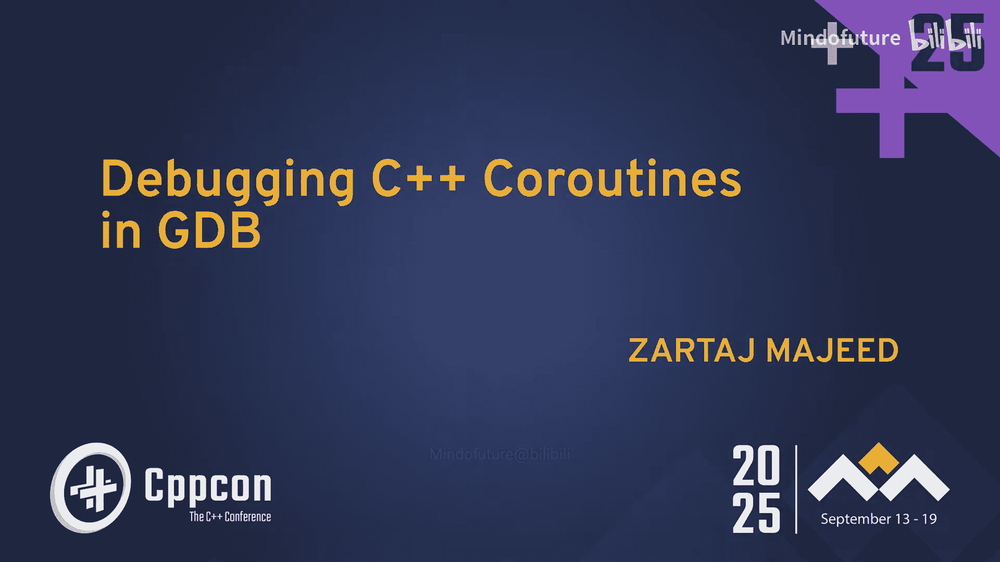
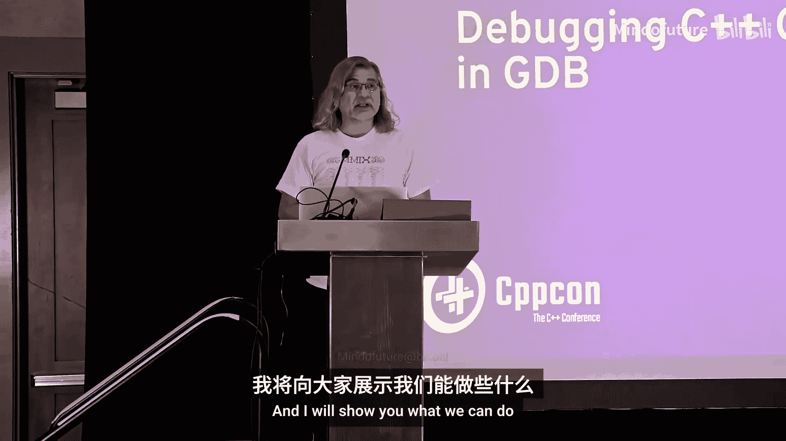
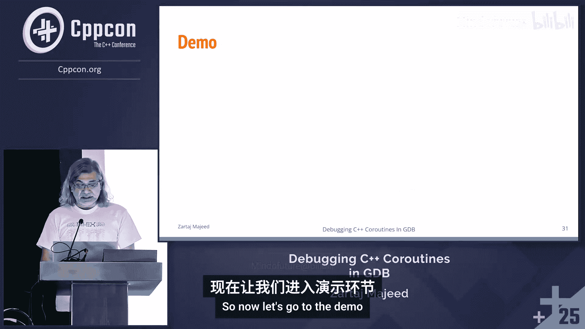
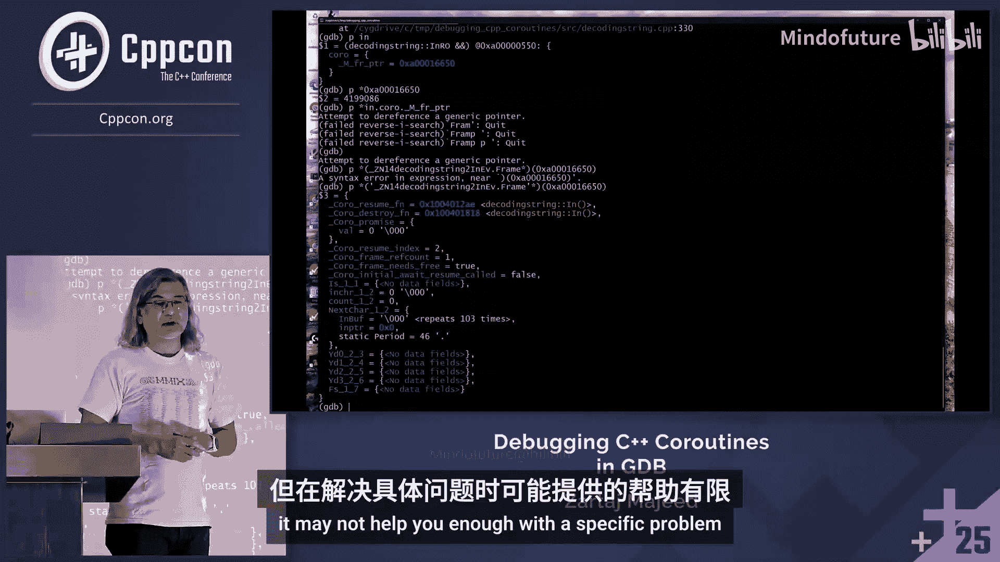
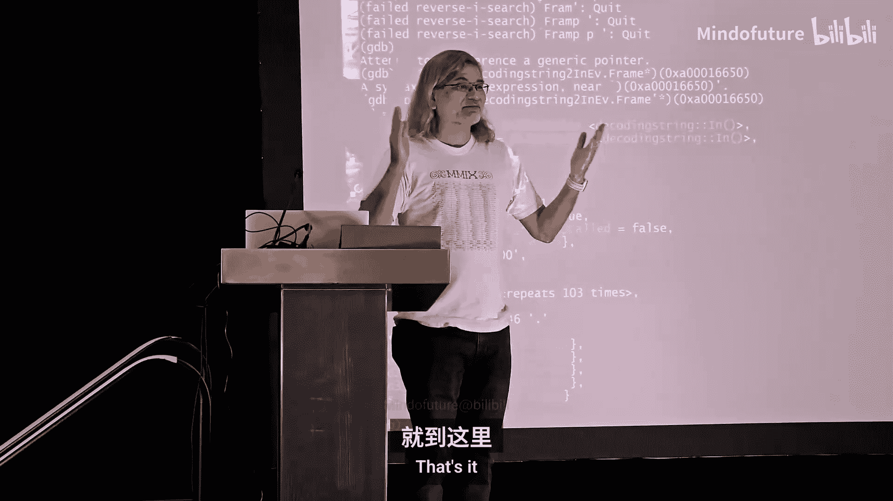

# Cppcon-2025-｜-C++-｜-C语言--｜-汇编-｜-编译器-｜-操作系统-｜-Linux-｜-Windows-p51-P51_在GDB中调试C++协程-Zartaj_Majeed-CppCon_2025--BV1wyPBzrEeu_p51-

Well， welcome everyone。 This is debugging C plus plus routines in GDP。

My name is Aj Majiib， and。I'll be kind of going over where we are in terms of debugger support for core routines and what you can accomplish today。

 What is still pretty difficult。And what can help you deal with the difficult issues。And I'll。

Give you one14 little program。As an example， and then we'll probably spend about 20 minutes on a demo where I'll fire up GDP hopefully it complies and I will show you what we can do。

All right， how hard is it to debug C++ score in GDP？Well， first of all， thebuging is hard。See。

+ plus scoreine are hard。And GDP is hard。 So logically。

 debugging C plus plus proteins in GDP is three times as hard。To give you a sense of。

The challenges you face when you try to debug。嗯。GCC compiled code with GDP that has proteins。

 There is a bug against GCC that's been open and unsigned since 23rd， February 2021。

And the person who reported it said， I'm itching to get into C plus plus C plus plus 20 cors。

And are very grateful for their implementation， But I am somewhat put off by the apparent inability to inspect them from within a debugger currently。

While looking for existing related GCC specific issues， discussions or commits。

 I found the following paper， P2，0，7，3。This seems to at least confirm the current state that I was seeing。

 I can't tell if support for this is missing in Gcc or GDPB or both。

 but I figured I'd try finding out here first。 So this was open against GCC。

The bug report does have some updates in the last four years。But it's still sort of orphaned。

 Nobody wants to acknowledge it。 Nobody wants to take responsibility。

 And there's a similar situation on the GDP side。You tend to get a run around when you want to。

Deal with some issues。Is it really still this bad， no。

So things thatve improved a lot since that survey in P20，7，3， I came across that pretty early on。

 but I'm sure anyone who wants to debug。C+ plus corines using GDP will come across this paper。

 and it's a survey of the state of debugging cors at that time。

 And C++ cortes were still relatively new in 2021 or 2020 when the paper came out。But。

The paper's author said。You can't inspect local variables。 You can't see the qua parameters。

 You can't see the promise。 I mean， there was just a litany of things。

So now you can set break pointss。 You can view local variables。

 You can view quaine parameters and examine a quaine's promise type。

 So all of these things that are kind of。Standard for functions。They will work for courts。

The challenge is the features of cors that are not typical of functions。 In particular， two of them。

 So one is quas can be suspended。They're no longer on the stack。

 How do you examine a suspended corine。 So that's still a little tricky。The second is。

 since they can be suspended and they can come back onto the stack and start running。

That means that they have a cough stack associated with them， right， So every qua。

Can be suspended at any time。 And you may have a multitude of these corrantines that are suspended。

But they all。Can come back to the stack。And be executable。

Bead running just like any other normal function at any time。 So that begs the question， you know。

 where is the call stack for each one of these corines。

 And that's what's referred to as the asynchronous call stack problem。 or， you know。

 So what you would like to do is， you know， you've got a bunch of quaines。At any point。

 you would want to know like where the call stacks are。

 And this is a very difficult problem right now。 There's been some attempts to solve this。 But。

 as far as I can tell， the current。You know， situation is that people have come up with solutions and。

And， and sort of techniques that are very specific to their libraries or their applications and。

There isn't like a good general solution out there。U。Okay， so let's start with a quarantine problem。

This problem that I'm using is a very old problem。 In fact， it's one of the。

 if not the original problem that was used to motivate cordines。

 So if you know about the history of corines， they were proposed or invented。

 discovered by Melvin Conway and Conway。Had a problem to motivate proteins。嗯。

Kuth in his the art of computer programming book。He doesn't say this。

 but I believe that he kind of simplified Conway's problem。Because he is a big fan of corrkines， too。

And he wanted to motivate quarantines very early on in the art of computer programming。 And so he。

 he you know， came up with this problem that he felt sort of highlighted the。

 the special nature of quarines for certain kinds of problems。 You know。

 why would you want to use a quaine for certain problems。 So this problem was used to motivate that。

A lot of problems that are used as examples these days。Are not really。

 They don't bring out the special nature of corines。 You know。

 you'll often see like generator examples， and you'll see some async， you know。Use cases， but。

From what I've seen， pretty much all of them can be solved in conventional ways。

 or you can use threads。 And they don't really bring out， you know， what's special about quaines。

 Why would you even bother with quaine。So I think Nuuth came up with a good， simple example。

 It's a text parsing and transformation problem。And he uses quas as loosely coupled functions。

 collaborating to solve a problem。 So that was his。Mistake on 4。So as I mentioned。

 this is the reference for the problem。And here's the problem。

Suppose we want to write a program that translates one code into another。

The input code to be translated is a sequence of 8 bit characters terminated by a period。Such as。A2。

 B，5， E。 And at the end， you'll notice there's a period。This code appears on the standard input file。

 By the way， this is a literal quote。 So a lot of the terms that he's using are somewhat， you know。

 anachronistic， but I'm sure that youll understand what he's talking about。

Intersspersed with white space characters in an arbitrary fashion。

 So you can have inter intervening white space。For our purposes。

 a white space character will be any byte whose value is less than or equal to。

The pound sign or hashtag 20。The pound sign， Kuth uses it as a hex symbol， as a hex prex。

 So you know， where you would see 0 x， Kuth uses the pound sign。The ASI code for。Space。

And all white space characters in the input are ignored。So that's。

 that's sort of the input side of the problem。 What's the output side。

 The other characters should be interpreted as follows。When they are read in sequence。

 So this is the non white space。 If the next character is one of the decimal digits 0，1 through 9。

 say n， it indicates n plus one repetitions of the following character， the character after that。

 whether the following character is a digit or not。

 So the first digit you find its account for the next character to be repeated。

And a non digit simply denotes itself。The output of our program is to consist of the resulting sequence separated into groups of three characters each。

Until a period appears。The last group may have fewer than three characters。For example。A 2， B，5。

 so on should be translated into A。 And then because there's a two that's count for the next character。

 which is a B。 So that's going to be three Bs。 Remember， if you see an n in the input。

 that's n plus one repetitions of the next character。 So 2 B turns into three Bs。Now， down below。

 you'll see the output。And you'll see that the three bees are actually broken up。There's an A。

 and then two B's， and then there's a space。 And then there's the third B。

 And that's because the output has to be in groups of three characters。And so on。 So， you know。

 I I think that。That pretty much covers it。There are a couple of subtle notes。Notice that  3，4，2，6。

 F in the input。Does not mean 3427 repetitions of the letter F。 It means4。

4s and 36es followed by F Y， because the three。The first three digit is the count for the next character。

 which can be a digit or a non digit。 So the next character happens to be a4。

 but it's just treated as any other character。 And so 3 plus  one is 4。 So you need to output 4。

 fours。And then， you know， you've got two sixes。 sorry，2 and a 6。

 So the two turns into three repetitions of 6。 And then the F is just an F because theres no count before that。

If the input sequence is one dot， the output is simply dot， not dot dot。

 because the first period terminates the output。 The goal of our program is to produce a sequence of lines on the standard input output file with 163 character groups per line。

Except， of course， that the final line might be shorter。 This is another sort of twist to the output。

 so not only is the output going to be in three character groups。

 but a line is limited to 16 of these groups。 So the last line could have shorter a smaller number of groups。

 but you know all the other lines should have 163 character。

The three character groups should be separated by blank spaces， and each line should end。

 as usual with the ASI new line character Hex A。All right。So Kuth came up， not came up。

 but he you know， presented。A solution with cor routineines。 And remember。

 he's trying to motivate cor routineines。 And this is in the context of his textbook。

The art of computer programming， in which the programming language。

Is not a high level programming language。 It's an assembly language called Mm。

 Emm is the unique and special architecture that Kuth invented。For his textbook， it's a risk。

Reded instruction set architecture and you know， all the programs are in the assembly for this for this architecture。

 So that doesn't take away anything from the problem。 The problem is great， you know。

 as a motivational problem problem。And， and so we come to why Kuth thought that corines are special or what was his interpretation of corines。

So subprooutins are like functions， as we would call them in C plus plus。He said。

 these are special cases of more general program components， called core routines。

In contrast to the unsymmetric relationship between a main routine and a subroutine。

 there is complete symmetry between cors， which call on each other。

He's referring to the call call relationship between normal functions。 That's what he means。

 or he refers to as a main routine and a subrine。A subroutine is always initiated at its beginning。

 which is usually a fixed place。 A co routine is always initiated at the place following。

 where it last terminated。Such14 linkage is easy to achieve with Mm。

 If we set aside two global registers， A And B。 So the last paragraph is specific to his architecture。

 It's very interesting， but it has nothing to do with C+ plus so。Here's the solution。

We're going to split the problem into three functions along input。

 output and processing of single character items。There's going to be a function called next char to manage the raw input buffer。

There will be a core routine called in to parse input and provide a character item for further processing。

And then there will be a qua called out。 And its job will be to format a character item and print the out。

In and out are cores working in tandem， as I mentioned。

 in is a generator that yields one character at a time。

And outfis a group of three characters awaiting each in sequence from him。Next jar is a subroutine。

 It's just like a regular function。It's only called by。

This is a C plus plus corine sport of the original solution。

 I've tried to be very faithful to his solution。 So I've used the same kind of naming。

 the same kind of general design， except it's not in assembly。Since E plus， plus。Okay。

 so here's the incor。So in C plus plus， now I apologize that I'm not going go into a lot of details of C plus plus quas because I kind of assume that。

 you know， either you have decided to use quas for something。

 And so you will spend the time to understand how quas are written and designed or you already know a lot and you just want to see。

 you know， what's going on with debugging and what are people talking about。

 So this is not going to be sort of an introduction to the quaine。You know， mechanism in C plus plus。

 But I will point out the salient features。 I just won't explain them too much。

 So according to a function， but it's a special function。

That has to have at least one of the special co routine keywords。

 So that's either co yield inside the body or co weight or co return。

So any normal function that has one of these three keywords is automatically quarantine。

 and the return。Type of， you know， the function return type of a core routine function is very special。

It's typically an object。Its typicallyypically a class。 and we call it a return object。

 So here I'm calling it N R， O for In's return object。You can have normal types， too。

 but it gets hairy， so we won't get into that。But here in is aorine， its return type is N RO。

 which I will show in a minute。But here's what's going on。 There' is a big loop。And in that loop。

 essentially， it calls next cha to get the next character， and then it decides。

What to do with this character。 So， you know， on the left side。Towards the end。Is just。

 is just checking。 is this a digit or a non digit， right？ So if it is a non digit。

 we know that we are just going to return this， we are just going to yield this， right。

 because it's not going be count。If we continue on to the right column， If that test failed。

 then that means that this is possibly a digit。And in that case， you know， we。

Set this variable count to its possibly valid value as a digit。

 And if it turns out that count is negative， that means it wasn't a digit。

 And so we yield it as a regular character again。 and we continue every single time whenever we've reached our decision point。

 And in the third case。We now know that the character that we got is a digit。

 and it it's a account for the next character。 So we just immediately get the next character。

And we yield it。 and we keep on getting。The next， sorry。

 we keep on yielding the same character that many。Count times。

 So we're sort of fulfilling the count specification at this point。What's the next jar function。

It has a buffer， thousand00 bys。 So it's， you know。

 like reading  thousand0 byte chunks of input at a time。

And it basically checks if the buffer has some characters available， something available。

 then just return that。 If not， then refill it and just ignore any character which is a space or a controlled character that's towards the end on the right hand side。

So， pretty straightforward。I have F get S over here on my slide， it's a little older。

 but in the code that I'm going to upload， we use CN and getline， so know， more C++。Alright。

 so let's go to the outco routine。 This thing is now responsible for taking the character that is yielded by the inco routine。

And then， preparing it for output。And preparing it for output means that it has to form those groups of three。

 and it has to keep track of how many groups per line there are so far and。

It's also pretty straightforward， but what you should note is where it's expecting characters from the in team。

So， first of all， how does it。Interact with the incorine。 So the first thing that it does。Last line。

 oops， sorry， Last line on the left side is that it calls in so that it has its return object。

That can be reused。Then on the right hand side， it again enters into an infinite loop。

 and it basically co awaits or awaits a value from the in。 So the co lower case in。

Is awaiting on the return object。Off。Of the inco team。 And it's not strictly the， the return object。

 but it's what's called an aable。But again， those are details。

 I'll go over some of these details in a little bit。嗯。So the next two slides are， again。

 just part of the processing that it has to do。 Each section is responsible for， you know， either。

formming a group of three characters to output or keeping track of the line with 16 groups For that。

 it calls the function finish line， which is in this little box at the bottom right。O。

So here's one of the problems that every coreine design has to face pretty early on。

 which is that since coreouts are supposed to be these equal partners。嗯。One of them， you know。

 you don't have that hierarchical col relationship。 So， but something has to run first。

And that's sort of one of the design decisions that you have to make with corines。 In this case。

 we've got two coreines in and out。We're going to go ahead and start without。

And then it will need to await a character from in。

So the first call will be to out and it'll you know start executing the body of the out coreine and it'll reach a point where it co in。

 which means that in will take over ill you know get retrieve a character and return it or yielded to out and so on。

 So what we're going to do is to will run out right away。 So for corines， what that means is。

There is a special。嗯。Sort of function that controls this behavior。

 whether a corine function starts executing right away or it suspends right away。 And so we will。

We will make， you know， out， not suspend。 It will run right away。

 and then it will automatically suspend at the first goal weight。 But on the other hand， in。Will be。

 will start out suspended， and it'll resume when out needss a value。And then the main program。

 which drives these two quas， it will just simply call out， that's it。When out is done。

 that means your entire solution is done。Okay， so here's the。Compilr machinery。 I am going to。

 I think， skip。Most of this， but you can look at it later。I think that。Yeah。

 most of it is really boilerplate。 Here's the。Inco routines。

Yield value function that is used to transfer the character from in to whatever needs it。诶。

Notice that。The yield value runs when gold yield in the incoine is called。When that happens。

It takes the value that has been read， or retrieved。

And it sets its internal state with a variable called Valel to that character that was retrieved。

 And then it supends because something else is going to need this yielded value。And。Also。

 note that the in core routine。Always has a character ready。Right， it。

 it doesn't need to wait for anything。It。Will call next cha。 Next cha will call getline。 if needed。

 And if getline， you know， if it's the end of file。

 then getline will error out and there will be nothing。 Otherwise。

 there will always be something in the buffer。 So there's no。Need for the in routine。

When its goal weighted。To suspend at that point。 So it's always going to return true because it always has something ready and available。

Yeah， so this is again， just。Compilr machinery for the outco routine。You can see the initial suspend。

 which is saying return suspend never， which means that when out is first called。Exec the body。Yeah。

 okay。 So now let's go to the demo。

How's the font size on this。Good， all right。So I've got the program here。是。Okay。

 so this is the entire program。Some comments in there that make it a little longer。

 but otherwise it's exactly what I showed you。Okay， so， and I've got a C make file。Okay。

In the CMake file。Most of it is very straightforward。I'm using C plus+ 26 as the standard flag。

I'm also， by the way， using a very， very new release of Gcc。

 I don't need it particularly for this problem， but I have run into bugs that have been fixed within the last two or three months on Gcc。

 So I would say if you're working with core routines and you run into some issues。

 chances are chances， not chances are， but there's a good chance that it's a bug in Gcc。

 so don't you know beat yourself on it too much， go to Gcc's bugzilla and see if you can find any any problems there。

嗯。So if you're familiar with CMake。The way you set， you know， compiler options is through this。

Stment or function， whatever target compile options。 So that's where I set the standard。

 And then I'm making sure that I have the debugging flags on。And。

Then I've got the special flag over here， the special option。This is an undocumented option。

This was introduced late last year， I believe， when it was accepted into master。

And the motivation behind this as far as I can tell， is that it's meant for developers。

 for GCC developers because they wanted to understand what's going on with their support of proteinss。

 but it has a lot of value for ordinary users too。The problem with core genes。

 One of the problems with core genes， is that。Courtes are like icebergs。You know。

 the famous saying about icebergs that。How much of it is visible above the surface， like 10%。

 or I don't remember。 But， you know， that's what they say about icebergs。

 is what you see floating above the sea is just a tiny percentage of the actual mass。

And proteinss are like that。 You know， what you see。Is just。You know。

 it's not as small as maybe an iceberg's top portion， but it's still。

 it can be comparatively pretty small。 There's a lot of machinery that people have to write。

That's kind of hidden from the application。It's tu away into these different data structures。

 a promise type， an waiter aable。 So it's difficult to just look at a coreine and decide。Yeah。

 I know exactly what's going to happen or what this is supposed to do。

 because you really do need to look at a lot of these other data structures to get a complete grasp。

 especially when you run into problems。 but then。The bigger problem is that when the compiler gets a hold of your source code。

It transforms。The entire function。And the result is generated code。And unlike templates。

 which are also generated。What's generated is not source code。

So what's generated is sort of more direct， intermediate code。

So you will never see that source that's being generated。That is your transformed function。

And that means that， you know， when the transform function runs。

 it's not your core gene that's running。You know， it's like， yeah， on the。

On the sort of visible effect side of things， it's the quaine。 But， you know， internally。

 there's something very different that's running。This flag， dash F dump la coral。And by the way。

 again， not only is it undocumented， it doesn't even come up。When you do like GDB dash。

 dash help or you， there's no， there's no proof of its existence unless you go look at the source or you look at their bug tracker。

But what this does is it dumps the intermediate representation of aorine。

 So it'll show you what the transformed function is and what the transformations are。

Cs are C plus plus standard。But the API is kind of small when you think about it。

There's maybe a half a dozen functions that are directly associated with a corine。

 And then there's maybe like another 6，8 things that are sort of indirectly associated。嗯。So。

But there's a lot going on behind the scenes。嗯。Apart from this standard。

There has been discussion that I don't think has been formalized yet of a quaine A BI。

So an API versus an API is an application binary interface， so to allow。

Objects at a binary level to be compatible with each other。 So there has been talk of a core API。

 What that means is that。There are certain internal representations that。If this is formalized。

 would。Be expected to be the same across compilers。And theoretically。

 that could mean that you could use like a library compiled。

 a qua library compiled with Kang with an application compiled with GCC。

I don't know if this is ever going to happen。But this F dumplan cor will show some of those things。

 itll show you know how the layout is set up by the compiler and some things that do conform to the ABI。

 they're expected to be in a certain place and you know you can kind of check that across compilers other compiler vendors as far as I can tell do not have an equivalent option to dumplan cor。

So that's the first thing we're going to do。 We're going to look at the output from this dump line coral and examine that and see what we can glean out of it。

 So here we go， that's。Do a seamic。嗯。Okay， so G C C 16， it's the next version of Gcc。 That's because。

It hasn't been released yet。 And then let me do a make。Okay， so we've got our executable built。

Let's see where the。Where the dump is。So I've got my build directory。And in the build directory。

 again， this is a CIic structure。 if you don't know CMake， don't worry about it。

 but if you do know CMake you'll recognize some of these things。

So the objects are going to be in the Cmic files， directory and。Yeah， so here。We've got。This。

And then。This， okay， so this is。The name of my source file， decoding strain dot CPP。

 it takes that name。For some reason， it attaches another dot CP to it。Then there's some number。

 numeric。Alpha numeric， you know， identifier。Not quite sure how they come up with this。

 but I think it's always going to be a four character identifier。 And then at the end。

 you've got a dot coral。So this is the output that F dump L coral produces。Let's look inside。Okay。

 so here。嗯。Again， big enough。Lair enough。It's good。All right。

So it starts out with the original function。 Remember， this is not code。

This is the intermediate representation， what in Gcc they call the tree representation。

 so this is the tree RTL。And。So because we asked for just the co routine dump。

There's going to be a lot of places in this intermediate representation where there's other kinds of intermediate or IR structures involved。

That are not going to be dumped， which is just as well。

 because it would get completely unwieldy if that were the case。 So it's just the quaine portion。

 So wherever there's something else that is not actually dumped。

 you'll see something like unknown tree or， you know， some。

Kind of brief summary of what what was there。 But you can kind of make out what was there。

This is the original function。But， it's got some。Some things changed or added to it。呃。

This thing is one of the yields。 Y D2 is the second yield over here。

Is the first yield or the core yield in the in routine。呃。Then you'll see some mangled。

Mangled names here。 So， for example。See。Yeah， so for example， this guy。

This is a C plus plus mangled name for some type。This is an internal type。

It's being dumped as part of the dump。This internal or this line that I kind of highlighted over here。

 This is part of the ramp function。So you can read about the theory of proteinss and the design。

Sort of。Decisions or the design approach that was taken。

 but the ramp function is a term that's been used not formally。

 but informally to talk about something that sets up the quarantine。

So it basically is in charge of creating the qua， allocating space for it。

 setting the variables internally for whatever will be needed when it's suspended。

 and then basically setting it up for the initial start that's called the ramp function。嗯。

And then down below， this is a good one。It shows the actual quaine frame type。

So this is just some annotation。 That's part of the dump。And this is the quaine frame structure。

So you can see that here， that's the that's the type of the frame。

 the internal type of the quaine frame。It's this mangled name。 and then dot capital F frame。And。

This is kind of what I was talking about earlier in terms of a coreine APII。

This scing frame has a portion。That maybe will become part of a core API， ensuring， you know。

 cross compiler compatibility， possibly。The first。Field is this core resume function。

The second field is a pointer to a core destroy function， and the third entry is the promised type。

So these three things from what I've read have been discussed as a potential qua APII。

 the rest is internal， the rest is implementation specific。

 so GCC will have something different than clang than MSVC for the remaining fields。

 but you can kind of guess what those fields are， so for example。

 the fourth field is called coral Re index。And， you know。

 you can kind of guess that what this is referring to is that when a co routine is suspended。

And then， you know， it has controlled， return to it at some point。

 it has to continue execution at the point of suspension or right after the point of suspension。

 So the compilers somehow needs to keep track of where this was。 So as far as I can tell。

 all compilers use some kind of indexing mechanism。To mark those points first。

 And then there's some field or some kind of map that allows them to go back to the。

The resumption index。And then there's some other stuff here。 You can see this is the yield。

 the first yield or Y D0。 There's some data about that。

 So if you've got four core yields in your quaine， you'll see four YD。Tie Y D named fields here。

 Y D 0， Y D1， Y D2。 And then this last one is the final suspend。

 So you know data related to the final suspend behavior。So that's just the quaine frame type。

 The last piece， the the piece that。Ha the bulk of the responsibility is called the actor slash resumer。

This is of Gcc specific。Design。嗯。Even Gcc originally had a had separate actor functions and resumer functions。

And there was some subtle distinction between them。

 But then they kind of felt like they're basically doing very similar things， which is to。Return。

 you know， which is to take over when control returns to the core routine。

 which can happen in many different ways。 And so I think they merged it into the single function。

If you have ever had the interest to。Design or implement proteinss in C。

There's a thing called Duff's device that's used for that。 It's very interesting。

But it basically relies on。Some special behavior of the switch statement。

And so any core that you see， you can implement it using this switch mechanism。

 switch based technique in C。And you can kind of see something similar happening here， right。

 There's the switch statement with different cases。

 each one of these cases is like one of the suspension points and the resumption from there and so on So it's kind of interesting to see that。

How it's being implemented。 Again， remember， this is not really C plus plus code。

 This is not any kind of language code。 This is some intermediate code that is just a representation of what the compiler generated。

 Okay， so enough of that。That's the。The quaine done。So what did I want to show you？GDB。

 let's get back to GDPdb。Okay， so as I said， things are really great if you're debu debugging proteins in GDP right now in terms of。

😊，Features that you expect of functions like you step into a function， you break into a function。

 You expect to be able to see local variables。 you can say info locals。😊。

It'll print the local variables。 You say info as， I'll print the parameters。

 So all of those things work。But as I said， things that are special for corrines or special for corrines。

 those are still challenging。So one of the things I I。

 I'd like to show you is how you can examine the state of a suspended quality。

 because that's something a function can't do。 A function can't just go away and come back When a function goes away。

 that is， you know， there's a return from the function。 It's gone forever。Right？

But a quaine still exists。 Now， where it exists is questionable。Typically， it exists on the heap。

So what happens is that when a quaine supens。You know。

 there's all this generated code that allocates some space on the heap。Takes the quaine frame。

 frame object， the， you know， the data structure that we just saw。You know。

 updates all the variables at state， whatever。And puts takes it off the stack， puts it on the heap。

 There's a little stub that's kept on the stack。That is kind of a reference。 you know。

 do way reference between。This dynamically managed。

 dynamically allocated area where the coreine now lives and the stack so that， you know。

 there's some connection there that can be recovered。 but it doesn't have to be that way。

 There is a kind of optimization。 The compiler may decide that。

This thing can actually that it doesn't need dynamic memory allocation。

 Not sure what if it means that it it'll stay on the stack somewhere， you know。

 embeddedbed or there's some static area， not 100% sure about that。

 But the point is that this quaine can be anywhere。 once it's suspended。 And， you know。

 you can't just simply say in GDP B T for back trace and then change the frame and then expect to see。

 you know， what's in that coreine that I was looking at if you that was running a few minutes ago。

 can't do that。 So you have to kind of。Work with stuff there。 So let's。Let's run this program。Okay。

And what I'm going to do is。The program takes input on standard in。The triple。Left angle， bracket。

Bash feature。 It allows you to use a string as standard input。 That's all it is。So that， you know。

 you can kind of see the input right there on the command line。

I've got a dash S 10 option to make the program sleep for 10 seconds before it actually does anything。

And the reason is very specific to the environment that I'm using。

 which is Sin on Windows that emulates the Linux environment。On Sguin。In Windows。GDB。

 you cannot run a program that takes input on standard in inside GDP。You just can't。

So you have to attach to it。So normally， I would just say GDP， you know， my program。

 and then there's a way that you can set standard in in G。 And it's much easier。

 But here I have to attach。 So what I'm going do is I'm going to run this in the background。

 get it sp。And then attach GDP to it。Okay， so。You know， that's where we are kind of let me。

Set some breakpoints。Okay， so I'm going to list the outco routine。

Some lines around the outcoour team， so outcoourine starts at line 239。 let me list maybe like 40。

50 lines from there。Not so I need something like 290。In GDP， you have to give line numbers。

So I want to set my first break point at the first goal weight。Okay， which is line 2，57。Here。So 257。

So I want to break at 2，57。Okay， why am I breaking at 257， Because then I can。

Examine the suspended incoine On line 2，45， we at the top。

You can see that I called in for the first time， which means that its initial behavior took over when and the return object was returned。

 and we said earlier that we wanted a lazy evaluation of this incotine。

 which means we want to start it out suspended。 So until the first CO weight。

The in quaine will be suspended。 It should not be on。So that's what I want to do。

 And so I set a break point just before the first go it， and I'm going to continue the program。

 and it immediately reaches that break point。 right， It hits that break point。

 So let's examine the stack here。 Oh， by the way， let me just show you the things I was talking about that you can expect。

 So， for example， I locals to show the local variables。Yeah， that's fine。 out is a core。

 You can see the local variables。What about the parameters。Yeah， it gets this hidden frame pointer。

 but it's being shown。 If you know the frame pointer type。

 which we actually saw just a few minutes ago， we could。 we could look at this thing， too。嗯。Yeah， so。

 so all of those normal things work。 So now let's examine the stack。Okay， so here's the step。啊。

Frame number two， which is at the bottom。That's the main function。Right， then we called out。

And now we're in out。So you can see in the in qua is nowhere to be seen。

It doesn't exist on the stack。 As far as we can tell from the stack， there is no running。Or you know。

 a function named in that is in any way， shape or form。Related to the current execution。

 But it is because it's a court。 It's somewhere on the he。 So how do we find it。

So we do have the returned object from in， right。So that was actually in one of the locals。

 Let me print that out。This is the return object。When you get the chancelator， you'll see。

In the Nco routines return object。We stash away the quaine handle。

That the incor team was created with。So this scoreal field that you're seeing。

 that's the coreine handle for the coreine。Internally， it has a pointer member。

 which is called underscore M， underscore F R underscore PR。 This is the frame pointer。

And we can use this frame pointer to look at the current qua frame， and it'll show us the state。

Even though it's nowhere on the stack。Now， for that， I do need the。Let's see if this。Just works。

 I don't think this will just work。Think I， I do have to cast it。 but list to see。Yeah。

So I do have to cast this because no， sorry， that was a bad what I want is。Gal dot。嗯。In， yeah。

I need in。Then， coral。Then it works。 Okay， so let's see if this。 Yeah。

 So this is basically a void star right now。 So I do need to cast it the correct type in order to see the quaine frame。

 And for that， I'll have to go back to the dump。Let me open up another window。Okay， so here。

I want the。Frame。Frame type。This is the frame type。This is mangled。But I can use it as is。Okay。Oh。

 what's going on。All right。嗯。Let's see。 So I need to。Dere。This thing。As a pointer。

I think that should work。Syynax error。Yeah， okay。So we need。

 I think we need the quotes around the type because of that dot in there。 that's kind of not typical。

But now I took that void star opaque pointer and you know， cast it to the right type。And we can see。

The quaine frame， even though it's nowhere on the stack。 This is the end quaine。

 And you can see the first three fields， the resume function is set to something inside the end quaine。

 You know， some code over there。 the destroy function， the promise。

 Some of these values don't make a lot of sense to me， Like， why does frame needs free。

 Why is that true right now， but maybe it's just some value that is not needed right now。

 It's set some at some point later on。嗯。But yeah， so that's one way you can。

 you can look at a suspended codinging。Now。Almost out of dying， but。What about async call stacks。

So you'd need to do something similar to this。 And as I mentioned earlier。

 the challenge there is that。If you're just using generic proteins。

 you're not doing anything special or custom in terms of supporting this examination later。

 things go through the standard library。And it's not that easy to figure that out how that connection is maintained between a core that's suspended and its placed on the stack where。

 where it eventually belong again。What you can do， which is you know。

 libraries like Folly and some other projects have done。

 is that they maintain special variables inside the promise of the core team。

That allows them or helps them later on， to figure this out。Generally， they're called continuations。

But essentially， what you're trying to do is you're trying to at the point of suspension。

 you have this information， or at least you have control over this information。

 What you can do is at the point when you're going to be suspended， you as a corine。You。

Are told where you will end up。 You can choose to ignore this information， but you can also use it。

 So store that away in a promise in your promise。And then later on， that's available to you。

And then you can sort of thread these connections because it's not simply that one quaine that's suspended。

Is directly connected to the stack somehow。 It may be that the quaine is connected to some other quaine。

 That's， you know， it's like the control may not be transferred directly to something that's on the stack。

So you do need to， to sort of wend your way through this thing。

 And you can do that if you're aware of the， of the need for this information there on。嗯。Yeah， so I。

 I think that's about it。 I hope it wasn't too disappointing， like。You know。

 I wish I could tell you that there was a GDP cor feature that you could just say GDP coral。

Show me the stat。 Show me whatever of this score。 like threads， right， GDB has a whole bunch of。

 this is a huge feature set related to threads。 You can switch between threads。

 You can look at their call stacks。 You can do all sorts of things。😊，Why not for courts？

I've I've read some documents that suggest that L LDB， which is a debugger for the plan project。

Does have something like this。But I haven't had a chance to use it。 And， you know。

 most of the world still does use GCC and GDP。 So while that's cellful， you know。

 in terms of just general knowledge， it may not help you enough with a specific problem。 So yeah。

Well， thank you very much。 I don't know if we have time for questions， but I'm available after。在证。

