# Cppcon-2025-｜-C++-｜-C语言--｜-汇编-｜-编译器-｜-操作系统-｜-Linux-｜-Windows-p53-P53_及早捕获错误_使用静态分析验证C++契约-Peter_Martin_Mike_Fairhurst--BV1wyPBzrEeu_p53-

Hi everyone， thank you very much for coming to our talk and thank you very much to CPDCon for having us。

😊。

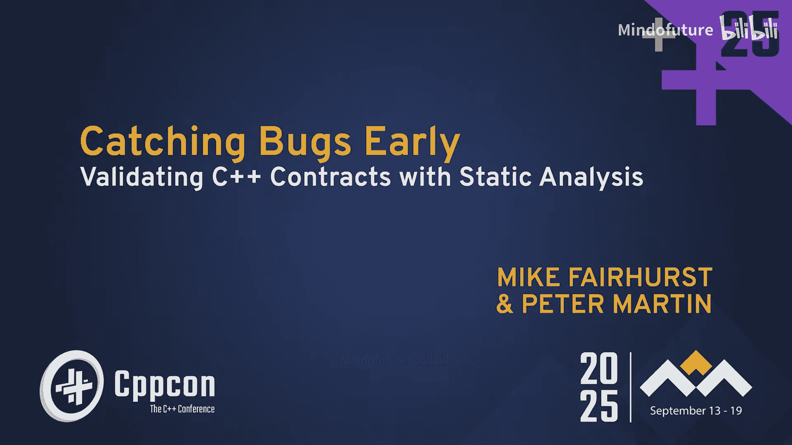

My name is Peter Martin， I'm here from Bloomberg with me is Mike Fairhurst， who's here from GitHub。

 we're here to talk about a project that we've been collaborating on。

 and that is validation of C+ plus contracts with static analysis。

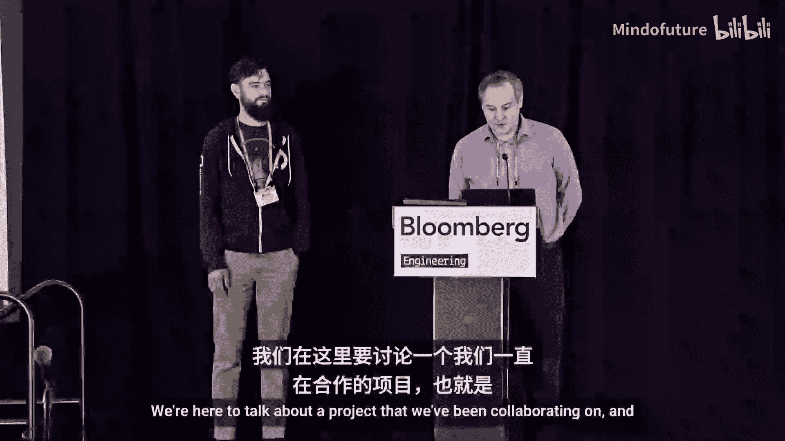

Or in other words， can we make use of the contracts's features in C plus plus 26。

To find bugs in programs before they even run。So here's what we plan to cover。

I'll give a quick introduction to C++ 26 contracts and our motivation for the project。

Mike will go over some tools and techniques we've been using for static analysis of contracts。

 and that will include deep dives on two tools， code Q， L and Z 3。

I'll talk through an initial evaluation。 We ran using these techniques internally at Bloomberg。

And finally， Mike will go over some future plans。And hopefully。

 we'll have some time for questions at the end。 But if not， we can take those to the hallway。

A quick about me， and I'll let Mike introduce himself when he takes over。As I said。

 I work at Bloomberg and specifically in our product security group。

And my team specializes in large scale code analysis。I've been at Blinomberg for about 18 years now。

 working in various different teams across our engineering， C， TO and CA departments。

And in recent years， I've had a focus on software security。

So because we're going to be focusing a fair bit on C plus plus contracts in this talk。

 I wanted to start with a bit of background to catch anyone up who may not be aware of this feature。

That said， we realized there have been several other talks at this conference on contracts。

 including excellent talks by Habsta and John Lekos， and so we'll try to keep this section speedy。

So what are C plus+ contracts， The introduction of contracts in C plus plus 26 gives us some new language keywords that allow us to specify a contract on a function。

These effectively give us a way to encode what we expect to be true at API boundaries。

 both when a function is called and what can be expected to be true when it returns。

So these are intended to help us surface misuse of functions。And specifically。

 you'll see these pre and post keywords that can be used on function declarations to specify preconditions and post conditionsition。

Preconditions set out the requirements about what must be true for a call to the function to be considered in contract。

Post conditions set out what we can expect to be true at the point it returns normally。And finally。

 contract As gives us a way to perform contract checks within the body of functions。

So just to illustrate this with some examples。 here you can see the use of the pre and post keywords。

 sorry if it's a little blur。And you'll see these on the function declarations。

 So in the case of divide， the contract here is that B cannot be 0， which avoids division by 0。

In the case of a， you'll see the use of the post condition syntax for naming a return value。

 So here we name the return value R， and we specified that the return value has to be greater than or equal to 0。

There are some other key things to know about contracts。

 but these are slightly less relevant to our talk。 So I'm going to gloss over them in the interest of time。

 but a key takeaway from this slide is that their behavior is highly configurable。

 you can decide whether or not checks are even done。

 Well exactly what happens when a contract is violated。

 and this can be chosen at build time through compiler flags or at runtime。

So given the existence of this new language feature。A logical next question is。

 can we use it to identify cases based on the code alone where calls are being made out of contract。

So if feasible， we'd like to find these kinds of bugs as early as possible without even running the program。

If we can find these kinds of bugs in a testing phase or in C ICD processes。

 that's much nicer than waiting for a contract violation at runtime。

Maybe there's a contract violation that's lurking in a rarely hit code path， for example。

 or maybe for some reason， contract checks are turned off at run time。 So in these cases。

 we can still potentially reason。About whether their conditions would be be met with static analysis。

We can't， though， clearly， say completely comprehensively whether all contract assertions will be true or false at runtime。

Because these are Boolean expressions。 And in some cases。

 those can depend on state that will only be knowable at runtime。However。

 we should be able to reason about this in at least a subset of cases。And if we can do that。

 hopefully we can catch at least some bugs ahead of time。

So we were interested to explore this topic in general GitHub have a tool for customizable static analysis called CodeQL。

 and this seemed like it would be a promising building block for analysis like this so we decided to make this question the subject of a collaboration project。

Mike is going to go into more detail on code Q L and the approach that we used to achieve this。

Before I hand over to Mike， though， I just wanted to mention some acknowledgecknowgments because while Mike and I are up here talking。

 this project has had contributions from several others。 and notably。

 the analysis method we're going to be talking about and the initial POC of it came from John Singleton now of Microsoft and several others。

 both at Gitthub and Bloomberg assisted on this project over time。

 and including Luke Carti from the GitHub side and from the Bloomberg side。

 Julian Vanneg and Joshua Byne。Now， I'll hand over to Mike to talk through the analysis method。

Hi everybody。 My name is Mike Fairhurst。 I work at GitHub。 I'm a senior code Q analysis。

 Code QL analysis engineer in the GitHub Exper Services division。

 so we work on custom solutions for our customers。😊。

My background is in languages and and type checking， static analysis，ve previously made。

A statically type language， with type inference。 And I've previously also made a just in time compiled language。

And that's kind of why Coqui is so interesting to me。I also have an auto insurance policy。

 but unfortunately， that can't be checked with static analysis。

 So we'll have to have to move on to what we can。

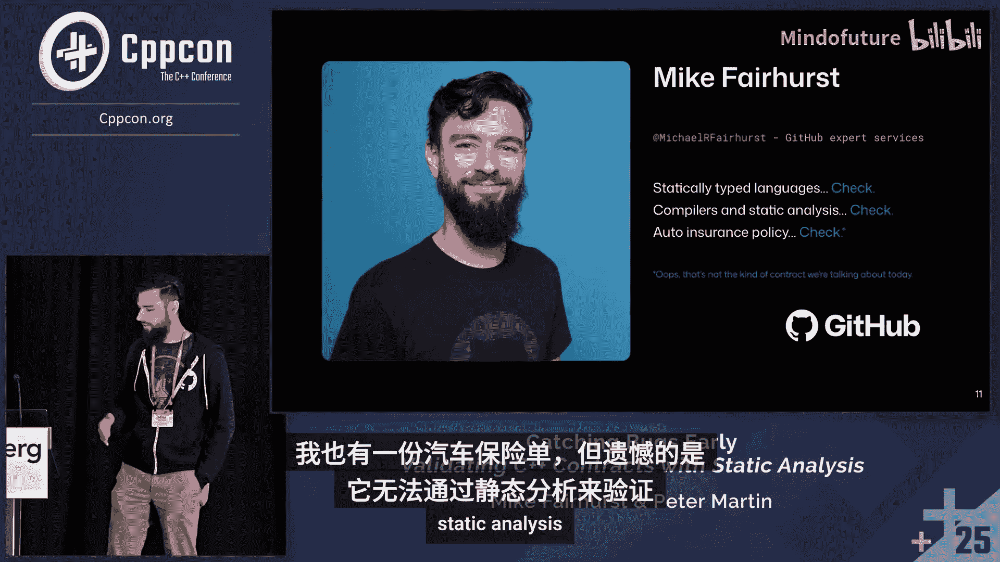

So if we look at a particular case where we have some， some function called format hour。

 this is going to have a contract saying that the hour that we're formatting should be a valid hour。

 so it should be between 0 and 23。We can clearly see that there will be cases that are trivial to analyze that this。

 this constant value 1 is definitely within the contract and that this is this is valid。

And we clearly will have cases where the contract is maybe not likely cases。 But in theory。

 if we see code like this， we can trivially analyze and see the 24 is outside of this range。

And we can report an issue here。One thing I would like to note is that just because a code path。

 just because a anvocation of a function clearly violates its contract。

Doesn't mean that it's never going to happen。 It is definitely possible that there is code that is essentially like this in disguise out there in real systems。

 where a branch is extremely unlikely to be taken。 And in that， in that path。

 contract will actually always fail。 And so this is something where if at a minimum。

 we can find these cases， then we've already done something。

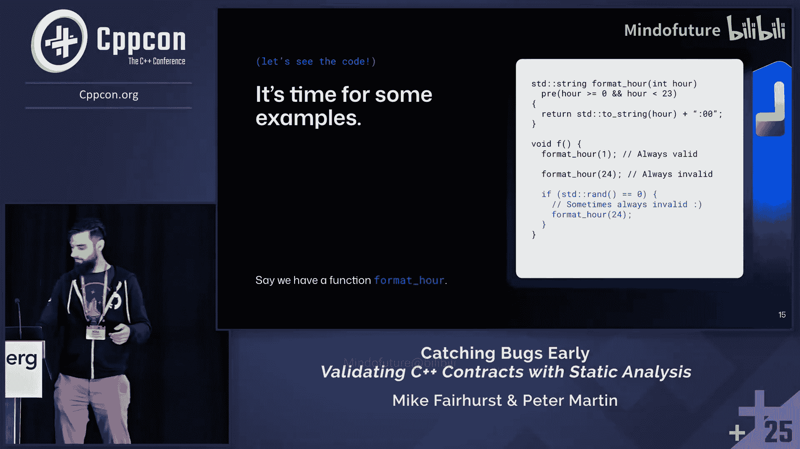

But we know that the real world is more complicated than integer constantss。

So this is an example where we have a command line tool。

 This executable reads the command line argument。 It pars it to an integer。

 and it calls the format hour function with that integer。If I pose to this room。

 do we know if this function will be violate the contract or not。

 The real answer is that we actually， we don't know。 We don't have enough context。 It's of course。

 if we deliver this as a command line executable to our users。

 then we should really expect that eventually someone is going to type in the value 24。

 and and in that case， we would violate the contract。But we don't know where it's being deployed。

 It could be deployed as an internal tool in being used by another internal tool where the range of values actually will always be。

 will always be valid。 So the answer of whether this will violate the contract is。

 is really that we just don't know because we don't have enough context。

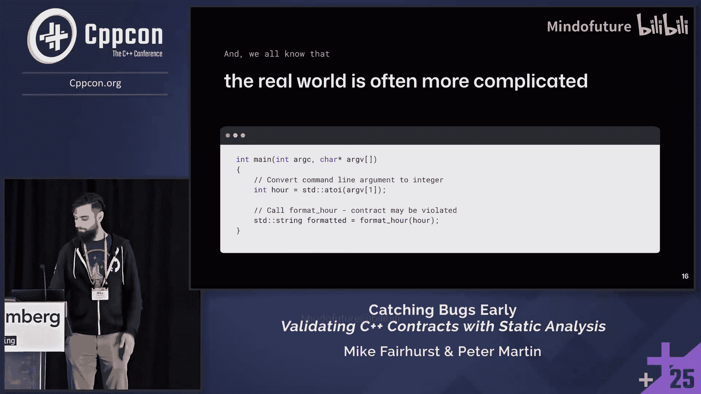

But nonetheless， I think we would all agree that this is a better version of the previous code。

Those of you who have watched the other contracts talks by， for instance， John and herb。

 will have seen that I'm talking about how contracts are not intended to be a primary workflow you're not intended to be your primary source of bound checking。

 So even if this command line tool is currently deployed to a program that inside of a setting where it will never violate a contract。

 we probably do want to insert this check in case that changes in the future。

 and by adding a check like this static analysis tools can see that we have a check like this and we can say we can categorize this differently。

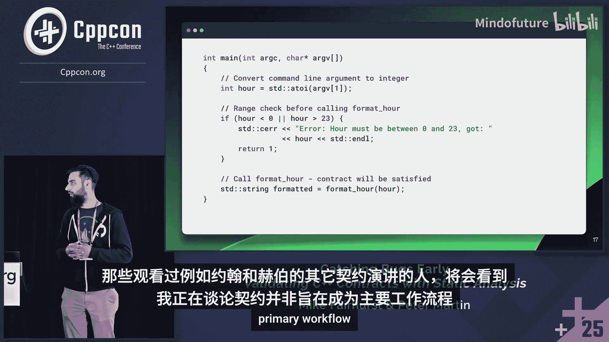

And。Why， why we would want to catch these things in general。

 Why would want an analysis tool to look at all these paths。

Analyze what values are flowing where and which may violate a contract。

 Many of us have seen this before that there have been studies done that show the relative costs of discovering a bug early versus discovering it in production。

 and it is far， far more expensive to discover a bug in production。

 whether it's a security vulnerability or a bug your users have stumbled across。

And so this is something where we do want to push left。

 We want to find this bug earlier where it's cheaper， such as in your C， ICD。

We can find many of these bugs by turning on contract assertions and by running our program。

 We may find this via unit tests in our C ICD。 We may find this via fuzz testing in our C， ICD。😊。

But it's worth noting that unit tests only explore the interesting possibilities of inputs that we chose to to write by hand。

 And then the fuzz testing can only explore certain paths with， with likelihood of success。

So there will always be branches of the code， possible inputs。

 the two interesting things in your code that a fuzz tester won't find that your unit test won't find。

 and the static analysis is very good at exploring all reachable code。

 and the static analysis is the right tool to find these cases。

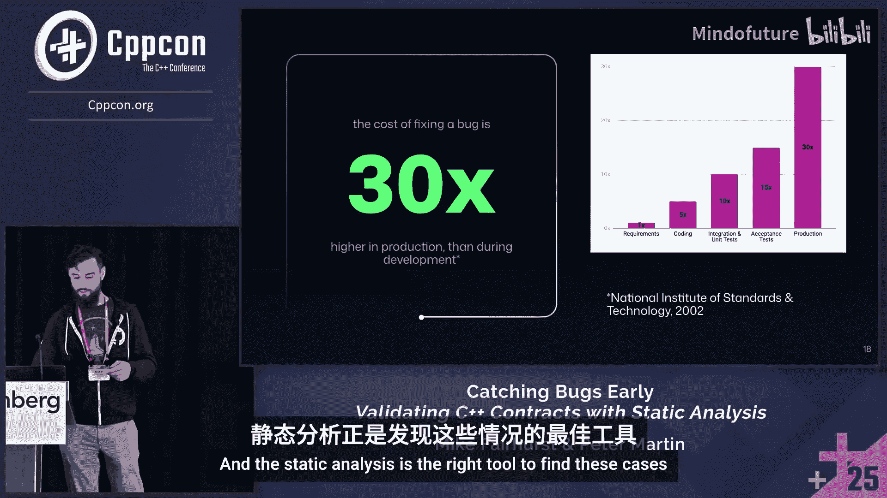

So， so what what cases， What are the cases that we can try to analyze。

 There are cases that we can always verify， such as we saw earlier。

 where it's very trivial to verify。There are cases that require context that we simply don't have。

 These cases will always be a challenge for these tools。

Where we're really interested is in this third case。

 we wanted to find out how many cases we can infer by applying sufficient deductive reasoning around the code in order to highlight particular places where we believe there's a strong likelihood that a violation is really truly possible。

As a quick note， I will say this is we are not pursuing formal verification。

 formalal verification is used in very safety critical software systems to guarantee correctness。

 We are not interested in guaranteeing correctness and with all the difficulties that come with that。

 We're really just interested in finding some bugs。 If we can find one bug that's better than none。

So at Gitthub， our tool of choice fors static analysis is called CodeQa。

Code Q L offers default aqueries for CN C plus plus and other languages。

 These cover known security vulnerabilities such as SQ L injection， buffer overflow。

 these kinds of things。We also have some quality queries。

 Some of the default queries will cover you know， common bugs。

 but we also have support for coding standards like autos search C plus+。

 I'm also currently working on the mis C plus+ 2023 rules set。 that will be hopefully done soon， Ih。

 we also have support in general with Co UL to write fully custom queries of whatever you want。

And when you're writing a code Q query， when we're writing our default queries。

 this is the sort of information that we have available for our stack analysis。

 We have the type information in your program。 So we know all the classes you defined。

 all thestructs。We know the types of all of your variables。 We know the members of all your classes。

 etc ceter。 We also have the full syntax tree。 So we have every operator。

 we have the opera ends to every operator， and we also know how you've structured your program in terms of if conditions and loops。

Which brings us to the control flow graph。 The control flow graph actually knows how code is reachable from which conditions We can see where your code will loop。

 where your code will have early exits for a function and things like that。😊。

And then we have the call graph， importantly， for analyzing C plus plus。 overload resolution is very。

 very difficult。 It's， it's a complicated algorithm， complicated process。

 It doesn't always do what developers might expect。

 And sometimes it's hidden in things like operator overloading。

So when you go to write a query with code Q L， all of that has been already resolved for you。

 You know， all of the call sites to every function in every operator overload， which is。

 which is very important。This is overall how codeQl works。 In the upper left， we have your code base。

 your build system and your build artifacts。 And this is what you already have today。

CoQL adds an extractor。 You can barely see the arrows here。 apologize there。

C file is an extractor that can that can observe one of your builds。 And when it observes your build。

 it traces all of the the compile flags， as well as all of the。

 all of the compiled files and all the flags in those commands。From that。

 we can plug in our own system where we extract all of the expressions， all the statements。

 everything that we。Basically， every fact about your code that we can aggregate， we do aggregate。

 And we put that into a database。 It is a read。 It is a right once read many times database。

 Once we've created the database， it's finalized and it's read only。

So then you can write queries in the upper right。 And your query gets to pull in a bunch of standard libraries that are also written in Q。

 L， the query language。And together with your query in the standard libraries。

 it can be compiled into a highly optimized form in order to run very efficient searches over this database and produce your results。

但是我。This is what Cojoall looks like in 100 characters or less。At the top line。

 we have this import CPP that imports the Q Q L standard modeling of C plus+ programs。

And then we have what looks much like like an S QL statement。

 So we can select function calls and functions。 We look over the set of all function calls and the set of all functions。

 and we correlate the two together so that the function should be the target of the function call。😊。

From there， we select the function call and the function。 And， if you run this in V S code。

 you'll see these two columns of results on the left。

 we have a clickable link to every function call。 And on the right。

 we have a clickable link to the function that it's calling。But code Q L isn't just a query language。

 It's actually a very rich language。 And it has。 It has standard libraries。

 and you can write your own libraries。Essentially， Co Q L operates on the facts about your program。

 and you have the ability to write new facts about your program。 These much look much like functions。

 We call them predicates， and they don't return a value。 They're just a logical statement。

So in this example， we can declare a fact that describes which， which expressions are negated。

It isn't super important that everybody here understands exactly how this works and leaves this talk being able to write codeq L。

 But I did want to give an overview of how codeQ is a rich language。And on that note。

 it supports object oriented programming as well， which may seem interesting for a query language to support object oriented programming。

But the way that it works in essence is that we use object oriented programming to constrain the set of types that value the set of data that that matches something。

 So here we are able to make a negated expression， which represents the set of all expressions that are negated。

This filters down the set to what we want to talk about here。

 specifically when we're writing code related to negated expressions。

 And now that we've filtered down this big set into this smaller set， we can actually write behavior。

 which looks much like member functions。 And we can write this behavior that's specific to the constrained set of data。

 So once again， nobody here is going to be a codeQl expert just from seeing you know。

100 slides and 10100 characters or last code Ql plus this。

 But I wanted to give an overview of how rich code Ql really is。

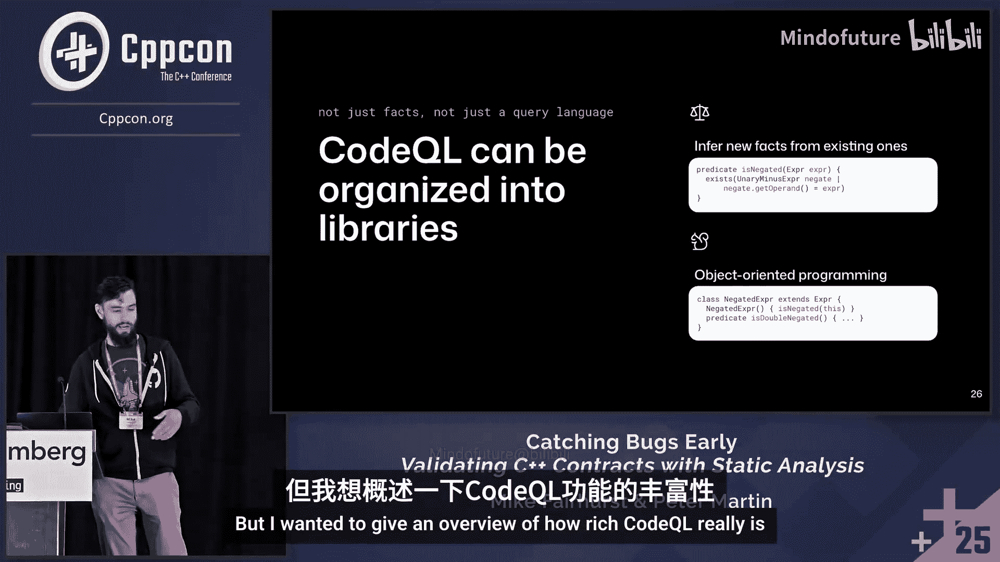

And it's time to go back to contract specifiers。 So contract specifiers， we remember。

 we have preconditions to constrain the function inputs。

 We have post conditions to constrain the function results。

 And then we have contract assertions that are in line in the function body。

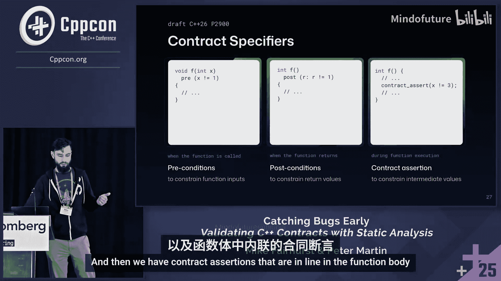

And we should also talk about what contract specifiers can and cannot do。

This is going to deeply affect how we perform our static analysis。

One critical safety feature of the way that contracts are designed is that when you refer to a variable inside of a contract。

 it's going to be constified。 It's going to be implicitly consed。

 You will not be able to mutate values that were declared outside of the contract。

This is very important because contracts should ideally not have side effects。

But there are two things here I want to call out that make that make static analysis of contracts fairly difficult in some cases。

 in inside of contracts， you can call functions。 You can call functions of arbitrary complexity。

 You can really do whatever you want inside of a contract。 It's incredibly flexible， which is great。

 But， of course， at the limits。😊，Creates problem for analysis。On that note。

 when were when we're calling functions， we can do all sorts of things like we can have side effects like like allocating memory。

 We should not have side effects that affect our program in any sort of meaningful way that we can't turn these contracts off and get the same essential behavior。

But it is possible。 And， of course， if we're allocating memory。

 that becomes a difficult thing for static analysis to track how that memory is allocated and mutated and passed around。

And you can absolutely have undefined behavior in your contracts。 That is absolutely possible。

 as well。Luckily for us， we already give and coach you all many queries that are aimed at detecting undefined behavior。

 But yeah， but if， if there's undefined behavior， we can't detect with those rules。

 then we are essentially you know， in， in troublesome waters。 And that's， that's just how it works。

So this is an example how it might look。 So we have a pre precondition that's invalid here。

 We take the parameter X， and we we attempt to increment it inside of the precondition。

 and that's not allowed because of constification。Next。

 we have an extremely inadvisable contract that I don't recommend anybody add to their program。

 We're doing all of the naughtty things I described。

 So we are going to call arbitrarily complicated functions。 We're going to allocate memory。

 and we're going to have undefined behavior as well。😊，Lastly。

 we have an example of how post conditions also have constification。

 If this R captures the return value of F， no， we can't change the return value。

So with all of the complexity that's allowed in contracts。

 it really may seem like static analysis tools just aren't applicable here。

 that this just isn't a problem amenable static analysis。

And we certainly know that there will be contracts out there that are written in this way where that's absolutely true。

But we still believe that we want to pursue all of the cases where we know that these。

 these additional optional things， these very flexible features such as arbitrary function calls。

 We know these won't always be used。 And so those are the cases we want to explore。

And when developing static analysis， there's kind of two camps。On the right here， we have the。

 the camp of what formal verification sort of provides。 or sorry， is it on the， is it on the right。

 Yes， on the right。So this is where we we write a static analysis tool because we want to guarantee that something is correct。

 This is something where static analysis is very strict。

 and we might be okay if some of our reports are false positives。

 have reports that don't actually indicate any real problem in the code because we want to know that if there's no reports that our code works correctly。

Most of us tend to actually live on the left。Most developers really really prefer living on the left。

Here， we as developers have a lot of jobs we want to do。

 We really don't want our static analysis tools to be noisy。

 We really want the static static analysis tools to have some trust that I know what I'm doing。

 and we really want it to be the case that when we get a result。

 that that result is a true positive detection， that it really is a real problem that we need to address。

 we're okay missing some examples， not finding every bug。

 but we really just want to make sure that when we do see an alert that it's a real result that we can address。

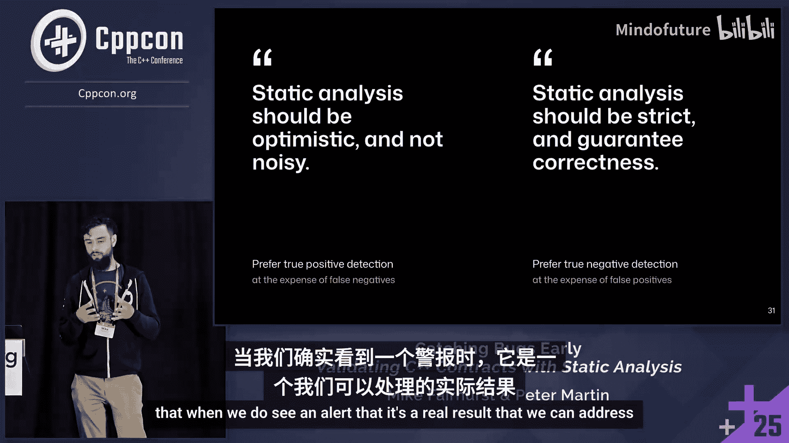

So our modeling has taken on these three aspects of， of contracts。

 So we support integer range analysis。 We've， we've taken a look at integer range analysis where this this loop creates an integer that's outside the range of the contract。

We also support nulldy analysis， tracking， yeah， which， which pointers may may or may not be null。

 And we sometimes have assertions that a pointer must be null。 Sometimes pointer must not be null。

We also have some support as well baked in for object field analysis。 So in this example。

 we have some classstruct C that that has a member X。Inside the contract of F。

 we actually constrain what that member X of the argument should be。

 and we do have support for identifying a violation such as this one， where inside the body of G。

 we set X to an invalid value if we're going to pass， pass C into into F。

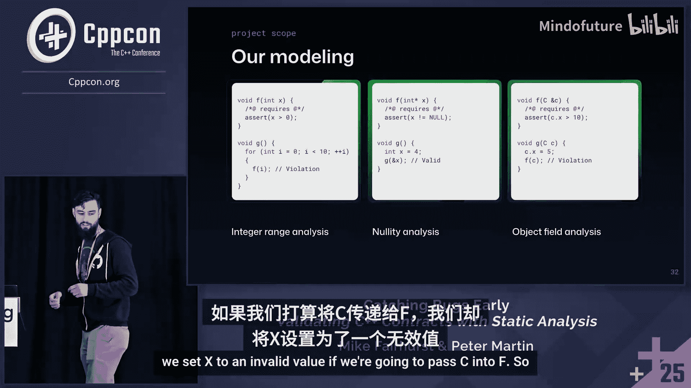

So we're going to focus on integer range analysis in this talk。

How do we take these particular examples， We have a function on the left。

 and we have a call site on the right。 How do we， how do we validate this inside of code Q L。

Luckily for us， Code Q L comes with a standard library that has standard predicates for finding the lower bound and the upper bound of an expression in your C++ program。

This is an example。 This is results from the Linux kernel of what that looks like。

And then we can find， in this case， we're going to look at assertions。

 We can write a predicate such as this that we can use in our queries to find find a contract range。

So here， what we're doing is we're looking for macroins where they're named Asert。

We then check to see that there is a comparison operator that is generated by that macro。

And then we check to see that the left hand side of that comparison operator is an access of the parameter。

We then can see what the operator itself is could be greater than equal， less than etctera。

And then we check on the right side that we have a we， we take the constant value of the right hand。

 assuming that it's assuming that it's a constant。 This is one way that we can write sort of a query。

 a predicate to extract information about an assertion of。

Of a parameter being within a certain range。But can we handle cases like these？

So this is the first example we have here。 We're going to assert that the base and the power cannot be null at the same time。

 It cannot be 0 at the same time。 We also have an assertion that if the month is February。

 the day is to be less than or equal to 28。We've also seen cases of where nulldy analysis and energyteger range analysis are are combined into one contract。

 We've seen that before。And then we have cases where the range of one parameter maybe depends upon the range of another parameter。

So in order to solve this problem， we have decided to bring in Z3。

You may have have heard of Z3 or may not。 It is a theorem prover。

 or you may referred to as a constraint solver。 It's an open source project by Microsoft with a friendly open source license。

 It's very fast。 and it's yeah designed to， to optimize logical constraints。

Z 3 operates on a language called S M T。 There are many S T solvers。

 Z 3 is is one of them and one of the most popular。Inside of SMT， we can define。

 you might think of them as variables。 their constants。 we have X and y。

 and then we constrain x and y with this assertion。 we constrain x。

 we add a constraint that x times x is equal to y times 3。

Then we have additional commands that we can use in ST。

 We can we have this command check satisifiability。

 where will we'll check if there's a way to solve this theory to prove this theory。

 And then we also have an option to gi model。 And this actually describes the proof that that Z3 has found。

So you can see below here we have the Z3 output。 It's going to tell us that the the theory is satisfied。

 and it's going to tell us that it thinks that y is 3 and X x is negative 3。

 This is one solution to those constraints。Here is a real geometry problem that my。

 my manager sent out to our team on a Friday for fun two weeks ago。 And I thought， well， I got。

 I got to solve this with Z 3 since I'm working on these slides。😊，So here we have assertions that。

 first of all， we have some setup code and some defining functions and things like that。 but。

 but importantly， we constrain that the yellow area， as far as we know， is three。 the red areas is 2。

 the green area is 4。We have additional constraints。

The the total height of the square is the total height of the red area and that the total width of the square is the width of the red area。

 plus the width of the yellow area， etc cea。And then we add a constraint that the。

 the areas of the red， yellow， blue， green triangles added together must equal the total area。

And when we run this with with Z 3， it instantly finds a solution for us where it tells us that the blue area has an area of 7。

 And we can see， in addition， the area of the the height and width of all of the triangles and the overall square。

And you might be asking yourself， well， but if code Ql is a logical query language that solves logical constraints。

And Z 3 is a proof solver that takes logical constraints and finds a solution。 Why。

 why would a codeQl query need to use Z 3。And there's really two reasons for it。

So one is that if we wanted to use the code Q L engine in order to solve the constraints that were laid out in your contract。

 we would really need something like Eow， or we'd need to have a code Ql query that generates a code Ql query that checks your code or something like that。

This isn't possible in code Q L。 But by using Z 3， we do have the ability to have a codequel query that generates S T statements。

 passes that into into Z 3 to sort of act like an eval step。The other reason why we use Z 3。

Is that Z3 and CoQl are solving different problems。 Coachl is a query language。

 If I specify a particular set of constraints， I want to find every solution to those constraints。

As opposed to Z3， Z3 is optimized to find one solution or one counter example。

 It needs to find some proof， not every proof or some counterproof。So overall。

 this leads it to being that Z3 is solving a subset of what code Q L solves in in a certain sense here。

 And if you can just find that one solution a lot faster than than code Q L would find all solutions。

So overall， this is our process。 We have this function F that specifies a contract。

 and that gets translated into this ST。 We create a constant named X after the parameter。

 We define the precondition。There may be more than one precondition。We also then take this culsate。

 we can find instead of G that there's a call to F of y。

 and we can then take the range of y using standard coQl range analysis。

 and we can generate constraints on top of the parameter X that it must be within this range。

These two bits of， these two blocks of SMT get concatenated together。 And then we go into the lower。

 the lower left corner。This is a， a final section that we add。

 And we're essentially going to assert a theory that one of the preconditions fails。We。

 we want to find an example that would show that the contracts will be asserted。

 will be will be violated。So we our theory is that someone is going to violate the contract。

 It is possible to violate the contract。 We just don't necessarily know how。

 So that that is why we assert。That not all of these succeed。 We assert that one fails。

When we run this into Z 3， it gives us an output like this。

 It tells us that our contract can fail because the value of x might be 0。

 which violates the precondition。Overall， this is sort of what we've modeled。

 mostly the mathematical concepts because they're easier。 We have additions oftraction。

 boolean range Boolean logic fully supported。 multiplication is slightly harder to do range analysis for。

 but we have some support for that division is not supported well in the standard range analysis。

 but it is mostly well supported inside of Z3 with the exception of that it will define divided by zero for you So you have to be tricky there。

 And then we have other cases such as bitwise operators where we have support for a lot of what not perfect support。

 but weve we've done mostly what we can to support bitwise operators in range analysis。

 but we haven't implemented that in Z3 yet。 And then we have like function calls or arrays and D refs that we haven't handled。

😊，And with that， I will pass it back to Peter to talk about our evaluation。Thank you very much。

 Blake。So Mike has outlined the key elements that we needed for this approach。 And to recap。

 this was our rough plan。 So we take a program that we want to analyze。

 We'd build a codeQl database out of it。And then we plan to use the range analysis features。

 as Mike described， with called Qlta reason about the possible values that variables can hold at a call site to a function with a contract。

We can also using code Q L， extract the preconditions， the。

 the contract of the function that's being called。 And then for each core site。

We'll be combining those two things into an SM T formula as input to Z 3。

 And Z3 can tell us whether they're compatible。 And if they're not， it can give us a counter example。

So we had seen this approach work on some toy examples。

 but we were interested to see what it scale to real programs。Something you might be wondering。

 though， is， how can we evaluate this on real programs when C plus plus 26 contracts syntax。

 it's not in popular use yet。 So in particular， there's limited compiler support for for contracts at this point。

 And that includes the compiler frontend that code Q L uses when it's building a database out of your code。

So we needed some way to test this technique against real code。

 But where the contracts are not specified using the C++ 26 syntax。Thankfully。

 we had an answer to this in the form of B， D， E。😊，So some of you may be familiar with B DE。

 it's Bloomberg set of foundational C plus plus libraries， and these are open source。

 You can find them at Github dot com forward s Bloomberg， forward slash B DE。And。

The reason I mentioned B D E is that there are some existing conventions in B D E library code that happen to be quite similar to the contracts features And this allowed us to test some of the same techniques。

 but even in the absence of the new language features。So one useful convention in B。

 D E library code is that a rigorous approach has been taken to documentation and specifically function level documentation in this case。

 and one phrase that you'll see in B D E code very commonly is in a comment above a function declaration and which gets translated to a doxgen doc。

 behavior is undefined unless。So this does effectively set out preconditions in in human readable form。

 It's a plain language contract。But， yeah， it's human readable。

 It It's not in a form a compiler or static analysis tool will understand。Even more usefully， though。

 another convention in B， D E code is to validate those preconditions at the beginning of function implementations。

 And this is done using a family of asserts， assert macros called B， S， L S Aser。😊。

So these As macros are also provided by BDE， and again they have some similarity to the C++ 26 contracts features in that build flags can determine whether or not these assetss are used at runtime。

And you also get the flexibility to define custom assert handlers to， to be invoked when。

 when your assertions fail。So for the purposes of our evaluation。

 we focused on inferring contracts from these B SL S assert statements in function implementations。

And we've done this in a way that can be expanded to support the official language syntax in future。

 when that's available。对。This did， however， present us with a minor logistical challenge。 So。

 as I was saying， we wanted to extract contracts from these B S L S assert statements。

In a typical program calling into functions in library code， it will only have the headers for。

 for the library。 It， It won't have the dot CP， P， P files for that library。And code Q L。

 when it's building a database from your program， it sees what the compiler would see。 So sadly。

 in in our case， it meant that these B S L S assert statements。

 at least the ones in the dot C P P files of the library are somewhat off the radar for analysis。

 Incidentally， we won't have this problem with C plus plus 26 as contracts。 because if you remember。

Pre and post are are specified on the function declaration in the header。 So in， in that case。

 the program under analysis will have the contract in its， in its source code。嗯。In the meantime。

 though， we needed a way to deal with this。 So we had a couple of options at our disposal。

The first option was for every program we wanted to analyze。

 we'd have to run a full dependency build when we're building the database out of it。

 That is build the program from source and its library dependencies from source。And that would work。

 but it would be a little bit awkward。 And in particular。

 it would mean tinkering with the build for every program we wanted to analyze。 But secondly。

 it would be a little bit wasteful in terms of compute。

 say there's many programs calling into one library。

 We'd have to be building that library dependency again and again。So we have the second option。

Which was to run a one off analysis of a library that many programs are calling into。

And summarize its contracts， effectively export those contracts and have them supplied at analysis time when we're analyzingna a program that calls into that library。

So we ended up going with the second option， which seemed a little bit more flexible。

 It does add a little bit more complexity to our to our approach。

 But we now have this concept of a spec database。And this spec database can contribute at analysis time containing the contracts for a library that the program will be calling into。

And if you remember Mike's slides from earlier， he showed Co Q L translating the contract on a function into SM T form。

 And that's， that's what this spec database holds。So onto our evaluation。

 we needed to select a target set of functions to extract contracts for。

And we decided to trial this on B， D， E's date functionality， in particular。

The thought here was that these functions and their contracts would be quite amenable to analysis。

 And in particular， that's because our grammar was somewhat limited in what it could support。

 And the thought was these date functions in their contracts would be dealing largely in a subset of of grammar that we could support。

 So in particular， that is simple arithmetical and logical expressions。

 And contracts that deal in numeric and Boolean types。

So we used a combination of internal Bomberg package metadata and source code search to find 6000 projects that were making calls into B。

 D E's date functions。And of those， we decided to prioritize ASap for analysis。

 So we picked the top 1% of those and we were going for breadth of functions called here。

 So we wanted to find a smaller number of databases to analyze。

 But where we were still covering lots of contracts。

And after restricting to the grammar that we could support。

 that LED us to around a third of the functions in the date library whose contracts we could support。

 And at the end of this， around 3000 call sites。So here are the overall results。

 and there are a lot of caveats to mention here。 So this was a relatively small sample size。

 and it was on some code that we believed would be amenable to this kind of analysis and only supporting a simple simpler subset of its contracts。

Of course， we do want to rerun this kind of analysis on many more programs。

 wide variety of targets in future。It did show， though。

 that the basic approach can work and can scale to real programs。So for the roughly 3000 core sites。

 we showed that we could validate。Statically， that 95% of the calls analyzed would be in contract。

5% could not be validated。 And I want to stress here that that doesn't mean there's a bug in these cases。

So in fact， of those that we triaged， it was simply that they couldn't be reasoned about by code QL's range analysis。

 And potentially that could be because the code， the code at the core site or the values of those variables may depend on runtime state state that would only be knowable at runtime or otherwise couldn't be reasoned about by code Ql's range analysis。

 And in those cases， you get a maximal range back。 So int min to int max。In future。

 we'd like to do more to automatically categorize those cases that we can't validate。And yeah。

 lastly， on average， and this isn't a very scientific statistic。 It took around 24 milliseconds for。

 for a check for each call site。 this was just on a modestly speced task machine。

 But the reason I mention it is just to show that this this kind of approach can。

 it can work and it be done， can be done reasonably quickly。

Before I hand back to Mike to talk about future plans， One last note。

 which is that we did test this on some injections， intentional injections of intentional bugs。

To make sure that we can successfully find those bugs with our analysis。 So to do this。

 we took a case that the analysis was already validating as in contract。 And if you can see here。

 there's a call to set second。 and it's not shown on the slide， but there's a contract on set second。

 that its the seconds that are passed in should be greater than or equal to 0。

And if you can just about see the code on the right。

 we have a couple of test cases here where we've made that those seconds negative。

 In the top example， it's assigned to in a conditional path。 In the bottom example。

 it becomes negative after some iterations of a loop。

So the good news is that range analysis did successfully track both of these cases and the overall analysis detected the resulting call as a contract violation as a result。

😊，And now， hand back to Mike to talk about progress matancy evaluation and some future plans。Alright。

 So we， we really identified that there were two cases that were leading to the most false positives。

So the first case here was just， as Peter said， unconstrained ranges。

 these were going to be expressions where code Q L's range analysis didn't have any range that it could give。

 And so it gave from intman to int max。Specifically。

 code call standard range analysis is a does not model interprocedural analysis。

 So that means that if another function is a certain range calls this function，' we don't track that。

 there's reasons why， for instance， we don't know if we can see every color to F so its sort of a closed world versus open world assumption。

 anyway， so there' there's some design principles that you can argue about in terms of how this should be modeled。

 but but either way， there's not currently interprocedural range analysis。

 And so we don't have a constraint on the range of x before it's passed into G。

 That means that if G makes really any assertion about X。

 then it will always it will always be raised as a potential violation。

 which in some cases we can look at that and see that that doesn't seem to be likely。

And as a developer， if you were to see a report like this。

 maybe you would be to fix it tempted to fix it by adding something like this。

 if the function F calls the function G， then that means that the contract4G really does apply to X。

 you might call this contract forwarding。 we want to take the contract from G and specify it here as well。

And what we noticed was that standard code curl range analysis didn't detect this and didn't didn't constrain the range of x before the function call。

And it turns out that the reason why it didn't work is because， as Peter had said。

 B S L S assertert calls into function a custom violation handler。

 And so essentially the G of X call is reachable regardless of whether this condition is tripped or not。

 the conditional handler violation handler is not guaranteed to take an early exit。

 And if it doesn't exit， then G will eventually be called with any value of X。

 So this is something that we were able to easily easily extend standard range analysis to handle these kinds of cases and limit down the range。

In terms of the first example， how we might solve this。

 it's worth talking about how code Ql performs range analysis。

So codeki performs range analysis by taking your program and turning it into what's called static single assignment form。

Those of you who have taken compilers classes have probably heard of this。

So essentially what we're going to do is we're going to take a language where a variable can be reassigned and we're going to modify it into a new variant of that language where there is no reassignment allowed。

 So this variable x first， it starts at a0。 and then we plus equal per m。

 The way that we're gonna model that in SSA is that we actually create an x0。

 that takes the initial value。 We create an x1 that takes the additive value。 And then lastly。

 we have x x2， which is what's called a p node。 And this basically a phi node represents that we may have a value from one variable or another variable。

 depending on how we got there。 It's really like a merge point in your program。

 and we can take a sort of an or of these two things。 So you can see it's slightly special。

 and that's why it has a special name。😊，The way that code Q L is going to then use this static single assignment form of your。

 of your program is it can say that each。Each variable in this program has exactly one value because it is not reassigned。

 It has exactly one value。 And that's part of why we have Para 1 inside the if condition。

 we create this extra Para 1 value。 And that's because Para1 has a different range of possibilities than parameter 0。

Once we have these variables， we can track the dependencies between the variables。

 what calculations are performed on them in that dependency。

 and we can iterate over this graph of calculations in order to reach until we reach a fixed point where every variable has an assigned lower and upper bound。

So when we think about this problem of how sometimes CoachQL just doesn't have a good enough range analysis and we want to maybe categorize these this stuff differently。

 This is what we came up with。 So we added what we call Pros。

 lower bound and upper bound provides to the range analysis。

 So a providence is going to represent what approach CoachQL took in order to come up with a range。

And then we can filter these， these different provides into different confidence categories。

So we have this per Ram 0。 and this is what I talked about initially， right。

 CodeQl doesn't currently have interprocedural range analysis。

 We didn't add code Q interprocedural range analysis to code Q L。And so currently。

 this is just it is going to assume the widest possible range based on the type of PRm0 from intmin to int maxax。

 And this is going to be a very low confidence。 If we find that the violation of a contract involved a range analysis that had this very low confidence。

 then we can say that the overall report that that contract may be violated is also low confidence。

Then we have here in this next example。 we have a bounded provideance。

 So this is going to be the parameterm1 variable has a bounded provennce because it is a constraint of。

 of this type range value。 and we actually do track that。 We track that it's a bounded type range。

 We we track how these things relate with each other as， as the analysis goes on。

So it's worth noting that this isn't a extremely high confidence just because we've bounded it to less than 10。

 because it may be sort of a catastrophic value that that may never happen or maybe yeah。

 maybe it's unlikely， but maybe it's literally never going to happen。

 and this would basically I would summarize this by saying。

 just because we checked that Para 0 is less than 10 doesn't mean that we know that Para 0 will ever hold the value 9。

So it's just a medium confidence。 That's gonna to be the upper round of parameter1 is， is 9。

 and it's just a medium confidence。Lastly， we have， we have loop conditions。

And you may have wondered how loops are handled inside of SSA。

 given that we have a static single assignment。So the way that loops are handled in SSA is that we can have recursive p nodes。

 So if we see the definition of x 1 depends upon x 2， and the definition of x 2 depends upon。

 the definition of x 1。This is why I said earlier that when we have a graph of computations between these variables。

 that we can iterate this analysis to a fixed point。

 Once we have propagated all of these computations and we've stopped updating that propagated graph of computationd values。

 or computed values。 then we're done。 And this would take potentially a large number of steps。

 So in order to speed this process up and make this analysis more tenable。

 we perform what's called widening， where we basically at every stage of analyzing a recursive phi node。

 we can round it to the nearest power of two。 So it takes log of n steps。😊。

And we can track when this has occurred to lower our our confidence in a result just a little bit。

Now we'll talk about some future work， too。First of all， our code is now open sourced。

 It's on Github。 This is the link。 Feel free to to check it out。 We。

 we are stressing that this is a proof of concept。 It's a pre releaselease。 It's。

 it's definitely not a production release。 It's still still very experimental。

 We know that we have certain bugs to fix。 We have bugs where there are missing constraints。

 There are bugs where we generate invalid ST or incorrect ST。😊，Nonetheless。

 there's a lot of cost and a lot of value to this run evaluateval and improve cycle。

 So if you take this experimental project and you run it on your code base。

 then you will be able to find and report and triage bugs and file them with us that gives us information that we can use to improve the tool we can't guarantee that we will solve those bugs but poll requests are also welcomed。

I will note as well that the， the documentation explains how these assertions are currently handled and it is customizable。

 so you can， you can add your own support for your own types of assertions in your program。

And of course， you can reach out to me if you want help with that。So lastly。

 an exploration that we're currently working on that we we're seeing what kind of results this will give us。

 If you recall the way that I described that codewell uses a static single assignment form of your function in order to create a graph of computations and forward those to come up with a range。

 this is actually something that。Conveniently， we can try to express this SM T fairly easily。

 static single assignment form is essentially a way of taking a language with mutable types。

 mutable variables and pretending that it's， it's， it's a language with immutable variables。😊，And。

 of course， that's what Z 3 is。 Z 3 has constants。So we get a very clear pathway in a lot of cases of how to translate your program directly from this SSA form into into a set of ST constraints。

 There is additional stuff we need to do around loops， but you can see， for instance。

 that we even can handle P nodes。 This x2 is equal to x0 or x1。

 We can know the condition that led to x0 versus x1 being the last value。

 and we can we can create the value of the P node correctly here。

 So this is something where we are currently in the act of exploring it。

 We will see how much this improves the results。 Essential。

 this would allow Z3 to perform range analysis for us。😊。

And potentially Z3 would perform more advanced range analysis that would cover all sorts of interesting cases。

 It could understand that there's maybe a minimum and a maximum value。

 but maybe there's some range in the middle that can't be held。

It would also potentially be able to recognize correlated ranges where。

The value of x is greater than the value of y， that kind of thing。

And then the other thing I'll say is that once we have converted a function into static single assignment form。

 things like inlineing become very easy， so we can potentially inline function calls that happen before the call site to try and see if you've initialized your variables to be within a correct state to satisfy the later contract。

Very much experimental， but we're currently seeing if this improves things too。

So the moral of the story is write contracts。R contracts that use all of the most complicated runtime assertions that you want to add。

 You will already get benefit from those in your unit tests and your fuzz testing in your production environment。

 if you turn them on。And all of that already has tremendous value。In addition to that。

 we hope that we can take your contracts as a challenge to make our tooling support your contracts。

 The tooling will only get better and better。 I'm sure we won't be the only static analysis tool that takes a look at this problem。

And we already have ideas that we're working on right now that can take it even further。So yeah。

 so write contracts。And I think with that， we are。

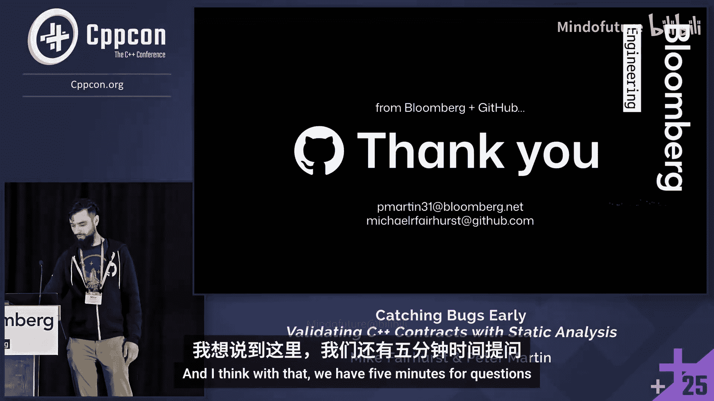

We have five minutes for questions。Thank you。 You previously mentioned 5% of that 5% it couldn't be reason about。

And you mentioned that at least some of that is because of dependence on runtime conditions。Now。

 wouldn't be。Contrary to how contracts are supposed to be used to not depend on。I mean。

 they're supposed to find bugs， right？Yeah， that's true。 I mean， that was。

 that was one of the the potential explanations here， that it was something that yeah。

 could be only known at runtime or just not reasoned about correctly by Code Q L's analysis。

 And I think it's more likely that it just couldn't be reasoned about correctly by the analysis that we have at the present time。

Yeah， I， I' at add as well。I might， I might add as well， but。

With with the addition of things like AI， it's possible that will get into a world where these noisy findings are less of a problem and where something like finding all of these cases where we can't analyze and inserting a contract assertion and asserting a runtime check is something that can be automated。

 So at the moment， we don't want to bog people down with all of these sorts of alerts necessarily。

 But there is a world where in the future， discovering these these results actually is valuable in a way that it isn't today。

So I guess I have more or less the same question， but let me maybe phrase it in a little different way to get some some insight。

 I'm also， I guess curious in the same way that that and maybe you can tell me if I've got sort of flip fl the direction you're trying to go with this。

 but like。One way you could say is we're trying to find places where we know a failure might happen or a place where a failure could happen。

 And a place of a failure could happen might be， well。

 you haven't checked the condition of the function ahead of time。 like for example， with BDL date。

 you're supposed to call is valid date before you actually create the object。

 So if you can't guarantee that you haven't gotten to that point by the time you call date。

 you probably did something wrong。 So does that fall into the case you were just talking about you can't maybe you just can't validate that the person is done those correct steps。

 or is it more just like you're trying to find the concrete paths of guaranteeing that you could have an assertion under some condition。

Or our insertion failure。Yeah， I think， I think you're right that the。

 the cases we were talking about could， could very well call fall into the category that you。

 you mentioned。Yeah。I know you said that you're not aiming for formal verification of the software。

 but I was wondering if you can see a world where maybe I could put an attribute on a function that says this analysis always fails if you can't prove this function call right here。

 So in our core critical security conscious functions we can say this one must be proven to whatever extent it can be。

Yeah， I mean， I think that's an interesting idea。 We definitely have there are many projects out there that use Z3 to attempt formal verification。

 And so there's， there's definitely room。 You know， if we can make our analysis smart enough to。

 to leverage that。 And yeah， the， the tricky part there is that you'll。

 you'll always only ever have a subset that you want to go through that。 So yeah。

 so something like an attribute that that that flags that as something specifically。

 I think that's a great project idea。😊，I have two question， so I think the first one is。

 do you support disjouned wches and is it something that you like support if not。

 is it something you want to support in the future？What kind of ranges do disgented range。Yeah。

 so the。CoQL has two standard forms of range analysis。 One of them is looking for constant values。

 and the other one is looking for relative values。 We currently only use the constant value range。

 So it's very possible that there could be a constraint that X is less than y。

 and then we only know that x is less than the lower bound of y。

 And so the disjoint range would be something that it wouldn't necessarily handle in all contexts。

 partly this is what the ST the SSA to ST compilation directly would potentially be more likely to pick up and get that for free。

 There is also another form of range analysis and codeQl that like I said。

 is for relative ranges where we can track that a certain value has a certain expression has a range that's another variables range plus a constant。

 and we haven't。We use that in other languages。 The C+ plus version of it is medium medium done and not been super successfully applied。

 but the goal of that would be to better analyze things like buffer overflows。

 There's no reason why we couldn't even if we don't do as heavy handed of an SMT generation approaches I described on my last slide。

 there's certainly no reason why we couldn't use both range analyses to generate both constraints。

 And if we generated both of the constraints than that that would give a improved result in that problem。

 But a disjointed range is going to be one of those one of those aspects that's fundamentally trickier to validate。

Thank you。 And thing I might say question is， what is the advantage versus and disadvantage of your tool compared to existing site analysis like Facebook Infer。

I don't know the， whos the the Facebook Facebook info I analysis tool。 And。

 I think they applied pretty successfully on their very large cost base。Yeah， I mean， I think。

There are there are definitely going to be you know other analysis tools。

 they're going to have their pros and cons。 I haven't done that comparison myself。

 so I can't I can't say definitely for folks who are already using code QL。

 this is a very convenient solution。 and for folks who aren't。

 they might prefer a different tool but yeah， but that's。I think， yeah， we definitely。

We wanted to explore this nonetheless and and see how far we could go。 And， and we definitely wantna。

 we want to take it further if we， Yeah， as we have the ability to do that。Yeah， yeah。

 I think something like this maybe could be investigated using Infer as well。 I imagine in that case。

 you'd have to write a bit of custom or camel your own new sort of plugin for this kind of analysis。

 essentially unless they are investigating the very same thing。so first off thank you for the talk。

 I had a question about the evaluation so I believe you guys quoted kind of like an order of 10 milliseconds per kind of test on average。

 it's curious what the tail looked like on that and if you're kind of concerned about as the program sizes get bigger。

 especially if you go straight from like CASA to S&P trying to kind of pick out something kindll make everything true for a big program like what that'll look like。

Yeah， I think that's a very valid concern， suddenly the combinators of it could explode a little more as we're analyzing many。

 many more functions with contracts and many， many more coal sites。

 I think that's where we'll have to reevaluate this in future with a more ambitious set of targets perhaps。

And yeah， I think it's an interesting one。 We can certainly do some useful analysis and we proved that in a relatively small scale experiment and that was really intended to give us food for thought on what are the big limitations of our current code as it stands。

 like what are the main action items for us to go and fix the whole category of false positives from that very limited evaluation and I think once we've addressed some of those things。

 yes we can absolutely try and scale this up the other thing is performance wise and I mentioned it was very unscientific test this was a kind of minimal spec test machine that we were using。

I think we may have improved on that， actually in recent times because there is now a native interface between code Q L and Z3。

 and that will have helped speed things up a bit because I think at the time of the evaluation。

 we were paying the price of a processification as well。

 So so for the evaluation with kind of a feel for the input size on average that sort of elic。

2 millise10 milliseconds。 Yeah， I don't have specifics on that。 I'm afraid。

 Are you Yeah you I think the limit of the number of constraints we would be generating would be in the original evaluation would be related to the number of contracts there were the complexity of those contracts。

 There probably aren't a lot of contracts or people are writing like 17 if conditions and double and percent conditions the other aspect of it would be the number of subobject and and then the number of parameters that's the space of how big your inputs would be And then you'd have the space of big contract would be absolutely one of the reasons why this S an exploration and not something we know will be good。

 isn't that we don't think Z3 will give great results。 don't know what the performance will be。

 like maintainability and things like that。 And that's why it's just just something we're exploring。

 Yeah and there are options to do， for instance， maybe a multi keep both approaches for。

Different purposes。 and yeah， unfortunately， I don't think we have the long tail numbers。

 I think in the original evaluation， the long tail probably would not have been significantly far off from from the median。

 but in the work I've been doing probably quite a lot more。

 I will also say that I'm in my current draft， I'm inlining all function calls up to one call of depth。

 I'm generating ST for pretty much every statement in the program。

 even if it's not related to an assertion and things like that。 on the Linux kernel。

 And on the whole Linux kernel with all tens of thousands of its functions。

 I think Z3 still solves my current SMT output in like 45 seconds。 So it' it's pretty d good。

 but we'll see how that changes as we improve it so。So you have one more question。

 So so do you do analysis on like the hope the whole parameter as one。

 or do you analyze what what function at a time and that you can somehow combine the results。Yeah。

 in the proof of concept， we're， we're looking at one function at a time， one call site at a time。

 Yeah， and and the， the SSA version， we look at one function definition in it。

 We turn the entire function definition along with its inline functions to look for contracts in those functions。

 etc ceter， into one analysis。 So so one per call site in the original evaluation。

 once per function in the latest exploration。I also have Github stickers。 if anybody wants。

 Weve got octopatt stickers and compile stickers and stuff。All right。

 I think that's all the time we have a questions。 Thank you very much。 Thanks everyone。😊。

