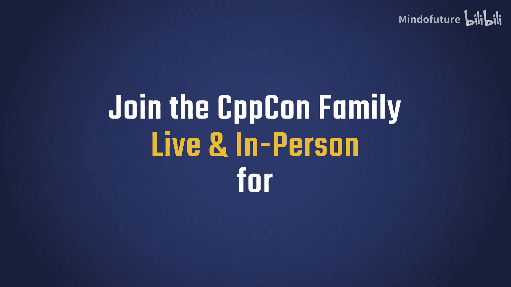
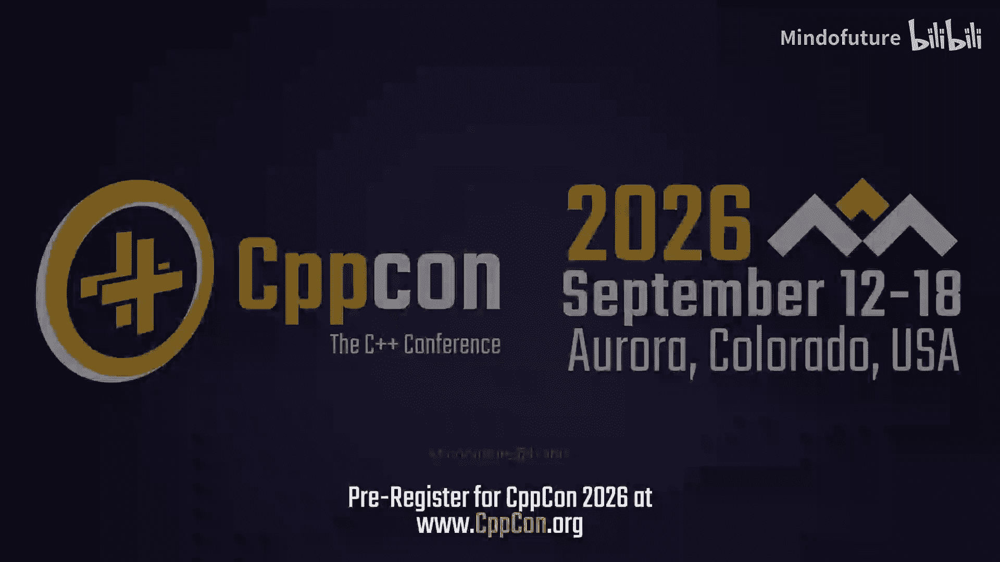
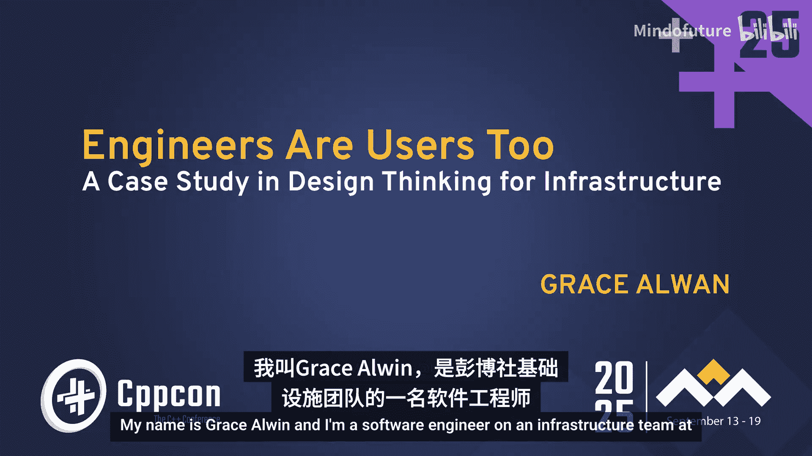
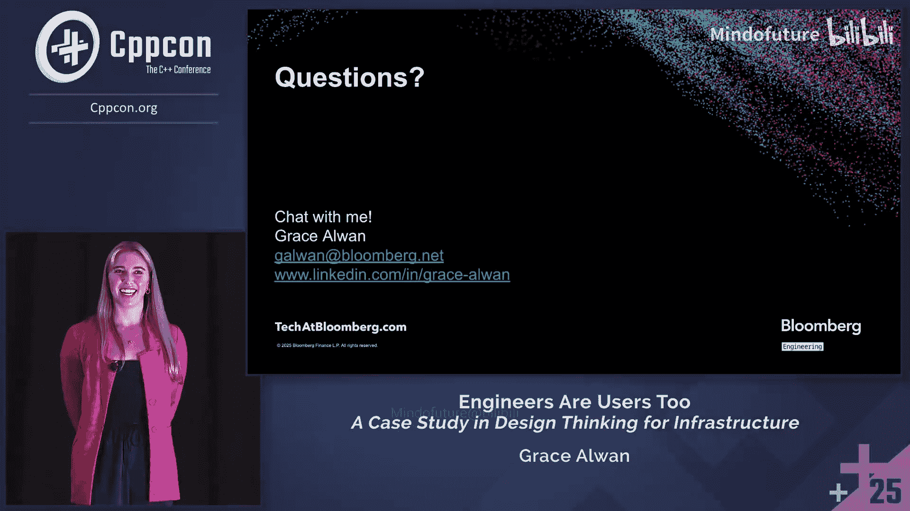
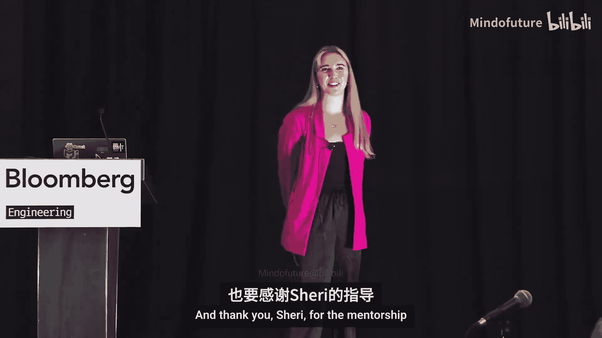
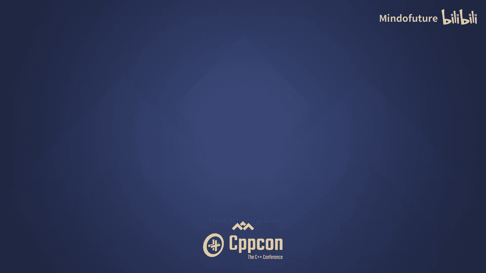

# Cppcon-2025-｜-C++-｜-C语言--｜-汇编-｜-编译器-｜-操作系统-｜-Linux-｜-Windows-p54-P54_工程师也是用户_基础设施设计思维案例研究-Grace_Alwan--BV1wyPBzrEeu_p54-

🎼I think it's just the breadth of topics that they have here。

's like the smallest things that C++ offers us to like the broad Eagle eye view on like architectures。

 software architecture and other other topics。

So it makes it unique in that sense。

Everybody， thank you for coming。 My name is Grace Alllin and I am a software engineer on an infrastructure team at Bloomberg。

😊。

And this means that I am spending my days with some of the most technical and complex and really just behind the scenes。

 systems at the company。But we are not just talking about infrastructure today。

 We're going to be talking about something that's maybe a little bit unexpected。

 and that is design thinking and UX design。And I realized that may sound like a strange combination。

 infrastructure and design， but that is exactly the story that I want to tell you today。

And this connection starts from the fact that。Infrastructure is heavily。

 heavily tied to developer experience， which inherently is a user experience because engineers are users。

And this is because infrastructure tools are what allow engineers like us to develop code。

 build machines around the world and deploy that code to those machines so that users and clients around the globe can use our products。

And so whenever we have engineers interacting with these infrastructure tools。

 that is a developer experience and therefore a user experience。

And so the story that we're going to be talking about today is how even though I'm sure we all know that developer experience is important。

We rarely treat DevX as a design problem that gets to be tackled using those same traditional UX techniques that are used across the design field。

And so the goal today is to walk you through how using UX techniques is going to radically improve your developer experience。

 how to use those techniques so that you can employ them yourselves。

 and how using those techniques as an engineer is really going to level up your engineering career。

Okay， so let's back up a bit and see how we arrived at this strange combination。

I myself studied computer science at Stanford， but I also fell in love with what happens when you meld CS and design work。

 and this is called HCI or human Comp interaction。And this is basically the psychology of how people interact with technology。

 and it encompasses UX as a field as well。And I'll also note that this applies to interfaces of all kinds。

 so that's your UIs， your APIs， physical products， that's an interface or CLIs or error messages。

 anything that anyone interacts with is an interface， this is not just about making pretty screens。

And so back to my coursework， I was surrounded by some of the people who really came up with HCI as a field and so I was learning from some of the best and getting to see their research firsthand。

And I was doing some really cool coursework， which was not typical of the CS S coursework that you're used to。

😊，Instead of just coding assignments， we would be doing the entire product life cycle。

And so we would first identify problems， we would go out and talk to people about them。

 we prototyped， we tested those prototypes， and then we coded them up all in a semester or a quarter。

And this was really， really fun for me。 and I fell in love with this。

And I'll also mention that this is all part of a really well defined framework that is just an industry standard for every design consultancy。

 startup， just anyone doing that whole product life cycle。And so when it came time to graduate。

 I sort of had this double identity going on where I loved the implementation side of things。

 and I definitely wanted to code and wanted to be an engineer。

 but I also loved the UX design aspect of products and UX research。

And this is often two separate roles at most companies， but I figured that just like I did in school。

 these techniques can be combined and practiced together if you are involved in the whole product life cycle。

And again， since UX applies to technology of all kinds。

 I figured that if I just took a standard software engineering job。

 I could sneak design into my day job。你。Thanks for love。Okay。

 so was I able to find this mix at Bloomberg？Spoiler alert is yes， but how do we get there？

Bloomberg does this really fun thing for new grads where there's basically a job fair。

 all my colleagues in the front row know this who started out as new grads and you have the teams all set up and new grads and teams are just talking to each other and trying to find a match。

And for that reason it's honestly more like speed dating and so you can picture me。

 I am walking around talking to all these teams， and I am just talking their ears off about how much I love UX and design and how I wanted to incorporate that into my work。

😊，This was probably pretty surprising for most engineering teams， right？

Most of these teams were used to having separate UX designers that they could go to to help with their UX problems。

 or maybe they didn't focus on this as a forefront of their work at all。

And so when I was mentioning things like the UX research process or design thinking。

 that may have just been something that was vaguely familiar。

But then in the place where I truly least expected it in an infrastructure team that deals with cluster management。

Those folks were immediately excited and interested in what I was talking about。

 and they said that you should join us。 So it was a match。😊。

I'll admit that this match between infrastructure and UX is not obvious because the instinct and what most companies tend to do is to put your precious UX resources towards the client facing products。

 the ones that are making the money。And to really just overlook the UX of your developer tools。

Because after all， the users of those developer tools are engineers， we're smart。

 we're good at problem solving， and we can probably just figure things out。But， I mean。

 a show of hands， who has not been able to figure something out without help or an insane time investment。

 Yeah， video， there's a lot of hands raised that I see。We have all felt this Devakx pain before。

And as a company grows， your infrastructure complexity is only going to keep growing。

 and that cognitive load， that pain is only going to keep growing and growing。

And so if you overlook the UX of your developer tools。You， as a company。

 you're going to experience lost time， engineer frustration， slow engineering speeds。

 and maybe even burnout。And honestly， this comes at no surprise for all of us， right。

 We all just rose our hands。 We've felt this pain before。

And we know it's important to have good DevXs。But what is not always realized is that dev X can be framed as a design problem that gets tackled using those same UX techniques that have transformed consumer software。

And it is this framework and the process that you may not have had as much practice with。

You may do some of this in your day to day， like going through user journeys or parsing through logs to see how people use your product or even naming endpoints carefully to make sure things are usable。

 And this is all part of it。 But what I hope you take away with you today is that。

There is a process that can be keep you organized， it's repeatable。

 and it is industry standard for a reason， because it has been tested and produces good results。

And we're going to learn this through a case study today because in my first project of my career。

 I used this UX framework and it led to some really positive outcomes。

 not just with the project goals， but also in my career。

And so it is both of those things that I hope you're gonna take with you today。So real quick agenda。

 we're going to go over the problem that I was faced with。

 and then we're going to learn that UX framework by seeing how I did user interviews。

 how I prototype， sorry， prototyped and how we synthesized the data and then the takeaways and the impact。

Okay。So the problem that I was faced with on my new infrastructure team。I。

 it was my first week in the job， and I was learning about what my team does and trying to make sense of how engineers at my company set up their products and services。

And the way you do this at Bloomberg is we deploy our code onto in-house machines and to set up those machines first you have your parent cluster。

 and this is probably familiar to a lot of you， it's pretty common across the industry where you have a parent cluster that contains everything that your product or service might need。

And then you have clusters within that parent， maybe a dev。

 beta and prod for all of your deployment environments。

And then you launch hosts within those clusters。But to set up those clusters。

 there were a lot of tools required。First， you had to go to one interface to set up your parent cluster。

 you filled out a bunch of configurations， and then you hit submit。

And then you had to do this for each cluster that you wanted。 So the dev beta Pro。

 you already have done four steps。And then you had to go to another interface and do another step of adding additional metadata for each cluster that you wanted。

And there was a lot of configuration in here。Almost more than half of these attributes。

 some of them were undocumented， some were deprecated， and some were supposedly safe to ignore。

 although nobody could tell me with 100% confidence， which ones I could ignore。

And 90% of our users were just fine with the default configuration。

 They did not have to wade through all of this， but we still made them do it。

And this led to this fragmented system going to two different interfaces。

 And it was a process that was error prone and just led to frustration。

And so imagine or what do you usually do when you're faced with a problem like this？

You talk to your subject matter experts， you write up a design document。

 and you make your best educated guess on what to do。But my team lead。

 remembering that I had this passion for UX， said， Grace。

 why don't we try using the UX framework here。So what does that framework？

Typically it looks like this， you empathize with your users。

 you define your problem space in all of your context and what you know about your users， you ideate。

 you brainstorm， you prototype， and then you test those prototypes and then you iterate over and over and over and this does not have to be linear especially when you're iterating you're gonna jump around so let's say that I had just tested a prototype and I'm learning more about my users I'm going to be jumping back to that empathized step and once I know more about my users I'll add more context into the defined step and you just keep iterating until you're happy with the result。

And this UX framework is used so heavily and so industry standard because it does a couple things。

 First， it organizes you and helps you have a framework with which to tackle a massive problem。

It forces you to put empathizing with users as a forefront of your work。

And it also promotes testing and iteration versus just going with your first instinct。

Another added bonus is that it leads to a really well documented process because you're going to be documenting everything throughout。

 and this comes in handy when people are questioning why a design decision was made。

 how often does that happen and if people want to repeat your process。

And so when I presented this process and all of the prototypes and documents that I was going to produce。

Folks on my team were actually really excited about this new way of approaching problems。

 And this is a full engineering team。😊，And this was nice to hear。

 because I'll admit that I had a little bit of apprehension about the whole thing because this was a team of all engineers。

 And this is not the typical work of an engineer on their day to day。 so。😊。

I wanted to make sure that this work was going to be valued and that if I spent my time here。

 it was going to be thought of as something that was creating value and useful。

So let's start the process。 We had already done some empathizing by looking at those two interfaces that we had。

 So we already have a feeling that something can be improved。

So now it's time to define our problem space and really clearly state out our objectives。

 our hypotheses， and some of our open questions。Okay， so our objectives。

 we wanted to streamline cluster management to prevent errors， confusion and frustration。

Some of our hypotheses were that we could centralize all of this into one place via a UI or an API so that people didn't have to go to so many different interfaces。

And what if configurations could be inherited from your parent cluster into your clusters so that users didn't have to fill out so many things。

And what if our defaults could be smarter so that we could help that 90% use case not have to fill out so many configuration details and not even be sure if they were choosing the right thing。

And lastly， some of our open questions were what is confusing about this current process。

 What questions are we asking users that they aren't understanding and will the prototypes that we make address the pain points of this previously fragmented system。

So I documented all this out and presented it to my team before starting any work。

And notice how by laying everything out， we are now all on the same page。

 And it also proves to our stakeholders that we're organized。

 We're research driven and we're just really thoughtful about this whole project。Okay。😊，First。

 we go out to interview people。 This is a very key step in the UX framework。

 and it is arguably one of the most important。Because it is really important that you do you do not assume that you know anything about your product or the user experience of your product。

 You must talk to the users。You also have to。Listen to what they say and how and see how they are interacting with your product rather than just asking them。

 do you like this， what needs to be improved。Because interviewing is about really getting into the experience of a product。

And so I did user interviews with engineers， the users of my team's product， and I did 30 of them。

 which is a lot。 And that meant that sometimes my calendar looked like this。

 which I realized is not normal for an engineer。And even though this is occasionally exhausting and does take up a lot of time。

 This is so， so， so important because of what I had just said earlier。

 It is about seeing what people do when they interact with your product。

 It is not just about asking whether they like it or not。Because if you ask。

 you're going get very surface level answers， maybe even just a yes or no。Alright。

 so how do you prepare for these interviews， You have to really take the care to craft the right questions。

Because you want to ask questions that are open ended， elicit stories。

 and really dig into the experience of using something rather than asking design decisions or yes or no questions。

 want to be you are seeking the data with which to inform your design decisions， not answers。

 to your design questions。And so instead of asking things like what's wrong with cluster creation today。

Do you like this new design。Isn't this method of creating clusters better。That one's really crazy。

Never do that。Is this error message clear？Press this button to do blank。 What did you think of that。

I instead would ask things like。Can you show me how you create a cluster today。

Tell me about the last time you ran that command。What made you hesitate there。

What do you think this button does？How did you feel when you saw that error？

Notice how these questions are completely different。As an interviewee， I did it again。

 as an interviewee， I am immediately put in a different mindset and I am reflecting。

 and I'm going to tell stories， and I'm not just going to say， yes， I liked this or no I didn't。

Another technique that designers use when doing interviews is called the think aud protocol。

 and this is where you ask people to narrate their experience using something。

 And I often tell people to just brain dump whatever they're thinking。

 like literally anything that enters their stream of consciousness。So let's do an example。

If I was narrating S， is it pronounced schedule， the schedule app for this conference？

I'm going to look here。I see the list of talks。 I see colors。 and I'm wondering what the colors mean。

 but I see the sidebar that has tracks in the corresponding colors。 So I think track。

 the colors denote tracks。I'm a little confused about what this button does。

 It looks like a selection， So I'm gonna click it。Oh。It got added to my schedule。Okay。

I didn't expect that。 I， It looked like a selection to me。

 so I thought that I was going to be able to select multiple talks。

 and then maybe a menu would open up， and I could perform actions on all of those talks together。

 but I did appreciate that it gave me that immediate feedback and told me that it had gotten added to my schedule。

 so I wasn't confused for very long， which I appreciated。And so did you hear that。

 That was completely different than just asking whether I liked the application or not。First。

 you saw how I developed that mental model of connecting tracks to colors。

 and then you also heard and saw my surprise when that button behaved differently than I expected。

And I said heard and saw， which I hope you guys noticed because what you see through body language may even be more important than what you hear through words。

 because we actually， like the way our brain works。

 we react through our bodies before what we're able to say and so while I was standing here narrating this。

 you saw maybe my brows furrowed and I kind of like leaned back because I was surprised。

And as an interviewer， I am furiously writing these things down。 This is so important。

And if someone is not telling me about those body language cues they're giving。

I'm going to ask about them。 So if someone sigh or has those furrowed brows， I'm going to say。

 w the long face or wide sigh。And that is going to be even more informative than what they tell me。

All right， so back to my project， what did we hear when we asked people to walk us through how they create clusters today？

I heard。New users cannot make clusters without help。I created a cluster six months ago。

 and I thought I could do it again， but I couldn't。I had tons of people asking me， what does this do。

 What does this do， What does this mean。And I heard lots of bugs。

It was also really interesting to note that almost every team I had talked to had developed their own documentation of how to do this whole process。

 which。Is an immediate cue to me that the tool was not teaching them sufficiently because a good tool should be self explanatory。

Now， these takeaways were not the only thing that was interesting and insightful from my interviews。

 Engineers loved being interviewed， and my engagement just went like through the roof。 Really。

 They asked me how I had learned to do this。 They asked about the process， and。😊。

As I typed furiously away， they were kind of looking at me with this curious smile， which was cute。

 And they even asked to be kept updated about the status of the project and whether or not I was going to be doing this with any other pieces of our product。

😊，And I just want to pause there because how crazy is it that people asked to be kept informed about a project they weren't even working on。

That does not happen a lot in engineering。And how did we achieve that？

It's because of that human connection that I'd fostered through interviewing and through listening。

That made users feel like they had a vested interest in the work。

This interest and that human connection also led to a huge amount of trust between myself and my interviewees。

 which would go on to lead to better collaborations in the future。

And I'll note that interviewing was a huge career visibility win just because of all the people that I talked to。

And my my professional network just grew in a huge way。

 And people became excited to get get my feedback on product or UX questions。Okay， next step。

Prototyping。This is another huge part of UX design， and it is super important because as we know。

 words only go so far and prototypes are essential in communicating new ideas。I mean。

 look at the difference between reading a 10 page design document and being able to interact with a mocked interface。

 a mocked screen， or a mocked server。One is abstract。

 and you kind of have to do some mental gymnastics to think about how this is actually going to look and feel and practice。

And the other is immediately clear users can put themselves in the shoes of actually using the product。

 they can give more meaningful feedback， and they might even have some sparked creativity themselves in my experience when folks see prototypes it actually gets their own mind working so you're going to get more。

Ideas given to you from your stakeholders， your teammates， or your interviewees。

Another bonus point here is that if you make prototypes。

 you're going to get concrete feedback on an implementation that you did with no code。

Before wasting developer hours on something that may have gotten the LGTM when it was in document form。

Alright， so let me take a guess at what some of you are thinking。This is all well and good。

 I know that prototypes are important， but how on earth do you know what to design。

 We are not designers。 We are engineers。 This is some people's jobs。

 and being creative is really scary。😰，And I hear you。

But I am here to tell you that design instincts can 100% be learned。

And they are actually all built off of years and years and years of research。

And this research point is actually really interesting。

 and it' it's one of the things that made me fall in love with UX as a field when I was back in school。

 And so I actually wanted to share with you guys my favorite paper that I read。 this will be quick。

 It is called userr definedfined Ges for Surface Computing， and it was published back in 2009。😊。

And what happened in this research was users sat down at a table simulating a surface computing device。

 this was pre tablet， pre iPad。And there was a camera situated above the table。

 capturing the table in their hands。And the researchers asked the participants。

 how might you navigate， How might you zoom， How might you delete a file。

And they captured hours and hours of video footage of what users were doing with their hands。

And that interview data， the reactions， the emotions of the body language。

And they aggregated this all up into patterns and ultimately reached some heuristics and guidelines that would inform all the touchscreen gestures we use today。

 That is how we got pinched to Zoom。Itn's that so cool。I think that's amazing。

And speaking of these heuristics， one of the most important learnings in UX study is actually these 10 usability heuristics。

And I'm actually going to go through all of them today because they are just so core to learning those design instincts that we are trying to learn。

And actually， a lot of these are going to already feel familiar to you because even if you don't know the names of these。

 you have felt the feelings because we've all interacted with a good or a bad design。

So let's go through them。First， we have status visibility。This is about knowing where I am in a form。

 Can I query the status of my request via an endpoint？Match between system and the real world。

 We want to use domain aligned language in a common language so that people don't have to learn new terminology when they're using your system。

Control and freedom。Users make a lot of mistakes。And they also might be in an exploratory mindset where they're just clicking around。

 making calls Willy nilly。And so we need to have clear。

 forward and backward and emergency exit mechanisms and dry run calls and rollback calls available to users。

Consistency。Users should not be wondering whether the same terminology。

 error messages or actions mean the same thing across your interface。 They should。Arror prevention。

Good designs prevent errors from happening in the first place。 So that's all about validation。

 strong typing， or having guardrails against destructive actions。Recognition over recall。

 this goes back to that cognitive load。We want to make information easily visible or queryable so that users don't have to remember things。

Flexibility。Every system is going to have power users and novice users， and we want to cater to both。

 So for those power users， we'll give them shortcuts， configurability。

 and we're going to hide those capabilities from novice users until they're ready。

Minimalist interfaces should not include information that is irrelevant or unneeded or extraneous。

Helping users recover， this is about good error messages。

 error messages should be descriptive and actionable so that users can help themselves。

In documentation， we should have documentation everywhere so that people can learn about the system themselves and again。

 just help themselves navigate and overcome problems。Alright， so that's all well and good。

 We know our design instincts now， but still being creative is really hard。

 So how do you begin to make prototypes。The key is to start from low fidelity ideas。

 which should be really， really messy。 And you want to have a lot of them。

And then once you have explored a lot of ideas in a messy way。

 you can slowly make your way up to something that feels a little more real。

 And that's going to be your high fidelity prototype。

You do not want to try to start with high fidelity because not only is that really intimidating to make something perfect from the get go。

 it is probably impossible。And you're also going to pigeonhole yourself into one singular idea when you really should be exploring many ideas in the beginning。

 and that's where that low fidelity prototyping comes in。

There's actually this really fun activity used for generating low fidelity ideas。

 and it is called crazy As。 This is often used for UI， but you can be creative here。😊。

And what happens is you take a piece of paper， you fold it in half， then in half again。

 then in half again， until you have eight quadrants。

And you spend one minute each sketching eight completely different ideas。

 and they should be so messy， super messy， even messier than these。

 This is all that Cha GPT could do for messiness。And the crazy part here， why it's called crazy As。

 one， because you're。Frantically sketching things to try to finish an idea on one minute。

But also because you can use these silly constraints to try to open up your mind。

 and they're silly on purpose because it really stimulates that creativity And so。

An example of the constraint could be， what if I wanted my user to accomplish something in one click。

What if I had unlimited resources？What if I wanted this to take longer than 20 minutes for some reason。

And then the magic of this process is in the numbers。

 because if you do this with a team of five people， suddenly in less than 10 minutes。

 you have 40 ideas， which is amazing。😊，And that's exactly what I did。 So I ran this with my team。

 It was a lot of their first time doing something like this， which was really cute。😊。

And then we had 40 ideas， and we brought them together， we saw the commonalities。

 and we converged on something that we thought would be a good place to start。So from there。

 we went and built our high fiity prototypes。For high fidelity prototypes。

 I use those same tools that designers use to make their prototypes because。

I really thought it was important to get this look and feel that feels almost real without any code。

High fidelity tools allow you to hook up click events and animations and really simulate the exact style of your interface。

 This is for a UI， of course。Without any code and with significantly less time。Now。

 calling back to when I had initially brought up this UX framework to my team。

 and I was a little apprehensive about the whole thing。This was no different。

I spent a lot of time on my prototypes， and I did worry from time to time about being the design girl on my engineering team。

And I wanted to make sure that I was developing the right skills and developing the correct personal brand that I wanted to enforce。

But once my users interacted with my prototypes during my interviews。

Everything was worth it because just like those interviews， engineers loved having prototypes。

 They were so excited that they could click through。

 And I could tell they had a lot more fun than than typical design reviews。😊。

They liked that they could click。 They asked me about the software。

 They asked me how I learned to do this。 And I know also that the feedback I got would have been impossible had I not had these really high fidelity prototypes to use。

And so the user feedback and also validation from my team and my management that this was a good piece of this project was enough to make me feel good about the whole thing and realize that it could be a niche that I could excel in。

And also， I am now really happy to report that my whole team does mockups for any project。

 We are all in cluster management， and we all do mockups。 Thank you。😊，👏Love that。 Yeah。

 we all do mockups for every project now because there's a variety of tools out there with a variety of learning curves。

 And so anybody can start。 You can even start with pencil and paper and just put those in your design documents。

 And that is going to be better than just words。😊，Alright， so back to my project again。

 what did we hear when we presented these prototypes。I heard a lot of positive things like。

 this is seamless。 or I flew through this because this is very familiar。This is straightforward。

 wouldn't have had to think about this at all。That sounds like a low cognitive load。

And I saw lots of smiles， which made me happy。😊，And I also heard a lot of areas for improvement。

I had implemented a pretty complex form because of all the configurations needed to set up your infrastructure。

 and so navigation had to be tweaked a couple times to achieve something that was clear。

 and people also had some overwhelm at seeing all the options at once。

 so I was working towards something that would be less overwhelming and just immediately seamless and clear for everybody。

Alright， finally， it is time to synthesize our data。

And we're back at the defined step here because we have collected all of our data and we can absorb that into new context。

So after those 30 hours of interviews， I had a mountain of data， as you can imagine。

And so how do you even begin to make sense of this。

The UX answer is something called affinity mapping。

And this works by taking each atomic piece of data。 that could be a quote， a singular story。

 a singular emotion， and you put those onto sticky notes。And I did this digitally。

 and I put each user as a separate color here。And then you go through and you start grouping sticky notes by common themes。

 Those could be a common frustration point， a section of the interface or just a common emotion。

And if you feel like you can do it again， do a second round。

 and you can do as many rounds as you want until you've reached the core themes that you are seeing from your research。

Here I used the black sticky notes to denote my main takeaways。And all of a sudden。

 I've gone from hundreds of data points to just a few main takeaways and themes， which is great。

And another bonus here is that attached to each theme are all of the quotes and the stories that led to that decision。

Which is really great for being able to look back and see why you did the things you did。Okay。

 so what did we learn。We validated our hypothesis that the current process was just frustrating and confusing to go to so many different systems。

 and we needed to automate more and provide more defaults so that users could just use the standard configuration。

We found that wayfinding and confidence in your navigation was really important and。We also need。

 I keep doing that。We also needed to make sure that people felt confident in what they were selecting。

 So just helping users feel confident in。The whole process was needed to be tweaked throughout the prototyping process。

We also learned about the desired workflows that users did and didn't want。

 we heard that people wanted the ability to clone clusters， they wanted things to be autofil。

 and they wanted configurable templates for each of their teams。

And we also heard that users were never editing and adding clusters at the same time。

 so we didn't need to overload a system with too many things。And， of course， there was a strong。

 strong need for documentation。 People were really confused by this process because infrastructure。

 it is tough， and it is something you don't often learn until you've entered the workplace。

 And so having documentation scattered throughout our system was going to help people learn。

And so the takeaway here is that。Being able to arrive at conclusions like this through data instead of just sort of anecdotal knowledge or previous experience or lore。

Is what that US framework gets you。And it is also unique to see how a smile or frustration or。

A slumped shoulder can be quantified into data that lets you arrive at decisions like this。

And it is also much more believable and impactful to your stakeholders if you are showing data that comes from human experience that drives your design decisions。

😊，Okay， finally， we're at the results document， which is the grand finale of our UX framework。

This is just a comprehensive way to communicate all that we've done to our teammates。

 our stakeholders， and all those interviewees that wanted to be kept updated。

We're going to include things like our problem and our context， and。

Really clearly define the challenge that we set out to solve。We're going to specify our methods。

 who did we talk to， how did we run our interviews， what were the questions。

 how did we make our prototypes？What were our findings。

 all those major themes and what were the quotes and stories that led to those findings。

Well include all of our design iterations and the rationale for each design decision that was made。

And finally， our recommendations for how to implement the project。

And I also like to include an appendix with all screenshots of all the affinity mapping we did。

 all the raw interview data， your early early prototypes， your crazy as。

 because this just paints a really nice picture of all the work that was done and shows how thoughtful you are。

And I'm also happy to report that this document is more than just a nice write up。For me。

 it has lived on since the conclusion of the project， I did this project more than a year ago。

 and this is still referenced today。Because it has provided inspiration for future projects。

 and it's an inspiration for how to run with future projects。嗯。

sorry teamss have also asked me for help implementing this process in their own workflow。

 which is really nice because that means that UX practices are spreading across the infrastructure org at Bloomberg。

 which is amazing。Okay， now we're at our takeaways。 why did this work？

The design thinking framework gave me the process and the organization to tackle this deeply technical and ambiguous problem space。

Interviews gave me empathy and evidence for which to make my design decisions。

Prototypes spark creativity and encourage early alignment amongst all of your stakeholders。

Synthesis gives you themes and direction。And the results document gives you credibility and easy recall to what you did。

And all of this changed my career。I am definitely known as the engineer with killer product and U X instincts。

 And this has become a superpower that。Has not only improved my engineering work。

 It is also an area where I can mentor and assist other teams。

 which is awesome to be able to do so early in my career。😊。

And it is also a niche that I can use to develop my personal brand。

And so my challenge to you is that you do not need to be a designer to start using these tactics。

 You can start small by interviewing a teammate about their workflow。

You can sketch a prototype using pencil and paper and put those in your design documents。

And you can bring elements of your personality that you don't often tap into into your day to day。

 like your interviewing skills， your empathy， your listening or your chattiness。

And you just got to keep repeating and repeating and repeating。That's iterating。

Design thinking again。Because as you keep repeating this process。

 you're going to just get better and better at it and reach a level of proficiency at which you're going to see those career payouts。

And this can be done for anybody。 Anyone at any level of the stack can do this， because。

No matter what the interface is， every interface that we ship is going to have an experience for somebody。

 And so we should engineer that experience the same way that we are doing our code。And that's it。

 Thank you。

We have time for questions， so please come on。Hello， this was really excellent。 Thank you thanks。

I'm wondering if you have advice for what to do if you're making something totally new without an existing thing to build off of。

 like here you already had。Cluster creation tools that nobody really liked Yeah what if you were making that and there were no tools already Yeah。

 good question So this brings up how the UX process can be different for every kind of problem so in this case since I already had some tools to work off I made initial prototypes because I had ideas of what could solve the problem but for you I would just talk to people first and。

Just gather data on， I assume there's a problem you're solving right and you can just ask them about that problem。

 see how they solve it today， see what workarounds they're doing。

 and then you can start to build something that can help solve it and then you can go back to them。咩。

So what you're saying is nothing starts can you comes to the mic？

So what you're saying is nothing starts from nothing that。

Even if there's nothing written down or nothing formal， there's something to go off of。 Yeah， yeah。

 you can talk to people about their problem and see how they're trying to solve it。

 even if there's nothing solving it today。Thank you， yeah。Can I ask the opposite question Sure。

 how did you get feedback on your wildly improved designs like how hard was it to engage with people to actually give you critical and interesting feedback there I actually not as difficult as you might think because and I actually think this is sort of thanks to who I was talking to the infrastructure or at Bloomberg is full of people who have been there a really long time and are very well tenured and really know their stuff and so they have no problem being critical which I appreciate because I don't just want to hear like oh this helped everything。

So yeah， I think it actually wasn't as hard as you think。Yeah， thanks for the question。

So following up on working with existing systems。How do you take that design the results where they drive changes into existing system。

 not just interface changes， but oh we need to do this a different way and here's a bunch of more work。

As opposed to changing the interface kind of thing。I guess I'm wondering。What you mean。

 by the difference between an interface in systems。So you have a system。

 the one you were talking has many different tools， right？So。

They all want different file formats or different format。 So okay。

 we now we've got to go through and change everything to take a common system a common format Okay or something like that where it's a system level change。

 not just what the user sees Okay， I see it yeah。I see what means。 So I think there。

What I'm hearing is getting multiple teams and multiple people on board。

And I think something that can help there is including them in the design process。

 because by including them。Listening to their concerns。

 you can incorporate that feedback into your designs， not just that of your users。

 maybe the people that are。Like making the interfaces that you use at。

Having them contribute to the design process can。Help them feel like， oh。

 I'll make some concessions here。 I'll help in this way。 And that that happened for me。 So thank you。

 Yeah， of course。Hi， I really like the concept of this towards design， but where I work。

 we're doing much more APIs， kind of C++ APIs and that sort kind of thing。Harder to see how the I。

 I want your thoughts on how the。Particularly the interview process works。 So I mean， you know。

 you're kind of this is a goy。 it's。You can watch people click and point through that。 But like。

 how would you do that kind of where it's gonna be some programmer typing and trying to read doc and figure out how do I call this function call or use these objects for sure。

 Yeah， I don't know。 do you have any insight into that。 Yeah。

 I think it's actually not as different as you might think。 because if I'm asking a user Oh。

 like again， tell me about the last time you ran this command They're gonna。

paste it in or however they're running this command， go to postman， whatever。

 and you're going to see how they do that and you're maybe going to see them combining multiple calls to accomplish one thing and that would be something that I would notice like oh do you need all those calls？

And again， the confusion piece， like if someone is kind of glazing over certain parameters， like， oh。

 I don't know what this one means， but this value works。 That would tell me that。

It's our documentation is insufficient， or I need to be doing user education in a different way。Yeah。

 yeah。Hey， Michelle， hi， Grace， that was an amazing talk。 Thank you。 I have two questions。 for you。

 So the first one super quick。 What kinds of software do you actually use for the high fidelity prototypes。

 talk to me after after yes。 And second question， what do you do if you're not able to easily interview your users。

 especially if your users are external and you can to arrange any client meetings， because reasons。

 Yeah， good question。 in that case， and because I know what you do I would have my fellow engineers or people who don't work on my on my product simulate being those users。

 So you could talk to me and you could have me try to use your product and I know nothing about your product。

 And so it would be really informative to see how I'm able to educate myself and if I'm able to use it on the first try。

 So you can try to。😊，Put some like acting skills to the test， you know。That's a great idea。 We'll do。

 Thanks so much。Hi， thank you。 I'm gonna be a bit more aggressive on you now。

 because I couldn't help nos everybody has been very cheerful。 it was good。 and I loved it。

 But there was one point。😊，And that was about this tool you used to create the the fine mugups。

 this design tool that will allow people to click through。

 and then it ran down my spine because I'd just been tasked because I'd just been tasked to enter a lot of tickets and issues and work into a well known。

Issue management system from the Southern hemisphere。And I had to enter a number。

 and then I had to grab the mouse， move it all the way down to the create button， click create。

Click create new， and then take the mouse and move it up to enter the small phone number，48d number。

 I wanted， then move the mouse all the way down to click create。

And I just typed and I hit control enter and nothing happened。 What the fuck I typed control enter。

 what nothing Do I really Yes， So where in your clickable prototypes does control enter enter。

 So to speak Oh okay， I was like， where is he going with this？amazingmazing， okay。

I have not used these tools myself， but that is possible in these clickable prototypes。

 you can put in keyboard actions as well。 so yeah we can get that and sounds like we need to connect you to someone at that common issue management software。

ふ。😊，They speak a weird sort of English， I don't think it' will work。呵。😊，Yeah。

 how soon can we get your slides I'll post them right after this Thank you Yeah， of course。

 I'm glad you liked。cant see So with your point about like starting with like low fidelity to high fidelity because you can get much more ideas out of low fidelity。

 something I've noticed is with some teams I work with a tendency to jump right to the high fidelity prototypes。

 And the reason is because we're using those same kind of tools for click through stuff。

 but working in the digital audio domain sometimes click through is enough。

 you actually need to hear it you need to gesture that is higher fidelity than a clickthrough prototype。

 So we have other internal tools for prototyping gestures or protyping sound。

 and that art for production， but not everyone's mastered those tools。 but product teams know how to。

 I can write C plus plus in our application。 So I can hack the idea into an application for my prototype but there's only one of those when they do it that way。

 and so their comfort levels easy all go fast in my normal environment。

 but it's not a prototyping environment so they don't get these many ideas。

 And so in this kind of other dimension， what's very clear like the paper versus unnamed tool。

That you can do like a bunch of ideas。 But when these guys， they kind of。Other tools to learn。

 you know， what's easy just。 Oh， I can just write some C plus plus bang out my one prototype。

 do you have any thoughts on how to。Encourage people to note actually let's try these other prototyping tools。

 try more ideas because it's kind of a cotton back and forth I having those product teams where people just more comfortable just oh。

 I can just take this app and hack my feature into the C+ Yeah thank you for that story and I have a lot of thoughts on it and actually people I've encountered people who have said like oh it's just easier for me to code something up and I really would beg to differ because I proven them wrong in Uber rides about how fast you can do something faster So what I would say to that is first of all。

 I have some examples on how to do like non normalmal modalities with low fidelity prototypes So in school for something like this。

😊，Where we had to use audio， something they would tell us would be to do pencil and paper。

 And then if someone。Press something， use your phone and play something。 And that's perfectly fine。

 So you can be creative that way。 And then in terms of。😊，Motivating people to do it。For me， I think。

Kind of like， I I'm in this research based mindset。 So evidence is really helpful。

 So I would probably point them to maybe this talk or just the， the standard。

Telling them that the industry standard way is to explore many things first。

 and you can try it out a couple times， and if you still after a couple times， don't believe me。

 then you can go back to what you were doing， but I would guess that after doing it。Once or twice。

 they would think， oh， this was fun。 and it LED to a better idea。So cool thing yeah。

 I keep trying Yeah， just keep trying thanks。😊，So。In the talk about interviewing。

 you talked a lot about body language and also with like the physical lowfi prototyping。

 having people kind of move stuff around and look at the physics so how would having remote colleagues like if you're in an infrastructure team suppose you' they're all remote everything over Zoom how would that affect your process that's a great question and I have had to do some interviews over Zoom and that's like a much more common process nowadays。

So what I would say there is always video， if possible。And then you're right。

 You probably can't see a ton of like the body language of what's happening under the video。

 And so it's almost like when one sense is gone and your other sense is become amplified。

 I would be listening more for those， like size or。Just the intonation at which people say things。

 and I would dig more into those。And I would like be trying to grasp that what I could see。

 like the eyes or the eyebrows or something like that。 But I definitely hear that。

 So video on is possible。 but yeah。Hello， very good dogc， thank you。I had a small question。

 I'm also a little bit interested in U。 I， but I noticed that's what I see is much more than I thought。

 And I don't think I can see there's a little side crash with more of some big projects。

 So my question is。How long mid did it take you from start to finish to a better UI application。

It really just depends on the scope of the problem。 This was a very big project。

 So this took me a couple months。 But if you， let's say， a small example。

 you wanted to see and evaluate the usability of。Your login flow， that's like a very trivial example。

 But if you wanted to test that， that would probably take you like a month or something too。

Go from start to finish。Or even less， it really just depends on the scope of the problem and as you do it over and over。

 it's going to get faster like the first time I did this process in my intro to HCI class that probably took the whole semester and then in future classes we would be doing it a couple times per semester。

Okay， that's clear， thank you。Hey， Sherry， what is wire framing that you went from low to high。

 And there's this in between。 what was wire framing。 Okay， yeah， good question so。

Whyre framing it could be a high fidelity prototype。

 but most often what people do is they have the low fidelity。

 which is the sketches and then you build something that doesn't resemble the styles and I'm speaking in UIpeak right now。

 but it doesn't resemble any of the styles of your application and it's much more bare bones and so you can people test people with that the same as you do low or high fidelity。

And it's all about time， really。The tools you feel comfortable with。

 So those medium fidelity tools are much more easier to master。 And so I might start with those。

 And then as I get more practice with this， then I might try to go to something high that is high fidelity。

Yeah。I do a lot of research at Bloomberg and a lot of outreach。

 and I don't I never thought of using your sticky note tool， but I actually take in brackets。

Iitials if everybody had spoken color code them so I could see its different people without having to read and then take those quotes。

 each interview was like the same color or the same initials， but I start to put them into sections。

 so I could actually see how many people are like oh yeah。

 this guy just talked a lot or oh my God 12 people agree and the idea of doing the sticky notes。

 so I could then maybe take that take that and at a glance， say， look。

 I ask this question and look at where the answers are falling as a chart。

 It seems like a really great way not just to understand what I'm trying to say but help other people understand why I'm saying it。

 Yeah， it's a really good tool for showing the quantity of data points that support each theme。

 So it sounds like you were maybe doing it in a document before and like pasting quotes that had similar features which is the same kind of work。

 but the sticky notes is。😊，Really good for one， the visual learners who want to drag and drop things。

 and also， like you said， for communicating to people， like， oh， I had 10 people say the same thing。

We should listen to them。Yeah， any more questions？I would like to thank Grace for launching CPP Cons Business and Careers track。

This is the very first talk of that effort。azThank you。What一。P the来。Great stories and great talks。

And Grace， thanks for showing us how it's done， Co， and thank you Sherry。My churchship。

