# Cppcon-2025-｜-C++-｜-C语言--｜-汇编-｜-编译器-｜-操作系统-｜-Linux-｜-Windows-p55-P55_2025年Visual_Studio为C++开发者带来的新功能-Augustin_Popa_David_Li-CppCon_2025--BV1wyPBzrEeu_p55-

🎼I think it's the concentration of expertise in simple lessons specifically。 I mean。

 it's all in name。 It's been really great to just like hang out with these experts and just like pick their brains and。

 you know， absorb their knowledge。😊。

Well， thanks， everybody for coming to our visual studio talk。

 What's new in Vi studio for C plus plus developers in 2025。😊。

My name is David Lee。And I worked on game development on the visual studio product team。

And my name is Augustin Poa， and I'm also a product manager on the Microsoft C++ team working on Visual Studio and VC package。

So it's great to be back at CPPcon。If you have attended one of our Vi Studio talks in the past。

 we always like to start off by reminding everyone， our product team's mission。

 which is to empower every C plus+ developer and their teams to achieve more。And today。

 what we'll show you how we got a lot of。Action packed demos。And。Before that。

Currentourtly see reminder to please。Give us， give us a chance to hear your opinion by filling out our survey。

 Our survey is very important to us。 It really decides how the product team。

Move with the product direction in the upcoming year。 So every year CP P P con。

 we definitely take into account all of the responses to our feedback。

This year we're giving out some Lego prizes as Raffphael prizes。On Thursday， there is a car。

 So we're actually drawing the raffle every single day at 4，30 combined bootho。

 You don't have to be there， but it'll be nice if you're attending to know， when in person。😊。

Here are some of the rest of talk。So， no， enjoy the presentation。

We're going to start with some major announcements。Then move on to the latest improvements for your。

Editing cycle。 So editing navigation within the editor。

Then we'll talk about improvements for managing libraries and building。

Before moving on to debugging and diagnosing issues。And last。

 we'll finish off with the latest updates for source control in Vi Studio。

 So let's get started with our major announcements。 And that is。

Visual Studio 2026 Insiders Edition is now available。If you haven't tried it out。

 I highly encourage you to give it a shot。 It is available to today。

 and you can definitely install both V S 2022 and 26， side by side。😊，As I mentioned before。

Our feedback is very valuable。 whether it's through surveys。

 through conversations in the halls and our booth， and definitely developer community tickets。😊。

Over the past 12 months， the C plus plus team has worked on almost 400 issues and have completed almost 30 feature requests。

As a whole across visual studio。 So not C plus plus specific。

 we have fixed almost 4500 issues and almost 300 feature requests。 Now。

 this can encompass everything from other languages。

 but also the core visual studio features in the editor， the debugger。Search， etc cea。So， once again。

Your survey that doing our survey is a chance for you to give us your feedback。Now。

2026 has a new look and feel。 We have a fresh， new U I。😊，With a lot of different themes。

 And you'll see some of this later today。The settings page has been completely revamped。

 You'll be able to access all your settings， search through a completely new interface。😊。

All your extensions will work。So， if you upgrade。Your VS2 tone in2 extensions won't work just as it would in 2026。

And lastly， this is our deepest integration with Copit yet。

 with Copit helping you every step of your coding process。😊。

We'll get to this in just a minute when Augustine， I will come on stage to show you。

The latest integrations。All right。

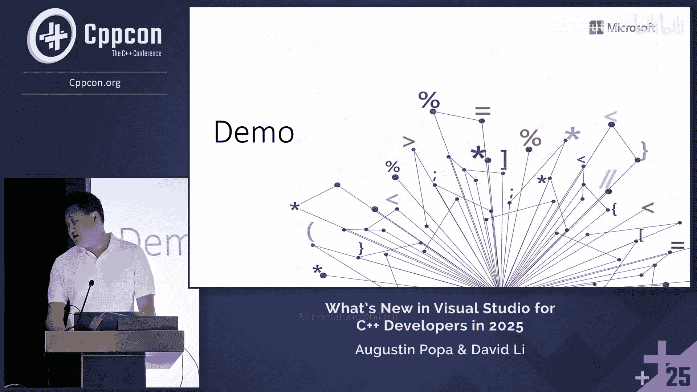

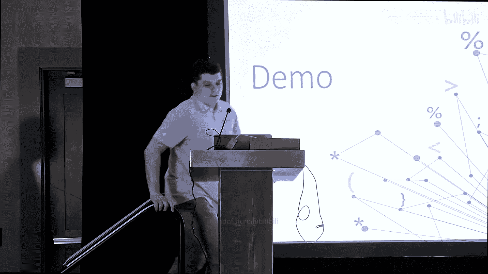

All right， so we're going to start off with a demo showcasing of Visual Studio 2026。

So this is what Visual Studio 2026 looks like this is in the Insiders channel。

 which is basically the new term we use for a preview build a visualual Studio。

 but you can try it out today and see how well it works for your projects this is the dark theme that I have opened right now but if I go to tools and theme here。

 you can see we actually have 11 different choices for themes for this demo I will actually use the light theme because I think it looks a little bit better like on the background here but there are lots of different options for you to choose from and you can see as well that I have already opened a codebase this is a CMake project and it's called bullet it's a physics SDK。

 it handles things like collisions and moving objects around and this is an example application with Edward it's basically just making a bunch of cubes fall down and I'm going to be making a few changes to this to this particular program as part of this。

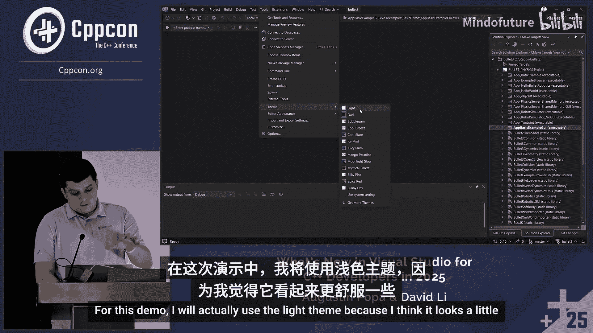

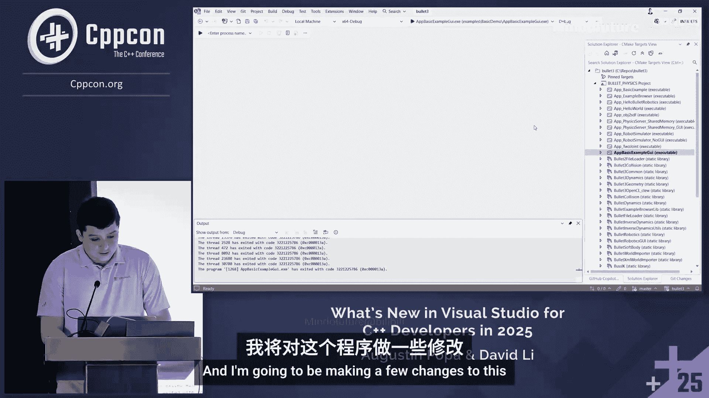

A demo。And to show you what。What we will be changing here。

We have so I have here I have fork to this repo and I have a few GiHub issues that I added and these are the changes I basically want to make。

 So the first thing I want to do is I want to bring those objects closer together when they fall down rather than just having them fall really far apart from each other。

 The second thing I want to do is change the objects from cubes to spheres then I also want to make sure I have documented my code properly with comments。

And lastly， I want to use the console window that also pops up when when you run the program because right now it's not really doing anything。

 but I want to print the initial positions of those objects。

 which might be useful in the future if I'm debugging some issue in the future and I'm going to try to do that using some C++ 23 features。

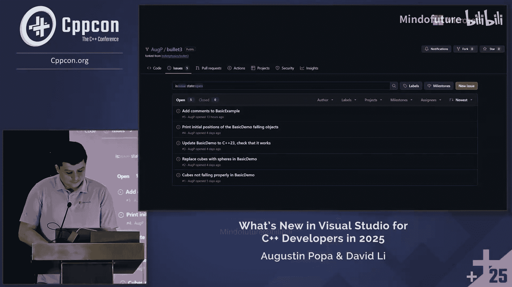

All right， so if we switch back to this。So first things first so I have See make targets be opened here。

 the target I'm working with is this app basic example Gui so let's see if I can find the code that corresponds to it and you can see here this is the universal search experience in Vis Studio you might notice that UI looks a bit different I'll talk about that in a moment。

But first， I just want to show you that。So it works the same as before you can search for files or types or other code symbols。

 so I can filter it down and it looks like there's this basic example that CPP file here。And。

What I want to do is figure out where can I actually。

 what changes can I make in this file to make those falling objects appear closer together。

So to do that I'm going to switch to the GiHub Copit chat window here and particularly I'm using ask mode right now。

 you have a variety of models that you can choose different LLMs that you can choose to use we keep this updated regularly for this。

 I want to use GPT 4。1， but you can see there are lots of different options available。

And I'm just going to basically ask it to investigate if there is a way。To。

To basically make that change， So to bring those objects closer together。

 So do you see anything in this file that might help me fix。The spacing。Between the falling cubes。

When I run， and I'm just going to go ahead and， and have that。Kick off copilt， and just start。

Looking into this。 And while it's doing that， I'll talk a little bit about the new UI for the unified search experience。

 So you might be used to the search experience looking like this。

 Okay you have this pop up in the middle of the screen。

 There's now a button that allows you to dock it wherever you'd like So right now I have a dock on the left side I like it when it appears there。

 but I can drag and drop that wherever I'd like it because it basically becomes a tool window and visual studio。

 So that's pretty nice。 we still have all the different filters for what you want to do。

 you can also type in like F colon or t colon depending on what you're looking for。

 you can go to a line number by typing just colon and then the line number there's also feature search if you want to look up a visual studio feature。

 So that that's been there before as well。 So right now I just navigated down in the file a little bit。

 and it looks like copile it also finished and it looks like it determined that there' is this triple4 loop。

 which I just navigated to and there are some multipliers here that determine the spacing between those falling cubes。

 So what I'm gonna do is。I'm going to update that。 I'm going to make those smaller。

 and that should bring the cubes closer together。So I'm going to make that change。

And then we're going to try running this again。And then see if this is。Working。Correctly， okay。

 so the cubes came closer together。 They basically form a big cube。 It looks really nice。

 Looks like that was successful， great。😊，Okay， so we can go ahead to the next change then。

 And I'm gonna switch Coil it to agent mode。So in as part of agent mode。

 I'm going to try to get it to change the falling objects。

So make the following objects spheres rather than blocks。And I'm going to update the model。

 let's say if Clas on it 3。7。OkayAnd the difference here。 So I'm in agent mode。

 So what is agent mode。 So the ask mode basically is like questions and answers can it's just like any AI chat interface you might have used before where you can ask it questions and maybe learn a bit about the code base you're looking at。

 But with agent mode， it can actually go and implement changes for you throughout your codebase。

 it has a lot of context to figure out step by step what it needs to do to address the prompt that you gave it。

 So in this case， it's going to try to figure out how do I change these objects So instead of showing a bunch of cubes it's going to show some spheres falling down instead。

And it's running in the background。In doing that。Right now， and you can see it's actually going。

 It's analyzing this file right now。And you can see that it it's already making changes to it。

 It actually lists the files that are having changes applied to them。

 so you can keep an eye on exactly which file was modified。 And you also have a keep and undo option。

 So if you don't like what it's doing， you can always undo it。 And you can do that file by file。

 depending on how you feel about the changes that it's making。

And it's actually going ahead and making changes。 and you can see it's highlighting here， okay。

 like I'm changing this。This this shape to a sphere shape。

 and it's and it's basically going and figuring out exactly which lines need to be to be updated here。

 And it determined that there is a type of object called this sphere shape that it can use instead there already exists a way to call this within this code base。

 So it basically analyze the code base and figured it out just from that simple prompt I give it。

 Okay， there is a way to do this。 And I can just swap this out。

 So it's not going to use the cubes It's going to use the spheres instead。

 And I'm just gonna go ahead。 It looks like it ran a build successful here。

 I'm just going pause it here and just try running it for myself。And see what it looks like。

And there we go。 So it went in and made the changes。 and now the cubes became spheres。O。

So now I'm going to keep these changes because it looks like it did what I wanted it to do。

 So I clicked keep。Alright， so let's try another prompt agent mode。

 Add comments to this file based on project conventions。So what it's going to do now。

 it's going to add documentation comments throughout this file。And might you might be wondering。

 well what if it generates a bunch of comments and I don't really like the comments。

 and then I have to undo it。 and I've just wasted a bunch of time because it does the comments in a way that I don't really like。

 So there is a solution to that。And if I go back to the search experience。There is a。

AFile in this repo called Copit instructionsstructions。md it's in the Doc Gitthub folder。Okay。

 so so what I've done basically is I've defined the conventions I want this project to follow in this file and Copit will use this file as context for any prompts that I give it to try to make sure that the responses are tailored to my particular re and my particular needs。

 So I have general instructions about what C++ standard I want to use API and style performance and safety。

 And there's also a section for documentation comments。

 So you can basically just write in what instructions you have for it。

 I also want to point out there's like you might notice these lines are indented。

 This is another new feature。 So there's an indent on word wrap feature available now in tools options。

 So that's why they look indented like that here。 And you can see the little arrow indicating its word wrap And it's very easy to fill in this file。

 So I can say something like do not use。And。Okay， it's it's being a little slow here。

 but basically as you start typing things in the file， it can use the auto completion experience。

 So there you'。 so do not use to do comments instead create an issue So you can very easily just start writing new lines to this file and the way I basically added the previous lines that I just I wrote a couple of words and and Copit figured out。

 oh， this is probably the rest of the sentence that you want to have here。

 So it's pretty easy to get started with using a file like this。Okay， so。Let's go back to。To here。

 it looks like it added a bunch of different。Comments throughout this code base and the way it structured the comments you might know this oxygengen style comments。

 And we've commented at the top of every function。 This is based on the the context I gave it in the compile instructions file。

 So it's doing it in that particular way。 So we're gonna go ahead and just try。

We're just going to try running it again just to make sure this should have only messed around with comments。

 so it shouldn't have broken the building anyway， but I just want to check。So yeah。

 it looks like it's still working correctly and now I have comments in this file。Okay。

 so that looks good。Allright， so next， I want to use that console window and display something there。

 So what I'm going to do just to get us started。 so I have some code snippets here。

 I'm just going to start by pasting this in。Basically。

 I want to add a function that is able to print the state of the of the objects at the start before they they fall。

 there's a client format issue there Ill just skip that。 Okay， so I print。

 so I added this print world state function and I also have a bunch of。Pound includes。

 I'll just move these to the。To the top。All right。Yep， we'll just move them over here。Okay。

And I still have a little bit to fill in here。 And I need to call the function as well。

 So it's called print World state。So if I go back to that triple4 loop that we had here， I can call。

Print world state。And okay， we'll skip the claim format error there for a second。 And this is。

Alright， so it auto completed that to display the initial world state。Okay。

 so then I also want to make sure I set the C plus plus standard to C plus plus 23。

 because I'm going to be using some new features here。 So we're gonna go to the C make。Ls。

And we want to make sure we add。嗯。Set， CMake， CXX standard。And we're going to do 23。

And then it auto completed or it's suggesting the next auto completion to set the standard required on okay。

 and when I save this， this is going to regenerate the Cmate cache。

And then I just have one more change to make here， which is going back to the print world state function itself。

 I left it to do。 I do have to fill in。Something here。Okay， so what we're going to do。

 so I want to use stood print line and I want to use formatting ranges。

 so C++ 23 features to to print out this。This output。

So I'm just going to start by just adding a vector。 and you can see that it auto completes it。

And I should probably the table client format in this file， but we'll just ignore that again。

 So so the vector， I just auto completed the whole line。And then you can see it's already saying， oh。

 maybe you want to do stood see out and stood format。 But that's still not modern enough for me。

 Okay， so I'm going to do stood print line。And again， just autocompte that。

client fermeter error again。 All right， So then this is going to create this。

 It's going to auto complete this。And then so this is going to generate the coordinates for the each for each object。

 it's going to add square brackets around that， but maybe I don't want the square brackets。

 I just want a cleaner looking like。Output in the console window。

 so I'm just going to add this colon N here。And then， we will try。Running that and seeing。

How it looks。There we go。 So the program's still working correctly。

 And now I'm printing the positions of the objects in the console window。

 So I'm using the console window for something now， perfect。 Okay。

 I think I'm pretty happy with those changes。 So let's figure out how to commit them into my source control and and get them in。

 so。😊，I'm going switch to the Git changes window here。 It shows that I've updated two files。

 I've updated the SeeMake list file。And I've updated the CPP file。I'm going to stage those changes。

 And then what I'm gonna do is I'm just gonna click this button， which is review changes with Copit。

 So it basically has Copit do a code review at the commit line。 Now， it's AI。

 It's not going be 100% accurate。 But the point is。

 this is something you can run into the background while you're doing other stuff。 So， for example。

 I'll also start generating an automatic commit message。

 And it's doing that as well in the background。And so basically。

 I can kind of multitask here and I can go and look at different things。

 And it looks like it generated the commit message here。 And you might notice the commit message。

 So this is an AI generated commit message that looks at the specific changes I've made basically what I've just demoed every single change。

 and you can see it it follows a specific template。 It has this like title at the top。

 It has a few bullets the grammar is a certain way。 And there is a reason for that。

 And that is because I've configured this in tools options to look like that。 So use that template。

 So if I go to tools options。 This is the new tools options。 UI in visualual Studio 2026。

 It's now integrated in the middle there。 you can drag and drop it wherever you'd like。

 I think it looks best in the center。 So it looks a lot more like the VS code1 very very clean and you can it has a nice search experience as well。

 So I can search for commit message。And you can see here。There is a commit message。

 custom instructions。 And this is where I put the template for what I want the auto generated commit messages to look like。

 So just like the other custom instructions file， that was the broad one for the repo that was the compile chat was using。

 This one is for auto generated commit messages。 So I can make sure every time I do a commit。

 the commit messages follow the same template And they summarize my change as well。

 And I don't have to worry about remembering like what is the syntax I'm supposed to use or having to spend time manually typing all that。

So that's pretty cool。Alright， it also looks like the code pilots code review finished。

 They generated a few comments。We'll just。Quickly look at this。 It's like it's saying， oh。

 are you sure you want to use prints because maybe not all compilers support this yet。 So， yeah。

 maybe。That might be a good suggestion。 It's also calling out， hey， look， this function。

 you added at print real estate。 you never documented it at the top the way you're supposed to。

 according to the compile instructions file that says you have to have comments at the top。

 So realized， though， you missed this thing， you missed this thing or maybe you should consider doing this a different way。

 So these comments can be really useful for catching things before you commit。

And the worst case scenario is maybe you'll get a comment and you think， you know。

 I don't need to do anything here。 but it's something that can just run in the background。

 So we really don't waste much time by having that run。

 And it's just like another layer of checking to make sure you you're not doing anything too crazy。

 I'm not gonna take action on these right now because we do have a lot more content to cover。

 but we can accept this these changes。 We can commit the changes with that commit message。

And then I can just click push， and this will push。Okay。

 I probably haven't configured the remote repository property here。

 but basically that would just push the changes to my remote repository and that's it。

 that's basically all my change is done and everything is in。Alright， so that's it for this demo。

All right。How do I。Resume slideshow。Okay， so just quickly a quick overview of some of this I've already talked about。

 So you saw I had a CMake project opened in Viual Studio。

 so we do have native support for CMake projects in Vis Studio for quite a while now you don't need to generate MS built solution and project files you can just use the native support there and I showed you the CMake targets view which nicely arranges the files by target and there are some other features as well。

 like there CMake presets support to help you configure your environment and tailor it to your needs。

We have a version 9 support right now for CMake presets。 There's also a CMake debugging experience。

 If you want to debug your actual CMake files， which is pretty cool。

 That's not something I time to show in the demo， but that's worth calling out。

And some of the newer changes in the past year， so there's the V9 support for CMake presets。

 but there's also In for CMake modules like in quick In， auto completion and hover details。

 and we also added several more several more visual Studio features now support CMakeic projects。

 including CPU usage events viewer and file IO tools。

 and this is in the newest version of Visual Studio in 2026。And lastly。

 I also want to call out if you're targeting if you want to target multiple platforms。

 we do have a remote Linux targeting support and visual studio。

 you can work from your local like Windows visual studio instance and you can connect to a remote machine or to Windows subsystem for Linux and you can build and debug on that Linux system and you're just basically working locally as if you're doing Windows development and you can seamlessly switch between your Windows and Linux targets but all the Linux work happens on the remote system。

 the files get synced between the two environments。

 your builds happen remotely your debugging runs remotely So it's a pretty cool experience if you're doing crossplatform development。

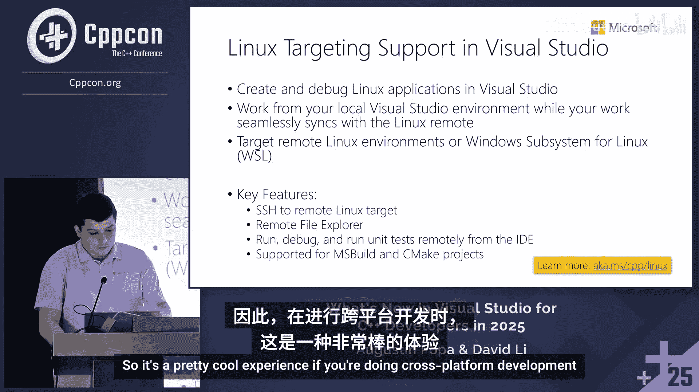

All right， so I think all of us have just seen agent mode in action in Vi Studio the。

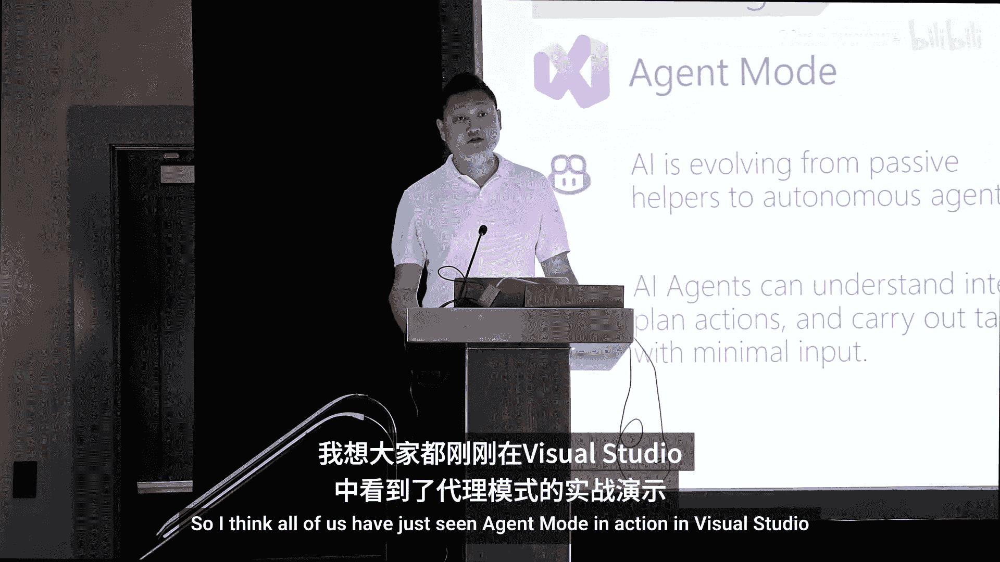

The thought behind agent mode is really。Helping you。Do your entire edit， debug cycle。He's there。

 step。Stepman step of the way， right。And some， some things that agentnt Mo can offer is autonomous multi sub execution。

 context where automation。 So， for example， if you have a debug build。

 if you have a release build Age Mo will understand that context and apply it in the actions and the replies。

And I， I just mentioned debug and release。 Well， I'll hold on to that and we'll show you some improvements in that area very shortly。

And lastly， AngelO can really help you with testing and debugging automation。This is a great time to。

 No， no more excuses for not writing comments。 Uni tests。 Copiette is there to help you。😊。

Some other GiHub Co improvements in Viual Studio。 there is now the free tier。

 so you can try that out。In addition to agent mode， we have added MCP support。

We have seen some of the C++ completion enhancements in action。

 as well as the model picker very recently we have added bringring your own model。

 So if all of those many， many models that are available to you and you're still not satisfied。

You can now bring your own motto。So Augustine showed you a new some new non copiette features。

 For example， the word wrap and notation， as well as enhancements to the search window。

We have also revamped the entire change signature experience。So you can now hover over your symbol。

 press control period， and the change signature dialogue will show up。 Now。

 this is a brand new interface that allows you to drag and drop your signatures。

 so you don't have to you don't have to manually change your signatures。And lastly， very。

 very popular requests， you can now save your file with a specific encoding。It's now available。

 Please try it out。 One of the top voted tickets on developer community。

So before I get into managing libraries and building a project， you know。

 hope you have taken away some of the productivity features because everything team has worked on is really to improve your productivity with copit and with your editing so you can focus on what matters most。

 which is coding。

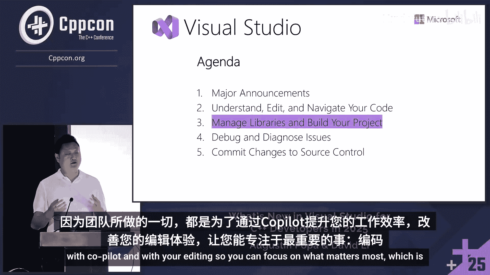

All right。All right， so we're in the section talking about building your code。

 first I want to remind everyone that we do have clang support in visual Studio。

 you can install the clang tools for Windows from the visual Studio installer if you are a clang user and you want to use say the same compiler to target multiple platforms and it is supported throughout our project systems if that's something you'd like to try out you can see there's like aka M links there in the corner So every time you see one of those yellow boxes。

 you can always navigate to that link， we usually have links to blog poster documentation if you want to learn more about these topics。

 So just a reminder that we do have clang support in visual Studio but I really want to talk to you about MSVC build tools which is our very own compiler and build tools that we have for Windows development if you want optimized build performance and to build secure applications and libraries we've been putting a lot of effort into improving our STL and our compiler and our runtime performance just to make sure that you get the best possible experience building。

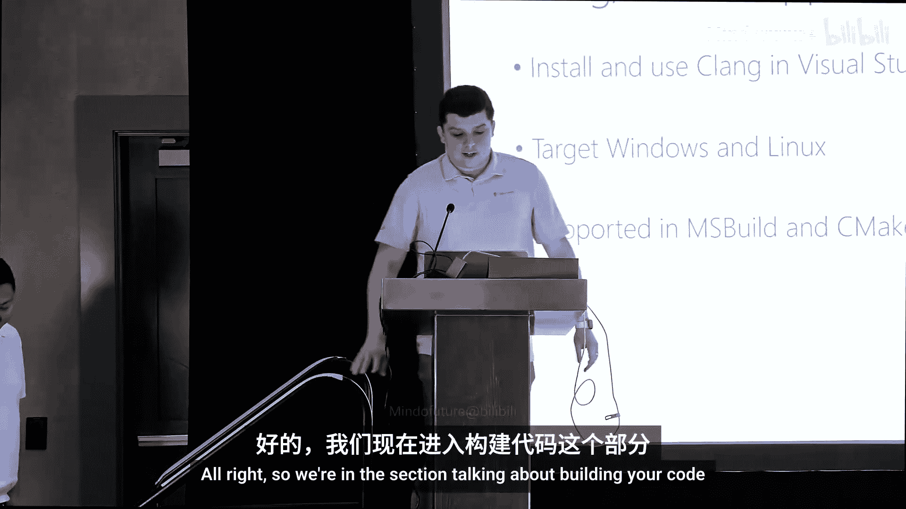

C++ code on Windows in new and Visual Studio 2026， we have MSVC Bill tools version 14。50。

 and if you're using MSBuild， you want to set the platform tool set to V145 to use that。Now。

 I know many of you may have questions about。Where we are in terms of C++ conformance。

 so we've been adding more C++ 23 features we're really trying to close the gap there and catch up and become C++ 23 complete。

 That is our top focus right now there's a list there of the different features we've been adding you see if you can see formatting ranges there that's something I was showing in the demo but we're continuing to work to try to complete the remaining backlog of c++ 23 features so we can say we're C++ 23 complete but right now if you want to try them you can use the stood C++23 preview switch and at some point that preview will' go in it'll just be C++ 23 once we are completely done with it but there's also stood C++ latest switch for features even beyond C++ 23。

If you do want to learn more about the recent improvements in the compiler and STL。

 so we came out with a blog post last week on compiler updates and the new 14。

50 update at that first akas link you can find it on the Microsoft C++ Team blog and if you want to see any updates in the STL the Microsoft STL is open source and we're very transparent about all the progress there there's a nice change log that shows all of the features that are being added in each release and there's an overall view as well as seeing like overall for C++ 23 for example what's in and whats still needs to be done So I recommend checking that out if you want to。

To learn more about it and we did a little bit of progress as well to C++ 26 in support including standard library hardening。

 we still have more work to do here of course， so we are focusing on getting C++ 23 conformance。

 but we will continue rolling out updates here as quickly as possible。

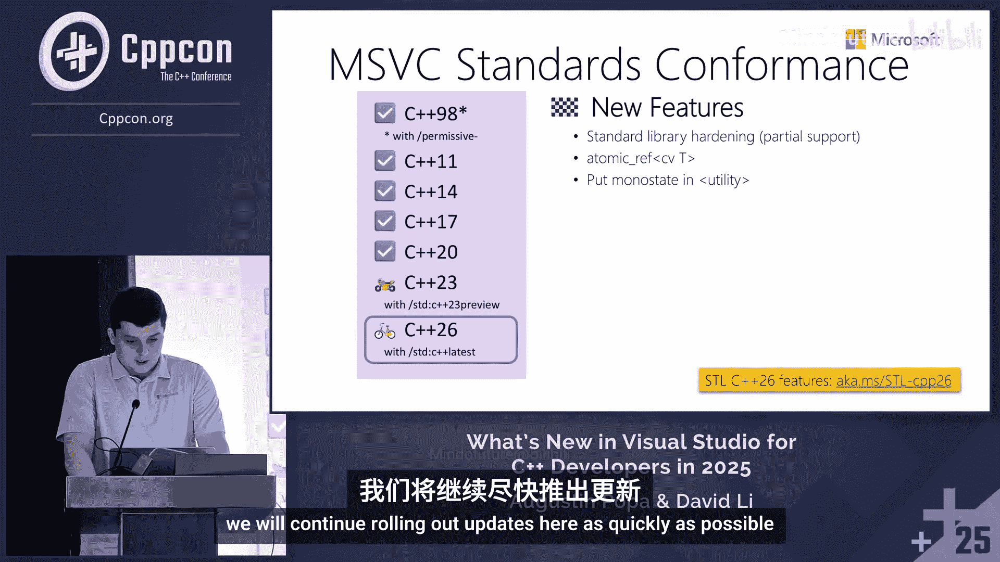

。

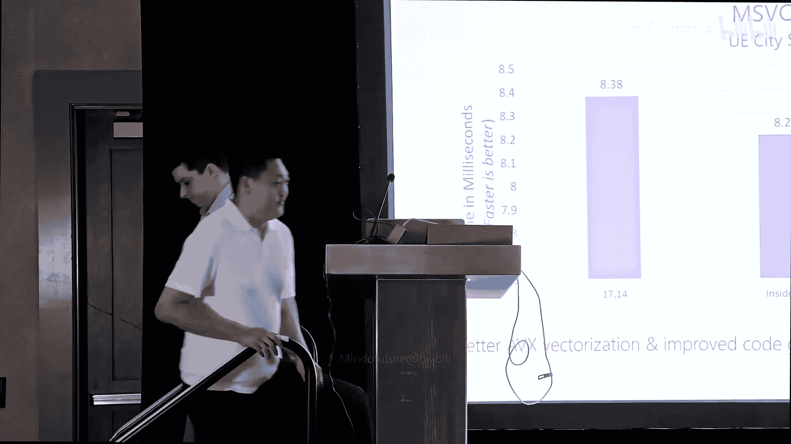

Alright， so at the booth， I've gotten some questions of like， what's the。

 what are some selling points to upgrade my compiler to the latest。

 And one of the top reasons is performance。 So I' am a game developer。

 product manager and I work with a lot of game developers。

 and one thing that is on both game developers。 and those of you are working on large projects is runtime performance。

😊，And over the past year， the team has been working really。

 really hard on improving runtime performance in MSVC。We have partnered up with Epic Game。

 to learn some of。The ways our compiler can be made faster， thanks to their comments。 And。

 for example， we are benchmarking MS SVC against Unreal Engine City sample with the Xbox series configuration。

As you can， as you can see here render thread from 1714， we already have very great improvements。

 And in the next upcoming weeks and months， you'll continues to see even more improvements to our compiler as we。

😊，As we get close to the stable version of。180。Similarly。

 we have also been making a lot of improvements in。For example。

 the MSVC game thread for runtime performance。And all of this is possible。

For thanks to better A V X vectorization。 And we have improved cogen for str fields and branches。Now。

 I know build performance and runtime performance is on top of their one's minds。 So， you know。

 if you， if you're not on the latest， please you know。

 try and convince your team to upgrade to the Li compiler。

 and if all those performance improvements are not enough。 we do have C plus plus build insights。

Buildingss is a very， very powerful tool that leverages MSVC trace capture technology to generate an E T L file。

😊，With building size， it will run your build， get an E T L file。

 and you'll be able to see many different views。 For example， headers view， right。

 whether your headers could be included in PC H or if there are a lot of expensive headers， right。

 that could be a great reason to use a PC H。😊，Or you can see information about function generation bottlenecks or long template instantiation times。

So just more information at the at your fingertips to improve your build performance。

We have added a lot of new quality of life features， thanks to feedback。

 You can now run building sites on selected files。 There's better filtering。😊。

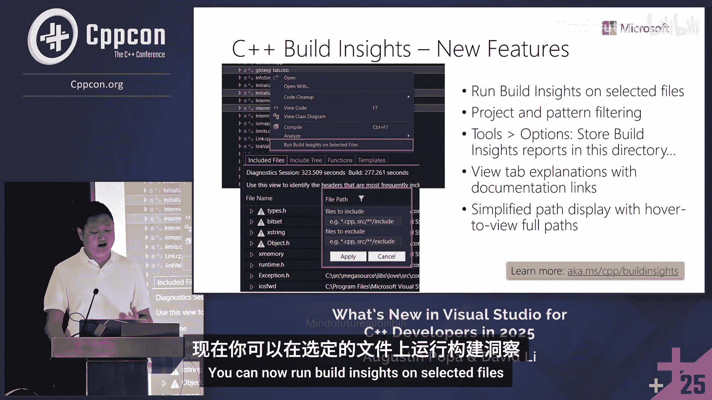

And we have seen great success with， with partners。😊。

There is a great case study if you want to get a understanding of how to apply the insights you have gotten from builds to make changes to your code。

 you can visit AK do M slash build insights MW2 to see how Activvision used build insights to decrease modern warfare war zones。

Bill time by 50%。 A lot of good learnings highly recommend to check out the case study。Allright。

 Code safety insecurity。All right。Just want to talk about a couple of different tools we provide to help you with code safety and security。

 We'll start with the Microsoft CncC++ code analysis experience。

 So this is something you can get as part of visual studio that runs in the background just like when you get intelligence warnings and errors this basically runs static analysis in the background and it can be really useful for finding additional issues like buffer overruns on uninitialized memory no pointer de references and memory and resource leaks it also comes with a number of C++ core checks to make sure that your code is compliant with the C++ core guidelines because you don't want to just stop at making sure your code can successfully compile you want to make sure that your code uses the most modern features and that it's safe and it's written about in terms of how the structure of the code it's using modern features to。

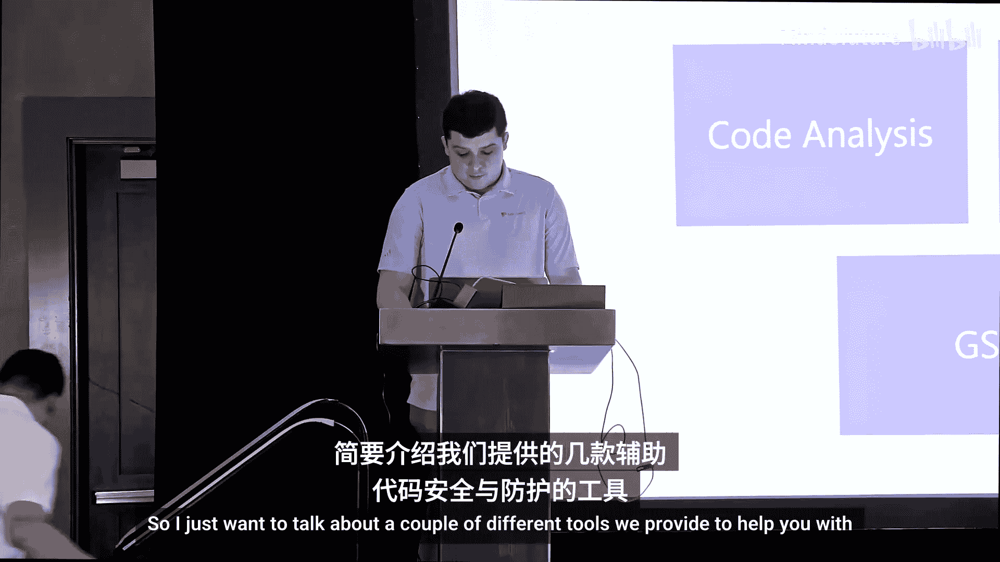

As part of the cobase。 So there are some improvements in the past year to this experience。

 They include new diagnostics for concurrency and locking。

 We also have enhanced overflow detection for allocations。

 as well as some improved warning suppressions。 And if you want to learn more。

 there's the AK dot M link there。Now I talked about static analysis。

 but there's also dynamic or runtime analysis， so if you're familiar with the address sanitizer tool as part of LLVM。

 we also have a version of it for the MSVC bill tools。

 so this is a tool that can that is part of your program when you run it if you add the F sanitized equals address compiler flag。

 it'll help you identify hard to find bugs with zero false positives。

And it identifies an additional cohort of issues that are not caught by traditional static analysis tools。

 so we recommend running both the code analysis experience as well as address sanitizer to validate your code changes or even just run it through your entire repo and see if there's anything historical that maybe you never got caught in the past to help you improve correctness and memory safety and secure your code and just in general stress test your programs and I do also want to announce here that we are working on Ar 64 support it will be coming in a future insider's release of Vi Studio 2026 So this is the very first basically preview of a visual Studio 2026 that's available now。

 but there are a few more updates coming shortly so you will start seeing arm 64 support light up which will allow you to build with F sitize equals address for arm 64 projects。

And lastly， I want to call out the Microsoft Guideline Support library。

 which provides types and functions to write safer， more maintainable code。

 which was also updated this year to version 4。2 with new features and fixes and a good way to get started with it is to install it with VC package and speaking of VC package that's our C++ package manager It's available either you can install it standalone or you can install it as part of visual Studio itself and it's a great tool to use to manage your C++ dependencies VC package at this point has over 2600 unique libraries available as part of its curated registry which are built and tested and validated for 15 different common built configurations to make sure that they work with each other and there are any AB issues or version conflicts between them and you can also bring your own libraries to your own libraries to VC package if you'd like and we have a number of advanced features to help you customize your experience whether you're a student or a professional developer depending on your。

You can control what versions you want of your libraries。

 you can control how those libraries are built because VC packages is designed from a build from source approach so you build your libraries from source exactly the way you want them so that they work with a consuming project and with each other and you only need to really do that once or anytime you're changing your build configuration for the first time because we have binary caching to cache those binary so you can just reuse them in the future and VC package will detect can I just get the binary where do I need to do a new build so that can save you a lot of time there and VC package also works in an offline or air gap environment with the asset caching feature which I also recommend checking out if that's a requirement for you。

And in terms of what's new in the past year， there are some performance improvements and thanks to some great community contributions as VC package is an open source project。

We have improved package installation speeds and improved binary caching restore performance and GitHub dependbo also recently added support for VC package so if you're a GitHub user。

 you can update your libraries basically automatically what the Penbo does is it submits a PR to your repo and it will say okay here's the list of updated libraries and it uses VC packages versioning baselines features so basically you can update the baseline and your VC package manifest file and that will update us all of your dependencies at once to new versions and those new versions because they're all on the same baseline they should just work with each other without you having to go and figure out what's the individual version of VC library that I need to set to make sure I have compatibility between them so I definitely recommend checking out that experience in giving us feedback。

Right。Alright， so we have talked about improvements in your when you're editing code and when you're building your code。

But what about when it comes to debugging。So。As a game developer product manager。

 I have chatted with a lot of AAA game developers and learned that actually。

 a lot of the same issues that game developers face are applicable through common everyday， C。

 plus plus。Applications。Now， this is especially true if you have a very large project。

So before I get into my demo， I want to you know， ask folks in the room。

 Ra your hand if you have a debug and release configuration。Hey， that's quite a lot of you。

 And raise your hand if you tried debugging and release recently。Okay。

 so what are some of the issues that are common when you're debugging your release build， right。

 Your build is so optimized， right， optimizeim for speed。

 game developers tell me that in debug configuration， you know， you get a lot more debugging support。

 but the frame rates might be atrocious。Now， if he tried to do the same thing in release。

You might not get all your locals， right， Vaable is opt miles away。 Very common Red X。

Probably not a great thing to see， but unfortunately， is there。But also， when you're。

 when you try to step through your code， your pointer just jump everywhere。

 you don't know where it's going。 It's unreliable。So now， what if I told you you can have both。

What if you can have full debug ability with your release built。

So that's what I'm going to show you in this demo， along with some other copala integrations through the debug and diagnose cycle。

So give me a minute while I jump over to Viual Studio。 I'm going to actually。

Disable that and continue。So as you can see here， we have this later Cy game running，60 F S， right。

 This is released。 This is not a debug build。Let me go back to visual studio， and reactivate my。

Break points。Now， this is。We're in something called the new C plus plus dynamic debugging mode。

What we can do here is first thing I want to show you， if you go to the call stack。

You can see that there's a new， de optimizeized。A new the optimized tag for this frame。

 What this means is。The current frame you're looking at is the optimize。

 So how this works is we build your binary twice， onces in release and once。

Once optimized and once unoptimized。 And as soon as you put a break point on there。

You'll get to the de atomized。So what can we do， right， We can step in。 So right。

 now we're in the force in line function。 This is just not possible if you're trying to debug your release build。

 Okay， what else can we do。We can step into the next function。

 which is this calculate transform bounds， okay， so we have some variable declarations。

And if we look at our glucose window， we can see all of our variables。What else can we do。

 We can tell it to run to cursor， right， because now the instruction pointer actually knows where to go。

Right。We can have it run to cursor。Or you can right click on the line。And set next statement。

Once again， these are not new debugging features， right。

 These are debugging features that were available for a very long time in debug configurations。

But now you can do it when you're debugging your release bills。

So let me step out here and show you one more thing。 So we only the optimize frames you care about。

If I go to this frame， for example， you'll see scene。The typical variables optimized a away message。

So how can you get around that？You can select your frames with other control or shift to select more than one。

Right， click。And de optimizeize on next entry。So once I click that and just let it break again。

 you'll see that all the frames that we selected。And especially the previous chaos engine interface。

Is the optimized。 And here， the scene variable is available to you。

So we store all the breakpoint in a de optimized breakpoint group。

What you can do is you just select all of them and delete them。

If I disable this breakpoint and press continue。You see， hey。My game is back to fullux frames。

 So this is how you can get full debugability with dynamic debugging， okay。Now。

 I'm gonna set the breakpoint again。 One more thing that I want to show you。 So previously。

 we're in some rendering code， right， this could be a common first place for you to see mesh glitches or something。

 right。And。Something that we have added is additional integrations and parallel stacks。

 So if we take a step back from the rendering code and see our code as a whole through the parallel stacks view。

This is a view if you're not familiar that shows you what all your threads are doing。

 Un real engine is incredibly optimized and has lots of threads going on。And。

One of the first things you might notice is we have added a new。Threat summs。

 So you don't have to guess what your threads are doing。 Co Po will tell you。

And there's always a generate insights button。 If you want to find out more of your current application date。

Okay， in the interest of time， we'll actually go to our next part of the demo。嗯。

By activating this breakpoint and。Hopefully， if I play around the game a little bit more。

 the brick point。The brake will activate。So。Now， we were in some rendering code。

 We saw all our all the different threads。Here， I want to show you one more addition that we have added to the debugger。

 So how many of you are familiar with conditional and dependent breakpoints。Okay， great。

 So one of the things that you can actually do is if I set a break point here。

And we go to conditions。Copi will help you figure out some conditions。Right。

 so this is a great way to improve your productivity。 Perhaps you already have something in mind。

 which probably not the case， right， In this example， I don't have something in mind。

 But current heat is less than max range， I don't think any of these are helpful。

 But what if I know that some action happens when the current heat is in a specific energyger value。

 right， what if it's4。So this is a great way for you to see that。

How CoPoli can help you improve your productivity。Throughout your loop。Okay。

 one more thing before we move on。So everything that I have talked about up until this point is not game development specific。

 Even though I used Un engine as an example， dynamic debugging parallel stacks and all of the copit features are very applicable for all C plus plus。

But for Un Engines specifically， we had recently worked with Epic Game to add blueprint debugging to our debugger。

 So just like dynamic debugging， you can see a new tag in your cost stack window。😊，Now， what。

 what this does is when you're。When you're stopped。You can double click on the blueprint。

So we have this， which reminds you， you need our Vi Studio integration tool。

 I'll talk a little bit more after the demo， but。Once you click on the blueprint frame。

You can now go to your blueprint。You can see all your blueprint variables。 For example。

 your node pins see what the values of all the blueprint variables are and。For example。

 if it's something that you're not familiar with， flow stack， could that possibly mean。

Click on the little Github icon next to that variable。

And then Gitthub Copiette will take in the context of your current application status。

Get that variable information and give you a very detailed summary of 8， what your variable is。

 But more importantly， what your variables values mean could potentially mean when your。

Program is stopped。Okay， so the debugger agent is looking through various files。

It thinks some files are available， but not。That's O。And you can see here， right， We have tasks。

 We have a plan。 read certain amount of C plus plus files for you for a Co pilot to understand。

And then itll give you the value of flow stack and what it means。Alright。

 let's get back to the presentation。Okay。So。Following our unreal engine， specific improvements。

U project is our new project system for unreal engine projects。 This is very。

 very helpful compared to the traditional solution。open solution。With you projects。

AndRe engine developers will have a faster and more accurate intelligence because Visual Studio now has a lot more additional contexts compared to the solution。

And as I mentioned before， Vi Studio integration tool is you can now install it directly in Vis Studio。

We actually have removed it from the Fab marketplace because you can。

 we don't need the marketplace anymore。And it is also not needed for blueprint references。

 something that a lot of customers have told us that it is valuable to them。

 So we have then moved that feature from the plugin onto Vi Studio natively。

But if you want blue extra blueprint debugging information， the Studio integration tool is required。

And as I've shown you， you can see your blueprints in your Cossack window。

As well as all your blueprint information in locals。

I have also showed you a variety of co palate improvements。

 specifically in the debug and diagnose depth of your workflow。 So breakpoint suggestions。

 variable analysis。And， of course， parallel stacks， very powerful。

 tool that got even better thanks to copal。😊，And。Of course。

 the biggest thing this year to our team is dynamic debugging。

You no longer have to see variables optimize away， and。And use a pragma， optimize workflow。

We have been working very closely with our game developers。

 and this is now available in Visual Studio 1714。 and later。

 we have a very detailed blog showing you how to activate C plus plus dynamic debugging。😊，Now。

 as I mentioned before， we're working with a lot of internal partners to make sure the feature fits the need。

 right。So from the coalition to game developers at Halo Studio。To developers at rare。

 which Keith is actually here in the audience with us today。

 So Keith will be a great resource to know how dynamic debugging works on a practical level because he has been using it since January。

😊，Just some additional tidbits。 dynamicynamic debugging is X 64 only。 It works with Xbox， fast built。

 Incred build and Unal Engine 5。6。 It still works with unrealreal Engine 5。5 and earlier any。

Only need to cherry pick a few changes， and it's not supported for L TC G， PGO。

 up I CF and incremental linking。We have a deep dive on Thursday， where。

Our engineering lead for dynamic debugging will go through a technical deep dive into how the team had come up with dynamic debugging。

All right。

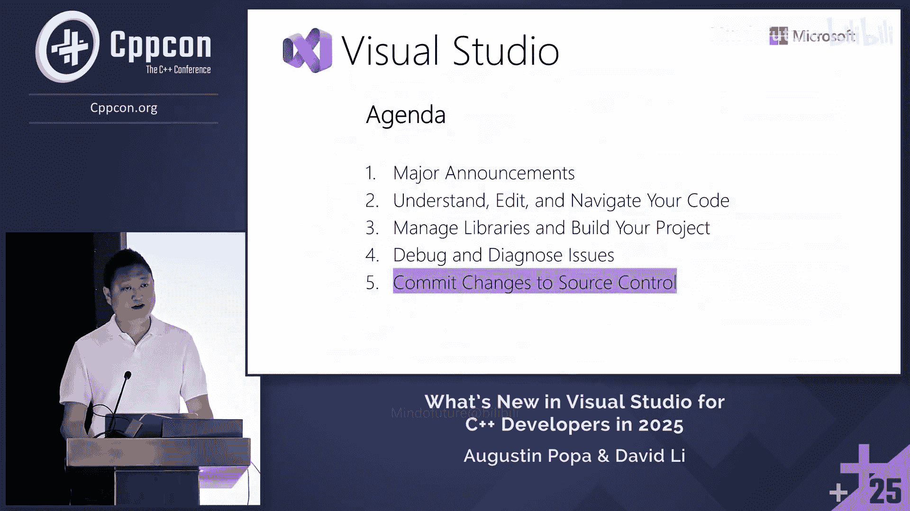

In the last part， I'm to hand it back over to August。All right。

 so I showed you some of the source control features that are available in Visual Studio。

 some of them have been available for a long time， but we continue to add to them over the years。

 so if you want to have a graphical user interface for managing your source control needs there are lots of features available as part of visual Studio and some of the newer changes over the past year there are some improvements to managing renamed files。

 PR drafts and templates。

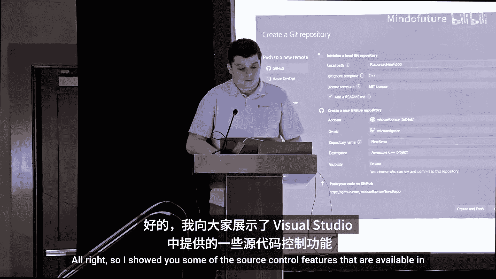

There we have support for internal GitHub repos as well as multirepo support。

 and then I also showed you the writing and customizing Git commitit messages and being able to set a template for them as well so that it's always following the template and it's also giving you like a tailored list of exactly what changed in your particular commit by looking at the differences in the files。

There have also been some improvements to the feature for adding PR comments so you can add PR comments yourself。

 but then we also have a code review feature where you can have copilot code review your code at the commit line and generate some additional comments in case you happen to have missed anything and again that's something you can just kind of run in the background while you're doing other stuff。

There's also a filter for viewing outgoing and incoming commits。

 there's a new button in that Get changess window。And then new to this version of Visual Studio in 2026。

 so a feature I didn't get to show you， if you go to Copilot Cha。

 you can type like hashtag Git changes and that basically gives it some context to look specifically at what's changed in your files in terms of Git。

 this can be really useful for summarizing changes that haven't been committed yet or explaining specific commits and it can help basically figure out okay what actually changed from A to B。

So you can basically reference specific commits and changes from the Good Change window in Copit chat。

嗯。And we've continued developing the code review changes with the code review experience with Copilots。

 so this was added in the past year， but we've made some improvements to it as well in 18。

0 so it should be a bit more accurate and more useful than before and lastly we have in line comments in the PR DVi。

All right， now I want to remind everyone， so the mission of the C++ product team at Microsoft is to empower every CQL++ developer and their teams to achieve more and we do this to the various developer tools that we've been shipping for a long time we are one of the oldest one of the oldest teams at Microsoft and we've been continuing to develop our tools over the years to try to help make you as productive as possible in your C++ development and we would love to hear your feedback on our tools as we continue to iterate on them and make them better for you。

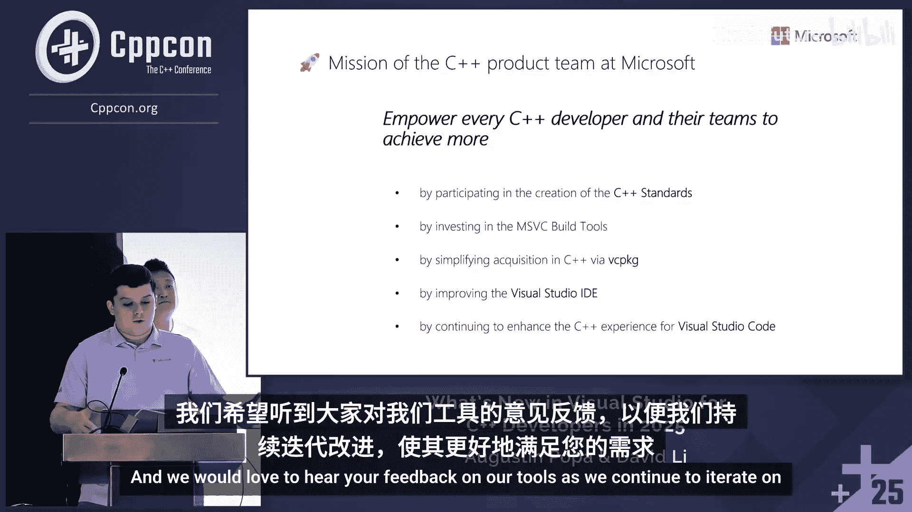

And then finally， so just a reminder we have some other Microsoft talks at CPPPcon。

 some of these are in the past， but you can catch them on YouTube and there was a VS code talk this morning and there are a number of other talks later in this week as well I also want to remind everyone to please take our survey there's a QR code there in the corner where you can go to the AK。

 MS link your feedback is really valuable to us and helps us decide what to prioritize for future updates of visualual Studio or Vis Studio code or MSVC or VC package or anything else that we're working on for you。

And if you do enter the survey， we are giving out we have visual Studio and visual Studio code So while supplies last。

 if you take the survey and stop by our booth， you get socks and you also get entered into a daily raffle for today。

 tomorrow and Thursday to win a Lego prize。And with that。

 we were happy to open the floor to any questions。 If we don't have a lot of time left。

 but we're happy to also talk to you at the Microsoft booth afterwards。I have one question。

 just in relation to V package versus Muki。Both practice managers are in there。

There any preference was one taking priority over the other。

I would recommend using VC package for C++ dependencies and Newgi for dotnet ones or for anything that isn't a library。

 maybe maybe some other type of binary file in need to get。

And also Newget is more applicable TMMS build projects usually。

 and I know you can use it outside of MSBuild， but that's usually where you get the best experience。

 but in general for C++ dependencies we'd recommend VC package it's much better designed to handle C++ problems than Nuget。

 which is more for doneette。So we are out of time， but we'll just be at the booth around the corner if anyone has more questions。

 Yeah， please follow us to the booth for additional questions and thank you all for attending。

