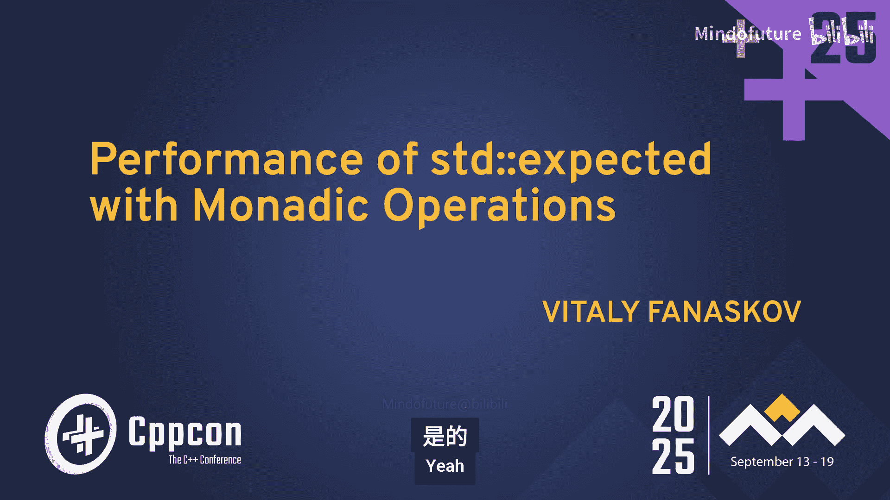
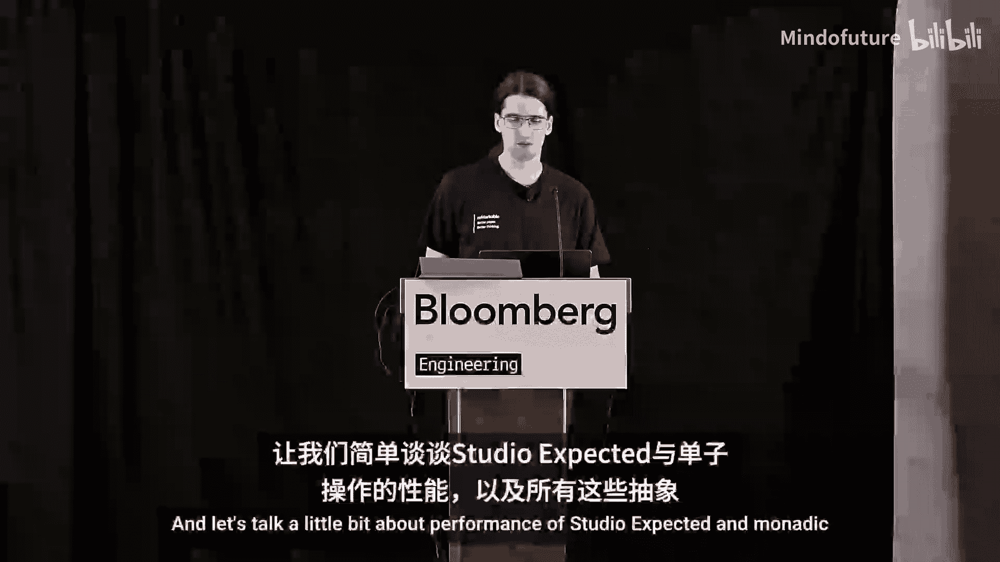
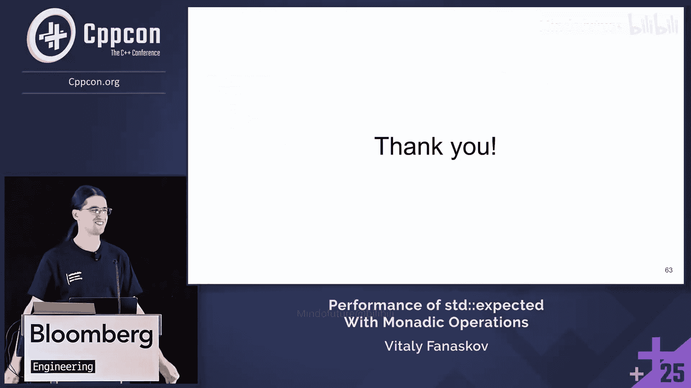
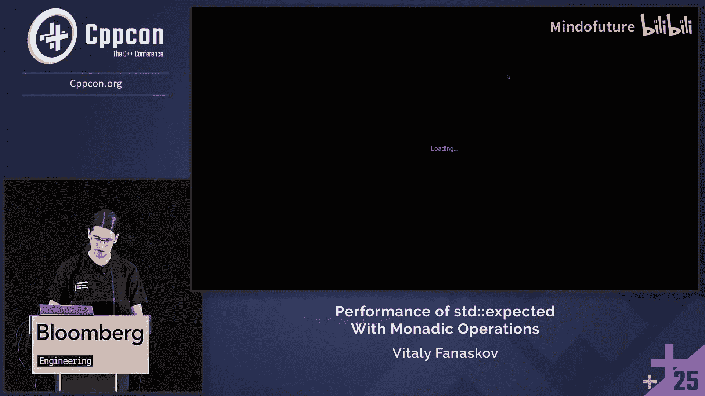
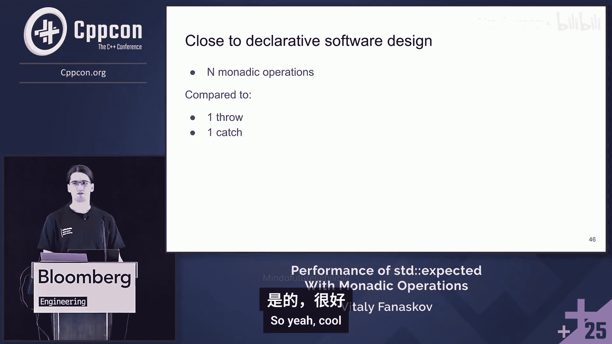

# Cppcon-2025-｜-C++-｜-C语言--｜-汇编-｜-编译器-｜-操作系统-｜-Linux-｜-Windows-p56-P56_stdexpected与单子操作真能提升你的C++代码性能吗？-Vitaly_Fanaskov--BV1wyPBzrEeu_p56-

🎼Attending this CPVCon you will be at a level which you haven't experienced and which you haven't ever have thought of you'll come to learn about many things which haven't been exposed to you before so I'm sure you would love to be here and once you experience this you'll be like I want to come next time and you'll not miss this again。

All right。Its working， yeah。

we can start。So you can come close if you want to see slides or to see me better。

Thank you for joining me today and let's talk a little bit about performance of student expected and magnetic operations or this abstraction。

😊。

Let me introduce myself first。 My name is Vitai， and I worked at remarkable。

 remarkable at a Norwegian company。 and we are doing this absolutely amazing。😊。

In notpos so on this screen you can see our latest model that we released like a few weeks ago。

 amazing stuff， you can check it out so at this company I'm working at the App foundation team as the principal software engineer and our team is providing some libraries and framework works for other team but not contributing into the user facing features。

😊，For today。I， at the very beginning， I sought to talk only about expected and the performance of magnetic appears I' expected。

 But then when I started， I realized that it。Doesn't make too much sense。

When its hanging and documents were still abstract。

 so that the reason why we not only look into the magnetic operations and expect it。

 but also compare it with the closest competitor。And bear with me， I'll tell you why。

So we will start to be error handle in general because if you use expected exceptions or similar stuff。

 I assume you need error handle or handle unexpected situations in general。

Then we' will talk briefly， very briefly about expression expected。

 look under the hood of expecting magnetic operations to realize what can have performance impact and what should not have performance impact and。

Similar things。 So then I a few benchmarks for you I put it here。

 I do not like this synthetic benchmarks， but there are some interesting things。

 and I made some interesting fresh observations。 So I'm gonna share them with you。

And at the very end， I have very few practical recommendations on what you can change to potentially make it slightly faster or。

Do less at least allocations。So let's start to with error handlele in general。

And my first question to you， are you familiar more or less with all of these cases of error handling methods like reach own Sc。

 and I don't have to read it you can do it。So very cool。

 I made this talk a few years ago another conference。

 I wish I slide you don't need to make a photo so that just for you for convenience So this about different our handlele methods and your knowledgeish in this area a little bit trusty。

 So just please have a look and in general I want to invite you to visit our Norwegian NDC Techile conference then hosted nearby Olo。

😊，That's a nice event。So now what and why。I'm going to compare kind of exceptions and still expect it。

Because those two methods provide similar flexibility。

You have an issue and you need to know what happened， not only that there。Issue happened then。

The similar use cases， nearly， I will show you there are some called Ss and then those two I can consider as the closest alternative in general。

Yeah。I know that can be serious the question， but are you familiar with exception guys。Very cool。

 So very briefly， three slides。 just to refresh that。

 So what the exception is that's when you have an unplanned event that occurred during a program execution and you create a certain object of exception type。

 Then we hand this object over to the system around time with thorough instruction。😊。

Then they're on time looking for the certain handler for it。

 And then if we match handler in catch block， then we're good。

 and if you don't then we are not so good， that would be。

Termination came their and was like your program crash after that。

There are four cases for exception safety。 I'm gonna talk much about it。 So。

 but the first one is when we have no exceptions。 So not there are handling methods。

Then we have strong exception guarantee。 It's very close to transaction stuff。

 and you can roll every Sberg。 Then the basic one， the basic is kind of interesting。

 It imagine that you had。 I'm not sure what like a document or something And you edited this document。

 and then the。Something wrong happened。 You have your program。 It's running。 It's in a good state。

 But， you know， you all stole your data。 So that's what the basic exception guarantees about that the most common one。

 I guess。And no exception safety。 That's bad。 Everything can happen。So we are not built there。

 So this very small example of the exceptions。Vectctor of three elements。

 and we are trying to access the force element here， but assuming that it's third element。

 so in this case Ed will throw an exception。And I guess I tested it with GCC so that you can see an arrow like this。

How can we throw an exception， how it works， You just， for instance。

 this element by index method or pretty close to add， we check if we are in arrange。

 if we have to arrange， we throw an exception， our device we use the square bracket separ to get。

The element。That's it about exceptions， let's talk about expected。Another question。

 So it's much less widespread。 So are you guys finding it was expected。

Please don't lower your hand yet。 Have you ever used it in your production code。Okay， good。

 thank you。So then this is a very basic example of standard library expected。

 so no custom limitation or something in they have an expected books。I use these notations。

 so you can imagine this expected stuff as a box where you put something and then you can process it more or less common way。

Report。42 here， then we just bring the value。V， you expect it。

It's the same as exceptions when an operation can fail and we need to know why this operation fails。

 so this not just option not as an option of that。Simply as the the presence or absence option。

 but there is some data like here， for instance， if have wget error writing from this server。

 we can understand what happened to Wit。If an error。

 we use this unexpected to distinguish what the error and what。The value。

 because you can have the same type for standard library expected for value and for error。

 And if everything is right， we just return to Wiget here。If we need to work， with expected。

 we can use regular methods， regular Eavs。And we can for instance check if there is a value。

 if there is a value we're working with this。😊，If there is an error， we do something else。

 We handle it somehow。Then there is more robust way ofre doing pretty much the same。

 so we get in widget and then there are magnetic operationss。To do simulations。

 if everything is fine， that we invoke this function。The text the wget is a parameter。

 so and then we can do something with a wget。We can also invoke transform， for instance。

 this function cannot potentially fail we only change the type or doing Samsung with an object。

 It's not necessarily have to change the type。So and or else is to just recover from error or just add some metterada or doing something when we are in an error stage。

We have four minority corporations。The regular transform that can change the type of the value or just adjust the object and transform error。

 do the same for error。And then， and or else。Where you can not only change the type。

 but only return an unexpected object if the operation fails。And the same four or else。

Here I put slightly different stuff so that stands for that you can change the type of value here。

 but not the type of error because there are risks to lost your error and this vice veros from or else。

I'm not going talk a lot about the exceptions themselves Last year here。

 I have a talk about minority operationss in modern C plus+ and mostly about practicalities of how can we use it or the caveats and so this talk is already released on YouTube。

 So you can just go there and watch that。 The reason why。

I'm not talking a lot about minority operations themselves and how to use them。However。

 there still expected has some。Rather important implementation details that potential affects performance of using this type。

So first of all， let's have a look like the types we have。There are three types。

 one type 4 unexpected。 you， you seen briefly。That's a type that' used as a wrap as a talk to distinguish between whether we have an error or value。

So not surprisingly we have。Expected here。 So technically， our exception can throw an exception。

Ha the the bit consistent anyway。 So then we have expected itself of the T and E。

 the T stands for the value and E for an  error。Under the hood of stood expected。

 we have the following data structure。So this one， my belief is copied director from the standard and。

It's implemented nearly like this。 And GCC standard library。 I'm mistaken。

 So we have a union of value and an X and X for an error unexpected。 So。

 and not that it's not unexpected of E。 right？ So that's the reason why you can have the same。

Type of both value and the error。 And most important， right now。

 we have this bulletin flag has value that we have to carry around and that we're gonna check every magnetic operations。

 So which can already tell you that there will be at least one if pair mon operation。

There is a simplified version of， and then。So。You can see that。

Here we have at least two potentially problematic places。 So we have one ifve， as I said。

 that always checks for value sign。So and the second one， if there is no value， if there is an error。

 we ver or unexpected into the return type， then we deduced based on the function return type that should be expected of T on some T and the same error。

And then， we。I sendend the filter on the chain。 So here already， you can see that。

We need to do one if check at least。And we have potential copierormo。

Operation on the unexpected value。If you look at the transform operation that's again。

 simplified version， we have much more static core types check in real implementation。

 but looks super close。So we have this u type that the function。

 return type and then we have expected so that should wrap in this type because you can re up type but you can change error type and if there is an error you have to carry it further。

So and it's pretty much the same as and then。 So you first have to check the value， the same issue。

And then， you have to。Return your value also wrapped in the return type。No else。

Or else it's just the mirrored and then in a sense。You just need to check this if there is a value。

 then you just simply return this value first， you do not invoke the error handler at all。

But you still need to check this sign。Of the value and you need to wrap your return value into this type stand you here。

For the transform error， this mirror transform pretty much。So we just check if there is a value。

 if there is a value， which has past the tro on our magnetic chain。And if there is。In error， we just。

Invoke the handler and gophm。So what kind of potential issues do we have here？

We have obviously they always have to check what that has value at every step。

So we have E structure inside of each endeavor operation。

And they have potentially copies of value or error。

 because just imagine what if your type does not support move operations So。

 or if it support only move operations， that also give some。

Well I would say constraints for the entire time Ana chain you have。And then result type。

Result type can be completely different。And it also means that we。

Not always can do proper alls or proper return value optimizations， or not be but compiler。

 So it prevents it from it。So now since we look under the Hoot to the boss， okay。

 back come look under the Hoot to exceptions， to be honest， and we're not going to do that here。

 but we just looked at a bit how it works。😊，Both competitors， let's call it this week。

Now let's compare the implementation。 I have the very。Simple function。That square root here。 So， and。

You might see that， you know， those two functions are new identical on the。Left hand side here。

 if the value is negative， we just assuming we cannot handle the case， but the value is negative。

 we just throw that the argument is invalid， otherwise we just call standard square root。Here。

 by the way， police noted that many of the expected function here， the mark does now accept。

On purpose。 So and the result type here should be expected of something。

So I have expected to double and to swing because I use strings as an error in more in real code。

 You most likely will be using。Separatortype at this per library， if like per component。

 for instance， depends on how you handle the errors。

So then which I simply create student expected if it's negative and calculates square root。

If everythings fine， if we can do that。How do we compute， How do we use it， I mean。

 we can use a different way， but I just put it right here。 So if we have。

Regular code without expected。 We can use it like this。 So log then square roots and log。

 just imagine that we have all other functions like log。And so on that follows the same notation。

Because to compose magnetic functions right here， So log and then square root and then log。

You need all of them to return the same or like not the same but。Convertible expected types。

 a device you cannot chain。But you also should notice that there are at least two hidden ifves here。

 so we first。Create the object invo function。Then we check if there is a value on or there is a error unconditionalally。

 we always check it。As we've seen from the implementationmentation。So then。The invoke。Square root。

 And then we also check again if there is an error of there is a value， and then we invoke log。So。

 two hidden es。How do we handle all of this like errors if anything goes wrong？

So those also like pretty much close。Here， I want that we are not。

We are not using like magnetic operations here or something else。

 Imagine that you kind of live in this middleware space where you already cannot use magnetic operations anymore。

 cannot use functional code anymore。For example， you enter an UI domain， right。

 and your UI framework is not decative and cannot work nicely these expected objects。

 You need to convert your to something。 You need to print it。 You need to do something like this。

One of the problem。Most famous。Your have frameworks for CPP is good。 So。

 and if you want to integrate your。Lo trick。The back backend implementation with the UI written in Ql。

 you just do not have the good abstraction around to say， okay， fine， I return from this operation。

 Sam seem expected convertible， and then please handle it。Furthermore， the UI engineers。

 they usually handle errors completely different way。So that's why in these particular example。

 we just handle its like it's a fine handle。 say we do print line or we do login。

And on the left hand side， we just hit the argument and print something。

 And here we do not use magnetic operations。 We just take if there is。Where be printed。

 If there is an error， we also print it。 So if say it's U I up。

 it will be printed in the lock and you。Or an engineer， like or a user， you'll see it。Now。

 since we are talking about the performance。I have some。Reference data， let's call it this way。

So here that's you don't really need to read it， even if you can read it but。

I will better version on the next slide。 So here， for instance， you have a right branch of weve。

 you just compare。 So it's algorithmmically scale scale。

 So here here you have a the first right branch of we on the second or you have own branch of if this use prediction。

 And then the on the very bottom， you have stood exception then thrown and code。

 also it's like on the thread context switch slower than this one。😊，Now just please。Try to calculate。

 I'm not going do that to complicate it。 How many。If even mispredicatives you can do for on the cynical exception thrown and caught in your program。

Again， were talking about just regular exceptions， no optimizationim， No some。

 no something like that。 And we're talking about just regular minority operations and regular expected。

It turns out you can do a lot of minority operationss in comparison to the only one exception thrown in court。

There is Sarah the old paper here， why exceptions can be。That's slow。

So I'm not going like you know watch or spend too much time on it。 You can just navigate and read。

 And I know that people， some implementation fixed many of the issue， but。

I doubt that those I put on the slide traffic。 So basically exceptions are allocated in dynamic memory slightly。

So， and then you need to use global synchronization primitives for this。

And those probably two things that make that even。Presence of the exceptions。Much slower。

 even because。Exceptions are known like for these kind of zero cost abstractions， right。

 If it's not thrown， there is nothing， but， I mean， there is something right。

 And it's a little bit of benchmark， synthetic benchmarks I will show you in the next few slides。Now。

 it's time to do some benchmarks。And。This doesn't mean that I will not show you benchmarks。

 I just want to encourage you if you have any kind of good use cases or like you have your own problems。

 please do your own benchmark and do it with a certain build type。

Just have your build types sorry as such in release。

Or release with the debug info mode because if you say measure anything in just debug。

 I assume you do not give the debug bills to the end customers so that doesn't make much sense unless you really know what you're doing。

So then use obviously here2 chain that close to production。If you have custom hardware。

 you should use this one as well。So。And then data types are also important。

 I will show you some cases and how data type can。Affect the performance。 But basically， you saw the。

Second red circle on my slides。 And that's where you re your type end that's it' is not easy to move for tocoia that can affect badly。

 Then you can have different number of elements， different number of operations。

 And this also affects performance。So， yeah， I would just want to encourage you to do your own benchmark。

 And specifically if you work on。And we did something like， for instance。

 we're doing these small devices and when we test something。On the desktop emulator。

 which is my faster。But the performance results are completely different。

Because hardware works differently， there is screen， there is less memory。

 and the devices in general is much slower。😊，This is hardware do I con of my old home machine where I did benchmarks。

 So probably don't even we need to read through it or memorize some or I mean。

 if you expert timeness and everything。 Ill say to you， this is just。It's a data。

So how to compare and what to compare。First of all。

 we should pick relatively light app and by light operations I mean that the operations that doesn't take significant amount of time in comparison to either branch noiseposition or something just imagine that if for instance a reference operation that what we measure we decide to take Io operation we just write one simple and the disk can read something from disk so that means that we have measure performance on this operation。

 not of magnetics or something like this and we get absolutely similar results I' am afraid for all of the data。

So。Yeah， I'm going to perform several operations in a sequence。 So that's large that。

 but it's more than enough。So 10， 100， 1010 k operations， this small light operations。

We first run without errors like no secured。 So we just run 10，100，10 ks in a row to see the results。

 Then there are we the most common use cases。 So the first use cases。

 we have an error that occurred at the very beginning of the chain if we either have the magnetic chain right on the first separation and then failed。

Or we have the Sam failed in the very middle。 And then we can Sam fail in the very end of this computation chain。

 Or if you throw exception at the very end。So the difference here is that we have certain operations performed normally light person and then。

We have other operations skipped。 So it' either there always or else hand there and。

 but we don't have it。 So it's just V pass an arrow to the end。

And we'll see how it affects the things。😊，And we check expected。At the end。

 or the catch in an exception。 I test the result code。 the assembly and is optimized out。

 are quite good here。You。Let's have a look at the operation code that's super simple and super trivial on the left。

And side you have the operation of vision exceptions on the right hand side was expected。

 and of course， on the bottom part of the side that the code I haven't wrote manually。

 I just generated a lot of code because imagine that you have a 10 K operations and so on so。

 the generated code。Here we just what the data object， by the way。

 data object is is super small object this does two ins。

 pretty much one counter and another object where we see whether this's a or step so we can just emulate that they are acute at the very beginning and the middle and the very end。

Small object that shouldn't really count here。Or shouldn't create huge influence。

So if this wrong step， we throw something。On the right hand side。

 if there is one step we return something or a device the increase counter that adjusts plus plus or permission so that the lightest one。

And then we on an object。So here that the number of operation generated like we do the results。

 we do operation， then we move on to new， move on to new， move on to new and so on。

 that would be pretty much the same。This is what we have on the right hand side。And here。

 the number of and then is generated pretty similar so we have the first operation。

 and then we change the number of the same and of the same operation。Why I decided to do it this way。

 I have to explain， because this is super close to。The real declarative design here。

 I'm using words declarative and functional as a synonyms。 It's not quite right。

 but for this particular token for this particular example， that's super synonical。

 We have N montic operations， like imagine that in the real program， the design this way。

 you can have hundred thousands of montic operations。 composting different chains。😊，And then， if。

Something wrong is happening the your exception or not exception expected objective will be bubbled up to the handleer and this handler is usually located to like。

 I would say very close to what we can call system error handler So and the same is happening for the triC certification error and most likely we will not do transactional rollback So this exception will will be called somewhere to like you know to the very close to the common handler for the errors。

Yeah， that's why we have， again， N magnetic operations for one through N K instruction。That's。

We have first chat when we just done with。 I need to say that both access are logarithmicically scaled because we don't have that many points so that。

Just please bear this in mind while you look the charts。And this， we have time in  nanoseconds。

I two to convert it， gauge does it by defaults and in nanoseconds。

Then we have a number of calls here。 So and if there are even if there are no errors。

 you can see that the more operations we perform the silver， the computation chains make sense。

But tricach is like slightly slower here。Even if just know， please。Consider that we have the number。

 like even here。The were here。 we can like。10 K of extra if checks。So， and。

When we perform the operation without it， but there is only trica in the program， so it's slower。

I pi in my benchmarks。So you can have different results。

When the error happening at the very beginning。So， that's。Growown pretty much the same like linearly。

 But at the same time， you can see that the effect of when we actually throw an exception and catch it。

 it's significant。 So we just throw it at the very beginning， right of the computation chain and。😊。

Just forwarded to these handlers。So you can see that the date is more or less correct。

 so we have this。5000 and most。 And on the previous chart， we have like 10 k。Niseseconds。So oh。

 sorry。That was different stuff。 So yeah， here we have like 50 k。

And here we have like 5 key so that we do not really perform computations in both cases。

 we just at the very first operation， we either rise an exception or we just return unexpected and then all other nearly 10 k pars they are not performed at all。

And that kind of data we have when the exception thrown at the very beginning or when the our unexpected created is also at the very beginning。

That's another interesting case。And with this case。

 we have an error that occurred somewhere in the middle of computation chain。

 So what does it mean that we have， for instance， here，10 operations， right。

 and the error Ac exception thrown or unexpected object created and the fifth operation。 So we do。

5 app。 And then for other five app， for expected， for instance。

 Vcha goes to the else alternative branch if we， we don't do any computations and robust4 expected they are hope just hand over to the system run time。

 and it ends up in the handler。So， and from this chart。

 you can see like then the more objects we have in computation chain that the。Close us。The lines are。

 So for like， you know， if you have 10 K app and there are somewhere in the middle， all of this。

And perhaps the。Right side the operations where you check alternative。Create some well。

 extra time or extra。Borden for the entire computationutation pipeline。

And if we have it at the very end， so you see that they start converging with much more earlier right than before。

So at then the very， we have。Like pretty much situation when no exception acute at all or like when we just have the computation without unexpected cases。

Any questions on those charts， super synthetic， quite far from reality， but should。

Why did you choose to vary the y scales by so much， Like it goes from 0 to 500。

 And there's a big jump between  one and 5000 and another really big jump and 10000 and50000。

 I it difficult to make the correlation Yeah， I would tell that I just say my script to please use log scale for both access。

 And that's it。 So I didn't choose the intervals how they scaled。Because that like， you know。

 if you start doing inter。From this chart， you can like， you know， make some conclusions， at least。

 So how it works and the numbers themselves are not super important。 That's what's important is like。

 you know that you can compare， like， for reference as the top notdge number so that the some operations we are performed or not performed。

So and this you can just visually compare again， for the real cases。

 you might have the chairs can be completely different。

And what you need to do is just if you want to measure， it replace like you know。

 either the entire class， entire component， entire library。For the exceptions to expect it。

 and then profile。So it will not be enough to say replace on the single function or start using。

Expected in scope of only the one function depend on the function。

 but I hope you don't have a function like of。1000 operations or something like this。Yeah。

So very good。 I have some general conclusions。Here。And， I mean。

 from my synthetic benchmarks with these very light operations。

 I can conclude that the code with magnetic operations is slightly faster than the code with exceptions。

 Again， you might have completely different data。😊，So then they。

 if an error happens at the very beginning of calculations。Then in my example。

 magnetic operations are significantly faster。Because we have on one side the event of exception that's scroll and caught。

 On the other hand， we have absolutely nice branch prediction where it's always the alternative branch。

 so we do not involve handlers at all。And for the cold chain。

If we have approximately less than 500 operations on chain and by chain here， I mean。

 not only one chain， like assume you， for instance。

 which if a widget that do something with a widget change its ID， then render it， for instance。

 and then return or handle error code。So I assume like the entire chain of computations。

I imagine that you， for instance， not on the。Created to reach it。

 but you also put it somewhere visually on the way out。 then you reposition it and so on under fee。

Count all of the separation as a single big pipeline。

Then we have the better picture probably because that's how it works these exceptions as well。

 So we count the old app before we like， initiate an event。 For instance， weget creation event。

 And until something goes wrong。And this is a very valid and very interesting questioning。😊，So。

You saw probably that the second problem， second circle， second line circle is extraco or move。

What do we do with extra code pain move par。 And I will show you。

 I will start is a very simple example。I have my noisy object。

If you're not familiar with noisy object the object that chats prints。For the events of construction。

 coping in destruction and something like for all of these major five things。

I have a spect of noisy and string。 I have my par， does nothing。 It just creates noisy。

And we assign it to something。 what you can see from there。Right hand side that we create noisier。

 then we move it out。 So if you in like from CPP 11， like this would be by default。

 So it comes with smooth semantic。 so it's moved。And then we have distractor for the Samsung created and then distractor from Samsung that was moved。

We can。 we have actually a way to slightly reduce the influence of this。

 but I will not going to show you right now。 That would be in the next section。 Now。

 let's look at the。And then or transform operation， because that would be pretty much the same。

So we have the function again with noisy， assume we created our result somewhere。

And then we store it as a value。 It's a regular value， not a temporary value， just a value。

 So our do something functional also does something very important。 It bringss。

So then we do something with noisy。 See， then we return it。

 then it heats copypy constructor that we return as once again from the production。

 it is copypy constructor again。 and then it is like two deors。

So you see like we copy here at least twice， and we destroyed it twice。 So any suggestions。

 what can we do to do not copy here。Yeah， that's a very good stuff。 You can， yeah， I huge like， move。

😊，A naive approach， right。 Can we just move。I put my。A value reference here。 So。

 and I got compilation error。 guess why。Correct。So the， yeah。

 dancer was what you can see on the slide。 So you can either should have already a temporary object or you can explicitly move it。

 Otherwise the correct and then will not bevoked。It will not be compiled at all。

So now from what you can see that we do Samsson， then remove， then we do Samsson， then we move。

 and then two deors involved on the pretty much empty moved out object。Ric is very nice。

In most of the cases， you will get this situation by default and for free， right。

 because your result object is returned from some function， right。

 So it's already temporary that you can already invoke handlers like this。

But just beware that you have objects stored somewhere。

Just start to the con object specifically please don't do it。 Just move it and process like this。

 so then you can。Save some copies。In a good way。So now what I did。

 I have another result here and another result is just res things around。

 so I have error is my value right now， and I have noisy object。As an error。

So I create an error somehow of noisy object assign a result。

 then I move result and then see like doesn't really matter what I have here in this handles。

 like by value by reference by something， those handlers will never be invoked because we have an error right。

 this alternative branch of your reef So none of those we handles is invoked and for noisy we have like see how the error carried move。

 move， move is explicitly move just because your result is temporary object。Which is very good。

Conclusions here like very intermediate。 So copying of operations for whether will be performed on each step of magnetic operations。

And extremely unlikely as would the optimized doubt， because how you saw the implementations。 and。

 I mean。Perhaps some compilers can do that。 I trust it， but most likely they will not be optimized。

Yeah。Then let's start with very few practical recommendations。

And let's get back to the case of creation。 How many of you are familiar with in place or similar stuff。

HaNot that many， I will just very briefly explain because what inplay does。

 it's create an object like kind of very close to like place you。

 so you have an object and you don't create an object first and then copy it inside of the result。

 but you create them all a result and the object so it is how in place back working for instance。

 and similar construction。 So my noisy object is I mean has a default constructor。

 that's why I don't have any arguments past here， but if you object have any arguments so you can just pass it as a veric pack after the comma。

😊，For I'm not sure how intuitive for me it sounds a little bit counterintuitive， to be honest。

 but to create the value use in place， I and use it in many places， but to create an error。

 you do still and expect。So just to make sure that you can create your result all it is an error and all it with a value。

 so for this you need to use either an expect for error or in place for the value。So then we use。

 can see on here that's a constructor and deor。So nothing else happening so like no move。

 no extra distractor for move out object that we can use most likely in many cases。

 you probably will not be using this。 You will just return an object。

 And if you really need optimizations。 So this is important for you， then you can use in place and。

Which is the most important stuff。 when you can do that。

 because most often your result is like already created object co。

 complicated object that already came from some function， from some routine from some calculations。

 And you don't really need to create it。 It's already created for you。 So that's why this， I mean。

 this good practical recommendation。 But， I mean， from my experience， there are， I mean。

 very few cases when you can really use it。 And。😊，I guess the number of cases when can really make an impact is even smaller。

Still， it's here。So then what you can use。Is use smart pointers or references， right。

 Because if you have smart pointer， say unique pointer， it's already allocate once。

 It just pretty nice semantic。 So it will be moved for you。 always。 Or if you have shared pointer。

 it will be copied， but you know how。Shard pointer is copying， right。

 is's kind kind of shallowvo copy and price of this。

Atomic variable that protects control block pretty much it。So and here。

The expected itself and optional。 they do not support references by default right now。

 I think there was a talk at CPP now this year。About references and the shorten version of this talk is given by Steve like。

 I guess the next room right now。 So you can just go here on the YouTube。

 found this talk and see the proposals for references for optional。 That's rather interesting。

 last times provoked many discussions。 So we will see how it goes。 But as of now。

 you're familiar with the reference wrapper。😊，Yeah， you just need to invoke。 I can not my hands。

 explain a little bit。 So you use this stood column column graph or stood column column graph to wrap your object。

 This pretty much in that holds reference and has very close to value semantic。

And this same thing is simply copypable， movable and so on。But at the same time。

 you can use messageget， for instance， or pass through the functions that accept reference directly and use it as usual。

And just beware that your object should have long enough a lifetime。

 So this lifetime of the object should be the same as the lifetime or your computational pipeline。

 Usually， it's okay for mons because you use this do curator， right。

 And it's kind of prolonged lifetime， so。Should different。And I guess， yeah。

 I have one more recommendation for you so。Use simple data structures for objects。

 It's like not noisy， but I'm not going to talk a lot about the standard layout about this。

O fashioned to PD stands for playing all data and so on， but if your structure has。

 say it's a just structure without like static fields， without a race。

 without virtual inheritance and so on。I mean， that would be like two stick says through copyable。

 but it's very simple structure。 So like data class， if you will。

 So then you must like it can pass it by value。 in many cases。

 they will be nicely moved and you don't need to care too much。With that， I guess， thank you guys。

We are on time。 I tried to set 15 minutes for questions aside。12 minutes remain。

 So if you have anything to ask， please go to the mic， should。Or if you don't。

 we can just chat later。Please， the question here。Right， thank you for the talk。

Can you go back to the fourth slide for the results of your bench Oh for for for， for which slide。

The first slide for your results I think it was like 47 or somewhere。 Okay。

 I will just scroll it this one。Right。啊。

You might have already mentioned it， and I might just have missed it both。

 I was thinking that tricach is really good。When you go along the good path and there's no overhead。

But looking at this， it seems like。It performed worse。 Do you know why that happened。

 I do not know why it's happening。 I tried to answer on the where was this on this slide。 So。

 but basically， you need to， first of all， check for yourself， like for。

 for your interpretation standard library for your system for everything so。啊。

I do not have the really good answer。 why its it's not that significantly slower。

 but it's slightly slower in my benchmarks the 10000 mark 10000 function calls。

 it seemed significant like。It it can be significant， but it's like all on the good path for。

This magnetic operation。 So that's always a right branch。

 So the branch predictor works pretty nicely。 And this is like optimize and absolutely amazing the the modern machines。

😊，So， but again， I wouldn't trust synthetic benchmark at all not at all。

 but you can use it for some reference data but still。Here we go。Alright， thank you。Okay。Hey。

 thanks for the talk。Think maybe I misunderstood some part of it。

 And I wanted to then expand on that。 So when you were comparing the tricatch and the moniatic operations。

 you said something about repeating the moniatic operations a lot。

I can go back to what slide we have。No， not here， okay， but doesn't really matter。😊，This operation。

 So what we can do here is we generate the code like course we stolen， not manually。 So that。

 for instance， here， if you have 10 k operations， there would be 10 k and then so and then compose and the same for regular operations。

 So 10 k regular operations versus 10 k magnetic operations right And so then along with that。

 I wanted to know did you try nesting the try catchtes and see if there was a change in performance where there was instead of just there being one tricatch in your entire operation。

 there was like a trycatch and a trycach and trycach the answer is。

 I didn't because I mean I tried to well to get the benchmark for the simplest possible case。

 because there are many interesting cases to export the one you said。

 then another one is like say that the passing larger objects So I have like probably 64 beat objects depend on that architecture that Im passing but。

What if I'm passing a topple of 10 elements， for instance， how this would affect both of the cases。

 because like 10 elements okay like too much probably but Taple of three elements。

 it's a very common case when you do monic composition。So many use cases。

 but dance answer is many interesting thing to well to learn about。

 but I tried to do like the simplest and the most general， right。

 So then when then we look at the slide， we're looking at one tricatch versus 100001 antic operations。

 Yes， it's exactly like this。 So we just have n magnetic operations。

 So because it's the closest case to the real one。 and then we have only one tricach。😊，So。Yeah。Cool。

 yeah。

If you have a very different performance， depending on whether or not。

 as you just brought up using a different object。Has better performance in a throw catch versus the mon operations。

 Would you choose to always take like the most optimal route。

 having different try catch versus expected expected throughout your code base。

 or would you choose one， despite the fact that you're losinging out some performance in some situation。

 That's interesting question， because like a larger object can affect， potentially， But it also。

Not not always will affect because in my example， specific the it will not affect because right。

 we have an operation， we return our object out of it。 and then we move the result。

 And that's what we do with the and and then and then。However。

 I meant under larger objects that you can have completely different program。 So and when you。

Restructure to your program from， say， exceptions to expect it are optional。

 You can have completely different computation flow because you re it in your code。

 And especially if you do not have a lot of experience with that you can just that。

Probably copying this object。 Well， extra times when you don't really need it。

 And then you can have completely negative impact on performance。 So that's what I meant， basically。

 that the larger object can affect the things。Any other questions。Here， if not， Thank you guys。

 Have an S。

