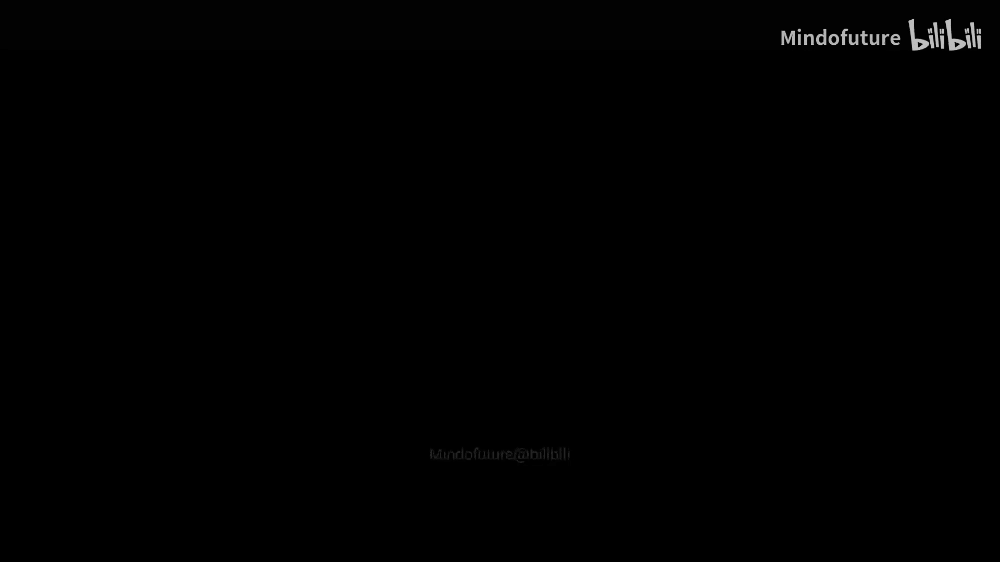
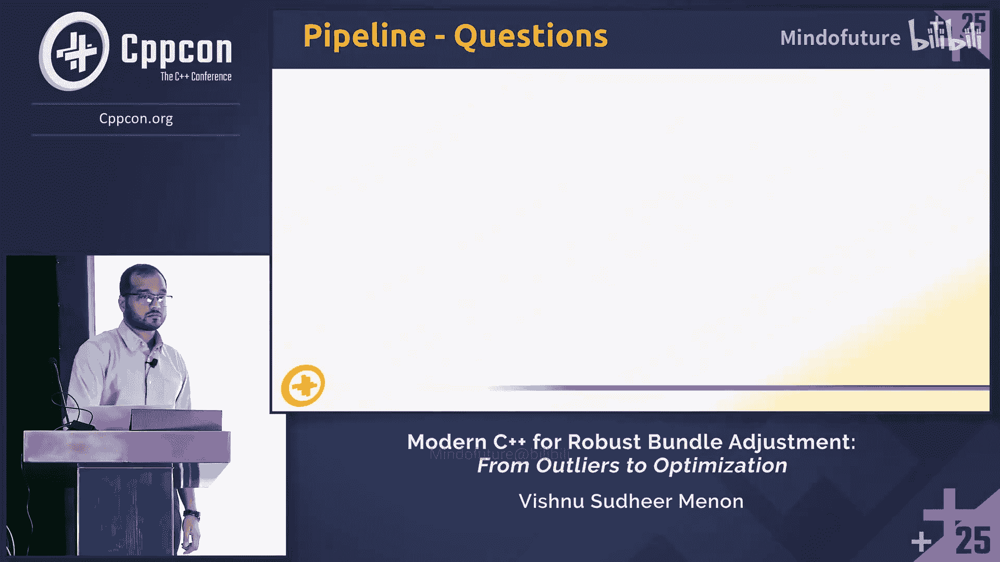

# Cppcon-2025-｜-C++-｜-C语言--｜-汇编-｜-编译器-｜-操作系统-｜-Linux-｜-Windows-p57-P57_现代C++能加速你的光束法平差管道吗？-Vishnu_Sudheer_Menon--BV1wyPBzrEeu_p57-

🎼You get to meet people there's a secret track which is just walking around， having a coffee。

 talking to people you don't know， oh what do you do I do this。

 you learn so much and you extend your network amazingly well and you cannot do this online it has to be in person。

Okay， guys， thank you for attending my。Talk on modernus for money investment。

 My name is Wishnu and I am an engineer at Zbra Technologies。

 We focus on making robots or warehouses。 we sell picking solutions so that people and robots can work together to complete a fulfillment order。

Okay， the outline of the talk is shown here， I'll be talking about visual reconstruction what it is B hand the data set that I'll be using which is from the paper bundle adjustment at large。

 I'll talking a bit more about the structure from motion pipeline that I built the data parcel that I'm using here to pass through sets after rejection optimization and finally the results。

Okay so the problem statement that I'm trying to tackle over here is I want to build a robust scalable and adaptable pipeline which can deal with multiple types of dataset sets and also is a bit more resilient to outliers and is scalable So why do we need to do this The reason is that there is no uniformity around the types of data sets and visual reconstruction。

 there are data sets such as kitt be which have different format which have different parameters for cameras which have medium to large sized points and so there's no uniformity over there。

 So when you build an pipeline you need to make sure that your pipeline can adapt to these different types of dataset sets。

So that's where data diversity comes in and that's something that you would want to tackle and then because of these data sets being a real world data sets。

 there is an element of noise and outliers in the data so you would want to have a special catch over there to make sure that you are accounting for outliers and filtering them out before we pipe them in。

And then scalability， scalability and optimization goes hand in hand。

You usually want to work with a large sized or a large sized dataset set。

 And those are in terms of millions of points。 So unless youre able to account for that。

 millions of points or maybe half a million of points， your SF M pipeline is not gonna work。

 So you need to make sure that your pipeline can process those number of points。

 give you a good result and is also pretty flexible。😊。

So before we jump in the pipeline is a quick talk through about visual reconstruction， y。

So talking about approach genetic。ボい時 what what。5 your。

My topic would be modeling the system pipeline using uplier rejections and then using two variants of optimization geometry mostly。

꼭요。So， yeah， before we jumping into the code just a quick walkthrough about visual reconstruction。

 So the idea behind visual reconstruction is to infer geometry， infer。

In for three structure from a statutory images。 so the and because the talk is mostly gonna be about visual data。

 I'll be focusing mostly about camera inputs， but reconstruction can be done also with a lidar。

 radar or any other sensors。 All you need is a distance measurement and angular reading。

 As long as youre able to point that point where the measurement is coming out from。

 you'll be able to visual reconstruction。So like I said。

 the inputs are multiple images and the outputs would be a 3D reconstruction。

The challenge over here is that you have to account for missing data。

 you have to account for occlusions， noise， outliers。

 and you have to make sure the pipeline is resilient to processing about a million number of points。

So this is a good example about how it look like how it look like。 So on the left。

 you can see the three main components of the pipeline， which would be the cameras， the observations。

 and finally， the 3D model。😊，The 3D model will basically be the landmarks that you're trying to map out and one thing note over here is that there are multiple cameras looking at the same part of the 3D model。

 This is because you would want a significant overlap and also associate measurements with those with those observations and the observations would be information that's present on the image plane which would be the U pixel coordinates and finally you have the moving camera which could be either one camera or multiple cameras and you would basically getting camera pose to optimize on to get a good reconstruction and on the right you have an output from G map which is a reconstruction of a building using multiple cameras by so a key idea over here is that you would need to have multiple cameras looking at objects from a different variety of angles to get a good angleular field of you。

With an good angler field of view， you won't be able to triangulate and estimate the process properly。

So a quick walkthrough here， you have input data， which is from cameras。

 you extract features from it， using corners corner detection or models or hobased histogram of gradient methods。

 you associate each landmarks to you associate each observations to a landmark so that you know so that you are able to have multiple observations from multiple landmarks and make a system through that。

 then you estimate seatd posts for the landmarks and cameras so that you have a seatd post to provide the optimizer。

 which the optimizer can wiggle around and get a good estimate then you do pruning to make sure that you are removing noisy data or accounting for them do bundle adjustment to minimize the reproduction error and finally you reconstruct the setup。

呃。So the data set that I'll be working on is from the paper or the project bundleman large。

 I am be mainly showing the result from the data sets， Ladybug and Trafalgar Square。

So this is an interesting data set， because it already does association and also provides me seat pose for the landmarks and the cameras。

😊，It is also designed for a made to large size problem， which are more of interesting types。

The format is also pretty interesting because it gives you the number of cameras。

 points and observations and it first gives you the observations。

 which is between a camera and a point and the position of the point in the image plane。

And then it gives you the process of the cameras and the process of the landmarks that is flying the map。

Okay， so this is the ladybu dataset。 This is a pretty interesting dataset set because you have more than half a million observations。

 you have1 thousand700 plus cameras。 and that mean number of points。

 The reproductdion error over here is also interesting because you have a mean of 3。

8 and a max of600， which shows that this has a long tail for this data set。

 and the long tail is mostly gonna be the ofliers。 The observations per camera is also pretty interesting because you an observation of there are some camera is zero observations and a max of 970 with a mean of 3633 and3 sorry and then observations per point also is pretty interesting because you have some points with just two observations and some points is 1。

45 observations。 So this is a pretty diverse data set where you have points a good number observations。

 field of few and also bad observations with a narrow field of you。😊。

And then you have the Trafalgar squared dataset set， which is a mid size dataset sets with about。

220 sorry， diamond number observations and 257 cameras。

 This also has a high max of 456 reproion error and also observation camera is a bit more denser than the previous data set。

 we have 8，76 as a mean with the max of 4000 observations from a single camera。

And the observations per point ranges from 2 to 42。So again。

 the challenge over here is that these are huge data sets with around half a million points。

 and if you don't account for the noise and outlis in these data sets。

 then you end up having a nonconvex optimization。So last slide before we jump into code。

 just want to talk a bit about the projection pipeline because this ends up becoming the backbone of the whole optimizer and the outlyer rejection。

 So I'm using a radial distorted camera model here。

 It's a pin It's a pinhole camera model with radial distortion along with it So what is that。

 So that basically means that you you are having parameters about the cur of the cameras lens and you can account for that when you're optimizing。

 So how does this projection pipeline work with works pretty simply it's a pretty straightforwardflow pipeline。

 you get a point in the world frame first you move that point to the camera frame using the cameras pose and translation。

 then you move it to the normalized image plane， which is a simple concept for saying that depth is one。

 So you end up dividing the X and y by the depth。And then you account for the ra distortion and you correct for it。

 and then you use the focal length to get the pixel coordinates。

 So this pipeline becomes a backbone because once you have a 3D estimate of a point in the world space。

 you can use this pipeline to figure out where it lies in the image plane and then you can compare that prediction with the actual measurement of the point in the image plane and that ends up becoming the reproduction error that you're trying to optimize over。

Okay， so this is the pipeline that I'll be talking about for the rest of the talk。

 So my goal when I was making this pipeline was that I wanted to make it as modular as possible and also scalable。

😊，And I accomplish that using C plus+ concepts， using concepts。

 I am able to set up a set a foundation for policies over here。

 What I mean over here is that by using c plus concept。

 I am setting a set of rules that each modules need to follow。

 And this is becoming the this becomes a contract between the pipeline and the modules that it's communicating with。

 So as long as these modules are able follow a set of rules。

 then it can easily communicate with the pipeline and maybe even the user can even switch in and out different modules based on the set of rules。

😊，So this lets me deal with a variety of data sets as I'm expecting the data parser to pass the data set and give me give me a data object that follows a data set like policy then I'm able to switch between multiple types of filtering using the out rejection policies the spatial filter policies or the optimization policies and I'm also accounting for scalability by having a policy over the windows by so yeah so this is a pipeline and will be going through it 109。

So first， we'll be looking at data parcel。Sorry。So data pass is pretty straightforward。

 The main goal over here is that I needed something to pass to the dataset and give me an expected output。

 give me an output that I can work with。 And because this is an expensive function。

 I'm using no discard keyword over here and is expected to account for any parer errors。

The no discard gives a compiler warning or an error If a user accidentally calls it without using the return type and SD expected helps me with the exception handling。

The main three goals over here with this function of with this class called data parel is that I need to do some I need to do some basic filtering。

 preprocessing， then I need to normalize the data so that the ranges of the cameras and the points that is dealing with are in almost the same range and also convert it into the policy format that I'm expecting。

okay， so filtering。 So the pre filtering step is very straightforward。

 I'm just making sure that the data I'm processing is bit sanitized。

 I'm making sure the camera Ids are valid， and I'm also making sure that the landmark when transformed to the camera on frame is at reasonable distance away from it。

 This is basically like it's should be around  point1 me。

1 m or like 10 cm away from the camera just so that it's a valid landmark。😊。

And the thing over here is that because it's a last data set， you would want to parallellyze this。

 so I am using STD for each with an execution policy or a parallel execution policies。

I I'm using the Intel TVB library over here to use this fileization。

 This helps a lot in speeding up the processing of the data set and I kind of became a huge fan of this property and also using erasive to erase any landmarks with insufficient observations basically any landmark with less than two or less than three observations I'm removing it。

And then processing everything else。normalormalization so。

For the idea behind normalization is that you don't want the range of values for the data set and for the cameras to be very different or like have a significant difference between the ranges over there and this is because the optimizer won't be happy if the ranges are to wide apart the optimizer will end up moving the camera and optimizer will end up moving the cameras or the points by varying different amount and that can cause a nonconex optimization so the idea over here is to use mad to to normalize the data so that all the inliers are around the same set of ranges and the outliers are projected out this does not ignore any outliers but rather make sure that the inlayers are cl together while the outliers are pushed out and I'm using Madow here over me because the median is a bit more resilient to outlier。

Than me， and。So， so that means that I'm just using the in lie cluster for normalization over the mean。

And again， I'm paralyzing using S TD for each using Intel T B。

how big is the landmark when you do the parallel， how many of them？So landmark， I， okay。

 so I can go back。So landmarks are 65000。 I have 65000 points over。

 Those are the landmarks for the Trafalgar square data set。 and for Ladybug is 1，56000。

Do you need like a GPPU。No， I was running on my laptop area， which has an Intel GPU。

 but not a custom GPU。Okay， so moving on to the policy。 so this is。

 this is a part of the input policy that I am modeling。

 I'm setting as a set of sorry that I'm using as the API contract between my pipeline and the data parcel。

So we have three components here。 One is the camera model like。

 then the camera like and observation like the camera model like uses the main function of the camera model like sorry。

 there are set of functions over here。 But when I started writing this out。

 I just wanted the model to have a project function。

 The project function basically projects a point from the camera frame all the way to the image frame。

 And that at the end of the day， that's all that you want。

 You don't want anything fancier than that you just want the。😊。

cameras intrinsic model to just project the point from the camera frame all the way to the image frame。

 But I ended up adding focal length principle point and distortion coefficients。

 because since the optimizer can now wiggle them around。

 you would also expect that the input policy ask the data par to provide that to you。

 So that the optimizer can optimize on the inter6 to。 So So that's why those three add there。

 the camera like is the camera X 6， it has the entrance 6。

 along with the translation rotation and the I D。 and the observation like is the。😊。

Is the policy around the observations。 So an observations between a camera， landmark and。Yeah， sorry。

 camera landmark。 And it also provides you the point in the location of the image frame where the observation was observed。

 which is the pixel coordinates。Then for the whole data set I am so the output for the data pars would be a object that follows this policy called a data like which the data like policy kind of encompasses the previous two policies in it So the data set like gets the expects data set to have these three main functions。

 which is the observations， cameras and points and the written type of those three functions should be of type observation like and camera like so I'm setting these policies or like these set of rules over here so that I can have an API contract with data parser or anything that pares through a data text format。

And also， I'm adding an SD map over here or like two return types with S TD unored map。

 This is because this kind of helps out when you're doing a query。

 you can query an observation from a camera's point of view。

 an observation from a landmark point of view。 and just having this kind of speeds up the whole thing from the on the optimization set。

😊，Now， moving on to the pipeline。Sorry。For the pipeline， I set it up using a factory designs pattern。

 The idea over here is that using ro cons， I can switch between different types of the be different types of the pipeline that I want。

 I can use a balanced pipeline that works with lesser quality or lesser。

Powerful outlier rejection and optimization or high performance one that works with a more compute。

 extensive pipeline。And。Because as a factory， I'm also expecting the user to write the derived classes。

 which which。Inherit from a defined base class， which defines the policies。

 So the reason I did it is to the reason I did it this way is for two benefits。

 One is that I can switch between variants at at runtime。

 and I also have a compile time check to make sure that the user users implementation with policies are valid and it follows the policy requirements。

So this is the main fact main hybrid pipeline class。

 So as you can see I have templating on six types where five of them have a requirement that they need to follow。

And one more thing note over here is that I am passing the data set type into the other policies too to make sure that the other policies are okay with this type of data that we are using over here。

And just a quick overview over。 this is sorry this is the factory that is producing based on the user defined type。

 which is got through the para。So you have the balanced hybrid pipeline which inherits from a base class which has defined these implementation policies and high performance1。

 it inherits from this base class which has these defined inherentit policies。

By defining them in code， you have a compile time check。

 make sure that you are not going to run invalid version of the pipeline。

The main function is pretty straightforward。 It just does it generates a Windows。

 then it performs outline rejection and then finally performs optimization。

 kept as simple as possible because I'm expecting the modules to do the heavy lifting。So yeah。

 logging a window policy。 So the login policy is pretty simple。 It just has to load the message。

 and that's it。So an implementation over here is a cross logging policy， which uses CPP debug。

 info 1 and error。 It's pretty straightforward。 The interesting thing over here is a static assert。

 static assert， so。Thinking about logs is that it's pretty easy for a library to have multiple different versions of logging。

 and youll already end up using one， but you will still end up implementing multiple ones to make sure that all the different versions are compatible with the policy。

 You can use a static assert and check and do a and use the compiled to check if the policy still valid or the implementation still valid。

Yep。Don't you lose the source location information by doing this。Those macros。

GP source location interview。In。By putting inside this function。嗯。Yeah， I think so， yeah。

 So I'm expecting a message to have that information。

Maybe I can constrain the message or have another feel aware that has a social location information。

But right now， I is expecting the message to carry that information with it。Nice catch。

The windowing policy is pretty straightforward。 Im using a non overlapping window。

 It can get pretty complicated by using an adaptive window or overlapping window for for the purpose of the talk。

 I just kept it simple as a non overlapping window。嗯。Just as a windowing policy。

 pretty straightforward again， expecting generate Windows function and a window result as the output。

Not going too much on detail over here。sake of time。 Okay， out lies the train。Outlier filtering。

 I kept the policy for offline filtering again pretty straightforward。

 I have a reject outliers function that is trying to call an outlier rejection result that I'm expecting from it。

 The rejection result is basically just for now is basically just some stats that I want to infer from the from the operation the inliers that it found the outliers that it ignored and the inlier ratio。

😊，I'm doing a simple outli filtering away。So go on slide。

It means that I'm expecting the class to do a prop destruction clean of the memory and make sure that。

A distract is defined。Okay， so the simple outli filtering is actually pretty straightforward。

 I end up using the projection model to project the landmark onto the image plane and check if the measurement versus the observation or measurement versus prediction is within a bounded within a threshold。

😊，If the if the projection on the image plane has a high error， then I'm ignoring it。 If it doesn't。

 I'm keeping that particular observation。 Now， this is pretty straightforward。

 The challenge over here comes up when you are dealing with more than a half a million points。

 You have to ittrate over each point， Iplement a projection or like do a projection for each ofs points and project it back to the image plane and check。

 So that becomes a bit heavy。So what we can do over here is basically decouple the problem。

You have multiple cameras over here and each camera is independent of each other。

And each observation within a camera is also independent of each other。

 That means that it's giving you the ability to paralyze and you can paralyze basically at the camera level and also at the observation level so that you you have a significant speed up。

😊，And。So that's basically what's happening over here。

 I'm processinging at a camera level by using aD execution part。

And also I' am processing at observation level by using a3D execution power so I'm getting the reproduction error per point using the SD3D transformom over here and then for each for trading through each point and3 projection error and then filtering them out。

This ends up becoming really fast。 I don't how to do sequential。 Each will be done independently。

 And each point has is outlier function。 Sorry， each point。

 each observation has a field called its outlier。 and that gets toggled if the error is too high。Now。

 moving on to spatial filtering。Spial filtering is also an interesting concept over here。

 So you might be wondering why I have two stages of filtering。

Filtering from a simple outlier and also spatial。 This is because you would want to tackle the outliers from two different points of view。

1 through the image， one in the image frame and one in the world frame。 So the image frame。

 you can do outlier filtering ransack while you while you can do spatial filtering in the world frame So that the In spatial filtering is that you would want the。

3D projection of the model to be as smooth as possible。

 So if there are some points that are lying outside this， the smooth model。

 then those are most likely to be outliers。 The policy pretty straightforward filter spatially is a function that I expect the model to call。

A model to have implement it taking data set and camera window。

And the result is gonna be a spatial filter result。That I'm expecting from it。So like I said before。

 this filtering is happening in the 3D space So you have a bunch of landmarks that will be grouped together and there would be some outliers that would be that would be present beyond the range of those landmarks or beyond those clusters。

 the idea is to catch those outliers that are that are visible or present far away from the clusters and filter them out。

So this means that I need to it through each landmark or each point over here and then find as nearest neighbors calculate the mean and then see how much an deviationvation is a landmark away from that is a point away from the away from the bunch of landmarks near it。

This is an expensive process because as we've seen earlier， you have a lot of landmarks。

 a lot of points。 And now I'm asking you to find its00 nearest neighbors or 200 nearest neighbors and calculate the mean and standard deviation。

 So this is expensive。 So the way to deal with this is to use a boost artery。

Boost artery already groups elements in it using a spatial index。

 So using the property of a boost artery， you are getting a spatial grouping for free。

 You have one cost where you need to load all the points into the artery。And after that。

 everything is based on a query， you can keep querying the artery for each point。

 figure out its nearest neighbors and then perform a filtering on top of it。Yes。

So this came in clutch for me。Spit up the whole process。So the idea over here is same as earlier。

 we only So idea over here is that。If because there are two stages of filtering。

 you can ignore points that are already defined as outliers by the previous filter and only process points that are defined us inliers or like pass through the previous filter。

 So you speed up over by ignoring points that are already passed as outliers。And then。

As similar to the previous approach， each camera and each observations are independent。

 so you can use the parallelization over here to speed up the processing tube。This is a bit wordy。

 but what I'm doing over here is I'm finding the mean and variance and Im using Z score over here to check whether a point is an outlier or not。

To calculate mean and so first I'm finding a set of first I'm finding the K nearest neighbors of a set of point。

 and then I'm using SDD ranges full left to calculate sum minus squared sum to calculate mean and variance。

 and then I'm using doing offline filtering using that。😊，T to note over here。

 at least from algorithm point of view is that I notice a mistake after I made all these slides。

 One is that I'm approaching this problem from a camera and observation point of view。

 but rather I could have just paralyzed from a point。Point of view。

 I just needed to iterate through all points and then query the neighbors of the points and filter using that。

 instead over here， what I'm doing is that I am going through each cameras and each observation in the camera and then checking which all points are absorb by this observations。

 So there's an inefficiency over here。 But yeah I just kept it in to show that。 Yeah， it happens。

And you can also make this a bit more smarter。 One assumption you can make here is that the mean would be locally consistent up to a particular radius。

 So you can assume that some points that are nearby each other would have the same mean and you can cache it。

 and then you can do just a query for the mean from a hashmap。 So that would also speed it up。

 But yeah， that is part of the future works for the for this filter。Now， after doing that。

 you end up having something like this。 Yeah， for the lady bug data set， you end up filtering out 3。

3 person the points， which is a main error of 21 s deviation of 36 and million of 19。

 they would I'm guessing there's some inlia that are also getting caught up over here。

But standard deviationvation 36 means that you are ending up catching the outliers that are in the tail end of the of the Gaussians。

Then for the Traalgar square data set。I'm getting a mean of 37。

 sand deviationation of 19 and mean of 34。 This looks a bit more better。

 The media and mean are somewhat consistent。 I'm also ignoring around 8% points。😊，Okay。

 moving on to the optimization。The optimization policy is pretty consistent and easy to understand to Im expecting an optimize function to be called by the policy implementation and I'm expecting a summary official this this summary helps in kind of figuring out the quality of optimization you can go through the cost the cost change whether successful or not and the itration summary that gets outputted by C。

The idea behind optimization。So the the concept of optimization is pretty straightforward。

 You at the end of the day， you want to reduce your reproion error。

 And what you have with you is that you have the measurements。

 you have the camera pose and you have the landmark pose。

 So now what are asking the optimizer I said you want asking the optimizer， hey。

 reduce the re projection error。 And I'm allowing you to wiggle around the camera pose and the landmark pose。

 wiggle them around as much as you want as long as the net repro error of the whole model reduces。😊。

And I thing the point out over here is that the observations are kept as constants while you are only moving around the 3D point and the camera poses and the entrance6 here So you end up reducing this expression over here。

Is your cost function pretty much fixed for this problem Oh yes？No， it's fixed this problem。

 I am varying the loss functions， but the cost function is a basic reproduction model。Okay。

 but the loss function be different。 Yeah， loss function can be a khi based loss function or a Huber loss loss function。

 I'm also trying out， I also tried a variant where I am creating my own adaptable cost function。

 but that didn't end up giving good results。 So I'm sticking with Huber or khy。

So when you're changing a different loss function， do you use any of the automatic differentiation library？

Like told or you hadn't called it it back。No， I'm using the series Autod library。

 The series solver has an Autod solver which produces a Jacobian for me。

That's from outside of your company。I also the company。

 It's a publicly available solve called C solve。Right。And this pipeline is built using that。

So the idea behind linearization is pretty straightforward because you're inherently solving a non nonlinear problem。

 you have to linearize it。 And to do that the C solver uses C solver uses something called Taylor expansion。

 it breaks down the problem it breaks down the problem into that expectency over there。

 So f x plus delta with deelta being the small change in estimate that your。

That you want to do to reduce the error gets broken down into F x plus J delta J being the Jacobbian。

And then you expand that expression to get this normal equation。

 which is hessian into delta equal to minus Jacobin into residualid。

Because we are solving a bundle adjustment problem， you have one thing in your advantage。

 which is that the Jacob matrix that is solving is gonna be sparse。

 This is because each residual which is the reproduction error only depends upon one camera pose and one of the one landmark So you end up building a huge Jacob matrix which is basically gonna be sparse so you can use something called a short complement over here to express a points as camera poses and solve a much radio system and the once you solve for the camera poses。

 you can back substitute into the to get your point estimate from this camera pose So basically will happen is that if you have a million million or more points in your data set instead of having a billion cross million Jacob matrix。

 you end up compressing it to only camera pose and you solve for the camera pose and this。

Ends up giving you a huge advantage in speed and also in memory。

And the series solver has two strategies that recommends the Linburg market and the Dot leg。

I mainly use livingburg market because it， I think is a bit more faster。 And it also。

 and it also uses something called a trust region based strategy。

 which makes sure that it doesn't the or the step size doesn't overshoot for a。

Poorly conditioned problem。The step size over here is an interesting concept。 If the not， if the。

The function is not wellconed， as in if the function has a lot of valuess and deep pits。

 then a wrong step can end you up in a local minima or or you might end up taking a large step and not having a significant reduction in your error。

 So using this trust region strategy， you can account for that。 if if a step。

 if you are taking a step down or if your delta basically if a delta is not reducing the error by significant amount。

 you end up not trusting that delta and you end up reducing how much you're moving along in the direction。

 But if your delta is significantly reducing the error， that means that you are going the right path。

 So so that means that you can take a larger step and continue by trading through。And finally。

 you update the parameters and then you reiterate。So for the simple bundle adjustment。

 what I implemented was that Im using the non cameras in the non overlapping windows and Im using the observation by those cameras。

 and I am optimizing on top of that。😊，So any camera's observations outside window are being completely ignored。

So yeah， like this it'll be processinging one step at a time。

 And this is how you end up breaking down the huge one legitimate problem。

 you end up breaking it down into sizable chunks and using this windowing policy。

 you can process just a small chunk at a time。 and and finally you assuming that by crossing a smaller chunks。

 you end up lowering the cost of the whole problem。

This is the optimizer settings that you set for the series solve。

And so the how C solver works is that it expects you to store all the variables that you are sorry。

 it expects you to store all the variables that you want to optimize into a vector。

 which is the camera parameter over here， and then it takes the pointer to the data inside the vector and it optimizes that。

So over here I am using first time using lazy approach to using STD views to ittrate over a camera with observation。

 which is basically the qualified set of cameras within the window。And。And I am。

Find and I'm getting the camera parameters over here。

 and I'm storing the camera parameters inside a vector。

 and I'm passing that vector passing the pointer to that particular vector into the series solver using a parameter block。

😊，And I'm also using quatonions over here， not a rotation matrix。

 The idea over here is a qua is are much more stable the rotation matrix and I can also use the quation manifold to restrict the optimization space for the quaernions This is because if you don't use the quaernion manifold series would be allowed to move the quatonions however it wants and it ends up becoming an inent rotation by using the quaion manifold or restricting the series to restricting the solver to basically move the points in the S3 manifold space and keep the rotations bit more consistent。

Y，'m sorry。 how did you tell cities to constrain to the normal。Yeah， I don't think I add it here。

 Sorry about that， but you can add a product manifold or a series quarteria manifold and you can so you would basically be adding it over here along with the parameter block telling that this part of the parameter is a quarterernia and respect that and don't。

Optimize it to a invalid point。So same idea over here for observations。

 you ittrate through valid observations using STD views and then store the observations inside the point parameter storage and passing the pointer for that particular storage into C so that under the solver so that the solver can modify it when it's optimizing。

So the idea behind the solver is that the solver takes in these pointers。

 modifies it and then you are expected to process a vector again to read what the new processed term is and then update your data set with the new process。

So that's what's happening over here。You eyetrate over the vector， again， to。

Figure out which camera I corresponds to which part of the vector and then you update the values of the cameras with the new results that the solve was provided you。

But your reproduction error explodes any of this。Even though you have accounted for outliers and you have broken down the problem into smaller sizable chunks。

 you end up having a higher reproion error than what you started off with。

 So something went terribly wrong in our process。So the mistake that we made over here is that we are assuming that the problem is or the chunks of the problem that is solving are completely independent and that's not true from the camera point of view it might be independent but from the point point of view it's not this is because there are observations that are shared between multiple cameras and you can take advantage of that in this problem over here。

So。That's what I basically did。 So instead of only instead of only adding cameras that are in the window I one way。

 one method to improve this problem is that you can add all the cameras in the data but only set the cameras that only set the cameras that are in the window to be variables。

So that the optimizer will only be moving the pulses of the cameras on the windows and ignoring everything else。

And then as you change a window， you end up resetting that。

 you end up resetting the cameras that are not in the windows to be constant and the cameras in the windows to be available。

 So at that in that way， you end up covering the whole problem and only optimizing a particular chunk of it。

And the other thing I did was that I can introduce a low bound and upper bound to the optimization space。

 This basically restricts。The space that series can cover solver can use to move the points around。

 you can。 So right now， I am using constants over here。

which is focal men came in Kax and Im using these constants to set up upper bound and lower bound for the set of values that the solver can use to wiggle around。

 but to make this a bit more smarter what you can do is that you can preproces the data set to see the range of values that is covered by the data set and restrict the space by using that information so that way your solver would be able to solve different types of data set without actually changing these into hardcode values。

And then the second thing I did over here was that instead of only accounting for observations in the current window。

 I'm also accounting for observations outside the window。 So the idea here is pretty straightforward。

😊，So the first thing is that I am introducing a new parameter called in window support。

 which basically means that if a point only has one observation in a window。

 don't optimize that point or don't use the observation。

 This is because if you just have one observation， you end up or optimizing for that observation and end up with a local minima for the point。

 And when you process that point again in a next window。

 you end up the point ends up being the wrong spot for optimization and the thing collapses。

 So so using in window support， I'm able to tackle that case。

 And the other case is that a point might have multiple observations from multiple cameras outside the window2。

 So we can take advantage of that。 So I'm adding residuals for all the observations of a point outside the window too。

 but I'm setting the cameras as constants。😊，So that means that the solver ends up solving only for the point pose and not the camera pose for any cameras outside the window and these observations can be an anchoring has an anchoring effect over here。

 it makes sure that if you are moving the point and the camera， for the cameras in the window。

 The solver would use the other observations as a way of anchoring them down。

 anchoring the point down。And you can add I'm also using low bound， upper bound over here。

 And I'm setting the the points in the data set constant or variables based on the number of observations that they have。

Two other things that I'm doing over here is that I'm introducing something called parameter ordering。

 As I said earlier， you can use a sure complement to break down the Jacobbian or like shrink the Jacobian into only camera pose。

 But one thing the solver expects from you is that you order the problem in you order the problem in a right way what I mean over here is that the problem expects the cameras to be in the top part of Jacobian and the points to be in a low part of Jacobian so that when it replaces the points。

 it just ends up taking the point chunk of the matrix out and replacing that with camera pose。

 So to do that it expects you to order your problem in a particular way。

 and you can do that you're saying parameter ordering which is a concept in series in the solver to make sure that the cameras are the top part of Jacobbian and the points and the low hollow Jacobian and you add them to the011 group and the first element。

😊，And group。So this helps in making sure that so the solver is expected to do this for you in the back end。

 but by explicitly calling them out， you are telling the solver or you helping the solver by speeding it up and making sure that it gets what you're solving。

😊，Then， another interesting。Interesting feature of the solver is the inner iterations。

 The idea over here is pretty straightforward。 Instead of using a joint optimization to solve for both points and camera poses。

 you can decouple the problem。 You can do the main optimization first。

 and then you can do a series of inner iteration or inner optimizations where you fix the camera poses and optimize only the points。

😊，And then you can fix all the points and optimize only the camera poses。

The so this is advantageous for us because each sub problem is much simpler and easier to solve。

 But the problem over here is that you are re using the Jacobian that you use for the joint optimization。

 So if your function is heavily non convex， then you end up using a bad Jacobian multiple times and you。

 you could have a bad optimization。And you also add more its over here that can end up using more compute。

 So this is kind of a double edge sword。 You need to kind of try it out。

 make sure your function is properly preconditioned before you can use it。

 So this is something that's worth trying out， but always be bit concerned about it。

Then I did try introducing to loss functions Cahi and Hu Huber is quadratic loss until a threshold and then linear loss beyond it while khi is quadratic loss to the threshold and then log beyond it。

 The advantage over here is that you can use squhy loss。

 if you have a lot of outliers in your data set This because introducing a log loss beyond a threshold。

 it ends up heavily deing the outliers and Huber is a linear loss。 so it doesn't heavily dev them。

 but it reduces the impact of outliers into the residual。

This is something I to play around with also in using loss function， also make。Sorry。

 using a loss function also means that you tune it because because you are reducing impact of residuals your。

Oim problem might not converge in time or optimization problem might take more time to converge because you are now moving from a quadratic to a linear loss so you need to play with the thresholds and figure out what the right threshold is for you so that you converge you just inliers and you ignore the outliers。

And yeah， I did try using custom loss function。I don't recommend it。

 I and I recommend you saying whatever is pre set up by the solver。

 This is because the ends are becoming more ver hassle than advantage you need to you need to mention the the sorry the residual that you are solving and also the you also need to provide the first order differentiation。

 second order differentiation， third order differentiation of the particular residual which ends up becoming complicated。

So doing this， the average deion error ends up becoming much more tolerable。

You end up account Fliers， and also having。Decent 3D modeling of the world。

There are still some noise on the sites， which needs a bit more of tuning and processing。

 which needs to be。We are done as part of futureture works。

Some references that are used for this talk to know more about the solver。 I post the link over here。

 And there's also a talk by the author of the solver somewhere here above， which I highly recommend。

 It gives a good overview of how the solver works。I any questions？

Hey， thanks for the excellent talk。 two questions， first one， I might have just missed it。

 Did you use any sort of。Features to be able to associate landmarks together that used for this。 No。

 the data set already did data association for me。 Okay was using advantage of that。

 But the filtering is to make sure that you account for any error in association and make sure you push that out。

 And then the other question was that earlier on， you use the factory to create the different things。

 but you still。Kept all those objects together and used a bunch of pointers is the reason that you didn't just make it a function and then have them as concrete objects。

呃。No， I don't have a lot of that。 Okay， I end up implementing that to me。 Alright， thank you。Hi。

 great talk。 thank you。 So in a similar problem that my company has a problem is one sensor with many more observations than others。

 where they're all sort of biased。 So maybe all of your measurements are shifted to the right when you do the cost minimization you tend to prefer to bias the net result towards that one camera。

 So maybe I didn't catch it where within the pipeline。 do you take that problem into account。

 So you would want to introduce a new optimization module which has a weight parameter so you would want to down or thatll basically be the information matrix of the covariance matrix you're passing in you would want to lower the weight on the residuals by the camera with more observations by the so that you can equalize the being equalize effect of the residuals within multiple cameras。

😊，Yeah， thank you， that's similar to what we've used before it's good to thanks。Thank you。

 I had two questions for you。 Do your 3D reconstructions have known scale since you have。

Both the intrinsics and extrinsics calculated。Yes， they do have a known scale。And。

They of reasonable scale have viewed。 So I am rescaling them again。

 using the normalization to make sure that it's within a reasonable range。

 But if you just print out the data， it ends up becoming3 D it ends up。呃。

Pretty like pretty okay to observe。There is it's not as if the cameras are very far away from the point。

 but to account for that particular issue， I am renormalizing reducinguc median absolute deviation。

Thank you。And then have you tested with。Constraining the intrinsics of the cameras to be the same If all the images were from the same camera。

Good find is a good catch。 I want to try that out， but I didn't do that。

Thank you。Could you back up few slide please？呃，就是客 for each。Let me start talking about a new mess。嗯。

Yeah， here， we don't use apparel policy is because the lambda。It's overlapping。

 it's not sweat anymore。So this one， I'm not using parallelization。

 which is sequential because I'm not。 I'm not specifying the parallelization policy here。

 you Okay can I。I think so。The observations are completely independent。

 so you could do it in observation space。 but if it's because it's points。

 you might want to like make it thread safe with new text around with points because multiple observations around。

 Yeah So do you think this would be。 I dont know how big No。

 I don't think this is much slower because the reason is that you are only looking at points that are observed by the previous window and the current window。

 Yeah， it's already small yeah。그呃。OK老师。但是。

