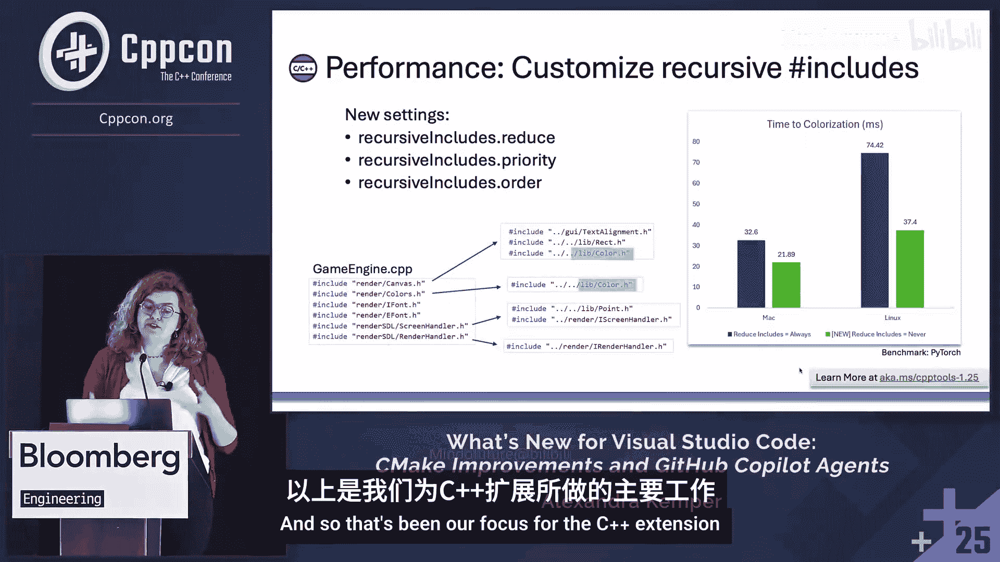
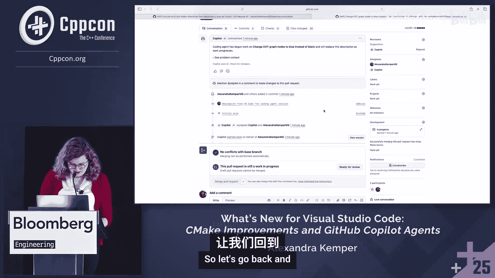
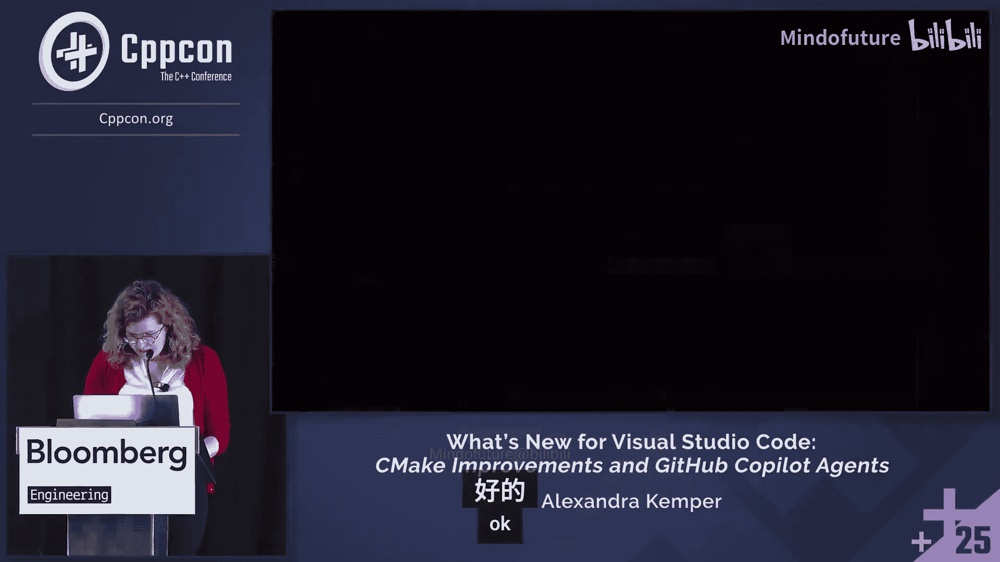
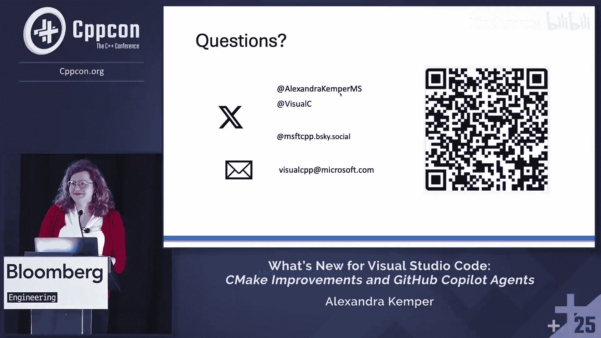

# Cppcon-2025-｜-C++-｜-C语言--｜-汇编-｜-编译器-｜-操作系统-｜-Linux-｜-Windows-p58-P58_VS_Code中C++的新功能_CMake改进与GitHub_Copilot智能体-Alexandra_Kemper--BV1wyPBzrEeu_p58-

🎼Being at the conference in person is very valuable to meet people in the hallways。

 I've had a lot of conversations with people so far and a lot of trading knowledge and getting excited about the same things。

Let's begin。 hello everyone， My name is Alexra Kemper and I am the PM for the C++ extensions in VS code。

 and today I'll be talking about what's new in Viual Studio code。

 including CMake improvements and GitHub Copit agents and how you can supercharge your workflow by adding all of these different features to your development cycle。

😊。

And with that， let's begin。

So if you walked into this talk and suddenly noticed， oh， this is VS code。

 Visual Studio is a separate product， which is a separate talk。

 and they actually have their what's new talk later today at 2 PMm。

 And so if you're looking for Vis Studio， you're welcome to stay but that talk is at 2 PMm and we actually have a number of different talks happening today from Microsoft and later this week。

And a couple of them are actually relevant to this talk in terms of coppilot features， for example。

 And we are also running a daily raffle。 At this point， the puzzle has been raffled off。

 but we still have a number of different Lego sets。 So feel free to find us at the booth。

 if you would like to join the raffle。😊，And。Yeah， so what are we talking about today。

 we're going to talk about faster performance in the C++ extension。The tooling updates we've made。

 for example， in the CMake tools extension， how we're going to update a couple build scripts with those。

 and then we're also going to talk about AI agents and build a project from scratch and then general VS code updates。

And so before we kind of begin， let's get a lay of the land and we have three main extensions for C++ development in VS code。

 these have not changed these might look familiar， and we have the C++ extension for code editing。

 navigation， debugging all of your different development needs。

 and then the make file and CM tools extensions for building with CMake or make depending on your preference。

😊，And。Then， and these tools are always available。 You can always use them or iterating on these extensions and regularly building new features。

 And then you also have Gitthub Copit and Github Copilot chat。

 These are they sell our bundled extension。 So if you install one。

 you install the other and Gitthub Copilot chat is actually open source now。

 So you could even fork this and build your own if you would like to。😊。

And these kind of work in tandem。 and you can always use the tools to edit your code develop your features。

 but you can kind of supercharge this workflow using Gitthub Copit and Gitub Copi chat to help you kind of take care of all the boilerplate manual work that you maybe don't want to do。

 but we'll see more of that throughout the demos that are to come。

And so beginning with the C++ extension， let's kind of discuss what's new because our big focus in the last year has been performance。

 We've had a lot of feedback around working with products at scale and so we really tried to we really worked on creating a faster project startup time as well as a faster time to colororization And so project start time is the time for the C++ extension to startup and the time to colorization is the time it takes when you open a file for it to like syntactic and semantic colorization to exist And so that's like the actually colorized variables and for In to be available and so on average weve helped improve the project start time by 3。

5 X and time to colororization is four times faster at this point and both of these examples are in the pitorch repo to kind of emulate a large open source code base And this is where the interesting question of course is okay but how did you？

Do this。 What did you actually do And this was a lot of like small incremental changes Like。

 for example， we now cache the configuration for intelligence。

 so we don't have to parse for it every time you start the extension。

 we have better processing for compile command Dutch Asson support。

 We support multiple compile commandson。 We have better config handling。

 We've paralyzed a lot of processes in the file discovery and there's a lot more incremental changes and I'm really happy to talk about these。

 but they are all covered in the blog post that's linked on the slide。😊。

And that's where you can kind of read more and otherwise also feel free to come to me and talk about them。

 but that's where we're seeing these major changes with Pytorch。

 which is kind of the benchmark we always use to analyze whether the performance improvements we've made。

 we can actually see the difference。And then so other than all of these incremental changes。

 we also add more customization in the C plus plus extension。

 where you can now customize recursive include paths。

 And this is really important also for configuring intelligence， which is the colorization hover。

 all the a lot of the editing features in。😊，The C plus extension are powered by In and so trying to get configured for In really makes the whole process faster and those features more effective。

 And so these customized recursive includes that include paths help set up In。

 And so if you're not using one of the methods we just talked about in the last slide with config providers or compiled commands that isson file to configure you can now actually customize a lot of different settings of how these include paths are processed since every single time you open a file。

 we recursively search through all the different subdirecties of that file to look for includes which can be really resource intensive and sometimes depending on your file structure doesn't really make sense So you might want to customize this specifically to your project。

 And so now there's three new settings you can use to customize this based on your actual treeview of the different files you have available and as you can see for the for Pytorch specifically when we optimizeize the settings for our specific project。

We were able to lower the time it takes for a file to colorize from 74 seconds to 37 seconds on a Linux machine。

😊，And so that's where there's a lot more information on how you can customize these and when to use which specific one with example it's in the blog post。

 and I'm also happy to talk more about this afterwards but it is very specific to your repo and so some reos will benefit from this and other s and it just depends on your specific situation whereas the performance improvements on the last side apply across the board for all the different types of configuration and so that's been our focus for the C++ extension。

😊。

But now let's see what we've been doing in the Cic tools extension。

 So we're going to update a couple of the build process in the VCMI repo。

 and VCMI is an open source project， which is actually the engine for heroesers of M a Magic3。

 which is like a battle game that you might be familiar with。 And so let's switch over。😊，2。This code。

That's。Not the one。Yes。Okay， let's go。So this is VCMI。 Can everyone read the text on the screen。Okay。

 perfect。So this is the VCMI repo here is of My Mag I have already actually configured and built this repo。

 so technically I could begin coding right now， but as you can see I actually have the VCMI repo open in this workspace as well as VCMI assets and this is called a multiro workspace。

 which we've already supported NVS code that's familiar but one of our top ask in the last couple of years for CMG tools is that hey。

 I have multiple folders I have open， many of them have CMG lists and when I go to my CM。😊。

To my Cic project outline， I actually see them all listed in my project outline。

 and I have this huge list of reoss that aren't really relevant for the work I'm doing like for example。

 here， I have my actual VCMI repo and then just another repo that's different assets and icons and similar。

 And I don't really need those for the work that I'm doing。

 and I don't really want to include those in my build process。

 So now you can actually exclude those from the Cic outline specifically without removing them from your folder view。

😊，So， if you。Open your settings。Okay， sorry， what on。openpen your settings。 You can use Cm。

Exclude and just list the specific folders you'd like to exclude。 So if we。

 let me copy over the path really quickly。So if we just。

 if we just copy over this path and name this the assets file， you can see now， okay。

 this will immediately apply in my actually folder view。

 I can still see all the different folders I have available。 if I go to Github。

 I can still see multiple different repos available and still make changes。 However。

 for my SeeMake outline specifically， it's now been removed from the bottom of my outline so I can only focus on the files that are relevant for my actual build process。

And so now that I've kind of removed the essence since that's not where I'm doing the work。

 I can now look at my actual VC my project。 And if I'm looking to update。IfI'm looking to update。

 for example， my presets， which if you might not be familiar with them。

 those are a set of different configurations that can be customized for the specific target and platform you are building for。

 So that's why this VCMI comes with a lot of different presets that are available for different platforms。

 different dependency manager different generators you want to be using。 And as you can see。

 we're using presets version 2 in the Cmic toolss extension。

 we actually now support presets version 10， which comes with some new features， So if I now go。Okay。

 that's fine。 We're just going to。skip that。 So now if I go to。If I go to my actual configuration。

 which I can get from the CM Sal bar。All right， we're going to。Navigate to Macos whoops。Apologies。

Mac OS and Ninja VC package release。 I can see the specific configuration I'm using。

 and with presets 10， I can now add comments。This is where you say， okay， Alex， but this is a J file。

 You can't add comments。 We all know in J files。 You can't add comments。

 This is a new field with Cic 10， Where for presets， you can。😊，Add a comment。

And for this specific comment， you can now write a description for your。

You can write a description now for the specific configuration。You can write， for example， that， oh。

 this is。This is the most performant。And。Configuration。If you are using。If you're using a Mac。So。

As you can see here， yeah， this is the most perform configuration of using a Mac。

 and you can just add individual comments to all the different configurations。

 You can leave notes for your team members or like or telling them when to use which configuration and which situations。

 even though this is a JO file， there's now a new variable supported here。And。

We're going to double check really fast， that this is。Configuring correctly。And。Yeah。

 it is configuring correctly。 And then also。Make sure Copilo is working correctly， okay。So。

So this is the most perform a configuration if you're using a map so we've added a commons and another thing that has also been added to support for graphphs and graphs is an open source graphical visualizer which works with dot files and so these dot files kind of are just like it generates graphs。

 for example， in it's used a lot in networking， it can help write like dependency trees for your project and it does this via dot files it kind of have like different edges and nodes which are specified between different projects in a very specific layout and so for these graphs now being integrated into presets。

 you can actually add a graphs field。And when you specify。A path here。It will generate。

A graphs dot file for you because normally you would have to create it yourself and so integrating this into presets。

 it creates a graphs file for you specifically for your CMake targets and the different targets available in your project as well as external libraries。

And so that way you can review all these in one go。 And so if we now。Configure our project。

And so I've just kind of specified， it should just create the graph dot dot file。

You can see that there's now a new step in the configure process where it says， okay。

 I've generated this dot file for you。 and if we open this dot file。It's at。

So if we look at this dot file， this is what a dot file normally looks like where it just has a lot of different nodes and it describes all the different edges between them。

 and so this has all been generated pre by the CMake for you and now if you want to actually open this file。

 you just have to use here let's first copy the output。And you just use the。

DPNG command to open this specific file and then create a diagram for you。Diagram dot PG。

And so once we run this command。We now have a new diagram file right here。

And that has generated a view for the entire VCMI project on what all the different targets look like。

 so if you want a reference， it shows executables， static libraries， shared libraries。

 there's a whole legend for it and you can then kind of go through your project and see here's all the different targets I have。

Here's all the different executables。 This is how they interact。 And， for example， also figure out。

 hey， some something's not wrong here， something's not being linked correctly。

 And that's where graphs is super helpful。 And now you don't even need to write the dot file from scratch yourself。

And so。With that。So those are some of the new additions with Cmic presets。 And additionally。

 if you go to Cic lists， you can now use。aiLet's review this really fast。

You can now use the GitHub Copilot chat， which you might be familiar with we showed this last year as well and with Copilot chat there's now a few different modes so there's ask mode。

 edit mode and agent mode， we'll get to agent mode later。

 but right now in ask mode this is kind of something really helpful to do if you have general questions about your codebase and you kind of want to brainstorm and discuss。

With chat。 So this is where if I want to update my Cmic lists， for example， I can say。

I want to update my build process， but with my build process， I want to， for example。

 add more target based。Target based development to my smiclist file。嗯。Wu。

That's not supposed to be the case。 Give me one second， please。嗯。

We're going to switch networks very quickly， the conference Wifi is sometimes not the most reliable。

So。Yeah， there we go， okay。Perfect， okay， let's retry that one more time。And we have the connection。

 Good start。So。嗯。Okay， and this is where it doesn't matter as much if you have a little bit of spelling errors。

 Copiloot will still understand the gist of what you're trying to do。And as you can see here。

 I did not have to explicitly add context， which is new from last year where you had to like specify the specific workplace workspace you don't have to。

 it will just pull in the context for you of what files do you currently have open。

 what files are you currently working on， what part of your text you have highlighted and here。

 and as you can see it's just kind of listing a couple of different recommendations。And。Okay。

 it's saying， yes， please use target properties over global settings。

 which is a general good advice with some specific examples and move logic over to subdirecties。

And move targets over， yeah， so this is where we could read this in detail。

 but for the sake of the demo， we're going to just go with the first step。

 which is adding target compile definitions。And now。

 if I actually start beginning to change my Cmic lists， if I'm running code here。I can say， okay。

 I want to add a target compile definitions。And。But， wait， actually。

 we're going do this in a different line。And as you can see， okay， the gray text right there， whoops。

 that just went away and got replaced by something else coming。Come back to me。Here。

the gray text right there。 that is completions。 This is where there's a lot of different compiler features。

 The gray text filled in in line as you're editing is via completions and completions are now actually more context to where than ever and are using a G4。

1。 And we're constantly evaluating new models to use for code completions for them to be the most helpful in your context and 4。

1 has actually been trained on more C+ plus code than previous models。 So the。😊。

Suggestions that provides are more relevant to actual C++ co basiss than before。

And these and this is where also if you don't want to use4。1。

 you can actually now choose which model you want to use for the chat as well， which is there's4。14。

0 Claude， Gemini and you can kind of choose whichever one you like the most depending on your personal preferences and the task that you're doing So when I'm writing like for example。

 working on strings or have larger pieces of checks like to use Cla if I'm doing like inline changes or changing things in chat I like to use GT41 but this is where it comes down to personal preference and you're not tied into a specific model。

And so with that， let's add the target compile definitions。 And so I'm going to add。Launcher here。

And as you can see， it completes this for me。 So we're going to do it。

We're going to accept this change， and then。Delete this line。 And now if we continue on。

 you can see there， this is another new feature， which is next edit suggestions。

 and next edit suggestions are slightly different than completions because they're not just in line。

 Hey， I think this is what you're typing。 This is what you want to do next。

 They actually preemptively say， okay， I just saw you changed definitions to target compile definitions。

 you probably want to do that again。 And so it kind of recognizes the pattern of the work you're doing。

 And then makes a multi line suggestions。 It's not just one in line completion。 And so with that。

 you can just easily tab except。 And it's able to actually change these depending on the situation。

 And so it just kind of keeps saying， okay， you keep making the same changes。

 You probably want to do this again。 and you can just tab your way through all of。

The code that you have available。And so yeah， so that's why it just says， okay。

 you probably want to replace target compile definitions for your entire file if you've already started on this。

And so。And then you might have noticed in between that for the CIic language services that you can see based on hoverover which describe your variables for you。

 these CIic language services now are actually powered not by thirdparty app but by the CI To extension itself。

 this was one of the biggest asks from our users and our GitHub to switch this over to be actually built into the CIic Tools extension。

And so that's where you just have information on all the variables you're working on。

 it can have a quicker understanding of what's happening and it's actually relevant to your specific build and build into VS code and by extension also works with the CFS+ extension。

😊，So this is where I've now made a couple changes and one broad change that's been added to VS code is that if you now click on the changed lines。

 you can decide that hey， I've made this change， I want to actually stage this individual change right here as I'm going along versus just doing it。

 saving an entire file， you can now incrementally stage these changes from the editor directly using this plus arrow。

And， and that way， you don't have to do change an entire line。

 save it and then try to nitpick in the in the GitHub changes view what what changes you want to accept or add or try to do this line by line。

 You can just do it as you go。 And you also have a new di view。So that if you。

If you go under di decorations， you can show， oh， I only want to show local changes that are in the working tree or I only want to show ones in the index。

 so if I dislabel this I can see this is the only edit I've changed versus here are different changes that I'm not actually going to stage。

And so that way you can just customize your view depending on where you are in the file。And yeah。

 and so this is kind of like the gist of it of we've now kind of。

 we've updated the build scripts for the VCI repo。 And with that， let's kind of recap。Here we go。

Okay。So what have we done， okay， we do not need the backup recording luckily。Okay。

 for Zig that' thought that was my microphone。So what have we just seen you can update your scic build scripts using the new scic language services which are now powered by the Seic Tos extension。

 we have support for Cic presets version 10， which has support for comments in the JO files via the comment variable and you can now build graphs dot file generation into your presets and then。

We also have configurability now， a view of multi root。

If you have multiroot folders in your workspace and you can now exclude specific folders from the CMake process specifically。

 but they will still be available in your folders view。

 something we did not cover today was Copilot hover， which is on the fly documentation。

 so when you parse over variable's in your C++ code you can click on generateite summary and Copit can describe that variable for you and describe how that variable works and in the context of your codebase。

And then additionally， for C++ completions， these are continuously evolving and how are now becoming more and more aware of C++ codebas。

 how these codebas work， and now have next edit suggestions which can determine what you're next。😊。

Changes are and have more contextual improvements for C plus coding structures。

 and then also you can stage commits directly in the editor。So。

Now that we've kind of seen what tooling can do， and we've updated the bill process。

 what happens if you actually want to build something from scratch。Because sure。

 you can always build it manually。 Yes， we have coppit， but from what we can saw。

 it kind of does single line updates， or if you use ask mode and Copit。Okay。

 you get all these instructions， you get this long list of text to read of all the different improvements you can make。

But do you actually want to make all of these changes。

 Do you want to read through all this and then try to decipher what commands that actually becomes。

 This is where。You can see actually on the right here。

 if you are looking for how to build a snakeking from scratch。

 it can give you a very long list of directions。 but then all you're doing is just kind of copying commands over turners to understand what is going on and this is where agents come in and this is newly integrated into VS code and with agents all of this is kind of taken to the next level because the main difference with agents is that their intelligence systems who can work at a higher level so they still accept natural language instructions it's still build into the coppit chat interface in Vs code and then there's some additional that will also show you later and they can work on more complex workflows so they might go on to do lists they can invoke tools which means that they can。

 for example， run command line tools they can run commands in the command line they can invoke the compiler or debugger and work more asynchronously from what you're doing and can edit multiple files at once So this is where you're just。

Of taking a step back and rather than saying， oh， I want to change one specific variable in this line。

 you're working across an entire project。And so let's actually see this in action。

And what we're going to do is you remember dot files right from graphs that we just covered a second ago。

 we're actually going to build this from scratch and specifically，Where's the。This is V my。

We're first going to find the code for this。And。So what we're going to do here。

 this is like an empty project。 I've just added a few files。

What we're going to do is we're going to generate a visualizer using graphs and since the one that's integrated into presets specifically is for executables and targets。

 it's not for your entire codebase， let's just build one of these from scratch that actually works with all of the different includes in your codebase and makes a mapping of all the different header and source files and how they're interconnected since that's something also really helpful to figure out oh maybe one file is not referencing the other and so what you can see here is I have a prompt file and an instructions file and I did write these ahead of time dis us sometimes so you didn't have to watch me type all of this out and you want go。

And the first let's begin with the coppit instructions file and this is new because this kind of introduces your coding preferences。

 so this is appended to every single interaction you have with coppit chat that says hey。

 this is how I like to write my code and so I've just kind of written a like standard。😊。

A standard set of coppilate instructions that is like okay I like to write modern C++。

 I have a couple personal preferences in terms of casing， I like to use C++ 20。

 I don't want you to write code in these specific ways here are some safety features I would like to see and so these coppilate instructions might be sound familiar because these used to be called custom instructions in case you were at our talk last year。

And so these will just be appended every single time。

 And this is really helpful so you don't have to say， okay， Co， you've generated some code for me。

 but obviously this doesn't fit the rest of my code base。 This is not how we name our functions。

 This is not how we do things and you don't have to like nitpick every single line of code that cop is written for you。

 It just knows in general。 This is how you like to write your code。And then separately。

 I've also created a prompt file。And this prompt file is actually。

just says what do I want to do here and just inject the prompt via file into the agent and so I just want to create a C++ 20 project with multiple files and I wanted to analyze the C++ code base and parse the include relationships and then generate a dot file for me that maps out all these relationships。

And this is where I have some more details of like， here's the framework to use。

 it needs to be cross platform， make a presets file for me since that's good practice to SeeMake。

 and keep iterating until it actually builds。And so if we now want to run this prompt file。

 there is a way to actually import prompt files if you would like。

But since I already have this in my project， I don't need to import it from a different area。

 so let's get this started， I will tell you some more， so if we now call the generate diagram。

 which is the same name as the prompt file， I want to say， please generate this diagram in C++。

And so while this is running， we can see you can actually import the different instruction files。

 so you don't actually have to rewrite your instruction file with every single repo。

 you can just have one instruction file and at the beginning of when you create your workspace。

 add this or import this from somewhere else。You can also import different prompt files and that's where promptfil are also really helpful if you have a repetitive task you want Cot to do。

 like， oh， I just wrote this feature， please add unit tests。😊。

Or that covered these specific scenarios or I an onboarding document for someone on my team Prom filess actually also support variables。

 So in the in the compile chat you can then say， oh。

 this is for a junior developer or senior developer or。

Different types of people joining your team who might need different documents to get started。

And so that's where Profil are really helpful。 Okay， so let's check in very quickly。😊，So。

One of the new things is that there's now a to do list where agents are this agent mode。

 as you can see on the right here， is actually working at a higher level。

 it first makes a to do list， it says this is all the different work I'm going to be doing。

 I'm going to design a project structure， implement the code， do some testing。

Generally good practices， and I did not specify that it needed to test this。

 I just said I want you to eventually build this project and so it's decided， oh okay。

 I'm going to test this end to end with our current re I'm fine with that that sounds great that should work so it's just created a couple of different files since I also specified Please create multiple files so we see something in the dependency view。

😊，And so if we look at our code。It's。It's written。It's just calling on different file to scan all the different directories for dependencies。

 and it。And it actually generates the graph and this just spreads this out across multiple different files。

 is using both source and header files。I'm happy with that。 And so if we look at the Si list。

 it also specified the S+ standard 20， which I had set in my instructions file and in my prompt and then is using has also connected to graphs。

 So that's a great start。 We're on a good track。And this is where with agents。

 you're able to invoke tools。And as you can see， it's now stopped and it wants to run a command line command to actually configure and build this project。

This is where with the agent mode， which is what you see on the right in chat。

 it is not going to run these commands without your approval So this is where running a command is a tool and you can see on the bottom right here there's now an indicator for this or you have a couple of built in different tools in via code and then some that are specific to the two specific extension So for example the GitHub pull request extension has some tools that are built in and you can customize whether you use any of these tools So if you never ever want to have agent mode even be aware of the fact that it could run command line tools you can just disable this here really easily with a checkmark but what we want it to do is now。

Please configure and build this project so I can just accept this。And it's now run into and。

Issue that there's no build preset called Macositybug。

 Okay so this is where I've also asked it to hey， if you run into an issue。

 don't just tell me there's an issue， try and fix the issue so I don't need to keep going back and forth interact with compileilt chat trying to figure out how this works。

 And so that's where it's not trying to fix this itself by saying， okay。

 let me list all the presets that are available。And it's seeing that， okay。

 Mac OS is an available configure preset and it's going to try to run again。Okay。

 and so it's running into the same problem。 And this is where you need to make sure that you review what coplate is doing and which is why running command line tools is interactive。

 because as you can see what it's now trying to do is just to configure using the preset by itself。

 And if it continues doing this and this is not successful， this is where I would kind of。

Step in and say this is not working。 But as you can see， it now said， okay。

 configuring a building the same step is not working。

 I'm just going to configure configuring was successful。Build files have been written to the correct。

 dependent the correct folder。And now it's going to separately try to build and so in that way it will actually iterate through the problems and try to solve them for you versus then immediately coming back to you and saying this doesn't build you try to solve the build error and then it comes back to you and says this doesn't build and so it just kind of takes care of all the steps for you and now if we select to actually build this dependency visualizer and we cross our fingers yes。

 it actually generated the dot file correctly and it also built this project for us and as you can see it actually parsed all of the different files in this project for there includes。

 which is why there's some stuff from the actual build in here and if you wanted you could specify hey。

 please take this out but it just build this entire project in 10 minutes from scratch or in under 10 minutes I believe。

Depending on the time。So， with that。So now that we've kind of used。So now that that was successful。

 We're going to keep the code that it's written。 This is where we could review more if we would like to。

 And we are now actually going to use another agent。

 This is where all the wording might start sounding very similar。 There's agent mode。

 which we've been using。And there's agent mode which we've been using in chat and there also is the GiHub Copit agent。

 which is actually able to make code changes for you and then also create a PR for you。

 including relevant commit messages。 and this is more asynchronous where it works on its own and unlike the agent。

 you're not individually accepting every command it's running， it's just doing all of this for you。

 So if we say。Coilt agent。Please change。For example。

 we already saw the graph please change the whole thing to be blue。嗯。Instead of black。

And so invoking specifically the coppit coding agent。

 the coding agent is built to actually write code and create PRs。

 And this agent is trained for this purpose。 It's not just a general model like using G 4。1。

 And so that's why it's especially good at this process。 So it's going to。Build these changes。

And we can see that in the generator file it's changed the color for us we are going to skip building it because I believe that this is correct if you want to we can run this later。

 but what's interesting though is it will not start these coding agentss with agents without your approval so as you can see it's now saying I'm invoking the coding agent this is what the coding agent will do it's going to continue working on this turning those blue testing to make sure it all works and then create a separate branch and create a PR based on your upstream for you so if I allow this。

It launches the agent and the agent just works asynchronously so we can see， okay。

 it's created a new branch。That's a good start。And now it will continue iterating。And okay。

 all the code is updated and now it's create a PR for me。And if I want to see more I can see， okay。

 this is a pull request， it's updated the name of the actual PR for me， it's created a description。

 it has assigned itself to do the task of now finishing the changes of making all the different nodes blue and it will now continue to iterate and write code for this and if we take a look in the。

Actual。PR on GitHub。We can see that it's now assigned itself。

 however it says it assigned Copilot and it assigned me to this PR because it's not going to just randomly push PRs to your branches。

 it's going to create this PR， make a lot of changes and then ask me to review the changes and this is going to take a minute so in the meantime we're going to jump back to the slides。

So。Let's go back。

And。If we go。Okay。

O。Okay。So now that we're back in the slides。What we just saw is there are copilot agents which specifically the copilot coding agent and there's the agent mode in V code and I want to point out that these are distinct because the agent mode in V code is interactive as we saw it runs command line commands for you but only with your approval and it's kind of an interactive experience you can jump in and say hey。

 this didn't work correctly this needs to be changed or I want you to take a different approach if you want to and you kind of have immediate feedback you can decide what tools it has access to versus there's the coppilot coding agent which is。

The first of like a specific agent that works asynchronously。

 it's integrated into Github and you are not approving individual commands It works。

 It kind of takes a step back and is working on its own。

 but it will still include you in major decision process。

 It's not going to completely push PRs to Maine without your approval on a Friday afternoon。

 So that's why it's going to be working in the background。And so。With these agents。We saw， okay。

 a managed to create this code。Is。Building the kind of graphs。

 similar viewer of like the source and he faculty you have available in your project， completely new。

No。I'm honestly pretty sure that everyone in this room could have written the code that Copilot wrote today。

 actually who here thinks they could have written that code。So， few people。

You have no faith in yourself。 I， I am extremely confident。

 Maybe you couldn't have written it in the time that it takes。

 but I'm extremely confident everyone at CPPcon can definitely write that code。

 It was split across a couple files， but。😊，The question really is， okay。

 you could probably figure this out yourself eventually。 You could build this dependency viewer。

 However， do you want to take the time， Do you want to spend。A couple hours， half a day。

 multiple days， trying to figure out， okay， how do I make this， How do I configure this。

 What writing on the commits yourself， creating the PRs。Could you spend the time， Yes。

 Do you really want to， Probably not， maybe once。Maybe once， yeah， maybe once。

 but this is where we just made this in what under five，10 minutes。Use copi agents to your advantage。

Use them to do all the work that would really help you write code in ways that matters to you to work on features that matter to you and don't spend your time on boilerplate things or manual tasks or all the things that really irritate you and you really don't want to deal with。

 use it to write the code that actually interests you。And also。

 and that's where all the things that it doesn't interest you， it can do pretty quickly。

 you just review the code， and then it's already over with and you don't have to spend an entire day writing unit tests。

And so， with that。Let's recap。 we saw you can now have custom instructions where you can specify。

 this is my coding preferences。 you can have prompt files and these prompt files are specific tasks I can do and these prompt files you can reuse them very easily you can now choose the different models available which are not specific to GP 4。

1 or copilot。ChatTT models， it can be clawed depending on your personal preferences and something we do not get to is you can actually also now from the same drop down that I showed you if you click on the manage models。

Item here at the bottom of the model picker you can actually also bring your own key and so this is pretty much just you bring an API key。

 you specified that API key and that model will be used cope to power chat And so for example。

 if at your company you say， oh， I don't want to use G or we have specific models we've trained and that know our system super well。

 we have an extremely intricate build system which I have heard since yesterday。We can specify。

 you can specify this for you， train your model and then just connect the API key。

 and Copit chat will be aware of all of this information。And。Additionally， you can now connect tools。

 and so these go beyond basic codegen， which lets you interact with you code in your ways。

 like run commands， invoke the debugger and these can be manually done by agents if you're using like agent mode。

 for example， or asynchronously used by the co-piloot coding agent。

And then they're also assembling separate， which is the mono context protocol。

 which is actually if you want to go beyond what's the built and tools that I was kind of showing you the list of and you want to connect external based extensions and this is where you can build your own tools。

 connect them externally， have them specific to what your team likes to work on and since this can be。

And that can be connected to any server- based extension that anyone has built and if you are looking at me and you work in En and this is a concern。

 there are ways to limit which tools your developers have access to this is not going to be download a random tool you've seen online that introduces problems so there are enterprise wide permission policies if you are concerned about that。

 but otherwise it can also just give you access to a very big marketplace of tools available。😊。

And before we kind of。Continue on。 Let's check in really quickly， with the。PR that we had。

 And so now we see。Okay， so it has actually now updated the description because it says， okay。

 here's the changes I've made， here are my findings， these are the details， here are my next steps。

And it's pushed a change and so this is where the work by the copilot coding agent which writes code and can create PRs ends because this is what it specifically is trained to do and this is where we can invoke the next agent which is actually a code review agent so I can say up here okay I want to request a review from co-pilot and so now that we've made the changes Copilate is going to go through these and try and make suggestions of this is what you could change and this is kind of like a first pass maybe it shouldn't be your only pass。

 but it can maybe help catch the like common errors， the security issues。

 the big things before you start bugging your co to say hey。

 have you reviewed my PR have you reviewed my PR have you reviewed my PR and that kind of saves everyone sometime end。

Effort。And yeah， and that's where we will see the changes。And since this is taking a minute。

And we need to continue on for the sake of time。 I will show you a completed。

PR or this is what the result for the， which is pretty much a similar change as you can see。

 which was just excluding the build directories that we saw that were disconnected from the other head source files and what the results for the。

😊，Copi。Code review would look like is that it tells you okay here's the poet quest of what it does as a whole and makes a description of this is the change I would recommend and actually has the fixed code available right there so it's not just giving you feedback and now you have to go figure it out yourself it's actually interactive and you can just commit that suggestion and so。

😊，This is where it's saying， oh， this is not actually working as you expected。

 You need to make these changes or。This actually performs two lookups。

 this is inefficient and that's where these agents are not the same thing。

 One of them is writing the code and the other is reviewing the code and saying hey。

 you're doing a terrible job And so that's why it's important to look at the code that AI is writing and also if an agent gives you a suggestion。

 review the suggestion don't just say， hey， I'm just going to accept all because this is the easiest thing and I don't feel like reviewing all this。

 look at what it's writing and make sure this works for you。😊，And so with that， let's。Go back to。

The presentation， we can also take a look at the end and see for our specific PR。

 what the code review feedback was。But so that's where agents come in with tools， MCP。

 and if you want to learn more about extensibility for agents。

 there's actually two talks at this conference related to this。

 there's one by my coworkerer Eon for LLMs in the trenches and that's like systems engineering and how he used AI in this process of building various different system projects。

And so that talk is actually tomorrow at 2 PMm and then there's a talk specifically about MCP and how the model context protocol works with an example of building a model context protocol from scratch and that is also on Wednesday at 350。

 So if you want to learn more about this there's like talk specific to this we just kind of we're at a high level today。

And so， this is where。In the space of Copilot and how it's being integrated into our code editors and IDE。

 it's changing for it's not just you and chatting with Copiloot。

 there is still a lot of tooling being added where it's you potentially just chatting with Copiot。

 which is actually using an agent to connect to various different tools to connect to various different MCP servers and provide you way more functionality to meet you where you are。

And。Now。For Github Copilot， there's actually two big announcements from the last year。

 and that is that the coppilot chat extension is actually open source so you can forget yourself。

 you can build it yourself， you can customize it， and it's actually been really exciting to watch everyone fork this and kind of make it their own the user here wait it's the one。

😊，It's the user here that has， it's just name coppid chat。 Wait the one down here。 But that person。

 no， every time with the agent， it says， oh， I need to I need to run this command and it asks you every time they actually added this very loud pinging noise。

 that every time it asks you to do that， your computer pings very loudly。

 which is a personal preference， but But if they would like to， they now fuckked it。

 this is available， they can use this。 And otherwise you can also like one person added。

 they enhanced their prompts and。😊，They uset in enhanced prompt which adds more context and another person。

 the one on the right actually made some changes， it's called Whatsapp。

 but what it does it adds it tracks for how many requests you've made to coppiot chat and the reason they're tracking their request is because coppiot free the free tier has now been released and for the free tier you do have a rate limit but it's an unlimited rate limit with the pro and enterprise subscriptions and so this is where it really encourage you to try it out at Github。

 co s feature coppit。And then， additionally。Why you should also， if you've tried it before。

 maybe tried out again is because things are changing so quickly。

 I don't know if you've been here for the last。 and like I've given this talk for the last two years and I've really just seen how much changes happen based on the features I show you every year like coppilot edits we're integrated into BS code in November 2024 that is not very long ago And now we have coppilot chats open source or we have chatyP5 is released。

 we now have AI agents， which are creating PRs and reviewing code for you。

 we actually are now working on C+ specialized agents where right now creates a PR for you。

 but in the future， it knows specifically how C+ code bases are laid out and can help you specifically。

 for example， with a C++ build system or more complex build system have help there。

 But this is where everything is moving with AI so incredibly quickly。😊。

And this is where this is the chance to kind of stick with it。

 try it out if you've tried it out a couple months ago， everything has changed。

 there's a lot of new features and find a way to make coppit work for you。

 find a way to get it to take care of all the bordererplate manual tasks you don't want to do and use that to your advantage。

Yeah， and so。With that。Does anyone have any questions？

Also if you have a question， please walk up to the microphone we have about five minutes otherwise feel free to come by and just talk to me or come to me at the booth。

 we also have a couple people from the C++ Copilot team at the conference we're not here right now so you can also talk to them at the booth go ahead Yes hi thanks for the presentation I was wondering so when if I would open VS code with copit and use its completion can I guarantee that any information that it provides it only uses from an open source file so I don't accidentally get software from let's say another company it's a too far question a second question how do I make sure that it never learns my code the code that I open it never adds to any database this is a big concern and the big thing is that Copit is not is trained on public open。

Source like it's trained on public Github repos and some text based solutions。

 but it's not trained on private repos。 It is not actually collecting the individual code lines it's giving you and then additionally。

We can never make any guarantees that it will never give you a recommendation that's。

That's private code。 That's just not something we can do。 However。

 there are additional like filters you can put in， which make sure that， hey。

 if any of this code looks like it could be concerning or it could be a copied from somewhere on the internet you can add additional filters。

 I believe it's in the pro tier and the enterprise here or you can actually create enterprise wide policies that say you cannot you cannot use anything that even looks remotely like this is copied from somewhere else So that's where they've build specific filters for this。

 Yeah and it will never learn on my code it will not learn on your code Yeah it uses because it just uses public repos and yeah this is where you can also see this in the official Github co documentation if you look up their FAQ All right thank you。

So。Given a pretty good instruction file and and the prompt how much variance is in there between what' generated like for example one day to next week like how much variance would they be So there's always going to be some variance I cannot say that's it will always be exactly the same because this is just the nature of working with something that's a little bit of a black box but this is where like for example。

 putting the demo together for the graph is I kind of made the prompt file and it generally generated the same thing and it was always able to generate the actual graph file even though the exact file layout for example was different I just told it hey you need to have multiple files and you can decide how you want to lay those out but I need the graph in the end to be the same and that's usually what worked and for me personally usually what I would run into was like configuration errors or build errors like what we saw today and so generally it usually led to this。

Same results no matter what but of course it's always going to vary a little bit and what I usually do is I actually iterate on my prompt files where you can ask you can also ask Copit hey this is my prompt file is there any way I can improve my prompt file because sometimes it has really good insights that you maybe didn't think of and then also I just usually append my prompt files that hey I found out that it's not generating a presets file I actually wanted that I make a change in my prompt file and try again so that's where I think it's just an iterative process over time。

Thanks， Alexra， for the review agent， is that also customizable with like a dot。

It file or something that nature I。I don't think so yet。 It's pretty new。

 I think they're still working on like building it out and making it available。

 but this is where if we look at， let's actually see if the one we created made the changes， yeah。

So right now， it's just something you can additionally add as a reviewer， and it's not。

And it gives you your feedback I don't really I think it can be set at an enterprise level。

 but I do not quote me on that I would look up online on the official documentation what it says for that as far as I was aware it's not configurable yet。

Hi， Alexander， thank you very much for the nice presentation。

Is it possible to bring this environment into a closed gap area disconnected from the Internet。

 Is there like what would be in a nutshell， What would be the。

Three steps that would have to be conquered kind of。Well， the problem is that Copi。

 because it's sending all these requests to the LM， it does need an internet connection。

Especially if you're working on something that's like air gappped。

 that's extremely tricky and you can probably figure something out if you have your own models you're bringing and you're already working in an air gapt environment。

 but that is extremely difficult。 and if you could just come talk to me after the talk because I。

you can find solutions for this， but this is like not kind of the standard use case we are building for so I think you would need to yeah you would need to really like come talk to us and we can try and find a solution that works for you guys am I the only one in this you're not the alone there's a lot of people There's a lot of people who work in government who come to and it's like okay so how can I use this thing that's connected to the internet and we're like oh that's going to be a little bit tricky but you are not alone we do hear this and that's why we also are building so many features for enterprise of limiting what tools do you have access to because we hear from people who are working in enterprise saying okay but I don't want my employees to be able to just download anything from the internet it sounds like there'll be this enterprise。

Ccoon that'll live yes with like also a lot of enterprise level settings Sure I don't know if those will be。

If those will fit all your needs with airGap specifically since AirGap is pretty restrictive。

 so that's why I would say come talk to us and we will figure something out， yeah yeah thanks。对。

Les it， okay， amazing。 Thank。 Oh， one more。 one more。 Okay， thank you for the talk。 very informative。

 So in one of the agentic examples， he showed that Copi you have to give it the custom instructions on how to build。

😊，And then it runs those commands in the terminal。 Do you see at any point integrating coppit as a tool with the Cmic tools extension so it can just use use the default build button and the settings Json that there are or you are onto something that's where hold on tight。

 Keep an eye out for any announcements like and this is where we are building C++ like specific agents。

 And there are a couple of familiar ways that you could integrate an agent into the C++ process。

 especially because a lot of people struggle with setting up build processes and configuring them。

 So that's why keep an eye out for any announcements。 and Thank you so much。 No problem。 Okay。

That is it， if not anyone， you're welcome to come find me after the talk or at the booth。

 thank you so much。

