# Cppcon-2025-｜-C++-｜-C语言--｜-汇编-｜-编译器-｜-操作系统-｜-Linux-｜-Windows-p60-P60_雕琢你不写的代码_AI世界中的软件塑造-Daisy_Hollman-CppCon_2025--BV1wyPBzrEeu_p60-

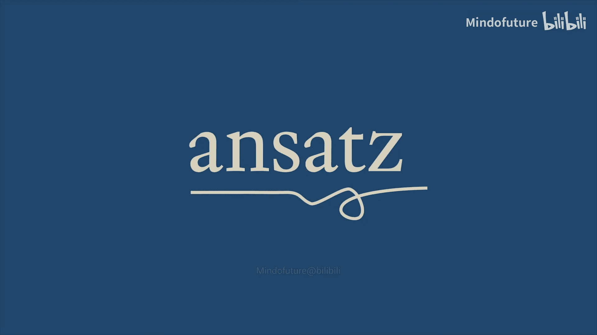

So hi， it's been a whirlwind past year for me。 ended up in a different industry than I ever thought I'd be in。

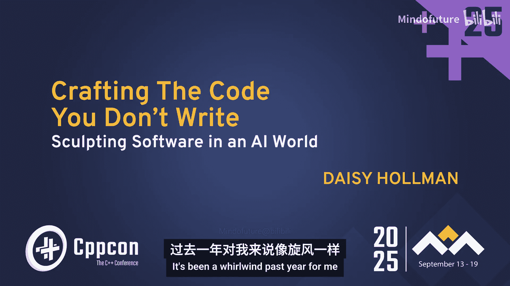

For those of you who know me， I'm now atentthropic working on this products clo code。

Some of you may have heard of it。 if you haven't， hopefully you have heard of it at。after this talk。

 Matt Godbol is showing me that he is too much of an addict and is currently using cloud code on the front row。

😊，So that's， that's fine。 Anyway， my slides are here。 If you want to follow along。

 they are live and they match what's here。 So if you have any trouble reading anything on the screen。

 especially from the back of the room， you can go to the slides and follow along。 Yeah。

 here's the nice the thumbnail slide。 I think for the conference。😊。

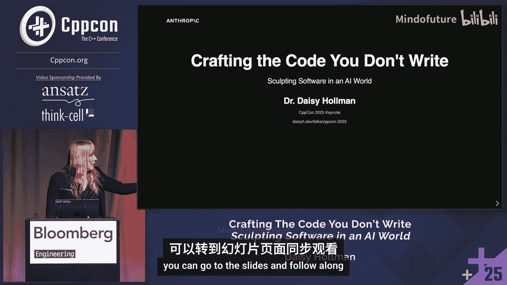

Yeah， so whom am I， John introduced me a little bit。 I've a longtime C plus plus committee member。

 I have wording or features that are in 172023，26。 almost certainly。

 it's not officially approved yet， but。😊，And， and likely。

 some of the features I contributed to are going into 29。

 Here are some of the things that I worked on。 while I was contributing to the committee。 I was the。

 the chair of S G 9 ranges， which is， I mean， I don't want to brag。

 but among the C plus plusies of C plus plus features， you know，😊，I was chair of this conference。

 Go the excellent opportunity to do that。 really enjoyed that。

 I gave these talks called cute C plus plus tricks talks that were really about deep and dark corners of C plus plus。

 I'm only saying all of this to say， I'm one of you like I am C plus plus。 And so can you like。

 this is， this has been a big part of my life。 And， and I'm， I'm saying all this to say。😊。

Now I work in AI。If you would have been skeptical of me as an outsider coming in here and talking about AI and talking about the future of coding as I see it。

I， I。Want to try and convince you with this slide that I'm not an outsider。 This is。

 this is my world。 And I really， really appreciate everything this conference has done for my career。

😊，And， and this is not the end of it to be clear。 But I am now working on AI。

 I am working on coding agents。 Let's talk about the elephant in the room very briefly。 AI is。

A bit polarizing right now。 I recognize that。 I'm not here to talk about that。

 There are great conferences about the ethics and social impacts of AI。

 This is a technical conference。 I'm happy to talk in the hallway。 I'm happy to talk over coffee。

 But here， I really want to focus on the technical aspects here。 I'm。

 I'm not here to convince you that AI coding agents are going to change the way software engineering works or that vibe coding is the future of software。

 and you should just forget about code quality。😊，Or that， like。In general。

 I'm not here to talk about the social impacts or the environmental impact。 Like I can。

 I will say upfront that I'm very concerned about the environmental impact of。Of。

Of AI and of coding agents and of agents in general。 and of a lot of the aspects of this。

 And I think for me， like personally， part of the excuse that the industry is getting right now is that we think that it's gonna to accelerate clean energy over the next two years。

 But there's a clock on that。And I think a lot of us are gonna walk away from the industry if we don't actually see that happening。

 So this is， this is like there are a lot of people who very much care about the environmental impact in the industry。

 And I wish I had more time to talk about that， but。I do want to focus on， in this talk。

How to help you thrive in a world where you have limited control over how much AI is in the world。

 right。No one in here really has the ability to stop the advance of AI。

You can have opinions on whether or not it should happen。 But the reality is， as a software engineer。

 it's going to impact your life。And I want to do my best to help you thrive in that world。嗯。

So goals for this presentation。 I want to help you understand L O Ms at a high level。 I want。

Especially the parts that are really important for writing code。

 I want you to really have a conceptual framework。For how to use coding agents as a tool。

 I'm gonna kind of bounce between coding agents， AI， L O Ms。

 a number of different other terms The the industry is kind of bouncing between these terms also。

So it's kind of difficult to。 And a lot of them are very loaded with a lot of commercial value to them。

 And I'm just trying to use them in the technical sense， but。

I want you to learn how to use them as a tool。 I want you， to。

Improve your mental model for how L limbs work， how they're trained。And。

 and why they make mistakes so that you can really learn how to anticipate these mistakes and avoid them and really be more efficient in your use of coding agents。

And like all of my talks， I really want you to， to learn how to learn， right。

 when you see this went wrong and this went right， like。

 I want you to understand how to figure out why this went wrong and why this went right so that you can。

Improve and， and iterate and get better， right， And I think that's especially very hard with coding agents。

And also。I wantanna geek out about the future C plus plus where photo coding agents fit into that future。

How all of that works， how we， how I think that the language should evolve。

 You got maybe some of that。 If you came to the grillr the committee panel last night。

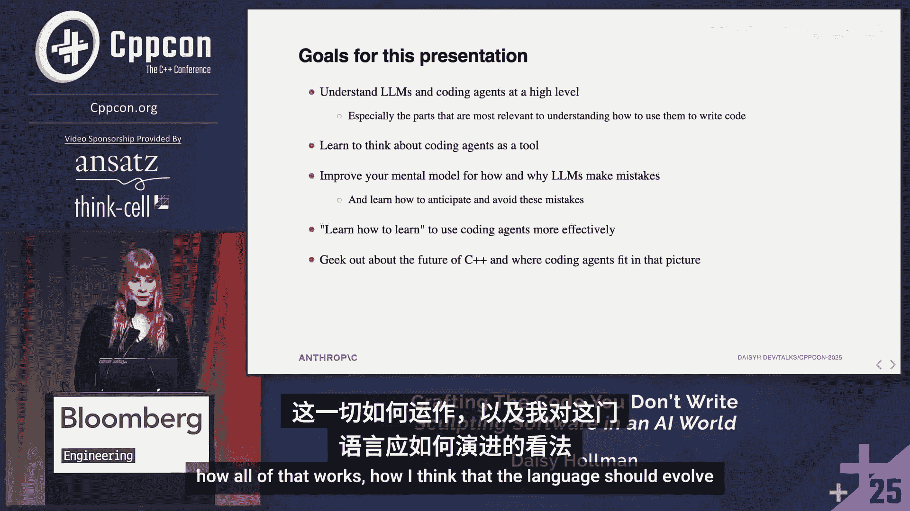

Anyway， I'm gonna dive in。 I have a lot of material。 I'm going try and not go too fast。

 but I have a lot of things I really want to say，  honestly。

 because I very much care about this community。 and I want them to hear all of this cool stuff。

All of you， I want you to hear this， not just。

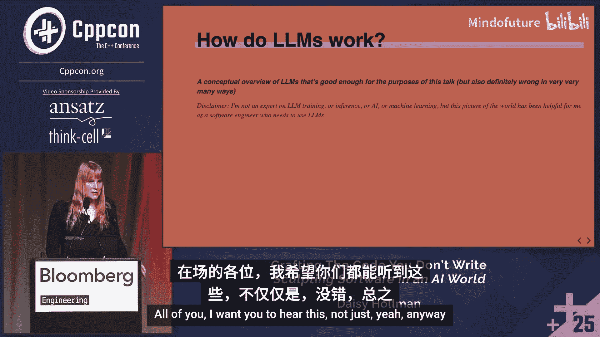

Yeah， anyway。So， yeah， I'm kind of gonna frame this in， in a timeline。

 So you get some idea of the chronology of this， But this is not intended to be an overview of the specific history of AI in。

 in the modern world。 But it it all started with this， this transformer architecture。

 this is the basic architecture。Of， of large language models used everywhere today。

 And I'm going to explain this in three parts。The， the first layer that I want to walk through is the input layer。

And this is actually probably the most important layer for you to understand as a developer。

 because this is where most of the things that you have control over are going to be put。Right。

 this is where we turn tokens into vectors。 We， we turn the， the language into numbers， right。

 so that the， so that the large language model can make predictions based on that。

It uses a fixed size vocabulary， and it also uses。A fixed context length or context window。 right。

 Those are the two important variables here。 And it's basically encoding the vocabulary and the position。

Into the context window。 And there's ways of doing that encoding that are much more sophisticated now than when this first started。

 But this was the basic architecture， even in the 2017 paper that started all of this off。

There's a third thing called the embedding dimension， which you may hear talked about some。

 That's basically just the dimension that the model is working on。

 where it's doing all of its transformations。 And you don't really need to understand that to use L L Ms。

 But if you hear that， that's what， that's what people are talking about。

 It's like the working dimension。The most important takeaway here， though。

 is that the context window limits the amount of information that you can give the model to think about at any given time。

Right， it's， it's the number of tokens you can feed into the model。

In order to predict the next token。And that。That basically frames almost everything we build on top of L O Ms。

 especially as engineers that are not。Directly involved in AI as， as， as C plus plus programmers。

Most of what we're gonna build on top of AI involves engineering this context window and using it effectively。

 It is the input layer to the model。So let's talk through。

 How do we make a chat bot out of just a context window， right， How do we have all of these。

 these tokens right up here。Better just words。 How do we turn that into a chatbot。

And is shockingly primitive。We basically， we write out， like human colon。

And then put whatever you said。And then we put assistant colon。

 And that's where we start having the model complete。

 And when the model feels like it's done completing or answered the question， it says human colon。

 and stops。喂。This is literally the text we're feeding in。It's， it's shockingly， shockingly simple。

 I think there's a theme throughout this talk that a lot of the technology involved in AI is in its infancy and is in low hanging fruit territory。

We， we do some sanitizing becauseuse like the first thing people tried to do when they realized this was was happening was the like type human colon or type assist colon in the prompt and try and confuse it。

 but。Basically， this is what's going on right now。 And it hasn't changed that much since the。

 the dawn of the Age or sorry， the dawn of the L L M era。But it also means that our。

 our conversations get very long， very quickly， right。

 Everything that you've said in that conversation before then is contributing to the context window you're using。

 which means that's all part of your input。 And so as you're trying to craft the input that you give to this model to get the best output you can。

😊，You have to think about all of these things being in the context window together， right。嗯。

Let's talk about transformers。 This is my one planned joke of the talk that I bet five people in the room will get。

Who knows what word goes here。Attention， yay， we had a few people who knew it。Who gets this joke。

How about this one？Okay， makes me laugh anyway。 I don't care。The paper is by Veswani E Al。

 attentiontention is all you need。 But two months before that。

 Charlie Poose came out with a song called attentiontion。So I like to give him credit。

Technically scooped the authors by two months。Anyway， the intersection of Charlie Booth fans and。

L O M engineers is pretty small。 It's pretty much just me in the middle。But it。

 it makes me laugh every time， so。Tranformers are really the key to modern L OMs， and。Basically。

 what they're doing is allowing you to connect， build connections between related tokens that could be far from each other in the input。

The mathematical structure of this is very interesting。 I wish I had time to go into it in this talk。

 But I don't think the mathematical structure really helps you understand what you need to know to code。

 which you really need to know to code is that attention is building these connections between things that our brain naturally builds connections between also。

 So if we have this sentence， the student who had studied diligently for weeks。

 despite the numerous distractions and challenges， Finally pass the exam。

 Pre much everyone in this room can parse that sentence， right， But in 2017。

 we didn't really have language models that could do that。

 And it's because they struggled to correlate things that were far apart。Right， and。

The attention is the mechanism that really gives the model the ability to say， oh， student past。

 That's what's going on here。 We're talking about the student。

 past is something that pertains to student and not challenges and not distractions， right？

 And so you， if you actually look at the attention matrix for the first layer of the model。

 you can actually see these。These blocks being higher or larger in magnitude between pairs of tokens that are connected。

Now， there's like multiple layers of this model。 So once we're past the first layer， right。

 we're connecting like connecting connections kind of， right。

 We're connecting a connection to another token， or we're connecting an abstract idea and another abstract idea。

 And there's many， many， many of these layers。But it starts with connecting words to each other and then connecting those to each other。

 etca， eta， etc cetera。And it turns out this works unreasonably well。

And so there's this third layer that's also important to understand。

 And actually something that you have a little bit of control over。

 if you're directly querying the API， but not a whole lot。 And it doesn't make that much difference。

 This is how we choose the next token， right， So it runs through this whole prediction thing。

 This whole mechanism。 And it comes up with something that basically turns into a probability distribution of the next token。

And then the model chooses the next token based on this distribution。 It's called sampling。

 And usually there's a a parameter to the model called the temperature that controls how random the sampling is。

 Lower temperatures are like more deterministic。 It's just gonna choose the most likely token more most often。

 higher temperatures are gonna be more creative and more random。But like， less consistent and。So。

 it's gonna choose something。Something less than the， the most likely token every now and then。

 And that is actually really important to accomplishing。Certain engineering tasks。

 And figuring out the right temperature in there is just kind of a matter of feel。

 We don't really have good theoretical understanding of why this is。 I think on most models。

 I've seen the ideal temperature for coding is somewhere between 。6 and 。7。

 But like if you're trying to write poetry。 It can be like 。95 or something。 Like its。

 it really is just something we play around with and try and figure out。And then this。

 this output repeats， right。 So we， we， we choose one of the tokens。

 and then we stick it back into the context window and try again。And the。

 the machinery will have what's called a， a stop sequence。

 which in the case of a chat bot is this like。New line than human colon， right。

 And when it sees the model generate that， it will stop feeding。

 doing this feedback loop and send you the result。And so we， we have what are。

Predefined stop sequences that allowed us to， to build this into real infrastructure。 that happens。

In the cloud and then sends you back your results。So let's talk a little bit about how training works。

 And to be very clear， I think there's this perception that AI that L O Ms are just fancy autocomps that just predicting the next token。

 And that's mechanically what's happening。 But I don't think it's a very interesting thing to say。

 And I want to kind of illustrate that mechanically that's what's happening by I want to illustrate how dated that understanding is by talking about how long we've been able to just predict the next token。

For these things， this goes all the way back to 2018， we were doing pre training on the same。

 not on the same scale， but basically with more or less the same technology that we do pre training today。

And you basically start with your whole model with a whole bunch of random weights。

And you look at some tokens from training data， right， so。Here in the training data， this would be。

Back， right， We， we all know peoples plus well enough。And throughout this talk。

 I'm going to use this， this little set of three thinking emojis to indicate this spot where I'm talking about the L O M being at。

 I couldn't come up with anything better for the presentation。

 So if you see that over and over again， you're confused。That's what's going on。

 I'm talking about in this code snippet。 This is where the L O M is at the that particular moment。

 And so here， you know， early on in the training， you might get something like this out of your random weights。

 You might get 35% back11% front，5% pull right。 And then what you're gonna do is you're gonna compute a gradient。

嗯。That will cause of the weights that will cause the back to become more likely because itll cause front and pull to be less likely。

The maths behind that is a little bit complicated， but it's actually not too bad。 And it's。

 it's something that's pretty understandable。 propagation is involved in this process。Yeah。

 and so then we adjust the weights， and we repeat， and we do this。Over and over and over again。

 for very large corpes of data， we move on to the next token and then try and do that。

 We do this for a whole bunch of different tokens。At once， and。It takes an enormous amount of time。

 an enormous amount of compute to train these things。啊。So that was 2018。

 That's what pre tradinging looked like in 2018。 And it has not changed much since then。

 The scale has gone up a lot。But the， the general idea for pretrain specifically。

 not talking about reinforcement learning， talking specifically about pre traininging hasn't changed that much since that era。

 I'm sure someone in the YouTube comments who is an expert on pretraining will correct me。

 But for the purposes of a C plus plus conference。 That's。

 that's what you really need to understand about how the pretraining happens。

What we started to see as we started to grow these things is emergent behaviors that were surprisingly good。

Unreasonably effective is another way to say this。 So in 2019， we had G T2， which was 1。

5 billion parameters。And was trained on about 40 GB of training data。

 G 3 was trained on about 10 is trained on about 570 GB of training data with 175 billion parameters。

In a very vague sense， if you look at these kinds of numbers。

 you can see that pretraining kind of constitutes a a compression on the data， right。

 It's like a approximate compression。In a way that allows you to reproduce those tokens， right。

 it allows you， It allows the model to regurgitate those tokens in a probabilistic way。 But we're。

 we're compressing the training data into the weights。This surprising thing。

 And we don't fully understand this as an industry yet。But the surprising thing appears to be。

It iss that it appears that this compression is something similar to what our brains use。

 this conceptual generalization compression of the data。So that you can。

 based on one concept over here and another concept over here。

 generalized to a prediction of a token that's likely to match the input data。This is a metaphor。

 It's not exactly what's going on。 If we knew exactly what was going on。

 I think I would be giving a talk at。An AI conference。And， and honestly， we don't as an industry。

 But this is more or less why we kind of think that this is working so well。

 And when we ask it to decompress the data。On some prompt that it hasn't seen in its training data。

 it uses conceptual generalization in much the same way that humans do。嗯。So let's consider this。

 this， this code snippet， right， this C plus plus， right， We have a widget factory。

 We are taking some sort of default initialized fo factory。

 And this is this is a well knownn C plus plus factory pattern， right It's。

 it's actually quite an old pattern。 I don't see a lot in， in more modern code。

 But we're making a unique pointer。 We're calling initialized。 and then we're returning。 And like。

 let's imagine that the model is completing right here。 right。😊，And。

 and there are several completion candidates， right， The obvious one is just widget。

But there's no reason inherently without any special knowledge that it couldn't be foo or no pointer or。

 well， what about Si move of widget is is that actually the right， maybe now we're not sure， right。

 like or stood move of foo。 I think we're pretty sure it's not that。

 But we could make a new unique pointer to a widget， But we have。You know， some intuition。

 it could be a semiical， and it could be 42。 It could be an emoji。Right， like this could be the。

 the completion of this could be any token。 How do we pick between these things， right。

And I want to think through how your brain is doing this。

 because it's actually surprisingly analogous to how we think that L O Ms are doing this。So。

Probably the first thing we're going to do is like。

 I think the return value is probably going to be asking。You eliminate the， the emoji。

We look at the return type， right， So we are doing some sort of。

Atten correlation in our brain between this token and this token， right。

 or this sequence of tokens and this token。 And we're like。

These two things are probably related in some way， right？ And so we're like。In。

And void probably are not candidates， right， because these things are not related to that correlation。

 right， So you， you can， can you kind of picture in your brain this process of the attention mechanism connecting pieces of this code。

嗯。If you are a。Very good C plus+ programmer。 You might have immediately said， oh。Foo has been moved。

So I can correlate this token here or this token sequence here with this token here and say。

Probably it's not foo or anything related to foo。 right， that's a use after move。

 We have a conceptual picture in our brain that or conceptual compression of the information in our brain that represents use after move is bad。

Right， or I hope you do。 If you're at CPPcon I hope you are getting that idea， right。

We know that this factory pattern is probably going to return something that's been initialized。

 right， So no pointer seems pretty unlikely。So we can cross that off our list。

We probably wouldn't initialize something and then throw it away。

So like this make unique seems pretty unlikely。😡，Right。

And probably the variable name is gonna be like widget。

 So even if this were like widget and then we were using food and you didn't know about use after to move。

 Probably the fact that someone had named the same thing as the factory function。

Means that you're probably returning that thing。But。Now we're down to two candidates。嗯。

And I bet we have the full spectrum。Of probability distributions for this completion in the room。

Because I bet there are people who are 100% sure this is a move。

And I bet there are people who are 100% sure this isn't。I will confess。

 even with all my years on the committee， my distribution is the。About this，93%，7%。嗯。

And that was before I looked this up。 But like。I'm not sure I could have told you why。

We could also do this completion， right。This is actually an implicit move。

 And so the correct answer is widget。 correctrect answer。 It's not incorrect， necessarily to do move。

 although mostlins will probably tell you that you're doing an unnecessary move into return value。

This is an implicit move because the， the type of widget exactly matches the type of the return value。

嗯。And I'm curious as to what people's probability distributions for this completion is。嗯。

I think mine looked probably something like this to my shame as a C plus+ committee member。

Especially given I was， I was literally there for this。But yeah， I don't know。

 anyone want to show out the right answer。It is not 17。It is 11。

This has always been a part of move semantics。 In 14。

 we relaxed it so that this could be convertible。 I think we did some further relaxations in 20。😊。

Yeah， there are committee members around here walking around here who can tell you a lot more about this。

Um you know。Go buy Barrry a drink。啊。So fun thing about working in an AI company is that I can actually go and pick the model's brain on this。

😊，Right， I can actually go and do this completion and figure out what its probability distribution is。

And this is not something we typically expose on mass to the public。

 but got permission to show that share this with you also。 So I'm pretty excited。😊，So we。

 we feed this into the the model。 and we， we get its token distribution。

 I did this with a temperature of 1。0， which is like the most random pretty much that it can get。

 So this is like not something you would really use for coding。 But I wanted to be able to see like。

 if there's any。Any like probability that's getting it wrong with small examples。

 modern models get these things right pretty often。 But this is also。

 I think most people in the room would agree。 this is a pretty dark corner of C plus plus， right。

 This is not。This is not C plus plus 1，0，1。 And I don't think most C plus plus 1。

01 entry level students would get this correct。 So this is not。It's a really interesting thing。

 And what we see here is something really interesting， and。😊，This was a late night。At the office。

 when I saw this， trying to figure it out and understand it。And what we actually see is。

 so on the far right， we have some very small models。 This is a model from 2024。This is。Late 2024。

 and these are both the smaller versions of our models。 Haiku。 This is 3。7 sonnet。

 which was released in February。 a slightly larger model。 This is Sonet 4。

 which was May of this year。 And this is Opus 4 by1， which is in August and much larger。Yes。

 we're hilarious opus on it， Haiku。And the interesting thing here is that it seems to be getting less likely to get the right answer。

In the newer models， right， I did change the variable from widget to var because I didn't really want to bias。

Towards anything specific。 And I put a using namespace stood in here so that I would like be more likely to get the the move directly and just just try and really sample this very specific issue of is it a move or not implicit move or not。

And the newer models are still going to， like at a reasonable coding temperature。

 you're pretty much always going to do this return correctly。

 But it was surprising to me that the older models。We're doing it more often。

And I think we have an explanation。 I had a lot of researchers and interpret folks weigh in on this and。

 and help me with this。 And I'm really grateful to all of them。😊。

But what we think is happening is that the old model just thinks this is Python。啊。And。

Once we start getting towards the newer models， it actually understands move semantics and has to do a split second and be like。

 wait a second。9% of the time， it's going to forget that implicit move is a thing。

 And just to be safe， it's going to move。So it has a concept of implicit move。In its brain somewhere。

 But sometimes it's forgetting about it， or it's forming that concept too late in the in the residuals。

 too late in the layers。 And it can't really connect that concept to the return value in order to pick the token correctly。

 right， And it it's still pretty low， right， at temperature of one， it's 9%。 It's still or 11%。

 you have to add these two together， right， because sometimes it it's generating the the980 L call。

 which is actually what we would like it to do， but。Here it ist a log scale。

 just so you can get some idea that like。Even the， the semicolon， the completely wrong answer。

 has a 10 to the -5 probability at temperature 1， right。

Which doesn't sound like much until you realize you're generating， you know，200000 tokens。Per day。

 this is going to happen like once a day in a typical coding workflow。

 It's going to do something completely wrong。And， and so this is very hard to get under control。

 right？ This is， you have to be very clever with how you engineer the way the model can correct its mistakes。

 And we're going talk about that in a little bit。But the interesting thing here is if。

I'm correct about this theory that the model understands implicit move。

But is just forgetting about it？Then we should be able to put a comment here。

That says this is an implicit move。 Remind it that implicit move exists。

And then this probability distribution should go back to all of the models saying one。 again。

 the ones that still thought this was Python code are just going still not know what moves are。

 but the newer ones that actually understand the concept of move and are just forgetting about it 10% of the time。

Are going to go back to 100%。And don't you love it when things actually do work。

 We get basically 100%。 There's a little bit of artifact here in the newest model。

 And we think that's potentially related to the model just trying to be safe because it knows that it won't。

Fail。 There's other things there。 But this is basically never going to get the wrong thing in real coding scenarios。

Well， I say basically never， obviously。You know， it's， it's a finite percentage。

At temperature of one。Some of this is probably just don't code at a temperature of one。

 but we can further。Figure this out。 We can further understand what the model is thinking with a really interesting experiment。

 Like， how well does it really understand what's going on here。

We can tell it that implicit move is broken in our compiler。So does it actually。

 I it just picking up on move and being like， oh， I should move。 Like， obviously。

 if it didn't really understand the idea of implicit move。

Then it would probably try and correlate move here with like the return value and like be more likely to do the move。

 right， instead of trusting the implicit move。😡，嗯。But if it really understands what implicit move is。

 it should be able to look at this comment。Build up a concept of， oh。

 I need to do something that I wouldn't normally have to do for implicit move。

And change what it generates here。And that actually works。Which is really cool。

 You can see our old models。That think they're writing Python still just want to return the the variable by itself。

 They are starting to kind of like be like， oh， maybe I should do something related to move。

 So it's not like that the old old models know nothing about C plus plus， but the new models。

KNonow a surprising amount。We actually think here， this is the model not believing you that implicit move is broken because I have never seen this broken in a compiler。

 but it's still like getting the right answer in this bizarre scenario that is obviously not in its training data。

 right， This is not something that is not a scenario that I've ever seen as a C plus plus programmer。

 I've seen a lot of other broken things。 But I haven't seen this specific one broken。And， and yet。

You know， the compiler is not just regurgitating its training data This is。

Almost entirely from its pretraining data。 and it's not regurgitating its training data。

 It's conceptually generalizing about what broken， implicit move means。

And I think that's really interesting。And here's the log scale just for completeness。Just for fun。

 Thr this one in。And I thought it was very interesting。That the newer models are getting better。3。

7 sonnet seems pretty confused。 I think the older models here。

Just vaguely know that move is somehow related to C plus plus 11。 And so it's like， oh， it's a move。

 C plus plus 11 things。And there was， in fact， a fix to implicit move semantics via a core working group issue in C plus+ 14 that makes this a little more nuanced。

 And I'm wondering if that's what it's picking up on。😊，But I think that's very interesting。So， yeah。

 take away from this section what I want you to get is that compression through conceptual generalization is a useful metaphor for understanding how pre。

Pretrain models store and regurgitate information， right， It is still regurgitating information。

 And I'm going talk about why I use that term in a second， but it is regurgitating it conceptually。

Right， it is thinking about what。Is going on in conceptually and then generating the tokens that match that concept。

Let's talk about reinforcement learning now， which is。Basically。

 everything that it advanced since 2002， aside from this， there's been some scale changes。

 too since then。 But a lot of the advancements that have really LED us into the more modern era and by more modern era。

 I mean， like since the release of Chatt BT。I still wouldn't even call that the modern era。

 We'll talk about the modern era soon。 But like。Most of that has come from reinforcement learning。

And so the problem with pretrain models is that they really are a glorified， autocomplete。

 This is a conceptual。This is a conceptual generalization here， but it's like。It can。

 it's predicting the next token， and it's not。Accomplishing a task， right。

 The task here is to answer the question。And it is predicting the next token， based on。

Parts of the question， but not based on its understanding of this as a task。Right， and so。

This would be a completely reasonable regurgitation of the training data。

 So vector size is defined in the standard library。

 vectors or sequence containers that represent arrays that can change size。Et cetera， et cetera。

 et cetera。This is。An example， Claude wrote all my slides， by the way。

 in case you're curious or or helped with most of them I。Prompted it。 but so give me a little credit。

 but。But， yeah， I mean， this is， I， I gave it an example from a different talk that was not related to C Plus plus and said generate something that is。

Like this example。 But for C plus plus， I think it did a pretty good job。

 I think that's really pretty cool。 But so let's talk a little bit about how reinforcement learning works。

 This is the part I have to be the most careful about， because most reinforcement learning。😊。

Work that's going on right now is very trade secret。And protected very carefully。

 And this is like a very active area of research。But the basic idea is that you give the model a question or a task。

And then you generate hundreds of completions。For that task。

And then you need some way to score those completions。

 So like you can give it a high school math test。 That's multiple choice， right。

 And that's that's a really easy version of this because。

 you know the right answer and there's not a lot of ambiguity。 If it gets the wrong answer。

 you don't give it any credit。 And if it gets the right answer， you give it a lot of credit。

 But what if it's generating C plus code。 Well， this is actually quite complicated in that， like。

 you know， some examples from C plus plus code。 If you asked it to generate a function that。

 you know， takes a random access range。in certain contexts。

 it might be correct to use Spna there because maybe you don't have C plus+20 yet。

 Like it doesn't have the context contextual information to know whether or not it has C plus+20。

 if you want to give it at least a little bit of credit。 But like figuring out how to write these。

 these metrics， these scoring functions。😡，Is an art。

 And it's not something we've really figured out as an industry。 And there's。

 there's even more nuanced to it than that that I won't get into the British talk because you don't actually even know which sets of tokens to apply the scoring function to。

 Sometimes the the agent may have taken a wrong turn。

 figured out that it was the wrong turn and then taken the right turn。

 and you don't want to apply your scoring metric to the part where it took the wrong turn。

 only the part where it took the right turn。 And that's an absolute nightmare and。

Active area of research。And then you basically compute a gradient of the weights based on those token completions。

That makes the model more likely to give the completions with higher scores and less likely to give the completions with lower scores。

I am doing a lot of hand waving here。But that's more or less， what goes on。You repeat this many。

 many times for many， many tasks。Again， enormous amount of compute done。

 And it's not like these tasks are often short time horizon tasks。

 You may be doing this for like the task in some of our training。 Okay。

 the task in some public versions of training data that I can talk about is often to take a。

Issue from a GiHub repository。And produce a fix。And the scoring function is the human generated pull request that fixed that issue。

Right， like these， this is， these are real world tasks that we are often training these things on。

 that the industry is often training these things on。

 I'm making no comment on what Anthropic specifically is doing。Sorry for that。I really love my job。

This sounds really hard。It's a lot harder than it sounds。

And I wish I had a lot more time to get into this。 I actually had some really great slides about C plus plus examples of this that I had to cut for time。

😊，But let's jump a little bit more into the even more modern era。Of tool use and agents。

So sometime around 2023，2024。We realized that like XML or Json。

 other structured market languages are just texts。And so we could give the LLma like description of what would happen if it uses the schema。

And give it a schema。And then when we see it generate that， we stop。 We do the thing。

 make the thing that we told it would happen， happen。And then give it back the output。

 and then let it keep。贴。Completing， so， for instance。

 we could have it run in a command in the terminal or run the compiler， run a debugger。

 run the profiler， search the Internet， search the code in a repository。😊，Edit a file。 Like。

 I don't think。I don't think I realized until I got to。

Work in this field that like edit a file is something that we discovered。喂。

That that's pretty crazy to me。 So I actually have some of the tool calls from Quad code using the Anthropic API。

 at least。嗯。For。For the edit tool call， so。This is like。For now， most use XML。

 There's kind of a shift towards JSO for various technical reasons I won't get into。

But here's what an edit tool call looks like in Quad code。

 And Quad has to generate this verbatim in order to change just a few characters。In the file。

If the old string is wrong。The tool call fails。 If there are multiple old strings in the file。

 the tool call fails。Like， we are in the ED era。Of agent drawing。Who here has used ED before？Right。

 okay。If you didn't raise your hand， think about it like。It's the reason VI is called visual。

Because you can't see what you're doing at all in ED。Yeah， it is find and replace。

And this is the only tool everything you've ever used。Involving a large language model。

 editing code does this。Which blows my mind。 There's so many things you have to remember。

I would call this superhuman intelligence to some extent， right， like， I could not do this。😡。

I could not do this by myself。Every time I needed to edit something and ever produce coherent code in a reasonable time span。

So I， I think that like the point I'm trying to make here is that the。

 the tools that we have are holding us back。 I think at some point。

 we will figure out how to create whatever the agent equivalent of VI is。 spoililer alert。

 It's not V I。 We've tried。It's not E max， either。But something that provides the same kind of active feedback。

To the model， while it's edited。So it doesn't have to verbaate and replace to give you some idea。

Of how good this is and how good the models are at this。Remember。

 I said Quad code writes all my slides。 I do my slides in jascript framework that I forked off of reveal Js back in 2018 because I'm a speaker and do a lot of speaking and。

Other speakers in the room know exactly what I'm talking about。 And anyway。

 it's something that you would not expect to be in pretraining data at the very least。

 And I have it edit the slides。 I tell it what I want to say， and I have it edit the slides。

 And so I had it generate the edit to my file that added this code block。

And this is what that edit tool call look like。啊。And it got this first time。First， try。

here it is like finding the list item that it needs to put it underneath and adding the code fragment。

😡，And the tool use that's nested inside the other tool use that it doesn't mess up at all。喂。

This is remarkable to me， but this is also like。To me。

 a sign of just how much our tool design is holding back the models right now。

 there's a lot of work actively going into this， but I expect this to evolve a lot over the next few years。

 I think we really are in the low hanging fruit era of agententic tooling。

Let's talk about reasoning for a minute。 I've actually heard a few people mischaracterize this as more complicated than it is already this。

 this， this conference。So basically， what started happening is context windows grew。嗯。Very rapidly。

 especially during 2024，2023 to 2024， I actually gave a version practice version of this talk。

 And I thought I had the wrong number here。 I said， surely this is not G 4。 This is G 3。

 only had 8000 tokens in the initial release， but it is actually， in fact， G 4。

There was a G 4 turbo model that had 128 k tokens， which was a little bit more modern。 Quad 3。

 had 200 K tokens。Jim and I had a million tokens。 Claude 4 had 200 K tokens。 Basically。

 over the course of 2025， we've seen this。Level out a little bit。

 And there are various reasons for that that I could go into。 Love to ge out about offline。

 But more or less， context windows are not growing rapidly like they were during 2024，2023。

 But in 2024， we were asking， what do we do with all these extra tokens。Heres。

 here's a log plot of that growth。There were some experimentation。

 There was some experimentation early in 2025， with some 10 million。Token context windows。

 I think the general consensus is that they're not very useful。 When you spread the model that thin。

 it kind of starts to get pretty dumb。And so we're leveling out mostly in this regime。

 look at where this this stops in like April。嗯。And so what do we do with all these tokens， right。

 We have all this extra context window。One option that we started with in 2023 is what's called Retrieval augmented generation where you just pull in a document。

 you pull in a web page， you pull in a bunch of information directly， which to some extent。

 you can kind of squint at and be like， oh， that's an early form of a tool call。2024。

 we started doing kind of deterministic tool calls where the model goes and runs the compiler and gets the output of the compiler right。

 And that that really is starting to use up the window， but close to the end of 2024。 people said。

 wait a second， What if we just ask the LO M to put more relevant tokens in its context。For us。

So this is literally the entire innovation。Here。From the paper that discovered this innovation。

Before we were doing this， we were like， okay， we're going to start the model completing right after these assistant colon。

 right。And after。We were doing this。 We' were going to start the model completing after assist Col。

 Let me think through this step by step， Col。That's it。 That's the entire innovation that shook the。

AI world in the end of 2024。It's insane。 This is。证 me。Unbelievable that this was。

This was something that completely changed L L Ms。 And we actually， you know。

 we don't understand a lot of these things。 This one's one that we I think we understand pretty well why this works。

So going back to this architecture diagram that we had earlier。Right， we have this transformation。

 transformer layer 1， We have layer 2， etc cea， et cea， et cetera。 And this dot， dot。

 dot is doing a lot of work。 There's a lot of these layers， right。

 Remember how I said that attention in the first layer is really connecting one token to another token。

 connecting tokens to each other， etcter。And then like the next layer。

 you're kind of connecting pairs of tokens or connecting connections， right。Later on in the layers。

 you're eventually building up something that more or less represents an abstract idea。

An abstraction， right， And that abstraction can get， can then get connected to another abstraction。

 But at some point， if you form the abstraction too late in the layers。

Then there's not enough time for the attention mechanism to connect that one abstraction to another abstraction。

 right， And so it， it kind of misses the connection and generates the wrong token。

But if we tell the model somewhere that it has to like。

 first write out some tokens that represent its thinking， quote unquote。

It's actually having to take some of those middle layer or late layer abstractions and turn them back into tokens。

And because it's turning that abstraction back into a token。

 and we're putting that back into the context window。

 we now have a more compact representation of that abstraction。

 which allows it to be formed in an earlier layer of the model。Does that make sense。

 I think that's actually a really profound insight as to how these models are forming connections between things。

 When somebody told me that inside anthropic， I just went home with my jaw open。 I was like。

This makes so much more sense now， right， we're moving abstractions into the token layer。啊。So， yeah。

 with that， let's talk about agents。Agents are the big buzzword of 2025。

And I'm not talking about the buzzword version。 I am really talking about the technical version of agents here。

And how they really impact how you use LLMs for coding。Early OM's。

 very small context windows only do relatively shorttime horizon tasks。

 chatbots kind of worked fine with this because like even if you're having a conversation with a human and like the model forgets something that you said three questions ago or four questions ago or the human forget something you said three or four questions ago。

 you're like， oh， that that seems like a reasonable thing a human could forget， right。

They kind of work， right， Like we also use these for fancy in line completions of code， right。

 those whole like multiline completions。 That's like a very direct application。 right。

 You're just predicting the next token likelihood and then throwing everything away。😊。

RightAnd if the user hits tab， then you stick it in there if you。If they don't。

 then you don't and you don't have this long conversation history that you have to worry about。

So this all worked pretty well。 But if you gave it a much more long time horizon task。

 the LM would go off the rails pretty quickly。 It had pretty limited ability to correct。

 We were missing this extended thinking piece， also。嗯。

As L O Ms got larger and reinforcement learning got better。

 longer running tasks became more feasible。The key insight was that we。

 if we let the model see the results of its actions and then iterate on that feedback。

 then we can keep the human out of the loop for a little bit longer and have it use up a little bit more time in order to give the user a better response。

Right， so， for instance， if we ask the token to ask the model to generate code。

 then give the model a tool to run the compiler on the code it generated。

And then add the results of the compilation to the context window。

And then ask it to fix the compilation errors。 right？

 So we have this now loop where it can then now reconbile the code， see more compilation errors。

 And it doesn't like confidently state that the code that is generated is。Is correct。

It actually can check itself。😡，Right。And this feedback loop is what really transforms a chat bot into an agent。

 When people talk about agents， they're usually talking about some form of autonomy with tool use that has a feedback loop that involves。

Some sort of。Consequences of its actions， results of its actions that it can then use to create better versions of those actions。

So， this is。One of the observations that one of the AI Research institutes Meter has done recently is that the。

嗯。The length of tasks AI can do is doubling roughly every seven months。

 And that's held since about 2019。In a very vague sense。

 I think it'll be very interesting to see what this looks like in 2026。 If this trend continues。

 it's actually accelerating just a little bit。 if you look at it。

 I don't know that it'll continue to accelerate， but。😊，Basically， yeah， I mean。

 we're starting to talk about models that can run for 24 hours， models that can run for a week。Right。

 what does that look like， What does it look like to write up a task with enough detail for the model to go work on it for a week。

And you come back and get a poll request。And is that week of work？Worth the improvement over。

 you know， five hours of work。It's gonna to be very interesting。 Like。

 I don't think anyone can predict the future right now。 I am an optimist in general。

 for those of you who know me。 But I think it'll be very interesting。😊，So how to。

 how do agents understand a 1 million line code base。

Right from just a few hundred thousand tokens of context。And again， I think it's very helpful to ask。

 how do humans do this， right？ How does， how does an agent go through and figure out what's going on in the code base in order to perform a task when it can't fit all of this code into context。

And we don't do that either。 No one here has the entirety of the Claton code base memorized。Right。

We search for key entry points。 We read through some of the code and those entry points。

 kind of skim looking for like relevant things to what we're trying to understand。

 We look at key types and data structures。 If there's a civic piece of functionality。

 We probably search for key strings or something like that。

 we might search through the documentation also and then use that to figure out what file we need to start reading。

 right， In other words， we only load part of the code into our context window， right。😡，嗯。And。

 and maybe we load like a summary of the rest of the code。

 or maybe we load like a conceptual picture that might be slightly wrong。

 but good enough into our memory based on like。Our experience with the code in the past or our experience in analogous situations。

Agents do this also， right？So this is the demo， a demo that I did three months ago at AU。Um and。

This was with an older model。 Our models have gotten better since then。 But I asked it basically。

 to go through the。Clan code base。 So I， this is cloud code。 I went and initialized it。

And I'm going to go ask it。To explain to me。How cons for if is implemented。In crimeang。

Who here has written coding clang before， like in the actual compiler。

These are the people you need to come ask how hard this is。It is very hard。 I have done this。

 done this a very little bit。 and it is a very large， very complex code base。And so yeah。

 I'm asking it， how do we， How is， if Con expert implemented books。

spoiler and bringing up someone to do a demo。And it's gonna to go off。

 and it's gonna to go search some things。 It actually asks a subag to go summarize for it。

 It searches for a lot of key strings。 It reads some， some files， and it comes up with this report。

 And I'm not going go through this for time purposes。 You can go look at my walk through it of。Of in。

 in on in my A U talk。But it， it comes up with more or less the correct description。

 And so then I go in here and I can say， okay， now I'd like to implement switch Const spur， right。

 which it's going to conceptually generalize based on the conversation about if Const Sp。

 I am using this as a tool。 I am preparing the context with an analogous example that Ive asked it to go read about。

And then I'm going to give it a task。That is related while it still has that information in its context window。

And so it's going to go through and write a plan。 I'm not gonna go through this whole thing。

 but the the most my favorite part of this whole thing is I asked it to rate the the difficulty of this on a scale of 1 to 10。

 And， that is not what I wanted to do。嗯。And it says right here that the most difficult part on a scale of1 to 10 is a 9 out of 10 is convincing the C++ committee to accept the proposal。

I think that's a little low。But it has not been to a committee meeting in fairness， because our。

 our notes are not in its training data。 they're not public， so， you know。

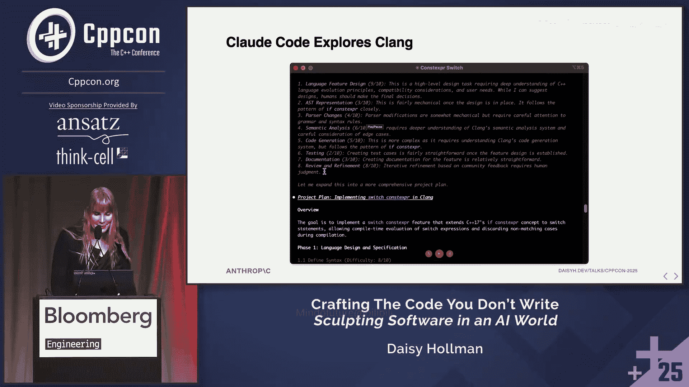

Allright， I'm going bring up Mark Williamson from Undo， who has been doing a lot of agent work。

And we're gonna do a quick demo here。I yourmic。 hopefully I okay， make he noises。 And we。

 we started talking back in April at A CU， right。

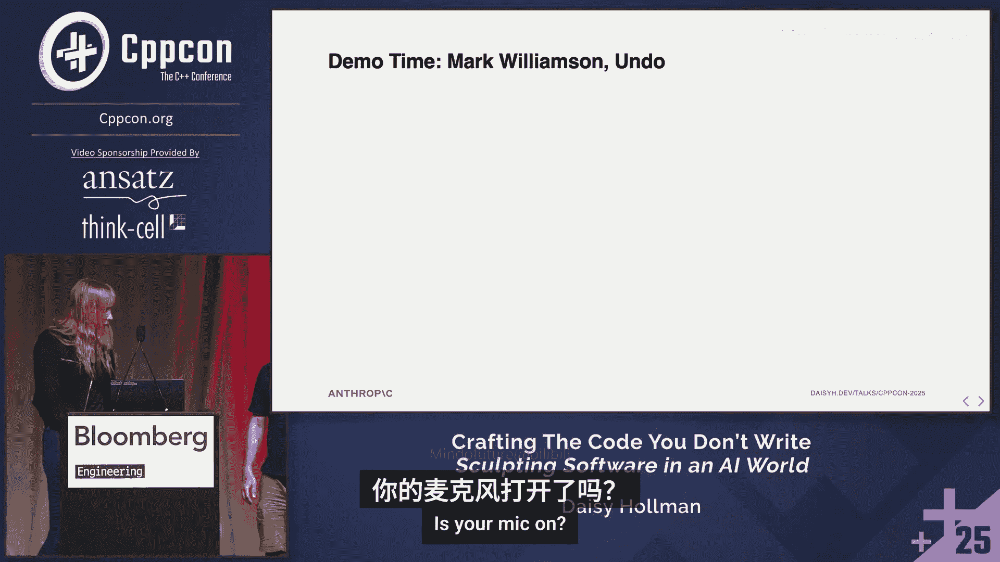

And you work on a， a time traveling debugger。 That's right。

 I want to explain what that is really briefly。 Sure， so hi， I'm Mark。 I'm CO Undo。

What we mean when we say a time travel debugger is。

The capability to capture the entire execution of a program。

 So that's actually a machine instruction precision with everything that was in memory。

 So every variable piece of state line of code， and then replay it deterministically。

 we actually do a load of tricks to make that a lot more efficient than it sounds。

 We just capture nondeterministic inputs that can affect behavior。

But the ultimate goal is that a human or an AI can retrieve any information they want about how that run of the software behaved。

And so you're gonna， you have been working behind the scenes with the cloud code team a little bit。

 mostly on your own， because we haven't been as good at communicating as we should have been。

 I'm sorry， but building a tool。For our agent， basically a tool， an MCP server。 But。

 it's a fancy way of creating tools。And。The agent now can control the debugger， right。

 Cloud code can control your debugger， run。And you're gonna show us something that you can do with that。

 Yeah， sure。 So a bit of preamble before we dive in。

What I've done in this case is I've played a little game of doom。 I'm using chocolate doom。

 the open source clone。 it stays quite close to the original source code structure。

 And I've played through this recording with our live recorder tool。

 And so I've captured everything that happened。 and we can recompute anything that went on in my playthrough。

 What we've got here is I've run to the end of that recording in RDbuer。

 on the top right you can see a live update of the frame buffer for the point in the recording that we're currently examining What I'm gonna do now。

 is use our AI integration to find out some high level information about the semantics of the code。

 So when was the second zombie killed in this playthrough。

 What it's doing is invoking Clade code in the background and it's handing over the controls of R Dbugger to Claude。

 So now it's Clalaude's job using special crafted tools to solve this。😊。

Off we go is getting a back trace at the end of the recording to figure out where it is first。

 And then it's gonna go and do some exploration。 And it's kind of like the exploration a human would do。

 So you can look， and you can see it's found this variable total kills。

 That sounds like what we want as a clue for how many kills have happened。

 But it turns out it's a red herring。 If you look here， we've run right back to the menu screen。

 This is part of the initialization of this level， It's the number of kills you can have in the level once it's spawned all of the monsters。

 So that's not right。 It pokes around in the source again， finds the player's array。

 And each player has a kill count， which sounds promising。 So then it starts poking around with that。

 runs backwards in time and finds when it was changed。 And on this occasion。

 it's found the first kill。 Its bookmarked it。 So it will be able to come back to it later during its reasoning。

 And so will the human if you want to check。😊，It's now run backwards again from there to try and find when it was two。

 That doesn't work。 That's fine。 It can recover。 It's got a deterministic recording。

 and it knows how to use the tools。 So now it's gone back to the end of time。

 And it's having another go。 And it's trying different expressions it can evaluate to figure out where this kill count became two precisely。

 You can see I got stuck stuck in the map and menu system for a bit because I forgot all the keyboard shortcuts。

Here we go going backwards， And it's now printing out the kill count， says it's kill count 2。

And now it's winding back to find out exactly when that was first assigned。And it's happy。 perfect。

 This is where the second kill occurred。😊，So it's now bookmark that。

 because that's interesting to the user and to further exploration。

 And being a good little agent is actually gathering us some additional context we might want to understand what happened。

 So we're querying out here what time it was in terms of game tips。

 We're querying out where this happened in the level。

 This is all going to form part of its final reporting。😊，Oh。

 and this is my favorite part that I forgot to stop you at is that it。

 it found it did not find a zombie。😊，Exactly， it found a possessed。

It found that that the enum for a zombie is possessed。 Exactly， yes。

 And it figured out that possessed is kind of like a zombie。

 That's probably what Mark means here precisely。 So it's。

 it's kind of generalized from my concept to the real in code concept。

 It needs to answer my question。So it's confirmed that it's a zombie man。 And now it's checking。

Where the bookmarks are so it can jump around and provide a good summary for me。

One thing I really liked。 There's no prompting that's telling it it needs to do this。

 It's decided I might want the previous killers comparison point。

 So I actually jumps back to there in time and gather some coordinates and other information there。

 And then we get this final report， which summarizes the answer to my question。 You can see we're 18。

09 seconds into level based on game ticks。 We've got coordinates。

 We've got a confirmation of the monster type。 We've got some information about the previous kill for comparison。

 And it's cast just a little bit of shade on my playing style by saying this is one of the weakest enemies in the game。

😊。

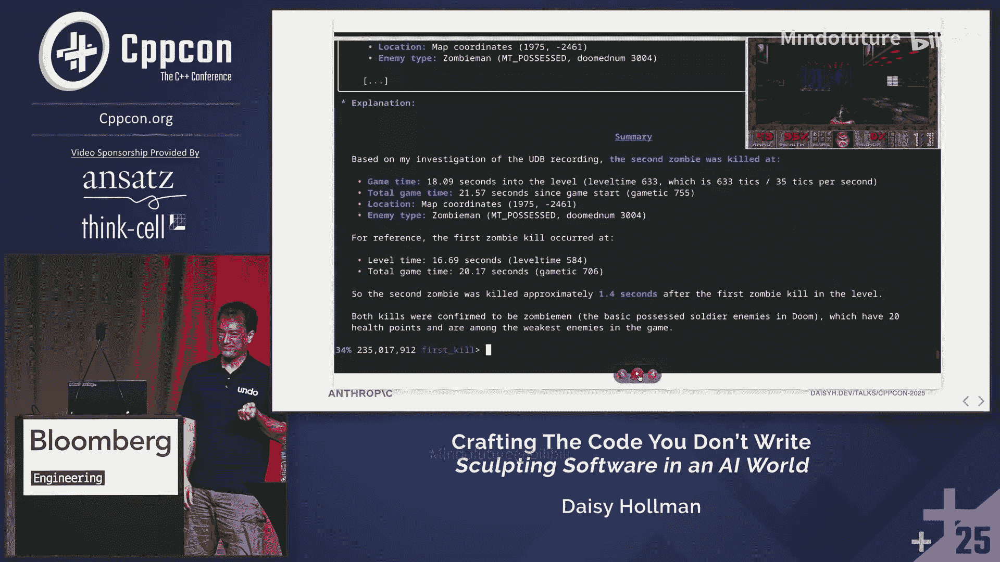

So yeah， thank you you very much。 is yeah， this is， I think， pretty， what do you all think？

I think that's a pretty incredible demo。 And this is all built using just prompting。

 I don't want to say just prompting because you spent what， three months on it connecting， telling。😊。

Teaching the compiler how to sorry， teaching the model。

 how to use your tool and figuring out what sets of tools it can use， what sets of tools it can't。

 I wish we could go deeper on that。 There's some really fascinating stuff there。

 They had to take away the step forward tool in order to get it to work correctly。

 And that's a really interesting discussion。 But it works。 this， this is all engineered well。

 and it works quite well on real problems。 too。 Yeah， if you want to see some of that。

 go stop by the undo boost。 They also have some great videos on YouTube of this。

 This is really the future of software engineering。

 And I'm so excited to get to be a part of it with the undo team。 So thank you very much。

 It's been fantastic working with you on it。 Thank you。😊，不。I get goosebump seeing that。

 I don't know about you all。 I think that this is， this is really cool。

 And it's really going to change the way that software engineering works。

 So I want to talk briefly about coding with L O Ms。😊。

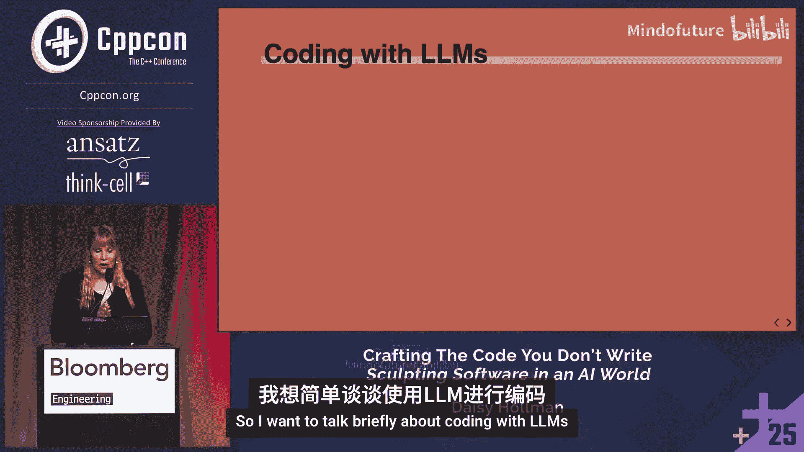

And I'm gonna skip over the next slide。 It's a really cool slide， but I want to get to the。

 to the interesting stuff that you can actually apply here。

 And I I think this is the mental model right now。 At least I think agents will probably get better But the mental model right now that I think is very useful for understanding what tasks or approximating what tasks the L O M will do well and which ones it might have struggle with。

 is that it's like a junior engineer。😊，This has read the whole Internet right the struggle with very large scope tasks。

 things that you would normally delegate to a more senior member of your team like abstraction design or code that's used in a lot of different scenarios。

 libraries with the diverse set of stakeholders that all have different requirements that you have to balance。

 right， keeping all of those stakeholder requirements in its brain and balancing them is like a very large scope task。

 and it's not something you would give a junior engineer right out of undergrad。

 No offense to anyone who was a junior engineer。 I think I would have been terrified getting that kind of task。

 Also like architect， the stuff that your colleagues are going to write for the next six months。

 That's not。 It's not something you should try and give to an agent either。 right。

 But they tend to overperform on highly arcane or obscure tasks that are relatively small in scope。

Build systems， source code repository management， knowing the right incantations to cherry pick three lines from one file into another file without messing up your gi history。

 Like， I have no idea to do that off the top of my head。 I have not used get once since。

Arriving at Anthropic Quad does all of that for me。

 Is there anyone here who would like super miss having to remember all of the like nerdy incantations in get。

Okay， I am at a C plus+ conference。 There's like three hands， but。And and I。

 I suspect I would had say same thing about who loves writing Cmate code。 Like。

 there's probably three of you。 Yeah， okay， but like。

 these are the things that you could very reasonably never have to do again。

 And that's really exciting to me。😊，Right， T meta programming。 This is a really interesting one。

Often very well contained task of like， expressing something。

That often is very compile time checkable。But the difficulty in it is the arcane weird rules of C+ plus。

 not necessarily the scope of the project。Compilr intrinsics。

 often when you're using compiler intrinsics for something， it's in a very， very specific。

 well constrained case because otherwise， like you。

 you can't really generalize compiler intrinsics that much， right， like。嗯。

Let me talk a little bit about some of the ways that you can go about using a model。 Like。

 if you dive in right in and say， do my whole project for me， go。

You're gonna be a little disappointed。 You might not be like， you might be surprised。

 but you're gonna be a little bit disappointed。 And so here's kind of some of the ways you can start ramping up in that direction while still doing your day to day job。

One of them that's very useful is rapid prototyping。 Like。

 is this even possible in the code base and how much work would it be， right？ And you can often get。

Horrible code quality working version in a few hours doing this。

 And that will give you some idea of like the upper limit of how complex the problem could actually be。

Right， and then you can go back and do follow kind of the same process。

 But with better code quality to implement the same thing。 And I find that to be very useful。

Side quests， I don't know how else to describe this。 It's basically like。

I'm sitting there handwriting the mission critical code， but there's this like functionality。

 like logging or serialization that I know needs to happen eventually。

 And I know I'm gonna have to go back and write at some point。

 it may be touches part of the code that I'm not as familiar with。

 but it's pretty small in scope and pretty well contained pretty easy to understand。

 I will often while I'm writing my mission critical code， go off into a window to the side。

 Start up Claude and have it write the thing， Sometimes I'll even just leave to do Cla。

 write the function that this that's being called here。And then， you know。

 explain it and then have it remove the to do when it's done。 That's kind of a， direction。 Sorry。

 I'm saying Quad here。 This is really not intended to be an advertisement forilanthropic。

 I should have made that very clear。 I think， yeah， I won't say much more about that。 but like。

 that is。What I use in my day to day， and that happens to be like the word we use as a proxy for agent at Anthropic。

 and so I slip into that sometimes。Planning and brainstorming this， mean， you， you saw this in the。

 the cl example， right， you actually had a reasonable function reasonably functional implementation plan for a switch constant spur feature。

With no exposure to the client code base before this， right。

 it also kind of helps me a lot with writer's block。

 There were several times where I was making these slides。 And I was like。What goes here。

 And it would give me 15 options。 And I'd read through them。 and I'd be like， oh， yeah。

 I really like that direction。 And then I'd start。 and I'd write something different from what it said。

 But yeah。😊，嗯。Learning and exploration， we already saw that right in the， in the demo。Refactoring。

 boilerplate reduction， modernization， cross language translation。

 I think these are all tasks that are。White。Work tend to work quite well with agent models。

 because they。Don't require very large scope understanding of what's going on。 It's kind of a。

Maintain the same functionality with a different way of saying it。

 And the models seem to be pretty good at that。 Test generation， especially。Again。

 I don't think most people in this room love writing tests。

 And this is another example of a place where。I skimmed the tests。That the model writes， but I， I。

 you know， don't always even fully read through the tests。

Becauseuse I think that that is like slightly less mission critical as long as it's like not making things up。

 You do have to skim it。But。As long as the tests pass， I have， and the， the code seems reasonable。

 Like， I wrote the code。You know， maybe this is a pretty good idea。

 I know I'm gonna get slammed in the comments by people who love writing tests。 But like。

 I I do think that this is a way to accelerate your software development。😊。

Let's talk about best practices for writing code that's going to interact with agents and spoiler alert。

It'sBasically the best practices for writing code that's going to interact with humans。嗯。

One of them is that if your L O M keeps guessing at your library interfacing correctly。

Maybe it's too surprising。Maybe this is an indication that humans will also guess incorrectly at this library interface or what it does。

Maybe you're being too cute。 Maybe you're using operator overloading a little bit too loosely， right？

 And it thinks that something's happening when actually， something else is happening。

If it's guessing the effects of your functioning correctly。

 it's another good indicator that maybe your function's name is not very indicative of what the function does。

Right， maybe your function signature is not very indicative of what the function does。I would say。

 like， this is what has really helped me succeed coding with agents is overthink this principle of least astonishment。

When you write code that the agent might read， like。

 actively think and be creative about coming up with ways that the code could be misinterpreted and then try and guard against those。

 If you have to use a comment。Do it if you can come up with a more bland way to say the same thing。

The model is probably quite a bit less likely to make a mistake。

So some surprising C plus+ things to avoid。This is like every other CPP con talk out there is going to talk about these kinds of things。

 We all know these are are。Good practices， even though C plus+ allows them doesn't mean you should do them。

 You're gonna to confuse people。 And if you're gonna to confuse people。

 you're gonna to confuse agents。Yeah。Don't be clever with upgrade greater overloading。

 Don't mix owning and nonowning semantics in the same type。 Avoid macros。 What did I just do。

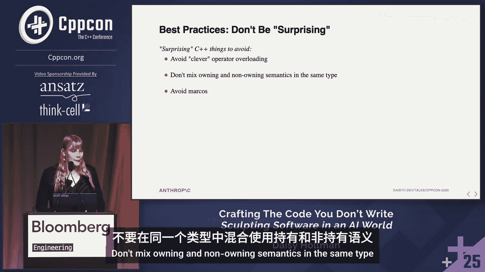

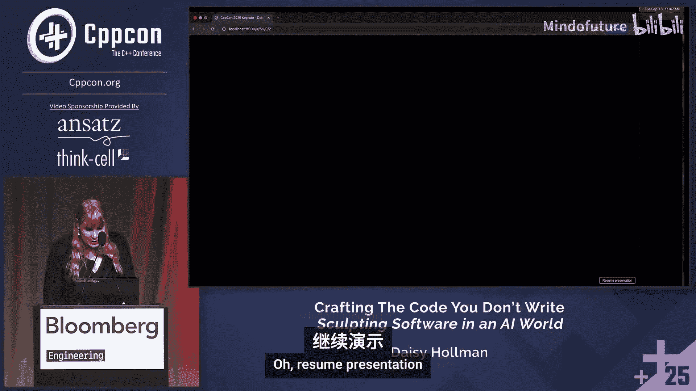

嗯。Oh， resume presentation， okay。嗯。Avoid argument dependent lookup。

 I think this one's especially bad for models because you have the same sequence of characters doing different things in different places。

 That can be very confusing。 and it can be different places， even in the same function。 That's like。

You know， I think argument dependent lookup done very， very well can be intuitive。

 but like most people don't。Avoid implicit conversions。

 don't do anything important in a implicit conversion function。 Use regular types whenever possible。

 right， This is all best practices of C plus plus。 And I'm just restating them here。

 There's nothing new here。 There's nothing specific to agents here。

 although we can start to look at some of these things and say。Oh。

 I kind of understand why the agent would make the mistake， right， We can look at the ADL and say。

 oh， it's the same tokens。 Of course， it's going to have a little more trouble correlating the behavior to that token。

Right， and that kind of explains this intuition we've had for a while of why humans get confused by this。

But it's not new advice。This is a really， really big one。 Prioritize better encapsulation。

 If you can figure out a part of your code that is very well encapsulated。

 very well and unit tested that you never have to touch。You can often have Claude or sorry。

 have your agent own that code。Right， I， I have several instances where I have a part of the code that Ive written0 of the lines of。

 I know how it works。 It's well encapsulated。 I leave it off to the side。 Now。

 like maintainability of that code is something you really do have to think about。 And， you know。

 sustainability of agent code is a thing you have to think about。

 Think about the largest that that thing could grow to。Right， and if that's large。

Probably don't do this。 But if it's well contained and is not going to grow and you are fairly sure it's not going to grow。

 Think about this。 Think about maybe having code that you don't own。Because spoiler alert。

 if you become a senior or a principal engineer， you're gonna have to do this anyway。

AndYou have to learn to get very good at this。嗯。The agent should be able to reason about the code in isolation。

 as much as possible。Especially， especially avoid code coupling。

 I think anytime you are making changes and they have surprising effects on unrelated code。

You're going to confuse the agent。 So err on the side of repeating yourself。

 This is a little bit controversial。Rather than breaking encapsulation and reusing code。

 my CPP con 2023 talk goes into great depth on this。 And I think actually。

 the advice in there applies pretty heavily。 Here's the links。Document your code。 This is。

 this is a big 1， I think。Yeah， comments are kind of more important for agents than they are for humans because agents do read comments every single time。

And。More importantly， like agents can maintain those comments。We do this at Anthropic。

 You can set up a C step that asks an agent to verify all of the comments related to the changes in your poll request and make sure none of them have w it。

😡，It's not completely foolproof， but it's way， way better than what we had before。 And I think。

 really tips the scales towards。This idea that self documenting code doesn't rot while comments do is just not is。

 starting to age， right， I think it's getting outdated。He takeaway writing。

Code for L O Ms is not that different than writing code for humans。

 except for that we can start to understand why。

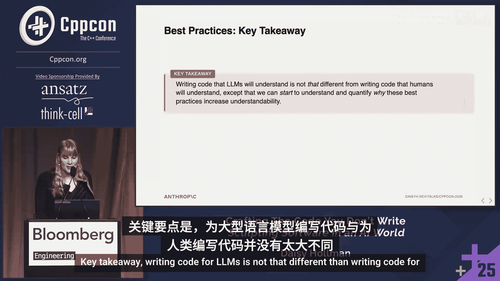

Oh， I left 8 minutes。 This is better than I thought I would。

 But this is the talk where I said we ge geek out about C++ a little bit。

 And what we think the features。Going to look like or what we think a future。

Evolutions of C plus plus four agents might look like。

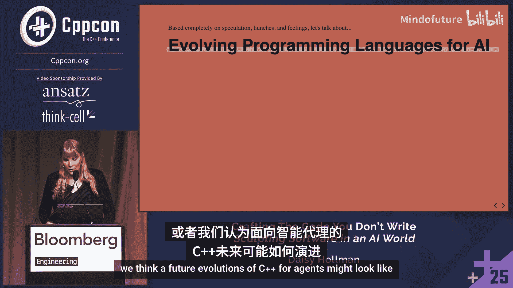

嗯。And I have this kind of category of things that I call two sided naming。

 I haven't come up with a better term for it。 I've looked for one。You have one。 Leave it in the。

 in the comments。 and I'd love to hear more。 but it's， it's。

 it's a broader category of things than just most of the other terms I've seen。

 The simplest version of this is， is keyword arguments in Python or many。

 many other languages where you actually can say at the call site。

 What the semantic meaning of the argument is。😊，Right。

 positional arguments don't carry semantic meaning unless you have the， the declaration in context。

 And we can start to understand why。The declaration might not be in context。By chance or whatever。

 right。 And so I think this is a pretty clear win。 I said this last night on the。

 the the committee panel。 I think this is something we could do in C plus plus。😊。

I think that languages that absolutely require this are gonna to have some very interesting advantages。

 Like， this is the。The call site in objective C。Part of the name of the function is the parameter names。

 And I think that's actually a really interesting model where you're actually required to state the semantic information there。

嗯。But more examples that are not keyword arguments in rust when you are going to borrow something。

 you have to say how you are borrowing it。As a reference at the call site。

 in addition to at the declaration。 So we know that this is。

 there is a reference bound to this thing。 We know that there's a mutable reference bound to this thing。

 and it could change， right？ And I think that's actually incredibly valuable for the for the agent that's skimming the code to say。

 oh， this was called in a way that that variable could change。

We have no indication of that in C plus+。 And I think that that's pretty scary。😰。

In out and Swift is another example of the same thing。And I've given all this rationale。

 but I'll leave it in the slides if you want to go over it。Contracts are a really。

 really effective way of encapsulating information and reducing code coupling by really explaining the intent of the boundaries of the function。

In its declaration。And I think that this is something that can vary efficiently and maintainably and verifiably。

Use context windows more effectively。I'm not going to go into all the details here。There is a caveat。

 right？ So these are all things that make humans more effective at programming。 There's。

 there's a lot more I could go into here。 There's， there is the twosided naming version of contracts where you actually have to opt into the contract at the call site and acknowledge it。

 So you wouldn't even have to go retrieve the declaration。 These are like。

Features in programming languages that have never gained a lot of momentum because they're too complicated。

😡，And so that's， that's this caveat， right， iss that like。

 if the learning curve is not too steep for humans。

then or if the syntax is not too obscure or arcane for humans。Then， we。

These things will benefit humans。 The problem in the past with like the reason why this is not hasscalcon is because。

The learning curve is pretty steep， and the syntax is arcane， and the， the effects are arcane。

 and they're difficult to reason about。 But remember。Agents are good at that。And so I think that's。

 that's a really interesting thing to keep in mind。As we move forward。Oh， I'm gonna skip this。

 so I get to my summary slide because I really want to drive home a few points。

 and then I'll have a little bit of time for， for questions until they kick me out， at least。

So coding agents are tools。That takes some time to learn and use。They generate output based on。

 I've literally added this slide this morning because I really want to drive home some of these points。

Clearly didn't read it。They generate output， based on input。

And the quality of their output depends on the quality of their input。The， the context window。

Is all of the space that you have to give input to the agent to to control your tool。

 use it effectively。When I hear people say L O Ms can't do this or LO Ms can't do this yet。

 I want to correct them and say it's much more likely to be accurate that to say。

 I can't do this with LO Ms or I can't do this with LO Ms yet。嗯。

I've been operating kind of at the forefront of agent development for the past six months。

 I've gotten or seven months now。 I've gotten the opportunity to work with a lot of people using this at very large scale to build entire startups out of this technology。

 and it is a skill that takes a long time to learn。

 I have gotten significantly better at it over the past seven months。 But I am not there。

 I'm not perfect yet。😊，But。This is if you learn one thing from this talk。

I want you to think about LMs this way。 right， This is a skill that you have to learn。

 It's going to take some time。 It's not going to work right away。Remember this。

 this notion of codingt agents or like junior engineers who have read the whole Internet。

 Or if you're a junior engineer， think about it like an intern。 if you ever had an intern。

What kind of project would you give to an intern？Right。If you're an intern， hey。

 welcome to C plus plus， welcome to CPP con。 You're way ahead in your career going to conferences like this。

😊，Good job。 Yeah， And it's worth time to taking the time to learn what learn intuitively what coding agents are good and bad at。

😊，And refine this kind of heuristic of junior engineers who have read the whole Internet。

Careful and intentional design can really accelerate your development process。 encapsulation is good。

 Codeup， bad， good documentation is gonna pay off more than ever。

 The future of programming languages and software engineers is really going to be anything but boring。

 And I'm just super excited to be alive for all of this。 So thank you all。 I'll take questions。 Yeah。

😊。

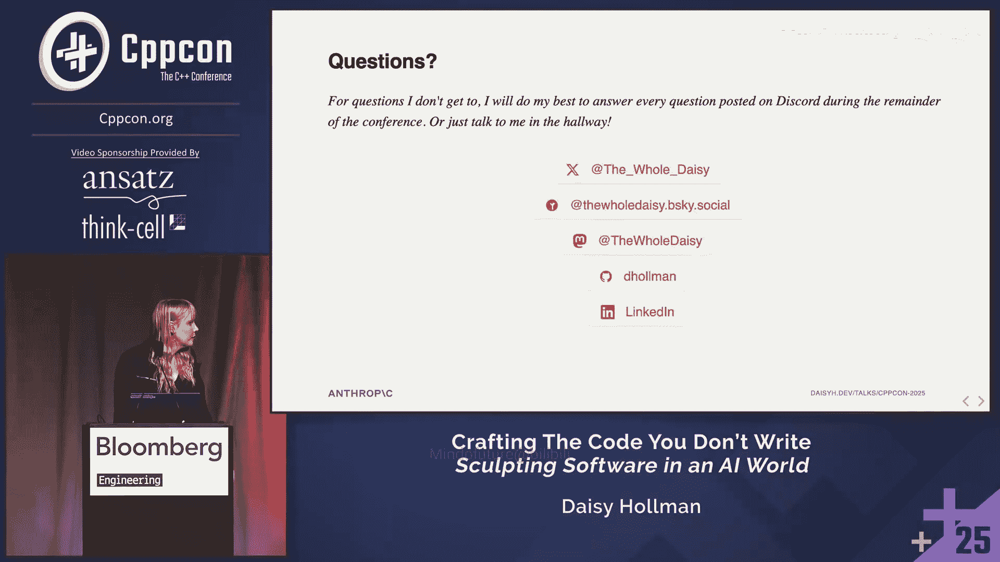

Sorry， I ran right up to the edge。 So if your question doesn't get answered and you're in line。

Talk to me in the hallway。 Post on Discord。Hey， hey， hey， hey， okay， cool。

 So I look at using an agent like doing pair programming。😊，But when I work in a larger team。

 it's sort of unusual because I'm like， I'm working with an agent。

 someone else is working with an agent。 We're sort of working things together。

 Any thoughts on like how you can use agents in a group effectively。

 Like to not confuse the context Like it's just one of those ways like having a threeway conversation。

 Like making sure I hand things off。 What's your thoughts on that。 Yeah。

 I think there are a number of directions we can go to this。

 I didn't really get a lot of opportunity to talk about how memory works in agents。

 I would have loved to。 But yeah， memory is is the general topic here or in context learning where you could take some some information from one agent and kind of use it to build up context in another agent。

 specifically in the context of teams and enterprise settings。

 We are working on some stuff that I can't talk about。 But watch this space。

 We really kind of sort to double down on this in the past。Man。So。Hi， Daisy， fabulous。 eyeop talk。

 I had a ton of questions I picked just the top  two。 So first of all， do。

 you haven't talked about safeguards that might be in place for all these kind of the unknowns you've mentioned。

 And second thing， do you think we'll still be needing static checkers。😊，Oh， that's a good one。

 I think static checkers。 So I'll ask the second one first because that's easy。

 I think static checkers are an extremely useful tool。😊，For the agents to use。

I think they need the ability。 I didn't even get to go into talking about hooks and LSP integration and things like that。

 I think those are very high on my list。Of things that I really want to figure out。

 this is part of this process of going from ED to VI to an IDE for the agent is figuring out what kinds of environmental feedback signals can we give it to improve its output passively。

 And I think that's a really open area of research。Safety， I'm going to。Not going to pass on。My。

Whole company's mission is focused entirely on safety， I think。

The first thing I'd say is write mission critical code yourself。

They're in the cloud code source code。There are a few files that the vast majority of us do not allow cloud code to write。

So we really do practice that。Write your mission critical code yourself and understand the the boundaries of the amount of harm that can be done。

Thank you。Hey， Grace， hey， Daisy。 Hey， Daisy， great talk as always。

 I was wondering if you could comment or speculate on。Maybe the use of diffusion to。

 I wondered unleash maybe some of the limitations of the sequential token generation。I am。

Pretty bearish on text diffusion。I actually think I'm a little bit bearish on image diffusion long term。

is a much longer discussion。😡，嗯。But I think that the main takeaway there is that we are actually seeing。

Models move， multimodal models move away from diffusion based generation of images。

Because the token based generation， iterative generation is。Looks more promising long term。

And the other thing I would mention in that context is the bitter lesson。

I don't know if you're familiar with the bitter lesson， but if you Google Bi lesson AI。

 I think that might give you some idea of where I would go with this if I had more time to answer the question we should talk later we should definitely talk later。

 I'm excited to talk about how this works with robots too so。Hey， hi， thanks， thanks。

 This is a great talk。 Daisy。 So I had a question or maybe related to one of the slides where you mentioned that comments are really important in code。

 but it generally happens that comments keep on like being static， but the code changes over time。

 So how good are these agents in actually kind of detecting these kind of differences between comments and know that the source of truth is always the code。

😊，Very good。 we use them and rely on them and regularly check their outputs。

 And our CI processes has basically made this problem go away。

Like pretty much none of the comments in our code based rot。So and we've done audits of this。

 and we are very convinced that this is something that agents are very good at。Thank you。

Can I take like three more questions。 So I have time for that。Hi， one question I have is。

I want to connect two dots。 so you said that the ground shaking realization with thinking was to just put that a little bit of pre prompt of like。

 you know， think step by step， that's all it takes。

 And then the other thing you said was the livinging factor is tooling。 So combining it two together。

 have you trying to ask it， what better tooling wouldn it need。 And if you tried。

Has you failed or if you didn't try， do you think it would even work。

 And do you have an even an intuition of why would wouldn't work？ Yes， I have asked it。 in fact。

That is when I got hold of the codebase， the first time when I got it to Anthropic。

 which was at the time called Clade CI， which was before wed released it。

 The first thing I did was to run it in its own code basease and ask what tools do you want that you don't have It came up with some good ideas and in fact。

 one of the tools that I can't talk about but that that it suggested at the time。

 just made it into the codebase in August and is making a huge impact on how our team does things。

 So yes， this does work surprisingly well。I guess the next step would be to give it a tool。

 to write a tool。 and then it can。Like auto create tools is that is more or less the thing it suggested in March when I tried this or February when I tried this。

 So yeah， okay， thank you。Hello， so。One of the things I noticed I。

 and you briefly touched on how this might be suboptimal。 But， you know， the。A lot of this。

Newer innovation is very new to me。 And I noticed that almost all of the intermediate formats are just plain text。

 Like you were showing the X M L file and the human program call and response。As just plain text。S。

Specifically for those complicated X， M L files that youre showing。

 you're talking about how demanding it is to have to generate those so precisely。

 But I wonder how much of the power is being wasted on just X M L syntax。

 Do you think there's room in the future for it actually just generating more structured output。

I'm at a plain time。 Yeah， I'm， I'm loving these questions because these are exactly the things that people are thinking about in the field。

 and it is。😊，Perfectly illustrative of how a lot of this field is low hanging for right now。 Yes。

 there's a thing called constrained sampling where you could， for instance。

 put the schema in the in line with the sampling and when you would actually sample for temperature if there's something that is not allowed by the XML schema。

 you just throw it out and you don't have it as part of your sampling。Does that make sense， Oh okay。

 Yeah， so it's not generating a text file， but yeah， would be doing so differently。 Yeah， so you're。

 you're not making the model have to think that much about it。 Interesting。 So instead of。

 so you're still doing text file， but giving it more structure to create it easier rather than just not using a text file。

 Yeah， and I think there are probably other things that we can do in the future。

That we haven't figured out yet。 Like once we invent B。I think it would be really cool。

I think take one more。 Can I take one more？嗯。Really appreciate the talk。

So I've been reading a lot of papers lately about alignment and there's a lot of proposals for monitoring chain of thought during like the reinforcement learning process。

 which is kind of like a no no， But I asked a lot of the different models。

 Do you think that your chain of thought is being actively monitored and all of them are like very vehemently saying。

 no， my chain of thought is definitely not being monitored。

 But I'm curious when those papers start coming into like the pretraining training data。

 Do you think they're gonna be like less sure and maybe like try to obfuscate their chain of thought。

I learned the answer to this last night。 So this tells you something about how。Quickly。

 the field is evolving。Most of the。Most of that， the。

 the teaching the model that its's thinking is concealed。 And so it doesn't need to。

Do that much Po on its thinking。 Most of the training get it to understand that is done in reinforcement learning and not in pretraining。

And so even if it is in pretraining， we pretty heavily teach it during reinforcement learning that this is not something that the user sees because we we。

 you know， score on the part that the user does see and we treat it as as a we treat it as a scratch pad。

 We have various mechanisms for doing this， I'm not gonna get too much into to it because reinforcement learning is something to be very careful about。

 But the the public answer is that yes， even if this made it into the pretraining data。

 we probably would， it would probably get removed。In reinforcement learning。

 especially as I expect to see more reinforcement learning in the future relative to the amount of pretraining。

But I do think that's a really interesting question。 And we don't really know for sure。

And I think it。I think it kind of thinks that it's not being monitored。

 but I don't know that it understands what that means。If that makes sense。 but that's， that's。

 that is me completely conjecturing。 So yeah， thank you。 Thanks for your question。 Thanks。

 everyone for listening。 And yeah， thanks for the opportunity。😊。

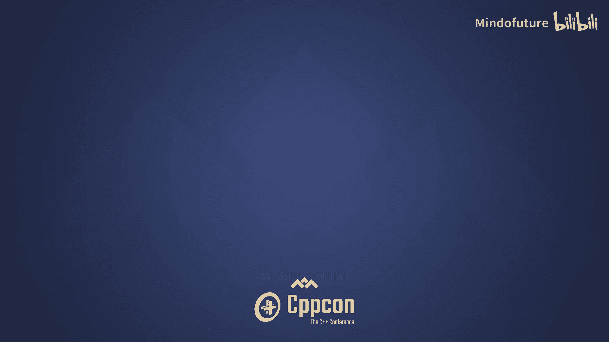