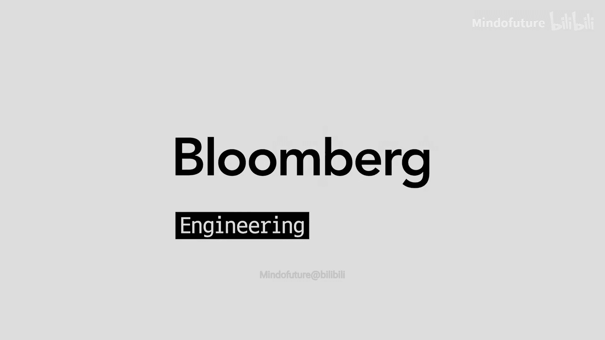
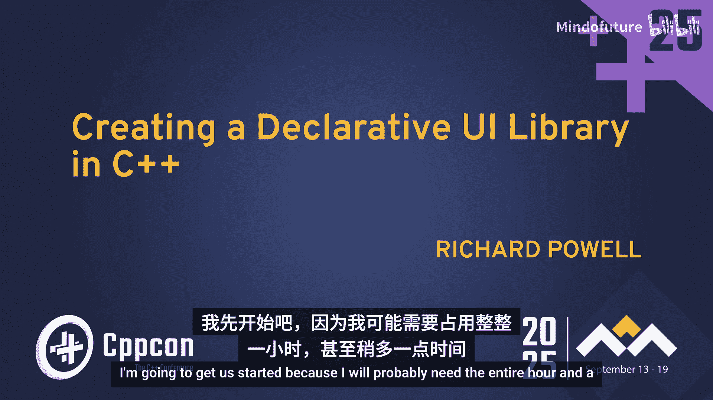
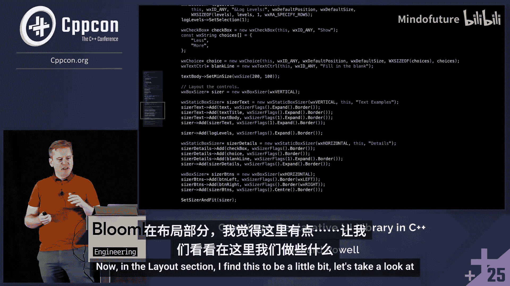
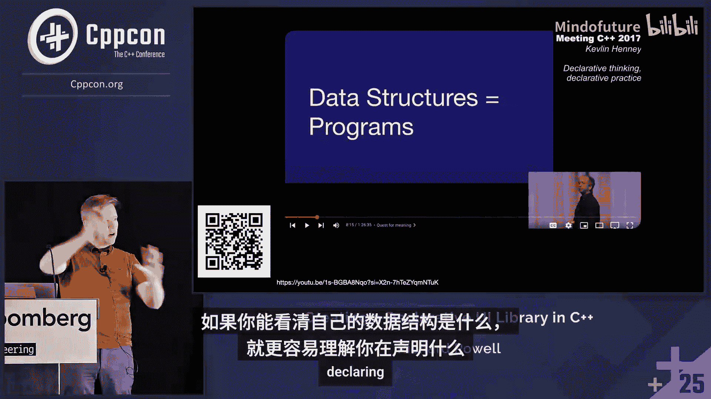
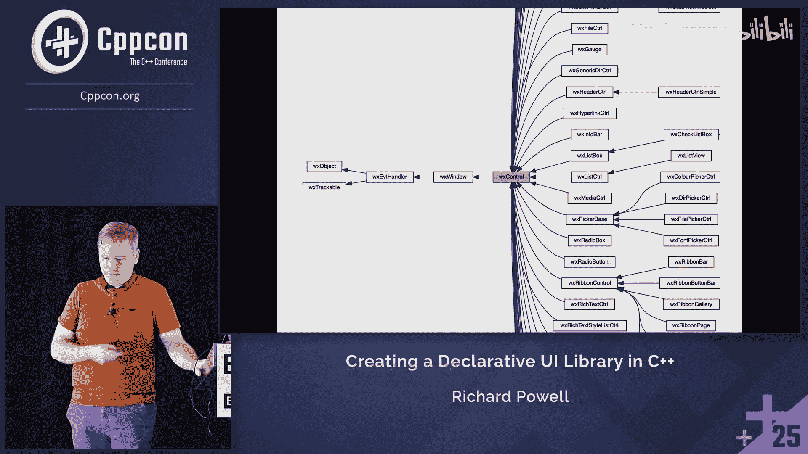
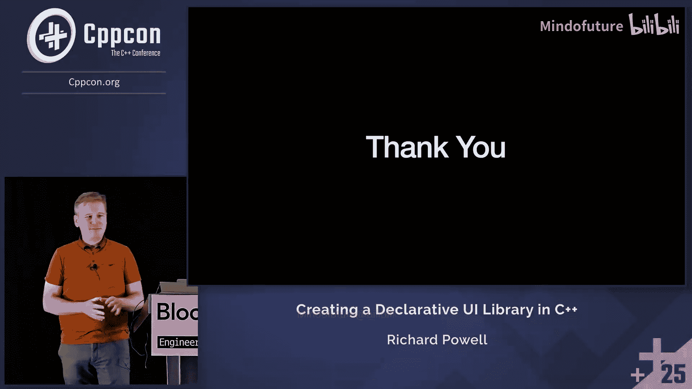
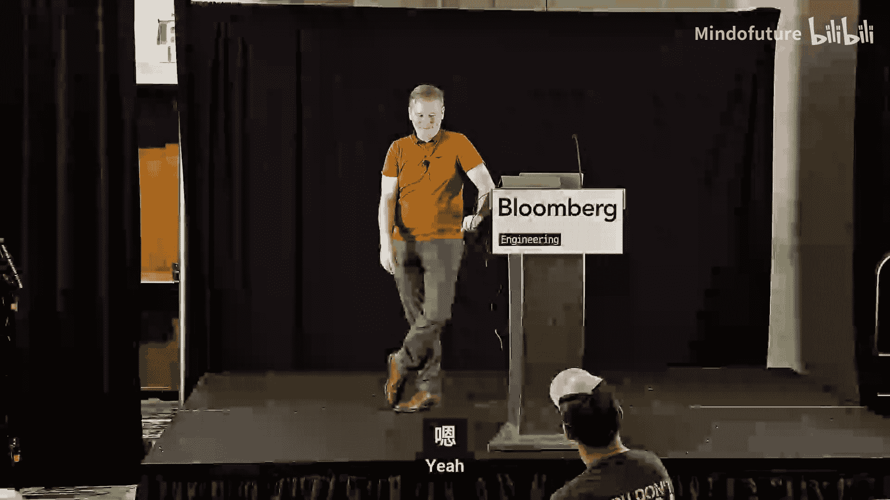
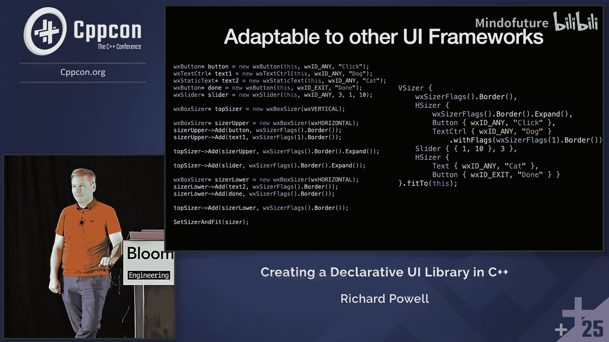

# Cppcon-2025-｜-C++-｜-C语言--｜-汇编-｜-编译器-｜-操作系统-｜-Linux-｜-Windows-p61-P61_声明式编程秘诀_打造更可读的C++-Richard_Powell--BV1wyPBzrEeu_p61-

All right。Um，I'm going to get us started because I will probably need the entire hour and a little up front。

Warning I'm gonna have a bit of code on the slide。 I got some feedback that it may not be in the best font because it's black on some darker colors。

 So if you're in the back you might have trouble reading it。

 So the old Jason Turner yeah I might want to stand up and move a couple rows in。

 it'll be a little easier to see the slides I do try to make sure I've highlighted what's important。

 but be warned there's a lot of there are some codes slides with a lot of codes。

 so I'm gonna get started。

Thanks， Kevin， at this。My name is Richard Powell， I've been programming in C++ for over 20 years。

 I've had the great fortune to work at several great companies over the years and I've worked in audio。

 audio software development， audio DSP and problem solving there and currently I architect audio experiences for the meta reality Las products。

And I've worked on a number of different things。 I love coming to conferences。

 I've seen a lot of great talks。 And today's talk is going to be about declarative programming。😊。

I've。Always thought these talks are great。 I like the way the code looks。 I like the way it feels。

 Yeah， yeah， yeah， It's coming。 It's coming。 Don't worry， it's intentional。😊。

And so today is going to be sort of case study in declarative programming and a lot of times when I've seen these talks I go wow。

 that's really great， but I could never use that my code my code can't be made declarative because it's really complicated and it won't fit。

 but I found with a pet project of mine that I found a bunch of practical techniques that you can use that can make your code。

 which feels non- decclarative become declarative。And while we're going to be working with Guies for this talk。

 this is not a talk on UI and UI development。😡，So we are going to be talking though about WX widgets。

 there's several UI frameworks out there， cute is probably the one that most people are familiar with。

 there's also juiceice， there's some other ones， but but my experience in the project I was working with which was called Cal chartt。

 the California Mary band charting program which I maintain go Bears It written in WXwigets。

 it's a great C plus plus framework。 it has everything that you would possibly need from a framework。

 it's got your sort of controllers， your buttons， your sliders。

 the sort of elements that you would expect to have in the UI program。

 it's got the ability to make applications， launch frameworks， do other windows。

 and it has do and undo systems and sort of all the practical stuff you would need to make a modern application it abstracts all of the system native fundamentals for that so that you can program in a crossplatform Way。

Now， I'll say I am not an expert on WX widgets。 there are people who are far more experienced with it than I am。

 but I have a practical experience with it and with building this larger application that had a lot of complex interactions。

But instead of really talking about it， let's let's actually demonstrate it we're gonna make a little application。

 This is my little hello world app you can find it on GitHub if you wanted to and all of the code should be there and we can just kind of play around with it so I'm gonna make a very。

 very basic application so。What I have here is basically I have my project that consists of a CMake file and in my CMake file I have。

 I' just very， very bare bone CMake file， make a C++ 20 find WX widgets and it is already been there I've installed it previously I'm going to make a Mac bundle。

I'm on the Mac and just a couple of like compiler parameters。

 and I'm gonna start with the basic hello world that actually this is from the Wx widgets like getting started page。

 And so a thing about a framework is it really influences the way you program I had a coworker。

 Jeff Lee years ago when I was like， hey you know when I started using this framework I started coding differently。

 it's like yes， your UI framework is really going to control the way you program。

 if you try to go against some of the framework paradigms it doesn't quite work。

 So it's best to sort of lean into their paradigms。And in WX widget。

 it's a lot of inheritance and a lot of subclassing， like many common frameworks are。

 so my application， my app is going to be derived from the system the global application class I'm going to say。

 hey， I've got a frame， which is my frame it's derived from that and this declaration here there this。

Macro statement does all of the magic underneath the hood of getting your main instantiated。

 causing the run time to get launched， all of the sort of complexity there。

 And my in function gets called in on it。 I am just going create a new frame。

 And so if we were to run this application。 It's probably gonna pop up over on the wrong screen。

 I' bring it over here。 So here's my app。 And it is as exciting as the code portrays it to be。

 There's there's nothing here。 It's a single frame。 in fact， actually。

 I don't even have really menu buttons or anything to quit。

 So let's make this a little more interesting。 So I'm gonna manually exit it that way。 And。😊。

Check out example two。Right， so now what I'm going to do is I'm going to add in a bit more functionality into my frame。

 I'm going to add some member functions。There's this event table in these inumoms。

 so this is how WX widges connects controllers to function calls， you say this event， this ID。

 there's someumoms that the system has defined find like exit about help and then you have your ones that you can create and you can cause them to call functionality。

😡，And then what I do is inside my frame。 I will say I have a new menu system。 and it's like， wow。

 it's just sitting there out by itself。 Yes， this is the convention of W X widgets。

 A lot of naked news。 A lot of things to knit about that。 But this is their framework paradigm。

 And I simply add my elements to my menu system。 I can create a little bit of a status bar。

 And I've got my functions that get called when I invoke them。 So let's now try this out。😊。

And as you probably expect， now I have some menus and I can do things with my menus。 So hello。

 and I get a little pop up in hello world。 great。 Let me quit that。 And let's add a bit more to this。

😊，Frame here。 So with my example 3， what I'm going to do is I'm going to build in more controllers into my my frame。

 and you can see I'm going to create some texts and some static text。

 some text controllers which are boxes buttons the sort of practical controllers you would expect in most dial boxes。

 radio buttons and checkbox and choices and and dialogues and buttons。

 So then when the example we do here is we're going to start laying them out Wx widgets has a dynamic sizing type of system。

 you can put your controllers in those elements。 and as the frames get resized。

 they will try to figure out the right bounds。 So you can lay them out vertically horizontally boxed and you can control the way that they expand or contract or have borders and this is not uncommon。

 a lot of UI frameworks have this where you can have。

Programmatic way of laying out your controllers and having them resize。

And you can ultimately there's this function called setsizer and fit that's a member function of the frame and that essentially takes that sizer that you've constructed and puts it all together so it allows it to say okay。

 given this sizer and given all of these elements fit them to that screen and I may have forgotten a mention yeah。

 maybe the detail here when you construct your controllers。

 you supply of this pointer that's the parent level frame that's the one that's going to ultimately manage all the life cycle and be able to know how to connect all the pieces together so。

And then you can add landas to buttons。 So this right and left buttons are bound to a specific execution。

 And so if we run this。AThis looks more like a UI we would expect and you can see that what we have here is all of the controllers I've created get laid out。

 I have my radio buttons， my checkboxes， my buttons。

 they're all sort of laid out in this way and if I were to click one of the buttons， yes。

 cool I get a pressed right button dialg box。Pretty simple overview。 And this is actually the， I。

 I crib this from the W X Wiidgets hellello world example that they start you off with。Let's go back。

To our slides now。All right。So。Let's kind of dive in a little bit deeper into what I just went over pretty quickly。

Here is my code。 and here is the example I had。 And as I was pointing out with that controller section where I'm creating all the controllers。

 what I have is I sort of declare and these， these controllers to exist。

 They're sort of allocated there。 and you can see that their names very much correspond to what they are。

 A W X button is a W X button。 A checkbox is a checkbox。

 you supply them with probably particular names。 and sort of you can almost from the code see what you would get。

 it's very reasonable。 It makes sense。😊，Now， if we were to scroll down to the layout section。

Now in the layout section， I find this to be。

A little bit。 let's take a look at what we do here。

 So what we have is the concept of vertical and horizontal sizes。

 So what I can do with a sizer here is essentially， this one's a vertical one。

 So each of these elements are now laid out vertically。I have a horizontal sizer for my checkbox。

 and so those ones are laid out horizontally， essentially I have these groups of sizes。

 my buttons are laid out horizontally。And then what I do is I have a top level sizer。

 which takes each of those elements and lays them out that way。

 so it's the way you build up your UIs， I I want these elements go this way。

 I want them to be this way and you can sort of create more complicated dialogue boxes that way。U。

Oftentimes in larger other frameworks， you'll actually lay this out in an XML file and QT has of a sort of description language where you'll put the layout in somewhere else。

 but generally you can WXwiidgets offers this facility for putting your layout in line with the code。

Now。What I find about this laying out code is it tends to be fragile。

 like it's pretty easy to temporarily erase a line and when you do that。

 you end up with a UI that looks something like this。And so I mean all of the controllers are there。

 but what the layout， the sizer and fit didn't quite know where to put that one element。

 the radio button， so it just put us right at the top， just overlaying it on top of everything else。

 which doesn't really look right and it doesn't size everything appropriately。

Another thing is a lot of times like that code's a bit of a word salad and what if I mistype sizeizer detail and instead of using details I used。

 I don't know the sizeizer itself or sizeizer text or the wrong one So I would get all of the elements laid out it just wouldn't look right This wouldn't conform to the design I wanted and you spend some time looking at that youre going what did I do wrong and it's like and then I'm like hunting I'm like oh Cizer right Pizer text very clear from the code what I did wrong No。

 no not。So to me， this makes the layout code very brittle， it's easy to screw it up。

If we compare these two sections of code， it's pretty striking how different they feel。

 I think the code on the left hand side is a bit easier to understand。

 I can really see what it's going to do because it's there in the names。

I can tell what I want from the left hand side。Now on the right hand side， I'm a little lost。

 I sort of need a guide to help me what's going on。

What is it about the left hand side that we find easier to understand？What was that。

Practically everything on the left is a declaration， I'm really being more declarative。

 I'm saying what I want more so than how I want it。So from Wikipedia。

 declaredlarative programming as the non imperativeative style of programming。

Wch programs describe their desired results without explicitly listing out the commands or steps that must be performed。

 And so I want to call out a great set of talks from Ben Dein right here in the front row about declaredative programming style indicators。

 this talk goes through a lot of them。 I'll say， I think what I took one of the things I took away from the talk was about preferring expressions over statements。

 And so I'd say the first slide， the slide that was on the left hand side was much more full of expressions than statements。

😊，Another great talk to check out is Calvin Heney's talk about Declarative thinking and Declarative practice。

 and he points out data structures， if you can see what your data structures are。

 it's easier to see what you're declaring what the intent of the program is。

So keeping those two things in mind， let's talk about these parts of the code。

 which are we have more declarative and more imperative sections of code。嗯。

You can see like what I find remarkable is that left hand side's all about， hey。

 here are the things I have。 and the right hand side is about。Laying and adding it， doing something。

 a procedure for each of these items do something。And I'd even say if you were to replace the word ad with something like pushback。

It suddenly starts， hey， actually that is。Those sizes are almost like data structure， like。Ha。

And in fact， actually we can see that a lot of the code ultimately boils down to this one function here。

 set sizeizer and fit， essentially I'm taking all of the controllers and all of the layout and I want to put it into this one function。

 so this in effect this whole thing is itself a data structure。😡，It's just hard to see。

So how can we make。The layout more declarative， how can we make the data structure emerge？All right。

We're gonna start with a more simplified example， so I just like this is really a simple example。

 little tiny UI， I have four controllers， I've got a button for click， text controller for dog。

 static text for cat done I'm laying them out vertically horizontally with the whole top level sizer laying them out vertically a little easier to understand I'll fit on one screen and so what I'm going to do first is I have my part of the code where I am declaring my controllers。

 these are the items that I'm going to be dealing with my widgets if you will and then I'm going to lay them out。

And so this is the part of the code where I lay them out Now I am an almost always auto type of programmer and we can see there's a lot of redundancy with our types。

 so let's do that first， let's do a first little cleanup where we'll make everything auto as much as we can and so now it's really clear I like to see I like to program this way because I like to see my types on the right hand side of equal sign as opposed to the left。

😊，And it also makes everything lined up really nice， isn't that cool。

 And then we don't really need to construct these controllers ahead of time when we use them。

 Why don't we just put them in place。And so there we go， makes the code a little more dense。

 easier to see what we're doing。 And， and we can also start seeing that there's a pattern that's here。

 So it's emerging。 So let's do some refactoring。 We see that we have some common steps that we're always doing。

 We're we're always taking a sizer， adding a controller to the， you know。

 constructed with the this pointer。😊，We have some values， like these are sort of values that are are。

 you know， they're either return values or static values in the code， but they're values。

 they're all the consistently the same type， and then we have type parameters。

And so these are all different types each time。When I think about refactoring， I like to say， okay。

 let's take our common code， we're going to make a function。

 we're going to put the common code there inside the function。When we want a value past our function。

 we take them as parameters。And when we want types taken as a parameter， we take them by template。

So let's make a function for this。 I'm going to call it create nad because that's what that function is doing。

 And so let's construct a create naD function。And so our createate nad function and what our C nad function is doing is it has our common code so it's going to take all that common elements and execute them。

 I'm going to take my values as arguments and I'm going to take my types as templates。

 that's how you pass a type parameter to a function。Great。

 so now I can just refactor this as opposed to having these functions here。

 Let's call them on functions。 Okay， cool， so I've got a bunch of functions here in the program。

 Now I'm going do a bit of a leap of faith here， but。😊，What it is is you can have functions。

 but you know I can abstract things as a function， but I see what I have here is I have sort of a type and I have state。

 There's some state that is associated with it that's going to be collected together and what I'm doing is now these two items are more tightly coupled if you will。

What I could do is I could create a data structure for containing those。

 and then I could call a function on it。 I could maybe put all of this sort of into a class and then have a member function that does the functionality makes it a little bit clearer about that it's a data structure。

So to illustrate what I'm talking about is， so I have my widget。

My widget is going to have some state that gets constructed and it's going to have a member function。

 which is going to be my createNe。So this is a bit of a sort of， well， really。

 I kind of unroll almost this function， if you will。

 to put stuff over here and then have it applied to this function， science seems weird， but。嗯。😊。

This won't be clear later。And so I can rewrite this now， instead of a function being called。

 I have a widgetstruct that will hold on to what I want to be applied to my create addd function。

So now it's actually pretty clear that hey， this was， you know， being a function call。

 it was constructing astruct and calling its member function。

And now I'll note I did make some subtle little differences here。

 which is this text controller has a different sizer flags and others。

 this is common in UI frameworks where you're like， hey。

 I want this one element to move and what I was trying to illustrate here is oftentimes you'll actually specialize certain objects over others and that's not uncommon。

So let's and and we know how to specialize data structures。

 if I want a class that's gonna to be slightly different than another class。

 I just have it have different member functions member variable。 so I could have。

 say a optional size or flags。 So and our convention could be is if your supplied one through the create an ad function。

 use it otherwise if I was constructed one， use that one。 So we can have that sort of behavioral way。

 So that way it allows specialization to occur I see there's a question。Yeah。

 I just want to make reading the code right。 you are destroying that widget object on each Michael on each line right like it only lives for that state。

 Yes， actually so the question was， hey， doesn't this mean that the widget object here is only living for the lifespan of that line And the answer is yes。

 yes it is。 The widget itself isn't really doing anythingstruct widget is just holding onto the I string optional size flag flags in this case but the create ad function is the thing that is constructing my UI So it's yes。

 it's a little odd You're like why I'm just putting things into a class just simply throw it away I'm putting things into a class I can call a function on it which is going to apply further。

You'll see why later when we get to a larger sort of data structure。Cool。All right， so。

So like I was saying， I have the ability to specialize different widgets so I can give some widget flags and some widgets that don't and so that way I can have this homogenous calling structure so every create nad function here looks the same。

Text controller for dog can be different because it's been declared with different size or flags。

All right。So let's。We can see that sort the data structures is kind of emerging here。

s let's look a little deeper here and see what we have here。 So as we can see here。

 I have multiple types， and I'm applying the same thing to them。

 I almost have I'd say I have a collection here of different types It would be what I would call a homogeneous sorry。

 a heterogeneous collection。What do we call a heterogeneous collection in C++？Tupple。

You saw this before。是实。Anyway， so it's a tuple， so I have a data structure。

 that's a tuple here that emerges， and I have some functions I want to call on each member of that tuple。

😊，How do do we call functions on every item in the tuple？Template4， T 4， right， no。

Temple 4 does not exist。 I also heard standard apply。

 and I'm going to go with standard apply So standard apply introduce C plus plus 11。

 I find the syntax a little wordy if you're not using it on a regular basis you'll like how do I use this but CPP reference has a really good reference on how to use it。

😊，And so let's try it out。 So I'm going to add it to the code。 So going back to our example here。

 I have my let's make the data structure more apparent that I have a tuple here。

So I'm going to say I have my lower widgets tuple and I'm now going to call standard apply to each member of it。

 and so that's the way I would call it， so apply that lambda to the lower widgets tuple and it'll go through and it'll execute each function on that。

So the flags， those size or flags， they should probably be more like an argument。

 let's pull them out to the capture， so there we go that looks a little better。

 it's just refining some code here。Let's refactor this as a standalone function to make it easier to use。

😡，So I've got my create addd function here， it's given a tuple of widgets。

 it's going to add them to the this pointer sorry， it's going to create them with the this pointer and add them to the supplied sizer。

usingsing the sizer flags so it would look something more like this and that's actually a little easier to see that this is a function。

 you're actually not really seeing my construction and destruction of those widgets。

 it's more like oh this is looking more like a data structure and we don't have to have the standard tuple here why don't we make a helper function which takes a Para pack and then underneath the hood it does the make Tupple for me and so that makes the code a little bit simpler to use。

And I think this starts you know what the widget static text and the widget button。

 I don't need to have widgets repeated a couple times we use some using declarations to make it easier to see and now actually hey。

 this is looking a lot more declarative right here I can say， hey。

 what am I doing I'm creating and adding， create with this add them to the sizer and what do I want create these things。

All right。So。We should be careful about using sort of any function as a widget。

 I think we're even in the keynote， it was talking about like。

That we know what the widget needs to support， widgets need to support the create nad functionality。

 they need to be given a parent that they will be created with and ther to add them。

 so let's create a specific constraint for that， let's create a requires clause as a concept and we'll say create naible。

 create naibles are things that support that interface of C nad。Okay。

 cool and so now I can replace instead of just using type name， just a generic template。

 I'm going to use specifically widget's going to constrain it further and this gives us the benefit that I can now do static asserts so as I'm writing functionality。

 even before I've run any code I have confidence that whatever I've added supports this。Cool。

All right， lets。Let's pop the stack a little bit， let's go back to where we were。

I think I see another refactoring opportunity here so let's do our exercise that we did before。

 We have our common things that we're doing all the time。 we're always taking creating sizes。

 I'm creating these horizontal sizes， I'm now calling create an addd with all the individual widgets there so these widgets are my values that I'm passing in and I have types I have these specific types that I have these widgets or they could be all various types。

So， and I also think that what I can see here is I have two expressions happening。

 I have this new box sizer and create an ad。 I'd really。

 I think what I could do is using our same techniques， reduce this to one expression。

 which is I'm going use that samestruct with member function。 And instead of it。

 it's going to return the sizer in this case。 So let's。

 let's illustrate what I mean with a little bit of code。So I have a sizerstruct。

 Cizerstruct is going to be constructed with all that state I want it to hold。

 so it's going to take an orientation vertical horizontal。

 it's going to take a sizer flags and it's going to take all of those widget。

 It's going to capture those widgets or copy those widgets and a real implementation probably there's probably a lot of forwarding that goes on and a lot of optimizations that could be done。

😡，And I'm going to have a create an ad function。 So what that's going to do is it allows me to rewrite my code。

Like this， so size or lower is the result of a sizerstructs， create an add function to this。

All right， so I've gotten rid of those two expressions。

 but I think what I can do is go a little further。 And instead of having two expression two expressions here。

 two statements， I could probably fold this into one。 I could probably take that argument。

 the top level sizer and stick it into the create addd function with those those size or flags。

 So let me manipulate the code again， and let's add those as additional arguments。

 and then my top level sizer gets called this way。😊，Great。

 so now I have the single sort of a declarative statement which is I have a sizer， it's horizontal。

 has these flags， it's going to take these widgets。

 and it's going to be added to my frame to the top level sizer。

So and I think if if we can probably go a little further。

 we can use the convention that we've been following， which is sizeizer flags。

 you know if they're the same as the one that's being added。

 I can remove it so there's reduce the redundancy， I could specialize it by a special constructor。

 but if you don't have any reason to be special let's just use whatever's been supplied so we can add that sort of optional concept that we had for the widgets themselves and we can reduce this by a little bit。

And now a look which is the orientation is taken as a parameter。

 it's a aum that really only has two values and it's like I guess for you know defensive program you would check to make sure I wasn't given a bogus value so that but I could probably do that with some typing。

 so why don't I create some subclasses， H sizeizer and v sizer and then I could just write like this。

Very cool for those of you who use。MacBase programming languages， yeah。

 that's no coincidence that the name is the same。Now there's something I did with these last the sizer object that may not have been noticed。

 in fact， actually I kind of。I kind of did it on purpose to see if anybody did notice there was a little bit of a subtlety that came in here。

 but it's a happy little accident。So what it is is。This function。Create an addd。

 So sizeizer is a thing， an object that takes any number of create addible functions。

 things that support the create an addible function that take in the sizer。 Well。

 sizer itself is a create addible。 So widgets are create addible。 But sizer now created an addible。

 which actually brings up the interesting thing， which is before we were static concerning。 Yes。

 is is button a create addible。 and yes， it is。 Well， is horizontal sizer a create addible。 Yes。

 it is。 I a vertical sizer that has horizontal sizes， create addible。 Yes， it is。

 We've essentially created a。😊，A tree structure here。

 allows us to compose larger UI elements together just with this sort of declaration。

So which means in theory， I can take a sort of a simple example。

 and I can compress this into one expression。But there is a bit of a challenge here because top level sizeizer is slightly different top level sizes so we see our create an add function takes an apparent sizer。

 it needs to be added to somewhere， but top level sizer doesn't get added to anything。

 it's the top so it needs a slightly different function， no problem。

 we'll just create a specialized function for it which will look like this。

So if I have anything that needs a parent sizer， a place to be placed。

 it'll have that and if it doesn't， it'll just be added directly to the parent to create the sizer。

Sorry， it'll just be constructed and returned， it won't be added to any parent。

Which means I can write something that looks like this。 So I have my top level sizer。

 It's a vertical sizer， and inside of it is two horizontal sizes。

 and each one of those has my buttons or my controllers。

And then I've created it and what that'll do is that will go through recursively not recursively。

 itll go through the data structure and create all of those elements。

 add them to the appropriate sizes， take those， add those to their sizes and so on。

 it's just repetitive and so it stamps out your entire UI Well。

 stamping out the UI happens on that set sizer and fit function。The actual sort of。

 you can almost think of is all of that stuff about the top level size。

 it's sort of setting everything up until Creant is called。

 and then that top level sizeizer fits everything into the larger frame。Oh。

 we can do a little bit of cleanup here。 I don't need to be redundant。

 so we can have that sort of convention we have， which if if one of these things wants to be specialized like the。

op the upper sizer wants to be expanded and lower sizer doesn't care。

 you can add specialization that way。So could we reduce these into？These two statements into one。

 and I think we can。I'm just going to expose the set sizeizer and fit wasn't a free function。

 It was a member function。 It's using the this pointer， so。

I think if we just add another function called fit。

We could rewrite everything into one sort of expression。And here we go。So we can see。There we end up。

 which is I have my vertical sizer。 It contains all contains the data structure。

 When I call fit to what that does is essentially goes through， creates all the widgets。

Adds them to the appropriate sizes， fits it to the frame all and at once。So。And to recap。

 this is where we started off with， like that's how we got to it。

 And so it's like on that sort of left hand side， I can't really see the data structure。

 but on the right hand side， it's very clear what the code is doing。So。

Let's look at how flexible this solution is。嗯。So， you know， as a library writer。

 you start off with something you're like， hey， if anybody wants to， you know。

 make this more flexible， how hard is it， because I did this with some example code。

 and maybe this is like。It falls apart when you have larger types of objects。So my widget。

we were dealing with text， we were dealing with buttons， we were dealing with text controllers。

 but when you actually look at the API in WS widgets for the text controller I was only passing in the parent the idea and string and there's a whole lot of other arguments that it has it has widgets these controllers can have their particular offset and size。

 you can make them bigger and smaller and how would I pass those to my framework and so I want to be able to allow this customization to occur here for elements and controllers that want to be customized。

I could add all of these like just simply by doing that and I'll just have more members in my state。

 no problem， but now my constructor becomes really kind of complicated what if I don't want to specialize the size or I do want to specialize the style So this becomes a little bit harder to do and what do you do here？

No。I mean I think we all know if I have a class or astruct and I have some member values and I want to change them。

You just use accessors like just how about like a setter， so let's add a setter here。

I'll call it with flags， so if I construct something and I want its flags to be slightly different。

 I would just use flags with flags there， now it's different。This won't compile。

Anyone want to take a guess as to why this one't compile？With a flags return void。

 void actually is not create addible。 So it's like a constraint was found。 also。

 it's probably good like， yes， the compiler is going really yell at me like with flags returning void。

 void can't be used in this context， so。What we should do is we should return this pointer like this way。

 what would we call this pattern， people seen this before？Buildder pattern。

 I've heard a fluent builder， I think technically in the grain Forluent builder pattern。

 I've actually also called this method chain a lot。

 I think it's maybe because I did a lot of work in objective C with a lot of methods。

So method chaining， so the idea being is if you're modifying the state of your object。

 return this pointer so that it allows you。say I have a button that has exit。 I want to have it read。

Make it 16 B with and add some help menus。 you can add all of these functions。

 you can start chaining them together。 and each time you return the same type。So it allows us to。

 well， now if I do that way， this code compiles and as long as I'm here。

Oh right now I can actually I don't have any need for that constructor to take in that member anymore so I can make things a lot simpler and I could add any number of builders to the methods to this so with。

With flags， with position， with all the various things yeah。咕 go咕。

All right so as often happens maybe your requirements for your UI has changed your designers to come back and they said you know what we really want is we want a slider I'm like okay cool yeah looks nice cool I don't know why this is very strange UI but you want to put a slider in there so no problem as we saw what I would do is I would on my top part where I'm creating my controllers I would declare they have another slider and then I would just add it to my top level sizer in there so it's added vertically so cool so。

No problem。 Let's just add a slider and we'll say using a slider and yeah， that should work。

 just add another one to my list of usings and oh no， no， it does not like that at all。嗯。

So I did cheat a little bit with my example slide as ones does。

 you'll note that by a strange and happy accident， all of my controllers were isomorphic。

 They actually all have the same API。 they all look the same。 They take strains， they have size。

 they have points but。Slider doesn't， which actually makes sense。 Slidelir doesn't have any text。

 It really just has values that it uses。 So when I try to instantiate that in my create controller。

 it failed because it's like， I can't put those arguments where you expect。 In fact， actually。

 if I think about it， if I want to make a fully extensible framework that could be used in lieu of W a library。

 I have to support all of these controllers。 And so that becomes a lot more complicated。 So。

IWhat do we do here？

Well， let's examine where we've been actually call and create naD。

 so this is my createate naD function。It does two things。It is controlling the what I want to create。

And then it's doing how to add。So it's actually doing two particular things。

 it's got what it has is it has the what I usually think of it is it's the what to do versus the when to do it。

What do you reach for when you need to separate the what to do from the when to do？

It's a common design pattern from Ganga4。Anybody。The template method。

 not to be confused with templates， but this is a the idea being with the template method is I have the template of what I want to do。

 so in my base class I will have my algorithm written in terms of a number of helper functions and then in my subclass。

 they can specialize those helper functions so it allows me to separate the what I want to have happen。

 which is what my subclass are for from the when I want it to happen。

 which is what my base class is doing。So let's take that and run with it。 So here is my widgets。

 it's got that new W widget there and what I'm going to do is I'm going to have a create function that is going to be the what I wanted to do。

And that's my helper function。 and now my create ad function and my base class will be written in terms of my helper function。

 so my create an ad here is my template method and my helper method is my create。😊。

So now for my string struct， what I need to do is I am going to。Where did you go oh there are。

 So what my truck is going to do is it's going to contain all the necessary items for knowing it's a text。

 basically sending everything along base to the superclass。

 and then it is going to implement the helper method。So when that gets called。

 it's going to call a WX static text。And so as we were saying。

 the how to add is controlled by the base class， the what to add and what to create is controlled by the subclass。

Okay。Cool， let me put all this together and when I write that all out。Oh。

 I still get a compiler error。And I'm going to help us all and highlight this is specifically what it's the compiler's complaining about now。

 which is。Target W details， WX wt， Wiidget is an abstract class。Which is the average class？Okay， so。

The problem is not really obvious， but know from the code， I'm like。

 I didn't see anything on that left hand side， that would be a problem。This function is now failing。

Let's go take a look back at our builder methods。 Now， our builder methods were all turning widget。

Yeah。That's a widget。 That's a wget。 That's a widget。But。😡。

I explicitly made widget an abstract base class， so I'm telling the compile， hey。

 give me a wget and the Myrs like， I can't give you a widget。Now， if I was dealing。

With a text controller。I don't want it to return a widget。 I would want it to turn a text tool。

 and if I'm dealing a button， I would want the return type to be a button。

So what I really want is I want the type to be dependent on what I'm using。

 I want the type to be a parameter。And now what we had said at the very beginning is whenever you want your type to be a parameter。

 you reach for templates。 So instead of widget， I'm going to make widget taken a template。W。

 and I'm going to pass in the button。As my template parameter here。 And so that way。

 when it gets returned， it's going to return the widget type。 And so it is really， like。

 it's really mindbing when you start actually employing this in your code because it's not often like。

 I'm like， I've just declared a type that I'm now going to inherit from a template version of that type。

 that's really。Really curious。😀Yeah。Yes。Now that I've done that， I can sort of。

 I can start really making this hierarchy very apparent。 So I've got now a hierarchy。

 I can remove details from my base class that are specific to my subclass。

 Like string is a detail of text controller and buttons。

 And so I can start moving those details out of my base class。😊，And so where were we right。

 we were gonna add our slider to this。 So now I've got my slider widget。 Oh。

 we never really settle on what to make the arguments on this for。

 let's go back and take a look at that API again for the widget the slider widget and。

I think this is a。是说呃。I don't like that。 Like if you take a look at the arguments here。

 I was thinking that slider， you would specify， I don't know。 maybe the the minimum。

 the maximum and then the value。 But apparently the API designers you know， they determined like。

 hey， value min and max would be the ones that you would go with。

 And like that feels like pretty easy to screw up。And it's like， in fact， actually。

 I had someone who would be like， I'd never let this pass code review I have three argument types at the same time。

It's worse。Because W X window I is， in fact， an in too。 So this is actually four integers in a row。

 pretty easy to screw up。 So I think we can do a little bit better。 And that's。

 I think an interesting part of writing your own libraries。

 you can actually improve the code that you're dealing with。 So in this case。

 let's add a little bit of an improvement here。 What I would write is let's guide the user to do the right thing。

 So let's make a word slider， given just a pair of numbers will be the range。

 And I will have the convention that will take the minimum if it's not supplied for the default value。

 And then this way， everything is nicely typeafe。 You can't screw it up。😊，Right。

 so that's what my complete slider implementation would look like。 And now when I add that。我了。

Looks good。And that's our final sort of product here。

 We have an extensible declarative U I built on W X widgets。When we take a look at it。

 it really wasn't all that much code it's about 230 lines of code and a lot of that was really just like the way I chose to do formatting with a lot of like lines that were there and some using declarations and。

这样。I'll say if you then examine this code with where we started for our toy example。

It's pretty striking about how much more readable the right hand side is。嗯。

I think when I come down to it， combining the controllers and the layout。

 it makes it so much easier to see what the intent is of the code。

 like I can almost intuit what the UI is going to look like just by looking at the right hand side。

It's really almost impossible to forget to add a controller to the layout。

 If I have a controller inside my truck， it's going to be in the layout somewhere。

 it's not going to be put in the wrong place。 I can't really add it to the wrong sizer。

 It's going to be in the tree structure。 I can really see where it's going to be in that tree structure。

It's very dry we took a lot of pains to not repeat ourselves。

 we had that convention of if you want to specialize the sizes。

 you pass them at the top level so I don't have to keep using that sort of sizer flags all over。

 we have a convention like a hierarchical convention that we added。

And one of the things that actually is really interesting about this is when you look at that right hand side。

 there's very little Wx widgets there。So in fact， actually。

 all of the work is done by that fit to function。In theory， I could write another adapter for Fttu。

 and I could make this work with Q。Im gooey。 I could make it work with juice。

 I could make it work with curses。And so that's like one of these kind of remarkable things is like。

 hey， this UI， this declarative UI doesn't actually work with sort， it can work with everything。是。

I'm nerd sniping。是。So lessons to take away。Look for data structures hidden in your code they're there。

 it may not be apparent you'll be like I can't find anything here but do some refactoring。

 you'll start saying hey， there's some common things I'm doing here all the time。

y that's a data structure。😡，Reduce the number of statements。Favor expressions。Watch Bendine's talk。

 just watch all those talks。Maybe that's my hidden point here， but yeah。

 so you really want to favor expressions， you have a lot more， the compiler understands the more。

 youll understand them more。be familiar with your gang of four patterns like the builder pattern allows composition。

 The template pattern allows you to have flexibility and allow customization。

 it allows you to set like。Ts forward in motion， I've actually if you're interested。

 WX UI is the larger UI framework where I've gone further with this it's。It's， it's。

 it's a fun little library。 I've used it for my projects and built up a number of different U I elements on top of it。

 It allows the customization points。 I go into a lot more details on。😊。

How it works and the read means there。And I think that's all my slides， Thank you。

So we have time for questions。Thanks， absolutely great talk。

 The one thing I was missing in our slides was error handling。So I'm wondering。

 does all of this require exceptions or is there any other way to？Yeah。

I think when it comes to a lot of the UI framework。 So I'm like， as I said。

 I leaned into the UI framework。 and with that it's WX would you， they have their own exceptions。

 they'll throw things when they're constructing UI's memory out of memory invalid sort of typing。

 So if you do little things like you I want to have a style like to expand the text。

 but you haven't actually set up the right left right sort of thing or correct sizes。

 they'll be exceptions are thrown。 And I just don't have any tag checking beyond exceptions。

 I just use exceptions there。 not quite usable and code basis thats refrain from using exceptions。

I don't think you would use W X widgets and none。 like， I think， I think if you're using a Gui。

 you're probably already at the higher level that it's using exceptions。

 I think he means the general style。 Oh， the style。 I'm not I a friend to you。 Oh， yeah， this。

 this just leans into what W X widgets would use。 And I'm leaning into exceptions on that。 So yeah。

Could you build something， I think what you can do。

There's no reason you couldn't build that in there。 Like a lot of times trying to do。

 So I do a lot of compile time checking to make sure I'm not constructing things incorrectly。

 And then actually， as they're constructed， I could。 Well， since there are a lot of constructions。

 Yeah， it might be challenging。 You could probably pass up a chain of expected and then have a chain of expected would be the way to do whole thingag。

 Yeah， Yeah， I mean。That。All right， thanks， thank you for the talk。

 you made WX wgets Sr code beautiful， which I didn't think was possible and that it's awesome。

If I wanted to use your library and then be able to access the controls later。Is that possible。 Yes。

 okay yes， So I've actually there's there's a part two in a part3 of this talk。

 And so the technique that I looked at using was I'm not exactly satisfied with it。

 but the idea being is I almost have like I call it a proxy。

 It's like a smart pointer type of object， which is what you can do is you can say， okay。

 I want this proxy object to be equal to this within my sort of declarative Ui part。

 And what happens is that becomes a something you can dereference later。

 So if you have it in your upper level class where you're like I want this controller。

 you can have a way to access it later。 It's a little fraught because it becomes like a smart pointer as in it could be it could be there could be not depending on if it's been allocated correctly。

 So I'm not satisfied with that。 I've also tried to make it so that you anything you can do so you don't have to touch it。

 Like there's other ways to do it。 Wx widgets has that。

hi is you can go into the object and you say find the particular token I'm interested in with the ID so I give you the ability to specify the ID and then binding functionality later we didn't get to it。

 but you can bind functionality so you don't actually have to get it back So yeah。

 there's three ways you can find it you can add functionality and I ultimately have what I call a proxy object which allows you to get the actual object when it's constructed Thank you so much。

Thank you for the talk。 It was a great tool the forcing kind of deductive API design。

 I'm very curious about how you deal with change， right because U Y is not like a static tree。

 It's like a function。😊，Over time， right， like you're。

 you're representing something that is changing over time。

 And I'm very curious what the solution in your API is for that。 Yeah， I think that would be like。

 if I'm modifying the U I， and I'm sort of saying。Here's the layout was before， now relay things out。

The way I would approach it the way I have approached it is I just kind I have actually like subroutines that return that entire structure。

 that data structure， and then I， it's an interesting thing to consider is because now all of these data structures。

 they actually。I mean， going back a couple slides here， an interesting thing to consider is。

No code really gets executed until you call that fit to function。 really， just it's a， it's a。

 it's a。It's a static data structure。 that's their memory。 So actually。

 you could create any number of data structures and just have them be returned by a function called fit to。

 And at that point， the runtime framework will decate all the old controllers and put new controllers in place and relay things out。

 So the way I would handle change is I essentially would， yeah。

 I just have multiple versions of this and then do that。 In fact， actually。

 you could have elements be composed together。 I could have that middle part。

 like maybe those that row。 I want to just change that row。 I would break this into three functions。

 Like get top row， get bottom row and then put them together。 And I would just have these。😊。

I would replace the H sizeizer with the button and text with a function that returns that object。

 And depending on some runtime code， could return another one。 So if you needed to change it。

 I would just call this and it would relay things out。So if let's say like that string dog。

 right is coming from property in my data model， right。

 I will have something that is observing my data model externally。

 Oh and like recalling this code that when I would actually。

 if I'm just changing one of the values within the controller， I would。

 I would bind that to a controller or I would change its value。

 if I wanted to relay out my controller， I would use a different sort of I would。

 I would just like relay things out。 Yeah， yeah， thank you very much。 yeah。

I feel like this questions already been answered by the other questions， but I'll still ask it。

 Would you consider。Making those members our value qualified。

 value our value reference qualified to force your user to use this。

Do you stand what I'm trying to say ah？

So you were going to try to force the user to use your API how you intended to be used。 Therefore。

 R V， R value reference qualify all those members。 So they， they， they have to use it on temporaries。

 They're not allowed to name these things。 I mean， they could。 They could。 They could。 Yeah。

The fluent functions are returning Yeah， but they could return our values。

 you could work swapwath it around。Well， yeah。 But that's how he designed it to be used。

 I'm just asking， right， Like， would you consider it And say， I made him think that's good enough。

 I'm gonna sit down。 I think where I， I， I。😊，I， I think my code。

 I support both like L values and R values as the optimization to forward them place。

 I don't think I force that because。嗯。I didn't see。 I don't see the value enforcing it。

 I guess where it like， why， why force the function。 make your API you Okay， that's a good question。

 I'll think about there's another option， which is to use deducing this and take the this by value。

 right and move through。And that would make a copy， but or it would move it and yeah。I didn't。

 I actually， I have to rewrite all my W X widgets in terms of deducing this to at least reduce the complexity because I have when I'm returning with the builder pattern。

 I need to use the right one for R values and L values。 but I haven't thought about constraining it。

 So it has to conform to this style。 I just now。Awesome。Well， since there's no other questions。

 thank you all so much for attending。

