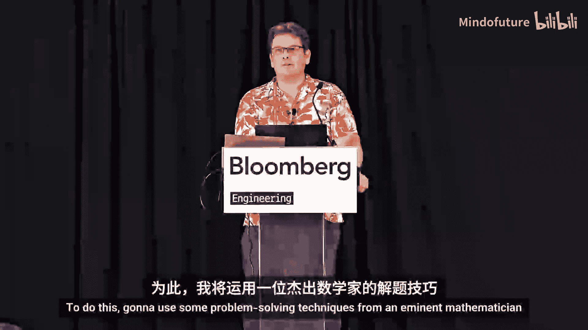
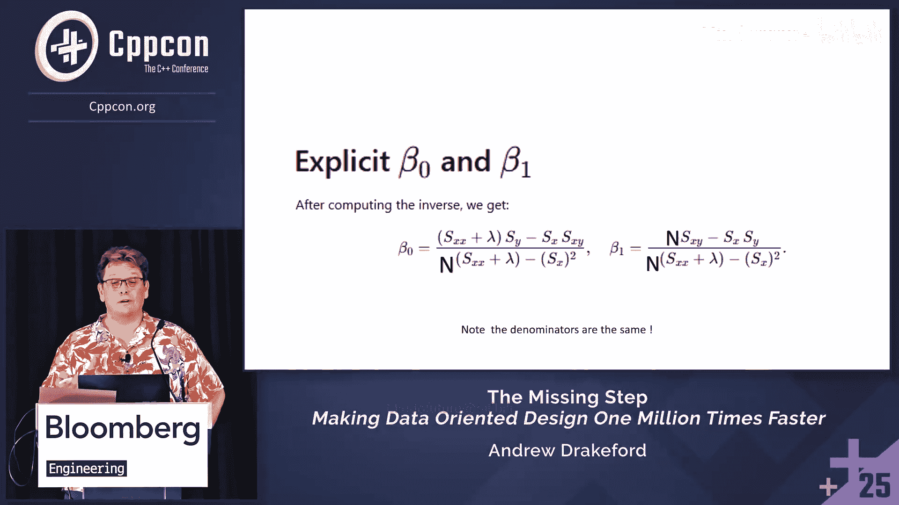
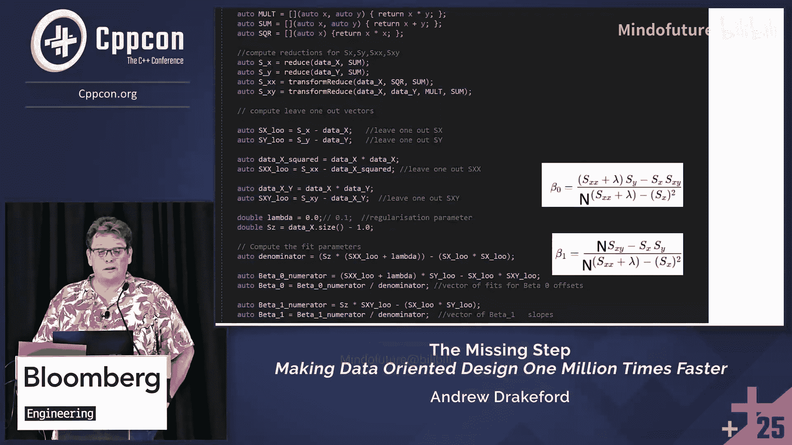
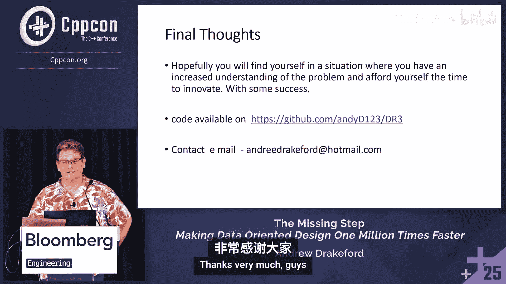

# Cppcon-2025-｜-C++-｜-C语言--｜-汇编-｜-编译器-｜-操作系统-｜-Linux-｜-Windows-p62-P62_C++数据导向设计能快一百万倍吗？-Andrew_Drakeford--BV1wyPBzrEeu_p62-

Hi， folks。My name is Andrew。 I'm going be talking about the missing step。

Making data Oient design faster， sometimes really， really， really faster。To do this。Good你son。

Problem solving techniques from an eminent mathematician George Pollyer。

 who coincidentally used to teach John Von Neuman Ma。 if you can imagine。

Central example in this talk。It's going to be a leave one out regression。R。

We used to do this in a machine learning quant fund。The takeout is。14000 seconds。

Initial or reference run，18 milliseconds。Final run。

It's not about actually running a million times faster or even this particular application。

 It's how we get there， because how we get there is transferable。

' going to start off with the classic data entry design。In 2014。

 Mike Actton wearing a lovely shirt like this。That seems to be compulsory。To talk like this。

 explain to us that if we understand the data， we can understand the problem。

The guy that I'm introducing to help us out。George Pollyo。

ItIns a kind of structured problem problem solving approach and gives us a how to detailed techniques。

 don't just understand the data to do this。He gives us the process。 First of all。

 we're got to understand。The problem。Then we formulate a plan。 and it's not just a silly grant chart。

 And then we execute the plan， and we reflect。His main weapons in problem solving are heuristics。

Such as decomposition。Reading biology。 And he has some other interesting side partss to his。

Techniques， having taught his approaches to problem solving to students。

 Hes watched them fail to solve problems。And he understands why that is。

 And so I'll explain why we fail to solve problems。And another good thing is that he mentions is。

When you're solving a problem， it doesn't go。 It isn't kind of a binary thing。

 We aren't reinforcement learners。Start， I haven't solved the problem。 flashlash of light。

 I have solved the problem。 There's the signs along the way when you're actually making progress。

And it's quite nice to have some of those so that you recognize that you're progressing rather than going around in a circle。

😊，So。I hope your takeaway from this is。New places to attack performance problems and concrete tools and checklists to do it And an interest in getting a copy of Polo's work and trying to interpret that you solving your own circumstances。

But first， let's just have a quick recap of data orient design。

 there's going to be an excellent talk on that as a keynote speech， so。

It's not want to overlap with that。Mike Actton， Red shirt。

Programs just transform data from one thing to another。

 Understand the problem to understand the data， Under the data by understand the data。

 understand the problem。 Under the cost to understand the problem。

Understand the hardware to understand the cost to understand the problem。 Code is data。He cu。

 nothing wrong with that context， This in capitals。 The more you have。

 the better you can make a solution。 This is really， really important。 I'm going to show。

How not quite keeping the context wide open causes us to get。Poor results。

Software is a real thing running on real hardware。 I guess。 so reason must prevail evidence。

And finally， don't solve problems you don't have。 I haven't given this capitalization because I don't believe it。

 because today we're going solve problems we don't have to solve problems that we can。

 We can't solve。Fair enough。Other sources of information on data orient design。

 There's a nice book by Richard Fabian。And he mentions the power of ordered data。

Which seems to have got lost in the myth somewhere。 It's very。

 very important if youve got all the data because you can use better algorithms。

And many other things as well。 And there's a nice talk on the software。 a nice article in overload。

February 2022 on the software engineering aspects of data on design。

So there's plenty of stuff to go and look at just to bulk up。

But that's not what we' are really doing here。In the real world。The real design problem。Well。

 it's a lot worse， isn't it？It's a lot more complicated。It's so highly dimensional。

We've got decomposition choices， algorithm choices。Compile time offload。 And if I can offload this。

 then it's going to be better， isn't it。What about the spatial layout of the data so that we keep cache coherency。

 starting to get it bit busy in there， isn't it。And now we've laid out all we can do execute and have the temporal coherency。

Yeah， it's time to get really tough。 How that。 Are we executing our code optimally。

 Would there be a better way of executing it。Now it's starting to get really really busy。

And of course， we want to use CD。 if that's developers。

 why go for something that's only going to run at a maximum of 10% when we can go at 100% having eight doubles process simultaneously if it will scale。

Oh， gushing。An execution ordering。 How are we going to make sure our caches are sorted out so that we can reuse the intermediate results。

AndHow are we going stop ourselves from how to do。Look up things in random unsorted data。

 What are we going into there， Oh high dimensional data， too， It can get really， really awkward。

And so that's what we tend to focus on。Because there's enough there to keep put people very busy。But。

 it isn't everything。We've got to consider these factors in the context of the problem domain。

 It's very， very easy to bury our heads and say， I've sorted out the data。The cash locality is great。

But what if you've not really understood the problem domain。

 What if this huge wins by understanding the the issues in the problem domain。

It's very easy just to bury your head and say， oh I've got Kasla County， I'm great， I've got Cdy。

 I'm great。😊，But having a broader context for your problem understanding。

So I'm claiming that there's a kind of a logical algorithmic bit to the design problem。

 There's a spatial temporal ordering layout sequencing stuff that we do。

And then there's this idiosyncratic stuff。What is a performance solution in one domain。

 is to entirely due to that problem domain。We might have side information and constraints that we can exploit to do。

Something that's even better because we understand the problem better。 We dug into it。

And there might be patterns in the data。The physics of the data world。Had recurring patterns。

 and we knew that， And we could sort our data so that we'd access lookups so that the lookups were always hot。

So what I'm suggesting here is the missing sta is a way of working。

All these aspects in a sort of heuristic， disciplined manner with at least some sort of plan。

And the tools I'm proposing that we use are Pol's problem solving approach。He's up with a life cycle。

 as I mentioned before， Anuristic。 And when we were doing work， you kind of。Well， we。

 we were asking questions。Because if to get good answers， you've got have good questions。

 and Socrates had a。It of a nice types of question。 It's just good to look at that checklist and see。

 what if I asked a question that was proing。Beliefs or something in this particular part of the work that we're doing。

So let's have a look at solving the design problem。According to George Pollyer。George Poer。

 as I mentioned， was an eminent mathematician。And he wrote this wonderful book。I read this book。

As a teenager and devoured it and loved it。 And have been using tricks from it。

In problem solving challenges I've had。There is a Q R code there for people that might want to have a quick look in the book。

able。Get your cameras up guys。It's a really good book。嗯。Oh， sorry guys for human。So， yes。

 his work was appreciated by many people。Thank you。Yeah。

 his work has been appreciated by many people and many eminent mathematicians have made。😊，full words。

In various editions of his book。Marvin Minsky， everyone should know the work of George Polyer on how to solve problems。

So， and I think he sold about a million copies of the book。In a nutshell， his approach says。

 understand the problem。Divvisise a plan to solve the problem。 Ex your plan， and reflect。

These are exact words。 I've not tried to translate them to a design solution。

 because I think if you see the raw words and you translate them in your own mind to your own problem。

 you kind of get an interesting variation of what youre what you're looking for and what the question is actually asking。

 And it kind of customizing itself to you。 So what's the unknown。

D known as the solution to this problem that we're working on。 What's the data。Clearly。

 that's everything we know about the problem。 What's the condition that's。

Say the performance requirements are all memory requirements that were try to satisfy。These ones。

 the second row is hopefully not going to apply to us。 Is it possible to solve the problem。

 Does it have a solution Well， we hope so。And。😊，Moving on。

 can we separate various partss of the things that we're try to satisfy and write them down。

Sometimes it's really， really good if you can dig back into the statement of the problem that we're working on。

And look for little chinks in the armor， ways of rephrasing that problem。

 they can give you different ways of attacking it。And the next part is， draw a picture。

Most of us are stuck to our keyboards。Standing at the screen。

 We don't use our hands to draw pictures and engage like that， but。Well， I like doing that。

 And I'm going to use social proof about why drawing a picture is good and why you should do it when you。

 you're stuck。So James Cl Maxwell， Richard P。 Faman。Da Vinci。

 he's actually quite good at drawing pictures。And it'd be good to top it off with two other guys that you may have heard of Isaac。

 Newton and Einstein。 These guys kind of re when they're solving problems。诶。AndWhat do they know？

Right。Yeah， exactly。So。The first part is divisor plan。

What's the connection between the unknown and the data？

What's the connection between my final solution to this problem and what I know。

Have you seen the problem before， do I know something related or quite close to it？

Can I restate the problem？ So I understand it， Do I understand all the terms。

Look closely at this thing that I'm trying to build。Has somebody else done something similar。 Can I。

 can I copy what they've done， under this circular buffer that people were using。

If you're not in the fortunate position of doing something very similar to what you've been doing。

Then it's going to get tricky。And you may not have a clue what you're going to do。 He're stuck。

This doesn't phase our George， he says。Wellll just find a problem that you can solve。

Its kind of simple， isn't it。By finding a problem that you can solve。

 you're get getting a feel for the solution space。And so what he advises is create an auxiliary problem that's。

Very， very similar to yours。 And that by solving that， you'll learn something。

And we're going to do that to solve some interesting， real world problems。That some very。

 very capable people from the best universities with lots of experience might have been a little bit stuck on an unm hot Mount。

 So they， they are very real。There there's no point reporting on something that's made up。

 This is very really。 It does work。So creating a useful auxiliary problem is very， very important。

This bit， do you， do you use all the data and have you taken all the essential notions involved the problem into account。

This is really quite important。In a mass exam， if you've not used all the data。

 you know you're solving it wrong。Real problems aren't mass exam。

But if you're not using all the useful facts， you're not going to be able to get some extra constraint to put on your solution to make it better。

And now， for the heuristics。Reaing by analogy， decomposition recombination。

 This isn't problem decomposition， B it into parts and solve bits。

 This is break it down into tiny bits。 and then reassemble those tiny bits to mean something slightly different。

Generalization and specialization。 Can we solve a more general version of the problem。

 Is it easy to solve a more general one， or specialization exactly the opposite， If I fix things。

 can I make a version of the problem that I know can solve what I。Tie some things down。

Working backwards， if I know that this is the answer to the problem。

What was it the bit that happened before that？And then the most common bit is auxiliary elements。

 construction diagrams， notations， intermediate goals。And finally。

 we have a reduction where we can map the problem that we have。

we don't think we've got a solution to， to to a new domain。Where we know that we've got a solution。

 solve it in the other domain and mapping it back。This is a bit abstract， but we're going to do it。

A real example， shortly。Carry out the plan。Okay， we're just gonna do the work。 Be diligent。

 Make sure that the new improved function that is running faster still gives the correct results。

It's kind of important that bit。And finally， once we've got a solution。

I think we've got to check the results。Is the solution that we've got， Is it just so obvious。

 And we can't see how we wouldn't have got it right from the start。And have we solved the problem。

The most efficient way， if we， if we face this thing again， whats， what's a better way of doing it。

And， finally。The answer to this particular problem that we've got， could we reuse it somewhere else。

Diagnosis， so from studying his students failure problems。

The principal reason for failing was an incomplete understanding of the problem。

 lackck of concentration on understanding of the problem when they first started。Now。

 that sounds like Mike captain to me understanding the problem。The next problem was。

A planning failure。I'm not saying anything about Agile here。 just diving straight in。Having a go。😊。

No no idea what they what they're looking for。 No idea where they're going。

 And then they don't get anywhere。 And then the other guys。Sitting there， meditating。

 waiting for the big idea。 It doesn't come。 They're just sitting there waiting。

 But there are things that you can do in terms of。Auxiliary problems that will improve your understanding。

And， finally。After having avoided all those things， they screwed up by being a bit careless。

Solving hard problems isn't just。A methodology or techniques or technology。 It's， unfortunately。

Involves a lot of our own mental state。 We have to have， a certain degree of persistence。

a positive mindset， maybe a growth mindset。If we don't believe we can solve the problem。

 we're going to give up a bit too easy。And then we end up with a sort of self defeating attitude。

Keeping notes on what you did and having a good approach to asking questions。Will be beneficial。

Socrates developed his questioning approach， unfortunately asked too many of the wrong questions and died early because of it。

But。But apart from those， I think maybe that's understanding the context bit。

 I didn't Maybe you didn't get that。 There's clarification， probing， probing for evidence。

 alternative views。Implications and meta level questions。If you。You know。

 sort of a questioning person you want to find something out。

 Just think about this as a checklist and see if you can ask yourself some questions of this style relating to what you're doing。

They might。Give you an insight。Okay， right。Where the rubber hits the road。This is a problem。

I actually faced。In finance。Troubsome function， which is very， very expensive。You know。

 what's called a moment matching pricing algorithm where we're transforming the。

Pricing made exotic instrument to a black shawl， simple instrument。

That's irrelevant from a technical point of view。 We had a great big square matrix。

 a bit like a correlation matrix where there might be some symmetry across the diagonals。

And every element had to be filled by。Some horrible， horrible， expensive function。

Timeaxe of the axes on the matrix were positively increasing time axes。

Corresponding to future expiry dates。But really this matrix。Taxes sell expensive function。

And something over all the elements of the matrix6's obviously going be n squared。

So the initial code looks something a bit like this。Have a double nested loop and call F impulse。

 which takes the three arguments， the little T， the time that we're looking at and the index of the cell on the array that we're looking at。

 we add them all up。However， inside the expensive function。F impulse， it looks like this。

The bottom function。Where actually， they're just taking the minimum of these。Three times。

So when I looked at this， I I what I was thinking is maybe there's some strategy where we can。

Work with this possible reflective symmetry across the diagonal of this matrix and maybe cut it down in half。

 as you see， there's a lot in matrix code。But this meant thing， I've never seen it before。So。

How are we going to solve this， How are we going to see if there's any way in which we can avoid calculating so much。

Well， were going to simplify it and create an auxiliary problem and have an investigate。

 And then I like to draw a picture。 So I'm going to draw a picture。It doesn't sound very hard。

And honestly， the guys that were working on this very， very smart guys。

So the first thing we're gonna to do。Is we're going to drop the little T。

 And we're just going to look at a problem where we just have a big square matrix with equal values in integers across the top and the bottom。

 this minimum condition。Okay， simplified。The next thing we're going to do is we're going to turn these from dates just to integers because it's going this mean thing is just going to behave the same anyway。

And finally， this expensive unknown finance function that's called for every cell。

 We're just going to return the the input value。Why are we doing that， We doing that。

 Because what we're looking for is we're looking for when this function is called with the same input value。

 If we cached it。Then we're gonna to know where we' doing the cashing。So let's draw the picture。

Pop the matrix。ですか。So here's our example 7 by7 matrix。And withdraw。This min stuff inside。

And then we add the magic， pattern recognition。And when I show this。It was awesome。

Because that means we've got。7 independent regions， not n squared。Just drawing the picture。

 and mean I haven't solved the whole problem yet。But it was really， really good。😊。

So the next bit to this is。Just polishing this thing off。

 So we're gonna take it back to where we came in and add this little tea back in。Oh， yes。

 the other thing。We actually know how big these regions are as well。 So what we can do。

Is we can evaluate this function。And thenre multipied by the size of the regions。 That's it。Now。

 let's bring in the little tea。If the little T argument is less than the first element。

Then it's going to win out on all min comparisons。So here we have it。

 We just call the function once and multiply by n squared， yes。

If little T is greater than the last elements， Well， that's just only just dropping an order from it。

 which is a fantastic result。 And if it's somewhere in the middle， then we get this kind of hybrid。😊。

So。Just by drawing a pitch， simplifying the problem， drawing a picture。We kind of got a really。

 really big win。Who doesn't want 40 times performance improvements。

 So what I've done as well on this。 I've， oh， yes， of course。With those kinds of futures。

 they were thinking of also using others， which had hourly rather than monthly exercise。

So let's just make this n squared problem 700 times worse on the axis。 So 700 square times worse。

So just。Simplifying the problem。Drawing a picture。Huge win。

This is what the auxiliary thing looks like when we。Implement it。

 we just call the F impulse and multiply it by。The size of the， the region。

We're invited the special case。 I don't know if we can see this。

 This is vibe code a vibe coded it because I wanted to run on Godbalt quickly。Here's a QR for it。

And when we run it on real code。The speed ups are。263 for the small tea。

61 times faster for somewhere in the middle。 And then the worst case， it's only 40 times faster。

Just for drawing the picture。Awesome。So。That's， that's the first example。 It didn't take。 Well。

 actually， in real life， it was much slower， and that was more bumbling， but。It was a very。

 very nice result。😊，We'll move on to the second example， now。Leave one out regression。

This comes from machine learning。 I was part of a。A quant fund。In a well known British bank。

And we were using machine learning to try and predict which way the market went so that we could。

Make forecasts and from those forecasts， make bets。

 work out what bets we wanted to make and blend them into a portfolio and then invest the money。Yeah。

 it's just about getting rich really。Now， these models， they have various predictive factors。

And we wanted to search the whole space for which predictive factors would be good。

With leave one out regression， what we do is we do a fit over the whole data set apart from one point。

And then we apply that fit to forecast the value at the point that we haven't included。

And we do that for all the points in the data set。So we're doing a lot of fitting and forecasting。

The difference between the forecast。And the actual。Were stored as what we call residuals and ordered。

And。To make it more robust， because we were after robust forecasters to put into the model。

We would estimate it by what we call inter quantile range。 So wed have this distribution。

 and we'd workk out the sort of。Bottom 5% to top 5%。

And if the forecasts were in a narrow range and stableable， then they' are quite。

 quite good things to put into a predicted model。But we ran through sort of millions of these things。

 So millions of possible things that might be predictive。And fits on， fits on fits。

 try and get the best ones。It did take a long time。In fact， on my first day。

Two of my colleagues were walking out。 They'd been trying to do a back test over the whole weekend。

 running it manually daylued dreadful。 So obviously， speeding this sort of regression stuff up。😊。

Has social benefits。Fitting and -1 data points inside a loop。It's a kind of order n squared thing。

We also wanted to make sure our fits were robust。 So we did a thing called regularization。

And we added an extra term to， to penalize the slope parameters。

So let's get on to what Pollyo thinks we should do。Understand the problem。

 Ask questions about the data and the size。 There's lots of it。 It's very big。

 and we've got to process all of it。Performance requirements。

 we want our staff to be able to go home at weekends。Accuracy requirements。

Never quite figured this one out。 We wanted， we want our stuff to run with the lowest accuracy possible。

 So it's running as fast and efficient as possible， but not give as bad results。

 I didn't solve that one， either。Have I done linear regression before？ Yes， lots of times。

 Have I done this kind of legal out stuff。I hadn't worked with econometric guys before， so no。😊。

We were using a well known。Analytics library providers， versions。But for us。

 we want to look into this thing and see why is this thing slow。

 So I'm just going to breeze through some standard regression masters。

You might be better just looking on Wikipedia if you're terribly interested in this。

When you're looking for predictive f。Usually better just to go for the simplest thing。

And so we went for a very simple， straight line。We hadn't with this and the next load。

 the objective function， we wanted to try and find the slope and the inter B 1 and B 0。

Which minimizes。The square area， which。When you have a normal distribution it gives you the most likely values of those parameters。

We didn't believe that was the case， or our。Econlects researcher。

 Professor Gu didn't and went with the very standard technique of having an extra term on here。

 which penalizes the slope be  one。Now， down to the regression stuff， this is。Classic。

 so if we have a column of our X values， in addition to a column of ones and a column of our Y values。

 which。I was not absurd， and。Very small column of our parameters that we're fitting。

And we have a little square matrix with the lander on the bottom right for penalizing。And the slope。

Moving on to the classic。Regression。Then your regression formulation。

AndThe bottom one is we've got the beetle of the。Fit is equal to X， T。

 X plus our Ri regressions term inverted multiply by X， T， Y。And inside here。

 we have these matrix sums。So basically， we're just creating little small matrices。And the bit it。

Look troublesome。 when we， I've got these sums over all the x values or the x。

 sum all the x squared values or the sum of x Y's over the whole dataset set。Because。

We're doing sum over N objects。Rather than just being scalar。

 we can rework this and we end up with this， this former formula， the slope and the intercept。

So what can we do to make this quicker？So the approach is。

 we're going to understand the problem first。Identify what are the slow bits。

We've seen all these sums over x's neck squares。 It's not a bad bet。

Then were going to have a look at an auxiliary problem。

We'll going to draw some pictures and then possibly generate another solution。So。

Let's pick the X T X matrix。 It doesn't really matter in here。

 We can look at x squared or some over X I。These things are going to be slow because they're selling over the whole data set。

So what can we do？Well，'s let's just remember that we're also computing these things for every time we're doing a refit。

And it's says X T X term， which introduces this order N， as as is the X， T A， Y term。

These are the things that bring this big length dependence to us。

Let's just consider the slow bit repeated n times， this matrix。How are we going to make this faster。

Well， we have。As some over the。Given X values。How would we make that faster， Well。

 I'm going to put it in a vet， aren't we， It's going to be contiguous。And well， I suppose。

We could use un sequenceenced reduce or transform reduce for the x squared。

 and we could scale it with threads and C D。And that's in the inneralop， it's going to go faster。

We're doing a really good job， aren't we， yes。No。It looks so innocent。And it's。

 this is the point where we've actually。Just about screwed up our chances of doing something really good。

For， it was like dereferencing the no pointer。What have we done wrong？

Nothing will really go 10 times faster。 we're heroes， everyone will love us。Well， not really。 Well。

 it depends。 They might not know that you screwed up。

We've applied an answer that we know to a problem that we recognize It's good。

 But what we've done is we've not appreciated the context of the problem fully。

We're only looking at the inner loop。And thiss completely constraintsstrained to the kind of solution that we can get。

 I mean 10 times faster is good， but a million times faster。 Well， that's 10000 times better。

 isn't it。So let's see what we can do。We want to expand the scope。Not just the inner loop。

 We want to look at。The whole thing。So we're going to create another small problem。

 So let's pick an element of this X， T X I。I just picked something over X ro x squared or something over1。

 I thought this would be informative。 It doesn't really matter。

 We just pick one and go with it and see， where it takes us。How does isolation vary。

For the n- one times， we're going to be computing it。Its a good question。

I think we should have this as auxiliary problem and draw a picture。

And here's a picture the rows are all the data。And the sums that we're doing to do leave one out。Now。

 there's an awful lot of repetition in there。And in terms of times of progress。

We're seeing the problem。Differently， we broaden the context in which we are exploring the problem。

And all this， all this redundancy， this repetition。If only we can exploit this。

 it's going to be really good。I didn't think it was going to go quite so much better， but。Right。

 yeah。 So let's get on。Let's instead of having this big square table。

 Let's just reduce it to two rows of the top thing and。A simple question。

Can we reuse the sum from the first level out to calculate the， the second row。

And this is when the sort of bittersweet feeling really thick occurs。Yes， we can。

 The sum of leave1 out row  row 1 is the sum of leave1 out row 0 plus x0 that we'd left out x1。

 the sum of。Lve1 out row 2 is sum of V1 out row 0 plus x0 minus x2。So。Yeah。

 there's something fishy going on here。 Something I didn't quite get。

But the sum of leave one out 0 plus x0。 That's just the sum of all the elements。

This becomes a candidate for an auxiliary variable that we've kind of found pretty useful。

So each leave one out sum is just a sum over everything。Minus。The thing that we're leaving out。

So I don't have to s everything。And miss one out。 I can swim everything once， then take one out。

Is that it Well， it kind of is。😊，Does this generalization apply to all the sums。Yeah。😊。

So what we've gone from is we've gone from an n squared。So something is's like 2 N operations。

And how have we done that？We've expanded the context。 We've not done that in a loop。

Instant hero stuff。We've worked the problem and understood that this magic variable that appeared and made us feel stupid when we saw it。

😊，The sum of the leave one outside is the some of everything take away the thing we're leaving out。

So our new algorithm is just going to be summing over。These， these quantities suming over x。

 sum over x squared summing over x， Y and sum over y。This is going to run really fast。

And we're going write it in a vectorized form。A couple years back， I gave a talk on。

Writing fast codes， using generic landers instanted with Cd types。

 And so I've kind of got my own versions of。Nonstandard transform and re。

And I'm going do an implementation of this a little later。So the new algorithm。Compute the S X， S。

 X squared， S， Y and S， X， Y。And generate the legal out by just sub subtracting the values。

On reflection。Can we general， generalize this trick。You can。

 So if you've got a reduction over a big set and you want to compute。Perturbed versions of that set。

Just try and there's an inverse operation to the thing that you're using your reduction。

It's a lot quicker just to generate the leave one out version。I think also。

 we found that certain benefits for expanding the context and using the auxiliary problem approach。

And also by working problems by hand， where we get this feel for what's going on。

If you'd done a post dark or postgra course in matrix computations and you've got this book。

 I got this book after I'd done this。 then you would have possibly found something matrix or method。

 which would help you。But we don't。 We've never always read the books that we need you to know everything from when we face problems。

So let's move on to the technical aspect of implementing it。I have a library called DR3， D cubed。

It lays vectors out continuously memory。 It's got a memory pool。

And we can apply vectorized math operations across the vectors。It's available at my Github repo here。

And we can use， basically， transform reduce。And by using auto。

 we can switch around the implementation for the S operations。The the data types called V X。

 memory managed， supports math functions， contiguous aligned padded。

And we can change easily between scalar and vectorizing instructions。

It just makes it very easy to translate to a scalar bit of code into something that's factorized。

And here's a picture of our memory pool。

So this is the function。 This is the function that we want to implement。Can we see this？So。

 the first three。just sang at the landers。 So multiply square some。Then， the next four rose。

Compute the sum over x。And y transform to get the sum squared and the sum of X， Y。

So these are little vectors。Then we generate the lead1 outpatrices by。Taking these scalar values。

 S X， and that's Y。As subtracting the input vector。 Now。

 that will generate a vector of the leave1 out values。

And we're now ready to move on to the final implementation down at the bottom here。

 If you look at denominator。They share a common denominator。So we can just calculate that。

ItIt just maps straight to the equation where S is really n or n -1， as you want to call it。

Calculate the numerator for beta 0。Basically， transcribing the equation。

 And just handles this with the element wise。Operations。

And we get the beta 0 and beta 1 calculated。 all of them。And when we run it， it runs in。

18 milliseconds doing all of it。Now， that seemed kind of impossible at the start。 We're doing。

A million fits on a million element data set。 And now the behind the curtain you can seeing something a little smarter。

 But still， you know， it's。If you go something doing a billion operations a second。

Ding a couple of 20 or so。Million operations is going finish in about 20 millisecond。 So it's。

 it's perfectly reasonable。 It just seems impossible because we didn't really understand the depth of the problem。

And。Now， for the last。Masuristic。Can we make these sums more accurate。

Because there's something I be big set。This is a chance to think about。

A heuristic minute of working backwards。So how can we make sums more accurate。

If you wanted to add two numbers together， we're going get the best results when theyre of the same order of magnitude。

So。Let's say the numbers all had the same value。 So we've got 128 of these numbers。

And we were adding them together。 What's the last sum that makes these more。

 this sum more most accurate。The last sun is going to。比押金。Two partial sums of the same size。

To do that， we're going to be adding。Two halls。We were， we're working backwards。

 So if I had 128 instead of 128 doubles。I'd have the sum of 64 doubles on one side and 6 sum of 64 doubles on the other。

 And my last operation reduced me to add these two sums together。

It doesnn't matter how I added the two lots of 64 sums， but。My last operation。

Is adding two numbers together， which are of the same size。To get the sums of the 64s。 Well。

 same again。So we go from halves to quarterss to pairs。And this is a balance sum。

This is not what we have in the library for adding numbers。 In fact， we've got exactly the opposite。

So this is my little picture of it。One big set split into has into quarters and going down to pairs。

So does this work？So we'll do a little experiment。We're going to get 10 billion0 to1 numbers and add them up using a full loop。

 siliconulate。Stid reduce。Fairwise reduce and also a reference error correcting summ technique。

By can。So first all， let's。Let's just do the sums。It's quite reassuring that your fall loop still accumulate and reduce given the same answer。

 isn't it。If you look at the disassembly。Well， actually， they're all doing the same thing。

 It's not actually three independent flight computers。It's just。The same thing。

The pairwise son and the Khanum are also agreeing。They've got a different answer。

So what do you think is going to happen when I shuffle the data around。And do the summation again。

And again and again。To swim the pairwise summ， actually。

I think the last digit on the last column for the pair wise is slightly。 it's one。1 unit off。

 the con stays constant。And we get all sorts of stuff from accumulating reduce。

So this is me pitching because I think we should have pair wise reduce in the standard。

So how are we going to change our code to be more accurate。Well。

 we've got reduced and transform reduced。 and if we had。

Payer wise reduce and pairwise transform reduce。 out of sums would be more accurate。

And that brings us to。The end of the talk。But there awesome takeaways。Design problems are very。

 very highly dimensional。And we shouldn't run away from the looking into the problem domain。

To search for。Ans that we can work。 If you use a Polo approach。A you some of his heuristics。

Finding a simpler version of the problem and working that can be very informative。

You can sit at your desk stuck。For an afternoon。Achieving nothing。

 or you could find something very simple that's quite close to what you're working on。

And youll have a good feel for what works all around that problem area。Be very careful。

About our in failure here。The hero program always gonna get a 10 bagger。

And he's just really lucky that his boss didn't know he should have been pulling a million Bagger。So。

 don't。Don't zero in your context。And for me， I like drawing pictures。

I find that when I'm work on problems and I'm drawing pictures。

 I actually draw the pictures wrong because I don't understand the problem。 It's quick。

When I've got the problem solved， I do understand the problem。 and the pictures are a lot better。

Well， solving an ancillary problem and drawing pictures is something that's。It's， it's very。

 very unlikely to be wasted time。And I'll close with。P his words。

If you cannot solve the proposed problem， tries to solve first some related problem。

He didn't know about AI， so human superiority lies bit was from the 80s。

Going around the obstacle that can't be overcome directly in devising some suitable auxiliary problem when the original one appears insoluble。

So when you're stuck。Don't stay stuck， find some problem that you can work because it's going to give you some information。

final thoughts。How do you think it feels when you actually get a 40 fold or 100 fold or a million fold speed up。

Awesome。系。Yeah， you know， honestly， I know， I'm hoping that you guys are gonna。

Try some of this stuff out， and。I want you to go get the yes feeling because it's really。

 really good。😊，And if you try this stuff out and it works you， please。

 please mail me and tell me it'll make my day。Thanks very much， guys。

I actually have two questions。 Yes， first。Have you considered fitting some sort of chish polynomial to avoid commuting these expensive functions and get further speed up。

 because then you're going see the evaluation of these functions。 and the second is。

You showed how to increase the accuracy of the sound。 but then you subtract one element at another。

Now you have a problem here because you have a big sun， big magnitude and suddenly that is small。

 So do you recover the accuracy in that case for your。When I got the big speed up。

 I wasn't too worried。嗯。The reason for the。Oh was sorry， Cheby cheff。

Have have I thought about using Cheby Che not until you mentioned it。But we。

 we can use this approach with fitting the linear fits。

I don't know how it would work with non nonlinear if it。

 Maybe there's some other trick that we might be able to use。Managing error when we do these sums is。

Something you want to work with with your data is that you。

 So you need to look at your own data and see。How the Arab propagation is working。

The standard library is just adding perpetually one number to a bigger number that's ever growing is not good。

Pair wise is better。Because's all you're doing is changing the sequence。With the error correcting Ks。

 you can pass in。 I did a little talk at A AU and showed that you can pass in a lander。

Which has also got a static bit， which has kind of a memory。

 And you might not want to do that because it might not work too well。When you。

 when your execution context is using multiple threads。But yes。

 getting an accurate solution does require more work。

 And pairwise is the simplest lowest hanging fruit I can see。 You know， I'm totally agree with that。

 The thing is at the last step， when you evaluate your formula， you have the sum of the elements。

 which is big。 Now， you subtract one element， which is more。 and you have another one that is more。

 So you're losing accuracy in the last possible step。 So how do you deal with that in that case。

 have you considered that。 No， I haven't， sorry， okay。But I will know。Thank you。 thank you。Hi。

 great talk， thank you。Yeah， I got a couple things for you first。To follow on on these summations。

 one of the last results you showed that the results weren't deterministic。

 that you got different numbers each time。And so if you're looking for deterministic algorithms。

That also work in parallel and will give you more accuracy。

There are reproducible floating point summation algorithms that you could use。

 and they also work nicely in parallel you mentioned you might know about those because you talked about passing an a lambda with some steam。

So those algorithms have a wide accumulator。Accumulate things on each thread。

 so there are ways to solve that problem really thoroughly with the giant hand or solve that giant problem。

I wonder have you got any good references to share with the audience， Mark。Yes。

 so you see Berkeley has a library called Repro Blas。 Oh right， yes。

 that's a good one to start with and this has the bin summation stuff exactly yeah。

And I think Professor G would prefer compensated summation， but nobody calls it that。

He lost that fight。And there's a good reference by Mr。 Hyam as well， isn't there， Yeah。

 sorry the numerical accuracy and stability。Which can also be found on the Internet。

But I wanted to ask one more thing， you showed some pictures that Newton and Einstein drew。

 could you explain what those are？I have I have no idea。 I'm sorry Oh， that's okay。 Yeah。

 just curious。 Thank you。 Thank yeah。😊，Thank you so much for the talk， It it was very good。

One question that I had that maybe the runtime is quite fast。

 so not relevant unless you move to bigger data， but did you consider trying to run this code on a GPU because it looked like it would be very easy。

 Yeah， yeah， it will be。It was when I was doing this about。15 years ago。So。We were overwhelmed it。

Do we try and use stuff on the grid， Do we try and use GPU， I wanted to use DU。

 Everyone wanted to use DPU in 2009。I didn't use C D either。 And then。 So So but then it was。

 we didn't even know A V X 2。But yes， winning。You can see how working the problem to get this kind of speed up by。

By just rephrasing it and putting that on something， we'll give you a big multiply。

 But then you put that for the big scale up on a C on a GPU。Yeah， this stuff is fantastic。 actually。

 I haven't thought about using it doing on a GPU recently。 I have a。😊，40，90 at home， waiting。

But thank you。 Thank you。

Well， thank you very much everybody。

