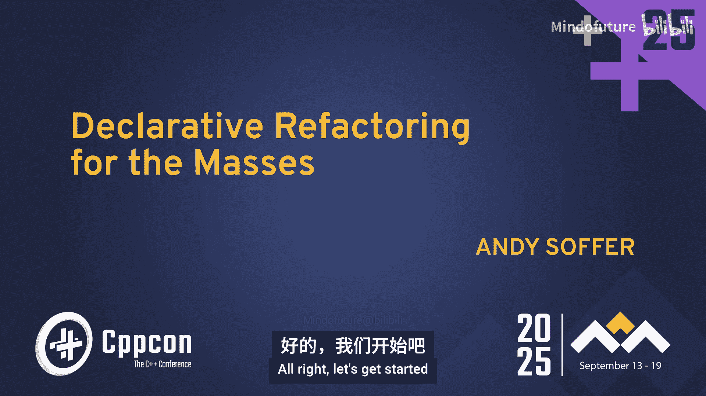
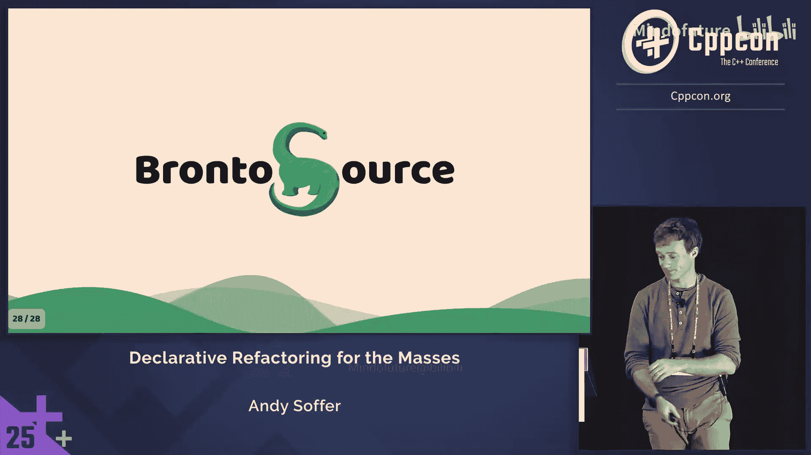
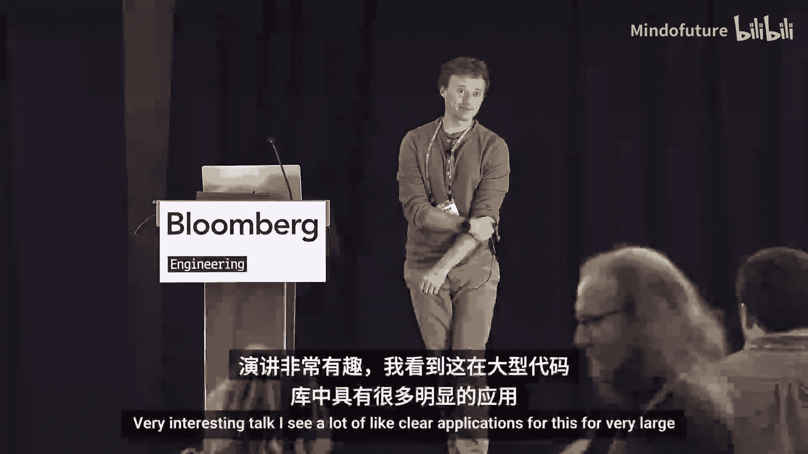
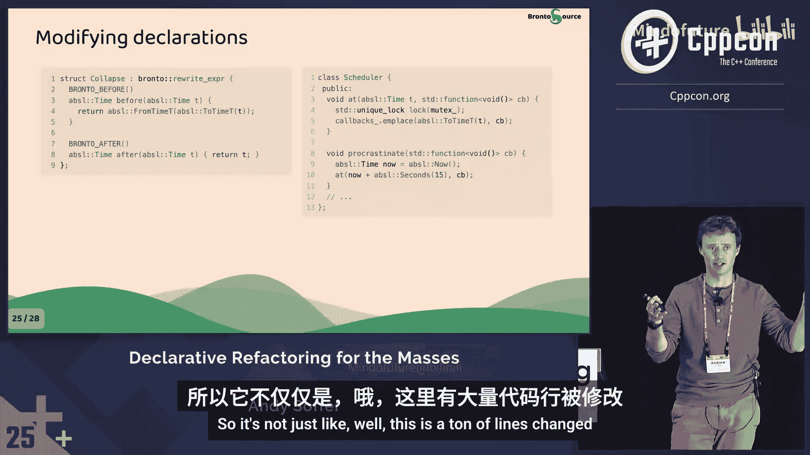
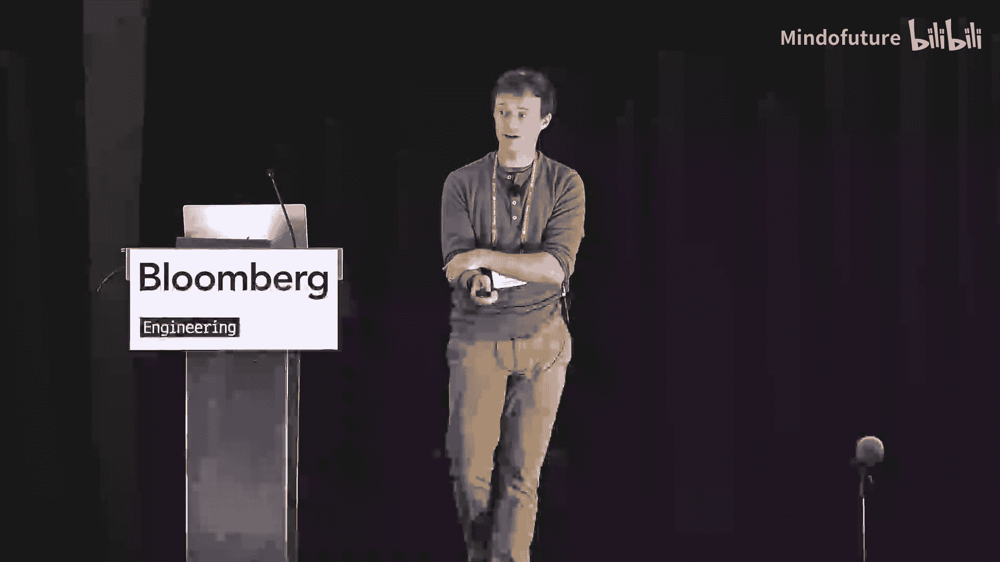
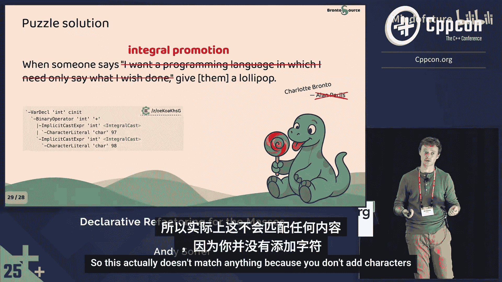
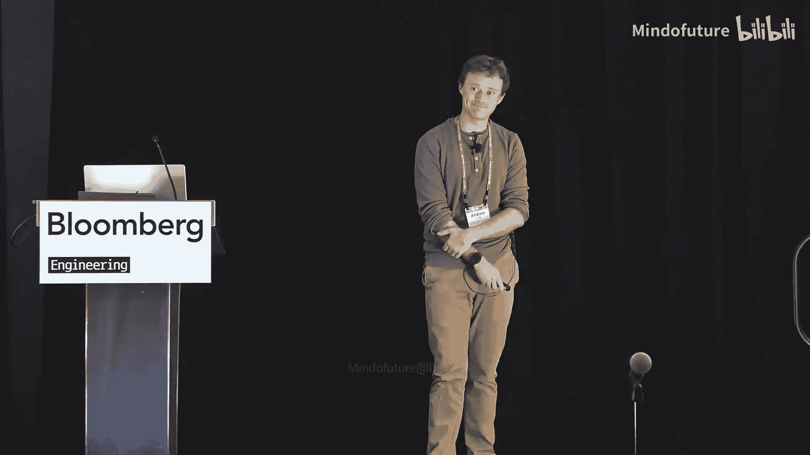

# Cppcon-2025-｜-C++-｜-C语言--｜-汇编-｜-编译器-｜-操作系统-｜-Linux-｜-Windows-p63-P63_C++重构的未来是声明式的吗？-Andy_Soffer-CppCon_2025--BV1wyPBzrEeu_p63-

Allright， let's get started。 So this is declarative refactoring for the masses。

 If that title doesn't make any sense to you。 That's awesome。 You're in the right place。

 you'll learn something today。 There's a QR code here。 If you wanted to follow along with the slides。

 So feel free to do that。 There's some links on there。 you can click。

 but you know you can also just look at it later if you want。😊。

So my name is Andy and the CTO at Braronnossource， where a tiny startup that's helping companies sort of get a handle on their code and sort of reduce their tech debt primarily in CncC++。

And we're hiring。 So if you know this is something that interests you， if you like developer tools。

 or you think we just have an incredibly adorable mascot， then you。

 come find me after the talk and we'll talk。On the subject of the mascot， this is Charlotte。

 He was designed by David Solagi， fantastic artist。

 You'll see a bunch of his stuff throughout the slides。

 He also gave us permission to feed all of his artwork into generative AI。

 So you'll see a bunch of AI generated work based on his work as well。

 See if you can spot the difference。😊，So the structure of the talk is going to be just tons and tons of code examples and a little bit of philosophizing。

 So let's get started with that。So what are we even talking about here。

 Declarative refactoring for the masses。 So I think it's helpful to break down those terms。

 You may know all these terms just not together， but we're gonna go through them anyway。

 So declarative is this style of programming that is typically focused on what should be done rather than how it should be done This idea of what not。

 how is is really the pinnacle the main point of declarative style。

 If this feels kind of vague and ambiguous。 Don't worry about it。

 I'm gonna give some pretty explicit guidelines for what this kind of means。Refactoring， I think。

 is probably familiar to most of us。 It's often described as modifying a program's implementation without changing the observable behavior。

I don't really like this definition because I think that if I optimize a function。

That should be considered refactoring， but by this definition。

 it might get faster and that's observable。 And so we're just going to kind of get rid of this。

 and we're just talking about modifying programs。 and I'm not talking about bug fixes。

 I'm not talking about adding your features， but kind of everything else I think fits under refactoring。

And this for the masses part is the part that's really important to me personally。Right。

 when we talk about declarative refactoring， I really want to build something that is us by any C plus plus engineer。

 not just the expert。Right。What I'm looking for is kind of a learning curve that looks like this。

Right。I want something that's useful for junior developers。

 and I want something that doesn't require you to know how compilers work to actually use these tools。

And I want this slow reveal of complexity right， The。

 the phrase is often that easy things should be easy and hard things should be possible。Now。

 C++ doesn't have a great history with this in either the language or the tooling。

The learning curve for C++ kind of looks more like this。

And I think this quote from Garna really sums up， right。

 Seabel+ has indeed become too expert friendly。Now I remember hearing him say this。

 I think it was CBPCon 2019。And as I was preparing for this talk。

 I was thinking if I could remember specifically which keynote he gave it in。

 And it turns out he was quoting himself from much earlier。

This is a quote of his that he gave an interview from 2006。So I want you to think about that。

 C plus+ was too expert friendly， according to its designer20 years ago。

So here's a word cloud of all the features we've added since then。If you can see it in there。

 there are six keywords that we've added that start with Co。

 The standard is two and a half times larger than it was when he said this， right。

So this is the kind of addition of complexity I really want to avoid here。

And declarative style often makes things makes things easier， often fights against that。 right。

 It's often easier for folks to ramp up。But this idea of what not how I said was ambiguous。

 And I want to give some very explicit guidelines for what I mean when I talk about a declarative style。

はい。So the first thing is unspecified control flow。 And I think the best example I have for this is regular expressions。

 So here's a regular expression thatll match dates。 This is a terrible way to do date validation。

 Please don't do this。 But， you know， this one will happily match October 72。

 But I think you get the idea。😊，If you look at this， you might say， well， And。

 there's actually control flowing here。 right， First， I match a digit。

 then I match potentially another digit， then a hyphen。But the thing is。

 that's just one way to do it。 right， Nobody said you had to match that way。 And， in fact。

 a much more efficient way to do the matching would be to first scan for a hyphen。

When you find a hyphen， look two or three characters later and see if you can find another hyphen。

 If you don't， you don't need to do any of the digit matching， just skip forward to the next hyphen。

 right， This is a kind of Boer more search approach that could work for this regular expression。And。

 completely different control flow solves the same problem， unspecified how it happens here。

So there's another thing that's really common in a declarative style。And this is that。

 you don't describe what what to actually do。 You just describe the constraints that a solution has imposed。

So here's an SQL query。 If I ever made a dating app， this is sort of what it would look like。Right。

 and no one said here how you actually have to， to look for， for your dates through this thing。

 You don't specify which shards in the database you're looking for or how you do locking to ensure consistency。

 All that is sort of handled under the hood。 You only specify what the output constraints are。

There's a ton of benefits to this declarative style。Right。It tends to be easier to reason about。

 It tends to be less error prone。 These aren't hard and fast rules。 right。

 It's not guaranteed that that's the case。 We've all seen sort of horrific regular expressions。

 But for the most part， these are easier to learn， And you can often show a regular expression to somebody that has never done any software engineering。

 and they can make a decent guess as to how it works。Now。

 I hate talks that show you the benefits and then move on。 Everything in life is about trade offs。

 and there are drawbacks to a declarative style。And the first one is。

 often implementation difficulty。declarative computers are inherently procedural and declarative languages are inherently not。

 and so there has to be something that does a translation of your declarations into what a computer actually understands。

 There's always a compiler or interpreter or runtime under the hood that makes that work。

And that's a really difficult implementation task。And on top of that。

 they tend to be more restrictive， right， Regular expressions only match regular languages。

 except for the ones that don't。 which is wild， but they。

 they're supposed to only match regular languages。 They can't match， for instance， C++。

I remember chatting a couple years ago with a senior director at Google。

 and I was working on something where I needed SQ L queries that were recursive， right。

 And some SQL engines can do this just fine。 Others don't support it。

 And the 1 I was working with happened to not support it。😊，And this director said， oh。

 this isn't a problem。 right， What you do is you're going to join the table with itself 50 times。

 And that gives you enough recursion depth that you're probably fine。And he was right。

 But this is really sort of an example of how these things can go wrong。 right， The。

 the way that you work around the restrictions that you have in declarative languages is to build these kind of horrific monstrosities using them。

And that's why we get really ugly SQl queries or really ugly regular expressions。

So this is something as we go through a declarative style， we need to fight against actively。

One of my favorite quotes about programming comes from Ellen Perlis。

 Here's the first Turing award winner。 And he said this。

 When someone says I want a program language in which I need only say what I wish done。

 give them a lollipop。😊，So fun side note， if you click this link or just search for perisms。

 you'll see like 150 quotes of his， they're all fantastic and well worth a read。So， okay。

 declarative refactoring， right， If we， if we want to use a declarative style in refactoring。

 what does that look like， What do we need。So refactoring is all about finding parts of your program and replacing it。

So if we're going to do this declaratively， the find part， right。

 we're going to want to describe what we're looking for， but not how to find it。

We're going to want to describe what we're replacing it with。

 but not how to do the specific text muing。喂。And because I care about this for the masses part of things。

 this needs to be as intuitive as possible。 Again， Ju developers need to be able to understand this。

And because we're refactoring C+ plus， I know that just looking at the text of a program is not going to be sufficient。

 We're going to need access to the type system。And like it or not， we have macros。

 so we're going to need access to the preprocessor。And so there's an obvious choice here。

 for what we should use。And that's clean tidy。How many folks have you used clling tidy or you clling tidy。

Okay， most of you， that's awesome。 How many of you have attempted to write your own claim tidy。😊。

Okay， like， like a quarter of you network， Keep your hands up。

 How many of you have succeeded in writing your own clang tidy。 right， Now， hands go down for that。

So I suggest that all of you attempt this。 It's it's a fun exercise。 whether you succeed or not。

 Kristen Shaker， who's sitting there laughing in the front row。

 gave this amazing talk here two years ago about how to get started writing your first automated refactoring tool。

 This is like the resource on， on how to get started with K tidy。😊，Clin I is awesome， right。

 It's got all these benefits。 There's like 400 checks out of the box， right， You。

 you just start running it， and it's gonna find all the things that you should do better in your code。

 About half of them come with fixes。 So you mash a button and your code just gets better， right。

 There's no reason you shouldn't be using this。😊，It's free it， right， Like。

 and I mean that both in terms of the cost， as well as like usage restriction。

And you can write your own。 It's totally customizable。But it's not without its pain points。

So the distribution of cleantdy checks can be really painful。Typically。

 when you write a clang tidy check， you upstream it into the L VM project。 And that's nice。 You know。

 L VM project will maintain that check for you。 But if you want to write a check that looks for something that's sort of proprietary to your code base。

 that's really not going to fly。 Now， it's possible to maintain your own。

 but that gets really tricky， for a variety of reasons。 including the fact that when you do this。

 you get access to all of clang's internals。 you get the entire compiler at your disposal。😊。

And theres， there's nothing stable about that API in practice。

 it actually does change with some frequency。 And that means that as it changes。

 you're on the hook for， for making those updates， So youre sort of if you write your own clean tidy and you run it yourself。

 you're setting yourself on the hook to partially maintain a compiler for as long as this check lives。

But on top of that， you know， even if somehow you don't have to worry about these things。

Cing abstract syntax tree matches are just complicated。And I want to show you an example of that。

 So let's， let's build a relatively simple one here。So we're going to match string concatenation。

So if you were to do this， you start by going through the documentation that's available on。

 on Klinging's website。 There's this amazing page that has every single cling A S T me that's built in。

 And it's got explanations about what they do。 and it's got examples of what they're supposed to match and what they're not supposed to match。

 And you go through。 and you find one that seems to fit。 I'm doing string concatenation。

 I'm looking for a binary operator。😊，Right， and it's not just any binary operator。

 It needs to be operator， plus。Okay， so we keep going。 We have operator plus。

 We need that to match something about the left hand side and their right hand side。 And hey。

 there's matches for that。And I don't actually care what they are as long as their type is a string。

 right， So I can say that these have to be some expression that has type。

And now I need to say that the type is a string。And here。

 I'm just gonna throw out the answer for you。 It's a C X X recorder decal that has named stood string。

 Now， this might feel a little bit outta left field。

 But C X X recorder Deal is the name that K gives for， for structure or classes。

 And so if you know that if you get acquainted with this， you know。

 there's a little bit of documentation to read， but really not so bad。So you write this matcher。

And you run it。And it will find nothing in your entire code base anywhere。

 It'll find nothing in my code base。 It'll find nothing in anyone's code that anybody will ever write。

Becauseuse there's actually a bunch of problems with this。 right， So first of all。

 binary operator is not what you're looking for。 Bi operator in Kang only works for primitive types。

 Obviously， what you meant was a C X X operator call expression。You forgot about CBR qualifiers。

 right， Operator Plus doesn't accept strings。 It accepts con references to strings。

 and you need to handle those explicitly。So typically what you do here is when you say has type。

 you say has unqualified D sugar types。 So you're going to remove all of that sort of syntactic sugar。

 all of the cons in their reference。 and you're going to see through any type aliases and you write this。

And we still have one more problem， which is that stoodoo stringing isn't a class。

Since stringing is an alias， right， And it's an alias for something that Kang also doesn't treat as a class。

 It's a template specialization of basic string at char with allocators and and char traits and all of that。

 So what you really needed to write was that you're looking for a record type whose declaration is a class template specialization that has names to basic string。

😊，And this is the match you would need， right？And the， the problem here， right。

 is that Kang's implementation details matter。 right， If you're going to use this。

 you need to understand the internal workings of this particular compiler。

The language details all have to be handled explicitly。And the standard library details matter。

 right， Think about you're a junior developer。 Do you know that stood stringing is an alias。

 Do you care， You probably shouldn't， but you need to， if you're gonna to use these tools。はい。

This is not really the learning curve we're looking for here。But， okay， you know， this is 2025。

 We've got AI now。 So maybe I don't actually need to understand how any of these things work。

 And instead， I can just write tests， right， I'm going write tests to make sure that the master matches the things I want。

AI will generate it， make sure the test pass， and then I can go on my way。So I tried this。

So this is the prompt I gave right write a clang AS T match that matches string concatenation。

 Just provide the match and no other text。 And I gave that last bit because I wanted to copy and paste exactly what it gave me and put it on the slides。

So I， I gave a version of this talk several months ago at CPP now and you know， had， again。

 did this whole thing with， with vibepoing clk tis。 And I got some results。 But I've。

 I've redone all the results within the last week， right。

 because the world of AI moves fast enough that I don't think it's fair to test it on something that's sort of six months old。

So let's take a look at what some of them are。So here's what I got out of deepse。

 So we know this isn't gonna match because we have that binary operator problem。

 Deepseek took about five minutes to generate this。

 And I think this is particularly fun because it invented this has can quickle type。😊。

Which I think is a combination of has equivalent type and has canonical type。

 But it's particularly interesting to me because it didn't manage to get it right later on。So， okay。

 so not deepse。 What about Claude right， Claude Claude Opus is the current leader on Swbench。

 These are mostly Python tests that that it's working on。 But this is what we got。

 So we know this isn't right because well， we have the binary operator problem in there。

 We've got a string literal， which doesn't have to be in string concatenation。

 It's a weird way to look up， a string literal。 and then I'm looking at it。 some ancestor。

 So this actually doesn't， doesn't work at all either。 And if it did work。

 it turns out that has ancestor and has parents on real code are exorbitantly expensive。

 and you should avoid them at all costs。Who knew？Okay， so not Claude。Perplexity is， is a fun one。

 perplexity several months ago did much worse。 And now it generated something that is still obviously wrong。

 But I don't know。 it's， it's closer than it was。 So， so we have this binary operator problem。

 And we're matching the left hand side right hand sides have to be character types。😊。

So I'm including this one because this one' is a fun puzzle。

 and I have a prize for whoever solves the puzzle at the end of the talk。😊，So the question is。

 what does this match， if anything， and why？So moving on， we have Gemini。

 Gemini actually managed to get that C X X operator call expression， right。

 It included this operator plus equals。 And I actually don't fault it for that。

 That's not what I was looking for。 But it's sort of easy enough to look at that and say like， yeah。

 that's the bit I don't want。 I'm just gonna remove it。 right？

 And so anything where a human can pretty quickly tell what the problem is and fix it。😊。

That that's not a problem here。What is a problem is that it uses this returns。

 And this looks like a clever way to matchsh。Match string concatenation。

 It doesn't say anything about the left hand side or right hand side type。

 but I'm just looking for operator plus that somehow returns a string。

 and that's probably good enough， right， But it turns out that returns actually doesn't match a call to an operator at all。

 It matches the actual function declaration。Right， and there isn't a function declaration here。

 So this， in my opinion， shouldn't compile at all， but it does and matches nothing。So， okay。

 I tried this on about， I think，13 different models here。

And so the results I have here in this correct column。 This is， did it match the thing I wanted。

 right， Did it match string concatenation。And then I have this second column this matches something where。

 okay， if it didn't match string concatenation， was there at least some code that I could write in C plus+ that it would match。

Because that's a great starting point。 right， If it's not perfectly correct。

 then at least I can look at examples of what works and what doesn't work and sort of iterate from there。

And these were the results I got。And like。It's， this just isn't gonna cut it for a really usable tool。

 right。So let's think about a declarative approach here。Rightい。

What if we just take our regular C plus plus code and we start annotating it， right。

 Engineers already know C plus plus， they're already programming that language。

 And so we're just going annotate it with our intent for what we want to happen when we do refactoring。

So I want to show you an example of that approach。So the idea we have here is inlining functions。So。

 this is a。Maybe a silly one。 But what we're， what we're doing here。

It's kind of the things that a compiler does when it optimizes your code。

 but we're doing it on the text of the program rather than the generated assembly。

So the way this is going to work is you have， we'll have the definition of a bunch of different functions on the left。

 We'll have a usage of that function on the right。 And I'll sort of show what happens as we go through this。

 We also have links to compiler Explorer for all of these。

 So you can play around with these examples， if you want。

So the way this works is you annotate the function that you would like to inline with this Bnto inline attribute。

And what that'll do is it'll look for all of the calls to your function。

And to replace it with the body of the function。So that looks something like this。Now。

 I think there's two really interesting things to point out here。

 The first is the extent to which this is a really textual replacement。

 And you can tell it's textual because it kept the macro and it kept the comment。 Now。

 if you didn't want the comment to be in line， then you can remove the comment before you put the inlining attribute。

 maybe you put it above the function or something like that。

 But this allows you to sort of use this process to inject comments into all the call sites。

 if that's what you wanted to do。😊，The other thing that I think is really important to point out is the extent to which this is not just textual。

 And you can see that because we added parentheses around the one plus2 in order to preserve the semantics here。

 Now， this is just one of like 10 different things that you need to do if you if things sort of span different namespaces you're gonna to need to do namespace qualifications。

 there's tons of things you need to do to make a semantically equivalent transformation here that are not just the textual replacement。

 I could give a several hour long talk about all of those things。 but that's not this talk。😊。

IfThat interest you come find me， I'll tell you all about it in the bar afterwards。

So this is a great quote from Abraham Maslow talking about the cognitive bias。 right。

 It's tempting that if you， if the only tool you have is a hammer to treat everything as if it were a nail。

But the thing is， in this case， really everything isn't inlining。

so I want to show you a bunch of examples of things you can use inlinnings to do。

Let's say I want to rename a function。Right， so I've got my old function。

 I really wish it were called new function。 And maybe it's in a different namespace。

 So what I'm gonna do is I'm just gonna create that new function that I want， right。

 and I'm gonna re implementple old function to call the new function。😊，Once I do that。

I can annotate old function， to be in line。And if you think about what happens when you inline a function that only calls another function。

All that's going to do is rename the function。Right。

What's interesting here is all of the manual edits that had to be made were on the definition side。

All of the automatic edits happen on the usage side。

 And that's an important property of how inlining works here。And when you're done with all of this。

 you can go ahead and remove the old function， so nobody calls that old bad name that you didn't like。

Okay， what about removing default arguments， right， I've got this get the data function。

 And I really wish people explicitly pass that index 0 when they meant it。

So I can use a very similar technique。 What I'm going to do is I'm going to split。

 get the data into an overload set of two functions。One that takes that index。

 and that's going to be exactly as it was before。And then one that doesn't take an index。

 but explicitly calls the one that has an index with the explicit value for the default。

When I inline that function。On the usage side， only the usage online line  one is going to change because only that that's the only one that actually calls the one we've inlined。

 The other one in the overload set， even though it has the same name， isn't being in line。

So you can sort of remove default arguments this way。

And then get rid of the one that you didn't like when you're done。

So it's not just functions that we can inline。 We can inline constructors as well。

 And so the classic example of what you'd want to do here is， you know。

 I've got this this interval class and it aborts if it's constructed with the lower greater than the upper。

Or maybe it throws or something like that。 And what I really want is to。

 to return a stood expected or stood optional。 In this example。

 I'm gonna be using stood optional just because stood expected is a longer type name and doesn't fit on a slide as well。

So what do you do Well， we're going to make the method that we actually want to call the static make method。

 and that's going to check and return nulo in the case that the bounds are in the wrong order。

And otherwise， it's going to do the construction。Rightい。Once we have that， our constructor。

Can delegate to make That gives us an optional。 We're going to unwrap it with value。

And then we can inline that construction。And everywhere， that object is constructed。

Will now be replaced with a call to make and then unwrapping the value。Right， now。

 this is not a perfect transformation。 right We， we have this dot value here。

 which is what it's it's supposed to do based on what we've told it to inline。

 But the whole point of this is maybe we want an optional or。

 or something about the usage site actually already knows that these are in the right order。

 And so we shouldn't have to pay for this extra check in dot value。

 right We also haven't changed the type at all。 This is still an interval。

 We might want it to be an optional here。And so there's a name for situations like this。

 we call it foreshadowing。Right， so we're gonna talk about how to fix this as we。

 as we move forward with a few other slightly more powerful techniques than inlining。

So a commmod frame I hear when I I tell people about this is， yeah， but my I D E can do this。

 And like， I'll be very honest here。 if your I D E can do all the refactoring things that you need and you don't find this valuable。

 I would love to hear about that。 And great。 I'm not trying to sell you on something that you already have a solution for。

😊，But I think there are actually a lot of use cases where an IdeE is the wrong tool for this job。

RightIf you look at a company that has just an absolutely massive code base that doesn't fit in an I D E。

 then like， you kind of want something that that can be done a little bit more asynchronously。

Or maybe it does fit in an I D E， but just barely， and your I D E becomes really sluggish。 You know。

 these are situations where you might want something like this。You might be a library developer。

 and you might not even have access to all of the usage of your code。

 but you still want to help people when you make breaking changes to do the upgrades。

 And so what you can do is you can describe in your code with these annotations。

 Here is how an upgrade should happen。 And then they can run the tool on their code at their own pace so that those upgrades happen automatically。

That separation is the really powerful thing about inlining here。

So I mentioned we can inline functions。 You can inline constructors。

 Inlining is actually much broader than that。 You can in， right， if you think about what inlining is。

 it's anywhere I've got a name that's sort of defined。And then a usage of that name somewhere else。

 And I can do inlining by replacing that name。With the definition。

And there's lots of things that fit this pattern， not just functions and constructors。Type aliases。

 right， I can inline type aliases。 And so this allows me to rename types。

 It allows me to do all the same things that we had with functions because type aliases are functions on types。

 essentially。😊，You could inline macros， right， either to get rid of them entirely or just to produce a slightly less terrible macro。

You can in namespaces。 Now， I only know of， of two particular uses for this。

 One is to do renaming of namespaces。 And the other is to remove using namespace SD that you probably have all over your code and wish you didn't。

But this is something you can do if you're renaming namespaces。You can inline entire headers。

 and this one's very strange， But headers are also a thing where I've got a file。

 that's I've got this name and it's defined with its body。And so when I do inlining。

 I can use this to do renames of files。 right Rename of files should be easy。

 except it's included in all these different places。

 And I really wish I could just push a button and have that problem go away。And so this is。

 this is one way to do that。 You could also take a large header and break it up into smaller ones or take a bunch of small headers and coalesce them into a bigger one。

 all with this kind of a tool。So there's a demo of all this available on compiler Explorer。

 Thank you to Matt Goddbalt for helping us set that up。 We've got most of this implemented， right。

 there's the macros and and includes are work in progress。

 and they'll be uploaded to compiler Explorer as soon as those are ready。😊。

So I wanted to take a moment。To talk about a little bit about the theory here and why inlining is such a powerful technique。

 because I actually found it kind of surprising。So when we talk about refactoring complexity。

 there are really two sources of complexity。And I call them local complexity and network complexity。

And local complexity is somehow things that are inherent to the change you're trying to do。

 network complexity is everything you also have to do because your code is being used by someone。

 So I'm going show a bunch of points on this graph to sort of illustrate by example here。

 If you want to format a file formating a file has almost no local complexity because you match the claim format button and your file is format。

There's also no network complexity because formatting a file doesn't have any network effects， right。

 People may be including your file， but that doesn't affect them。

 like formatting one doesn't affect the usage in other files。If you're trying to optimize a function。

 right， there's a ton of local complexity there to make this work。

 But there's not really any network complexity because。In theory。

 optimizing a function doesn't break anybody who's using it。 Their code just gets faster。

If you want to rename a private method， okay， there's， you know， renaming is is pretty easy。

 There's not a ton of local complexity there。 There's also not a ton of network complexity。

 right there are going to be cause to this function。

 but they're all probably there are gonna to be few of them because it's a private function And because it's a member function。

 overload resolution isn't too complicated。 So so you're not going get really nasty things here。

But renaming a public function is actually surprisingly difficult。 And again。

 the local complexity is not bad because renaming is not hard， but the network complexity。

 you have to think about things like argument dependent lookup。

 You have to make sure that you're renaming just the one function with that name and not all the others in the overload set that have the same name。

And if you're renaming it to something that happens to land in a different overload set。

 It name colls with something else， you got to make sure that that doesn't affect overload resolution。

 except in the ways you actually want it to。Right， it turns out that this is actually surprisingly difficult。

And if you're so unlucky as having to need to change the signature of a virtual function， right。

 the local complexity， all of the things sort of inherent to what you need to do here。

 you have to understand all of the overrides of that function and how they're going to cope with that type of signature change。

And then once you do that， you have to go and change all of the usage site of all of the overloads of excuse Ex me。

 All the overrides of that function。 This can be very painful。So the best。

 the most important lesson I ever learned in refactoring is to sort of at all costs。

 separate these two。Right，Do not try to handle network complexity at the same time as local complexity。

If you can handle all the local complexity first。Then you have this。

 all the network problems can actually be parallelzed， right。

 You can break it up into small chunks and send them all off reviews separately。

 And if you ever do make a mistake， right， it's not like you flipped one big switch and you have to roll everything back。

 You've just got that one little piece that needs to be rolled back。 Everything else lands smoothly。

 This decoupling is a really， really powerful technique。😊，And this is exactly what inlining does。

 right When you inline something， you're guaranteed that the semantics are going to stay the same。

And so if you want to do， if you want inlining to work。

 inlining will handle all of that network complexity for you。

 but it demands that you handle all of the local complexity upfront。

So this is sort of why in lightingning is powerful。But as I said。

 inlining doesn't work for everything。There are situations where we don't have a function to inline。

 And for that， we're going to take a lesson out of Java。So Java has this tool called Re fasterster。

 It was originally developed by Lewis Waserman， who's a friend of mine and a former co。

 And this is sort of a description of how you might do string optimization。

So I'm hoping that just sort of staring at this， you kind of get the idea without me even explaining it。

 which is the point， right， This should be that easy that I， I mean。

 maybe some of you are Java experts in here， but I'm not。

 So hopefully you can still look at this and figure out what it's sort of describing what it should do。

But we'll go through it anyway。Right， so we're describing sort of what the code looks like before and what it looks like after。

 So on lines 4 and 9， this says we're looking for something that's， you know。

 some string dot equals the empty string or dot length equals 0。And that。

 that S doesn't have to be literally the， the variable whose， you know， single character S。

 That's sort of， you should think of this like a regular expression capture group。 right。

 So we're saying that this is any expression that has type S。

 And we're gonna capture that and remember it。And we just say that these are what we're looking for。

 And we know that because it's annotated with this before template。

Then when we want to do the replacement， we've got an after template。 It also takes a parameter。

 That's that S， right， And that's going to use whatever was captured from the before template。

 And we're going to replace this with S dot is empty。

And we can imagine what this would look like with C plus plus。Its basically， the same thing。

So let's go back to our string concatenation example。

So here is a rule that will replace string concatenation with Abbsil stirir cap。

 If you're not familiar with Abbsil stirir cap， it does string concatenation。

 But the one of the really nice things about it is that。😊。

And actually takes a very number of arguments。 And this can be a really nice optimization。

 because if you have， you say，10 strings that you're adding together with plus。

 you're going to create 9 intermediate strings。 and you're gonna allocate for a bunch of them。

 and you're going to do a bunch of me copies and it's going be really expensive。

 But if you see them all on one function。 you can first compute all the sizes。😊。

Reserve enough space in your string to do that all at once。

 And you just spt everything into the string all at once。

 So this is a really nice optimization that you can use。😊。

And so we have this rule that basically says we're looking for the concatenation of two strings。

 We don't actually care about the con reference bit here because this tool handles that for you automatically。

And we can run the tool with this， with this specification and it， well， okay。

 it did what we told it to。But this actually isn't what we meant， right。

 But it's at least something where， where we look at this， you know， if I were to write this rule。

 And， in fact， I did， and I got this result， I'd be like， oh， yeah， right。

 I know what I did wrong here。 right， And so there's。

 there's sort of two ways to fix this to have it be a single stir cap。

So one is to write another rule that looks for nested calls to stirirca and replaces them with just a single one。

 And you could run that iteratively。 And eventually， you'd get just a single stirirca。

And that will work just fine。But I want to show you another technique because C++ has very addicts。

And so we can just say that we're looking for a bunch of strings added together。

 And we specify this with that fold expression on line 18。Right， now， all of those parameters。

 the stirs were concept constraining to be convertible to strings。 right。

 so this will handle not just strings， but itll handle string views， con cha star， right。

 anything that could be passed in with operator plus here。😊，And so。With something like this。

 when we run the rule。All those stircats disappear。 And we just get a single one， right。Now。

 there's one more thing that we can do here if we're thinking about this purely in terms of we're trying to optimize this greeting function。

And this requires knowing that Stcat natively handles integers。 right， So I don't actually need to。

 to wrap that age in a stood two string。 I can pass age directly into Stirca。

 and everything will work just fine。And so we can write a rer rule for that too。Right。

 this one's a little bit gnarlier。 But if you start， not look at the parameters。

 you just look at lines 32 and 33， what are we looking for。

 We're looking for a call to stirirca with some number of arguments。Then an argument that's wrapped。

 something that's wrapped in two string。And then some more arguments。 And I don't actually。

 I've used auto here because I don't actually care about the types at all。

 And It doesn't matter what they are， because if I have a compiling program。

 then they're already passable inca。 So I'm happy。And then the replacement is going to be the same thing。

 but without that stood two string。And so this will remove that st two string， like we want。So， okay。

 how does this fare with AI。Right， so I had to give a slightly different prompt， right。

 cl A T metrics have been around long enough。 they're in training data for all these models。

 This tool has not been around for very long。 So I had to tell it to go read the documentation about this thing。

 and then use that API to to write a rule that would convert string concatenation to stirca。

 So I hope this feels somewhat comparable to the prompt I gave before。

 I'm asking it to do a little bit more because it has to do the rewrite to。

 But it's kind of in the same vein。So here's what I got out of Claude's sonnet。

 If this looks familiar， it's because it's almost exactly what we had on the previous slide。 right。

 First try。 Claude got this。 No problem。And so this is the kind of， right this is。

 this is sort of what we're looking for in， in terms of the learning curve。

 something it's so easy and L O M could do it。But， but I actually think what what's really interesting here is why AI was actually able to do this。

 And， and this is， you know， purely speculation on my part。

 But it seems to be that when you use sort of a bespoke language。Like this， the。

 the clang A T measures of this sort of bespoke domain specific language。

 There's just a very small fraction of the training data that's relevant to the L O M， right。

 And so it makes it much harder。But here， most of the things that are relevant are just normal C plus plus code。

 And there's a ton of C plus plus code in its training data。

And so I think it's interesting that AI tends to do better on things that are more familiar to it。

 kind of in the same way that humans do。 so this was just one example。

 I want to show you the results for， for all of the different models that I tried。

And about half of them actually got it right on the first try， which is kind of cool。

Cht QBT and Manus were were close。 They actually generated something that would match string concatenation。

 but rather than having that be， know， left hand side plus right hand side。

 where those are both strings， they were template parameters。

 So it wouldd actually match any addition whatsoever。Now， this isn't perfect， certainly。

 But I think that most people looking at that would look at a bit。 Oh， yeah。

 I see why that's doing the wrong thing。 And I know how to fix it pretty quickly。

 And so I still do think that that's， you know， not perfect， but it's， it's at least helpful。

Now deepep deepse actually didn't even generate a rule at all。 It was just horribly wrong。

 And then these last three Lama and the the two models from Quen。

 they were unable to follow the link to our website。 And so just， you know。

 weren't going to generate anything correct anyway。So， okay。So we've seen inlining。

We've seen this more general mechanism for finding your place。 but both of these are。

So both of these are things that replace expressions， right？They'll never change a declaration。

 They'll never change the type of， of a variable being declared。

 And that's a frequent refactoring that we want to do。So I want to show you how that works。

So if you want to modify a declaration， I've got this semi more real world example here。

 So you've got this scheduler class。You， you've got two methods on it。

 You can either schedule something at a particular time， and it'll call that callback at that time。

 or you could procrastinate， and it'll schedule it at sometime in the future。Right。

 and the goal here is gonna be to replace time T， which is an Elilias for some integer type with a a stronger type。

 right， something that that sort of ensures that that we have the semantics that we want。Now。

 if you're familiar with St Chrono or there's a huge number of these libraries that have these strong types。

 any of these would work， I happen to use Abil time here because that has the shortest name and fits on the slides。

So okay， what does it look like to rewrite a declaration？But honestly。

 it looks basically the same as rewriting an expression。The biggest difference， I think。

 is that we tell it we're rewriting a declaration instead of an expression。But inside the body here。

 right you see this， we have this before and the after template， the before template。

 we say we're looking for a time T that's initialized with anything。

 we're going to capture that anything。And the replacement， we're going replace it with an abs time。

 And whatever that anything was that we captured， we're going to wrap it in from time T。😊，Right。

 so we had a time T。 It's going convert it to an apps time and do the initialization。Now。

 if you're looking at this confused， that's correct。 This is going to go horribly long。

 This won't work at all。 So we have two instances of time T on the， on the right hand side here。

So this one on line9， we can change to an a cell time， but when we do that。

 we have this addition of 15， the integer。Kind of representing 15 seconds。

 But we're not able to add an integer directly to an a time。

So this will not compile anymore if we were to make this transformation as written。But worse。

This time tea。This temp T also is initialized， right It's initialized down here。

And in the hundred other places that this is called， some of which are in different files。

 different translation units， some of them are in different repositories。 right。

 So we've got a big problem here where we， we can't just change the signature of this function。

 right， everything is gonna to break if we just do that。

But both of these problems can actually be solved with the same technique。So when we write。

 a rewrite rule for declarations like this。We're going to add one more thing。

We describe that the usage afterwards， we're gonna tell how to take the strong type and go back to the weak type。

And often， when I describe this to people， they look horribly confused because that's exactly what we don't want to do。

 right， So bear with me here。So what's going to happen now is on the right hand side， on line9。

 we can now safely change now to be an ail time。We change the type， and then everywhere now is used。

 We unwrap it back。 So it has the type that we wanted to begin with。

 so we unwrap it back into a time T。 We add 15。 We passed to a。So that one at least compiles。

 it's maybe not the code you wanted to see， but it does compile。不得是。At Online3。

 that time T parameter is a little bit trickier。Right。

 I can't just change the type there because I can't see all the places where I need to sort of revert it back to the。

 the weak type。But this is where the declarative approach really shines。

I don't actually need to make the change here。I just need to describe what change should be made if I were to make it。

And we know how to do that in a way that might change function signatures。That's an inlining。

So if you think about what happens here， we， we run this tool。 It adds this， this inlining that says。

 hey， if you were calling the time T overload。What you should do is instead wrap your tea in a from time and then call the overload that takes the strong type。

When you do this， all of the places that we're calling at with a weak type。Can be in line。

 and they'll call the other overload。 right， And so now we got this at of from time T of two time T of now plus 15。

 the callback。When we're done with all of that， right。

 when this happens across potentially many repositories， we could get rid of the。

 the weak type overload。And what we have here。Is only the strong types， right。

 All of the declarations have been changed to strong types。Now。

 this doesn't look like exactly what we'd want it to be。 But the nice thing is that right now。

 we don't have any more declarations that need to be changed。

 All the things that need to be changed to make this sort of like nice code that looks like a human head written are expressions。

 and we know how to rewrite expressions。Right， so I'm looking at this。

 And there's a bunch of things I don't like here。 You probably see them， too。

 I think the most obvious one that we all agree is the first one we should cover is this time 0。

 right， That should be Abbsel now。And so there's a rer rule for that。 We're gonna take the time 0。

 and we're gonna replace it with Abbsil now wrapped into time T。

 We're always gonna go back to the week type。And when we do that， we get this。

And if you're looking at this thinking， Andy， this is just getting worse and worse as you do this。

Well， you're not wrong。 But the thing is， I know what's on the rest of these slides。

 So I'm going continue anyway。The next thing that I'm looking at here that I don't like is the plus 15。

 right， I want to do the addition inside the domain of the strong type。

 not the domain of the weak type。And so there's a rewrite rule for that。

 If we ever see two times T of some time plus an integer。

 what we should do is instead first wrap that integer in absil seconds。

Add it to the time and then convert back to the two time。to the time tea。And when you run that。

 it gets even worse。But now we see a really nice thing。

What we have here is asil from time T of ail2 time T in a couple different places。

And there's a rewrite rule for that， too。Right， if we ever convert from a strong type to a weak type and then back。

 we should just stop doing that。And replace it with whatever the expression is that we had。

And when we run that reite rule， everything simplifies， and we have removed all of the time teas。

 right， If you think about what just happened here。

 I showed you four refactoring rules that are all safe， like。Prorovvably correct。

 as much as you can prove these things are correct in C++。They total the 44 lines of code。

And if you run them iteratively， they automatically update a weak type to a strong type。

Now there's still a little bit more work that we could do here if we wanted， right。

 These callbacks were still replacing something with the weak type。

 So you might want to go in and and change the type there。

 I'm still working on how that sort of transformation could be expressed。 But we'll， we'll get there。

 I don't think there's anything terribly difficult。 terribly complex there。

 It's just sort of how we want to express it in an easy way to understand。

So what does this look like if you want to start using these annotations。

 this is the header that you're going need to include in your project。

And I include it here because I can， because it， it fits on this slide。 right。

 This is everything I talked about today， A bunch of macros， two structuress that are empty。

 This is gonna have absolutely no runtime cost on your entire program。There's compile time cost。

 I guess， including it。 But， you know， this isn't like a template heavy thing。 There's。

 there's no templates in here。 You're not instantating anything。 You will not notice this， I promise。

The other thing I think that's worth pointing out is that On line one， right。

 this is license with the the0 B SD license。 So have at it， do whatever you want with this header。

 There's， this is， this is very free to use。Because this header actually't doesn't do anything。

 right， There's nothing imperative about this。 The heteroer is just the declarations that you would need so that you could declare what changes you wish were done in your。

 if you were to refactor your code。 The how part， right。

 that's an entirely separate binary that runs and reads those declarations and starts making the transformations for you。

So the main takeaway I think I want you to have from all of this is that if you want a robust。

 reliable system for automating these refactories，Then a declarative approach is a really powerful technique。

With these simple primitives， you've got these building blocks that you can put together and you can string together these really nice complex refactorings that would otherwise be。

 terribly rote。A declarative approach means that like you， as a library author。

 can help your users update their own code， right， even though you can't see it。

 you can tell them here's what you should do。 They run the tool， and their code gets updated。Now。

 this is great because it means that they can stay up to date。

 but it also means that you can more easily make the breaking changes and not deal with all the backwards compatibility issues that you don't really want to spend the time on。

And this also helps in code review， right， These rules don't have to be something because you have have a specific migration that you have in mind。

 They can just be patterns that you wish people would stop writing。

 And junior developers are going to write patterns that you wish they didn't。 And that's fine。

 that's part of the learning process。 But if you can automatically have system that reads their code back。

 aha， you made this mistake here in code review is a button you can click。

 So you can see this is what you should have done instead。 and it will automatically fix it for you。

 This can be a learning opportunity as well。😊，And so with that。

 I wanted to say thank you and open it up for questions。

There's a mic up here yeah。Yeah。Very interesting talk。

 I see a lot of like clear applications for this for very large code bases at scale。

 One thing that I'm wondering about。 So say that you had planned out like that whole migration with like or sorry like the ail time so could you just kind of ship all of those rules together initially。

 and then does it just keep running until it converges or something like that。 Yeah。

 so this tool we have runs through once and you know at worst。

 you can put a batchsh script around that that runs it until it stops finding things yes some of these things you want to do iteratively and that's if you if you don't do it iteratively if you have to do it all at once。

 well the rules become much more complicated if you have to do it in one fell swoop but if you can run this in the background because each one of these is a compilation And so that can take some time。

 but if you're run in the background it happens at night while was sleeping anyway And so these things it will you'll wake up and you'll have。

😊。

The massive transformation that you want to generate， Right。

 the main thing I was thinking about is just that like for like a very large distributed code base or something。

 if you start applying if you start applying this product。

 you'll start having probably more and more migrations that are kind of like in flight。

 Yeah and I guess the main thing that I would wonder about is that we all agree that the end result looks way better and is way safer。

 And that's the code that we would want to write But the intermediate steps do also matter。

 totally they absolutely matter。 And so you actually don't need to commit any of the intermediate steps。

 So so the tool runs。 And it has in is local client or whatever。

 like the version of the code that that looks kind of crappy。

 And it just keeps going until it stops finding anything。

 And then it presents you with like here's the total refactoring I did。 And by the way。

 so that you can inspect it。 Here's all of the steps I did。

 So you's not just like this is a ton of lines change。 I don't know what's happening A。

 Thank you very much。😊。

Super cool talk， loved it， I had no context on this at all beforehand Im skiding。

So so say I worked at a company with a bunch of tech debt or I was a representative for a company with a bunch of tech debt。

 and I wanted to use these tools like yesterday。 Who in this room would I talk to about that beside you Are you taking on new clients And yeah。

 just like， is there anybody？They could help me on board right now for the record。

 I did not plant her but thank you。 Yeah， so come talk to me or Matt Kakunds is sitting right there。

 Yeah， come talk to either of us。 We're happy to help you get started with all of this。Hi。

 I have three questions too。 Yeah hopefully short So first of one。

 doing this correctly is that this tool is currently closed source and available on compiler Exper only So the uncompilr Exp can play around with it's gonna give the one file on compiler Exper。

 the tool is not currently open source But we have a copy and we're happy to work with get whatever you second question is more of have you heard tool called by in French institution is used for C was used for factor of kernel and some other stuff I dont I'm familiar with yeah you might want to check it out because like it I think they also have some how do spell like a butterfly in French that's。

 I can look that up。 Thank you。 and last question。 with the tool on compiler Exper for while。

 So you about all do not change overload like。😊，Cd wears。 I also played with non and unnamely spaces。

 So all complicated cases are not handled so far。 So like。How。

Hard do you think it will be to handle all these like long tail of C plus features。

 because otherwise， I can yeah I can just use regular expressions and it will。

 So I disagree with that last point that you can use regular expressions and it will work。

 it will look like it work， Kristen talks about regular expressions in her talk。

 But to your main point。 there's still a bunch of bugs in this we started building this a couple months ago。

 So it's a work in progress。 we like to work out in the open。

 That's why it's on compilers we want you to play around with it。

 and we want you to tell us about all the bugs you found。

 So I'm going find you afterwards all the things that that didn't work I'm gonna I'm gonna want to know about it will be a long tail I think it's actually achievable to get sufficient amount I will never fix every single thing in C plus plus that won't happen。

 There will always be bugs。 But I do think we can get sufficient to the point where bugs will be like1 in 100001 in 100000。

😊，So okay， got it， thank you yeah。Thank you for the nice talk and the nice dinosaur pictures。Oh yeah。

 sorry。 We have。 We have stickers here as well。 Okay， I will definitely get some。

Your last comment was about that you have these refecting done already。

 and then you want to integrate it in the in the git repository or in the review process。 Yeah。

 So how do you think you should do that， Because when you do a function in lining or renaming of a function。

 you have this old function， you have the new function。

And then you always have to keep the old function because that's the rule you need in order to look it up。

 Yeah process So the， there's several sort of process steps in the， the process here。

 The first commit adds the new function。 It has the old one called the new one。

 It and it adds the inlining attribute。 right， So that's done probably by a human。

Then you have this system that's sort of running nightly or however you configure it that looks at all that finds all the places to replace。

 breaks it up into small chunks， submits them with review or whatever sort of standard review and testing process that your company has。

And at some point， you's seem to stop finding things because they're not there anymore。

 And at that point， either a human or you know， in the future willll have the tool automatically delete the。

 the in line function as， again， a separate。A separate commit。Yes， that's what you explain。

 But what you said it。 If a union comes by writes the old code actually replaced and that should be in the review process here you have done some things that you have already replaced。

 Yes， so so good point。 I don't think I clarified this well。

 these are sort of two separate use cases。 If you have a specific migration that you have in mind。

 then you， you know， you add the thing。 it runs and you remove it when you're done。

If somebody happens to use that in flight， maybe it shows up in code review。

There's a separate thing where， you know， users write code that is less performant than it should be。

 know， they， they do multiple additions， and they， they should up strings， and they should use Stca。

 That's a rule that you keep in your code base forever。Right。

 and so that now anytime anybody makes that mistake。

 it can be fixed automatically immediately before the code actually makes it into your codebase。Okay。

 thanks。Hi， thank you。 I think you kind of answered my question there。

 but I was gonna ask like we did all this work， kind of scratch work on the slides。

 Like how do we save that work， Does that live with our code forever， What's the vision there？ Yeah。

 so the tool will generate patch files or a ser format or whatever sort of format you need And you can keep that format for all the intermediate steps But at the end of the day。

 you in terms of like your commit in your。You， you would only commit the steps that that you actually want to。

 And that's， that's configurable。 Like you， some people want to actually see all those intermediate steps。

 Most people want to just see the end result。 but if I might want these steps to later reuse in the future。

 right， Like if I wrote these patterns。 the patterns， Yes， the patterns you can。

 the patterns live with your code。 right， so it has。

 it has the same version control system that you would have for anything else。 Okay， so we're not。

 we're not reinventing anything either。 Okay， thank you。Hello， thank you。

 So you mentioned very briefly the case with stood optional。 so。

 and there is not like on this optional， there is stood optional stood expected。

 And the bunch of magnetic operations。 So my question is about this。 that's like， I mean。

 from practical experience， those cases are rather complicated。 when we change error handling from。

 say， doesn't matter either exceptions。 So return code or whatever to the expected or like whatever containers with the stuff。

 So the code turns into the E。Not if yes or then if not then log dot value or something like that。

 So like do have any suggestions or like have you experimented with this or can you to handle this at some degree。

 So can handle it to some degree。 Yes， do I have more thoughts on this Yes。

 do do I know how to solve that whole problem， No， but you've afterwards。

 I'd love to hear like how that experience has gone for you because that's gonna inform what we actually make the tool do I think that I haven't found even a very complex migration。

 if you think about it hard enough， you're not able to it into series of steps that are sort understandable but I haven't actually attempted on that one。

 I just sort believe that it's probably doable。 there does need to be I will say more you didn't need to have more access to understanding the control flow and I didn't show any of that here。

 but with that， you can。😊，You can probably make。 We should definitely have a chat。

 I can show you real code， but I can you show you some code。 Yeah， yeah， that'd be great。 Thank。

 thanks。In the last like 15 seconds， did anybody figure out the puzzle。Yeah。

 is it adding to just like。Like as。That's what it looks like it's doing， but it's not doing that。

It's not adding the pointers。

So it matches nothing。I， well， okay， so， so had somebody gotten in， we'll go forward here， right。

 It's integral promotion。So this actually doesn't match anything because you don't add characters。

 You first cast them to integers， and that cast has to be handled explicitly in Klink tidy。

So， yeah， fun stuff。Yep， thank you。

