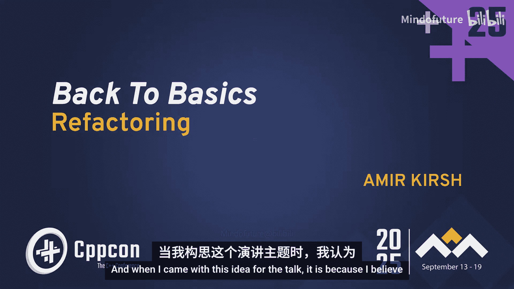
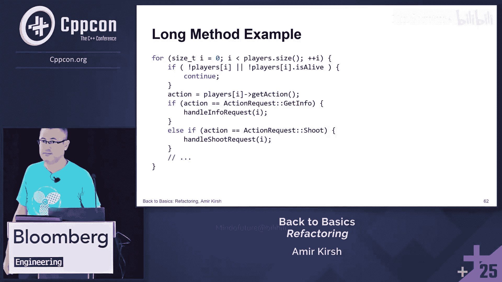
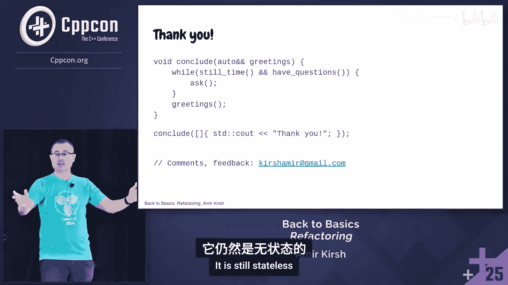

# Cppcon-2025-｜-C++-｜-C语言--｜-汇编-｜-编译器-｜-操作系统-｜-Linux-｜-Windows-p64-P64_回归基础_如何重构C++代码-Amir_Kirsh--BV1wyPBzrEeu_p64-

🎼，Good morning。Good morning， everyone。 Thank you for coming。 We are going to speak about refactoring。

😊，And when I came with this idea for the talk。

It is because I believe that refactoring becomes even more important these days。 And if in the past。

 refactoring was。Not for the juniors， maybe。 I mean， juniors would do refactoring。

 but usually it would be a senior doing a code review， seeing some code and then saying， okay。

 maybe we should fix this or that or maybe along the life of the codeb。 we require some refactoring。

 but it was driven more， more by seniors and。

The reason is that the juniors would write the code and the seniors would work on code review and fixing the code。

 And today， most of the code is not rate， written。Nor by seniors， neither by juniors。

It is written by I。 So， so the juniors need to to refactorle the code because otherwise they would just come up with the AI code and say。

 okay， this is what I have。 And then what is their role in in the play。

 So we need juniors to be able to read code that they didn't write and be able to maintain it and for better maintainability they need to refactory So this is the main idea for why I believe refactoring is that anyone should master from the beginning。

A few words about myself， I'm a lecturer at the academic College of Telviviafo。

 also in Inelviv University， co organizer of the Tel Aviv Co CPP conference and also a training advisor in the industry。

 So let's start with some code review。It's all going to be a long。Coachnippet。

 it's going to be quite easy。 We'll start with easilyfactoring。Options。

 what do you say about that piece of code。Taken from， in this case。

 an exercise submitted by a student。There is a game over there with players。

 And we want to check something about the player。😊，But something doesn't seem so right。

I will say what I see here。 Well， first， I see some duplications。 I mean， player at I。 Now。

 we usually just ignore such duplications because O， it's easy。

I believe that even these small duplications eventually hurt us because when we want to change something。

 maybe we'll change it in one place or in the other。Better to use， I guess。Temporary viable for that。

 or maybe range based for。The other thing is that negation is a bit confusing。 I mean。

 why to negate an in an or condition。I mean， it might be that someone would not really right。

 or it might be that it is wrong to begin with。 I would try to negate the negation。

and the the what is the player at eye， not on player at eye。 I mean。

 there is some kind of use of optors overloading over there。

 I guess player can be cast to a Booleion。Probably why？Do we understand， what does it mean。

 Maybe a function with a name would do something clear。So it is not clear what we check here。

 And we also access a data member。 I guess easily alive is a data member。 It's not function called。

 And I。Prefer hiding my data members and calling functions。

 because maybe we will change later on something in the axis， validate something。Write something for。

 oh， we want to write to the log， whatever。 and it is much harder they're doing that with data member access。

So let'sfactor it。It's a small piece of code。 And still。

 I believe that in order to better maintain it and。Add later on features and back fixes。

 It would would be better to have this even small piece of code written in a better way。

 What about introducing a variable to all the player。 Now。

 it might be that this variable can be introduced through a range range base 4。

 But let's assume that maybe we cannot use it or we will see once we have a variable。

 it's easier in the if to just use the player。 maybe instead of accessing a member。

 we would call is that as a function。I that is is better than than is alive in this case because there isn't a need for negation。

 And if we are creating the function and we know that the check that you want to check is whether this player is dead。

 why call the function is alive if most places in code。 we just ask if it is dead。

 or maybe provide both。 I don't know that's another question of redundancy。

 whether we want to provide both or not。 what about the not player。

 maybe better to have a function with a name， player is not active if this is what we were actually checking。

 I mean， it is a bit more readable， I can understand what's going on here。Now。

 in case he's not active and he's dead， iss something that we usually。Check together。

 maybe we can merge those into a single function。I mean。

 if if we see in code that we call both in many cases。

 and usually my advice is not to refactor on the first place where you see something that you don't like so much。

 You say， okay， let's see if we do it in another place before I create a Al function。

 Maybe I need the alpha function。 Maybe let's wait for that。

 on the third time that I see that I do exactly the same thing， I say， okay。

 let's do the Al function。 So if we see that we usually。😊。

Need to ask whether it is not active or dead。 Why not just ask whether it is not active or dead。

 which for me seems easier Now， one can say， okay， but what about single responsibility， I mean。

 single responsibility will say you are either not active。 This is one call or dead。

 This is another call。 And I would say if commonly， we ask this question， This is the check。

 Then it is the single responsibility， This is what we want to check。This is original。

 this is the refactored code。😡，I would say that it is a bit。More readable。Refactoracting。

 refactoring。The term was not tamed created by Martin Foer。

 but he is very known for this term because he wrote the book refactoring。

 and Martin Fuller in the book and in his site， states refactoring is a discipline technique foruring an existing body of code。

 altering its internal structure without changing its external behavior。

 So we don't want to change the behavior of the code。 we want to keep the code as ease。

 but with changing its structure。嗯。There is a book。 This is the first edition，2005， maybe with。

A catalog of refactoring options。And I will discuss some options in this talk。

 A book also needs some refactoring。 So they they created the second edition， I think，2018。A bit。

I don't like so much the picture on the second edition because the picture on the second edition presents two bridges。

 an old bridge and beside that a new bridge， and usually when you refactor。

 you just refactor the old code and the old code doesn't exist there anymore。

it's not replacing the entire bridge。 You just replace something。 You still have the old bridge。

 Its you cannot in a way， point out on on the moment in time that the old bridge became the new bridge。

 I mean， it's a continuous work。 So again， the idea is， okay， we want to replace something。

 But I would not take that metaphor of replacing one with bridge with another。

Re factoring is a discipline technique for restructuring and existing in by of code， as we said。

 without changing its external behavior。How can we tell？

how can we tell that we didn't change the external behavior。

 Because the idea is that we just want the code to be more maintainable or easier to read or easier to introduce。

A new feature。 I mean， if the code is easier， then it would be easier to introduce new features。

 But how can we tell that we didn't change the external behavior in a way that we didn't help what the code was supposed to do。

 And the answer is quite easy。Rereation testing。 So， you cannot do reraing without testing。

 Testing is essential for refactoring。 I would say reraing without testing is like a fish without a bicycle。

 I mean， it's a bedman before， but you will remember it。So whenever you say refactoring。

 remember the fish， the bicycle， we need testing， we need enough testing in order to have a stable refactoring。

I'm not going to talk about testing in this talk， the other talks， this is a link to Google。

 sorry to YouTube with CPPPcon and testing， and you will find there are a lot of talks about testing。

So why should we do refraing when and how？ So again， from Martin Fulller。

 refactoring is not another word for cleaning up code。

It's not that we just want the code to be clean for for no specific reason。

 It's aimed for improving the health of the code base。

So we want to support new features and future code changes。 So before。Implementing the new changes。

 if we see that the code。Is not adapted。 does not fit the new feature。

 It would be much easier to first do the adaptations。

And keep the external behavior and make sure the old test。

 all test pass and then work on the new future。 If we do that together， if we。

Insert the new feature or the back fix together with the reraing。 it would be much harder to test。

 and we will introduce new bugs。Irovability and maintainability。

Let's assume that we go into a code base and we need to maintain it and it's quite hard to understand。

 don't feel afraid changing something if it stays the same， but written in a better way。

And what should give you some confidence in doing that is that you have enough testing。

 And if you do not have enough testing， that add some testing in order to be more confident。

 performance improvements， performance improvements in a way do change the external behavior。

 But I would， I would say that， yeah， but the functional test should still be relevant。 I mean。

 even if I change some timings and better performance the functional test should still pass。

And in many cases， we see something that is not a bug。 I mean， if it is a bug， we need a bug fix。

 and then we actually change external behavior。But it's not a bug。 It's backprone。

 something in the code， somebody can use it in the wrong way。

 and we want to change it in order to prevent future bugs。 All those are reasons。

 good reasons for refactoring。And to summarize that， it is usually in order to reduce technical debt。

 technical Let is code that is not written the way that we would write it given the entire code base。

 which evolves。But we don't have time to change it。And when it it is there。

 it encourage interest in the form of how to work for any additional change。

 So in order to make future changes much less expensive， we need to refactor once in a while。

So when on change， I mean， if we need to change the code， I mean。

 if we are on a certain location in code that we are not touching， do not refactor。

 do not refactor stable code that you do not have any change to。😡，Admitting to this code。

Re factor based on actual benefits， do not refactor on subjective preferences like， oh。

 I prefer West Coastt， and I know that the coding convention in my team is East Coast。

 but that's a factor。 Don't do that。 Don't just change things， if they do not have any value。

 by the way， value might be。Admitting to the project coding conventions。

 So if you see a West cons and the coding convention of this project is east cons。

 let's move the cons because then the code would be more readable because it con conforms with other parts of the code。

 Yeah， that makes sense。 but do not just change style because you prefer that if others would prefer something else and there isn't any actual。

Objective value in that。O， let's go back to old code。This is a more bigger snippet。 we have a loop。

And the loopies。Iterating over all players。 And inside， we took the player。 We， we did the change。

And we condition now on based on a function， is not active ored， which is a bit readable。

 more readable。Rather than what we had before。And still。

 I have things that debate bit bother me here。 Do you see something that。😔，Boths you。I mean。

 my question would be here。 Maybe， maybe we can go with a range range base 4。 And， the question is。

 why should we prefer usually a range base for。Rather than looping with an index。

So bounce checking off by1arrows， the need to use the index instead of just， okay。

 I have the object that I want to operate on off by one else。 Usually。

 this is the most important issue that we want to avoid。But the problem here is that。

We're actually using I down below。 I mean， I is being used。 so I cannot just go with range based 4。

 but but for me， if I'm going to maintain this code again， if it is stable， I don't have to touch it。

 do not touch it。 But if I'm going to add something into the loop。 I would say。

 let's change the loop， I mean， let's put an index above and use a range based for by the way you can initialize。

A size T with -1。 It's valid。 It is done by the language itself， with。String and pose。

 That's correct。 String and pose。 The end of string is -1， which is s。 Anyhow， it is valid because。

Un signeded are allowed to overflow onflow。 and once I do the plus plus， I start with0。

 Why do I prefer to do the plus plus immediately when the loop starts。

 I could start it with0 and do the plus plus at the end of the loop。I there is a continue。

 but even if there wasn't any continue， I prefer to make sure that I will。

 I will go through the plus plus。 Okay so do the plus plus at the beginning and okay。

 we have now range based for。 if you are in C plus 20。

 we can do the initialization of the index inside， which as better scing， I mean。

 I will not use index outside or I will not collide with index。

 which might be used outside for other needs。 if you are with C plus 23。

 we can use stood views enumerate， which returns， which allows you to loop with a column and get back a tackleel or pair of index and the actual object that you want to iterate over。

 So I would say this in a way seems a bit better。And refactoring might be driven by。

Moving to a later standard to a more modern simpleus plus standard。

 be it moving to C plus 11 or being moving to 20 or 23。One can say， okay， so if inside。

 what you do is just， you filter out all the dead and not active players。You just continue。

 you pass them。So maybe we can put that into the loop。 Maybe we can say， okay。

 do the for with a filter using views filter。Sorry， I know that it is back to basics。

It is not that you have to know how to write it。😡，But you have to know how to read it。

 because you may go into such。Caednippet， doing rangeangrs。 If you're in civil 20 and。

You still need to understand， Ok， what's going on there。 Oh。

 there is a Lada provided for the filter in order to filter out the。Players that we want to skip。

 And then in the loop， we just end those that we do not want to skip。

 We need to filter only after the enumerate。 Otherwise， the index would not be correct。O。

 we have this loop。 Now， let's assume that we look at that and we say， oh。

 that is an atro refactoring。 It was much better before。Well， the problem is that。This loop。

Which is in a bigger function。Should not be in the function to begin with。 I mean。

 looping over all live players is quite common。It happens not only here。I mean。

 when I go through the code base， I see， oh， I， I do the same here and here and here and the loop。

Is exactly the same。 So either it would be this loop or this one or the previous one。

There is some logic in the loop。 and I wish to have this logic written only once in one place。

And we can do it quite easily with。With a function， let's create a function。

 and the function can be for each live player。😊，It is a name。It gets。In action。

Which might be a lambda。Or a function pointer or whatever the user wants to provide。And now， now the。

 the complexity is hidden and the complexity might be this kind of loop。

Or the previous version of the loop。 But it is hidden because anyhow， a loop is nice。

 but still can be hidden and then maintained at one place with a name。😊。

Whether we like this specific implementation or not。 So once we have that。

 ending in action would be just calling for each live player。

 So we call the for each live player saying， okay， we。

 we need to do something with with all live players， those who are not。Dead or on and are active。

 And we remember that the reason is for the index。 So we asked for the index。 So inside。

 we get in the lambda， the index and the actual player that we iterated over。

 And now we take an action from the player。 and we ask， okay。

 player what is the action that we want to。Perform and， and this piece of loop。

 this piece of code is， is implemented not in player， but in game manager。Somewhere else， okay。

 which manages all players。And then we go over the。Different actions that might be requested。

 What is say about this。Yeah。Look's look at。It might be a switch。Yeah。I just typed it。

 It might be a switch。But I would say maybe even something better than a switch。I mean， we see inams。

 So inams can go easily into a switch。 We may go to。that。一南。Maybe I can in them there。

 maybe I can map the ins into a function or comment pattern。

 So I would go with a comment pattern saying， okay， player， you want to do something。

 So instead of providing me back an inum， maybe you can provide me。An object。Polymorphic  one。

Inheriting from。Actual request。And then what I have to do is to take the action。

And the player could take action from a factory。The player can maybe the player can return the in if I prefer the player not to be aware of the action command。

 So maybe the player would still stay with the in。 But then I will send the in to a factory。

 go back and get the command。 And then I would say I have now a much better and readable code。

 I mean， let's look over all live players。 ask for the action。 and perform the action。

 And there is more than that in in the loop。 But this piece of code became I would say a bit easier to write and maintain。

 And now you made this degree。 You may say， oh， we like the loop。So。

I do not force you to change the look to this one， but I would say something else。

 if you do see something like that， do not refactor it。

Back to a loop because I do see something like， okay， Ju comes in and say， oh。

 I don't like this function。 Let's just write the loop。

 There is a reason why we prefer the function because the loop has some logic that we want to hide。

 There are some complexities。So we use the comment button back to the book。The refactoring book。

The refactoring book comes with a catalog of code smells。And refactoring options。

And the code smell is something that is better in the code， something that， oh。

 I don't like it because it is background prone。 It is how to maintain。 It is not extensible。

And the refactoring options are how to mitigate this issue。Why catalog？ I mean， we。

 we can just look at the code and say， oh， I don't like that。 Let's do that。 Why do we need。A book。

So a catalog provides shared language。Very similar to design patterns。

 It was in the era of let's do catalogs and。Then we when we see a co smell。

 it is quite easy to go to the established refactoring options without thinking too much。

 It's like a chess opening book。 When you start a chess game。

 you will never see a professional chess player on her first move thinking。What should I do， Oh。

 this guy， they did E2 T E4。 What should I do now， No， there is like automatically。

 we know the first 2，3，4 moves， Sam here with oh， for this one。

 there are some options that we know what we can do makes problem detection systematic and repeatable again。

 because we know what are the options provides actionable remedies。 again， we know this is the case。

 this is how to solve it。 And it suppose education and boarding and code reviews because we have the common language。

 we know how to point at something and and it is already established。It's a living catalog。

 It's not a finished book。 I mean， the book is finished， but the other。

Corode smells that are not in the book。 If it is not in the book， it doesn't mean that it is good。

 There are code smells that are not in the book， and there are refactorings that are not in the book。

 Okay， and， and I will discuss a few。And soft practices evolve， so we will see new issues。

And new mitigations。Let's go through partially a list of code spells and mitigations that appear in the book。

 We will not cover all。 Okay， and you may want to go later on， achieve the book and go through that。

 Or I will tell you other options， even though I do。Recommend。Having your hand on the book。

 long method。 I guess this is the。Most common， long method。 Do you have long methods。

We do have long methods， usually we have long methods because it is much easier to write the long method。

 I mean， we have all the information inside。 Why should we go way either way， I mean。

 it's all inside。 but eventually， long methods are harder to maintain and tend to be more bug chrome because there are too many moving parts in this function。

 If there is a small thing， it's harder to accommodate bug into a small thing。

 It's much easier to to put new bug in a big function。So comm factorings for a long method。

 extract method。Take a portion of the of the big method and extract it into a different one。 Then。

 of course， you would have to pass arguments。 That's okay。 Now， the。

 the function would not be able to mutate。All the local variables that we have in the big function。

Only those that we send to the new one。 And if you send it by value。

 then it wouldn't be able to mitigate those as well。

 So I'm protecting the bigger function in a certain location where oh， now we only need to do this。

 And this should not interfere with anything else in the bigger function。 less room for bugs。

Replace temp with query。 In some cases， we create a temporary variable。 I mean。

 a local variable in the function。 Then we take some results from a function。 Then later on。

 we use this result。 I like it。😊，I prefer using。Local variables for that， by the way。

We place them with query。 There is a refactoring。Entry in the refactoring book。

And there is another one saying， replace query with a temp。 I mean， refactoring in some cases。

 you can do that。 you can do that。 In some cases， do this。 But in other cases。

 maybe it's better to do this。 When should we replace， oh。

 you just call a function and take the result and do something， That's not good。

 Better put it in a variable and then use the variable， When do we do that， When should we do that。

You call a function and say， oh but but there is a replace template query。

 I'm using the query without using a local variable because it is like shorter。 No。

 here I would prefer you to use the local variable with a name because。

The function name is misleading or not clear。 and I want to put a name or the function return something without measurement units because we're using weak types instead of strong types。

 and I want in my name to say something about the measurement unit， better move to strong types。

 So it might be that I want something there， By the way， what is the tell， what is the hint that oh。

 better use the local variable here instead of just using the result of the function immediately。

 What is the hint for that。That way have there。A comment。If we have a comment saying。

 we do this and that， I say， why a comment， Why not having a variable saying the same thing。

And and this is a refactoring option in the book。 But here， you know， if the method is too long。

 in some cases， you say we do not need this local variable because the function name is enough。

 So maybe you can take this function name， put it in the if instead of。Calling the function。

 putting it the local variable and then using the local variable in some cases。

 even not immediately after calling the function。 Let's assume that there are five lines in between。

 and we already forgot what we were doing。And maybe even introducing a bug in between。

Changing the value， which maybe we shouldn't。 So maybe replace template with query。

 maybe the other way around in some cases， replace method with a method object。 In some cases。

 the thing that we are doing inside is not。Enough， just take it into another method。

 It is a complicated thing that is being done there。Maybe you need a class。Then create an object。

Then call a few functions on this object。We are using object oriented programming， right。

 thecomp conditional。 You have a complicated condition， complicated conditions。

And you want to keep that in the function。 maybe you want to put it outside。

 But let's assume you want to keep it in the function。 then write。

 break the complex condition into smaller， well named methods。 again。 Okay， use the method。 and。

 and the condition would become clear。Do you have an example？

 you can you think about examples of of things that we mentioned here。

We at it at the beginning of the talk。 Do you remember that one。It's part of a bigger function。

And if I take that and applying a star method， I get a method that is the loop。

And if I replace method with a method object。I create the action。And I call execute on the action。

 It's an object。And I prefer an object rather than a switch than calling the proper function。 Oh。

 why not use an object to end polymorphism to find the proper operation that I want to。Apply。So。

 we used it。Without maybe going through the catalog。 and that's O， by the way， if。

 if you do proper refactoring and you do not remember the names from the catalog， it is still fine。

 Don't feel。Bed with that。Long power list。 Do you have functions that have too many arguments。 Yeah。

 it happens。 I mean， to begin with the function only took three。But then we needed something else。

 and it became 7，9，12，12 is too much。 Let's do something。 Okay。

 we should have stopped like at about 5。 but too many arguments。 Now。

 the problem with too many arguments is that it is outer for both the color and the function maintainer。

And it will be background on both sides I。Andand。The arguments in a wrong order。

 I may assume something about an argument。 Oh， this was not that1。 I should use this one。

 More arguments， more room for troubles。 What can be done。 What should we do。

We can create astruct common factorings we can do introduce polyal object instead of taking these five arguments。

 maybe all these five arguments can be packed into astruct or a class。Preserve all object， maybe。

There was a class there。 And instead of sending the object， we just。Unpacked it。

 we just took the actual data from the object in order to send that instead of sending the object itself。

 So why not send the object itself。 What do you say。

I will discuss that in a moment because sending the object itself is not always the right thing to do。

 But that that is a refactoring option in the book。 replace parameter method with a method。 Now。

 replace parameter with the method means。Okay， you can。

Get this value inside the function instead of me sending you the value。

 I would say I'm not sure that I want the function to call the method。

 I want to call the method because the responsibility of achieving the value should be outside in this case。

 Okay， it might not be the right fit。 But it is an option。 I mean， why should you。Send this one。

 The function can achieve it by itself。 Then we omit one argument。

 I'm not sure that would be for the best because in a way。

 it makes the function stateful instead of stateless maybe。 And instead of being more generic。

 we'll discuss it in a moment。 So I want to。Check these two and say， be careful with those。

 because what about reable object。It might be a ch smell by itself， why。放式。丢着。

I'm letting the function。 Thank you， Rob。 I'm letting the function be aware of things that you shouldn't be aware of。

 we， do we call that。We are breaking encapsulation。 We are creating tight coupling。

 So it helps in encapsulation and decoupling。 Now， preserveable object is in the book。😊。

I would not recommend always doing that。 I mean， in some cases we say， yeah， yeah， it's okay。

 these two are tied to capital anyhow。 So why not just test the object。😡。

We' are using the object elsewhere。 Just past the object。 But in some cases。

 you should not know how the object is built， or you should not speak with this object because once I pass you the object。

 it's not that you can use only the arguments that I wanted to send you。

 You can actually use everything。And for that， we have Tonyni Vans Kn。

 A Kwan is a short story with our moral。 Okay， if you do not know Tony Vaher。

 first thing after this talk， go and find talks by Tonyni Vans in YouTube。

 I don't think that he is in CPPCon this year。 He was in CPP North。 a few months ago。 great speaker。

 Great talks。This is from his Twitter account。 He used the same example in one of his talks。

Let's go through the coin。 Okay， A master and his dog。Master。The student says。

 I'm honored by your visit。 So the the student is in his backyard and he sees the master going by and he thinks that the master is paying him a visit。

 So he he's saying， oh， I'm honored by your visit。 And the master was not actually coming to visit the student。

 but he doesn't say that。 He says， I was walk out walking my dog。

 And then the master sees that the student is coding。 And he says， you function。😊。

Why does it take big common tract instead of justs and why。I mean， you have a function。

 And instead of passing to the function X and Y， you pass big commonstruct。

 So the the student answers。Big common Str is where we keep X and Yma。Brk， the dog barks。Is hungry。

 the master says。She like to open food。 The student asks， no， just open the fridge。

Let him take what he wants。That's the message。Did you get it？Why shouldn't we pass big common track。

 Why shouldn't we pass the o object。Because the other side would use it。 And by using it。

 it will be usually or at a certain point of time abusing it。

 using it not in the sense that we wanted it to be used。

Passing the entire object is not the right thing to do in all cases， in some cases， maybe it is。

But it would make the， do you remember the Scottme。The long argument list a bit shorter。 Okay。

 this is a link to another talk of mind discussing this coin and hiding your implementation details。

Keeping obions。Keeping decoupling。 Okay， you can watch it later。

 What about replace parameter with method。 So again， if it is， okay， I' am not sending anything。

 The function would call the method inside。 I'm a bit worried about that because again。

 I'm putting now a state into the function。 the state should know something about the method。

 In some cases， you say， yeah， this is the responsibility of the method。 But in other cases， you say。

 no， I want to keep things stateless and keep the responsibility on the collar。 So instead of。

Asking the fact the， the， the cold function。To achieve their proper information。

 I can do something else。 I can still send something， which is not the arguments， but is。

An interface。Saying， okay， you can achieve the， the information。 Maybe you need to achieve things。

 It's quite similar to。Passing an object。 It's passing an interface。

Which would be a base for something。 And we call this depend and injection。 Okay。

 this is what you have to use in order to retrieve some information。

 I would not retrieve the information for you， but I will give you the thing that can。

Rewe the information。 Okay， and it is quite usable for testing。

 So dependence injection also can shorten the long list of arguments。

 usually when this specific interface can provide more than one single argument。 Oh。

 it will provide this on this and this。Large glass。😡，This is another problem。

Do you have large classes， Usually we do。 So a class that has grown too big。

 Usually they start small， taking on too many responsibilities and becoming out to maintain。

And al tour he used。So common de factories would be stock class。😡。

There are some things in the class should that should move to another class。

 And then I can use the other class in in my class。 I mean， take X and Y， create point and and。

And hold the point。 Do you say my point， Extract subclass。

 maybe part of the responsibility can go to a subclass of mine。

 and then the user can use the subplus or my class or extract superclass， which is quite similar。

 but which type do you want to use me or replace data value with the object。

 replace data value with object is not。😡，It's quite similar to the first one。

 The The difference is that in some cases， we have an int。Or a simple string and say， oh。

 this string represents a person in the class。 we the person and do things。

 So why not just keep the person。 or instead of the int。

 keep the thing that the in represents or a reference to that。

 So just take one primitive type or one field or in them and replace that with the actual thing that you want to manage。

 And in some places， it will make the class easier to maintain and with less responsibilities。

 because instead of taking the primitive and doing things with the primitive， I have an object。

That knows how to do stuff。Comments。Comments are good， right？Not necessarily。In some cases。

 in some cases， comments might be cosmll。So comments can be a code smile if better coding would remove the need for redundant documentation。

 In some cases， say， why should you tell me that， Why shouldn't the code。Tell that。

 And And co telling something is much better than comments saying the same thing because。😊。

Code is being compiled。Comments are not。So when called changes。

The message that you want to expose changes with the code。 The documentation do not。

 and you still have all the documentation saying something。 and you go to the code。 Oh。

 it's not what is going on there。 but maybe it is， let's keep it。 By the way， do not。

 If you said that the command is wrong。Refactoror the comment or remove it。

 How can we remove comments。 So common refactoring is exact method。 In some cases。

 we are doing something， and we explain above what we are doing。

 What is the best way to explain something。 Give it a name。 Make it a function。😊，Oh。

 and it also helps with。Reducing the size of the function。Yeah， do that。 Give it a name。

 And if I say a comment， maybe all the things that I do below。Should be in a function。

Introduce assertions。 In some cases， the documentation says， oh， we assume here this and that。

Why do you assume that， Because the documentation says。

 so maybe it would be better to assume it within a c。Or if an exception。

 if you go back to Es talk on contracts from yesterday， In some cases， it's an exception because， oh。

 it may happen。 In some cases， it's an assert because， no， it shouldn't happen。

 It's a bug that I cannot。Continue if it happens。 So either assert exceptions or contracts if you are in simple for 26。

Switch statements and complex conditions。I mean， we do want switches some places。

 but not all over the place。 and we want to hide our switch。To put it inside a factory， for example。

 Yeah， the factory can have a switch because we want to see which in we got。

 And then we create the actual object。 And then you go with the object and polymorphphyism。

And the same thing goes with complex conditions。 We want to hide them and then give them a name。

 And then things are much more maintainable and easy to read。 So complex condition。

 conditional structures may become long and complicated to maintain。

Violating the open closed principle of it should be easy to extend our system and hard to abuse it to use it incorrectly。

 And it makes the code hard to extend。 Let's assume that I take the action and then I have a switch of what should I do according to the enum of the action。

 Each new action should require a new entry in the switch case。 I want generic code。

 Getting the action， doing something。 Pomorphism and classes。

 So replace conditional with polymorphism。We do that。But we should do that also with alt code。

 not only with new code that you are writing now and doing it with alt code means。😡，Refactoring。

And in order to do it for alt code， reraing requires testing， replace type code with state strategy。

 it might be that we hold the inside the class something that tells us what our state is。

 and when we are going to do something we query the inum or the int and then we do what we want to do。

 why not hold an object。State bottom。Or strategy。 Do you know the the difference between states and strategy。

 because they are quite the same。 I ordered an object。 And when I want to do something related to。

This object， I query I ask the object to do the operation。 So state pattern。

 we use the term state pattern when this object is part of the bigger object state。 I mean。

 if you change the state， I'm not the same thing。Or you change my state。

 I'm not the exact same thing。 Strategy is I can do things in。Few， several different ways。

 I can do it DF S or DFS。Does it actually change myself if I change some internal behavior for efficiency or for。

 oh， for bigger map， you do that for smaller web。 you do No， Im the same。 So my advice is。

 if you actually want to answer the question， whether it is a state or strategy。

 think about there is a function in the class， that if you implement that。State would be inside。

 considered， and strategy would not。And that is。Equality operator。 I mean， if I get to objects。

Should I check this field for equality， If the answer is yes， you are using a state pattern。

 It's part of your state。If not， oh， that's a strategy。 I mean。

 if two objects are the same for all other means and are not the same for this field only。

 and it doesn't bother me。 I'm saying， oh， that's the same， then that's a strategy。

 but it's mostly terminology。Anyhow， replacing。A member。

 a simple member with a strategy would make a switch disappear in most cases。 Inuce a null object。

 In some cases， we want to check， oh， are you null， now it doesn't have to be always null。

 it might be， are you open， are you close， it might be that， okay， instead of asking。

 why not just do the operation。 And if if it is a null， instead of holding null。

 hold an object that when you call the operation。It would just in no operation。 That's it。

 Do nothing。 in some cases， people say no， but it would be。Cotly。Now， we do not。

 It's an inline function。 I mean， holding an LPTR， holding an object that doesn't have any fields。

It should be the same eventually。 And and in some cases， you say， you know what。

 if you do call a function， I want to log。 Oh， so instead of having the if and then logging and just call the function Oh the null option。

 the null case， it is being handled。 you are having a null object。

 an object that represents the null case。And again， it will remove the need for ifs。By the way。

 another example is when you implement linked lists and you use dummies。For the link list。

 if you know that using dummies， avoid the need to check whether the head or the tail have changed。

 So in some cases， you add some data， you pay with storage， which is quite， it's only two nodes。

And then you do not have to check whether head or tail have changed。 And again。

 it reduces the complexity of。Rundant， if statements。

The book itself has 22 codemes and 72 refactorings。 We will not go through all of them。

 I don't ask you to know them by heart because instead of think some code and asking yourself。

 what should we do here， you can。Nowadays， use AI。 So I took the code to AI and asked， okay。

 this is the code。 What are the code smells， And I urge you to do the same with your your code。

 Don't ask AI to refactoro the code。Not now， maybe in a year， maybe， maybe in two years， today。

 it will not work quite well。 but you can ask what are the codesms， And this is what I got。

 A few answers， all are quite good。 Okay， and then the I and a few more notes all are good。

And then they are asked me， do you want me to refactor that， Oh， I I asked him。

 can you tell me using the refactoring terminology of the book。

 And he come with these are this is is called in the book。 And， and I proposed。

 do you want me to refactorle that。 And I said， yes， and I got something not so good。

So the refactoring itself， in some cases， would not be the best。I will say for now， okay。

 but helping you thinking about what are the cos smells？What are the possibility factoring。

 Don't do that， I mean just propose， I I will decide whether it is good or not。

Additional few Cus plus factorings， which are not in the book。By the way。

 the the book is mostly speaking about Java。When， when there is an example。

 when there is they thought odd but the plus can。Use some of the factors as well。

 move weak types to strong types。😡，Don't use types as just primitive。 There is measurement unit。

 I mean， meters， seconds。Satelllies may crash on mouse if you don't do that。

Mo from user allocations to library allocations。 Do not use allocations in your code。

 You can see the old code above as the new code below in the old code I allocate。 Now。

 there is something in between。 and there is a link to our talk that I gave on the full。

Path to go through， I have locations。 Oh， I still have locations， but they are hidden。

The path goes through Im using smart pointers。 And in the middle， the user sees the smart pointers。

And I recommend。Having the smart pointers as internal implementation detail。 Okay， you should。

 it's not something that you should be aware of that I'm holding a smart pointer inside to all the math expression。

 I don't want you to allocate。 I will allocate。 I don't want you to be aware of the fact that I'm holding a smart pointer inside。

 Just create something。 I will do the allocation inside。Move from pointers and references to values。

 value semantics。 If you look for value semantics， you will find talks about that。

 simplifies ownership， reduces risks of null and dangling resources。

 Do you have an example of moving from pointers to。Value semantics。

Is the previous one same thing moving from pointers。 The pointer is hidden inside。

 but I'm working in this example with sum。 and sum is a value an object， not a pointer is an object。

 I not the polymorphphyism is a bit hidden inside。 And again。

 there is a link to a talk which goes through this path。 prefer standard algorithms of the roll oops。

 Sean parent。😊，2013， famous talk。No row loops。 No， I like roll loops。 I mean， I I write row loops。

And and you may like them as well。 And I'm not saying every roll loop should become a call to a standard library algorithm。

 There is a talk by Sand on Friday about performance issues。 In some cases。

 maybe we would prefer the roll bat。Do not take a call to standard algorithm and say， oh。

 I prefer a roll loop and reffactorate to a roll loop， never do that。 I mean。

 if you see a call to function， something that is declarative， a call to an algorithm， Don't say。

 why not a roll loop， Let's move it to a loop， Don't do that。 and if in some cases。

 you do want to move from a roll loop to a standard algorithm， Sean Par will confirm。 Avo markers。

 if possible。Use our AI。Are you still locking and unlocking？Stop doing that。 I， I mean。

 when I say stop doing that， I don't mean only stop doing that。 I mean。

 if you see that in code that you currently maintain。Refactor it。And when I。Talk about AI， I。

Construct or distractor。 The distractor should be the tool to unlock。To release memory。

To close the database connection， etc cetera。 Otherwise， I may have links。

 and we haven't established。Common pattern， which is resource acquisition is initialization。

 acronym R II。 Let's summarize。Continsually factoring is acquired。 Otherwise。

 our code would get technical debt。We need to do that。

And I would say we need to do that even now more than in the past。

 because the code is not getting better with AI。Reactle code that are actively working on do not touch code that shouldn't be touched just because。

 oh， I can't reactle that to be， no， no， no， not nobody is touching that there isn't any bug fix there。

 There isn't any need to maintain it。 I mean， at a certain point of time。

 maybe you will be required to maintain that。 So then。Coning with AI。

 coach quality and productivity doesn't necessarily improve。 I here two links worth。Going through。

A key message is the programme's responsibility to own the code to understand what's going on there and maintain the quality。

 because there there is research already that code quality with the eye is going down。

 moral duplications。Less conceptual integrity。 I mean， we want conceptual integrity。 We。

 we look at the code and say， oh， that is good。And we get something that works。

 But when we look inside， we say， oh， oh， no。 And and then that is our responsibility to make it better because otherwise。

 it will become a big ball of mud。 In factor， for a clear reason， not just by intuition。 I mean。

 what do。We achieve in this refactoring move。 This is the question。 And once we have an answer。

 then we have a map。 We can。 We do not go for the travel without a map。 Okay， and we check。

Occasionally， that we are on spot on a map by。Testing， so we， we need small， incremental。

 testable changes to make sure that we are on the map。You may use AI for refactoring。

But probably just as an al tool， not as do the refactoring。 I'm not taking a look。

Because it will get worse code than before in some cases。 Okay， and， and again。

 this is my experience。 And you read that it's not only my personal experience。

 relying only on AI to the fact that code probably will true for September 2025。

 maybe tomorrow it will be。Perfect or in ear from now result with mey code that still needs reffactory。

 I mean， in some cases， you are in a loop。You are， I had an example where I wanted two classes to share a base class。

 So I asked AI to do that for me。 and they I created the base class， but。

He didn't use the right functions in the base class。 I mean。

 still I had two derived right classes which do not use the proper functions from the base。

 so I asked I to fix that and I got some fix but then I got something broken。

 I mean the code compiles usually some magic goes there and it works。

 but not the way that I wanted and eventually after one hour I realized that I could do that in 10 minutes。

So in some cases， it is more productive just doing it yourself when you realize what you want to do。

That is for now。 So thank you。 And if you have any questions， I'm here for answer to see if I have。😊。

There is a mic， if you want。So。To go back to the， you know， on the very first slide。

 the long code example that we refactored。嗯。Show how。You know， some things。So I mean。

 that's an impressive refactoring you turned it into a。

A thing where the loop itself is only filtering live players。Did the command pattern all that。

 but those also imply changes at other places in the source space， right。

 it wouldn't just be in this one source file。Isn't there kind of a risk there now you're making a change that's distributed across several places in the source space？

I work with people who would be like， that's a code。 No。

 you shouldn't be changing places all over the code。

 How do we know that this doesn't have other effects。 That's sort of a。Anxiety inducing in itself。

That's a great question Yesterday there was a talk by Andy Offer tackling refraant as well and he presented a graph chart of refants that are local and ref that has a networking effect networking in the sense that affects other code pods and you should do both but when you do a local thing you know the risks and you know what you're doing when you do the more broad thing then you need to communicate to make sure that others and to have access to the po。

 you can do that if either there is an external user that you do not control and you want to factor。

 you must。Still preserve the old function， so it might be a good thing to preserve the old function。

 maybe at a deprecate annotation or comment about that saying okay you have to keep that for these users but if you're a new user use this one I would go with this approach but if you can eventually get rid of the old one again you need access to the code base you need communication with other users don't pi anyone off。

In this case， I would say this is a local change， why this is a local change because it wasn't a big function that had a loop and I'm taking the loop and using another function now I can use the same function Also in all other uses of I have to iterate on all live players。

 I don't have to do it immediately I just have that function use it here。

 then maybe advertise to the entire project away okay， we have a new function。

 maybe you want to use it Thank you。 Thank you。

I think that we have time for one last question Thank you very much， was excellent。

What are your thoughts on short circuiting when you have like at the beginning with a function if return and would you prefer that over if return else if return else if return So the question is in the beginning of the function want to check something and then only return okay because the arguments are not okay those who prefer only return those who prefer to start with the actual thing like an if and then the return would be at the end。

It may have。Performance implications， even though you can use likely and unlikely likely for quote clarity only for clarity。

 I go with the other return usually I want to be to take off from my mind all the L cases and then focus on okay。

 now I know that I'm ready for the function。 This is my approach but I'm okay with other approaches。

 Usually I would not refactor that。 This is an example of something that I would not refactor just because this is my personal choice。

Because other choice are okay well Quick  one， one more。 Yes， so small functions。 I am in big favor。

 small functions， but sometimes they can create cognitive overload。

Just saying so we should use common sense creative always， always， I mean。

 if we have thousands of very small functions that only do a very， very small thing， we can say。

 why do we need this function， Why not just you know， and in some cases， Yeah。

 you would not create these Small functions Are you familiar with the book called the Philosophy of Soft Design。

Sounds familiar by John Oussterst， who is the creative raft protocol。

 And you mentioned that because because he talks about， he argues with Uncle Bob。Like viciously。

 and he talks about small functions and the deafness of the classes。

 I will tell you something about small classes。 this would be the last comment。 small functions。

 small classes。 I strongly believe in stateless functions。 anything that can be stateless。

 start with a stateless and in many cases， we have state things that should be stateless。

 stateless is much easier to test much easier to maintain and in every framework。

 every big project there are a lot of things that can become stateless。

 So every big stateful thing as inside。😊，A few dozens of stateless operations that should and can be implemented as stateless。

 even if they take a few arguments or an object that hides those arguments and just do the work。

 without any any they do not rely on anything external。 They take everything that they need。

 including dependence injection。 Maybe they do take some object that they will use in order to retrieve some data。

 It is still stateless。

Thank you all， thank you very much。I yourole。

