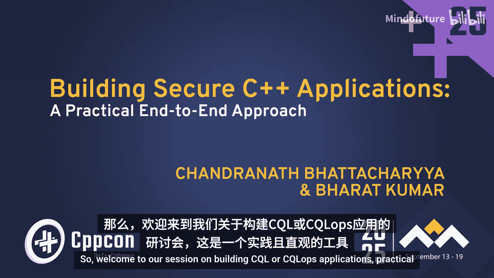
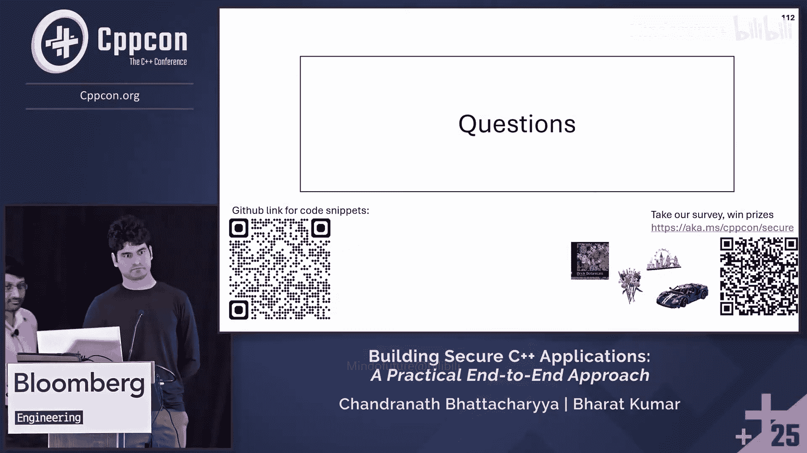
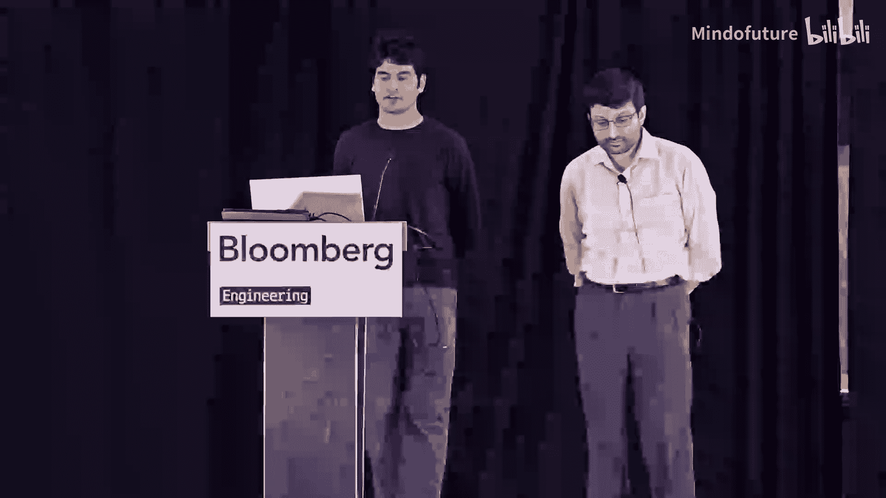
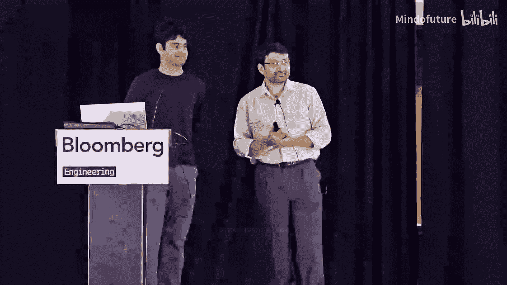

# Cppcon-2025-｜-C++-｜-C语言--｜-汇编-｜-编译器-｜-操作系统-｜-Linux-｜-Windows-p65-P65_构建安全的C++应用程序_实用的端到端方法-CppCon_2025--BV1wyPBzrEeu_p65-

🎼In the field of C++ there's nothing else。 This is the very top of the C++ conferences Here you will find the newest stuff。

 It's huge。 You can meet all the experts and the community here is nice。

 You get to network which very best。😊。

Are in the correct room， So welcome to our session on building CQ Cosis applications。

A practicalrac intu your approach。呃，跟相关。房灯。I've been in the Microsoft A browser team since。2018。

I've proven a in sicklessless on andnda for more than 20 years。

This is my first time entered in Cion so I'm really excited to be here with Miss Barrup Hi I'm Barak and I've been with Microsoft as browser security team since 208。

And。I've been working with C++ for almost a decade on and off， and I'm glad to be here。

Okay， before we move on a quick note on the questions。生三都地方。If the question is a specific side。

 please notice number so that we can refer question。不给问啊，晚上。So in normal。

 that sequence versus above language。马这从做美到两C。但是我也跟不。出てです。Now。

 we can't simply re the massive amount of existing samples for code into a memory dis language overnight。

Microsoft page， the browser that we work on， is built on Chium， which is predominantly simples plus。

 So we are in this boat。Fortunately， we can make significant progress without a ho right。😊。

So Herb shutter wrote this blog post in 2024 where he laid out a practical approach towards C+ ver。😊。

He laid out four key safety categories， bounce， lifetime。Inization and type。

And he also mentioned that he believes a 98% reduction across those four categories is achievable in new or updated C+ pluscode and partially in the existing code。

😊，So our approach has the same spirit。 We totally understand that there is no silver bullet。

We chief aware had the problem to make it incrementally better。

 including moving some portions to memories of language like trust。😊。

So in this session we'll work through an approach in Microsoft H。

 we'll work through how our each in tackle safety across core safety categories。

 bounds lifetime initiation and type， and we will also touch upon a little bit on threat safety。

 definition safety， reducing other undeefed behaviors。😊，Note。

 this stop focuses on safety to minimize exportable behavior。 Now。

 we all know that safe code is not equal to correct code， right。

So we'll also start upon some strategies we use to improve overall code correctness。

So now safety is critical across the entire development lifecycl。

 so we will expose safety categories， safety practices across each of these phases， design。

 implementation， code review， CI pipeline and after release。😊。

Of this will focus a little more on the implementation portion。Now。

 many of the techniques will discuss were developed by the incredible open source community at Chroium。

 so we are really excited to share this with you。😊，A quick note on our C was environment。

So our project uses C++ 20 with Kang and Ley++。Exception handing is visible。

 So our discussions today will focus on the behavior of this specific tool chain。

 not on other compile compilers like this is your MSVC。😊，Okay， let's start off with the design phase。

 let me hand it over to Barrup。😊，对，真的。So let's start with the design phase as security begins a design phase and to understand process。

 let's look at our architecture。 We have the same architecture as chromium where we have the multi process。

Model， a browser process is the most privileged because it runs at medium integrity level on Windows。

 And then we have the render processes， which are unted because they are。

The least privileged and the run has untrusted eye along windows。We also use module。

For the inter process communication。And by default。

 we have a stance that render processes are always compromised。

And if render process need to perform any previous operations。

 we use the module message to broker that to the browser process。

We also follow the chromium's rule of two what that rule is。

If you have a code which processes untrustworth inputs and the code is written in an unsafe language like C C plus+。

And your code needs to run in a process with either no sandbox or a high privilege process。

 like browser。All three should not be true。What that means is like if you want to pass Json in C plus plus in browser process。

 that's a big no no。You can do the same thing in a utility process， which is sandboxed。

 or you can use the rest language for the same。How our security review process looks like we have the security champions。

 along with our security team。 We review the design of every feature that comes our way and。

Here are the things that we look for。 Are we introducing any new entry points for the untrusted input？

 And if yes， do we need any new processes to handle that data。

Or are there any new inter process communications， module communications required for this feature。

And are there any new additional fuing coverage that will be needed for this particular feature。

With that， handing over to Chandra for Bo safety。Thank you about it。So let's look at bomb safety。

 so this will be this section will cover the spatial memory safety category。

So we'll focus on two things， one is lipsy plus+ with hardening， and the other is unsai buffer usage。

Let's look call diy person with hardening。So lipspers offers four hardening modes。

 one is unchecked where there's no hardening there a fast mode which enables essential and low cost security checks so this is recommended for most production bids there is also an extensive mode which does whatever fast mode does plus adds some additional ones with non moderate overhead and finally there' is a debug mode which actually has a lot of checks but is not supposed to be used in the release production because it has a significant overheadin。

😊，Okay， so what is the compiler option to use？ So there is just a flag。

 There are four values of this particular flag。 elly perhaps hardening mode。

 And each of these stands on one particular board。So。

 there are multiple categories over here as you can see。

 fastS technically covers only two of those categories。

 valid development access and then valid input range extensive does a lot more and debug actually does everything of those。

😊，For our project， we use this one， the extensive mode。If we quickly look at the categories。

 you will notice that e lips were hardening handles more than just bound safety。

 so we are just covering bound safety over here， but it handles a lot more than that。😊，Okay。

 a quick note on C plus the standard library hardening。

So C++ 26 at supports for standard library hardening。

Harp shutter actually highlighted these as a part of a key note in C++ on C。This year。Now。

 Liyplus offers more comprehensivecing hardening than what is currently proposed for， Cus was 26。

So now we say that we are actually doing hardening lipsy plus plus What happens when then hardling failure or awkward。

 and that can actually be configured。 So we can configure the hardening failure。

How do we configure that we can configure this with a particular macro。 And for our code。

 we are just confiing that with a built in trap。 So what is a built in trap。

 So it causes the program to stop its execution abnormally。😊。

It triggers an immediate CPU trap causing an immediate and unconditional crash on xtistic platform。

 mostly its implemented with a UD2， which is an undefined instruction。😊，Now。

 this ensures that the program halts immediately without giving an attacker a chance to manipulate the program stay。

😊，So when you see me mentioning traps in the later slide。

 so I'm referring to this non exploitable cache caused by built in trap。

With that let's look at the first category， some examples of this one valid n axis so let's look at what the standard says checks that any attempts to access a container element。

 whether through the container object or through an iterator are valid and do not attempt to go out of bound or otherwise access a non-existent element let's look at some code so vector is a class which has this for the sub operator if it's called without a bound if front back and pop back or called on an empty vector or if an era is which's called with an end all of this will trap so here is some code we have a problem vector which is an empty vector and we are calling front back and pop back with an empty vector this will trap if you call out of bounded index out of range and the will trap2 and finally if you call an era is with a VN this will trap too。

😊，If you don't have hardening on， then this call will just maybe crash at a time。Similar to vector。

 there is also string which actually hardens since all these particular functions。

 the sub operator front back pop back and also with array so it is a similar code called on an empty string so front back pop back called on the empty string theyll actually to trap and then when index is called out of range that will trap to and finally when it is iss called with end that will trap also。

😊，Now， what is interesting over is that if this code is built and run without hardening。

 it doesn't actually crash and it produces this particular output so hence the antiified behavior and hence we need hardening。

😊，Okay， one more type to consider optional this one if it is called with thearrow operator option is called or the star is called on it when it' is empty。

 then thiss little factor here is some code that does that same thing。😊，呃。Note。

 optional is actually not a container， but it still comes under this particular em of this particular category。

😊，Here also if you don't have hardening， then this code doesn't pressure at all and print that particular output similar to optional expected is a similar kind of type and that is also covered in this embit and in this case the similar operator are covered so arrow operator in the star operator when expected has no subset object if you call that that will trap。

😊，And if you call error function。When an expert has no a object that will trap to。

Some other containers that are covered string string view， span， array and list and deck。Obviously。

 this is not an exhaust list。Now， what is interesting is that it does a little more。

 So it actually goes beyond continuous like algorithm。

So this mean Max and min Max are called on an empty range like this。😊。

See here we are calling meanmax and Windowsux on an M。

 so all these calls will actually trap at one time。Okay。

 we end our exploration of valid access element， let's look at the next category which is valid input range。

😊，So what does a documentationian say， So checks that range is given us input the library value。

 the sentinel is reachable from begin it So let's say an example。😊。

Vctor So if you call areas of a vector with fast greater than ni so' what I mean by that is like this code。

 So you are called areas with a vector with n and big instead of being n end end right。

 so this will trap。😊，Now if this is built without hardening then this code is there is no crash everything it was fine。

 similar to vector a string is also like that if you call eras with first greater than lu like era is being called with end and then begin instead of begin end that will trap to and in this case also if you this if you compile this code without hardening。

 there is no crash。😊，We'll cover a final category for lipsips harden before moving on。

 which is non novel。So this has nothing to do with bound safety right。

 So this documentation This checks that the pointer being de is not novel。

 and it mentions that null point or deence would not compromise memory safety on most systems。😊。

However， it' is an undedifferend behavior that can result in strange errors due to comparative optimizations and we'll see one such issue later into our slides。

😊，I'm just quickly mentioning some of the things that are covered so string string has multiple functions that actually take concastta and all of those are covered。

 I'm just showing examples of two constructors over here， string view， sorry。😊，And then yeah。

 if you call it at runtime with null pointers， this will all trap。Similar to string view。

 there is also string， I am showing two functions of string there are other functions also。

 and if they are called at2time I'll point a dell trap2。

So it brings us to the end of our lipsy+ hardening section with the question。

Is more bound safety necessary， or does this provide all that we need。Let's see an example。

So this is a print function， which just takes an instar array and a length and it just tries to print out something right seems harmless。

Code compiles， His out。As you can see， something is wrong， right。

 and you immediately notice the programming error。So instead of I less than length。

 I use I less than equal to length， right。Which is out of bond access and different behavior。

So this code may crash at runtime with Santaez birdss。😊，However。

 most production bills are not sanitized， so this can lead to exploitation。

So this is where the onset buffer users comes into play。

 It attempts to convert such code construct to compile camera。

 So it's actually just a compile temp flag。Let's look at it。 So this was the code that we had。

 which compiled fine and then ran into error runtime right。

 So the moment we compile this with un buffer usage， this fails to compile。

 and this is what's printed。😊，So the point to note every here is that the actual failure was eye less than the equivalent length。

 that is the condition that was failing， right？😊，But that exact here location is not pointed out。

It just points out coding patterns which may cause problems at comp time。

 the coding patterns that can problem at run time。I pointed out。

 So let's try to understand something a little bit better。 So here is some code over here。

 which just actually does the right thing。And this also gives the same error right， and as you said。

 this code is fine， but it the pattern is the pattern that is pointed out over here。

So A&VM save buffer documentation contains a lot more information。

 I'm just pulling a little few points from that link。

So it says that buffer operations should never be performed with raw pointers。

 though the warnings are actually emitted for error indexing with sub operator doing point a arithmetic or actually calling bounds unsafe standard C functions like me copy Man。

 etc。😊，And it also gives us sound advice。 They say that， you know。

All buffers need to be encapsulated in safe containers and view types。

 safe containers being array vector string and views being span and string view。😊。

So let's take this first one and let's look at these particular examples with the。

A indexing with subs operator。 So here is an example of that。

 This was the code that we had seen before。So how do you fix it， This one is very simple to fix。

 We can just， you can just move it to a arrange as follow。Okay， that totally fixes this problem。😊。

But our advice will be， you know， try to move that into a area。That also fixes the problem。

 but area is better because it's hardened。 So a lot of the functions that you have in area are also hardened。

 So it's better to kind of go to area in this particular case。😊。

So that was our error indexing with sub operator， less so cut an an example with pointer arimictic。

 there can be many such examples that I'm just showing one of them over here and this one will fail to compile and give the error that unsafe pointer arithmetic has been done over here。

😊，Again， the fixes can will come in various shapes and sizes， depending on the type of error。

Here the fix is very simple， just convert into a string view。😊，Okay， lets moving on。

 let's have this piece of code where we try to actually have an install area and a length and they're not trying to print it。

 so how do you fix it。😊，So as that mentioned that， you know， this code doesn't compile。

So we can fix it by converting into a span。So st span， whenever we have point and a size。

 try to see whether you can convert into a st span。

And this reason this actually works fine is that because outbound indexing attempts to a suit pan will call cause a nonexable crash in the hardening mode。

😊，So with that， lets look at this particular guidance that buffers need to be encapsulated into safe container and view types。

😊，So you have this piece of code over here。 So the first one attribute says has an ink array。

 And the second one is a con scan array。 So what should you do？

 So the first one you should try to convert into a student array。 Okay， as we have done over here。

 And the second one， if possible， try to convert into a string view because string view actually doesn't allocate any memory。

😊，And if you have code like this。A function which takes a area and length， right？

Try to convert to a stspan。And if you have some code like this， which takes a cons scer and length。

 then try to convert into a string view。And again， the reason this actually works fine with T for usage is that。

The outer bound indexing attempts for containers will cause a nonexable crash。😊。

Which brings us to the question， what if we cannot fix an unsimrful problem， So how can that be。

Here have some code。 So this is a callback coming from a C library。 Obviously。

 we cannot control the C library。 So well have to control a deal with this particular callback。

 And if you see this， this will definitely cause this particular problem。 So how do you fix it。

 We saw it We saw it before。😊，No， we didn't see it before。 Okay， so how do you fix it。

 So basically in this particular case， we can just wrap that call that we unsafe code in the hashpma block。

 Okay， So like this。😊，And once you do that， this code comps fine。

Now this can be used also in the span constructor， so let's see how we do that so here is some piece of code。

 you can see that there is a clam span over there which is what I was supposed to do。

 we are advising to kind of do that。😊，But what is the problem so we are getting this callback from unsafe callback and then we trying to convert it to a spanm and immediately this doesn't compile okay because it says that hey。

 the two parameters to span construction is unsafe as it can introduce misback between buffer se and bound information right So this is one case which is totally applicable to wrap it into that prama block。

😊，And once we do that， this comps。However， this also introduces a new problem， what is that？

So let's look at this。 So this codeal compuls and work fine because we actually updated Mipan to get it to work。

😊，Then I can write this code， which clearly is unsafe right because I'm accessing of out of bounds。

 there are a plus2。😊，This code compels 2， right。And it gives this garbage output over there。

So it would be good to flag all calls to unsafe call back to ensure extra safety is taken while calling them and we can do that we can do that using this particular tag so if you use this tag on a function it will be tagged as unsafe and once you have tagged the function is unsafe if you try to call it it will fail。

😊，Now， there are two options， either you fix it in some different way or if you feel that your code is correct。

😊，Then you can put it in the pragma block。So this additional warning increases the chance of written issues in the coding and the code review phases。

😊，Okay， let's move on to the next category， which is C style functions。

So answerai buffer uses is also flag for C cell functions like the following。

 which is a non exhaustive list。 You see the usual suspects over there， mam， copy， memet。

 string copy， etc。The chicken is also smart。 It doesn't always flag。

 So if it knows that static it compile and nothing is wrong。 Like this piece of code over here。

 it will not actually flag it。 This works fine。 There are some more examples available in the Lium code base。

Now， let's look at as an example with name copy and how to fix it。

So here is us trying to use Mem copy over here， trying to copy a string buffer into another。

 and then since we are using unsai buffer users， it immediately gives us error that hey mem copy is unsafe。

 so how do you fix it？😊，You can totally fix it using a span and a rangeco。

 So once you use span and Ranggicopy， this is completely fixed away。

 And let's look at the code output。😊，So this code output is exactly the same with the mem copy version and the ranges copy version。

 they have exactly the same output。😊，Now we'll digress a little bit。Because you know。

 every time I'm M to see okay what compilers can do， how it can optimize them。

 What am I talking about over here。See this string hello right So whenever you see that hello kind of string。

 you'll generally see something like this emitted in the code， then aski section。 but over here。

 there is nothing like that， right there is no string over there。 Instead。

 we have this mystery dang looking long integer over there right What the hell is going on over there so。

😊，If you convert the disimal into an hex dismal。😊，And then if you take the output convert into ask here you can see that okay。

 that hello string is actually hiding over there， okay， it's a little lender system。 so yeah。

 that's our wonderful compiler doing stuff for us。😊，Okay， moving on。

Let's take an example of namem copy。 So this was the code that we had， right。

 It passes checks and everything。 is it correct， Of course， it is not correct and the reason。😊。

Because there is no check， there is no check for the span size over there。 So what do you do。

We add checks， so we just move into a new function name copy span。

 and what did the first thing we do is add an S saying that whether the destination size is greater than source size。

😊，And then we called the Rs copy。And then the code in the main changes to we just call that particular name copy is span function。

What can the test be， it can do anything that you want。

 but for example it can be something like this which can be implemented for Kang and X 36。

 what it does is that it puts aud to instruction over there。😊。

Now again the comp is super smart in this particular case you can see that app statically that okay everything is fine。

 so it just totally removes the UT to statement and both of them have exactly the same output。😊。

Obviously， in the case where it cannot see that， for example。

 we are actually copying a vector using this approach。 and in this case。

 this is the output that ispros don't worry too much about the code。

 but just see that the UD2 was actually unlikely so it is moved to the end of the function and then the usual code actually has a main move。

😊，Okay， so let's take this code again， which was the wrong code kind of and see what we are doing in age and chromium code wayss。

😊，So in agent chromium code base， we have base span， which is an alternative shoot span。

And that is actually hardened。 It has a lot of extra functions。

 and some of them can handle this me copy。😊，So what we do is that use one of those functions we are creating a base pan。

 doing a first stamp， then doing this and copy from。

 So that is the function that we can actually handle the main copy over here。😊，Now。

 if you want to consider the main copy span。 So what you're doing over here is that we are just using that copy from over here。

 Note， I removed the asset， right。There is no assert of the first statement。

 and the reason being that base band copy from will trap at runtime if the source and destination size does not match。

And then the main code becomes something like this。

 just change the st span with the base and everything's fine。😊，Okay。

 enough with menthoppy moving onto to Man。So this is me trying to use meet to attempting to actually set all the elements of this area to one。

 Let's see whether I succeeded or not， okay。So I'm trying to print something pulling print area and yeah of course I did not succeed。

 So so yeah mainet is difficult to kind of use correctly okay so with unsai buffer。

 it actually doesn't worry about whether you are using themet correctly or not it always flexing that hey。

 it's an unsai function right So what do you do So it's very easy to kind of convert this So basically we can just use ranges field and the ones who do that we get the right output much easily and our errors are also gone。

😊，Okay。Moving on to some statistics。From our code base， so chromroium is our upstream code basease。

 so they have reduced the onset buffer users by over 90% in their code base。

Is our code so we know more accurate numbers for that？So for us， actually。

 the answer buffer for usage the non non C library functions。

 we actually got it down to 0 in three months。 And then the C library function usage， we are。😊。

Fixed more than 75% in two months。Let's round up this section with the state of our code base and what we're doing。

So。😊，With Lipsyus was hardening in W1 a buffer implementation， we believe we are in a good state。

 it also helps that it is part of the tool chain， so it's harder to kind of miss this kind of issues。

😊，Also， we have ES NCI pipelines to catch more issues from tests。O。

 so quick note on what is AS so AS is address sanitizer。

 it is the first memory allocator which can detect out of bound access， use of the free。

 double free and invalid free。😊，Okay， that concludes our section on bound safety。

 Let's move on to life safety。 So this is actually the temporal temporal safety portion。😊，Okay。

 so this will cover a lot of guidelines and codingting guidelines and all those stuff。

 So the first thing is that， hey， I think we all know this one。😊，Use raw pointers carefully。

 So let's take examples。 So suppose this is another class called another class and then we have a sum class which holds that another class object is a pointer a raw sequence was pointer right。

😊，And then when you do something like this， try to call this do something on that point or a4。

Without careful lifetime penetrations， this call can run into use of the free。So what do you do。 So。

 yeah， this can be totally fixed if you can convert into a unique pit where the more ownership model becomes much。

 much clearer。 So here we have done is that。 we have actually。😊，In the construct。

 we have taken unique Per as an argument and then replace that the row pointer with a unique Peterer in the class。

😊，This totally solve issue。However， in some cases， it may not possible to do that for various reasons。

Hence， we come to chromium raw， also known as molecular pit。

Which can be used to handle these kind of scenarios。

 So the claim is that it can be used to significantly reduce the chances of exploit。

So the transformation is very simple。😊，Wherever you are trying to use and just a T star。

 just use a drop PTr T， that's it， that's what you're doing over here。

 the calling code does not take to change。So the came is that。Now。

 this user to free has significantly research chances of being exploited under certain conditions。

So what are those under certain conditions？So raw pit depends on certain things。 So it， first of all。

 depends on the partition allocated in chromium。Any numerically allocated and freedu partition is poisoned with a particular pattern。

So hence this note， it mentioned that you the sheer act of deence at dangling pointer won't crash。

 but present increases the chances that the subsequent uses of the redable will crash。

Giving us a chance to investigate and fix。So which also means that because we depend on partitional log。

 it cannot help with literal stack stackem yellow， etcter。😊。

So the coding guidelines that we have in chromium is that。

Use rawpiTer for class and fields in place of a raw Ct pointer whenever possible。

What about references， right， so similar there' is a classicalcal law that can be used to hand da references。

😊，Eloquiative was in partition。 I look， very simple instead of。

Another class and who are just using raw if another class lets it。Okay， so。

W it here what does it do is that it makes the code less exploitable。

 but safety is not equal to correctness right。This does not make it correct。So in our code base。

 current ownershipship model and deterministic approaches are always， always preferred。

With that said， let's come back to this piece of code and suppose you are not able to use a unique piter。

This is like more generic I'm talking about。 Consider using weak。

So we just change our class and then instead of taking a rawpi or taking a shared pit as a construct agreement and we're storing a Wikiped over there。

😊，And then we recall we are just calling lock and whenever that pointer is valid we are calling4。

 so this solves that tissue。😊，NowSuppose there is the case where we cannot even use shared particular with what can we do So one option is that you can store an ID and query it later from another object with a guaranteed longer lifetime most programs have such objects let's see an example to example I'm creating a class another class manager and that is a function called creative will return objects of another class as pointers and then there is another function gate with ID if you pass an ID do that function it will return that object if it exists or return null pointer so with this in place we just make a modification to another class which just takes in an ID and then towards that ID and finally the main modification is in some class。

Instead of to a raw pointer， it to an idea over there。 So then how does it get to the actual value。

 So when it wants to get that another class， it calls get with I from the another class manager and if there's non nu pointer。

 then it calls through。😊，Yeah， this approach may look a little bit contrived， but it really works。

 We have actually used this in our code base。Okay， so now we talked about shared video， right？

We also need to use shared pittier carefully。 So， for example。

 assume this particular piece of code over here， assume that it's used being used as a shared pittier。

😊，Now in this code we have the function4， which is calling an fn is of that is passed as an argument to it right。

 we can always turn into this output。😊，As you see over here， the mylaus is destroyed。

While within the body of the fu function。 And it's called after that， right， so。Is in use of to free。

So this kind of things can be easily handled。 We can just handle by using the shared printer。

 as you can see that we just in the strong counter there and moment you do that。

 this becomes the output。So that is a guideline that we may need to increase the reference count of a class before calling functions。

 which may delete that object from when it got called。😊，Let's look at another scenario。

 which is very common。 as call of member function。 So let's see an example。

So you have a function called file， which takes as a first argument， a name。Presumably。

 we find name and then have callback function， which is supposed to call back with the data later。

Here is again now on my class， which has a new function start reading file that calls read file。

 and in the second argument， it passes the Lambda。And it captures this argument in the Lambda when the Lambda gets called。

 it will call callback with the argument。In this contraption。

 it's always possible to get in this scenario。As you can see from the output。

 the callback can be called after the object had been destroyed。

 so there are examples in appendix we actually show the entire scenario。😊，How do we fix it。

 We can easily fix it again by using a shared pter or wpiter。Okay。

 so we just need to capture the weak pit in the Lambda captureist， and then you can fix it。Okay。

 so be careful with callbacks being registered for class member functions to be called later and then considered handling use after free scenarios using weakP or unregist approaches。

😊，Which brings us to the chromium code whistle ruless。 And this will become a little hard to see。

The first thing is that I'm talking about shared pre functions on our band。😊，So instead。

 we have replacements。So for she we have re counted and ri counted thread itself。For function。

 we have once callback and repeating callback as the name says once callback can be called only once repeating callback can be called multiple times。

Now let's take the same example that we saw and see， okay。

 how do we transform it for chromium to follow the chromium coding guidelines。

So instead of a function， we just use a once call back over there。

And then the calling code needs to change because we have to create that。

 So these bind one in the way to kind of go and create a one callback。

 And since this is actually binding a member。😊，Function pointer。

 So we need to call it to also bind in an object to call it。

 So that's why the next the second agreement is right。

And the nice thing is that this code does not compile。 Okay， So immediately。

 we are actually getting out of that problem by default。 Okay， so we have to compile this。

 We have to do additional stuff。😊，So here， as you can see that we have to kind of tag it with。

Underre this the developer needs to explicitly use base under return to get it to compile。😊。

Now this change gets us something， it actually gets us safety。The reason being。

Based on written can can causes the bind ones to store the point and internal is raw the one that you saw before。

 right， So the code becomes safer from use after free exploits。😊，But again。

 safety is not equal to correctness， right？Users of based underwritten is totally frowned upon during years。

 so what we should do is that we cannot actually get PTT and weakPter。

 so we have replace maintenance chromium。 so we actually have a different weakPT infrastructure that handles this scenario。

😊，So essentially， what we do is that we introduce a new new member variable called a Week P factory。

And then use that to get a weak period which is past to the second argument。 Now。

 this weak period infrastructure ensures that if your original object is destroyed， in this case。

 my class is destroyed， that colback will never be called。 Okay。

 so that's why we handle the scenario。 that's how we handle the scenario。😊，There is another。

 it's also possible to solve it is something called a base countered。 I'll not cover that。

 But let's look at one other scenario。 Let me try to defeat all this system， right so。

Bind ones can tick a lambda and then I am doing exactly the same thing。

 I am capturing this as the capture variable of the Lada and then calling conmbculator right。

 which can defeat all this stuff。😊，Luckily， this quote doesn't comp。O。

 moving on to a next strategy that we can use， which is to use attributes like clang like tu bond。

Here's an example of a scenario。So we are having this Gi or default function which takes string as the first argument and key as a second argument。

 and with string starts with key its the sub stringing of that particular string。😊。

Here is some code calling it， this comps fine and runs fine。😊。

Then I create a new function get string and return a string in this case。

 it tries to defeat the small string optimization。 it probably doesn't matter。

 but that's what you're doing。😊，And then we call this piece of code。And here's the output。Clearly。

 something is wrong。 What is wrong well。The string being returned by get test here is just over here at the end of the first statement。

 so when were trying to access it over here in the second statement，It refers to destroyed memory。

So now if you just tag it， if you just tag the first argument type with this annotation clang left mount the moment to do that。

If you try to call this code。It will get this。Let's consider one more scenario clang leftabout comes handy。

This is a very commonly scenario。So we have a my class， which has a string as a member variable。

 now string is a heavy type to copy， so which is where I have this SDR function。

 which returns string as a con string reference。😊，Generally this works fine。

 but whatever about this piece of code， it seems to compile and done fine。 however， GC complains。

And itcomps correctly， because this code is incorrect。 Why is it incorrect。

The string being written by SR is destroyed over here。 So if I try to access it in the next line。

It is referring to destroy memory so not correct right So here also we can use that clang left temp attribute and the moment you do that this code will fail to combine。

😊，Now obviously it's possible to solve this in other ways also using overloading so for example here we do is that we actually introduce an overload so the previous version which returns a constant stringing reference is overloaded only for the constantt L value and the other one we can create a new function which is only for the R value and this works too。

😊，One other chick that works for us is this dangling， which is enabled by default。

Here is some piece of code。 which is clearly wrong。 And this doesn't comp。 Fortunately。

 we tend a bit dangling。Currently this works only for some risk types we can get it to work with our different types also with some other attributes。

 we won't have time to cover those they are part of the appendix。Okay。

 this brings us to the end of this particular section on lifetime safety， so let's look at。

Look at these status， what we are doing。So it's a difficult topic。

 so we are trying to do various things。To handle it。 So first of all， raw enter。

 it helps with safety。It's actually enforced in the quo of phase。

 There is also checks in the CI pipeline， as we'll see later。

 Then we have this once called back underwrittenant Wipier。 they are partially enforced villling。😊。

Also enforcing the quo phase。Clang left and board currently only answers in codeter view。

 So anything that is in code of is kind of easy to miss。😊，O， coding strategy， again。

 code and implementation interview， dangling good enable default。

 We also have a few other plan checks that are used。

And then ASA namess and pipelines to help us figure out more such issues from tests。

And even after release， we'll cover this later， we actually use GWPSM。

Okay quickly a quick note on MN。 What is that So that is a memory sanitizer it's an unlecious memory detector which can be used to detect mostly unlecious memory issues。

 So why did I cover it over here because it also covers use after the destruction。😊，Okay。

 moving on to the next section， which will be a much shorter section。

 this will mostly consider guidelines。In uncertainty safety。

So this is also a guideline that we use that initial is members of the point of declaration。

 what I mean by this is this that you know。😊，Here the member variables initialized in the body of the constructor instead of that try to do this you see whenever you try to declare that variable try to see where it can initialize it over there itself and the moment to do this it reduces the possibility of making mistakes on missing out on initialization。

😊，Fortunately， there is a length check that can help us figure out these issues。

Second guide that we use is to kind of initialize properly is to English as the member and on list。

 So for example， this is a code over here。As you can see。

 this one tries to in the body of the construct， it tries to get member B from member A。

 and then it's initiizing member A in the next line， right？😊，So instead。

 if you just that code actually comps fine， and runs in some issues。If we convert in this form。

 initializing the member of variables the initiali is list。

 then immediately this code runs into a comp error。😊， it says that he， you have reordered it okay。

So the developer looks at that and then reorders it correctly based on the order of initation actually。

 and then this code works fine。Finally， we also ask developers to initialize variables。

 So if you have something like this， don't do something like this， just use intake cost to4 okay。😊。

Fortunately， there is also a plank check that can help get such issues。

Also making variables cons can help compiler detect search issues。

 so if you have something like this， the compiler would automatically complain。

NowCk I also has a various number of other chicks which check for un variables into various scenarios。

 so consider using those we actually use those in a C pipelines。😊，Fortunately。

C++ 26 comes with P2796。Which removes the undedifferent behavior with unnationalized variables for certain scenarios。

That brings us to the end of our this section， let's see what we do in E。So use coding guidelines。

 code review。One ins kkary checks。And also， him sent pipelines to figure out more issues with tests N C pipeline。

 Okay， handing off to Burth for the next section。停出去。

Let's take a look at how to reduce type confusion。Our our guidance is to avoid type burning。

 What's type typeing in a C plus plus is essentially the practice of reinterpreting the memory representation of object of one type into another type。

Here' is an attempt to type an into into floor。 He is a union。 It hasn't an a fl member。

And in this function， we are trying to initialize it with an integer and you know。

 try to return it as a float and add the function as a con tax float being initialized by calling this function。

So this will fail with a compiler error saying that， okay， you cannot do that。

What this code is correct in C， but in C plus， it's an undefined behavior。

So what's our recommendation。 The guidance is to you Bcast， which works correctly in this scenario。

And instead of using the union hat for these kind of scenarios and also rather than reintert cast。

 our guidance is to you pitchcast as well。Let's take a look at reinterpre cast。

In this particular example， in the ga float， we have a cash start T。

 and we are trying to reinterpret it as a float star。Now。

 this can fail on some platforms and run into a sick bus issue。 why， because some platforms like Ar。

 they have a very strict memory alignment requirements。 And on Intel， it can run。

Intu issues with the simply code。Gcc has a W cast line strict flag for this kind of issues。Now。

 how do we fix this One option is to use mam copy and the issues resolved。

 but with Mam copy we can run into the unsafe buffer problems and our guidance is to use some kind of wrappers in the chromium library。

 we have these kind of wrappers available。Clank I also has these checks which can flag all these reinterpret cast or static cast issues。

The problem is， it will flag all the。Users， including the valid ones， as well。

And we also have the sanitizer for that assess， which can potentially。

Create the runtime errors for such unaligned access issues。Now。

 next guidance is to use variant in place of union。

Here's a code which uses union in an incorrect way。 We have a rapper class， which has a union。

 and we are creating a wrapper object here， which can crash at one time。 Why。

 so the constructor here is not initializing any of the member variables correctly。And as a result。

 the distract is not also not working correctly。And if you look at the set functions。It just call。

 it's not even calling the deors of the previous types at all。How can we fix this。

 We use variant which with a string on a vector integer。And this code works correctly。

We also have control for CI control for integrity， which can help find this kind of invalid caste issues。

Here is an example。 We have a base class， which has a function fo。 and then we have a drive class。

 which also has the override for the function fo。In the main， we are trying to create a。

Object B of type base。 And then we are trying to convert cast it into a drive class D。

If you have the CI enable， then at run time， it will crash saying that， okay。

 you are trying to cast from base to derived。 and the V table is wrong here。What's our status here。

 So we have the coding guidelines to catch these kind of issues。 And during code review。

 we try to catch some problems。 And also， we have the CI enabled in our CI pipelines。Now。

 moving on to the threat safety。So how do we avoid the threat safety issues like deadlock and race condition。

 So we use sequences in our code base。嗯。Sequences are essentially chromium abstractions on top of our system threats。

It has internal。 we have internal libraries for supporting all the different sequences。

 The code can create its own sequence and post it task to any sequence。

You can post any task or a specific thread， like a UI thread or I thread。

 And the library takes care of all the sync for all the sequences。

The guarantee is that the task posted to a sequence will run in the same order as they were posted in。

按。Even though each task can run on in a same sequence can run on different physical threat。

 the library ensure ensures that there is， you know。

 synchronation and the tasks are running in the same sequence。

Very useful utility is that you can post a task on one sequence and get the result and post a task with that result on another thread as well。

Here's an example。 So we have a scenario where we want to read some items from the disk on a background set。

And then we want to perform some task， use some items in U in the UI thread。

It's possible to do that with the sequence。 So we have this post task and reply with the result。

It's asking to post this task on a background thread。 And with the result。

 call back the U I function。How it works is。 So we have the UI thread。

 It will post the task on the background thread。 It performs the task。 And then with the result。

 it will call back the use some items in the UX on the UI thread。 And that way。

 the sequence is insured。How do we ensure it in edge we have the coding guidelines and we try to catch some of these issue during the code reviews。

 We also use threat sanitizer in our CI pipelines， which is essentially a database detector。

With that handing over to Chandra for the definition safety。Thank you for it。Oh。

Let's moving on to the next section definition safety。 This will also be a small section。Oh。

 so we start with OD violations so this comes and so ODR is one different rule。

 this comes on the IF India which is informed， no diagnostic requiredency C++。

So here's one simple example。So just a context of variable in a header can cause audio violations。

 It's possible to do that。 So fix is very simple。 Just make it in line。

So it ensures that the one different rule is not violated。Also ensure pre flags values consistently。

 this is a tricky thing to do。 Let's see an example。Okay， so we have this my class。

 which has this macro spatial source， and when the spatial source is present。

 there is a says spatial function and there is a spatial number which is a member variable。😊，O。

We have this Mys dotcc where I'm defining that particular macro。So in an actual case。

 it' will come from some kind of a build definition file here I'm just showing it as an example。

And in Min dos they say， I don't have that macro。😊，And here is the code I'm just calling my class。

 creating my class object and then calling a StR。 Now this code can totally terminate at run time。😊。

And this is based on a real life example that we saw in your code base。

 which is caught by an address sanitizer。Okay， what is happening over here， let's look at this。Okay。

 so this was the code of my class。This is the main that called it。And this is micros constructor。

Only the portion that causes problems， okay。So as you know that my class is seeing only this much。

 sorry main dots CC is seeing my class only this much as a story ring。

Michael also says he's seeing more。Of my class， okay？

But the code starts at main and then considering street string is 24 bys。😊，In main dotcc。

 that string underscore variable is placed over here， 24 bytes over there。Then my class。

 which is in the my class constructed definition。The STR actually is placed like this。

 as you can see it's already trying to do something out of bounds。Okay， so now this code runs。

 which is calling the move construct of23。And this comes from over edge over here。

 So this is small string optimization to happening。And so immediately。

 you can see that there is an outer bound rate。And then we do this hash and it goes on over its over there。

And then。Main dot CC interprets this potion as a string and hence it crashes。Okay， one more simple。

A simple approach for audio violation fixes is if you have something like this。

 which is a source or CiL which has a class a global variable and a function different only for the source。

 in this case well suggest that move it into an uned space。😊。

So that becomes the guidance add in source only classes。

 variables and functions to random name space to get internal linkage， hence remove the audioDR。

Which brings us to the end of this particular section。

 let's look at what we do to improve definition safety and edge。So you use code coding guidelines。

 code review， and of course， use AS and run sincere pipeline。Moving on to the next section。

Rucing undeent behavior。 So there is a lot of unde behavior in C plus plus。

Let's see what are some of the strategies that we use？

So first guideline is that try to use constants for constantal constants variables。Heres some quote。

So this code runs into a signed in over because we are trying to add one to in maxax right。

 but this compulsion runs and gives that error electron time right。😊，The value is incorrect。是。

The moment we move it into context but， the moment to do that， the compr gives an error。Even cons。

 if you just make it cons。That will be an error2。 So which becomes a guideline that consider making variables。

 which can be calculated at comp time constant or cont。😊，That will help catch undefined behavior。

One more quick example。Division by 0。Module by 0 and shift operation this is shifting by -1。

 all this are undefined behavior， and this code compels just fine。😊。

So just make them constant and once you do that， no compulion， there's a compion error， okay。

And these warnings are enabled by default。One more strategy to reduce unent behavior is to guideline is that consider using constantent constable functions when applicable to detect unent behavior we have seen this use before when we saw this type burning getting caught this particular example。

There is a wonderful article by Shaik Yagboard， which mentions many such more examples。Now。

 unfined behavior can cause unwanted optimizationimization also。

Like this very interesting scenario which comes from 20 level11 block so this is some code so we have a FP which is a function pointer which is set to null0 and then an imp function which does a print there is a set function which sets input to FP and theres a call which calls FP and main calls call。

😊，If you can look at this， look at the code， then set is never called， so this code should crash。

 right？But when built with clang with minus O2， this givess an output hello。This was never called。

 right？So here's the assembly。 as you can see that the set is just a red。

 The body is completely removed， and the main directly makes a call。😊。

So why does it do that because it is allowed to do so because calling a null pointer is undefined。

 so which permits it to assume that set must have been called before call？😊，You can do that。

So when built with this particular check， no delete al pointta checks。

 then this term minutes because the code P is like that so it removes that optimization。😊。

O looking at the documentation is mentioned that this particular check is on by default and when it is on by default。

 then treat' point a difference creation of un reference to null as undefined behavior and optimize our branches accordingly。

😊，Our code base has this one， so we remove this particular and different behavior。😊。

Let's consider one more undedi paperaver， which is missing return in function。

Luckily this one is also caught by clang， this double return type is a default warning clan it also catches it and as the standard mentioned that this is also unfferfined behavior。

😊，One more tool that we use to handle undefinent behavior is sanitizers this happens only at one time so the clang actually has a multiple undedieffinent behavior sanitizer checks and we use those。

So let's close up this section to see what we are doing in edge to reduce undeefed behavior。

We employ for a variety of tools， coding guidelines， code review， cr checks。

 and also undefined BA centers that runs in CI pipeline。Okay。

 handing it off to B for the next section。Thanks sooner。So dont during the implementation phase。

 we invest a lot in writing in the fs。For the fs， we mostly rely on lip f。

 which is essentially uncover its by for engine。It's very easy to reproduce the caches with the engine。

 and it also integrates well with the sanitizers。Here's an example which uses the first data provider。

 We have a function process， which we want to。First， so we have the first data provider。

 which provides us with two random integers， and we are able to call the same function in a loop in a further。

Given that we are a browser team， we need some advanced f then live f。

 So we have the tomatomato and fuzzile that we use。 Domato is the grammar based generative dom f。

Which helps us for S L CS S SN JS samples in our do。 And the facility is for V8 engine。

It's very efficient for the finding the J and the type confusion box。

 and it also uses rael for very fast execution。In terms of statistics with our fossils。

 we run them with sanitizers。 So we identify nearly 700 crashes。

 and 200 plus of them were security box。It excludes any external box。

 which we report to the chromium and duplicates。Moving on to the code review and the CP plan after release process so during the code review our reviewers run against a possible checklist of all the issues。

 we also have pre existingisting rules for our boards which can put a comment on the PR we try to use AI to assist with some of these code reviews and for the security sifiers we ensure that the security reviewer is always reviewing that particular code。

In STI pipeline， we have multiple stages。Some of them are pre submitmit checks。

 plank plugin running the clk I D strizers and sanitizers， which we take a dive into。

So how does our pretty summer checks look like So we try to catch the uses of unsafe APIs in this phase。

 for example， using chromrome dot sign or mam copy or trying to use any unsafe cryp to libraries。

 we also ensure that the security wheel are present in。

In the code review and try to scan for any password or secret keys being added by mistake in the Pi。

Looking at the flaggging plugins， these are additional plugins which can catch issues during the build phase。

 So we use fine bad constructs， which essentially identifies anim missing virtual keywords on the methods which should be virtual and it flags that any class that drives from base ref counted or the ref counted track save。

 it should either have a protected or a private deor。Another plugin we use is the Opia check。

 which helps ensure that we are using miracle pointers correctly。

It ensures that any class data members are declared as miracle pointer rather than a T star。

And it increases uses of。Raw reference， raw underscore ra T rather than using the raw references。

 And it flags any unsafe cost like reinterpret cast or static cast。

 because it just refuse the purpose of using a vertical pointer。

And it also disallows using myital pointer for a stack alloc type。 because in that scenario。

 the user is unsafe。We also have client tiD checks。

 here are some of those checks that we run in our CI pipeline。Then we invest in static analyzers。

 We mostly use vague queries for our static analysis because it's very lightweight compared to something like cordql。

 which relies on a database。 It works on clinic ASD。

 and it's very useful for finding some of the low hanging fruit。In this example。

 we have a function get name which try to return if pointer to a characteror array underneath the string。

 which is already being destroyed at return。 And here's a simple value query which can identify all these patterns in across the whole code base。

Moving on to the sanitizers。 So we run As， Amson and UBN pipelines periodically through our tests。

 and it helps finding all the memory issues。 Here's an example of a classic use after free。

 So we have a pointer。 we are freeing it and then you are trying to use it again。

 So A will flag it for us。And same if we have a uninitialized variable in this case， X。

 we are trying to use x， even if it is even when it's not initialized properly。

 So the answer will catch these kind of issues for us。And in case of Ubian。

 we have a scenario where we are trying to add A and B and theres a potential of having a integer overflow。

 so the Ubian will flag these issues for us。Now， moving on to the after release phase。

We use GW P SN to catch any issues in the wild。 It's a simple sampling based memory at a detector which can identify use after freeze。

 Heap of overflows or double freeze in the production environments with very minimal overhead。

How it works。 So it uses a sampling allocator。 So it randomly selects a small fraction of hepa allocation to place in a guard pool。

 and it also uses guard pages to identify the。Any overflows or underflows surrounding the selected locations。

 It has a concept of delayed freeze。 So if any memory is delocated。

 it will quarantine that memory so that it can detect any use after freeze。

And in case of any illegal access， it will。Trigger a segmentation fault。 We received that dump。

 which helps us enable you know， with the debugging。In terms of stas。

 we were able to have 1200 crashes reported to us using GWPSN and they fixed almost 140 security bugs。

 which were identified。So worth the conclusion。 So the building secure plus application requires a multiard approach。

 There is no silver bullet。And incremental improvements are possible by adopting the safer coding practices or by leveraging modern tool chains like C plus 20。

 clang Li C+ with hardening， unsavable for users or crank I D checks。

By using compile time and runtime checks or using sanitizers and furthers in our environments。

 and we should also try to focus on coast safety categories like lifetime bounds。

 ineration and type safety， along with threat and definition safety。

We should try to integrate security review， static analysis sanitizers throughout the development life cycles from designed to release。

Most of the course that we used in this presentation and additional ones are present on Github and we have some of these code synni also available in the appendix and we hope this talk give you something interesting which you can use in your code in the future and a bit thank you to the Chroium developer team and are also at development team。

Also。Spspecially to Kathleen and Priri for helping review the content of this presentation and the wonderful C++ committee for the books。

 blogs， videos， questions and answers。There is a big presence of Microsoft colleagues at Ccon。

 We have multiple of these talks。 I talk is the first one here。按。

There is also a survey to get feedback so you can use this Q QR code to give the feedback。

 and there is also a offer to raffle to win the prize。So any questions？

My questions about big cast， are there any cases where both would work and you still do prefer or interpret cast and in particular how do you deal with casting between unrelated pointer types？

Yeah， I think bitcast should actually work like my understanding is that there are some things you cannot do with bitC for aulated pointer types casting you shouldn't do with bitcast so it's only certain types of things the one that work with name copy those are the ones that should be used。

Should we， although you can you can probably work Yeah， but you actually give unde behaviors。

Thank you。So you mentioned that you integrate AI into your code review process。

 how useful did you file， that you find it， like how is the noise versus actual useful command ratio。

YeahSo it's still in the early phase， so the noise ratio is a bit higher than we would want it to be and you know we are trying to improve as you go along。

 you know bring it to an acceptable level。Yeah， so it's you know， still and our。

 That's what I would say。Yeah， had'd say 50，50， quite high。

I see like candy AI actually understand the code and I point out very complicated error scenario。

 like just just like very obvious ones that it can point out。Yes。

 sometimes it does point out obvious ones and even non obvious ones it does point out I see with the AI the effectiveness message essentially around your context window。

 it can help identify any issues if you have written a new function， it will point it out for you。

 but if you are expecting that okay it can。Prace all your data flow across the whole project。

 then that's， you know， that's a big ask。 You can potentially do it with AI， but you know。

 you will probably have to run a lot of code in your trusters maybe just to identify that one particular issue so。

Thank you。 Thank you。Yeah， thanks for the talk。So on a lot of these。

 you were pointing out that for your sanitizers， you enforce them by running them in your pipelines。

What exactly are you running in your pipelines you're building with the sanitizers。

 but what are you building and what do you do with it are running tests test with sanitizer instrumentation so they can identify any issues any code which is covered through our tests able to identify so you're building the actualputable and running it on a canned set of test data or you're running your unit tests have the set of unit tests the comprehensive tests all the sanitizers we have something additional as well。

Okay， so mainly mainly the unit test in the C pipeline is the unit test as well we call them browser test。

s comprehensive set of。 So you got a of input whatever that you feed into it so for us， actually。

 the unit test is actually a nonineg test the browser test more like an integration test is something like an interactive U test also which can actually click on stuff all those sanit And finally。

 the release will goes out and then G that is actually for general if any user is just using it that will be catching it Thank you。

😊，Any more questions， comments。Okay， then thank you all。 Have a nice rest of the evening。

