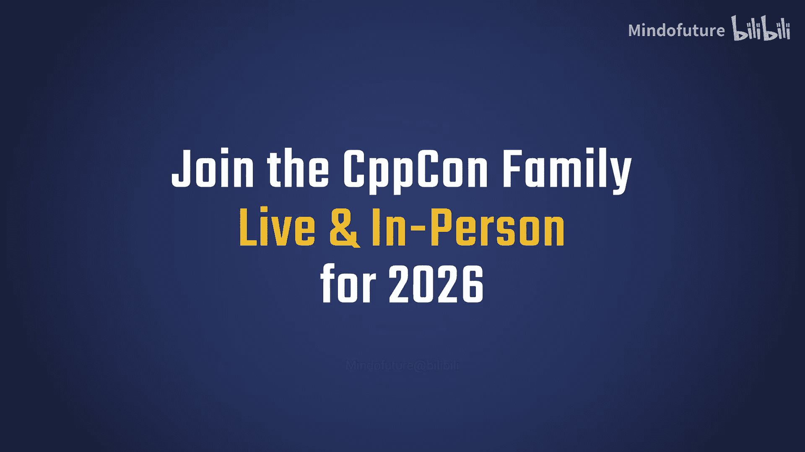
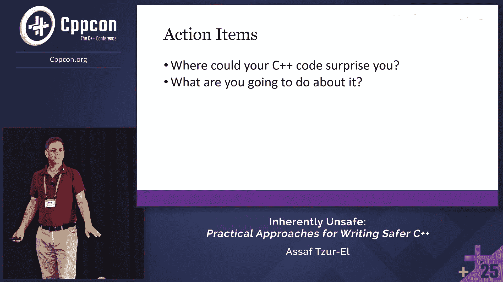
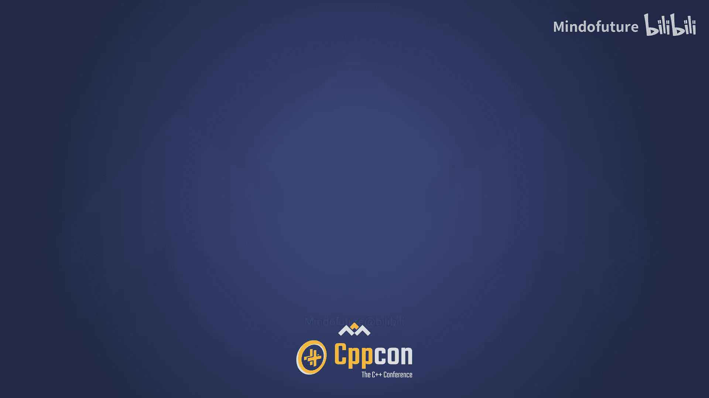

# Cppcon-2025-｜-C++-｜-C语言--｜-汇编-｜-编译器-｜-操作系统-｜-Linux-｜-Windows-p68-P68_C++的危险_如何缓解并编写安全的C++-Assaf_Tzur-El--BV1wyPBzrEeu_p68-

You can't beat the in person interactions， the lunches， the dinners。

 the quality of the people that you meet over coffee here is just phenomenal。

Yeah， C++ is inherently unsafe。 And you see， it's not me saying that that's Gu Toto， right。

 the father of C++。😊，And he's right because C is terrible because you can， I don't know。

 assign to a con。And what's going to happen here？You'll get a warning， which you will ignore。

 of course。 And well， not not you， not you people。 You are， I've been told。

 experienced expert developers， but there are other developers， and they tend to ignore warnings。

And C++ is safer because this code will yield。A compilation error。You can't from that。Way to go， C++。

Or are you talking about the same language that came up with Conscast？And this code。

One generate a compilation error， not even a warning， this is okay code。

So just let me get it straight。 Spo fls came out with this concast mechanism in order to circumvent the safety mechanism that it just did。

To make sea safer。Right。Okay， conclusion， don't do C plus plus。 Learn rust， vibe coding。 Yeah。

 that's a viable option。 Thank you for attending my talk。 Have a great rest of the day。

 Thank you very much。😊，You're not leaving。Okay， so you know what。Since you were here， I guess。

You do have to deal with C+ plus， occasionally， at least。

Whether you like it or not or love to hate it， or I don't judge。So。Let me help you。You know， avoid。

Shooting yourself in the foot or stepping on a landb that will blow your whole leg off。

And let's start with mapping the the kind of minds that we're talking about。

So let's talk about the dangers。Of C plus plus。嗯。I see it as two groups of dangers。

 and the first one is safety。 Okay， C++ is unsafe。 It has memory safety issues， right？

And other safety issues which we will discuss， and that's pretty scary。

But that's only half the story。Because it's also very， very unpredictable。

And unpredictability is baked into the standard。Okay， and that's。Sheer terror。

So let's relax a little bit and start with the scary， okay？Let's start with safety。

 And I want to show you， I'm warning you in advance。 I want to show you an example。

And it's going to be scary， as promised。So I do hope no one here has any heart conditions or blood pressure issues or stuff because ready set。

Boo。Okay， this seems innocent enough until you realize that the pattern behind this is also behind some of the most exploitable bugs in software history。

And of course， I'm talking about altogether now， buffer， overflow， yes， okay， so you know this。😊。

And this is what I'm talking about。 Okay， not just bugs because you can write bugs in any kind of language。

But this kind of bugs。These real serious things are special for C plus plus。 And yes， see。

 it's predecessor。 But we're talking about CPP here today。😊，And in this lecture。

 I'm going to talk about safety and security more or less interchangeably。

 There are quite a few definitions of safe and secure。

 and some of them collide and some of them overlap。 And I'm not going to go into that。

 So safety security for our intents and purposes。 Same thing， okay。😊，🤧Okay， so。Let's。

Let's see the landmines。So we have lifetime safety issues。

 We need to remember to initialize stuff in the construct。 Oh。

 and don't forget to den initialialize them to delete them in the deor。 right， Oh。

 did you make your deor virtual。Very important。Dangling pointers。

 these all these things about a lifetime accessing an object after deleting it， fun stuff， right？

Then we have bound safety， you can access an array at index minus1。

 you can access a vector at size plus 2000。😊，Then we have type safety。Casting。All these things。

 type checking， fun stuff。And that's pretty unique to CNncCPP。And on top of that， and actually。

 we have more。 Yeah， we， we have exception safety and so many others。 I can just， you know。

 extend here old day。 But I just took a few of them。 And on top of that， we have。😊，You know。

 the usual suspect， thread safety。Okay， all these race conditions and gridlocks and whatnot。

 and we have runtime on top of it all because， you know， no matter how many unit tests you wrote。

 many， no matter how many code reviews you did， you know。

 no plan can withstand the rigors of the runtime。And the fun stuff is that you can mix and match them。

😊，U。Lifetime safety and race safety。 I can access an object in one thread while deleting it in the other。

 Fun。 Okay， and again， you can do your own mixing and matching and have fun doing that。😊，うん。

But that's half the story， as I said， because Cpl class is also very unpredictable。

 And when I'm talking about unpredictability， you probably know that as you be undefined behavior。

But undefinified behavior is only part of the story。 So that's the whole story。So yes。

 we do have undefined behavior。And undefined behavior is where the standard itself says。

Anything goes。Classic example。Division by zero。 if the deummerator happens to be zero。

 then the result can be zero or intimatet。Or five on Fridays and format your hard drive whenever it feels like it。

 And this is okay。 This is fine。😊，I do hope you're not using this disastrous programming language。

That's not all because we also have unspecified behavior。This is a bit trickier。

 So I'll start with the example right away。 So assuming we have a function F receives parameters， X。

 Y， and Z。 But instead of sending1，2 and 3， we call functions A， B and C。

 take their return values and pass them as arguments， okay。So the standard does say that A。

 B and C will be called and the return value of a will be passed as x， et cetera， et ceter。

 but in which order。Will we call A then B， then C， or will it be C， then B， then A？Well。

 according to the standard。Anything goes， so any of the six permutations is fine。

And this is not even the bad stuff， because if you call F twice， the order might change。Fun。

Had enough yet。Because I'm not done yet。 We have implementation defined behavior。

 which is behavior that is defined。But not by the standard。By the implementation， the compiler。

 for example， size off。😊，What's the size of long in your whatever you're doing right now， Always8。

Do I hear another number 4。4，4 going once， going twice。 you got out here 16。 So yeah。

 it feels like a bazaar because according to the standard， almost anything goes。But the compiler。

 at least the documentation， should tell you what the size of long is and it should be consistent。

 so as long as you're staying with the same compiler on the same operating system using the same business on the same CPU。

 you'll get the same result from size of long。So that's implementation defined behavior。And sadly。

 we have more。We have conditionally supported behavior， which is behavior that is supported。

Conditionally， if the compiler feels like it。Example。Pragma。

Pragma this might be supported by one compiler， but not supported by。other。

And we have locale specific behavior。 that's about text and languages and all that。

 And as a Hebrew speaker whose language is both extended ASI and right to left。

 I can stand here all day and just talk about that， so maybe I better not。And in CPP 23。

 we have erroneous behavior。Which is somehow linked to undefined behavior so we're back to square one。

 and on top of that we have all these convoluted wordings like invalidated pointers or invalidated iterators。

What's invalidated iterator？Okay， if you would have invested an hour digging through the manual like me through the standard。

 you would have known that it's actually undefined behavior。 So again， back to square 1。唉。So， yeah。

 CPP is complex， unpredictable。And unsafe。But today I'm here。As a bearer of good news。

There is an answer to all these problems。 Oh， wait， there is something I forgot to tell you。Okay。

 every thought must have a bug， I hope this is the bug of this talk。

 So instead of bashing C++ all the time， I want to say something in favor of it。And do that。

 And it's not C fast's fault。This is all Dennis Ritchie， that's seasefold。Because。

Because C had all these unpredictbilities in the standard and C plus plus just。😊，Inherited it。Okay？呃。

But。I do have to say something nice about C。 And that is that at the end of the standard。

 after having all these。Star behaviors， weird behaviors all over the place。

 At least it has this appendix， this annex with a concentrated list of all the unsupported behaviors with。

 you know， the the pages where they were mentioned。 and then a list of all the undefined behaviors。

 etc cetera， etc ce。 And S plus doesn't have that for some reason。

 And I've been told actually yesterday that。うん。They are going to bring it back in CPP 26。

 So we have something to hope for， at least that。So again， C+ plus is。Complex， unpredictable， unsafe。

 But as I said， there is an answer。It's a simple one。And you're not going to like it。

Because the answer it。Well， sadly， it's not 42， sorry。The answer is。Migrate。Move away， change。

Switch to another language。And it's not me saying that it's all these acronyms。

 and I'm not good with acrom， so I'm going to read them from here。

The CISA is the Cyberse and Infstructure Security Agency。 That's two securities in one acronym。 Wow。

 NSA is， of course， the National Security Agency That's the spooks。

 ONCD is the White House Office of the National Cyber director。 If you've been keeping count。

 we have two Cys and three Securities in one line of acronyms。😊，And。

This is basically the US government。 And there are more acronyms like that who are all keep telling us。

Forcing us， begging us。2。Switch to migrate away from C++。

They started by telling us to stop using CC++ for mission critical and safety related applications right away。

 that was 2022。2023， they said， well， by 2025， you must not run any CPP code in any of these applications。

 By 2024， they got to the census and said， well， please at least by 2030。

 please have a plan to migrate away。And this is worrying， I mean， as a CA Fl developer。

My job is at stake， right？And again， I'm the bearer of good news， don't worry。Not going to happen。

It's just not practical。Think of all the code。 I mean。

 talk to me after you finished moving the whole of Linux away from C。

And then we'll talk about three windows， of course。And then we'll talk about so much code。

 It will take decades upon decades to change everything。And that's not all， okay。

 because there's also the ecosystem， so many tools supporting this that you'll have to change so many libraries。

😊，And you know what else is part of the ecosystem？You people。You are experienced C+ developers。

You're not going to become something else， developers， you know， just like that overnight， right。

 So this will take lots of investment。And then there's requirements because if the requirements call for real time performance。

 then of course， we can't use memory managed languages such as Java and C sharpharp。

And if we need efficiency because we're very low on RA or CPU。

 then certainly we can't use JavaScript or Python， and if we need low level support。

 then Ru won't cut it。And I won't go into go。So as we can see， there， there is no real alternative。

Okay， there is no language that。Supports everything that C++ can do。And be safe。And be predictable。

So there's just no alternative， the only alternative to C plus plus is C。

 the only alternative to C is assembly， and I'm not even going to finish that sentence。😊，Okay。

 so this is definitely not the answer。So what is？Well， if there is no magic solution。

 then it must be hard work。And we can have a solution or solutions that can mitigate these problems。

And we'll start with standardization。And for example， C++。

 C++ is a safer version of C in the standard， instead of one almighty cast， we have five， four。

 sorry， weaker ones。Instead of using raw pointers， we now have smart pointers， et cetera， et cetera。

 So C plus plus is。Safer。And on top of that， there are initiatives such as Sean Baxter's Safe C++。

 anyone heard of it？SafetyPP do org， Inter read。Go and read it。

 he suggests and other initiatives like that suggest to add security mechanisms into the language。

 keywords and other things。And there is support also from big buddies like the International Standard organization。

 so for example， IO26262， that's how I remember it， nicknamed Fua。

 functionalal safety in road vehicles， so he talks about functional safety in road vehicles。

 from all kinds of aspects， physical， mechanical， E and electronic and yes， software。

But the problem with this standard is that it deals more with the process， stuff like， you know。

 all the requirements must be fully documented， stuff like， and I have to read that to you。

Verify that the software architectural design is suitable to satisfy the software safety requirements。

Whatever that means。Okay， so so that's。To， to high level for me。 I need something。Practical。

And there are。There are， you know， OS， top 10。Again， look it up。

10 areas of security concerns and how to mitigate them。 So you might。

 I don't know what you're dealing with， so you might not need to deal with authorization and authentication。

 but almost everyone needs logging and monitoring。So these are two of the top 10。

But the all step 10 is geared more towards web apps， front end， backend。

 less about what CL plus is doing these days。And it's not language specific。

 it tries to be language neutral， I mean， front end， how many languages it got there？So not O ep。

So we have all kinds of ways of thinking， we have defensive programming ever heard of it。

This is about stuff like design for the worst， plan for the worst， trust no one。

check all the arguments coming in， expect the worst， all these things。

 and it's considered a bit of a paranoid approach， but you know the fact two are paranoid doesn't mean that the runtime is not out there to get you。

So it does have its place。 and you should keep it in the back of your head and and use it while programming。

 This， this is a good。Thing to， to remember。But again， that's， that's not enough。

Something a little lower level。 and there is， there is the secure by design initiative。

 or may I call it secures by designs initiatives because there are several with the same name。

One of them is by all these acronyms that we saw earlier， the US government。

 so they have the secure by design， the own version of this initiative。

 and it's basically design your software to be secure from ground up from the design phase。

And Google has its own secure by design。 Look it up as well。 pretty interesting。

 And it also resides in other frameworks like Microsoft， SDDL， security development lifecycle。

 So it doesn't have the name， but。😊，The， the ideas are， are still there。And。

It's still to higher level because I can let people read that all day。 But at the end of the day。

 they have to write reliable， safe， predictable， softwareer。 I need something。😊，In Hebrew。

 we say Taless。Boots on the ground， like， you know， get down to business。 It's， it's。Yeah。

 enforcement。Yeah， I need to enforce this。 I need to make people write good code。

And I suggest here a two pronged attack， a scissor maneuver， one too punch。

So we'll start with a set of rules， guidelines， dos and don'ts， never use raw pointers。

 always use smart pointers， for example。And we do have these sets of rules because smart people compiled these sets of rules multiple times。

 actually， there is the JSF CEA plus coding standard developed for the JSF would。

Came to be the F 35 jet fighter。There are the SplF core guidelines。

There is a csac and autosar and Mira and quite a few more。 So we're covered on this front。

And on the other side， we need to enforce these rules。So we need tools。And luckily。

 we already have them because static analysis tools is what we need。

 We need to make sure that people are not using raw pointers so static analysis tool can take care of that for us。

 right？So。Today I'm going to focus on Mira， that's one of the rule sets， the guidelines。

And I'm going to use it because a， it's pretty popular。

I'm not going to run a popularity contest here， but it's pretty popular。

 And it merged with Autosar like two years ago。 So it's a bit more popular now， I guess。

And also it's geared toward regulated industries。Cars and stuff like that。 So it's like cutting edge。

 Okay， hardcore。 So this is what I'm going focus on。And without further ado。

 let me introduce you to the Motor Industtry Soft Reliability Association。

 and I'm sorry about my terribleri Israeli accent， this was supposed to be in the British accent because this is a British establishment。

😊，I see I need to translate that motor industry in British English is an American English automotive industry For the rest of you。

 that's car manufacturers Okay， so factories making cars good。

 So the motor industry of the UK gathered with academia and they came up with this set of guidelines called Mi。

 they started with mistrus C in 2004 added C plus+ in 2008。

 and they've been going at it ever since then。😊，And initially， it was for the car industry。

And then the aerospace industry took note and started using it and then medical and then all kinds of other industries。

 So now it's pretty widespread。 And now they also have other members outside the UK So for example。

 BMW is also a member of M Ra now， that's a German car manufacturer。

So let's take a look at the latest and greatest of Bi C plus plus。 That's the 2023 edition。 Yes。

 I know it's two years old。 Yes， and it covers C plus plus 17。 And yes， I know it's。😊。

A bit outdated for you cutting edge people。But。How many companies are really using CPP 23 in production？

From my experience， not many。And。On the other hand， sadly。

 I know too many organizations who are still contemplating the move to this new and。

scaryary thing called CPP 11。😰，So C plus 17 is fine。 It's okay。And it contains 179 guidelines。😊。

I don't know if you think about it as a lot or not， but I'll give you some proportion。

 the standard is around the CL class standard is around 2，000 pages long。Okay。

 so this is just 179 guidelines， I think。I'd go with that。So do you want to see it。

 Do you want to see a real guideline live， Okay， I caught one and brought it here for you today。

 Here we go。😊，So how exciting our first guideline， rule 96，1， the go to statement should not be used。

And。It feels to me that this has been forever like this。It's as if I don't know。

 my kindergarten teacher told us kids never use go to。

 you feel like that sometimes yeah so it does make sense， right。

 I don't need to explain why it's necessary okay so I want to point out some of the peripherals。

 some of the things around it to show you how much thought was put into this。So first of all。

 I talked about guidelines and this is a rule。So there are rules and there are directives。

 and I won't go into that， but just so you won't be confused， okay？Everything is。

 There are 179 guidelines。 Most of them are rules。 Some of them are directives。

That doesn't matter exactly right now。What does matter is category。

Because we have mandatory required an advisory。And if a rule or a guideline is mandatory， well。

 that's pretty much safe， explanatory， right， this is the law， that's it。

 Nothing you can do about that。 you have to obey。 And if it's advisory。

 then this is the best practice and it's your funeral。And mandate required， sorry。

 required is the interesting thing， because when you have a rule that is required。

 you must either comply。Or formally document any deviation and violation。Which means， for example。

 that I have my piece of code that I'm in love with because developers tend to be in love with their code and they don't want to change it。

But this code violates some guideline。I can keep it。I just need to formally。Thank you。

I have to formally document。What I did， why I did it， What's the alternative。

 what's wrong with my code and why I chose。To deviate from the guideline。Oh。

 and then I need to get my supervisor approval。And probably an official audit if I'm in a regulated industry。

Or or I could， I just could maybe just saying， I could change my code and fix it and make it better。

My choice。Okay， more down to Earth example。I'm using a C library which returns a row pointer。

 and row pointers are a big no， no， right so。But I have to use it because I'm using that it's in C。

 What can I do， And I'm using it 10 times。 So I have to document the deviation 10 times。

 And I have a good reason for using it。So I have to write。The excuse is my justification10 times。Or。

I could write a wrapper function that calls this。C code。Ws it in some smart pointer。

 and then my 1 functions will call this safe version。And then I only have to document one deviation。

My choice。So this is very smart， I think。Knowing developers。Worldwide。Okay。

 another thing I wanted to point out is decideidability。

And this thing makes our life easier because guidelines can be either decideable or undecidable。

 and decideable guidelines means that。For this rule， we can actually ask a static analysis tool。

 does this code comply with this rule。😊，So I don't have to worry about this。 Okay。

 this is all automatically done for me by an automatic tool。 Okay， so I love decable guidelines。😊。

Okay， we have some more of these。We have a single translation unit and we have rationale there explaining why。

 and there are code samples and everything， everything comes with a nice package that tells us why this rule is there and how it should be used。

Okay， that's why an another。Okay， here you go。 Rule 9，4，2。

 the structure of a switch statement shall be appropriate。

And you can see that it's a rule and it's required。

 which means I either comply or document any deviation。And it's decable why。

 because a static analysis tool can find switch statements and make sure that they are。😊，Appropriate。

Well， they wear a tie。Well， of course not。Because there is also an amplification which explains what appropriate means in this context and in this context。

 a switch statement is structured appropriately when it conforms to the following restrictions and then there is a list of restrictions。

 for example， the last one is every switch statement shall have a default label。😊，And of course。

 static analysis tools can detect a switch statement and make sure that it does contain a default label。

 that's easy for them for these tools right， so I don't have to do that。

And it also makes sense because if I forgot some case。

 I don't want my code to fall through to the rest of my code。

 I want it to be stopped by a default statement that will log it or throw an exception or handle it some way somehow。

So again， this is very smart。But something is wrong here。Oh， I know what's wrong here。

Do you see what's wrong here？No， oh， yeah。 because you don't know the very first rule， Rule 0，0，1。

 A function shall not contain unreachable statements。Now our thing is clear。Do you see the。

 the contradiction between the rules。This contradiction even has a name in them。

Because let's say I have an enumeration， okay so I do a switch on it naturally。

 so I have a case this， case that， and that's all I have。😊。

So the last rule forced me to add a default statement。Which will never be reached。

 But this rule says that a function should not contain unreachable statements。So what do I do now？

What do I do now， Mi Ra。Well， again。There is an amplification for that。Okay。

 a statement is unreachable in this context。 If the block containing it is not reachable from the entry block of the C G of the function。

Bottom line。We're not talking about logical unreachability， like in the default label。

 We're talking about stuff like writing statements after return。 Okay。

 this one will definitely won't be reached。Okay， so it's not really a collision。

 They really thought it out。🤧So。There are more contradictions， There are overlaps all over the place。

 but each one comes with its own very good reason， As you just saw。

 I just showed you the tip of the iceberg。And you can see that lots of thought have been put into this。

From people who know the language， but also know how developer think and and work。And。

I might sound like， you know， a fanboyer or something， but I don't work for Mi Ra。

 I don't know anyone who works for Mi Ra， not in real life， at least。 I don't know。

 I don't have stock options。 I don't know if they have stock option。

 I'm not related in any way to them。 Okay， I'm just a happy customer。 Well， happy。 Yeah， this。

 this is a regulation thing。 So I don't know if happy applies here。🤧嗯。Okay， so this is about rules。

 Let's talk about tools。And because。Having like a 250 pages。

 more or less guide book is useless if I have to memorize it。But fortunately， as I said。

 most of the rules。😊，Are decable， meaning that they can be handled by static analysis tools。 In fact。

90% of them are。So I can leave 90% of the guidelines to the aesthetic analysis tools。

 and now when I'm doing a code review， I only have to deal with like 10% of the guidelines。

 which is much better。Much easier on me and if you've been using clockwork， Cavariity。

 sonar and others， okay you already have rule sets that you can configure to comply with Mron so for example。

😊，This is sonar。Finding the， the go to room。 Okay， and you can see in the bottom right that it's using the Mira rule set。

And another example from Soar， this time， this is the unreachable statement。Getting caught。 Okay。

 and again， bottom right， you can see that it's using the Mira rule set。🤧。

I've been using and concentrating and focusing on Mira until now。

 but I do want to tell you that there are alternatives。

 okay there are other paths in the C++ world and for example。

 Bianna himself took a different route and he formed the C++ core guidelines。

And they are more lightweight。Okay where Mitra is geared toward highly regulated industries。

 so here you have guidelines that sometimes are more fuzzy。

 stuff like minimize usage of break and continue statement， you know within loops。

 minimize whatever that means。So it tends to be a bit more fuzzy。

 but there are things that can be tracked by static analysis tools。And。It's。

It tries to give you best practices， It tries to give you more control and more responsibility as a developer on what you choose to use and what you choose to ignore。

 and it has these profiles and profiles are like sets of rules。That you can mix and match。

 so if you're working in the automotive industry， for example you'll probably use different profiles than when you're working in the gaming industry。

 which is different from the I don't know， finance because your needs are different and your focus is different。

And it's trying to balance safety and performance。That' that's the goal。

 And I'm not going to dive into that。But I did prepare。This table for you。 So where Mr。

 Cpl plus is strict， it's like， you know， you can't use half the language or thats how it feels like sometimes。

And it's focused on mission critical， safety， critical applications。

 and it forbids right out forbids unsafe features， and it's all about compliance and audits because it's regulated industries。

And S fast score guidelines is more lightweight， it's more flexible。

 It has these profiles that you can mix and match， and you can。😊，You have your own responsibility。

 It's more。 It discourages unsafe use。 It doesn't force it。 Okay， It's also mostly tool enforced。

And while Mi C++ is a bit heavy， it's conservative， it's easy to evolve。

 we saw that the latest is from 2023 and it covers C++ 17。While the core guidelines。

 you can see them on GitHub under the EO CPP organization， and they constantly evolve， okay。

 there are always commits and PRs and marriages， okay so it's alive。So it's right now。

 it's dealing with CPP 23。And hopefully， soon。With 26。🤧嗯。So。😊，Still。Mstra on one side of。

 of the guidelines and core guidelines on the other。Still， give me。This headache。

 because now its I need to be not only。A language lawyer。 You know what a language lawyer is。

An language lawyer is when you need in order to be a good developer or in Splfa in order to be a developer at all。

 you must know the standard inside out， like just like a lawyer knows the law right so you must know the standard inside out。

 all the details， all the tiny intricacies， everything in order to be a good programmer。

So in this case， I not only have to be a language lawyer。

Now I also have to be a ministry advocate or a core guidelines advocate I mean， why would I do that？

And this will supposed to be the why。This was supposed to wrap it up and hand it over to you because our goal is not to write more and more and more code and faster。

 but to deliver working software， even if it's slower。

 but to do it safer and more reliably and then we'll have higher quality and safety and portability and everything there is true。

But I don't want to talk about that。Because。I， I keep hearing your thoughts。 You some of you。

 at least， you're thinking very loudly。And these were my thoughts， so I empathize。

 maybe that's why I hear those thoughts。And these thoughts are something along the lines of great。

 another rule book to limit my creativity， because I'm a developer。 I'm a free spirit。 I'm creative。

 This is， I express myself through my code。 and now you。😊，Forced me to use this code and not that。

And that feels limiting。But I want you to think about it differently。

I want you to think of it not as a restriction， but something that promotes predictability。Because。

🤧嗯。Excuse me。🤧Thank you。Because by removing the dark corners of the language。

 we get to have code that is easier to reason about， to maintain， to handle， to verify。

And this is why we need those guidelines。So yep， I said it once and I'll say it again。

 C++ is inherently unsafe。😊，It has lots of buried landmines in the form of unpredictability and safety issues。

😊，And while there is no alternative。There are ways to mitigate the problems。

And adopting coding practices is the key， and specifically guidelines like the Mi C++ guidelines that we saw will help both you and your code be safer。

And more predictable。My name is Assaaf Suwell。In the last 30 years。

 I've been programming and architecting and C Owing。 is that a verb， I guess now it is。

And what I really love to do is help。To share all that experience and battle scars from these 30 years with people and organizations。

 So they don't， they won't have to make the same mistake that I did。And I hope I helped you today to。

 you know。Keep your limbs intact， avoid treating yourself on the foot or step on a landmine。

Thank you。Oh， one more thing before。The questions。I've been told that there is a law now that you have to talk about AI。

So I'm going to talk about AI， but。A different AI。I want to give you some homework， okay？

So you don't have to answer to me， just。Think about it。And with that。

 I'll take questions if you have any。Nothing。

Okay， cool， yeah。So。Mike。三 my。嗯。😊，Mira， probably。Frebvents us from using new。Which。Its a good thing。

 I guess。And it will be caught by static analysis tools。 I guess。 So I just want you to confirm。

 then they will allow me to use placement new。I don't remember the whole thing by heart。But yeah。

 it's， it's geared toward。 you know， all cars and stuff and embedded and in embedded。

 you usually use a placement you。 So I guess they will probably my bet is that it will be required。

 So you'll have to document each and every one。 So you'll minimize your usage of。News。

 even if it's a placement。Hi， I'm wondering whether M。 Ferso gives。

Advice about compiler flags to be used。Because for instance in your switch statement。

The compiler can catch， if you don't。It's a check， specific。And so actually。

 by adding the default statement to me， it's kind of dangerous because if you add a new value into the ams。

Then the code is just gonna I it。 And then， yeah， just。可能。

Just ignore not see something that the converted have seen if you didn't have it before statement。

 Okay， so。You did something dangerous because one thing I love to talk about is OCP。

 the open closed principle， and the example of OCP violation is using inums with switch when the inum is not closed。

Because if you have an inum that you intend to add to， don't use inum。

 because then what happens is Inham always goes with switch， right？

 So what happens is you add in value to inum and now you have to go over all your switches and fix them。

That's a violation of OCP。Okay， so let's think of it another way。

And I have whole lectures just about that。

Okay， more questions。That's it， okay， thank you。

