# Cppcon-2025-｜-C++-｜-C语言--｜-汇编-｜-编译器-｜-操作系统-｜-Linux-｜-Windows-p69-P69_你的C++代码在泄漏内存吗？发现所有权感知性能分析的威力--BV1wyPBzrEeu_p69-

Welcome to my presentation， it's really nice to be here。This presentation is called。

 where' did all that Ram go。

Measuring objects with ownership aware， memory profiling and C++。So for a bit， a brief introduction。

My name is Eto。I'm a senior software engineer at Vollo dynamicss。I wrote a memory profiler。

 it's called Mem Profile。And I would like to comment that this is a personal project。

 I've been working on it in my spare time。 and that's the Github link。😊。

So what this presentation will cover。This presentation will cover why we care about profiling。

What Mem profile supports and how all of this works。

 This here is a screenshot of some of the output of Mem profile。 You pass in。 well。

 the profiler has a few stages。 You profile executable。

 It generates file containing all of all of the statistics。

 and then you can analyze that file in a whole bunch of different ways。

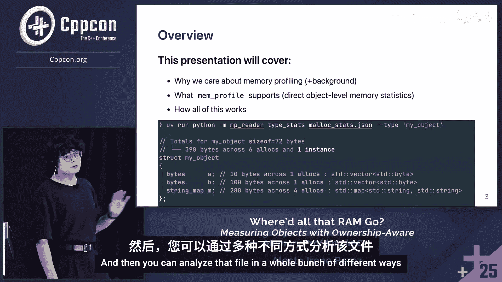

So。To start it off， why do we care about memory profiling。Memory on a system is a finite resource。

 Sap is sometimes available， but it is ordersism magnitude slower than Ram。

 and out of memory is often an unrecoverable。 Like， you can do things。 You can。😊。

Design data structures such that like， if you trigger them。

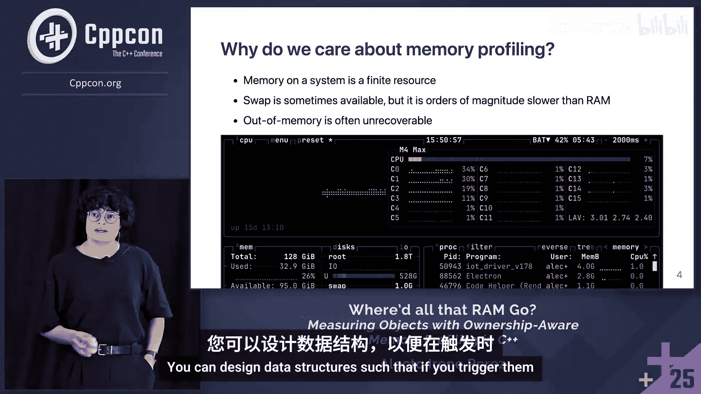

They will， They will like free available resources。 but this is very difficult。

 This isn't always like as reliable as you would like。

 And sometimes you just don't have any more memory。Again， you can buy more Ram。 you can do that。

 You can， you can get bigger computers。 You can get servers in the cloud that have more memory available。

 But this is often expensive。 And if you're shipping to clients， like if you're shipping a browser。

 like clients are gonna be unhappy when the browser consumes a whole bunch of memory and you can't。

 you can't buy more memory for them。 you need to be able。 well。😊。

So you want to be able to optimize things。 You need， you want to be able to optimize it。

 but you need。To measure what you optimize， like， you need to measure how much you' use member you're using before。

 how much member you're using after。 And you can't go into this blind。

You need to be able to identify what's actually using memory within the program。

So I'm gonna to give a brief rundown of like。The current。

 the current existing tools for like measuring memory usage。 there's a lot of tools out there。

 many of them very good tools。 I'm gonna to discuss three today just so that the talk doesn't go on too long。

 I'm going to like I'm， I'm happy to answer questions at the end of the talk。 If。

 if you want to ask about something more specific。😊。

So the simplest way to measure memory usage is with utility like time。

And this actually makes it very simple。Here we have an example program， we have a map。

We fill up the map。

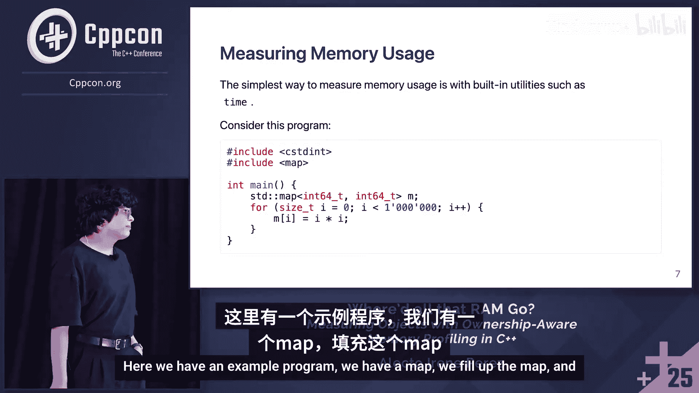

And we're just going use time to measure the memory usage。So the built in shell。 Well。

 the shell built in usually cannot do this。 However， many operating systems have a time executable。

 and this time executable does have this capacity on Mac O。

 You can use the dash L flag to get the peak memory footprint on Linux。

 This is typically dash V usually this is something that comes with the E。

 but sometimes like you'll need to install it arch is one distribution for which you'll need to install it。

 But yeah， this provides maximum resonance set size。 It provides peak memory usage。

 it provides a lot of very useful things。

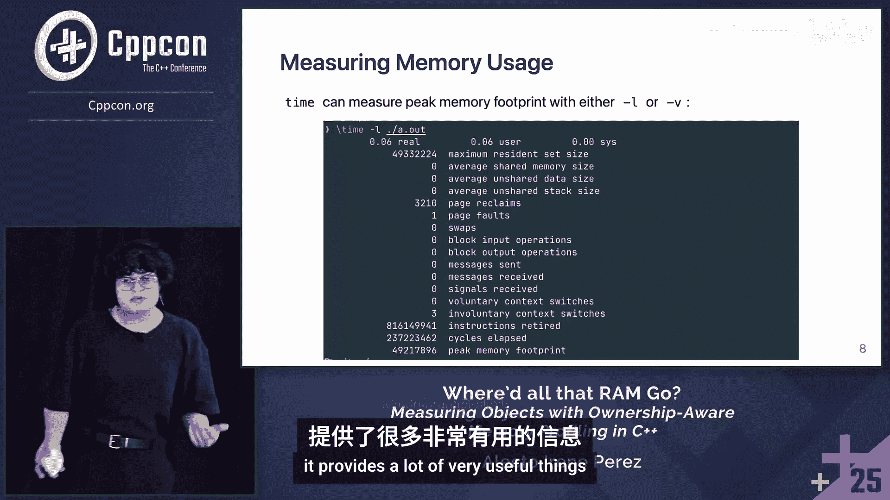

So the pros。It's quick， it's easy。 and you get one number， peak memory footprint。The cons， though。

 you don't get any visibility into what was using memory。 And， and you only get one number。

 You only get the peak memory usage。 It's， it's like a benchmark where you can run the benchmark。

 And you know how long it takes， but you don't actually know what was taking time。

There's another tool。 Valgrind。 Valgrind in general。

 is like incredibly powerful and incredibly useful。

 If you want to do something like figure out where memory leak is occurring。

 Val grindin is the tool to do it。😊，Valgrand Masif can actually like measure memory usage over time。

 So you can， you can see。How much memory the programme was using at different times when it was delocating memory。

 and， and it it prints a nice ASI graph。Finally， I'm gonna cover Kitty Heap track briefly。

 This one is， is more modern。 It's more advanced。 It takes stack traces every time an allocation occurs。

 So you can see where they occur。 and you can use this to make a flag graph of memory allocations。😊。

This image here。Is an image taken from their Github。

Anyone who is familiar with flame graphs will probably know how to read it。

 But to give a brief explanation， the length of the bar on the horizontal axis is how much memory was consumed。

 And then the height of the bar is basically the stack。

 So you can see here that a whole bunch of memory was allocated in Q data array allocate。

 And this happened in a chain of calls that that was initially like started back when back when somebody spawned the thread。

😊，Now。Seeing where memory allocations occur is very useful。

But this doesn't tell you what is holding on to that memory。

 It doesn't tell you why the memory wasn't freed or took a while to get freed。

And this is why I'm writing into the profiler。We write code in terms of data structures。

 in terms of objects， in terms of containers， We write code that deals with ownership semantics。

 Our profiler needs to reflect this。 We need to be able to figure out who jobless consuming memory。

 Why memory isn't released。And what members or subobs are using that memory。

Objects can get pretty complicated。 So like simply being able to say this type is using that much memory。

 it's very useful， but I want to be able to take this a step further。

And mem profile can answer these questions。Finally。

 I would like to remark that we resolve the limitations of similar efforts。

Men profile is not the first object to wear a profiler， but it is my hope that it is。Very useful。

 It's very generic。 It's very capable。 We can profile， use defined containers。 We can profile like。

 we can handle template specialization。 We can handle virtual inheritance。

 You can resolve at runtime， which object is actually being allocated there。

 We handle C style unions and also sub objectsject allocated with placement new。

 So if you have some stack vector。 You have a vector that like puts objects on the stack。

 you can see what was placed within the。😊，Within that stack allocated buffer。

It handles sea style unions。Yeah， it does the works。I'm。

 I'm going follow up with a couple examples of， of the profiler。

Here's a very simple object to start off with。 You have some vectors of bytes。 You have a map。

You create the object， that's your program。

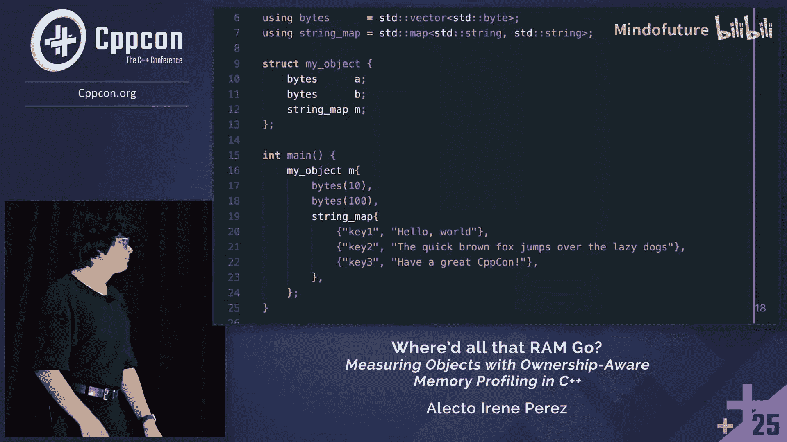

This is the output of the profiler。😡，We can see that there were three members， A， B and M。

 We can see exactly how much memory each one used。 We can see how many allocations occurred。

 and we can see how many objects were created。 In this case， we have one。

 one object of one instance of my object。 And yeah， this is how it used its memory。😊，upp there。

 you will see that we are running the analyzer。 We are filtering the output for types matching my object。

 And yeah， there's only one in the and one in the program that matches it。😊。

If you had a unique pointer of my object， this would also show up with the filter。

 But the capabilities of the filter are like very general。 You can put a reix there， you can。

You can have an exact match。 There are options to control， like， how the filter operates。

Additionally， and this is generally like pretty useful for thebuging purposes。

 You can see the offsets into the object where this memory was， where this memory was discovered。

 So you can see that the first， the first set of bytes was discovered at offset 0。

 and it took up 0 to 24。 The second one from 24 to 48。 and the third one from 48 to 72。

 all of them happened to be 24 bys。😊，This is another example。

 We are going to measure the memory usage of a lambda。Unlike astruct。

 a lambda does not actually have named fields， but Kang still records what the types are。

And we can see that the first field allocated 10 bys， well， owned 10 bys。

 The second field owned 400 Btes because you have 100 floats that are4 bytes each。

 and the last field owned 8000 bys across one allocation because you had 1000 doubles。

This is another example this is an example where you have a C style array inside a class。

You construct it and you profile it。You see here that the first element of this array own 10 bytes。

 the second element owned 100 Btes， the third element own 1000 bytes， because we have the offsets。

 and because we know the size of the object， we are able to determine the index。

 And it doesn't just have to be a C style array。 This also works for for stack like it also works for buffers that are in line in the object。

 This is the next example。 Actually， We have vector that allocates in line with some buffer。

 This is a toy implementation but its it's meant to illustrate it。

 The key things here are that it performs at the allocation correctly。

And we have some pushback function， which allows us to add in all of these members。

 When we run it through the profiler， we can see how much memory each index used。😊。

You will notice here that index 3 is missing。Index 3 is missing because no memory was。

 no memory was allocated there。Finally， I'm going take a non toy implementation。

 This is going to be anchor。This one， the same thing you you add in you add in some bytes。

 This implementation actually uses an array of an array of U and date under the hood。

 This one is a little peculiar because they store， the capacity is the first member。

 but it's implicit like instead of having a named capacity member。

 you just everything is in this in this data object， but the profile is still handles this。

 It sees that there was a standard vector of byte that was destroyed8 bytes into the M data object。

 another one， 32 bytes in and another one 56 bytes in because these aren't a multiple of the size of standard vector。

 That's why it wasn't that's why it didn't show the indices。A canonical example。

 so you have standard vector of some values。You can see here that there were two vectors created over the program。

 two types containing standard vector that appeared in the trace。

 you have one that was your vector of bytes and well。

 vector of the container vector of bytes and another one that was just a vector of bytes。One of them。

Did not have any like allocating children。 One of them just allocated the memory directly。

 The other one did have allocating children。 So the one without allocating children。

 you see 2200 bys allocated across six allocations。Does anyone。

 can anyone tell me why there are six allocations instead of  three。

The reason there are six allocations instead of three is because we use an initializerr list here。

 so it constructs all of those bytes objects， and then it makes a copy of all of those bytes objects。

The value is object。Only owns 1110 Bs indirectly and 72 by directly。

 The 72 B was the space to put these three values。 And then the indirect ones were the ones that were actually owned by the members of the。

 the vector。Allright。 So yeah， this， this gives an overview of what the profile can do。

 All of these are toy examples so far， but I'm going to show some very non toy examples later in the presentation。

😊。

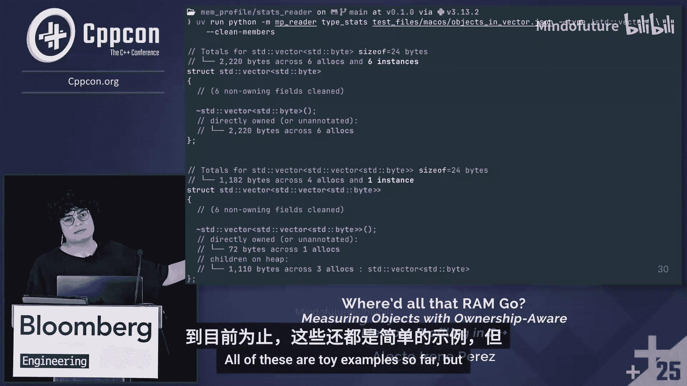

Next。How do we go about doing this， How do we go about measuring an object。

 There are a lot of complexities here， particularly surrounding things like shared ownership。

 where we want to make sure we're not double counting memory。Here's a very simple example。

You have an object that contains a shared pointer。 You allocate some number of bytes in the shared pointer。

 This object is going to be a million bytes in size。

 It's actually going to be a million and 32 bytes because the shared pointer has a frame that it uses to store some additional information。

 So it does two allocations instead of one。 But we're just going to go with a million bytes for now。

So yeah， this object A is 16 B，8 do data holds a million B。 And then there's， of course， the 32。

32 by pointer on the side that that was not included in these totals because I just。

 I just typed them up and put them there。 The profiler actually does。

 does observe both the million bytes and the。And the frame that actually handles all the metadata。

So let's say we had some measure he object。 Like， let's say that someone wrote a magic function using reflection or something else that could measure the size of an object。

Okay， this has a billion bys。 That sounds correct。Not everything is as simple as that。

 And even this isn't actually like that simple because the shared point doesn't contain any metadata indicating the size of that array。

 but let's say you could do it。What about this case， So you have two separate allocations。

 You added the total bytes， You print out 2 million Bs。 This works。 This is correct。What about this？

Here's where things get tricky。You have two objects， you call the copy constructor。

But because there's a shared pointer under the hood， you still only have a million bytes。

 So if you were to measure them separately。You would get the wrong number。

 You would get double the memory usage that was actually in use。So how do we fix this？

You could write to more intelligent measure heat function。

 you could pass it like some collection of objects。

 and then it deuplicates of all of the shared pointers， but this is。It becomes very complicated。

 Like， Me heap is not an actual function you can write in any sort of sensible and portable way。

So what we're going to do instead is we're going to do things based on ownership。Here's。

 here's the code before before。 And we're gonna de sugarug it。

So we allocate the first block of memory。 A gets a use count of one。

When the shared pointer is assigned， we increment the use count， we do some stuff with the objects。

 B's lifetime ends first， so the use count drops from 2 to1， then A's lifetime ends。

 the use count drops from 1 to 0， and this is where the deallocation occurs。What we see。 So， yeah。

 we。The thing， the thing to realize here is that like， even though memory can be shared。

 even though ownership is shared， the delocation is still unique。

 Meory will still only be ded once because if you have a double free， that is undefined behavior。

So this is the core of the profile， it's a deor based approach。

 we attribute memory to the objects that actually delocate that memory。😡。

Any memory delocated in an instructorstructor call is defined as being owned by the object being destroyed。

 And if no delocations occur on destruction， we know the object didn't actually own any memory at the end of the day。

 finally。Because HD de allocation is unique， because you can't double free something。

 this also correctly assigns an owner， even when the memory is shared。Is this correct， Like。

 is this approach the right way to do things， I'm going to claim it is。

 I'm going to claim it is for a couple reasons。 One， you can just ignore all nonowning types。

 You don't need to measure their size because they don't own any memory。It's generic。

You can handle anything that like actually follows RA AII and delos the memory that it owns。

 This also applies to if it， if it frees any resources through another means。

 this approach handles both shared ownership and unique ownership because at the end of the day。

 only one object actually frees that memory。And memory is always attributed to the last remaining object which owns a piece of memory。

 And this is actually significant， because the object that。😊，Last stone。

 that is also the reason it wasn't destroyed sooner。

 So if you have some very long live piece of memory that was just sticking around for a while before finally being delocd。

It'll point you exactly to the object that owned it。

So this allows us to discover why memory wasn't freed sooner。Okay。Let's do some more measurements。

We're just going to take the Sha pointer example again， we're going to build it with the profiler。

It's， iss very straightforward to use with something like Cm。 You just find package for the profiler。

 and then you link against MP build with plugin。 Then we use Kkquin compiling。

 It does need to be L L VM playingang right now， which mostly you're probably gonna be using anyway。

 But this is just something to mention。 So if like you're on a Mac or something， Yeah。

 it iss gonna have to be L L VM Kang。So MP built with plugin， this thing we're linking against。

 it's an interface target。Liinking it adds the compile flags to inject the plugin when compiling with planang。

And here we use link libraries to ensure that it is linked against all targets uniformly。

 And this is actually pretty important。Pretty important for the reason that like if you have des which are typically in line。

 there are oftentimes going to be multiple definitions of those in different translation units。

 and we need to ensure that all of these definitions match。

So we all just compiled them with the profiler and get uniform definitions。

This is an example of what the output of the plugin looks like。 We have。

I'm going to break this down briefly， so we have a whole bunch of state that is just going to be stored in the binary。

 nothing happens at run time。The part that actually happens at runtime is this call to save state。

So we're going to save the this pointer。 We're going to save appointed type data。

 We are also not shown here， but in the save state function， going to save identifier for the object。

 This is going to be an atomic counter that allows us to sequence all destructions。And。Yeah， yeah。

 we save this。 It gets placed in 40 B。 The last， well， at the beginning of the 40 Bte block is a tag。

 and we're going to use this tag and discover this tag when scanning the stack。😊。

And at the end of this block is a check sum to ensure that when we're scanning the stack。

 we've actually found valid data and nothing was corrupted。Running it is pretty straightforward。

You can use LD preload to take the binary， inject it into your executable and。That's it。 It。

 It runs with a profiler。 It'll generate malloc stats。 What this does is。Symbols like Maachin free。

 are what's known as weak symbols。This means that the C standard library provides definitions for these symbols。

 however。The C standard library also permits these symbols to be overridden by the user。

So we override them。 we provide our own definitions。

 These definitions will basically get called whenever an allocation or a free occurs。

 we also do this for reallock， the aligned alls， we do it for all the variants of new and delete that like need to be overri and this allows us to trace all allocations you could still circumvent this by doing an OS call where your'。

But， but。That's a bit of an edge case。So you can do all of these data allocations and every time it hits one of these functions。

 we will take a a stack trace， just the raw addresses， we'll take the raw addresses。

 and then if it's deallocation， what we'll do is well also unwind the stack and we will look for the memory left there by save state So this will allow us to identify any objects that were in the process of being destroyed at the time the theallocation occurred。

Yeah， so， so let's just run it。 We had this， this thing here。

 which printed out the this pointer for illustrative purposes。 We compile it with a plugin。

 we run it。 and yeah， it prints out the this pointer and we get this malloc stat object。

 It's pretty tiny because not very many allocations occurred。Something I want to note is that like。

 during runtime。The stack trace just grabs the raw addresses because that's very fast。

And then at the end of execution， at the end of the program， we take all of these addresses。

 we deduplicate them， we put them in a big array， we treat that as its own stack trace。

 and then we hand that off to something like CPP trace in order to get file namess， line numbers。

 etc。 for all of the symbols。 but we only have to do that once。 We only have to do that at the end。

s why that's why taking stack traces like doesn't slow things down too much。So we get some output。

Here we are going to see that two allocations occurred， one of them for the1 megabyte allocation。

 and then a 32 by allocation for the metadata object used by the shared pointer。

 this is we're going to use the dump Even subcom to just see the raw events and see the raw traces。

 We're going to look at the free traces in particular。

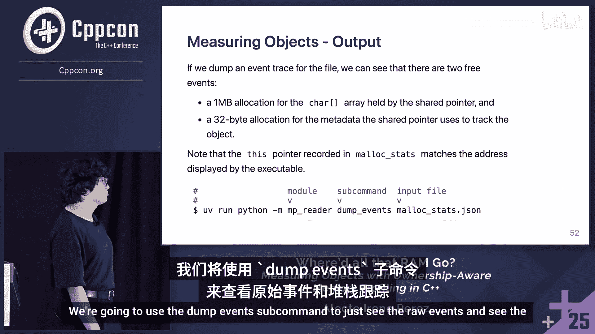

If you notice here， the thing to pay attention to here is that you have the file namess。

 You have the line numbers。 These are very typical and stack traces。

 You also have thisers for the objects。 You have the this pointer for the object。

 the name of the object， the size of the object。 And this is what's like picked up when scanning the stack。

 You have two of these。

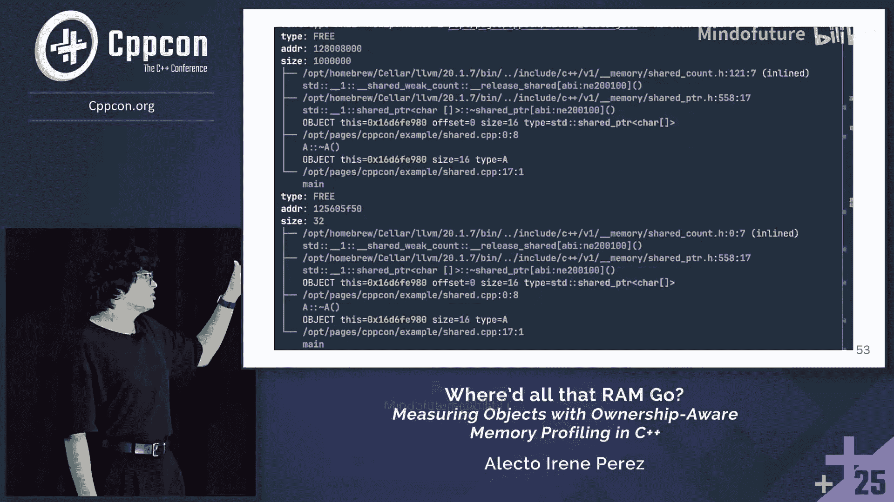

One of them was a million B allocation。 The other was a 32 B allocation。 It picks them up。

You can see here that A had an address ending in FE 980， this corresponds to what we see here。

 we see。A's address。 We don't see B's address because B didn't actually own any memory。

 B did not at the end of the day， deallocate anything。Okay。So。Let's talk a bit about the trace。

When we take a stack trace， every entry in the trace corresponds to a stack frame。

 Some of these entries correspond to deor calls。Again。

 these deor calls are annotated with information about the object being destroyed。

And then additional type information is like。Taken from there， we have， if you look here。

 we have an MP type data object。 We pass a reference to this object to save state and save state saves a point to it。

 And this object is embedded in the binary。 So that point will be valid for long as as long as the program is still alive。

And at the end of the execution， we can aggregate all of these pointers， we can dereference them。

 we can figure out all of the associated field names and field types， field sizes， field offsets。

 all of the information we need to do these profiles。Yeah。

 that's the additional type information stored and recorded to Malex Sta Json。

 although there's a lot of information。 So it's not displayed in the trace。Finally， well。

 we can get the thing we actually care about， which is statistics。

This is statistics on a profile of F T， X， U Y， I profiled one of the demo examples。

 You can get the allocation statistics by type。 You can get， yeah。

We see that standard vector of pixels was using most of the allocations， most of the memory。

 We have some other big objects here， such as FTx Ui screen and FTx UI image。

 This is a terminal user interface library。 So it's for rendering terminal user interfaces like to your terminal and the other very nice feature we have So what this does by default is this distracts all allocations and all the allocations over the lifetime limit of the program and adds them up but oftentimes what you want to do is you want to like figure out what was actually alive at peak memory usage and you can do that by passing filter peak。

So what I did for the demo application is I only ran 10 frames。

 I only ran 10 frames and then exited the program gracefully and the allocator was able to record everything。

If we filter by peak memory usage， we see that like it's just one of those streams that corresponds to peak memory usage and we can see what was alive at that time。

 we have about one1th of the memory and use since again， we' we're just looking at peak memory usage。

 It's about 194000 bys total at peak memory usage and' it's split among a number of different objects。

So this is very nice。But as I showed earlier， you can get more information。

 You can break down by member。And we can do this because we know the disappointmenter to every object from the trace。

 We know the size of every object from its corresponding type information。

This is enough to allow us to compute offsets。 and then based on the offsets， well。

 we also know the offsets of every field， the name of every field， the type of every field。

 we can just put all of this information together。😡。

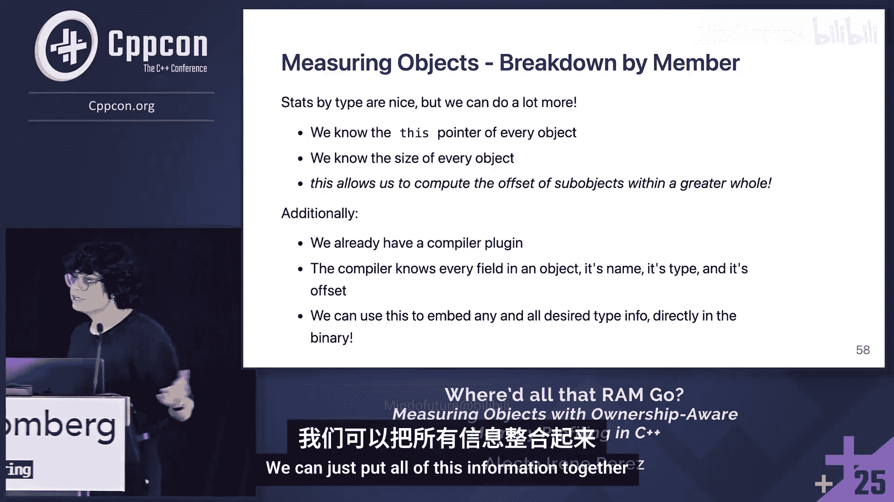

And this is what it looks like。 You can see that an FTX screen object owned an image and it had some hyperlinks。

 the image is what actually held most of the memory the hyperlinks barely held any。

We can see that the FTX UI image just owned a bunch of pixels， we can see that the FTX UI。

 like Flbox helper that that owns some blocks and some lines。

It's very useful for seeing the actual breakdown of memory usage。If you didn't have this， like。

 you might not know that hyperlinks like barely contained any memory。

 You might not know that most of it was in the image。 You might。

 if you like spent a lot of time like reading through the code and thinking about it。 but like。

 it wouldn't just be obvious and be up there。

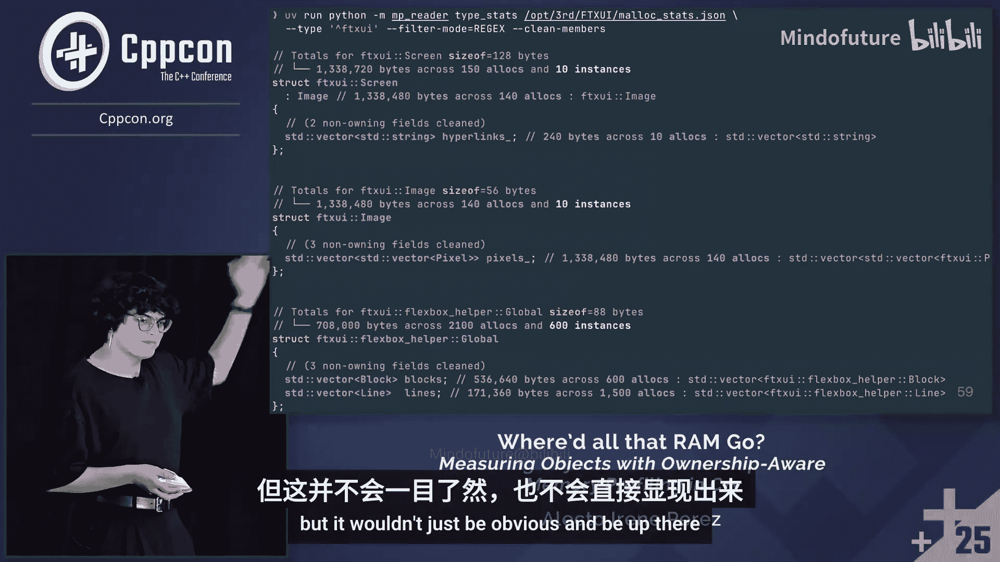

You can also see that we allocated like 10 instances of the screen， 10 instances of the image。

 and around 600 instances of the FTX UI Flexbox helper。You can see the size of each object。

 You can see how many allocations occurred， like how many allocations each one owned。第二。Okay。

As the last part of the presentation， we are going to test the profiler on an nontrivial code base。

 We're going to profile CMake。

So CMake is a lot larger。 CMake is 935 translation units， it's a million lines of code。

 There are multiple dependencies， its mixture of C and C plus plus。

 and we can build a whole thing with the plugin。 We can just build a whole thing with the plugin shown here is the CM state object。

 This is like kind of the core object that holds a bunch of day for CMake。

 We can see here that it used around like 3。4 million bytes total across like several tens of thousands of allocations。

 We have a ton of different fields， all of which own memory。We can take an even bigger example。

 So the amount of data you have is going to kind of depend on how many allocations occur。

This one is a full profile of Cma configuring itself。

 We end up with a stats object containing 15 B of allocations data。😊，And yeah， we can handle it。

 we can handle it fine， we see that like standard vector Car was using most of those bytes。

 we can see that we also had some other objects like CMU streamream read handle。

 we can see that like CM list file function use a bunch of bytes and we can see breakdowns。

 we can see breakdowns for most of these trucks by by all of the members。

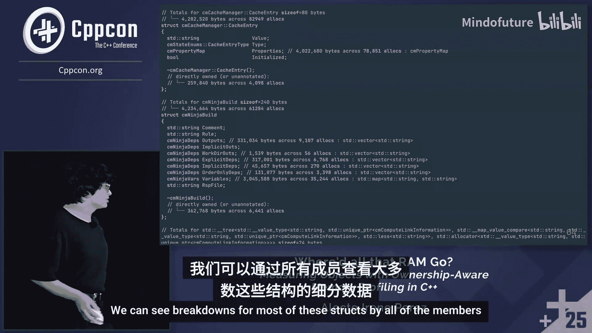

So， a few caveats。Right now， you need to use clk。This approach is pretty general if someone wrote a plugin for GCC that worked in the same way。

 like you could just use it with GCC， but right now the plugin I wrote works for Kang。Right now。

 this plugin also has issues annotating non inline deor calls。

 This has to do with when codegen occurs， like the annotations will show up in the abstract syntry。

 The abstract syntry will be modified， but for non inline deor calls。

 oftentimes those definitions may be cached。And so it'll。

 it'll use the old definition instead of the annotated one。And finally。

 if a library provides a definition for a de， like the standard library has a copy of standard strings deor。

When the linker links it in， it'll just use that one instead of using the annotated one。

This can result in missing adaptationnots。 So like if you see here。

 we don't have information for the strings。 we just have like that information。

 those allocations got directly attributed to CM Ninja build， which owned the strings。

 So the the memory still shows up there， but like we couldn't identify that it was in a string。

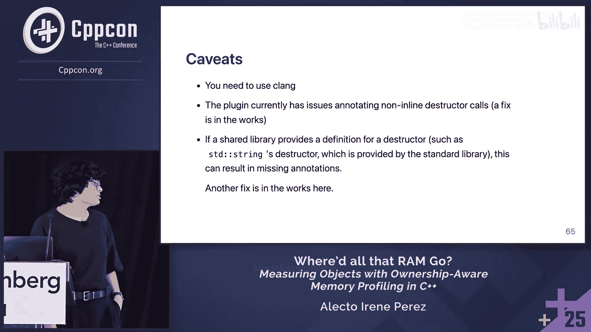

I will say though， that if you have something that owns a string。

 like if it was a unique point of this string， it would show up correctly because the standard library does not contain a definition for the deor for unique point of string。

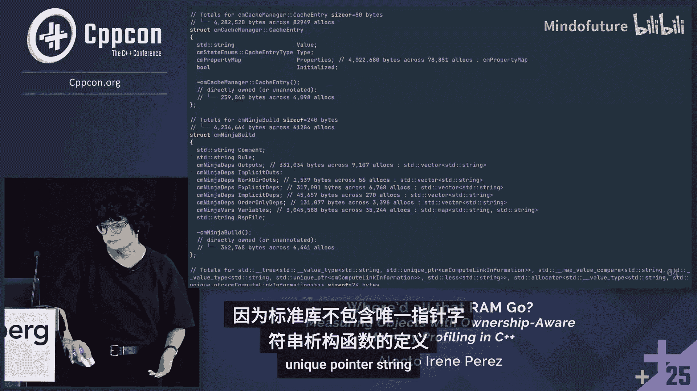

We are gonna a fixes in the works for this。 What I'm going to do is like。

 we're already like modifying the abstract syn tree。 I've been。

 I've been working on an approach that basically like updates the A BI tags for like built in objects so that the。

So that it doesn't use the definition provided by the standard library for the des in particular。

 But yeah， that's the gist of it。嗯。Some final remarks。

This tool provides increased visibility on memory usage on a per type and per object basis。

 I think it makes it a lot more obvious which types are consuming a lot of memory。

 and I think that the breakdown by field is something that I haven't seen before and that is like incredibly useful。

😊，Altogether， this provides the data necessary to identify inefficiencies and optimize code for memory usage。

Thank you very much。Okay， I guess I'm gonna any questions。啊。The question is。

 in most cases why we need to。Profile number。Because we have a memory leak somewhere。

But according to your approach where you profile the disruptor。That he instrument a deor。

 most likely the deor is not being called because of the memory。哦。So that problem。

So in response to that question like there are already good tools available for discovering memory leaks and the information necessary to identify memory leaks does actually exist in Maopt。

 JON， it records all allocations and it records all free so you can simply identify any allocations that don't match a corresponding free。

 and you have your memory leak， can you have where it occurred in the code base。However。

Theres another class of， like， memory usage。Not really bug， but like inefficiency。

 where you just have data structures that are very bloated。

 You have classes that sometimes have dozens of fields。

 these fields sometimes like have the same pieces of memory duplicated multiple times。

 You have potentially objects that have like big lookup tables。Yeah。

Getting visibility onto the things that are using a bunch of memory when you don't have a leak is something that is very difficult。

 and it's something that this profile was built to address。questionYes。

 our typical usage is that at the beginning of the application， we allocate a lot of memory。

And this memory would be。The allocated the end of the。对二。

Like typically we ones measure a peak memory。Duringuring。The run of the program。 Yeah， at that peak。

 all the objectschis are not destroyed yet。 And like， how do we， if the whole thing based on this。

How that。That's a very good question。So。Because it tracks all allocations and all freeze。

It knows when a piece of memory was initially allocated。

 and it knows when a piece of memory was destroyed。 So like you have some time of peak memory usage。

 we look at all the pieces of memory that were allocated before that and destroyed after that。

 So we filter for those。 And then we see which objects they corresponded to because we have the information from when the deor is eventually run。

So when we look at peak memory usage and when we measure at peak memory usage。

 the deors aren't run yet， but the data is still in the file。

 Like we're just taking a slice of the data。 And we know that that memory is eventually going get delocd and。

Because the analyzer is operating after the fact， because it's operating once the program is already completed execution。

 it's just going through the trace and it already has the disruptor calls so。

That information is available by the time the analyzer is running。嗯。返しです。

SoWe have some legacy codes designed to be linkeded。完了。We don't really care about the allocation。

Just leak loads of memory。Yeah。Would this work with this to。

The answer to that is that because because the statistics object has stack traces for all of the allocations that occur。

 like it would be relatively straightforward to just identify and enumerate every single leak that occurred in the runtime of the program and also give you a stack trace for the leak and file names and line numbers if it was built with de bugg information so we could do this this isn't what I focused on when I built this initial version of the analyzer right now。

 this first version of the analyzer is written in Python just because like。

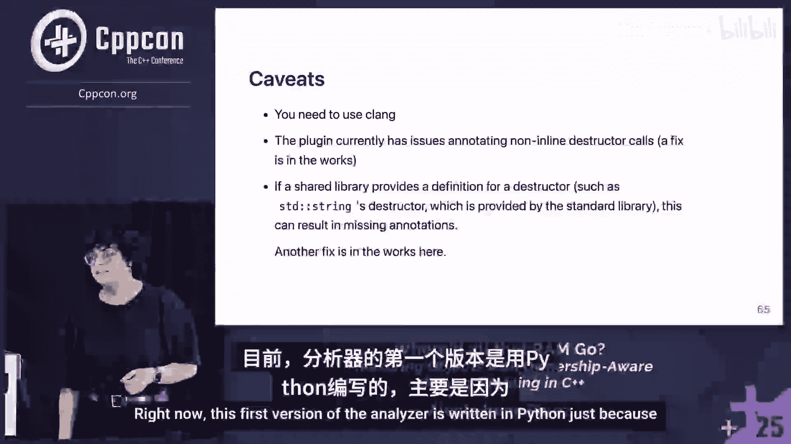

That was that was the easiest tool to get a prototype working。 however。

 if you can see here when reading in a 15 gigabyte file， just loading the file in Python。

 just doing JSson dot loads with the Python standard library takes about half an hour just to load the 15 gigabyte file So I'm going to be rewriting the analyzer in a compiled language and also expanding on its capabilities in order to do things like make it convenient to identify where leaks occur。

One moreOkay。So you mentioned that you too support place we need and now typical use case。

You didn't know they would allocate。Use page of fights。And就 the在。These like to。Yeah。So right now。

 as you recall， well， it's hooking into malloc， it's hooking into reallock。

 it's hooking into new and delete， but it's assuming that these functions like are actually what you're using for memory allocation。

 So if you allocate a whole bunch of memory up front and then delocated it on exit right now that memory will be attributed to that big upfront storage object。

 So you will see that a big up storage object uses a bunch of memory and then freeze that memory at the end。

 however。I already have a clang plugin。 One of the features that I'm hoping to implement is a way for users to essentially mark certain functions allocating。

 And so then it treats that as an allocator instead of using Maoc。So then you can。

 then you can Yeah just bites the。Like doing while the program is running。

 We create objects on these bike。 Yes， but you use， you use some function to pull from the pool and。

 and give you the memory for the object， right， That function is the one that the plugin would instrument。

😊，Yeah， okay。Thank you for the talk。Maybe it's out there an outdated question but last time I checked this kind of issue。

 one of the main problem is the actual system call that is used by MA and all this。

All these tools and the memory that is actually used at the operating system level is the peak。

And if I don't delete what is at the top of the allocated， then the whole memory is see allocated。

 even if I have removed and deleted whatever is in between the beginning and the end of the。Actually。

也。Maybe it's completely。 Well， so that's an implementation detail of， of the malloc you're using。

The mal， the like the malloc implementation。Is the one that determines when memory is free to the operating system。

So okay， because yeah， actually there is only one sustainable photo graing system and if you don't do it negatively。

 I don't think the malloc， most of the implementation of the malloccan will not give back the me to the ba system and eventually on the system running。

The actual memory that is used from the participant point of view is this one。Yeah， yeah。That's true。

Here's what the profiler is meant to address。 Like， there is some reason。So。

MMmap is what actually provides the memory from the operating system。

 but it provides that memory because Mack requested it， right。

This profiler is designed to give users the information necessary to make their containers。

 their data structures， their objects more efficient， so you don't use so much memory to begin with。

Oftimes when you're like optimizing for memory usage。

 like one of the things I've noticed is that oftentimes it can be very difficult and very opaque to figure out why objects are using so much memory to begin with。

 like you can take it an object。 You can look at the implementation。

You realize that you need a bunch of information， such as like how big all of the containers it has are。

 So maybe you into a bunch of print statements to see the size of those containers。 But like。

 this is all very inconvenient。 This is cumbersome。

 And this means that like optimizing to reduce memory usage。Is a very tedious process。

 simply because collecting that data is hard。 And this is designed to make it very easy to collect that data。

So the idea is that like。You want to use less memory to begin with， yeah。美接。

iThis is a great tool insight。Have a question about containers likebacterter that grow dynamically in。

 and you can call things like shrink to feet。 Yeah， I guess that' get count。Okay。

So that's a very good question。

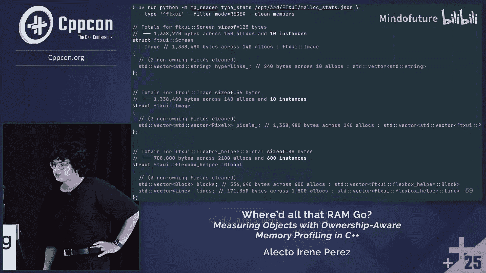

嗯。Bm bang b。

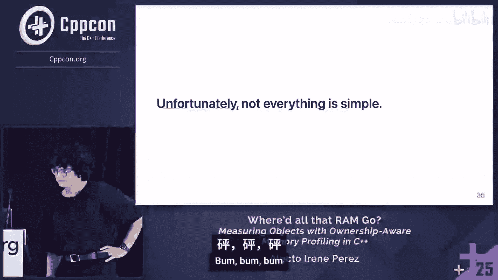

So yeah， the answer is that。Because it only looks at deor calls right now。

 it'll look at the final size of the vector， but。Allocs that happened while the vector was being reized won't be directly attributed to the vector。

 They will just be some ephemeral allocation that occurred during the program。

 but it looks at the final size。So。That's still usually typically very useful because oftentimes people don't shrink vectors。

 So looking at the final size of the vector is oftentimes sufficient to identify what was going on。

 This program does actually。 So I do actually have correct tracing for real lock every time you do a real lock。

 like that's。Every allocation， every destruction， every。Every realloc， each of these is an event。

Each of them has some associated address。 And in the case of a realloc。

 you also have an address hint。 So the hint is the old address， the。Addres is the returned address。

 And based on the hint in the new address， like you can trace allocations through realloc。

 But unfortunately， a lot of a lot of vector implementations don't use realloc under the hood。

 They just like allocate a new block of memory， copy a bunch of stuff over and they delete the old block。

Something that I've been thinking about， I have been thinking about how to address this is also getting the plug into annotate functions like resize in addition to the deors。

But you would need to specify that like on vector， you wanted resize annotated。

And perhaps there would be some convenient builtin set of functions。

 which were annotated automatically and also a way to configure the plugin like a configuration file where you could specify new types and functions that you also wanted annotated。

 But that is， that is still a work in progress。😊，And my question I have is you collect staff traces。

 mode where you。Agregate data based on which path it led to。

 like you can imagine like a vector of jar could be 10 different sources of this vector。

AndIt's important， for example， to identify which particular effect are the which paw。Yes， so I do。

 the profiler does。 The profiler collects all of the stack traces and all of the stack traces are dumped out in order to like。

 make this process efficient， What happens is all of these profiles are just implemented like。

 you have a bunch of in this， like the， the stored。

The actual file that gets bit out as output will have。

A vector of indices into a frame table and this frame table for every single program counter that appeared in a stack trace。

 it'll have the file name， the line number， etc。 So Maloc Stasla Json includes information for all of the stack traces that occurred。

 they're all resolved at the end of execution。 and one of the one of the things that I hope to do。

 I use the pretty simple format for the output and this was intentional because I want people to be able to take this data and write their own tools to interpret it。

 if my analyzer doesn't provide something that they want。So right now， the analyzer is focused on。

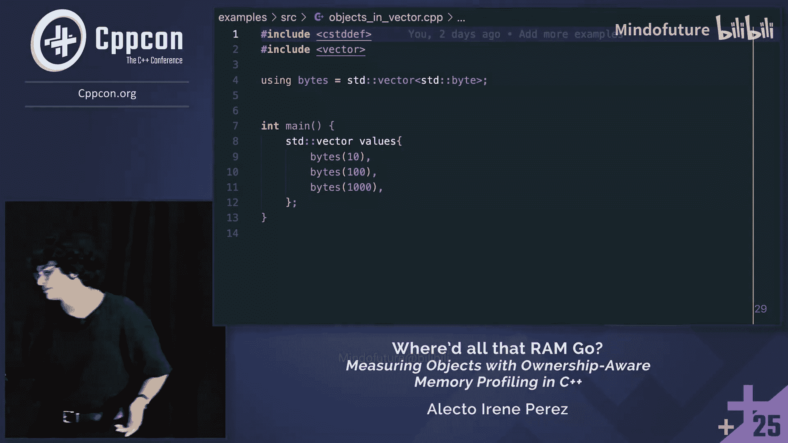

My analyzer is focused on identifying like which objects owned， which other objects。

 And it uses this information from the trace in order to do so。But for any given object， like。

 it can also tell you。All of the places where where it was where that memory was allocated。

 So you could like work backwards and you could see like， here's where the memory was allocated。

 Here's where the object was eventually destroyed。 You do have all of that information。

 and you could break it apart。 But one of the things I've noticed when。

 when working with memory profiles is oftentimes you end up with。A delu of information。

 like just so much of it。And I thought that like splitting it up by object and by member was a very convenient way to like。

 compress it for the purposes of allocation。 But， of course。

 like what you talked about is something that people would be interested in。

One of the places I'd like to go with the analyzer is I would like to add filtering。

 So you can see instead of just all of the allocations for the object。

 you could see like all of the allocations for an object in a particular function as an example。

And you could just filter the output of the profiler。So by instrumenting your destructive。

It sounds like you wouldn't be able to how much memory。This場。The code segment of shared Library。

That is correct。You don't。 Well， yeah， that's， that's correct。

 You don't know how much memory is used by like loading shared libraries and stuff。In my opinion。If。

🤢，Well。The intended use case was when you want to make containers。

 objects and data structures more efficient。 And this information isn't really needed when， when。

Optimizing a data structure， so。Well， imagine you've got it。

usually bad but imagine you've got some global one。Allocated in。Lver itself。The data like。h。

Ca for that。This wouldn't account for that， although， well。So that's。

 that's something that kind of depends。If that object is created after the profiler initializes and before the profiler exits。

 then any allocations done by the global variable will be tracked and will be recorded。嗯。

If that object like。Because you're preloading the library。

 that should generally speaking be the case。 So you should be able to see allocations done by the global variable As for the size of the global variable itself。

 like if the global variable does allocations， then this size will show up in faces。

 just like the size of other objects。

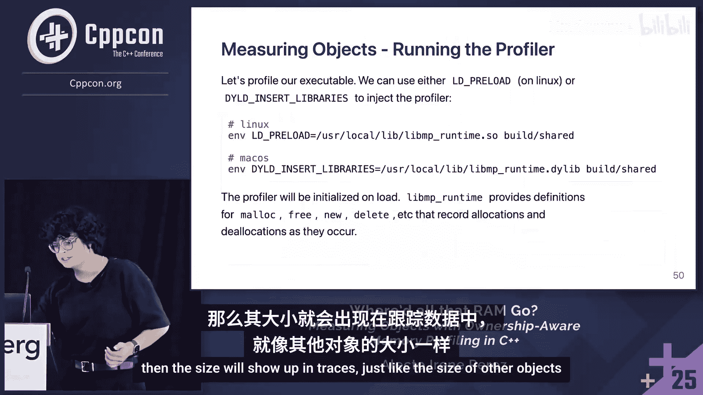

Like， we see here that it reports that standard vector of by 24 B。 So if you're global was。

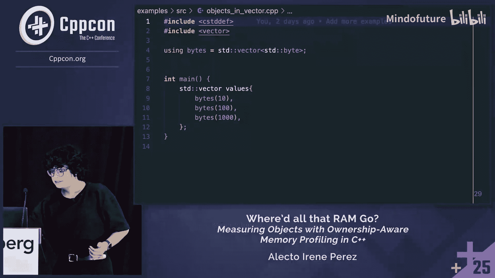

For some reason， several megabytes large。 like， it would report that。啊。

One of the other things they have to comment on there， though， is that like。

I think generally speaking， like it is pretty straightforward to see the size of a binary。Like。

 you might not have much visibility on， on what functions are taking of space in the binary。

 But like that is a， that is a separate problem that requires separate solutions。Thank you。

So have you having dump polymorphic memory resources？

It seemss kind wouldn't be able to easily look into them。So the answer to that is。

You kind of have two cases there。One of them is where the polymorphic memory resources is handling everything in which case。

 like， you never hit Malac and you never hit free。And in that case， like right now。

 the profiler like wouldn't have any visibility as to what was going on there because you weren't hitting mallain free。

As as I mentioned when answering someone else's question。

 one of the things I would like to do is I would like to update the Kang plugin that was built in tandem with this profiler so that you could also provide a list of additional functions you want to treat as allocating。

In which case， you could treat the polymorphic memory resource as its own allocator。

 And it would also track that in addition to things like malloc。However。

 that is still a work in progress。So like for example， if you're using these。

To just pivot a little bit， using a per arena， for example， sometimes in arena。

 you'll have some objects that kind of don't have their distractors called and some objects to do。

So since you're in with the structure， would you be able to at least analyze the ones that are happy？

高。You would be able to analyze the ones that are having the instructors called if they're actually freeing memory right now。

 So it's really more free。Sure。It's on free， but， of course。

 this applies generally to like any form of， of delete that like any delete in the that's part of standard Z plus plus。

And not do a situationition you're calling the de。要。Yes， so if you're polymorphic。

 if it's just like being returned to a memory pool， right now the profiler doesn't pick up on that。

 it will pick up on the pool itself if the pool is allocating with malloc。

 but it won't pick up on what was using memory within the pool。Again。

 my hope is that the plugin will， will be able to like read a configuration file and then know which additional functions should it should annotate so that it'll be able to get the same visibility as for malocin free。

对。Okay， okay， thank you very much。

