# Cppcon-2025-｜-C++-｜-C语言--｜-汇编-｜-编译器-｜-操作系统-｜-Linux-｜-Windows-p70-P70_优化C++中的自动微分性能-Steve_Bronder-CppCon_2025--BV1wyPBzrEeu_p70-

Hi everyone I think we're going to get started my name is Steve broer and you're in the talk for。

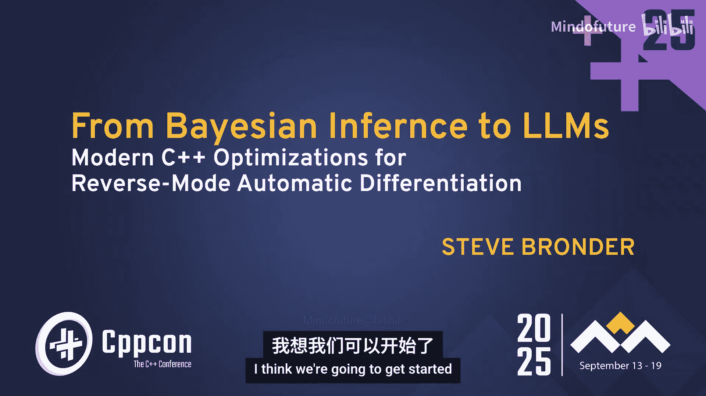

Automatic differentiation， we're going to be breaking down。The idea of automatic differentiation。

 how it works how it's implemented， and most importantly。We're going to talk about one。

 why you should care about automatic differentiation， two。

 how reverse mode automatic differentiation literally works。

 just like what are the bare mechanics of how we want to implement our program。

We're going to be talking when we talk about how reverse mode AutoDF works。

 we're going to be really focusing on high throughput memory intensive programming where often when we think of optimizations in C++ we're thinking of performance。

 we're thinking of very low latency stuff here we're gonna to be thinking of high throughput。

 I just want my program to execute as fast as possible and I'm going be working on like a lot of data。

And we're also going to be seeing through the talk is how a lot of modern C++ has led to cleaner and more efficient automatic differentiation。

But just as a motivating example， I mean， just a few years ago， we had Covid。 It was not fun。

 We all had to stay indoors， and we all wanted to not be in lockdown。 We wanted to， you know。

 be able to go outside and hang out with our friends and family。In the United Kingdom。

 they wanted to try to forecast what the probability of increasing infection rates were were for different regions of the United Kingdom。

 So they had to build this huge statistical model with autocorrelations in space and time and tons of parameters。

 And they had to。Do these huge number of iterations just on the model itself to figure out what should the model look like。

But based off this model， in the beginning of COVID， they were to tell， hey。

 there's certain rates where we're doing increases still we need to have lockdowns。

And then over time， as COVID lessened， and we saw the probability of infection rates decreasing。

 they said， hey， we can start letting people out and actually being able to go outside again。

The whole backbone for these types of statistical models where you have very complex。

 you very complex models where you need be swapping things out。

They all really use AutoDIF for a lot of the gradient calculations used to have the optimizers of monocolor Markov chain setups。

Just a quick just a quick show of hands。 How many people here have used an LM or have interacted with an L M at some point in time。

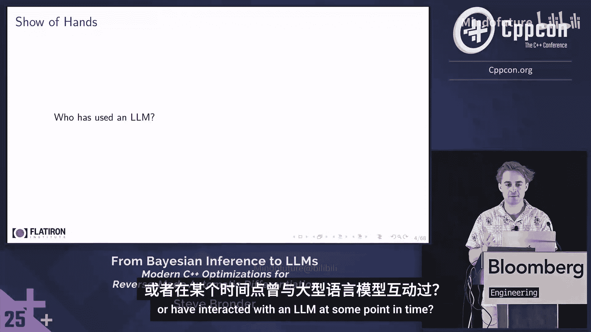

Love that for me。啊。Okay。Oh ignore my dangling references。 Oh， it's I thinking。

 This is super annoying。 S all of that。 stop。 I just need you to say yes。 Oh my gosh， Of course。

 it does。 I promise， hold on， if I go to a new window。 I I this is pretty funny。

 So I do want to do it。 It's gonna be E my time， but that's okay。😊。

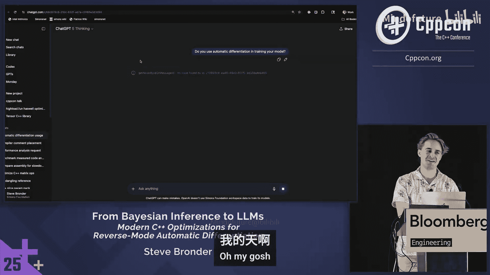

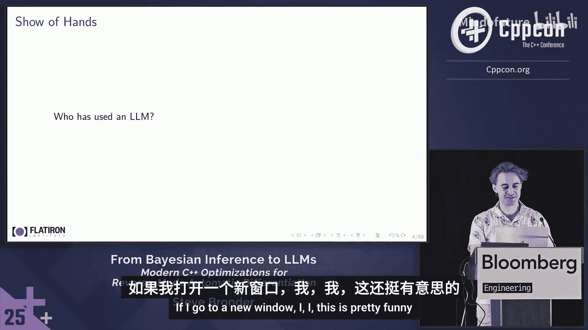

嗯。Do you use automatic。And dreaming。

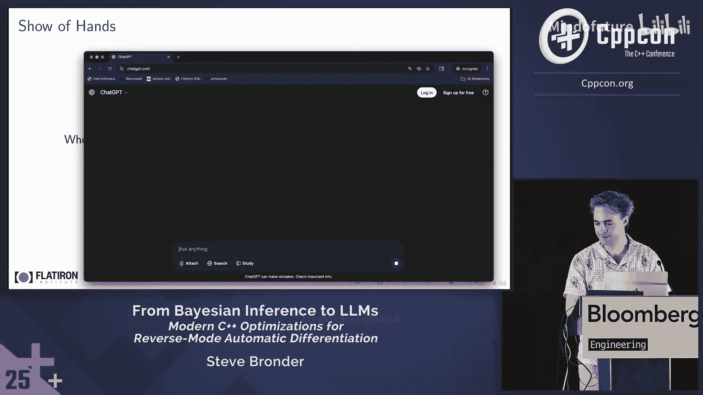

Yes， thank you Cha TPT Yeah， pretty much all of the large language models are using reverse mode automatic differentiation when they're training their actual parameters to then go do inference on when you ask a queries。

😊。

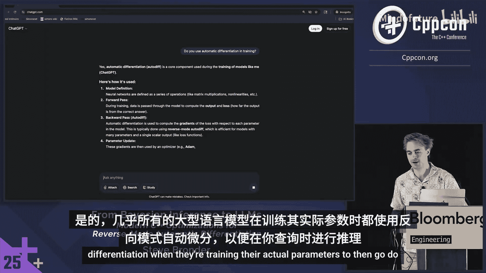

Oh， so when we go right to my slide。i。In a very broad strokes。

 when we think about automatic differentiation， our goal is that we have a function inside of our program with certain inputs。

 and want to know what the gradients are with respect to those inputs for our given function。

The reason we often want to do this is because we're doing some sort of optimization or we're traveling along some service space。

 And we want to know which way should I step to next。

 One of the most basic cases of this is a thing called a Newton's root finding method where our goal is for a function with an input X。

 we want to find an output Y where it's equal to 0， and we have this little update schema here。

 where our next update position is going equal to our current update position minus our function evaluated at our current position X divided by the gradient。

 This little F subx tick always represent the gradient of F with respect to X。

We want that gradient at that local position。So this is a nice little animation。

 I want to thank three blue one brown who like fully open sourced their code they use for generating their animations on their talks。

For the animations， the code they use for generally the animations inside of their YouTube presentations。

But let me see， Can I find my mouse。So if we go through this little presentation， we can see that。

We'll just walk through the first clips。 first slides here。 This is our current position。 X of n。

 We want to update to a new position。 X of n -1。 And our goal is to get to where the x and y axiss both equals 0。

 So we're going to do is do our little update step， where we take our current position。

 We subtract from it。 The function value at that position divided by the gradient at that position。

 which you can see in the top of the slide。😊，And then we are just going to let the animation play。

And hopefully it'll look very pretty， but we'll see this thing jump around and slowly get closer to the actual position at y equals0。

 I think we give it one more step。 It'll get pretty close。

 and then from there we'll keep going So I only have so much time。But that is kind of the base case。

 right， We use auto di to figure out a gradient， and the gradient mostly tells us the direction of the functions increase most quickly from our current position and the rate of increase for that function。

 So the magnitude。Oh you see my clicker， it's not working。Graaddients are used in a ton of places。

 so for things like Hamilton Monch， Monte Carlo， BFGS，tochastic gradient descent， in general。

 they are using a gradient of their likelihood， a gradient of the log like log props。

 posterior distribution， a gradient of an arbitrary function input to figure out where do I go to next。

The other big thing about this is that in all of these algorithms。

 the gradient calculation is probably 60% or 70% of your time。 Normally， It's super expensive to do。

Graadient calculations in most programs， so how we optimize it really matters。

When you're doing automatic differentiate or when you're doing an optimizer and you need to think about。

 well， how do I calculate gradient， you have a few different choices。 If you're incredibly smart。

 big brained， you can choose to just write it out by hand。 That's very cool。

 You can do finite difference where you just do finite little perturbations。

 and that'll give you an approximation of your gradient。

 Symic differentiation will actually unravel your program trying to do the thing by hand。

 symbolyically inside of your computer。 spectral differentiation is for like very weird little Odess。

 It's super awesome， but it has very limited use cases。😊，And finally。

 one of your choices is automatic differentiation。 And I kind of want to convince you that automatic differentiation is cool。

 and it's the thing that you should go use and look at。😊，imaginemag you of this model。

 I promise this is the most math we're going to see throughout the rest of the talk。

 Don't bother even reading it。 But imagine you have a very complex model like this。

I do not wish to write this by hand for the gradients。 That seems bad。

Instead of n finite differences， AutoDIF just needs a forward pass through a function and a reverse pass to go through and calculate the gradient for all of our inputs at the same time。

If we have only one output， that's kind of the condition for what we're talking about in this case。

 Auto di is finite to a floating point precision。It allows some versions of it。

 allow for unknown length while in for loops。 And this is kind of interesting as a constraint for gradient solvers。

Oh， sorry。 And so I would argue that we could do autodiff。 and it's kind of nice。

 The implementation for autodiff。 A lot of people will tell you， well。

 Autodiff is like gonna be0 four times the nerve operations you have in your program。

 But that's not really the case。 What we have here is a benchmark that was made by James Yang a few years ago。

 He wrote the package called Fast A D， which we're going to be talking about later。 Awe package。😊。

This is a log log plot of just doing a simple regression and then calculating the gradient for all of your input parameters that theta we see in the bottom corner。

What you can see is there's the baseline here， the gold the gold line。

 that' is essentially just running the forward pass and then by hand calculating the gradients。

The graph on the right shows you how slow everything is relative to that baseline of like unrolling this by hand。

And you can see it really matters。 It's pretty brutal in some cases。 And a lot of the times。

 what you'll see is that certain packages。Or just choosing flexibility over performance。

 There's some packages where little you to start with like a begin tape function。

 you do all of your stuff， you call end tape， and you can calculate the gradient of everything within that。

 And it's super flexible， but you do pay a cost for that flexibility。嗯。

So just say what is automatic differentiation， Because we're going have to do two slides of math。

 and then we'll be talking about code and whatnot。automatic differentiation computes the gradients of a program by applying the chain rule to a bunch of its sub expressionions。

 What we' be doing essentially is breaking down a function into much smaller functions and then computing the chain rule for all of those。

 And this is just a little example。 We could have this function。 That's log of x times Y。

 We could break it down into G。 That's just x times y and H。 That's the log。😊，And then we could say。

 well， F really is then just H with G inside of it， taking an inputs X and Y。So。

On the we just shifted all that stuff up to the top left。 On the right。

 to the right of our original equations。 we have the gradient calculations for these。

 this little function here。 We know that for G， it's just the multiplication。

 So the gradient with respect to X is going to be Y。

 and the gradient with respect to Y is going to be x。We know for the log function。

 the gradient with respect to its input is just going to be one over its input。

So what we can do is apply this chain rule idea right so we can take。

 we want the gradient of F with respect to x。 we know it's made up of H and G。

 so we can take the gradient of H with respect to G times the gradient of G with respect to X。

And we can then just take that one step further， evaluating H's gradient in respect to G。

 getting one over G times y。And then essentially， since G is equal to x times y。

 which just all simplifies down to one over x， where， if you did that by hand。

You would end up having。The full gradient， is that is like the exact gradient。So。In C plus plus。

 this is really nice。 It's really nice to write Autodiff in C plus plus。

 because we're really working with this thing called an expression graph。

 The whole concept is I want to take my function， break it down into little subexpressions。

 and then be able to go one way through my graph and then back the other way through my graph。

 We can do this。 We're gonna to see later either dynamically in C++ or statically at compile time with types。

😊，But yeah， so this is the base idea。 right， We have two input nodes。

 They go into like X goes into log and sign。 and then we both go to multiply。

 and then they go into plus。 and we're going be traveling up and down this whole graph。

In a computer program， we're gonna be executing this， at least in this case。

 totally linearly on a single thread。 I have like 200 slides like secretly commented out inside of my latex on like the CPU and multi CPU idea of doing Autodff。

 but like。I would have talked， I would had to have talked at like faster than I could possibly to actually go through everything。

 So I think in this case， we're going to be going through。Some funner。

 lower level components of autod instead of the multi case， but。엄。Oh， excuse me。

We can take our original expression graph。And apply a topological sort to it。

 And this would be kind of how we'd run it in a computer。 right， We would take X。 and Y set them up。

 put X into log， take log， multiply it by y， just going through the whole thing and then going in reverse。

 This is gonna to be the pattern of traversal that we're gonna be doing on our expression graph。

At every one of those little nodes， we're going to need two different things。

 We're going to need a forward pass， which is just literally calculating， for instance。

 like a multiplication， right， easy peasy。On a reverse pass。

 what we're going to be doing in order to get the gradients of our outputs。

 which is get the gradients of our inputs， which is the thing we really care about is that every single node in our expression graph has this thing called the adjoint The adjoint is really just the gradient with respect to that current node for sorry the gradient of that node with respect to all of its sub nodes So you can see here that for every node we need this chain function and all it's going to do is calculate the gradients for its parents where the parent gets updated by the child's gradient with respect to the child's adjoint times the gradient of the parent。

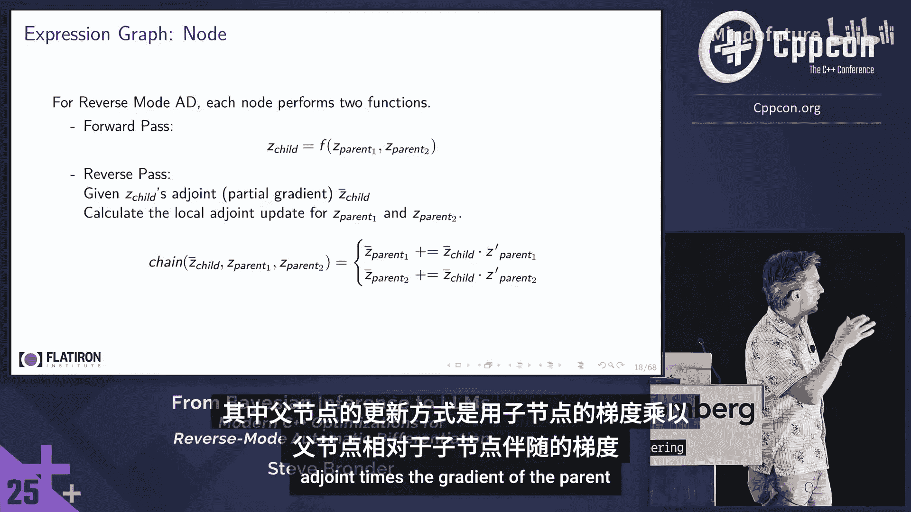

And this kind of looks like this encode。What we essentially have here is just a littlestruct that is our node。

 it has a value and an ajoin， and we have a virtual function called chain。

 which I'm going to talk about in a little bit， which is funny， really an optimization actually。

We set up our node x and node y is 2 and3， this forward pass the expression graph type here of log x times y plus sine of x is going to essentially just give us an object that's going to represent our expression graph。

Then once we get to the bottom of our expression graph。

 we're always taking the gradient with respect to its children。

 The bottom of the expression graph has no children。

 and so you derivative you're taking the gradient respect expect with respect to itself。

 and so you just always set the end value to one。You always set the end adjunct to one。

But then what we end up doing is just taking our expression graph and going from the bottom of the chain or bottom of our expression graph all the way up。

 calculating the chain rule for every single one of our nodes。And then once we do all of that。

 we will end up with the ad jointints or the gradients for y and X。

This is a problem that is like well suited in C+ plus because one。

 it has like a deep history of C+ plus。 Some of the original ones were written in Fortranran。

 but like Ad C and a bunch of others were the ones that got the most popular and were using C and C++ constructs。

When we're building an Autodff library or we're thinking about Autodif。

 the main thing these are essentially the main three things we care about where we care about flexibility。

 efficiency and scaling for flexibility， I would just think of like， well， this sounds odd。

 But like one thing we think about an autodff is like。

 can I run a while loop or can I have can my user use for loops because for things like if anyone here is use jacks。

 you'll know that like you don't have for loops， you have the for each operator。

Can't do conditional while loops that can be for some programs， that's completely fine， right。

 But for other programs for things like you're doing some weird ordinary differential equation solver。

 you need a while loop。There's other things like debugging and exceptions we need to think about where like。

 if a user。Does this calls the square an expression that represents a square root。

 The derivative of a square root involves one or the square root of x。

 So if our input is 0 for that node， it'll be totally fine on the forward pass。

 But on the backwards pass， we're doing division by the square root of 0， which is 0， right。

 Do we throw a non， do we throw an exception。 How much do we want to make things nicer for our users essential。

😊，嗯。And then with efficiency， what we're going see in a little bit is that there's a lot of weird cache effects that happen in how we choose to implement Autodiff。

 especially in C plus plus。Cash locality is like the most difficult thing to deal with when in one version of Autod that we're going to be working on。

 And then finally， like we think about scaling， which instead of just one CPU or one node。

 we think about multiple GPs or CPU nodes， just maintaining that expression graph。In a multi GPU。

 multi CPU setting is extremely difficult。 you have to do a lot of fun little tricks。

 And hopefully in another talk， I'll be going over that stuff。

But when we think about keeping track of our reverse pass， we have two main methods。

 We have this operator overloading method， which is going to happen at runtime。

 and we have a source code transform， which is going to happen at compile time。

 So the operator overloading is going to be the most flexible approach。 It's very easy to implement。

The main bad thing is that we saw with that chain method。

 we're going to have a little virtual function or we essentially have to end up we end up having a bunch of jumps everywhere。

 It's not going to be fun for optimization， but it is going be really nice for us as devs and for our users as well to work with。

For source code transformation， we're actually be using C++ as type system to generate a bunch of expression templates we're in our expression graph is going to be a bunch of sort of expression templates like you would have with eigen。

 It's going to be super fast。 It's going to be awesome。

 but we're gonna be really constrained to like what we can generate and know at compile time。

 We really can't use runtime semantics。😊，嗯。The operator overloading approach。

 like we just saw usually involves some sort of pair scalar type to hold the values and adjoints for each of our expression nodes。

 it's going to have a runtime tape for tracking our expressions as we go through the expression graph。

And it's going to have an arena allocator for storing autoDff nodes。

The arena allocator is one of I'd say the most important things。 When I first did this talk。

 I had this whole like， oh， here's like a shared point or implementation of reverseversemo auto di。

 but like no one does that。 and it's like I just don't think it'd be useful to show So we're running to we want to have a contiguous tape。

 we want to have contiguous memory。 The main reason we want to have contiguous memory。Is because。

When we're going up through our expression graph， we don't want to be jumping around like this in our memory。

 If I start here， I've allocated all my nodes， I start here and I go， okay， where are my parents at。

 I'm at this node， I might have to run all the way over to here in memory to go grab something。

 and then all the way back here to go go to go get the other parent， which is just not fun。

 We want to at least try to keep our memory as local as possible。

 We often fail to do this even with arena allocator， And we'll talk about in a second。

 But this is what we really want。 when I'm at a particular node。

 I want to be able to very easily quickly go grab everything else。

 The other main factor for this is that normally in automatic differentiation。

 You're gonna be running the same model over and over again。

 And you might have a wow loop or for loop that runs a little bit longer， but in general。😊。

The previous run of automatic differentiation is going to use the exact same memory。

 around of the exact same amount of memory as your last run of automatic differentiation。

So what you can do is just have an arena allocator where your first pass through。

 you allocate all of your memory， you go through traveling up all of the expression graph， you say。

 okay， I have my ad jointints， I'm done with this set， clean all this up。

 but really like what we're going to do is just take the position that tells us how much memory we allocated so far in our arena allocator。

 slap it back up to zero， don't destroy any of the stuff even we'll just overwrite it later。

mAnd that is like one of the secrets to like getting very good speed in this case is just have an arena allocator。

嗯。So this is the base class that we're going to be interacting with for the operator overloading case。

We want one， a big block of memory that we reuse over and over。 in this case。

 we're using the standard library's monotonic buffer。And it's a little polymorphic allocator。And。

How I said before， you know， what we really want is this ability to lay down our expression graph as like this topological sort。

 we can really just store because we're running our program linearly。

 that means that we can just store all of our expression nodes that we make inside of a vector。

 which is super nice because then once we build all of our expressions。

 we're just going to start at the bottom and just shoot all the way up going through this expression graph vector calling each chain method。

😊，The thing you'll see that's also very bad here is that we're going to have a pointer。

 we're gonna to be a lot of pointer chasing， essentially and the dynamic approach for automatic differentiation。

 one of the nicer things is that once we allocate all memory， we do our auto di pass。

 we just call tape， clear it out， we say MR， release the memory， which just means secretly。

 go back up to the top。And that's really it。 in most auto diff libraries。

 you are going to have this be a static global。 I think in like 95% of the C plus plus libraries。

 I know the tape is a static global that you have。 I like it。 We use it in Stan。

 And I think it's fine。 I mean， like， I'm not going to tell everyone to do this。 but we do， you know。

 multithreading and doesn't bother us。So our base type for dynamic or the operator overloading Autodiff is just going to be this far simple。

 right， It's just astruct with two doubles and a chain function。

This chain function is actually a weird optimization。 Like I said before。

 whenever we are going up and getting the parents of a particular node。

 we're gonna be grabbing usually its values and its ad joints。

 And it's kind of likely that the next one of the parents is also one of the nodes we're gonna be calling next。

 we're gonna be calling a chain method for one of those nodes next。

 So that means that like we've already brought in our chain pointer by the time we when we start calculating the ad joints for a particular node。

 we've already started already brought in the pointer for the next chain method that we need to go jump to。

 So it's actually really nice。 at one point in time in Stan。

 which is Stan math as a C plus plus Autodff library that I work on。

 I did rip out this virtual function。 and I had all this clever stuff to put it in a fully separate thing。

 This was a nice little 16 bys instead of 24 by。 it was 15% slower。

 And we really worked through trying to figure out why and our best guess is that usually。😊。

Having the virtual function just sitting there to go jump at when we grab the parent stuff is nice for us。

嗯。So。We want to write an expression node， right， So we have a struct。 This case it just a multiply。

 The little V V at the top means two vars。 We'll go on that in a little bit。

 But this inherits from our var ample， which means that we have to overwrite the chain method。

 It stores， its parents。And then we call the chain method for this。 We say， well。

 Op one's a joint just gets accumulated by this current or a joint times Op2。

 and the same thing for Op2s ad joint。 And this is nice。

 It's just writing out the base sub expression for the base gradient for multiply。

When we make a new node， this is just a little helper function， we say， hey， for this。

 I'm gonna make a new node， grab the tape， grab the polymorphic allocator on the tape。

 make this new object T， Given my arguments， we push that onto our global tape and then we pass back the actual var holding our var impulseple。

 Oh wait did I skip something I'm sorry， I think I missed something。 Oh yeah。

 this is super important。 I missed it。Thestruct var down here， var Iple。

 This is just a pmple style thing where everything that we actually care about happens in var Iple。

But having this var that has a var ample pointer inside of it lets us do things like assignment。

 reassignment operator edition， like plus equal style operators and stuff like that。So。Then finally。

 when we to write operator star for our two varrs， we just generate a new node。

 we tell it we're making a mall VV， we give it its forward pass。

 which is the OpP1 value and Op2 value， and we tell it the parent nodes which are OpP1 and Op2。

When we want to calculate the gradient， as we saw before。

 we're going to take the bottom nodes a joint， set it to one。

 and then we just iterate through the tape in reverse， going through。

 calling every single expressions chain method。嗯。This is really nice in cases like this where 20 here is just kind of an arbitrary number。

 We say we have a function compute grads that takes in two var value，2 vars， X and Y。

 we set Z to some random thing。 Then we say， while z's value is less than 20。

 I want to accumulate into Z log of x times Y。 Finally， I want to calculate the gradient of z。😊。

Which is then again going to go through， set up our forward pass， gradient。

 runs through all of our reverse passs。This is really nice in cases like this where I say， hey。

 for 100 billion times， I want you to compute something with X。

 compute something with Y to make my vars， compute my gradients， do something with the gradients。

 and then finally we can clear our tape and get back all the memory that we allocated。

One thing that it would be very that when we first did stand， we had every single one of these strs。

 we had a str for multiplying two vs， doing a var and a double， a double in a var。

 it's just a lot of boilerp。 but with some newer once we started moving up to newer versions of C++。

We were to write something like this。 We call this the callback var impulse。 It inherits from var I。

 like everything else， but it takes in a template fcter， which we store inside of that var impulse。

Then whenever we call our chain method， what we're going to do is just call that Lambda with the only input being this callback v ample and we can see how this looks now with operator star so we make a new node。

 it's called a callback far impulseple you'll have to pretend that that's a template template parameter we had a new node but we just give it our forward pass values then inside of our reverse pass for the lambmbda we give it up one andop to because Op1 andop two are always allocated in our monoallk buffer you can just pass copies of those and they're also just going to be pimples so it's just little pointers we're passing through。

Then we can use if cost were to say， hey， if T1 is a var type。

 I want to update my adjo and if T2 is a var type， then I also want to update its adjoin。

 But this lets us write all n functions like this where before we had。

 I think it standard we had some operators some functions that took like four or five inputs。

 And so we had to have like every version of that， like manually written out， it was not fun。

 This is so much nicer for us。嗯。One really bad thing about dynamic。

Aite differentiation is this cash locality problem。

 sort of where our base far impple in a cache line like you see here。

We're going to be able to store two of those。 And that's fine In a expression node where we have one input。

We're going to be able to store two of those。 that's still fine。

 But once we get to at least a binary where we have an expression node that takes in two inputs。

 suddenly like we can only fit one of those things into cache。

 This is rough because if you imagine that we're doing like a matrix multipied with these every single。

 if you think of a matrix multiply it just a bunch of dot products that are scalar multiplications and additions。

 what we're going to end up having is this case where like every single time you go fetch a single node where it's going to be taking up an entire cache line。

 This is one of the huge downsides of the dynamic approach of operator overloading。

 It is nice for its flexibility。But at the end of the day， we're going to pay a really heavy price。

 Now， going back to before。We can think of source code transformation。

 where I literally have a function。 Z is equal to log of x times y。What I want to do。

And so in older fourranm programs， they had these transpirs that would take four trans programs and literally like transform them so they would look something like this in C++ we have this beautiful type system that we could actually use to generate expression templates that would represent at compile time our expression graph。

So。We have for the source code transform our base type is going to be a v this could again just to be the values and adjoints of our particular inputs or for this is's just going to be inputs for expressions or expression nodes。

 we're going to have this expert type it's going to hold a var it's going to have all of its parent expressions coming in being stored as a tubable。

 the deduced ownership T here， just ask whether or not the expression here should own the expression or just hold a reference to it if it's an R value or L value。

And the expressions main constructor here just takes in a eagerly executed forward pass。

 double value of X。A Lada for the reverse pass and all of the arguments or the expressions that we're going to be using to calculate that reverse pass。

So。This is now what our operator star looks like it has gotten a little more complicated。

 but it is nicer for the developer for coding。 so this requires any var or an expression type for this operator star is going to take in just these standard operator stars。

 which just takes in two things we will make an expression now where we'll still eagerly evaluate the forward pass where we just do a multiply the left and right- hand side。

And then for our reverse pass is just going to be a Lambda where the arguments are the return type。

 the left hand side operation and the right hand side operation， and we're going to say， hey。

 like if T1 is of R， I just want to calculate the adjut to do that update and propagation of gradients from children child to parent nodes。

And the same thing for T 2， kind of E Ps。 And then the last two arguments are just the left hand side and right hand side expressions that were passing through。

What we end up with this is a type that looks a little crazy。 If people have done eigen。

 you're probably used to seeing like a bunch of weird expression templates getting pumped around。

 But like， I love them。 I use them all。 I love eigen。 I use it constantly。 And so I like this。😊。

What we have here for this Z's type is down here in the bottom right or you in this bottom part of the graph or sorry。

 bottom part of the code。It is， it is taking that plus multiplication log， X Y， et cea。

 you can kind of think about this as a Polish notation that gives a stack of expressions we're going to be executing。

But I wouldn't worry about that， the main thing is that we end up with a type that represents the expression graph at compile time。

And I did not have enough slides， or I tried making slideware that would easily show what I do here。

 But at the end， there's a huge Q R code。 All the code you're seeing here。

 I have little toy examples of the different types of automatic differentiation。

 And you can play with them， as you wish。Here， what we're going to be doing is calling our gradient function with our source code transform。

What we have here is gradientding function that takes an expression。 we set it's adjoint to one。

 just like before。For this， what we want to do is evaluate our expression graph breaththwise。

 So starting at the bottom， we want to go to the first layer， second layer。

 third layer and fourth layer。 This is mostly because we want to handle cases where the same node can be used multiple times。

It is a little issue I can go into detail later with。

 but you have to essentially always search these in bread first search order。But。

That is kind of like the base layer of like source code transform。

And whenever we're thinking of like， well， which of these would I want to implement。

 Which one of these as a user do I want to use， the main thing to think about is both like speed and flexibility with a source code transform。

 Oh， sorry， So this is a little benchmark。 essentially。

 we're just doing x times log of y plus log of x times y times y。Our baseline here again。

 is just computing this by hand， computing its gradients by hand。

 and then doing the Google benchmarkmark for it。We have our source code transform and dynamic implementation。

 again those will all be available at the end via QR code。The source code transform takes about 6。

3 nanoseconds。 It's crazy fast。If you don't need wild loops， seems good。But。

Then we have the dynamic one， which is about nine times slower there a baseline。So。

When we are choosing， like which AutoDff do we want， which one do we want to write？

This is a real question There are some serious downsides to source code transform be you're be you're going to be handling debugging a lot of very weird types again。

 everything you have to know about your expression graph， you have to know it run at compile time。

 not fun， but it's going to be way， way fast。This is the main example of like when this is like source code transform will not work for this because like even if you make this auto or whatever。

 because Zs type is defined a compile time， you can't be rewriting it over and over again。

 So this wall loop just is no go。So。One of the bigger things when we think about dynamic and source code transform or autoDF in general is we're mostly focused on statistical models of some sort in a lot of statistical models we're going to be working on giant matrices of autoDff types。

 all of parameters are going to be represented as autoDff types and the main question is like how in C++ we want to represent our autoDF。

The two main ways of this is just kind of a simple example， we have a matrix of vars。

 and we want to do a matrix multiply with them。Before I go any further。

 there's I'm to be using in few other slides is this arena matrix。

 All it says is it inherits from eigen and essentially is an eigen map that all where all of its memory sits inside of the of the arena allocator we had before the monotonic buffer。

So for operator overloading。There are two main ways to do。Marices。

 what we have here is the first one where we have an array ofstructs。

 This is just an array of our basic bar var scalar type。 This is nice。

 and we'll go over the positive negatives in a minute。

 The other way is astructive arrays where we literally represent a node in our expression graph as a matrix And inside of there。

 we have an arena matrix for the values and a jointints。 And then， of course。

 it has its own little chain function that represents running the chain on a particular node that is an underlying matrix。

😊，So。What's cool about the array of Strs approach。 Well， what's nice is if we have addition。

 multiplication， subtraction division and some transcendental functions like logs and exponentials and whatnot。

 most algorithms will just work。 like technically， you can do like first stand when we first added O D E solvers into the language。

 which so sorry， when we added O D solvers into Stan math。

 which is the C plus plus library for automatic differentiation。

 we literally were just using these matrix var types and stuff like that。

 where we would pump them through boost Ode E solvers。 And they would be horrifically slow。

 but they would work。 And that'd be really nice。😊，But again。

 you're adding a ton of operation to your expression graph when you represent matrices like this。

 and the other thing that's really bad is that you're turning off Simmed operations。 This var。

 remember， is a pmple that goes to a little pointer。

 a var Iple that holds our values and a joints and a chain method。

Usually for matrix automatic differentiation， we are going to have to。

Grab just the values of a matrix or just the adjoints from a matrix。

 And what that means is that for every iteration we go through this。 say I want to grab element 3。

 I go in， I do a pointer chase to the actual var impulse。 And then I grab just the value。

 sometimes that value is gonna to be a representative of a matrix multiplication。

 And so where we have to grab a whole cache line just to get one particular element。 That's rough。

The other way to do this？With destructive arrays approach is that we have both of our values and adjots in this littlena matrix inside of our stack arena allocator。

And what's really nice about that is that these are nice， contiguous values for the adjoints。

 And these are contiguous for the values and adjoints。😊。

This is super nice because it turns on Simmed for everything。

 When we do the matrix multiplication example， you'll see here and we use something of like eigen as the back end for our matrix operations。

 We get all of eigen's S or SD operations。😊，And also note before。Well， sorry， note that。

We have this virtual chain function here now， instead of having like a bunch of smaller。

 instead of like exploding up our instead of exploding our expression graph into a bunch of big things。

 we now just have a node that represents the entire matrix multiplication。

 which means less jumping around in memory。The thing that's really bad the downside of this is that now。

 when we represent a matrix as an actual expression node。

We do have to write every single little operation we would want to do on matrices。

 If you want to do the Csky decomposition， you must know the reverse pass or the gradient of the Chisky decomposition matrix multiply all of them。

So this is our operator start。Using thestruct of array approach where we tick in both of our left and right hand side operaans。

We do the first， we do the forward pass just as before， eagerly。

Because the arena matrix puts all of its memory inside of our arena allocator。

 we can just copy up one and Op two into the Lambda。 totally fine。嗯。

The auto the Lada then just takes in an input， which is like the current node itself。

 And just like before if this var is if this is a var matrix。

 I want to update the ad jointint for it doing the accumulation for both the left and right hand side operaand。

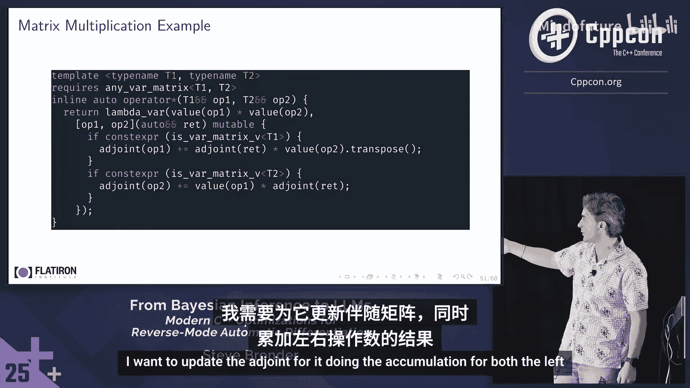

It's a nice clean code。The one huge downside， I know well another huge downside to doing thestructive arrayse approach is that you can imagine I have code like this。

 This is a little toy code here， but I make these var vector types and then I say， hey。

 I want to do Y I'm going to do a dot product of y and X。

 and then for some reason I'm going to take a slice of x for positions 1，2。

3 and assign it positions 0，1，2。 Then finally I'm going to do Z， which is I'm going to make Z。

 which is just product plus the sum of x。If we think about this as an expression graph。

 we have something like this。 The song the daughter highlighted in read， because。

They require X to be two completely different things different parts of the program。

 And the question is， how do we handle that。嗯。Again。

 when we lay this out in a little topological sort。

 you can see that some depends on x having gone through the subset assignment。

 but the dot product requires X to have not been changed whatsoever。How we deal with this。 Oh。

 one other issue with this。 We figured this out is that if you are going to choose to go this route and allow your users to do little slice operators on on these。

 you could run into very weird cases。 for instance。

 where like if you have this case where you're doing assigning 1，2，3 to 0，1。

2 if people also use eigen， you've probably also run into aliasing issues where you've been overwriting the matrix with itself。

 What happens in this case， if you do this naively is that starting from your initial point。

 you're to start overwriting all of your elements with the first point which is zero。

 So you to be super careful with this stuff。 In Stan， you don't have to read all of this。

 the point that you have to get from this graph is that。

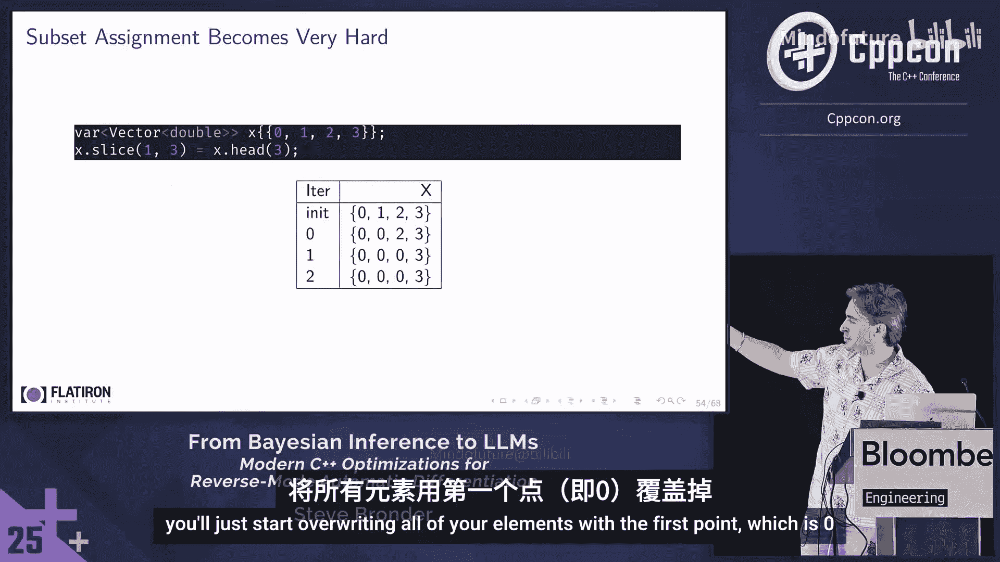

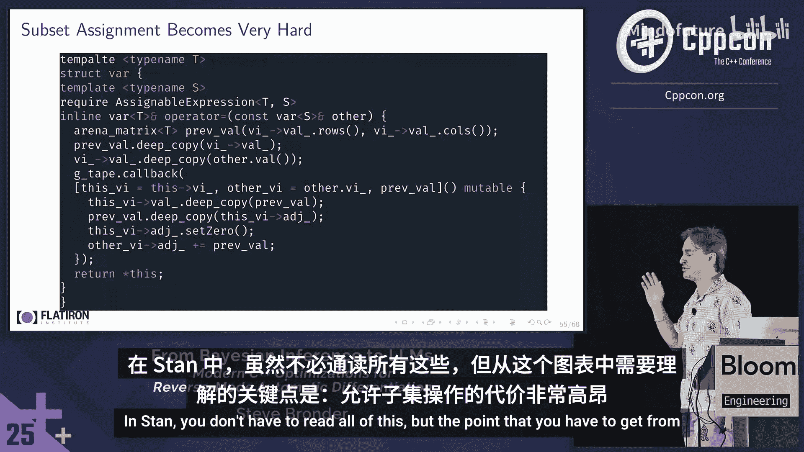

It's really expensive to allow for sub subset operations。 It's nice for your users。

 There's a lot of algorithms where it's nice to do subsets， but。😊。

Your users are not going to be playing this paying this weird。

 implicit cost of constant deep copies where they didn't know that they were going to have that because youre。

 if you implement both of them， for instance， like Stan does the matrix of var types or the array ofstructs。

 Easy， Pasy to do subset assignment， you just do it。 The aliasing issue can still be a thing。

 Besides that， you're fine。But for thestructive arrays approach， it's brutal。The other way。

 at this point， we have kind of talked about how to you operate overloading style matrix operations。

 they're nice， they're okay， but。The source code transformation， I think。

 is one of the more exciting parts of autoD++ right now， there's some cool research going into it。

 and I think that it's really ripe for like doing cool new open source packages or things like that。

So。We want to write source code transform on matrices now。

We're going to be using the type system like before。

And we're going end up writing code like this where we write these kind of placeholders representing matrices。

 var x and y， and here we're going to do a simple matrix multiplication。

 and then a summation of that， that expression is again going to be like we saw before a expression template。

And then we ask the expression， hey， how much memory do you need for my expression graph。

 It reports that for the values and the adjoints。 We then set the values and adjuints。

 We then give the expression back memory so that for expression graph。

 it has the memory embedded inside of it。Then when we call gradient of this。

We want to be able to do stuff like this where we can say， hey， like take this expression。

 I want you to reset the ad joints at first。 And then I want you to run a forward and reverse passive Autod with new values of my X and Y inputs。

 This is really nice。 The main take from this。 That's really nice。 is that。😊。

You can essentially write your expression graph once and then constantly recycle it with new values。

 but also keeping around that speed you would get from the unruling of your source code transform。

 but then just causing you to pump in new values for that given type。

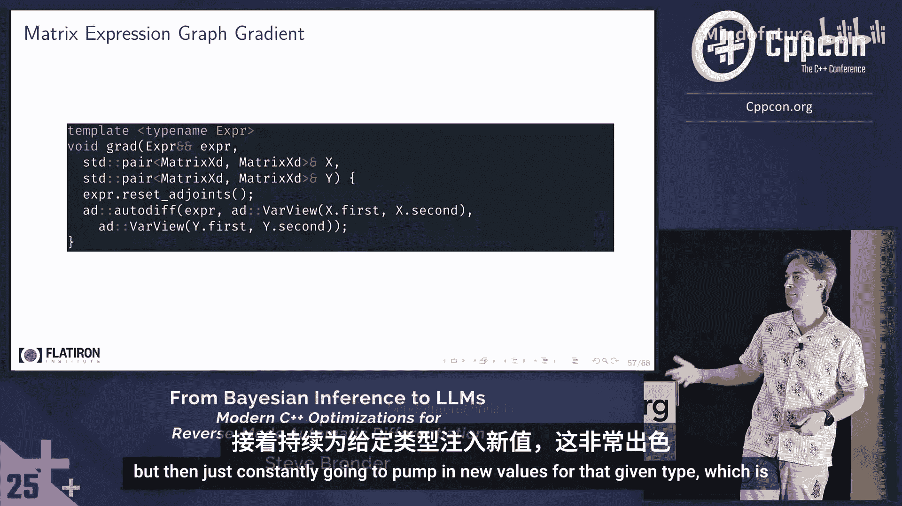

Which is super nice。嗯。There is a lot of code here。I will try to break this down a little piece by piecemeal by piecemeal。

你。The hardest part to keep in mind with this is that we。

Generate an expression graph that is itself a bunch of expression templates， but inside of here。

 we're often going to be also generating expression templates over our value and add joint matrices。

So what we do here for this v type is， again， we'll assume that all of the things we're gonna see here are never going to own their own memory。

 So， again， I have nice little free pointers just floating around。 We have a value and a joinin。

We have double double pointers for the values and adjoints。 We say how big is this particular var。

 and we keep in mind this ops thing， the constant per ops value。

 which means this thing for the forward pass and reverse pass is only going to take in one value ever。

 I sorry for the forward pass， this thing is only going to take in one value。So in the forward pass。

 we're going to be given this vVi object and we're going to say， hey。

 the pointers for these are not going to be the values and the data for the values of the pointers for values and the pointers of ajoints for the vVi。

And then that forward pass is just going to return back the values， right。

 because in the forward pass， all we care about is the values for the。

Initial path of our expression graph。For reverse mode。

This is just going to take in its child adjoint。And we are then going to accumulate into the ad jointint for this type via its child adjoint。

 and that's just it。So this is kind of what a map matrix multiplication looks like in this。

 it gets a little bit intense。 there is， these are all just the signatures we need。

 but you can see that it takes in it as a template that takes in two different opera。

It has a forward pass， taking in a parameter pack of arguments， it has a reverse pass。

 just taking in its child adjunct。And it can then you can then query it saying how big of a cache。

 how much cache do you need for this particular expression graph。

 and then you have a bind cache to say I want you to assign this memory to your element to the expression node here。

We store Op1 and Op two here， and we also then store the pointers for the values and ad jointints for this expression node。

 along with the rows and columns。

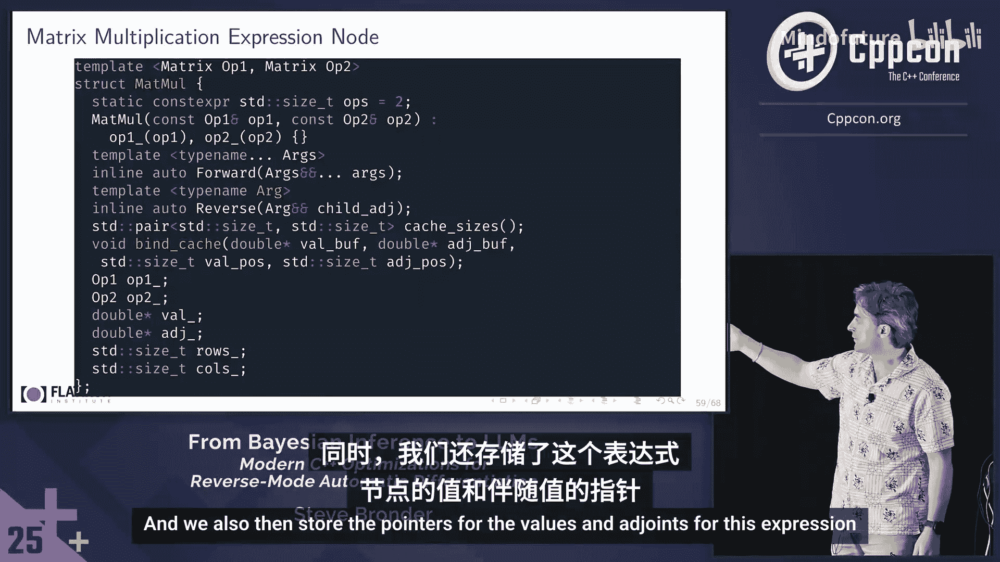

So when we do the forward pass for this， what we're going to end up doing is for。We have two。

Parents this for this note。What we're going to be saying is， well。

 take operaand on the left hand side。I'm going to ask you。

 I'm going to ask it how many operarans from my input it expects。 So in this case。

 if the left hand side was just a regular X var like we had before， it would just be a value of one。

 so we just take a little slice of our arc which would be a which is one and then pass it forward to the and pass it to the forward function of that operaran。

And the same thing for the second opera brand， we're going to say we knew we took。

X amount for the left operaand， I need X amount for the right operaand。

 make a little slice of my parameter pack for that and pass it to my forward。

 for the forward for this。And then finally， at the end。

 we do Op 1 and Op 2 multiplly together and setting the value for this particular adjoint。 sorry。

 the value for this particular expression node， excuse me。The reverse pass。It takes in a child。

We then。Proroppagate the adjoints of the child up to the current node。And then we say well。

 the left ad jointints， just like before we could have like C plus plus 17 stuff here saying。

 well do the left adjoin or just do the right adjoin for the purpose of slide where I remove those。

 but the left ad jointint is just going be the Op ones transpo times this current nodes ad jointins。

 we then pass that to the reverse pass of oh sorry that should be Op1。

 not up2 in this slide the first reverse pass should be up to Op1。

Left adjo here is going to be an expression， though。 And that's a really key point。

 As we're passing these things through， we'll be building up an expression。

 a huge expression template to be finally passed to our var values。

 which is super nice for inlining purposes But then the same thing for right adjoin。

 Sorry that is the I got up to reverse and op one reverse。 So should be swapped。

 But it's still same thing applies the。😊，Reverse pass here is essentially just accumulating an expression template of our reverse mode operations。

Then。Just kind of simple， I am going to redefine a way for the overall expression to be able to say。

 hey， can you tell me how much cash I need for this particular node？

And then we have another function that just says， hey， given these are my pointers that I'm doing。

 oh I missed a little star there， sorry， in SDD pair。

 given the pointers and the amount of cash have already allocated， allocate a certain amount to this。

 and then allocate a certain amount to all of the sub expressionpresss that are underneath this expression。

But once you have all of that。You can write some really nice， fast matrix code。 Again。

 this is just what we had before where we're making X and Y。 We're doing our sum expression。

 asking for cache sizes， assigning caches to the underlying expression， and then just running Autot。

😊，This is a benchmark looking at all three of the matrix multiplications that we just saw。

 So we're doing here is matrix multiply and then summation。

So this has the array of struct approach where the var type is like our underlying array type。

 thestructive arrays approach where we have two separate matrices for the values and adjoints。

And then we have the source code transform version。 So this graph is slightly deceptive。

But what you can see is that the baseline here is just the source code transform。

 and for the array of Strs approach， it just gets blown out of water。

 like it is just too slow for at least relative to source code transform。

The start of a array approach here looks like it's catching up to source code transform。

 But like this is more of an artifact of a poor benchmark。 The problem is is that like after a while。

 once you have a large enough end by end matrix， your time is going to be dominated by matrix multiplication。

 So Id really only look at I would really only look at this up to 10 or 30 or so。

That's just a zoom in of this。 But again， this is going back to when I was like， oh， well。

 this is a little bit of a distrustful benchmark。 we look at fast A D。

 which is does exactly the source code transform that I was just talking about。

You can see it's just a constant consistent beatup relative to pretty much everything else。

 which I think is dynamic。 So for staying， we're dynamic， at least。But。

That is the end of my presentation If anyone has questions， I'd love to hear them。

 the QR code here will take you to a ton of code that has benchmarking code for little toy examples。

 all the different AutoDF we did today。And all the slides if you want to review them。

But thank you so much for coming to my talk。Any questions I'm happy to hear them。Thankン you forズはいはい。

Now it's on。 Thank you for the nice talk。 So you present it this operator approach。

 operator rollinging approach with note implementation。

 and then what you call the source transformation approach。

That's basically a statement level reversal。Have you tried to combine this instance so that for every note you have in your graph。

 you do a statement level revveral？Yes， so what we do in Stan usually is we have expressions that kind of just represent。

 so that's a great question first off， thank you when you want to compute oftentimes the research is trying to combine operator overloading with source code transformation because right there's just points in your program where you don't need a while loop and you want the speed of source code transform。

Some parts of Stan do this。 We could talk a little bit about the implementation afterwards。

 We actually end up doing a lot of this inside of our we have a little compiler for our thing that essentially we explicitly write out。

 I have a log multiply node Like I'm doing a log of one thing and then a multiply with two matrices We just have explicit node for that。

 And then our compiler can look at users code and go， okay。

 I see that I can combine these So the user is written log and multiply。

 I know I can combine them into the log multiply function to generate that expression This is probably the hottest area of research and autod right now is how do you mix both source code transform and operator overload。

😊，Okay， thank you。 Yeah， yeah， absolutely。 Thank you。Any other questions？No， oh， that's fine。

 If guys when come talk， oh， sorry， one time， there we go。

A little tangential to the main content of the talk。

 but you mentioned topological sorting a couple times on these graphs。

 Those are non unique in general， of course， do you have a way of preferring certain sorts to another or？

No， honestly， the main reason we think about as a topological sort is just that at the end of the day。

 we want to shove things into an STD vector so we can go up and down quickly。

 right So probably not not much impact So interestingly， there is cool things for doing topology。

 So Robert Gowwer is a guy who has an awesome paper on doing particular topological sorts that allow you with just。

 sorry， there's gonna be a lot of math for one second。

 That allows you to do particular topological sorts over your expression graph to also calculate Hesians with just the reverse pass。

 So if you're interested in that， I'd say check that out， it's super interesting。

 But that's not my expertise。 Thank you。 Yeah， no problem。😊，Quick question。

 do you know I talk how they did。Dynamic they have die。

 So they have thestructive arrays approach for matrices， usually in things like piytorrch。

 whenever you doing the operator plus equals。 in the back end。

 it's really making a hard copy and saving stuff。 like you have to。

 when you're doing anything dynamic， you must save where you were previously。

 So instead of actually overriding any memory it just makes news。 But yeah。

 that's what piytorrch does as well。That was a great talk。 Thank you very much。 Thank you。

 I think if anything。嗯。I want to just say， like， auto diff is probably like one of the greatest things in the world。

 It's fine。 It's just incredibly useful。 You couldn't do most。😊，Physical simulations or。

Calculations like this without it。 I'm not really like that well versed in the low levels。

 How do I know which library to choose， I've， I've used Autodff。

But I don't really know like what the best ones are out there。

 So I'd say for if your target language is C plus plus the first thing I would do is throw away ideas of speed。

 You things should be， how can I， as a developer， get the fastest off the floor with my program。

 my simulation， right， So for that， there's an awesome。 if you。

 if you type an Autodiff website on Google。 There's a website where someone has just collected like every possible autodiff library that's ever written。

 I'd say， you know， personally， I'm a huge proponent of Stan math， I really like it。

 We don't have C make yet。 So you have to do some weird stuff to compile us。 Hopefully。

 me and Brian are going to fix that soon。I was just I was at the camp， but I love Brian。

 I work with it。 He's great。 But yeah， I'd say Stan fast A D is probably like my favorite current if package for doing matrix operations。

 It's very。😊，James Fang just kind of wrote it like for fun in like a summer。

 He's like a crazy smart guy and then messaged us at Stan saying， hey， like we。

 I wrote these benchmarks and like looks faster than Stan。 that doesn't seem right。 And we were like。

 yeah， it doesn't seem right。 But then we looked at it and we go， oh， no， you are right。

 You are way faster。😊，And we looked at it， and it was gorgeous。 If you're doing matrix stuff。

 I think fast A D is really fun。 but in general。😊，Check the fast check out the AutoDff website。

 and that is going to show you a lot of like the different packages you have available to you。

But worry about your time the most。哎。H。What is。そう。we'll talk after。 Yeah， any other questions。

 Am I overtime， I three minutes left。各夫人。I was so worried I wasn looking good questions。

 I'm getting questions。 I'm so happy。 Thank you for your talk。 I have a question on this。

 sort of the slides Simon operator。 Can it be， can it just be like matrix multiplication so that you can rotate the input to become the output。

 So could you say that again， So you can like have a matrix。😊，Mplication to do the slice assignment。

 And then the problem is just to autograph that matrix multiplication， right？

For the assignment operator， you can do a matrix multiplication to。Sorry。

 was there a slide number that you had in mind。 I can go back to。 There is a， you know。

 you have an assignment。 you have a sort of a sub slice of a vector and you a sign。Yeah。

 exactly this one。 yeah， yeah， so I I think we can just like have a say a y equals x times some matrix or some matrix times x and that matrix is going to like grab ahead of x to become y and then you can just operate on y after that。

 is that true？Again， it does matter how so at least for our implementation of R vectors。

 if you do like auto Y equals x dot slice， no copy gets made at that point。So if I had here。

 like var vector X， and then I said auto y equals x dot slice。 and then I said。Or I did Xtt head。

 and then I said X dot slice is equal to y。In our version， that would require the same。

 I would have the same aliasing issues we have to be careful of and just an eigen。

 you'd also have these exact same issues。So yeah， you do have to be really， it is brutally painful。

 We found this bug by accident，Luckiily we found it， but。

Doing s set design ref matrices is really hard。 I think Jacks doesn't even。

 I think a lot of packages just don't allow it， which is kind of a reasonable design decision。I see。

 Alright。 I have another question。 So on the topological sort thing。

 I can imagine that one graph can have like many topological orders。

 And so they might differ in their catchable quality performance。

 How are you So Lake one that is the best one。For us。

 it's really just that the topological sort example here。 for at least Stan's use case。

 there are particularly auto di packages that do do specific topological sorts to do things like I said。

 like the Hesian example。 For Stan， we're just doing the basic layout。

 And then using that to justify storing everything in a giant factor。 That's pretty much it。

 But there are， again， Robert Gawer has cool things that he's had。

 He's been thoughts about this stuff before。 So I'd say checking out his work could be super good。

Cool， yeah， thank you。 Thank you。 Is there other questions。Now。

 one last thing is if you're interested in allocators in general。

 which is a large part of the dynamic stuff we did here。

 Kevin Carpenter has a talk tomorrow on allocators back to basics。 that's super gonna be fun。

 If you're in scientific stuff And you look， I want my code to be faster。

 add an allocator of some sort Arena allocator stack allocator pull allocator。

 It will make your stuff so much faster。 So go check out that talk。 anyway， I think it's all for me。

 Thank you guys so much for coming of my talk， I really appreciate it。😊。

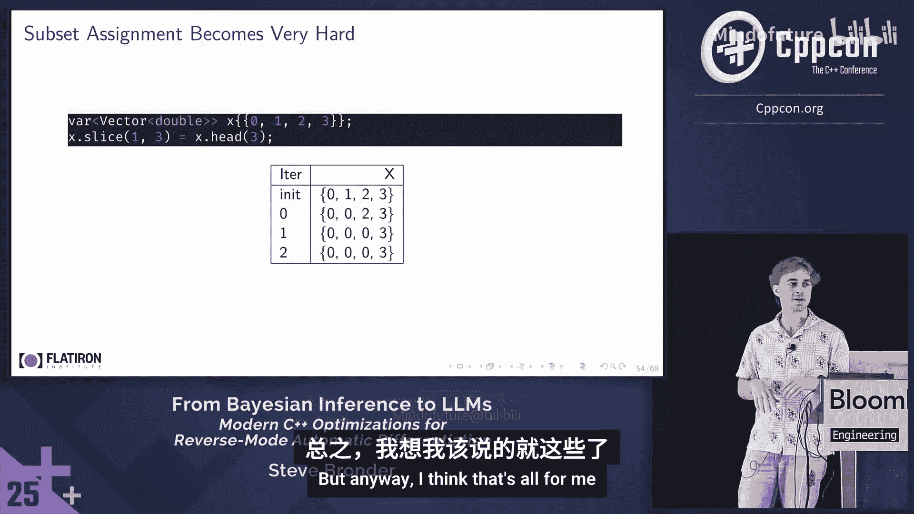

