# Cppcon-2025-｜-C++-｜-C语言--｜-汇编-｜-编译器-｜-操作系统-｜-Linux-｜-Windows-p72-P72_回归基础_精通C++友元-Mateusz_Pusz-CppCon_2025--BV1wyPBzrEeu_p72-

。

🎼Yeah。Alright， welcomee everyone。 My name is Mattpush， and today we are going to make some friends。😊。

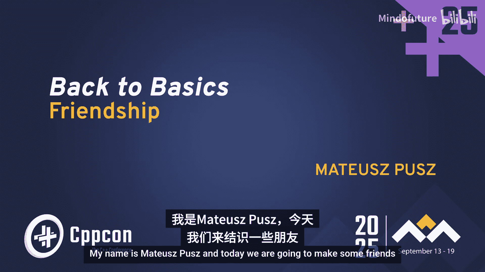

This is the back to basic track， right， So we are going to talk about fundamentals of the Cpl language。

 and we are going to scope mostly on the front keyword in the language。Regarding me。

 I am the principal software engineer at IPAm Systems。

 and also I am a trainer and the consultant for preparation。

 So I also provided a workshop during class weekend here。

 and Ill provide also one more after the conference。 It's the online workshop starting on Monday。😊。

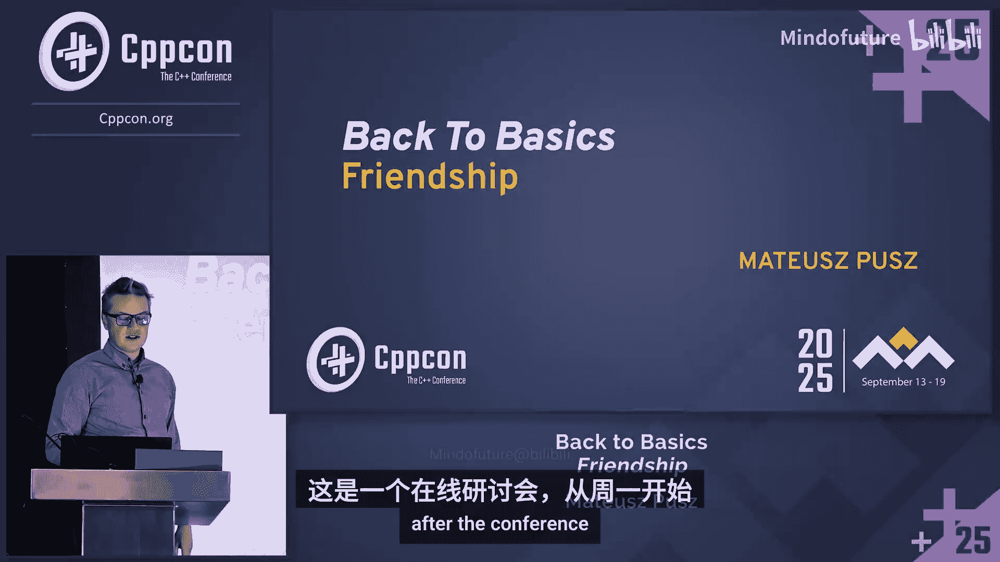

As I'm a trainer， I will provide this class in my typical work workshopy style because it's not not really a workshop because you have just one hour。

 and we actually cannot do some handson coding。 So a lot of coding go actually will not happen today。

 but。I will provide some rationale。 I will try to f， facilitate some discussion。

 try to force you to think， for example， through this quiz that you can scan the code and join。

And so this is not just a lecture。I will just pit for corner cases and provide recommendations on how to write proper code。

All right。If you want to join the quiz， if you want to have a chance to win a reward。

 a prize in the end， then please scan the code。And。Let's maybe start。We have the first question。

 I still see people coming。 So I will give them a chance to scan the code。

 So if you want to join the quiz， scan the code， because switch this light now。

Or someone can insert the code from the， from your cell phone。Alright。

 so let's start with a simple question in the beginning。 This is not a quiz。 This is not for points。

 I just want to， to provide you some， some input， some input。

 Did you actually use friend keyword in your last project。

And let's maybe switch to the quiz itself and see how it looks。So。

Did you use the Fri keyword at least once in your project or not。Yeah。Alright。

 maybe Ill give you some more time to actually join it。And， and answer。 So who't。Have a choice。

Please answer。 There's also still a link in the top here。If you didn't join。

 and I will also provide you Q code for the late joiners to the training。So。What you can see。

 most people didn't use friends。 They I either don't need it or they are afraid of it。

 or they actually asked to not use it。And we are going to talk about this today。Some of you use it。

Some of you are asking who is a friend？I hope that everyone here in this room can can be can can become our friend after this talk。

 I will revert this a bit back again for people that join。 you can join still join the quiz。

If you didn't so far。And maybe let's describe also the rules of the quiz itself。 So right now。

 I've seen that people are already there and not coming anymore more。

So the rules of the quiz are as follows。 So will be multi choice questions like we had just one before it。

 This one was not scored， but there will be similar questions。

 The more correct answers you select the better， the more points you get。 However。

 if you select an incorrect answer， you get zero points for entire question。

 So the hint is to not guess just one of the correct answer and submit the answer as soon as possible。

 because faster answers get more points。Allright。So those are the rules。Alright。

 so those other questions for from from now。 And you can choose right now one of your favorite emojis。

 Why am we talking。For a moment about what we are going to learn today。

I would claim that front is a powerful tool， but like art， it requires skill。

 understanding and careful application。We are going to talk about this keyword。

 and we are going to talk how to avoid overuse of this keyword。

 how to use it judiciously and appreciate the nuances of this。Of the scors， of the sward。

Prob you've heard a lot of statements similar to friend as evil don't use it。I is the myth of true。

We are going to find out。Com one belief is that friend breaks encapsulation and should be avoided。

 That's why maybe most of you actually claim that they are not using friends here because you are told or you know that you should not use it for some reasons。

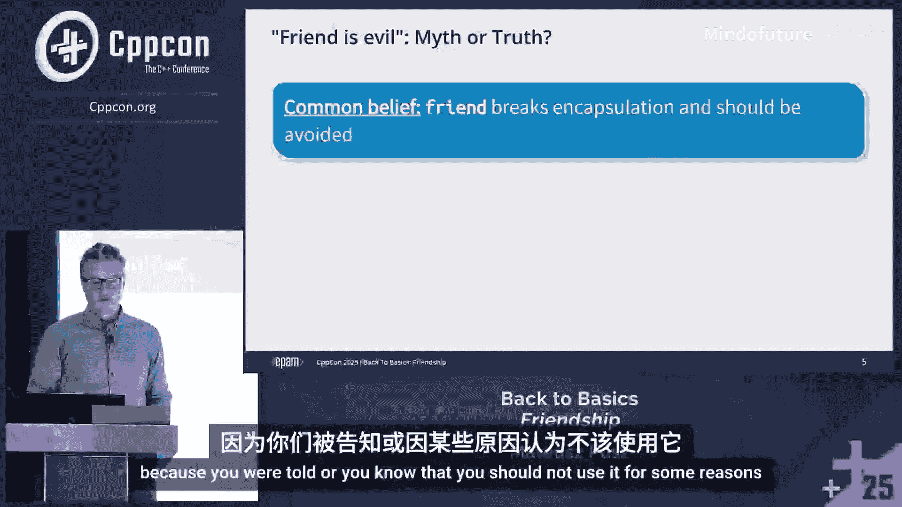

Let's challenge some of those assumptions， during this talk。I will try to prove， and。

Describe that French is often misunderstood， rather than inherently bad。

There is a feature called Hidden friendsends， which actually are really。

 really great and actually improve your code a lot。😊，TheR problems come from misuse。

 not the language feature itself。And in modern pass plus。You can actually make。

Friend shine in some patterns。Alright。So let's start with the first quiz question。

 What will be the outcome。Of this program。Where is my course here。You have actually right now。

 quiz on your cell phones。I hope so。

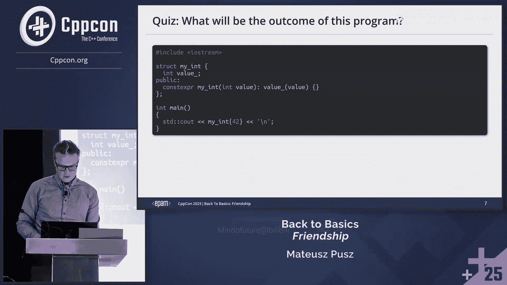

Or not。If not And then it's wait。Yeah。sorry。We have some answers，11，1213。Answers， let's see。

There will be computation error。

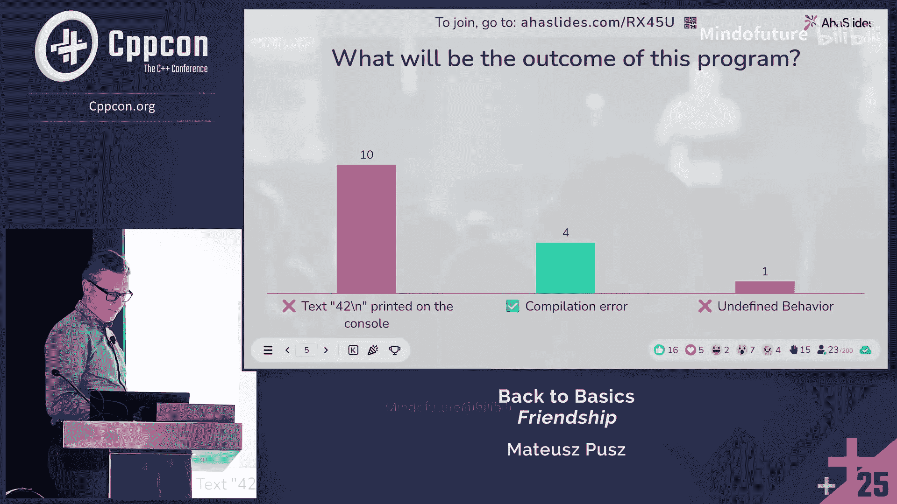

And。Our will fruit publish。Should provide this a bit longer。

 but So wanted to show you that actually the cattanese item works there for you。

There will be no text 42 on this screen because you want to print 42 from value。

 but there is no streamic operator， right， You have to provide streamic operator for this。

 for this work。Right。So this will be error you get。

And you have to provide so calledled customization point to the program you want to。Compile， right。

 What is the customation point。 customation point is typically a function that describes how to subscribe your specific type like this one。

To your engine that you want to use in， in this case， our engine is a streaming facility。

Provided with the language， right， everyone knows what we should do here， right。

 We have a wide streaming operator。 It's one of many custom points that we use。

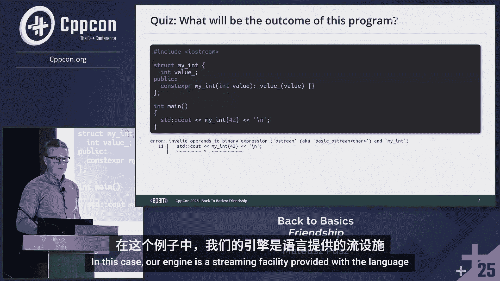

In our programs， for our user defined types。Most generic frameworks like that depend on so called argument。

 dependent name lookup。To find your customizations。

I will not talk about ADL today because I did a few years ago here on back to basic track。

 you can find my talk。youre going to talk about。Friends， but。Fs typically， are useful。

 as you will find out later on， together with ADL 4 customation points with that we are going to learn later on during the。

Talk。So again， this time。I provided here。Thete operator。I have a track with value inside。

And I want to print it this way。Again。In thequiz， next question。

What would be the outcome of this program。Where is me Crusor。I didn't get it。

There was no question for you？嗯。There should be some people answer tax value， right。

 this the same question that was before。 Maybe you didn't actuallyually noticed that is the same question that was before。

嗯。Most of you actually answered this time correctly and didn't fall into a trap that I actually provided with on the slide。

 There is no compil error。Sorry for that。 I was a bit。Tricky。

 I just wanted to grab your attention in the beginning。 This is attract， right， This is attract。

 So you， So this member is public， even though。It may not look like that one。

So there's no compilation error in this case。 And actually。

 you've seen code like this in production about cos co basis。And this goes through code reviews。

Because。It looks like proper code， right， It does a keyword that is wrong。PreviousNo。

 Brazil was also struck。Yeah， but there was no stream operator。 So that's why it failed。Right。

So beware that this may be misleading during code reviews。And this still is a public member。

 not a private one， right。So， this bringss 42。If I put class here correctly as most， as actually。

 we should do probably， then we have an error， of course that gives access to the private member。

So let's take over with a class member access control。

C plus plus offers a rich access specifiers to control the visibility of the class members。

We have public members that are accessible to everyone。

 We have protected members that are accessible to the current class， and its children。

And we also have private members that are only let accessible go to the current class。

 and no one else can see it。Right。And we have two different keywords that we already faced here during this talk。

 We have class that provides private。Access to our members， but not only to members。

 but also during inheritance， we choose private inheritance。In case ofstruct。

 we have both public access to members and public inheritance by default。Right。

 so I don't have to put public here。 This is still public interface。And in base， also。

 I have public access to base through such an inheritance。

We can make our code to compile with this class that was failing。A minute ago。Weve provided a getter。

And just provide the getter here。However， getters often are not a good solution。

Spring getters and settlers for every member of your class typically is considered as a bed design。

Alright。Typically， classes are encapsulated。 They have some private members。

To provide some wider logic or also to allow you for easy refraing of your code without affecting customers。

If you will provide a getter for every single member in your class。

Then you can also factor this because this member has to be provided even， even worse。

 if you are providing a getter that actually provides this。Integer， by reference。Then next。

 you have to have a storage of this type inside。Because with， with the value getator。

 you could probably recalculate something based on the members。Right。

 so I think I get there may work， but it often breaks encapsulation of the classes and should not be used for such cases。

If it's useful for other cases， if it's useful for， from other things， it actually makes sense。

 then you can make add a get， right。But we don't want to have gutter for many different types。 Like。

 for example， we should not have a。Getter for， for， I don't know strict internals and so on。

 references exactly to those， to those things inside。

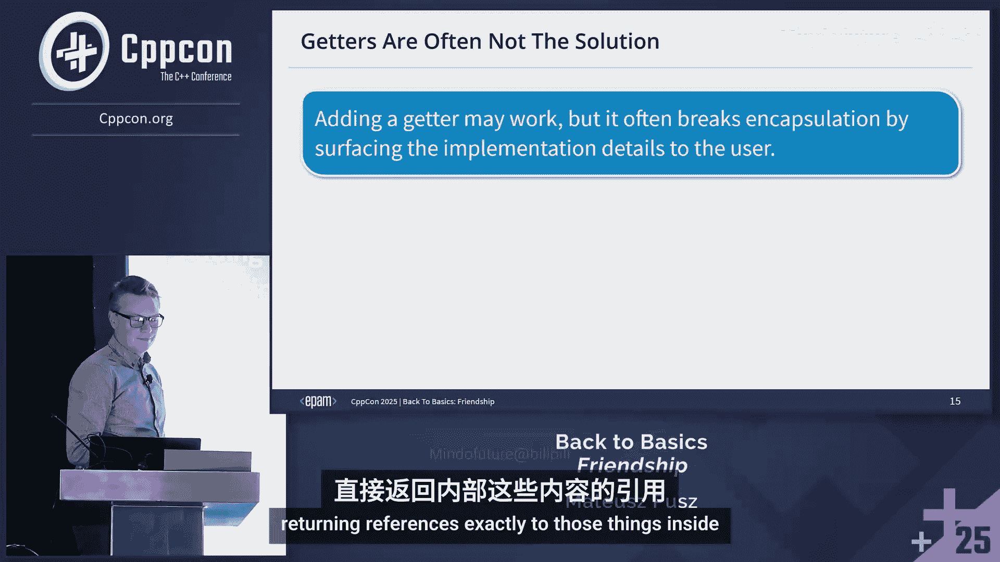

All right， next question。This time。Will have。Class。With private value。And operator plus。

That that takes another。Class of the same type and wants to add the values inside。

And they want to add it this way。 They have value 42， and they want to add  one and one plus I。

What is the outcome of this program Again， next question in the quiz， just let me switch the quiz。

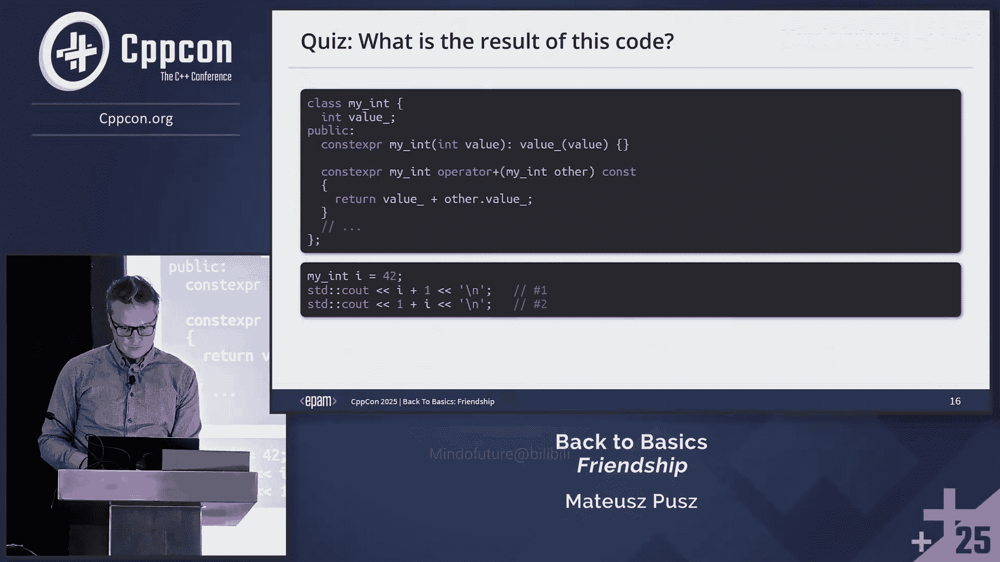

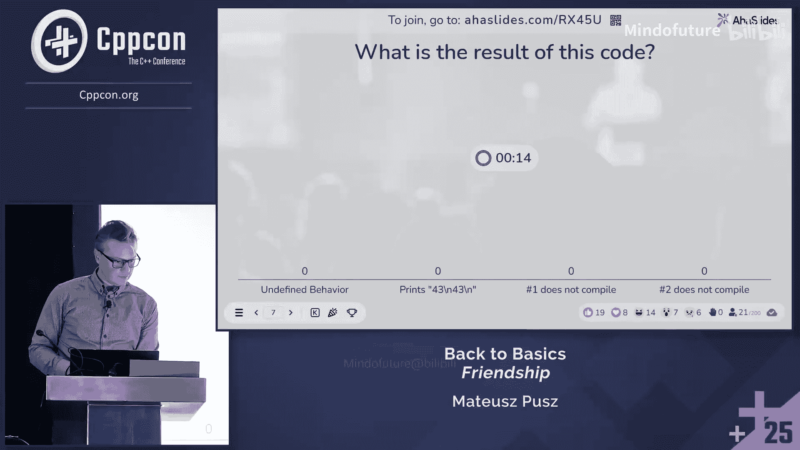

Alright， let's see the answers。Come on。Good， number 2 does not comp。 Most of you are correct。

This code will not breed ，43，43。

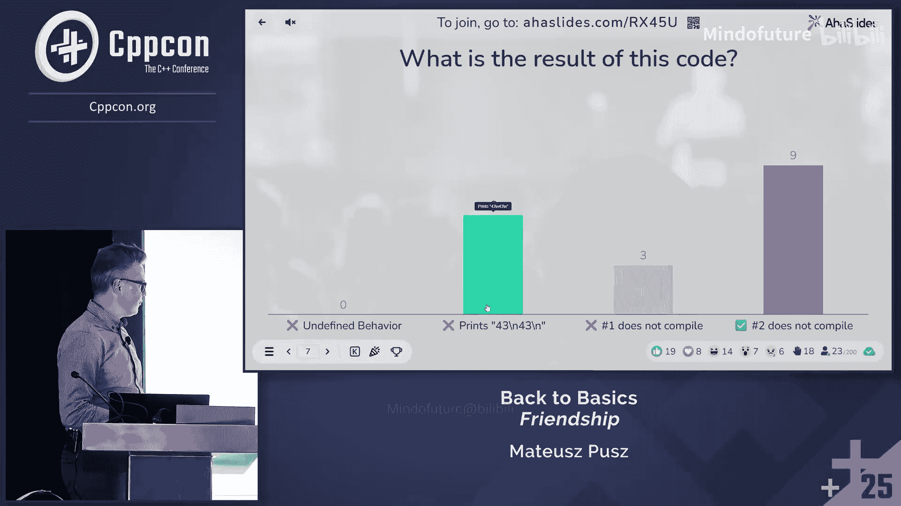

And。Number one will compile。 Number two will be an issue。Number  two would be an issue。

Because it requires the conversion of the first parameter， first first argument of this expression。

 and it will not convert。To my end， because there is no pressure that actually works with that。

Only the right hand side parameter will have conversion。 So this conversion will work to my end。

 thanks to this converting non explicit constructor。

But the lets can say there will be no comptor will just tell us that there is no preto plus that。

Works on an int， and my int。So this is not a correct approach to provide operator plus。

But the operator plus， because it it's a member， has access to our。Private value。

The correct way to do it is to make operator plus a non member function。

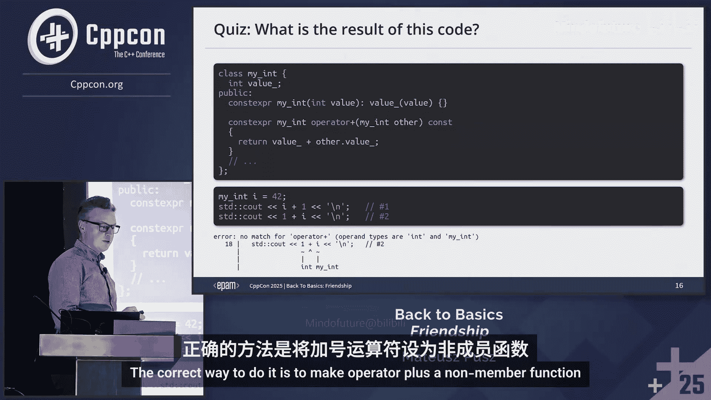

And most of the binary operators， if not all， should be implemented。As。Non member functions。Right。

 such an approach allows the convention for both arguments。

 left hand side and right hand side of our。

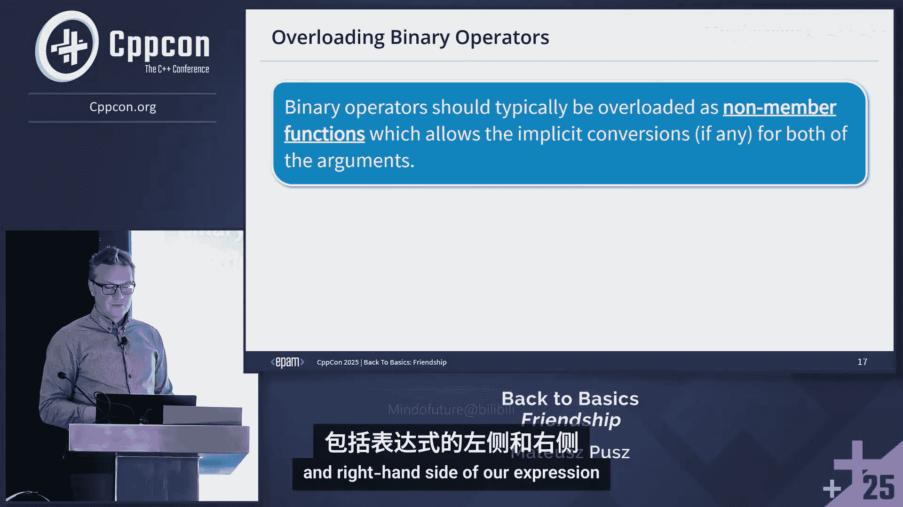

Of our expression。So， Imrovnic here。The operator plus being noable function， and S。

I don't know what a friend is yet。I provided this gutter that I said is not the best idea。

 And it works。 In both cases， we see the outcome。 It's 43，43， and it works nice。😊，I could also。

 assume this is provided。 use operator plus equals， which typically is public。

 and then I can get rid of the problems with the private member inside。

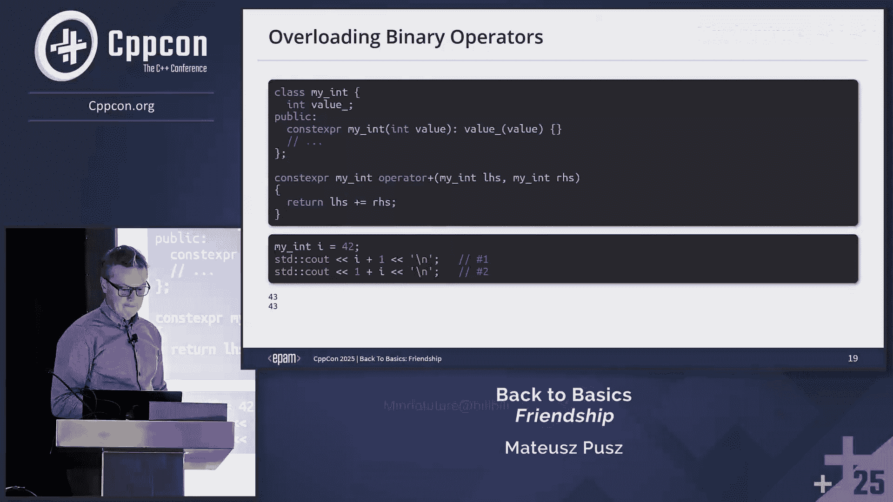

But to not have a getter， you have to talk about friends。Why the doesnt， Why does different exist。

 Access control is the key principle simple in C plus plus。

 We'd want to make sure that we encapsulate things properly that we hide some things from the user that user cannot use it。

 but we are hiding this from the user， so。Not only that cannot use it。 It's。

 the intent is that it cannot break it and also cannot depend on that， right， Her Hi is slow。

 that user always depend on everything that you actually provide， even if it's not your intent。

Because you won't。To be able to re this later on， but possibly change the plantation details without affecting the user。

Right。Snal member functions need the access to private members and cannot be printed as member functions。

 like operator plus， for example， or streaming operator that we've seen before。

 Those cannot be prevent as member functions， which will have access to private members。

 So you have to solve it somehow。 And we have friend for that。Right。

 so I declare two functions that we already seen Stemic operator and operator plus as friends to grant the access to all private members to those two functions。

And I then define those functions outside。 and I now have now nice access to our internal。

Implementation details。With that， I can add stuff。 I can print stuff。 Everything works。

So what does frienddo， F grants a function or class access to private protected members of another class。

Traditionally， friend is being used like we just did before。

 So when we need access to the private members。And this is most known。

 known use case for this keyword， but not the only one， as you'll learn later。Another quiz question。

I provided here a declarationlaration of Fri functions as public or as private。

Is there any difference， because my students often ask me， should I provide this public or private。

 Does the private mean that actually those are visible to the customer。

If they're in the private section。Is there any difference， let's。Try to answer this in the quiz。

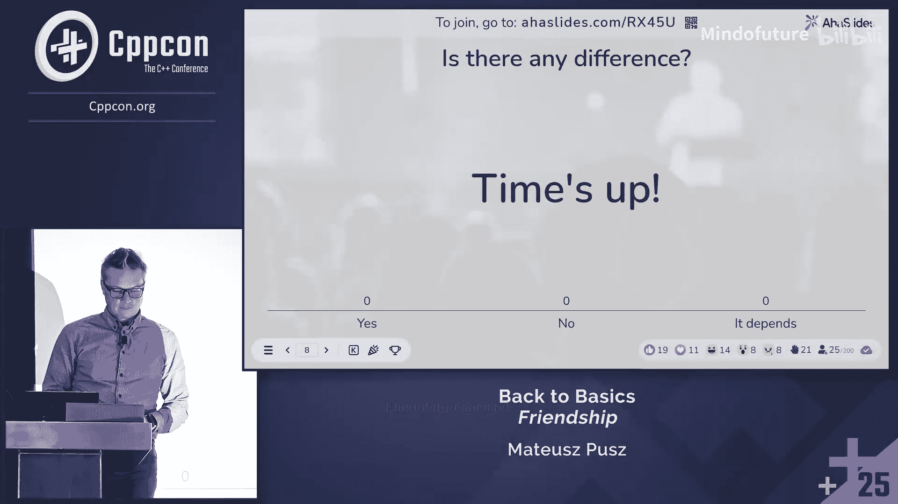

Most of you are correct。 There is no difference。 That's exactly the same。 And I love this answer。

 It depends。 In C plus， it always depends， right。That I， that's why I put it here。 But no。

 this is not the correct answer this time。Yes， this is exactly the same。 No matter what I do。

 I have exactly the same observable behaviour。 I would。 this code will just work。

Access specifiers have no effect of meaning of a friend declaration inside of the class。

 You can put it in public， protected。Private， and this will be exposed as a friend function to everyone。

Where to run to the faction that actually specified， but everyone will be able to see that。Alright。

 so what can be our friend。Can be a function， either no member or member can be a class。

Can be a template。Non member function template。 Member function template， class template。For example。

 in this。Okay， we have a bank account example。 It has a balance。 Each account has a balance。

 and we have transfer funds function that wants to come do basically to transfer some money from one account to another。

Right， Iin't even having here。The getator。Called balance。But this is constant function。

 It does not allow me to mutate the class for this member。

Exposing a member that is noncons and returnss a reference。Well。

 it' probably not be the best ideas because everyone would be able to get our balance and change it with no control。

Right， so that's why this getter this will not was here。

 And they have to make this function a friend。 So this friend has access to all private members and change them。

In a safe way。But this is slide where， right， but it， it should work like a transaction， of course。

If something go sideway。If I want to complicate my design a bit and make a transaction。A class。That。

 for example， has a run function that has check balance and then transfer。

 and transfer is a bit2 a function here。Then。I have to specify this function in this way。As a friend。

And this is the proper inheritance， proper polymorphic。

Appro where you have public member exposed to the user。And private。Victuaual functions。

As an implementationation detail， not exposed public in public interfaces。 If you can achieve it。

 it's a better design than making those functions public。And now another quiz question。Is it okay。

 right。Is does this work work as expected， Does this code compile expected。

 What might be a problem if there is any。Let's see。Is it okay or not。

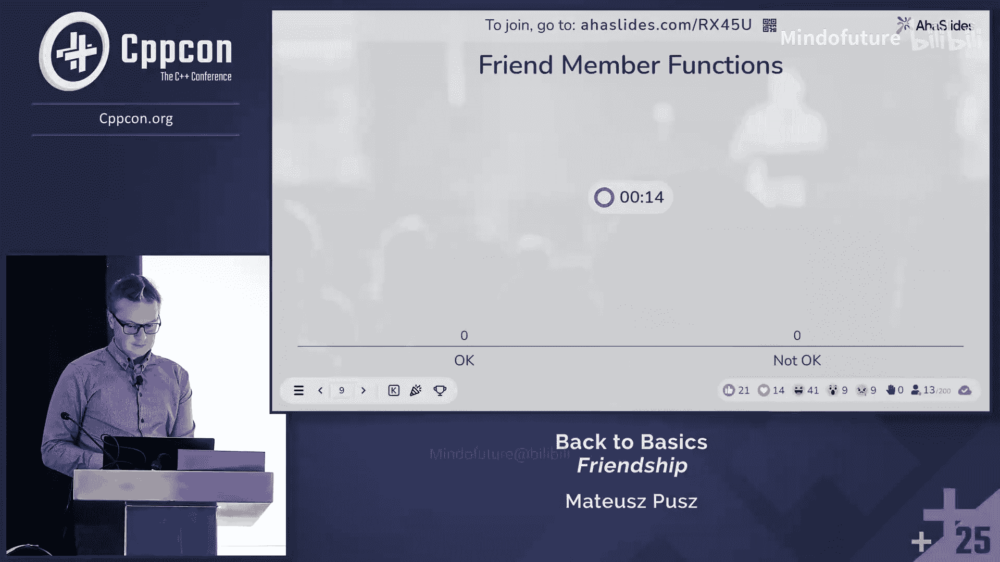

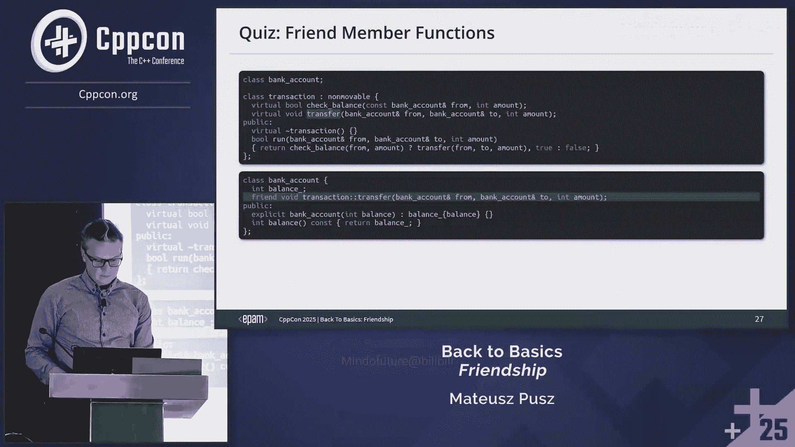

好。Actually， it is not O as。

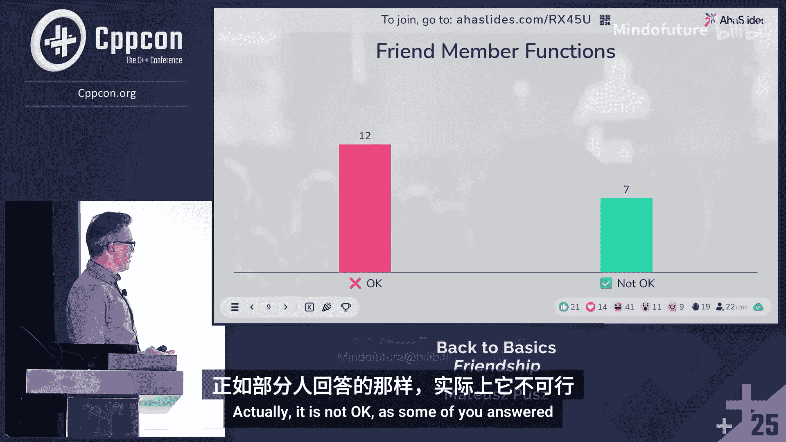

Some of you answered。 Unfortunately， this code doesn't work。

 This code doesn't work because it turns out that even though I said this is a friend and this function can act as it。

But they cannot make this function friend because as a private function of this class。

So this actually L O L O requires us to put this declaration that we have here in the bank account。

To put it and define as a friend。Of our。Of her class。

 So this one now can see this private function and make it different。A bit not it。

 but this is how it works， right。So you have to have two friends in this case。

 to make this function see our internal details。And now， again， this is another quick quick question。

 Is this code O K already or it still have some issues。Let's try to find out， and。

Think about it for a while。

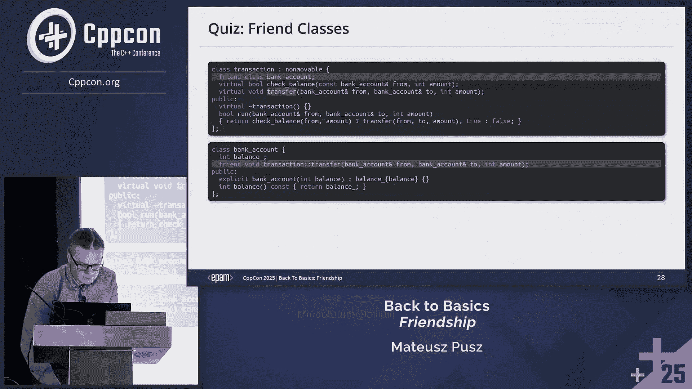

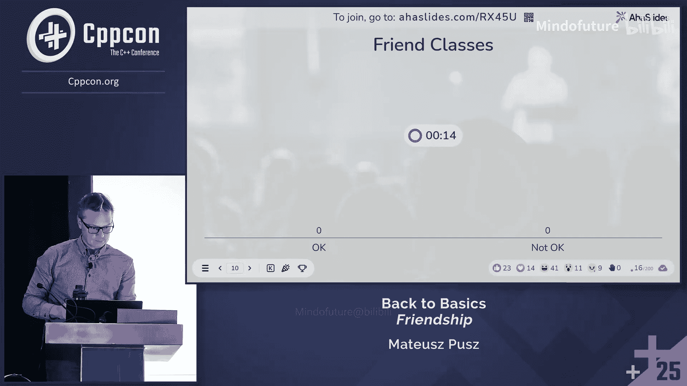

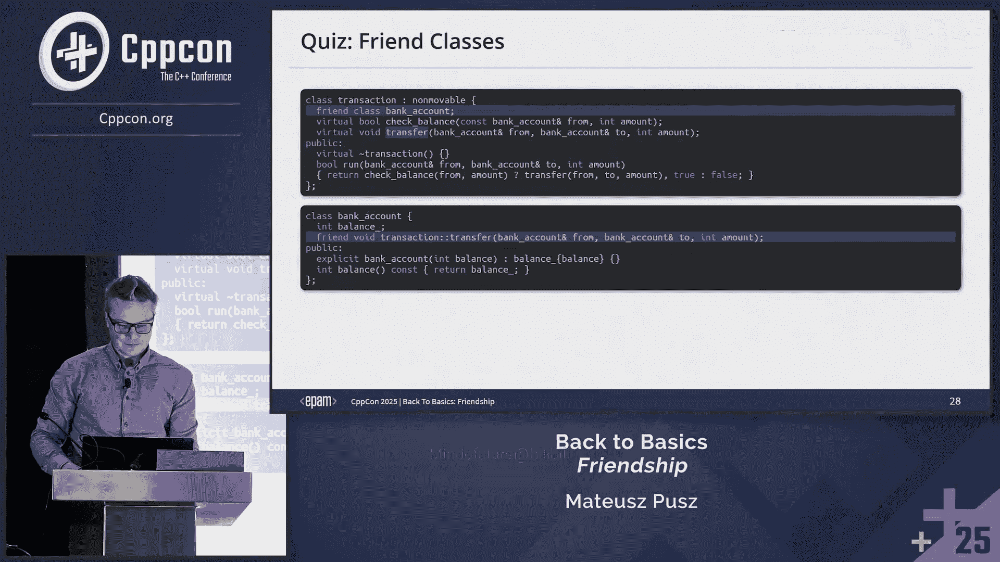

F of you say that that's okay。Most of you that is okay。 Unfortunately， it's not。

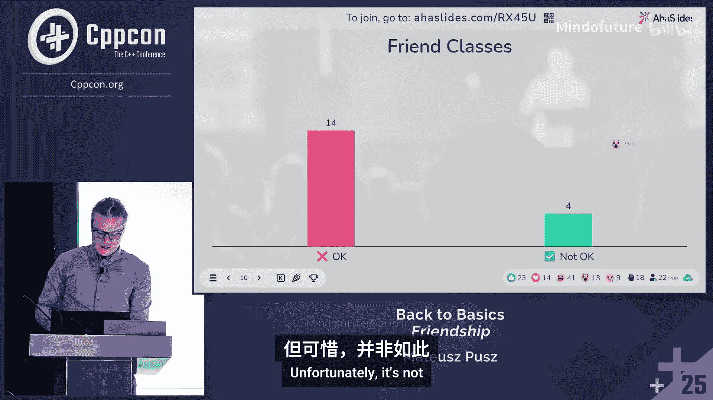

It's not because this is。This one is。A friend declaration， but not a class declaration。

That's why you， if you have want to make this here， a friend will。

 you have an error saying bank account does not name a type。And the balance here。This one。

So you would those specifyify this a front。This type is not known。

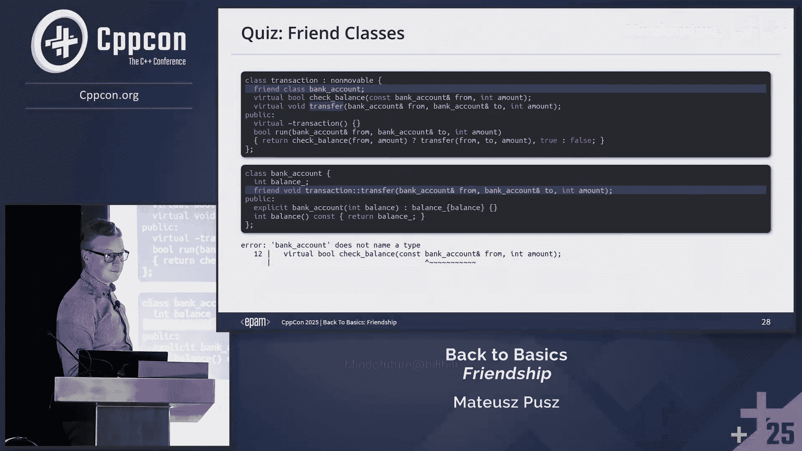

So， actually。Front class decor does not declare a class in a such a way。

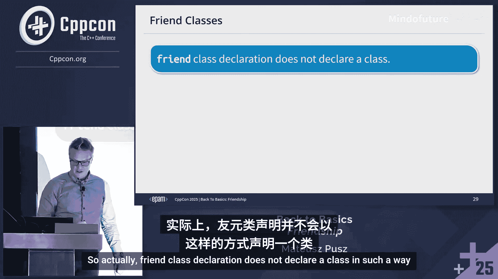

Aspec the question is still needed。 So you have to put。From for equation here， then from declaration。

 then transfer。As a friend， as a virtual function， and then friend。This function。

 so it can access our private members and change the balance。This starts to be a bit complex， right。

 but。But this is what has to be done in case you want to。Connect。Two classes。Through friendship。

If you want to make it a template。 So trust refund right now is a template function。

Function template。And。You want to declare this a friend。 You do it this way。And this just works。

However。When you want to make this representation type， also。

A representation type of this bank account。 So I moved this type name from the function actuallyly to。

 to the type here。 So bank account is also has the same representation。

 So we have class template and a function template。With rep。

You have to actually first for our declared bank bank account。 So this type is known。

 Then for our declared this function。 So compiler notes， this is a template。

 and then you can implement this function below。So in this case， we have to provide。

For the location for the class template and then function template declaration and then only you can say this function declaration for specific type rep。

😊，Will be your friend。Because we are using exactly this type prep here。

And specify industry here as well。Typically， if you have button account like， actually。

 you don't have it here。 But if you've already like copy construct or other stuff。

 you don't have to repeat rep。In those in the same class template， right。

 so you can remove this bunkm this this wrap from here and also provide here empty brackets。

 It's exactly the same because this wrap is actually what you are using in this class template。

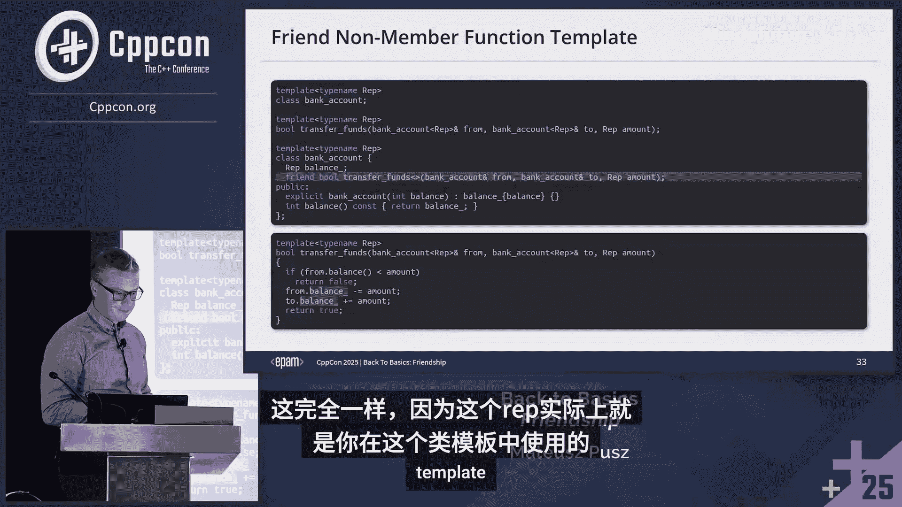

Some more examples。If you get class template and you want to say that any B is your friend。

 then you specify it this way。If you want to say this should we be of the same T。

You provide it this way。If you want to say only B of int is your friend， then you do it this way。

 And all of those work。Assuming that B is known before， right。

 because we have to declare this as a class template before。Let's talk about encapsulation。

I claim that cancelsulation is an art of baning data and behavior associated with a single responsibility。

Behind a clean interfaceface， which is basically hidden from the user， right。

 it conceals implementation details， Ses class invaris and enable effortless reraing。😊。

All this all of this is encapsulation， not just a part of it。And now I have a question to you。

 What is your。Failing can adding a member function， not friend， just a member function。

 decrease encapsulation。 So putting member functions decrease。

 increase or doesn't change encapsulation。Let's， let's try out。

 Let's find out what you think in the quiz。We didn't move the broadcastcast。 Okay， sorry。All right。

 no。What do you think。Yes， added class number function can decrease encapsulation of a。😊，Of a type。

There was a really nice article。Ba lawyerers。Who said that if you are writing a function that can be implemented as either member or non member。

 nonf non member， you should prefer to implement it as a non member function。

 That decision increases class encapsulation。 When you think Excel encapsulation。

 you should think non memberm functions。Member functions。

Don't break our ability to refactor our class。If you have 100 overloads or 100 functions as a member functions inside the class。

 and you want to change members。Thenent typicallyically， you have to。

Refactorctor entire 100 functions。If you have number functions that depend on the public entire of class。

 then the factor is easier。This is why the in basically encapsulation is broken or or decreased with every a that new member function。

And there are perfect examples of such broken types in the standard Library。 For example， this one。

This is not my favorite one。And guess what， With every single simple test release。

 we are adding new functions here。This mostly connected the fact that it's already bad。

 so it can will not be much more， much worse。 And besides。

 people love to type dot and see the list of all of the functions they can call。

But this actually makes it harder。 Now， imagine I want to change internal of basic string。

 I have to update all of those functions。I actually。

 want to propose in place string for the next version of the standard。

 And they have to provide all of those functions as well。

 because it has to be a replacement for string。So this is implementation problem for。

 for library developers。 It's a specification problem for IO members。

I have to write the paper with the so huge things。And it's also a maintenance issue。

 because if in the future， we will be able or well want to add a new member to any of those。

 We have to remember to update all of them。Because users will not be able to switch from one one another easily。

So think about it。 Think how you design in your classes。And。Try to not repeat those mistakes。Right。

 no number functions are preferred in many cases。Question， but you may come to the microphone。嗯。😊。

I understand how。Adding these number functions。capsulation。future change is harder， but if of those。

P with an external function using friend or something。You know。

 you can't change those either because existing code depends Sure， yeah， I， yeah。

 it is a valid comment， but I didn't say anything about friends yet， right，Typically， in string。

 youd probably need something like 10 functions that provide you access to。

 to the most important properties of a string。 mostly it storage。And then functions like first。

 first off and so on。 find， first off and other functions can be prevent in terms of this public interface。

 They don't have to， don't have， don't have to be in this string itself。Right。

So expose the me public interface that allows you to。

 to keep encapsulation nice and and refactor in the future and allows you to implement all of those operations and implement that them as non member functions。

 typicallyp also the great thing is to make them template。

 So then one occupation will serve all string like abstractions。 And you don't have to provide more。

😊，Right。So this makes you lazy。 And I often send to。

 say during my workshops that the best C plus+ developers are developers that are lazy。😊，Don't。

Type too much code， because if you type code typically， you might introduce errors。

 right that's easy。And we are， we want to save time and not have purpose with our code。Right。

 so 148 member functions。Plus，25 special number functions in string， and it grows。

So do France violate encapsulation。F， A C plus plus F A Q says a freight function in the class declaration doesn't violate capsulation any more than the public member function violates encapsulation。

Both of us exactly the same outcome。Right。So。If you hear from your friends that they say。

 don't do friends for， for functions because they break isolation and those the same friends like are adding members。

 members， members， members to your class。Ask them。What's the difference？Because there is none。

All right， properties of friendship for class templates。Or classes。Friendship is not interpret。

 If I specify that a base class。Here。Is a front of x。 Then base class can access x。

 but the derived class of base cannot access x。Right， we'll get an error。

Tight capping between two types like eggs and base。

 Its fine when they are created and maintained together。 There's， let's say nothing wrong with them。

 Sometimes you cannot implement them as one， because， for example， they may have different lifetimes。

But they are tightly bound together， and you can introduce some such coupling。However。

 exposing that to customers will be a maintenance nightmare and and prevent any changes in the original type。

Friendic is not transitive。If we have class X again， that Tim this， this time will specify Y as。

A friend。 and Y has access to our X。 and also specified that Z Z is its friend。

 and Z has access to Y because it's a friend of y。Z will not have access to X。

 even though it's a front of。X here， right？So here willll not be able to get pro y to X。

 even though Y has access to X。Friendship is not mutual。 here。If x is has a friend Y， Y。

 not a cell is a friend of x。Again， quoting C plus plus F A Q。

 just because I grant you friendship access to me。 Does the automatically grant your kids access to me。

 Does the auto grant your friends access to me。 It doesn't automatically grant me access to you。

That's a really nice， nice quote。2。And how friendship between classes work。If you want to。

Take one thing from this training or or this talk。 Only remember about this。

 F is not a solution for unit testing。Please don't。I've seen so。

 seen it so many times as a consultant。Right， we have some official framework， production code。

 implementationation details， more implementation details。

 and then we specify friend class framework test。😊，To provide uni tests for those things。Just don't。

This brace populationlation increases couplingping between tests and implementation。

 Nobreak changes to private members require modifying tests。They said， but design， broken design。

Actually， at least testing internal details， which， which you should not。

 You should test public interfaces and how they behave， not the internal details。

If you are doing this， it means that probably your type is broken。

 that this started to be some huge monolith with thousands of responsibilities。Like 20 members。

100 functions。 And you want to。Tells them in isolation。Just know how you should write your code。

Apply single responsibility principle。They compose the motor that you created into smaller classes where each has its own responsibility and test it separately through public interfaces。

Use the potium injection， if needed。More interfaces， if needed。

And use public getters only when necessary， right？ So again。

 you should not use getters for things just to make C operator work or not provide getters only for unit testing。

 because I've seen that as well。Right， we don't need to。 They get anywhere in the production code。

 but we need it to provide some access to the test so they can test it。No。This is also wrong。

And please， please， please， don't do it。I've seen it so many times， as well。

I went to one to to one team。 I told them to not do it。And they， O， say， okay。

 we'll remove it next day， I' coming then Burke， and they have this。不好。This is cheat。

This is cheating thedo it。All right。When friends are not needed。

If you have some class or class template like this one with some internal data and you want to implement an itertor that should in iterate for this buffer。

Then this iterator， being an nested class of storage， has private access to this storage already。

 Iterator doesn't have to be a friend， in this case。Is it an nested nested class。

 nested class has access to private members of its parent class。So， this is。Friend， in this case。

 it's not needed。Some time ago， I actually approached a really nice article by Arnna Merrt。😊。

He said that friendship is the strongest coupling link we can express in C plus plus。

 even stronger than inheritance。So you'd better be careful and avoid if possible。Friendship is。

 as we already discussed and established， is often seen as an indicator of a poor design。

Mostly caused by the lack of friendship graularity。When you。

 when you make some class or some entity T T， a friend。It has access to everything in your class。

And especially in case of those monoliives that we just mentioned。Then it may not be desired。Right。

 it can mess with any single member in our class， Not only the one that it needs access to。

 but only do to all of those that it doesn't need access to。

If you have those monolis and the refraing is too expensive。

You can use one of the idioms that I'm going to show you。So this is a huge class， let's say。

That has some session factor。 and it requires to provide。A friendship for the session factor。

 So it can call this private constructor here because it's a private one。

 only factor should be able to create our session。But we also have some other members here。

 like generate random token or even secret token here， third here。Right， if you meant。

 make this class a friend。 It has access to all of it。Right， so I can create a session that's fine。

 but I can also hack and override the secret token。Which problem is not desired。What you can do。

 you can use Pas idiom。 Pasky idiom provides a class here。That is a private class。

So no one outside can actually see it or use it。Right。

 and then you specify that such a bacteria is a threat of this class。

Is this also private constructor。So no one can construct it and also copy constructor here。And then。

 here。You specify this constructor key as the last parameter of your function you want to basically allow to use。

 In this case， our constructor。This case， the the constructor is public， you notice。It is public。

 It not。 It's not private to private anymore。And it is fine because only the class that has access to this。

Through friendship can create this last parameter of the function。Everyone sees this function。

 but no one can call it besides this one。 right， So what I're doing here。

 this is a the session bacteria that a friend has access so it can create the instance of this class。

 even with single braces here。😊，And to this， you can provide more granular access to specific functions in your interface。

😊，Important things to notice about this pattern is that before C plus 20。

 you actually have to provide implantation here。This makes this， this class non trivialvi。

 which I hate about it， but。Well， until plus 20 aggregates were broken。And you could treat。

 you could provide actual value this aggregategregating season， empty braces。

 And even though the constructor is claimed to be private， it will just work。

We fixed this in C plus 20， so it will not work anymore more。 So default is fine。 But before it was。

 it was a problem。Also， this one is needed。Because you could create such a hack。 You could say。

 I'm not creating an instance of this object。 I'm just a pointer to it， which is no pointer。

 And then the there of it。Of course， it's U。But that will work almost most with the compilers and give you access to this constructor。

Because you are not using this co this， this pointer anywhere。 So it will not crash anywhere。

So that's why， actually this has to be also provided。 And then this not， not possible。So with this。

 you are fine。Another possibility， under idiom to use。It's so called factory attorney。

What we have here， we provided all of the hidden interface here is private。 Also。

 this could start is private again， with no additional parameters。😊。

But we specified special additional class that provided session factory again， as our friend。😊。

And we have static make function。 only session factor can call this make function。

 which calls our private constructor。Right， so you have here session factory， factory attorney。

 and we call make。 We are the only ones that can call this function make。

 and only we have access to this private constructor。Right。

 so those are the possibilities to actually expose on the part of your interface to your friends。

But I said in the beginning， this is probably a bit D because this means that your class is doing too much。

And that's why you have to protect F those。Iioms。It's better to decompose it and then provide access to only specific parts of it。

 It will be much better。Alright， let's wake up。I set the two of this slide and show you this error。

Right， because there was no steaming operator。I liked。

This is not entirely true because this error doesn't look like like like this one。

 This error looks like this one。Right， I just show you the first line of this error。

 and there is 121 more。If you think that's a lot。Then it's not that bad because it's clk。

 You didn't see theTC output yet。There's a J output， not a smaller font。There is 300 lines more。

And there is a note here。 There are 52 candidates。To call your function。Alright。What happens here。

 I included only。I your stream。If I include more header files， probably this would be even longer。

This is a side effect of our customization points。If you have a popular customation point。

 likete operator， operator equals less than。There are plenty of over loads of dysfunction function of the same name Does different arguments。

Name lookup has to find all of them。 Then the Verto solution has to deal with all of them。

Which actually is not。Fine， in terms of those error messages。

Then lookup and the positions are often more the most expressive parts of your compile 10 performance。

Let's see some figures。Instead of besides having my my in that you've seen before。

 I also have my float。And I forgot to add here， operator plus。When they call it。

I get this error in it operates perhaps because there's missing function。

 but it also says no from my float to my int。Because it sees the other overload。That he provided。

Which was a friend of my aunt。Right， so it says Im， I check this over a load。

 but this one was working on int， not in floats， and they cannot convert float to int。

 This is a correct error message because this code is ex accessible to this expression。

 And the compileo says， well， I I analyze this one， but this is why it doesn't work。

Those errors are not bad。 There's actually really good ratification for those errors to look like that and beat that long。

 You expose all of those functions。 I analyze all of those functions。 None of them work。

 I tell you why。Alright， we complain about error messages being long， but， well。

 this is how we structure our code。So I said， Paul， this is not for， this is not for points。

 but let's see。Have you ever blamed templates for slow compile times of your project。어。Wow。Alright。

 so most of you didn't bring templates。That's actually surprising because plenty of people blame paying10 pay for compile times。

And some of you are really like to have really fast。B times that that's not your problem， then。

Alright， so let's find a solution for that for those longcomp camera messages， as they told you。

The name lookup interval resolution typically is the slowest week you do through compile time。

 not template instants。I can we can actually fix it。 and we can fix it with such an idiom。

 I refactored my in to not have declaration of functions and then functions defined beside behind the behind the class。

 and now provide a definition inside。 So they are declared and defined in the same class。

 my course here， right， Declar definition， Declar definition in the same class。😊，And it works。

There's no need to declare anything as if， everything is defined in a class template。

 So you have to type less。Lazy developer C plus plus gold， right。

Every time you have to write some additional code， Think if you can write less， T。

 you will have a better code。So also for function templates that you've seen。

 you have to first provide declaration for a class template， then function template。

 then actually specify it's a friend， and then provide definition。I wrote everything twice， at least。

There plenty of this。 It will also work。 You will just specify it here， and it will work nicely。

As a function template。Right。Notice that those two right now are not much different from member functions。

Right。They are nearly the same typing。 I just have to add friend additional characters to type。

 but I don't have to buy those expensive declarations。 They do not。

 I don't I don't have to search for entire file to find definition of this because it's different defined in different place than my member functions in the class。

Here， everything is the same next to member functions with not， no much overhead。

 which is much better as well。And now let's try again the same broken my float class。All this says。

 I cannot find。And I think for this function， notice that my int of a load is not visible anymore。

It doesn't propose in my email in， which is specified like that。 There isn an in my in operator plus。

 but it does't propose it anymore。My error message got shorter。 My compile times improved。

Because this is the hidden socalled hidden threat。One interesting property of those friends。

 I'm adding here another function called A， B， S。I provided this in an old style with declaration and definition outside。

 And I call A， B， S。 It works。 I did it the same with hiddenden friends。😊，And it works。Now。

 I want to call it with unqualified lookup。 for example， for the namespace name。Left column works。

 right， doesn't。That's why actually， we call them hidden friends。Their definitions or。

 or their access is hidden。 They are actually not possible to be called through dot because they are non member functions。

 So they are not be not possible to be called with member syntax function。But also。

 they cannot be caught with nonme syntax。With qualified lookup。They can be only found through ideal。

So a hidden friend function is a function that has a friend keyword。

 basically in definition declaration in the class in this line。

 And there is no other declaration we besides the class， outside of the class。

Such a function can be only found through A D， L。But I also said that most of the customization points actually look for the customization through ideal L。

So this is a perfect match。Right， classification points are looked for by AD D L。

 This is exposed by A DL so they can find each other nicely。And they will not make those overloads。

Huge when you're actually doing name， name lookup。If we had hidden friends for all our classes。

 done properly with hidden friends in the standard library。

 then you will not see those monstrs error messages with 120 other loads。

We just didn't at this point because we didn't know about this property or didn't care about this property that much。

 Now， we know better。 probably we would re di design it it differently， but。But we didn't then。

 and you cannot change right now。Right， so recommendation is to。Prefer hidden friends。

Rather than global no functions to overload operators or implement common custom custom points with common names。

Right， swap， maybe A B， S， maybe plus， right， all of the operators。

Do it even when access to the private members is needed。

 If you can implement on this as a no function because you have private problem access to the public members。

 get as other stuff， you can， But your compile times and error messages will be worse。

P doing this as a friend。Even though you don't need private access， is better。好。

You will find out that your competence will improve。And error messages will be nicer。To summarize。

Friend grants a function or class access to private and protected members of another class。

Intros strong coupling between two otherwise independent entities， like classes。

But it is fine as long as those are。Really connected to each other and cannot be merge for some reasons。

 For example， different lifetimes。Hidden friend function does not break encapsulation any more than the member function do。

Right， so there's no reason to be afraid of them。Friend easypl is not mutual， transit inherited。Use。

 friend， when external functions need special access。Right？

F that cant or shouldn't be painted as member functions， like Stmic operator， operator plus。

 those have to be that as non member functions。So and need typically access to private members。

 Then you provide them as friend。Also。You kid and friends。To improve your compilation， and。

Clarity of the error messages。Even if you don't need private actor。

And use for print for time two classes that are tightly cap， but can be mergeed together， as I said。

 for example， they have different lifetime or different entity TT numbers， right， for example。

 there may be plenty of entities TT， plenty of iterators for a vector。

 You don't want to have this fast， this feature merged into the vector interface。Avoid friends。

When public inter interface sfiifies with the exception， of course， of the hidden front。

Don't use friends for unit testing， please。Right。Also。

 avoid friends when giving access to all per details is not desired。 Try those pastky idioms。

 At client idioms。 Maybe this will help。Or use but alternatives， dependence injection。

 SP and other stuff。So to summarize。Frit is a powerful tool， but like art requires some skills。

 understanding what it means， what it does， how to use it and care for application。Have we overs。

Use it judiciously， and appreciate its nuances。Thank you。 That's it for my talk。

 But before we come to questions， I also would like to announce that I will provide an online。

Workshop after the conference started on Monday， three day。Cause， and actually。

For the winner for a quiz， I'm offering 30% discount for this course。

And now let's see who is doing her。Doc， congratulations。What is duckuck？Here。

 I hope you are interested in getting the class。 There are also different things that we are going to discuss。

😊，Cot on me after that， we'll find it out how to auto make make a vote if you are。

 if you're interested，50% discount for the。Post conference class。

I hope you are still not registered as my student。So。

 so it will actually allow you to access this with， with 50%。

Discount。All right， time for questions。Thank you。No questions， everything clear。All right。

 if there are no questions， then。Thank you very much for coming。 I am here until Friday。

 so you can find me easily。 We can talk about friends， other E plus+ Fis trainings。

 IO whatever you are interested in。 Thank you very much。 And having a nice time here。😊。

