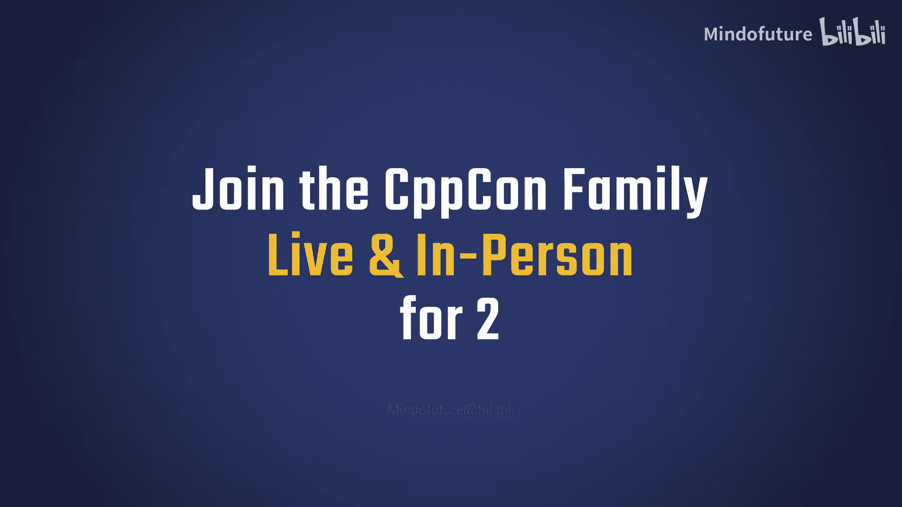
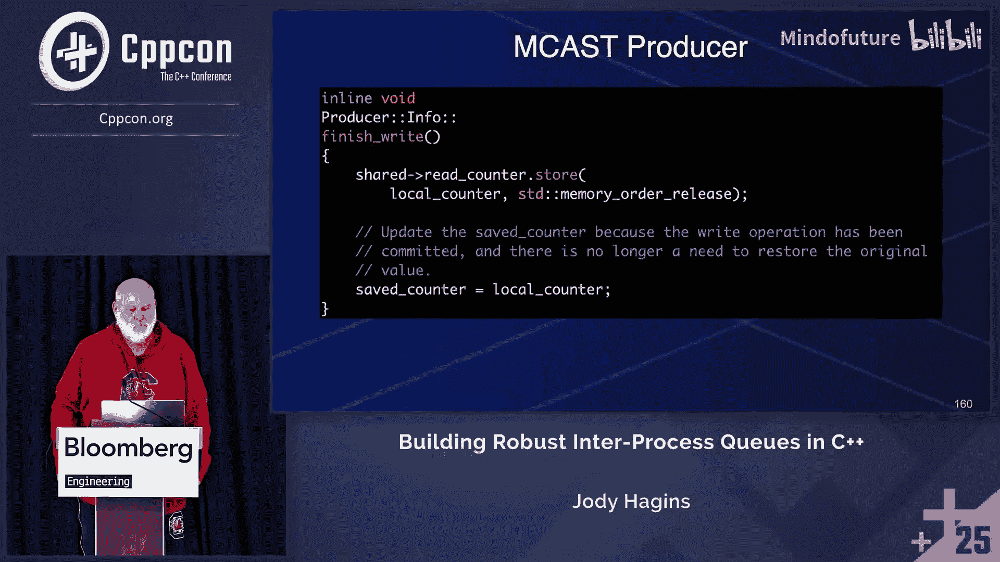

# Cppcon-2025-｜-C++-｜-C语言--｜-汇编-｜-编译器-｜-操作系统-｜-Linux-｜-Windows-p73-P73_如何构建健壮的C++进程间队列-Jody_Hagins-CppCon_2025--BV1wyPBzrEeu_p73-

🎼The Rockies are over there。🎼Don't just go to the conference。

 go and see the Rocky Mountain National Park， go hiking up at Bear Lake or something。

 don't do what I did， which is just to come for the conference， go and see the area。

So while he tries to get this going here。嗯。I'll at least start from somewhere。I'm Jody。

And today we're going to be talking about。Inter processcess cues。

 We're not going to be talking as much about the cues themselves as issues that come up when you try to use cues across processes。

 because C plus plus says。Almost nothing about processes。And。As a result。

 there's just wisdom that you acquire over time， there's things that are defined in the language。

 there's things that work， there's things that work most of the time。

 and there's things that work some of the time。I gave a talk similar to this at C++ onC earlier in the year。

 and in there I go into more detail about how these cues work， how the atomic operations are done。

 I'm not going to go into that today， since then I've actually gotten a few questions and had several discussions and so what I'm going to do is I'm going to try and talk about things I will go into those issues and some of the basic issues like our favorite implicit lifetime stuff。

But I will also spend more time on some details of implementation。

 including how to implement the magic buffer， because I've had a number of questions about that。

 how you。😊，Do several other things。 So there'll be a lot of code。

 and hopefully we'll actually be able to see it because。

I don't think speaking C++ is probably in the cards for any of us。In the past few years， I。

 this is a very close， close community。 And I've had a lot of people asking me about my wife。

I've gotten to where I was just give people updates when I speak。

 because that was kind of an easy thing to do。 It was easy， because。Things were going well。

 A few weeks ago， we had our latest visit to the doctor， and they're not going so well anymore。

So I just wanted to at least give you an update。The the cancer in her lungs and her liver is pretty much about as active as it was back a year or so ago。

 and there's they've run some tests， there's not a whole lot of known treatments that are supposed to be effective for her。

 so she starts a drug trial on the 25th next week。So。I'm not sure how that's supposed to come over。

 I don't know。 We're very hopeful。And I hope you'll be hopeful as well， but it is the way it is。

 and I can't just come in and say， hey， she's doing great and then when she's not just not saying anything at all。

But she was supposed to come here this week， but she's not feeling so great。 So she。

 she stayed home in South Carolina。But when we talk about inter processcess cues。

There's some things to understand。First， when I talk about message cues。

 I'm not talking about task cues， I'm not talking about cues。

 job cues that most of us are familiar with， like you have a queue and you have some tasks or some jobs and you'll put them into the queue and then you'll have a bunch of workers that come along and take the task off out of the queue。

 they'll execute the task。 and if you have 10 or 12 workers and you put 20 things in the queue。

 those 10 workers as they get stuff， they'll gobble the first 10 things off。

 And so each one of them sees the first thing on the queue。

 and that's what we think of mostly with with cues。 There's a specific type of queue。

 that's not what I'm talking about though。Password。Oh。Oh gosh， I can't even see it。Oh。

 that's not the evidence。Here we go。That's right。So I'm talking about message cues。

 where you actually put a message on a queuee to send a message to someone else or to some other part of processing。

If you're familiar with actually Alan Kay and the old original idea of object orient programming。

 he claims that object orient programming is all about the messages。

It's all about the messages that are sent between components。

 that's what object learningient programming is about and the encapsulation of those components so that it's just about passing messages and getting work done。

I had a talk in 2022。Where I talked about reviving an old design through using a thing called streams。

 and I was excited about it because now I can implement that in a standpoint at compile time。

 So when you think about message queuees， I want you to think about them from a conceptual point of view。

We're going to talk specifically about message， concrete message cues in shared memory that are being shared across processes。

 but when we think about message cues， we can think about them from a conceptual point of view。

You think of a message queue， it could be a pointer in a register that gets passed to a function call。

 but if you think about just ideas of I've got some stuff to do and I'm going to pass messages between each component。

It really gives you a lot of composability。 gives you a lot of ways to build systems。

And put them together because you don't care where the next thing is。

 you're just going to pass a message， the next thing may be a function in my program。

 the next thing may be a cue to a thread that's running in my process the next thing may go to a shared memory cu that's read by another process。

😡，It may be something that goes to a queue that then gets forwarded across the network to something in Europe。

You don't really care。I mean， unless you're worried， unless you're concerned about the latency。

 but as far as from writing your code， it doesn't matter where these things are。

So when I talk about message cues， these are the types of cues I'm talking about where you're putting messages on a queuee。

 obviously in my background， I want very low latency message cues。

 so when I talk about cues between processes， we're going to talk about cues that get mapped。

Into your address space， they're shared between from one process to the other and there are fiIFs。

 you put a message in and the first one comes in， the first one comes out。

 if you've got one consumer， then that consumer will consume those messages。

 if you have multiple consumer then every single consumer gets to see every single message。Now。

 it's hard to go on too much farther without being able to show code or examples。 But well still。

 maybe I'll just turn my computer around。But if you so use， oh， there's something there。

It's not playing it， though。 He's dropping once I play。 Well， I'll， I'll try and see if I can。

Go through。 Yeah， let me see what。Let me see what I can do here。 But you know。

 can we get it back to where now oh there it goes。You can see something there。

Let me see how big I can make this。啊。嗯。嗯嗯嗯。叫什么 idea点。

It's a good thing that my talk is code heavy with code samples to show on the screen。

 maybe we can act out message cues。So， well I'll just talk about some。

 some things that I don't have to show you on here， right， some with some code。

 So there's one problem that we have。 If you look at message cues that come about from the Internet or things that you might be familiar with。

 you're probably familiar with single producer， single consumer message cues that are based on atomic counters right and so you've got an atomic counter。

Um。あ。You've got an atomic counter for the reader and for the writer。

And they basically have this buffer。 And the the right。

 the right counter is where their writer can start writing bys。

 The read counter is where the reader can start reading bys。 And these are atomic counters。

 And you just move them up。 The writer moves it up， write some， write some bites。

 The reader sees where that is。 and he can come along and write behind them。

 These are usually done in。These are usually done in big buffers。

That are that are like circular cues。I could probably do it without notes。

 but it's really hard to do it without anything， but。If we， we think about these types of cues。

They're okay to use within a process across threads。 And we've probably seen them all before。

 One of the very best talks on this was done。A few years ago right here at CPPCon。And about。

 and it was about implementing the single producer single consumer cues。

 Talk about all the intricate information。So you'd think that we should be able to go and take Charlie Fraash's implementation or take the Rgtorrp implementation or take the Dwgd implementation or take any implementation that we've seen and just be able to take that data structure and put it into shared memory and put it into shared memory call MMap on it or call virtual aEC or whatever however you're going to share it across your processes。

And just shove those things in there。But the problem immediately becomes。

 what about the pointer to the buffer。Because in two different processes。

Even though they're pointed to the same memory。They have different address spaces within the processes themselves because they have their own address space。

So they can't share a pointer。 So inside your data structure。

 you're going to be able to have to have a pointer for the reader and a pointer for the writer。

 And that's okay。But what you then have to do is you have to make sure that when the writer and the reader come along。

 that they get the pointer so that they can put data in and that only they get it。

 if you think about the API for stood queue，Stood Q。

 you can push and you can pop and it has a couple of construct， actually has 14 constructors。

 It has a bunch of things。 In fact， even though it's a queue。

 you can actually look at the first element and the last element。Kind of interesting。

But what we want to do when we're talking across processes。

 we don't have the luxury of having code and having a policy that says， hey。

 this code should only use the push part of the API of that queue and this code should only use the pop part of the API。

😡，The API for Q has both of them。You can create the queue。 You can add to the queue。

 You can read from the queue。 You can write to the queue。When we're across processes。

 we have to be much more careful， I'd argue we have to take this amount of care with separation of concerns。

 even not going across processes， but if you imagine one process could create the queue。

 it creates the queue in shared memory， another process could be the producer and another process could be the consumer。

So why do we want the producer to be able to consume things？And if we have a producer in one process。

What's to prevent some other process from just being started up and saying， hey。

 I want to be the producer， too。Well， with normal APIs， there's no checks。

 and I've yet to find an API on the Internet， I know they exist in production。

 I've yet to find one on the internet that actually does anything with this。😡。

wonderonder how far we can get on here。not。Change what？没问题。The zoom in the top left。I'm sorry。

 don't do that， don't do that。系。Oh喂。は。😊，All right， well I can't see here， but I'm okay with that。はい。

I have no idea where I am in here， but it doesn't really matter。 I think we just， we've had a blast。

Okay， so。Yeah， we， we talked about this。 We talked about that。

 We kind of talked about some of these things。We pretty much talked about a lot of this stuff。

 and I don't have a whole lot of time left。 I， I doubt they're going give me a whole bunch of。

 I doubt they're gonna give me extra time。 So I probably need to just run through this stuff。

Oh and you know what？I'm afraid to touch it。 I can't see my notes either。

You should deal with you now I can set you up for that。Is it not going to break？😀Yeah。は。Yeah。

All right。But when we talk about these we want to talk about a separation of concerns right and we also need to make sure that if it's a single producer。

 single consumer queue and a process starts up over here and becomes a producer that as processed over here doesn't also come up and get a producer。

 most of this is done in our modern code bases by convention， right oh yeah。

 you're going to be the producer， you're gonna be consumer。

 it's undefined behavior if we have more than one of these。It's hard to。

 it's hard to enforce within a single program。 It's almost impossible to enforce if you have multiple processes。

 So you want to have a separation of current concerns where you have。

 at least an object that represents the cu。 That's all it represents is the queue。

An object that represents the consumer and an object that represents the producer。

 The only thing the consumer can do is。Read stuff off the queue。

 The only thing the producer can do is write stuff to the queue。Thank you。 Thank you very much。

He's been working on that since 20 till。That's been 45 minutes， he's been very persistent。

So this is actually a good book here and in talking about separation and concerns。

 this is actually a good design book， I recommend it the first two chapters are pretty much full of a lot of ideas。

 separation concerns and similar things regarding it grabab Klaus at the conference He's here and talk to him about the book he'll be very happy to talk to you all night long。

But when we talk about these separation of concerns， we want to talk about the queue。

 the queue' is in charge of its construction， its metadata and its buffer。

's in charge it's in charge of synchronization。 What type of synchronization does the queue itself。

 It's not a producer or consumer Well， it has to synchronize with other people trying to create the queue。

If you're supposed to create the queue， you should only allow one thing to create it。

 Well what happens if two programs try to create the queue at the same time。

 You need to have some type of synchronization there。You have the producer。

 The producer must have an existing queue。 There's two general ways of doing this。

 One is by having the queue have a， you know， make producer factory function or something like that。

 make consumer or have the producer take the the queue as a parameter to its constructor either way doesn't really either way。

 there are pros and cons each one。 But usually one way or the other will fit in with what you're normally usually doing。

I prefer to have the queue create the consumer and the producer rather than having the you create a producer and pass it a consumer or pass it to queue。

 I just don't like the idea of passing a bunch of things into constructors so。

But and then we have to observe the Highlander rule。There can be only one， right。

 if they're supposed to be a single producer， there should only be one producer at any point in time。

 trying to create another producer should fail if there's already a producer in， in existing。

And a producer can only write into the queue。 The consumer， just like the producer。

 must have an existing queue， There can be only one in a single consumer scenario。

 we'll see later when we have multiple consumer scenarios。 In that case， there can be more than one。

And it can only read from the cu。 That's all they can do。 Okay， I hope this makes sense。

 And I hope the， the importance of this gets to you， especially across processes。

This has to be enforced by code， it can't be enforced by convention。😡。

We'll talk about how we enforce that and some problems that arise because if you want to enforce this。

 you're going to have some problems immediately， I'm sure some of you are thinking if you're going。

 well， if I'm a producer and I grab the lock， whatever the lock is saying I'm the producer。Sorry。

 my voice just reminded me when I was 16。If you're， if you're going to be a single producer。

 what happens if the producer crashes？ Well， if it shuts down， the de runs。

 And so the de should be able to at least release the lock saying it's the producer。

But what happens for crashes？One of the things I passed by in here was that。One of the things for me。

 as far as an intra processcess queue， it needs to be recoverable。In other words。

 if the producer dies， I should be able to start up or have another producer already running that can pick up where it left off。

On the same queuee and be able to pick up where left off。 Well。

 how do you do it if it dies and it crashed while it was holding the lock。

These are issues that we have to solve and we have to at least address in some way。

So I consider this not optional。I really do consider that if you're going to write cues across processes and you do not separate these concerns。

That' it's just that's not。 that said to me， that's a non negotiable thing because there's。

Because I've done it the other way。And there is lots of pain there。It is pain that you experience。

Four days。And the trauma lasts for weeks and months。In years。Decades。Yeah， not optional。

So there's one thing we could do。 we could have an advisory file lock on most systems today。

 like I'll admit， I don't know anything about Windows。So I'm not going to talk about that。

 mainly this is about Linux and MacOS。On most systems。

 you can represent shared memory as with a file either in like devSm or dev huge pages or someplace on Linux and Mac。

 you can mount a temporary file system that is RA resonant and so you can do the same thing represent them with files you can do this you can have an advisory file lock advisory fileile locks sound awesome and there's lots of things in the operating systems in both Linux and Mac OOS that provide access to advisory fileile locks。

 The problem is that none of them really work or none of them really work the way that you and I would want them to So you probably want something like this which is an advisory file class that implements something that allows you to manage these file locks and that automatically make sure that they're released when it goes away。

Inside of your cu， you want to have a set of characteristics that define your cu。

 make it differentiable from other cues。 You probably want to have in the metadata of the queue itself。

 some type of signature。 This is just some type of maybe even text description of what kind of cu this is。

Because you probably will have three or four or six or10 some number of Q implementations that are designed specifically for the task that you're trying to work with。

😡，Single producer， single consumer， Mcast cues， that're not all made the same。

 They're not all great for。 There's not one of them。 That's like the best thing for everything。

 So you'll probably have several different ones。 You want to have a signature。

That will probably represent the kind of cu that's there so that when the producer and the consumer Rndezvous。

 they know my code is built for this type of cu。 Let me make sure that that's what I'm looking for。

 You probably also want to have a UUI。Why？😡，Jody， why are you going to put a E I in there。

 That sounds kind of stupid。Well。If you've ever had a program that runs producer and a consumer and they rendezvous on a file path because that file path is supposed to be unique。

 And yet， for some reason， the clean， the clean script didn't clean it correctly。

 Now you have a producer and a consumer that are connected on different cues that aren't don't have the same I。

 You can possibly want to。Get fired。Or not want to get fired， but maybe get fired。

So having a UU ID in here， whenever you have the rendezvous point right somebody creates a cu and they say。

 hey， here's where you go to find this queue， and by the way。

 here's a unique identifier of that queue so that when you connect up。

 you at least have some way of verifying that you're talking to the right thing anytime you have processes that are doing lots of things you've got some type of orchestration or coordination among them。

This has nothing to do with a message， has nothing to do with atomic。

 it have nothing to do with speed， it has nothing to do with fast。

 it just has to do with trying to make sure that you represent an update in the queue so that you can connect and make sure that you're not going to have problems later on。

How many times are you going to connect to something to the wrong queue？Never。Except that one day。

I mean， I don't know if you guys have ever been part of something where you can actually say that there was a problem that happened。

The problem was isolated。A person interceded， decided to shut the system down。

All of this happened in less than 60 seconds。And you still lost millions of dollars。

This is something that can happen。And so making sure that these kinds of things don't happen。

 it's always important。I gave a talk a while back on that talked a lot about what happened with night Capital。

And it wasn't one error。 It wasn't one thing that happened。You take a dozen things that happen。

 any one of them， if you say this doesn't happen， most of us never even know that incident occurred。

Pay attention to the little things。Youll have your message size， alignment， cash line size。Flags。

Telling it whether it's a single producer， multi multi producer。

 what type of things are are are allowed， whether it's an actual inter processcess queue。

 Why would you put that in there。I know if it's in process because I'm going to find it on the system well you also have cues that are not inter process and you might have threads that connect to them。

 I mean bugs happen， so these types of things help make sure our systems are robust which was part of the title right。

 robust inter process message cues。We have our metadata。

 which keeps our buffer offset of where our buffer pointer is， our characteristics。

 It allows us access to our producer lock and our consumer lock。

I said earlier that if a producer comes alive and gains and a producer's constructed and it is the only producer allowed in the system。

 there needs to be some way of ensuring that it's the only producer。Well， you can grab a lock。

 you can grab a mut text， and it can hold that thing， but if it dies。

 it will not release that mut text。 that Mu text is sitting in shared memory or some。

 you have some counter or some atomic or something。So what I do here is I have a unique process I D。

 Now， this is not the P。The pit is not unique。The pit is small and it gets reused。

The chance of you reusing your pit is pretty small， but it does happen。 So this process I D is a。

 it's going to be an atomic value， which is why we try to see， Can we， Can we use a 128 B atomic。

Because really what it does is it stores the process ID。

 the PID T that was given to it by the system， and it stores times the time that this process started in as much granularity as possible。

 hopefully in nanoseconds， because it's unlikely that you're going to recycle through all the Pis in that amount of time。

On Mac， this works for 128 on Linux， it doesn't。 well that's not true。 that's not true。

 depends on what system you're on， the Linux sheets I use， which are all intel X86s。

 they only go up to 64。But。Theoretically， it's possible that with this type of process ID that you could clash。

But。It's very unlikely， I mean， the sun will explode tomorrow before that happens。

So this process idea is 64 B。 It's expensive to compute， though， because on both Mac and Linux。

 it has to do some stuff on Linux， It has to like read slash dev proc and do some。

 some operations and things like that。It's expensive。 So we want to cash it。

And so here we cache it with an immediately invocable lambda。We store it into the Id。不。😡。

When I was C++ on C。I paused right here， and somebody said， but what happens if it forks。

I was pausing because I was wondering if maybe， maybe that would happen again because that would be really cool。

 So what does happen if， what does happen if you fork。😊，Well。

 you're going to have to do something like this， when you do things across processes。

 you have to think about stuff like this。Because if you're doing cross process communication。

 you probably have at least one processes in your system。 that's the orchestrator。

It's orchestrating things and forking and exactecing and probably doing more sophisticated things in order to set up environments for your children。

 your child processes。So this is， this is an important thing to at least understand。

Which brings me to。Kind of my next point here， oh yeah， so this ID equals。No。

 we can set Id equals something because it's static。 That address is known。

 We don't have to capture it。Because P thread at fork only takes function pointers。 P thread at fork。

 basically， this says。What this code here says is that whenever a fork happens。

 that first function prepare is going to be called。For anything else gets done。

The parent will be called in the parent after the fork。

 and the child will be called in the child after the fork。

The operating system will guarantee that there will only be one four happening at a time。

And so what we'll do is we'll basically do this。So if you're going to do cross process communication。

 you're gonna to have to at least understand what fork does， what you can and can't do as， as shown。

 you can basically。Install at four handlers。You have to understand that if you're doing process orchestration。

 anything inside of these handlers or in the child has to be async signal safe。What does that mean？

Basically， if you can't write the code in a signal handler。Then you can't write it in。The child。

Technically， there are some things you can get away with because it's not exactly a signal handler。

 but it's pretty just' pretty much the same rules。 You can call low level system APIs。No mallic。

 no print F， no no locks， no stood， no no standard I O。 Most libraries。

 if they're threaded libraries and they have locks of any kind。

 you can't do it because whenever you fork。The one thread gets duplicated in the child。

 All the rest of them， those threads aren't running。 So any of those threads that are holding locks。

 they're holding locks in the child because the child process has the same memory。

 the same address space layout and the same objects that the parent did。

 And so none of those locks get released。 So you just have to be careful about this stuff。

Unfortunately， Mm is not one of the asnct signal functions， according to Pos， but。

Anony Mmap is not Posss either。I have I have not been bitten yet。Doing anonymous Mmas。

But technically， you're not supposed to call Mm at all because it's not blessed。

I I have an at Fork class to register at Fork Canlerrs because at Fork processing can if you'd call P thread At fork。

 you can register function， you can't ever remove it， you can't change it。

 you can't change their priorities at Fork handling has very specific priorities and it's based on the order that the at Fork handler was called。

A lot of these things get called at static initialization time。

 a lot of them get called when libraries are initialized。

 you have no idea which one's going to get called first。

So I basically have my own class to install and remove these things and set their own priorities。

Prepare always gets called in the reverse order that all the handlers were installed。

The child and parent handlers always get called in the order that they were installed。

There'd be lots of dragons here。If you ever find yourself thinking， hey。

 I need to write an@ Fort handleler for this。You need to think about it again。

You probably do if you're doing anything with locks。

If you're doing anything with even if you have your own allocator， if it has any type of lock at all。

 you're probably gonna have to do that because when you fork。

 it's very possible that some other thread holds the lock and you can't make any progress。

What does it have to do with message queuees， nothing。But it has everything to do with processes。

 because if you're doing this stuff， you're going to have to orchestrate across processes。嗯。

We need to have a lock。 So we have this。 we have this basic lock right here。 We've got trilock。

 which basically calls the simple that we'll look at in a bit。

 We've got lock here that basically just。Tries triesries a few times real quick to see if it can get the lock。

 and if it can't， then it goes into a more waiting policy where you might actually go to sleep waiting for it。

When you unlock it， we're just going to do an atomic compare exchange。嗯。

This is a little bit safer just because it will only unlock it if you actually hold the lock。

You shouldn't be calling it if you don't hold the luck， but。And if we look at triumphal real quick。

 we're going to do an atomic exchange。With the pit there is the lock。

It's the atomic operation that we're contending over。So we're going to do an exchange with our。

Process， Id。And no， which is basically means nobody has the luck。If we're able to do that exchange。

 then we got the lock and we're done。 We're good。If not。

 then expected will tell us who does hold the lock。It could be me。

Maybe some other thread had the lock。If that's the case， I'm just going to return false。If it's me。

 but if it's not me， then I'm going to go take my， the pi of this guy that says he owns a lock。

 and I'm going to get his I D。 I'm going to go through that expensive computation of computing his identifier。

😡，If I can't get his ID， it means that process doesn't exist anymore。

 or if I was able to get the ID and they don't match。

 it means that the Pi got recycled and it doesn't have the exact same start time and so either case it means that process is dead and it's gone and we will rip。

😡，The lock out of his cold dead hands。But we can't say that we have it。

 We have to go back because there could be another process somewhere running running on our system that's trying to get that locked。

 too。 So we try to see if we can get it。There is， you might go。

 why doesn't the operating system already have something like this？ And if you're on Linux。

 you do have something like that。 It is basically a P thread Mutex with the flag of robust。

 If you use a oney's robust muttexes， you can get the same type of behavior out of P threads。

There are some issues with some of this stuff in shared memory。 There's some other issues with it。

 and it doesn't work on Mac and my stuff has to work on both of those。

This is an interesting way to go about。I have no idea how much time I have left， not much。

So if you look at our producer。We want to be able to write。

 and this producer is actually the API that hopefully we'll get to later when we see the API for the MCCSQs。

So the basically has the producer only can only do one thing。It can just write stuff。嗯。

Writing can be complicated。Right， because you have to prepare a buffer。

 You have to make sure I get a buffer as we saw in slides that I didn't present earlier。 have to。

 you have to make sure you've got a buffer that you can write into。And then you put stuff in there。

 And then once you've written it， you have to mark that you've written it so that the reader knows that it can come and read。

We don't want to have to do that stuff over and over again。

 So we have this one function called right。It takes basically an invocable。

And it will pass it a writer that it constructs。And so it'll do whatever it needs to do。

 It passes you a writer。 You can then write stuff。 And then when it's done。

 it does all the magic to make sure that everything everything's done。😊。

Here's what the writer might look like。 or here's what the writer actually does look like for the multicast fast queue。

 which hopefully we'll get to。You can see here that it basically just has this one has a function to just write a span of bytes。

Remember， these are basically， your callback is given one of these writer objects and then you can write into it safely by calling one of these functions。

This one basically does it in place， which allows you to construct in place。

 It constructs the object， not just does a straight copy。

And then this one actually does a write of some number of arbitrary bytes。 You can give it。

 you can give it an alignment telling it what type of alignment do you require for this arbitrary set of bytes that you're going to write。

All of the locking stuff is taken care of。You know。

 these are the types of things that I think are important from an API perspective。

 The writer can do one thing。 it can write。And it can write safely， it has a complicated API。

 all the stuff in that implementation is trying to do preparing buffers。

 doing all of this stuff with these atomics， the user has to do nothing about that。

 the user just says， hey， write this stuff in these various formats。😡，Similarly， a consumer。

 and this consumer is the same consumer that you would use for one of these multicast cues。

It's consuming and notice that it doesn't get an object of any kind， it just gets opaque bites。

The reason is look up top， one of the errors you can get is that there's no data。

Another error that you can get is that I've been lapped。

The reason it's a ant 64 is because the other type of error you can get is that。

ThatThat's the maximum number of bytes that I could get might not be enough。Right。

 but I couldn't get you full。 I couldn't get you full a full， a full object that you wanted。

I'm sorry。These are synchronous calls， yes。Yeah， so the the callback that you give it will be executed by the time your function returns。

But notice。That one there lapped。Lappped means。I'm a consumer， and I was too slow。

 I had my ring buffer。 There were 1 thousand0 things in it that I could read。

 By the time I get back to read it， the system recognizes that I've missed all thousand of them。

 I was too slow and I've been lapped。 What am I supposed to do。I don't crash， recover。

 be faster next time， make a bigger buffer。 are there are some recovery strategies， but in general。

 when these things are used in production， the most common recovery strategy is just to crash if you recognize you got too slow。

 just crash。But there are some recovery strategies that we that we definitely can employ if we recognize that we get lapped。

So we're going to look quickly at this Dwgar queue。 We looked at it in depth at CP on C。

 but I also am running way short of time。 I hope they give me a little bit more。 But who knows？

 So this will be quick。 You can， you can see Casper Dgar's Q on his website。

It has traditional single producer， single consumer things in here。It has an atomic。

It has a writer and a reader where it's going to basically。

 the writer says here's where you start writing， the reader says here's where you start reading。

It's got some local state that local state is for several things number one it's for the buffer where are my bytes that I'm put that I'm having in this system The second one is this posing in。

 this is my window that I can write into so if if the writer has written100 bytes and there's only 40 left then this window will be 40 right this is the window that I can actually either the reader or the writer can actually use the next one base in size is the size of the whole entire buffer these windows are kept because you have to make sure where am I and this queue does in place construction so it requires that you have contiguous memory contiguous aligned memory and so if it gets to the end and you need 64 bytes and it only has 50 it won't give you the 50 bytes at the end it will wait until it has 64 bytes at the beginning and it has to do that computation there's a way to get past that with the magic buffer which I do have providing an implementation in here to go through with you hopefully we'll get to it。

😡，The magic buffer basically allows you to virtually you map two segments of memory over the same actual memory and so that when you get to the end of the first one。

 it automatically， even though you're at pointer， you're at pointer X。

 and then you go to pointer X plus1 byte。😡，The the virtual memory subsystem will automatically make that X plus1 white point back to the beginning of the buffer again for you。

 so you don't have to do any of this stuff really at all。😡。

But we see that they've got some right commands and some read commands。

 and actually the DwGd implementation， the way that it works is very。

 very similar to the way that David Gross describes the FastSQe。

 which is also the FASQ implementation that I was describing earlier。

 except it has my API on top of it。😡，Because what it's doing is just keeping track of where you are。

 the only difference is that the Dwgard queue will block if the writer。

 if the writer can't get bites， it will block waiting on the reader to catch up。

But if you don't block and you just keep going， and if the reader doesn't block reading。

 it just reads and has an ability to catch up the Dawd cue and the fast cue that David had described are almost identical。

嗯。But you do have to initialize it because notice it has a couple of things here。

You have to give it a reader buffer， and you have to give it a writer buffer。

 So if I took this structure and put it in shared memory， there's two problems。

 Both of them identified on the screen。There's two reasons you can't just use the Dwgar queue。

 You can't just say， I'm mapping this into shared memory and use it like it is。

 One of's very easy to find， very easy to fix。 The other one is a little more subtle。

 Any see the first one， The first problem。😡，The pointers， yes， the bufferber pointers。

 both the reader pointer， the reader and the writer are both pointing to the actual initialized pointer。

 It's not really a problem yet because in our implementation。

 we're gonna make sure that there's only one producer ever alive and it's already mapped it。

 And so what we can do is we can say once the producer has established that he's the producer。

 he knows where this is， he can go in and adjust the writer pointer to point to the memory in his location he can do it safely because there can only ever be one producer。

😡，And the same way with the consumer， so they'll update their pointers， say， yep。

 that's the first problem。What's the second problem that is？It's recognizable on this slide。

 but maybe not so obvious。There's a hint。Has to do with that line。It's an atomic， yes。

What about it being an atomic causes of problems， I thought atomic solved all our problems。No。

 because there's two operations。sing0。sure。Yeah， the assignment is going to be okay because both of those are going to be atomic assignments。

So the assignment is going to be okay。The problem。Is。That there's an atomic there at all。

What do you mean， You're supposed to use atomics。So what's the problem。

 why can't you just put one of these in a ring buffer？Well。

 there's this thing called implicit lifetime。We mapped this data。 I I'm a producer。

 I didn't create the queue。 I didn't create it。 I just memory mapped this thing。

And I'm trying to tell the compiler that， hey， there's a queue there。😡。

No lifetime has ever been started。It's undefined behavior。Fortunately。

Here's an example just to describe to you the initial problem。Before 20， this was undefined behavior。

After 20。Objects can have implicit lifetimes， certain objects， the compiler is allowed to say。Hey。

 this object， I'm going to assume that it's， I'm going to assume it's lifetime。

But there's some restrictions。This is the exact example I gave you earlier。After 20。

 this is perfectly fine before 20， it's not。Well， it's not exactly true because we have time travel。

But。This is key。What what is compiler allowed to do with implicit lifetimes， scalar types。

 implicit lifetime class types。Orray types and CV qualified versions of these types are collectively called explicit implicit lifetime types。

Right right？So what is an implicit lifetime type， A class is an implicit lifetime type。

If it is an aggregate。Or has at least one trivial eligible constructor。This， by the way。

 is not a trivial constructor。Even though， and the reason is because it doesn't even compile。

 you're not allowed to say this。 you can only default the special member functions。

 The only constructors that can ever be trivial are the default constructor。

 the copy constructor and the move constructor。It would be awesome if a user could specify a trivial constructor。

But， you can't。Until Javier writes the paper。And has to have a trivial non delete， a trivial。

 non deleted deor。So。What's the problem？There's one place in the standard that talks about processes。

One that I know of。And this is it and it's in。Atomic lock free。Hey， my atomics are block free。

 this should apply to me。The implementation should not depend on any per process state。

 this restriction enables communication and memory that is mapped into a process more than once and by memory that is shared between two processes。

 sounds exactly like what we're doing。Weve got memory maps shared between two processes。

 and I've put a stood atomic in there。Unfortunately。C plus plus 20 made this change。

The default constructor used to be trivial。As a C++ 20。

 the default constructor must initialize a value。Sounds like a great thing because now I've got values that are initialized。

 but it's no longer trivial。But wait a minute， Jody。You said。Any constructor that is trivial will do。

They only changed the default constructor。This is a great time for a message from our sponsor。

The greatest single C++ slide in history。Some people think it's archaic。

 some people think it's outdated， I've had people tell me I need to stop showing that because nobody needs to know that anymore。

So here's your pop quiz， What does this code do？Does it compile？Which。

 if any of these static asserts will fail， if you are a professional programmer and you're unwilling to bet your paycheck on your answer。

 then you need to go back and look at that slide again。😡。

Because the bottom row is exactly that situation。There's a move assignment that has been user declared。

 Now it's been user declared as deleted， but it's been user declared， so it's deleted。

 It doesn't exist。😡，Which means that the move constructor is also not declared。

 The copy constructor and the copy assignment are both deleted。Why does that matter？Jodie。

 you show that slide in every talk you make， yep， there's reasons。Why does it matter， look。

 this is what Stutatomic was before 20。The copy constructor was deleted。

That means there is no copy constructor。 There is no move constructor。

 and the default constructor is no longer trivial。Stud atomic is not an implicit lifetime type。

Because it's not an implicit lifetime type。 How am I supposed to How is the compiler ever supposed to know its lifetime。

Well， how about if we call？The magic used to be called stood Bless。

 Now it's called stood start lifetime as。 How about if we just call stood start lifetime as Sounds great。

 except you can only call stood start lifetime as on types that are implicit lifetime types。😊。

Which stood atomic is not。So we have to create a size。 We can wrap this with an atomic ref。

The problem here is that now， if you ever use this as an atomic ref and as not an atomic ref。

 that's undefined behavior。And that really doesn't say what it does， does it。

 you kind of lost some stuff。So I've implemented my own atomic。

 The first go at this implementation was a raw implementation。Because。

the Apple Plan compiler didn't support Atomic reffi yet。soon as Apple Kang supported Atomic Ref。

 I made my implementation be just Atomic Ref because it's much easier than trying to support the whole thing if you want to implement your own atomics。

 you're in luck，Because Ben Sachs has a talk later today telling you how to implement your own atomics。

But when you do， make sure that you don't make the constructor。Non trivial。

So messages must also be implicit lifetime。So any message you put into a shared memory queue has to be an implicit lifetime type。

You， oh， well， that kind of makes sense， well， it's more than makes sense in order for your program to have defined behavior。

 you really have to do this。Talk a little bit about cache line size。

 You saw that we were measuring things on cache line size。 Really。

 this whole thing is I could use stood hardware destructive interface size instead of using a macro。

But I realized that AppleCang was just wrong on my on my Apple machine， I've got 128 byte L1 cache。

 so my cache line size is 128 bytes， but when I compile my code， it says that it's 64 bytes。

 Fortunatelyly I had a test that it failed as soon as I upgraded to the because Kang used to not support this AppleCang used to not support hardware destructive interface size as soon as it did。

 my code started compiling with it and then my tests failed because the cache line size was wrong。😡。

But if you look hard enough， you'll find mailing lists for both Kang and Gcc， and they basically say。

 yeah， you really shouldn't use this in header files of libraries。

Well where else am I going to use it？But yeah， really you shouldn't use it there because it's hard to get right and it can change depending on your compiler flags。

😡，So my recommendation， if you're writing code like this， don't use。😡。

You might think use hardware destructive interface size because that's the standard C plus plus way to do it。

 I'm telling you now， don't do that。So we're going to talk about the magic buffer。

I'm going to go through this implementation， how many of you are familiar with this？Magic buffer。

Only a handful。 how many of you remember what I said earlier about it。Okay， so。

 so the magic I don't know why it got called magicic buffer。 It's been around like forever。

But the idea is that your machine has virtual memory。Your dress space is all virtual。

And all of the operations on your virtual memory mapped back to some physical page。

 somewhere in your system。So if you have a buffer， let's say you have one megabyte of a buffer。

And you want to use it as a circular queue。 If you use it as a circular queue。

 you have to keep extra variables and you have to do extra code to decide whether you've gotten to the end or not so that you can wrap。

😡，That is extra code and extra data that you don't need to keep track of。😡。

Let the operating system keep track of it。It's easier。It also can be faster， though， you must。

 as everything talks about performance， you must measure。But it can be faster as well。

So if we have this one megabyte of data， this peak data。

What we want to do is we want to get this1 MBby of data into an address space so that when I access that 1 MBby plus1 B。

The operating system itself will automatically reference the first byte。

What does this allow me to do， it allows me to take any offset within my buffer。

 I mask off to the one meg， and no matter where it is。

 I've got one meg of contiguous memory at my disposal。I don't have to do any tricks。

 I can just access one meg， and it automatically will wrap for me。How do we do this？Well。

 in my implementation， I've got some arguments that basically I've got a mapping object that knows how to do it for Apple and for Linux。

 it also knows how to do it for non anonymousonyous data and anonymous。

 which is basically just in the virtual memory system。

 which on Apple you have to do very differently using their special APIs。😡。

But we're going to look at the M1 to try to explain how this works。

 So I've got this one megabyte of data。 There's my arguments that I can pass in。

I'm going to create two MBgabys of anonymous memory。Okay I'm going to tell the virtual memory system。

 hey， set aside two megabytes of data for me in the virtual system。

 it has not reserved any physical pages at all， it's just set aside two megabytes of virtual memory space。

The next thing I'm going to do is I'm going to map my file。

 map my one me over the first half of the buffer。I'm going to tell Mmap， hey。

 I want you to map this thing and here's the address I want you to map it to。

Because and I know that address is good because I already reserved it as virtual memory。

 and so I mapped that one meg over the first half。Then what I do。

Is I map that same one meg over the second half of data。

And now what happens is that whole two megabytes of virtual memory。I go through the first Meg。

 and as soon as I get to the next second Me， I'm automatically referencing that first mega of memory。

😡，Immediately。Abody at least with me on this？And you can do this with memory in your system。

 it doesn't have to be memory backed by a file， it doesn't have to be memory in shared memory。

 you can do it with regular memory in your like for things that are across threads。😡。

This is kind of what that mapping call looks like。It's basically just a call to Mmap。

Figures out what's there， whether it needs to be shared whether it's synonymous or not。Do I have。

 I have a volunteer in here， Do I， how how close， how close am I to actually having to cut off on time because of the。

 the， the video part， or do I really， you guys are hot， right， You want me to get out here。

It says I only have a minute and 30 seconds， that's why I'm asking。Okay。

So I'll try to get through some MC cues in the last few minutes here。Mcast Qes。Single producer。

 multi consumer。 Every consumer gets every message。The producer never blocks。

Slow consumers may miss messages。 It's up to them to recover if they can。There at C sauce on sea。

 I talked about it。 I won't talk about it here because don't have time。 but you can。

 you can construct these cues。 And if you looked at all that set of flags for my message cues。

 you saw where it could be single producer， single consumer multi consumer， multipro。

 you can create one of these cues that is single producer， single consumer with one consumer。

 And then single producer， multi consumers with all the rest of the consumer。

 And so what you could do is you could have one consumer that's pulling all the stuff and then archiving it somewhere。

 they will block if they have to normally they won't。

 But and then you could have a recovery process where if somebody missed messages。

 he could ask somebody to replay those messages for him。 So there's a way to do it without crashing。

 But。I highly recommend David Gros's two talks， this one， and this one。

And the first one he talks about Sea lock， multicast cues。

 which are basically with a sea lock a type of lock that's used in the kernel lot。嗯。This last one。

 he talks about what he calls fast Q， which is almost identical to the Dawgar queue we looked at earlier。

 And so we're going to look at at an implementation， my implementation of。A cube very similar。

 It's not his cu， but it's very， very， very similar。嗯。So let's look at the producer here。

Before I waste the rest of the time doing this， let me first ask because you can' at least read the code on the thing。

 anybody get questions。 Nobody really interrupted me at all。Abody got any questions？

Is the application demanding that you said？This is what happened。If you're okay。

 so what happens if you're cross computers， that's a great question。

 So the way that the system works is that it knows by configuration what these cues are。

 So if you're across if you're across computers，You know what the queue you're supposed to talk to an endpoint。

 if it's remote， depending on whether the system is configured to allow auto transfer or not。

 you would think you always want to have auto transfer。 Why wouldn't you。

 but sometimes you might have a configuration wrong and you don't want to have an auto transfer。

 but if you have auto transfer enabled， it will recognize that the queue you want to talk to actually list somewhere else。

 it will spin up a network communicator that will be a consumer of that queue and it will come across and be a producer of a queue that you can then read on your own machine。

😡，Okay， so the the at is maintained。Oper system。Correct。Correct， correct。All right。

 so if we want to write， this is similar to what we've seen before。 But this is actually。

 how an is in the implementation is that。When we want to write， we get an instance of the writer。

 We give it some special information so it knows how to， how to do some things。

There's the writer that we construct， and we basically call our user and say， heHey。

 here's the writer object。Write some stuff。And then when it's done writing it。We call finish， right。

Which？Cementments that。RightAll the stuff that it's doing writing does not touch any of the atomics。

 Okay， it's basically just going to prepare some stuff to write and it's going to write into some stuff。

 And then when it's done this finish right is where the atomics get updated so that the readers can see what's going on。

And the reason this is there is because we're going to return what the user calls and if they gave us。

 unfortunately we still don't have a good pattern for this in C++。

 if they gave us a function that returns void， we just have to recognize it and not return anything。

If they， if they did give us something， we return what they've done。 We call Finn result。

 and then we return return their value to them。This is basically the implementation of right span。

If you give it a span， it will go get a buffer by calling prepare buffer。

 this prepare buffer is very， very similar to the prepare buffer that we prepare right that we saw in the Dwgar queue where it just goes up and says。

"Hey， I want to get bites， but instead of waiting for them it just grabs how re it needs because it assumes that the readers are going to keep up so it'll never ever block。

😡，It'll always go get the number of bitetes that it needs。

And then it just mem copies that span of data， and then it updates its local counter。 Remember。

 this writer has a local counter because you can the callback that I give you。

 I give you a writer and you can write as many times as you want into it。

And it's up to this thing to keep track。 The only limit is you can't write more than one。

Fu buffer size and one callback， right， you're limited to that。So heres。

 here's the one where we're just going to write any， any arbitrary data with a specific alignment。

 We do the same thing。 We call this Pre buffer。We mem copy our data。

And then we update our local counter。If we can do the same thing within place。

And this is repetitive by now， right？We get prepare our buffer for how many bites we need and the alignment。

We call placement new inside of our data because no matter where we are。

 we know that we're always going to have continuous bites because we have this magic buffer if we have the magic flag on。

 which we will in here because it'll set it up。😡，We update our local and we return。Our writer itself。

 the constructor of the writer。Saves its current counter。Because in the deor。

 it might need to revert it。Finish， right。 This is where it updates the shared memory to basically let the reader know that it's available。

Our tri read is similar。Except in this case， there's only one way， right。

 because we either read the bikes or we didn't， and we have to copy them。

 We can't give a view into the buffer because the writer might come around and write over it。

So we have to basically make sure that we've got enough bites。All right。

