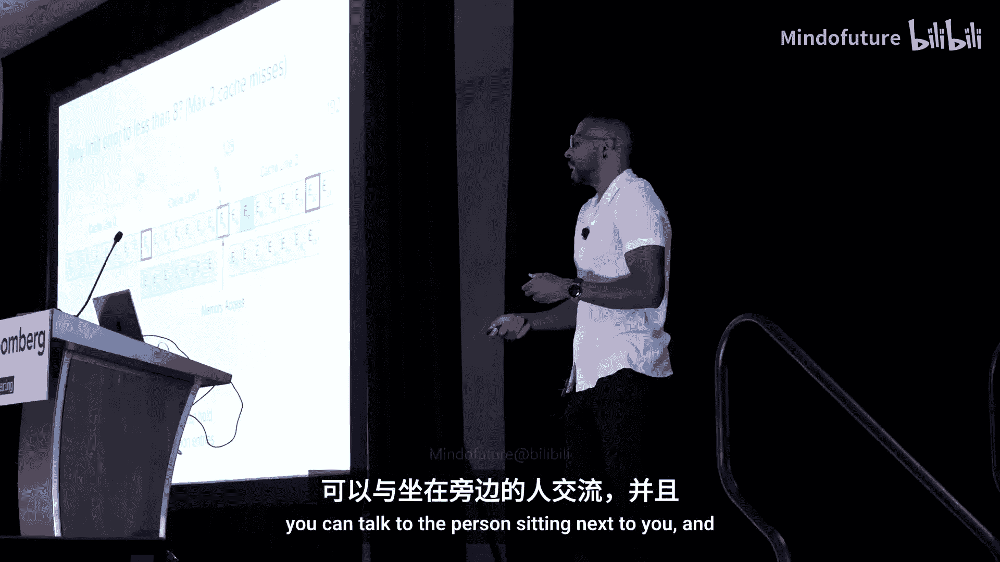
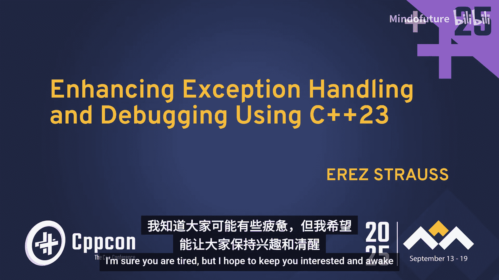
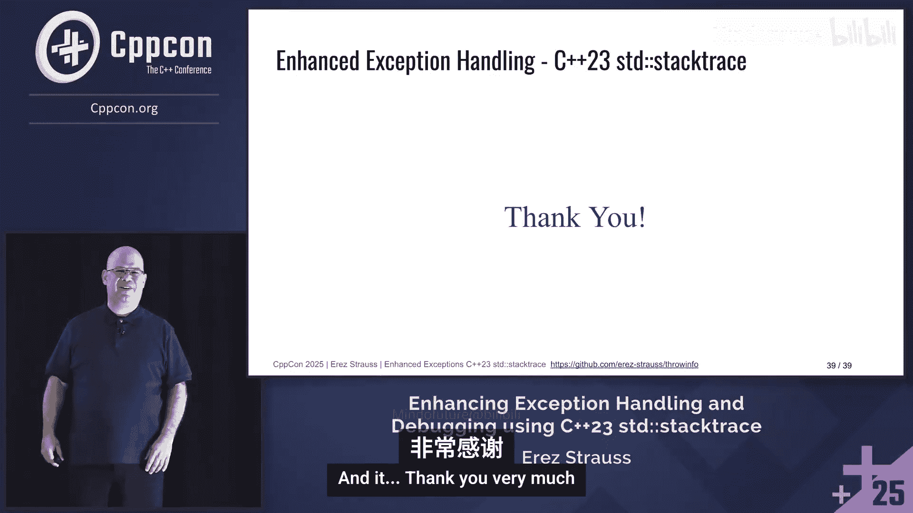
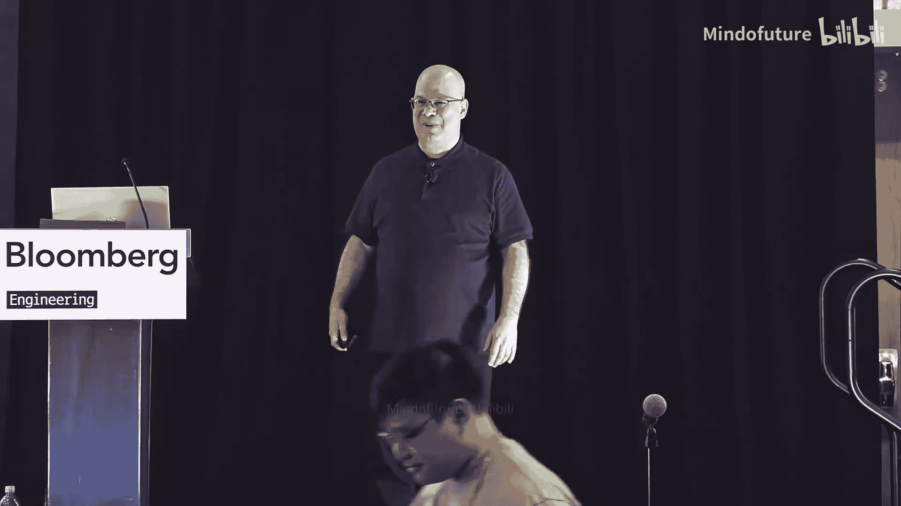

# Cppcon-2025-｜-C++-｜-C语言--｜-汇编-｜-编译器-｜-操作系统-｜-Linux-｜-Windows-p74-P74_C++23_std__stacktrace的隐藏力量_加速调试与异常处理-Erez_Strauss--BV1wyPBzrEeu_p74-

🎼Coming here in person is so much better。 I've tried to watch talks online。

 It can be harder to concentrate。 You know， there's so many more distractions at home。

 But here as well， you can actually ask the presenters questions。

 You can talk to the person sitting next to you and you can talk with the presenter afterwards in the hall。

 It's really a totally different experience than just being here virtually。

Good afternoon。 Im sure you are tired。But I hope to keep you interested and awake。

So thank you for coming。MyMy name is Er Straus。 I'm a developer， like most of you， I believe。

 And that's why I want to start with a question to you as developers。How many of you。

Found yourself in a situation that you had an exception。You get to the catch block。

And you don't know where it comes from。I think that everyone， including me。

 found himself or herself in this situation。How about。

Running just with L D preload and getting the stack races。

That is available from the system at the th location that will help you to identify the location that caused this exception。

So this is the goal of this。Talk is to show how we can have it and show access to a Github repository that will have the slides。

 the examples and the running project。So this is the goal。

So I think that it's nice because it is helping to solve a problem that every one of us has。😊。

So for this， we will need to learn a bit more about what the language is providing。

 whether it is how the exception handling is defined and how the what are the stack trace components are and how we can inject code。

 into those locations that are important to us， whether it is the throw statement or。

The catch location， catch block that we are going to execute。

 and we will talk about this implementation， both in Linux。 That's the main one。

 And if someone needs it on Windows， I will show。Different mechanism that is being used on Windows to do the same or similar services。

We will。Show that there are some other libraries that are doing similar things。

 They are more focused on printing。 I I'm more focused on providing the data from the throw statement to the catch block and to provide it in without any changes to the code。

 if possible。So every one of us is familiar， I believe with。Exceptions。

 we are throwing them using the throw statement。 We need to be inside the try block， if not。

We will terminate the program， and we will try to generate a code dump if we don't succeed to have a core dump because of some system limitation。

Misconfiguration and other things。 we end up with a nonreproducible bug。

That we have no chance to reproduce， no chance to understand what happened unless we have a very detailed logging mechanism。

 But that's another story。收。Let's look at example code here。

 We have multiple functions calling one to through the other。 and the main start。

 and we have a stack。 The stack layout is from top to bottom。 And we are the first in main。

 And then we are calling function A， and then function B， function C。

We will see two mechanism later on that are important to understand with the stack。

 One is walking the stack just to search for things or to find the return address for each function call。

 And this is one mechanism。 And there is the second mechanism stack unwinding。

 which will remove the elements will'll call the destructor of each level and will unwind the full stack。

啊。In most systems， we have two phases。 First， we are， okay， I'll get it later on。

 We'll talk about it a bit later。 So what are the good things about exceptions， We have a very。

Compact opt。Optistic code that is without any error handling。

 and all the error handling is done centrally in the catch blocks that enable us to write a。Cd。

 which is efficient and easy to read。What are the drawbacks。Oh。

 and does for we have a set of predefined hierarchy of errors or type of exceptions。

 and that enable us to separate our handling according to the types of the exceptions。

So what are the limitations？One of the limitation is that we don't know the call sequence that leads to a given exception。

And we don't have a mechanism currently， to inject code。

To do the work that we need in order to provide extra information。When we are trying to debug code。

 if we put a break point inside the catch block， It is already too late。 We already unwind the stack。

 So we don't have what happened。 And on the other end， if we put。Break point on a throw exception。

 We might end up with too many exceptions and too many times that we are being stockokeed with the debuggers。

 So we have。A problem。How we solve it， we'll see it here。Any questions so far。O。嗯。

And another disadvantage is when we are having unhand exception， we will。

Trow or we will try to cool dump， and we will might fail。 And then again， what we said before。

So this is another example of the problem。 We have a random number generator that gives the range between0 and half。

And hundred。 And we theres some range in in this that we might call。We don't know which one。

Even if we get the exception and we know the number that was there， we don't know。

 how did we get there。And this is the a problem that I'm trying to resolve。So what， what are the。

 what is the wish list that every one of us has， or you might， if you have a more， let me know。

 I'll be。 I will add to the list。The list is， I want to have the。Maybe a message。

 maybe the stack race， the full stack race。 If it is an exception that。

We want to edit edit features to exception。 We'll see it a bit later。 We。

 it might be even the source location。 We'll talk about the differences between them。嗯。

And if there are many threads， we might want to hand to have the information about from all the threads about the exception handling。

 whether they succeeded or not。Um。Yeah， and we I something that is not written here is that we might want to have a hook that we want to exercise every time that there is a throw。

 And this is a mechanism that will enable us to do smarter debugging in。

If we have a function that only once in 100， we want to stop of inside that exception。

We can do a function that make a decision whether we want to do a board or not。

 So this is another mechanism that can be done with this library。U。Okay。

 so let's look a bit more about the simpleus plus constructs that are helping us later on。

 One is the source location。 the source location。 I give it as an example for mechanism that was added。

To C plus plus 20， it is giving us the source location where we are。

Instaniateated this with the current function。 This structure is。

Implemented in efficient way from us。 It is generated by the compiler as a constant expression。

 and it has internally all the information about the file name， the function name。

 the line number and so on。And this one is not dependent on runtime。 It is compile time generated。

And here Im showing just for for the users how we can edit it to be printed to our liking so we can just report it from a given location。

 if you look at this using the current function。When we are calling this report function。

 it will instantiate the copy with the local location where we instantiated the called function。

To this report function。 So let's see an example how it can be used。

 And we are saying that the function for is calling is constructing one element of source location and printing it。

 and this is the one。 and we we do we create one with the current。

 We instantiate it with current and we will see that it is there。

And we are calling the report function， and the report function is instantiating a local copy for it for the different lines in the code。

 okay。So why I'm showing the source location， because it is very， very similar。

To the entries in stack trace， the C plus plus 23 stack trace is composed of。

One time generated entries， and each of the entries is similar to the source location one。

 they are named a bit different and we'll see in a second a bit more later on。

 We will see how they are being used and how we can print them to。

So any question about social location？Yes， please。受け？这接个。ニュードケーション。

It's it will report the location in the source where it was instantiated the coal。

So if it was through a template， it will show you that， for example。

 the template parametersters that were generated for them。That。Yes。Sure。嗯。So。And more question。

 No more。 Okay， so the next thing is runtime stack。 we have multiple frames。

 and we want to have the addresses of them where we need to return from the function calls。

 And this is generated with the current function that well see it in a minute。 and。

It can be dynamic in size。 We can set the maximum size in case we don't want to have too many entries。

 Let's say you have a recursive call， and some。Very， very deep。 You are doing a throw。

 You don't want to catch a stack traces of 200 function callss。

 You usually want to to have some limit， and it。As left to the reader， in an example of every。

 the stack trace can be generated with a specific allocator。

 You we can request a different default allocator for it so we can have。

Control on the memory utilization of it。 And we can。

Impact the performance of capturing the stack race。U。Okay， so。Okay。The stack itself， we can go。

 I hope that everyone has the experience going up down the stack frame with the debugger。

 It's well known and。Used。Unwinding calls the distractor。

 we need it to clean up properly the elements that were allocated on the stack。And。Stuck race。

It's a sort of vector of those entries of each one of them is a frame with the information or it's a pointer to the return address and but we can generate from it the file name。

 the line number and the function call that generated this entry in the stack trace。

But this one will be as it is one time。 it depends on the bugggger information that we are have we requested from the compiler。

 and this is everyone familiar with minus G on GCC and so on。

I'll show the current function return it goes and check all the entries in the stack frame and collect us the addresses to be returned through and from those addresses we can print them and ask line number or file name and we'll see an example how we can use them。

Yeah， any question on that so far。Okay， this is a bit dense。 Sorry， it's an example of。

How we can process the entries。Inside the stack trace。

 And that's enabled it bring us the question whether we want to go from top to bottom or bottom up。

 because the。Some of the libraries will print who calls who。

 So this one was calling this one calling this one and so on。 And we'll see it here。

 And some will say we the last one is the original one。

 So we want to to first to print the last frame and then going backward。

 So it depends on I'm sure that it will be clear。 when you see a stack trace。 who called who。

 But it is important to see some libraries choose one way to print it。

 Some libraries are choosing a different way。 The stack trace default is to print it according to the。

The reverse order。So we see here that we are printing。The address， the the frame number。

 we are seeing the。The native handle is in Linux is the pointer to the return address。

And if it is not empty。ESo， if it is not empty， we can say we are printing the file name and the source。

 the line number。And。This example is a bit。Com added complexity because I， I wanted to show。

I indent think of the the stack。And what are the fields that we are accessing inside every entry。

 And this one is available， and it is working on Linuxux and Windows。

So it's very because it is a standard part of the language。Nextix。

So let's define something that is very helpful for the rest of later on is a context of a location in the code。

 it will be have the stack trace， maybe location， it will have the timest， thread identification。

 and maybe other information it is open to you to define what you really need。

And where would can we use it。Any ideas。In at the point of throw。

 perfect another location or other place that you might want。In the catch handler to print it。 Yes。

 and we can， I can suggest few more。 for example， if you are doing expected whatever type。

 the error type can include this。 So when you are doing， oh， it's an error。

 I want to have the context， how did I get this error。 But this is a different。Lecture。

 it's a completely different。 It will have a different。Overhead， it will。

 because you need to have efficient move operator and so on， but。So I'm leaving it for later on。

So we have。The the context will be created with all those elements。And if you need。

 you can add more information later on。 so I have a definition of it。 it's the extended context。

 it has all those things， and we are we see how it is being initialized with all the mechanisms of the language。

So the goal is to be able to capture it immediately after the statement throw。

Before we get to any standard operation of unwinding the stack， before we are doing anything。

 So let's see how we are going to do it。We can do one thing that you suggested is to edit to the exception itself。

 if we are doing exception that is inheriting from this context。

And we initialize it when we throw that exception。 In theory， we got everything that we need， right。

 because when we get the exception in the catch block。

 we will have all the information and we can print it。 We can celebrate。😊，Her success why partition。

 because that will require us to change both the location of the throw and the location of the catch。

 Both of them need to have some changes。So it won't be as easy as just doing LD preload。Agree， right。

 So let's do how we'll see how we can do it better。

So we are looking at the exception handling mechanism that is part of our runtime environment。

 that environment that someone defined and worked very hard on it。

 And it is the definition that is being used today in most of the Linux system。

 I don't know of anyone that is not using it in the Linux environment in Windows。 it is different。

In embedded， it might be a bit different， but it is very close to this scenario。So the API。

 which is different than API。 API is the programming interface。

 A is the binary interface of the runtime environment。 The AI is defining us that。

When we are doing the statement。Throw actually behind the scene there are few things。

 One is allocating on on the hip the dynamically， the exception data。And then， calling the function。

C x x。C， X， A， throw that handle it。And when this function needs to handle the。Exception。

 it will do two things。 It will search first for a catch block that matches the type of the exception。

And if it finds it， it will unwind the stack。To remove everything that is not needed anymore from the stack and execute。

Catch block。 But the catch block， in order to start it， it will call a function called C， X A。

Begin catch。And what we want to be able to do is to intercept these functions and add functionality just before those function being doing the same things that they did so far。

 So if we can do that。😊，We can capture the at the beginning of the th。

And we can print it out when we do the block of catch， or when we do the statement of terminate。

 we can print out the output of the stack race。This is a bit risky， but I will talk about it later。

 and we can print out the stack traces from just before calling a boat and causing the core dump。

 So these are the mechanisms that we are going to use。And， okay。

 so interception of functions in dynamic dynamically linked。Executables。How it is being done。

 we need to do to define our own copy of the function。

Finding the dynamically using the DL open and DL Sim mechanism。

 we need to find the original function that the program intended to use。

 and then we can do in our function， whatever we want。 And then we can call the original one。

 if we do it and。Everything will continue to work as if it was working。As usual。

 but with our extra side effect function doing our the work for us。

So we need the first linking order。 If we wanted to be not with the LD preload that I showed before and we wanted to be part of our。

Application， we need to be first in the linking order of objects。

 So our function will be first before others。 Otherwise， we might have problem with this。U。Okay。

 so let's say what we are going to do now。For in order to do the exception handling without changing the code。

 we need to。Inter interceptive C X A slow。And we need to。

 we don't need to do it because we will call the original one。

 and it will search for it and unwine if the stack if needed and activate the catchb。

 And then we also might。Add our intercepted of function of the catch block。So let's look here。So。

 and one more complexity in our Linux environment， you will know that standards are good。

 So let's have many of them。For for that reason， we have two definitions of the X I throw function。

 One is， which is the official one。 and one is with void pointer。And GCC provided it。

For for a long time。 And now it is with the clang， It will be using the new one。 So we。

 when we are writing code that needs to work on both compilers。

 we need to do one for this and one for this。 It will be exactly the same code internally， but。

The signature of the function is different。 So we need to pay attention for that。

 We'll see the code in a second， in。We will instantiate internally this context and we will deliver it。

 How do you suggest to deliver it to the catchb， Any ideas？Putting it on a thread local variable。

 So when we are doing the catch。We fill in data into a thread local variable in the catchbook。

 we can use it。U。And because we some more concern about performance。

 we can provide also control whether we want to capture all the information or only part of the information。

 So that also will be available through a thread local variable that says oh。

 skip for now because I know that I'm going to have some exception in tight loop。

And if you want to enable it again， you just need to change this control variable。

So here is an example。 Sorry for it's not。As nice as we thought， I thought it would come。 Okay。

 so what do we have here， We have this。Function that is the over。 First， we have the type。

And we are calling this DL S that search for the original function。 And that's why we have here。

 First， we define the type。This is a cl in second， we'll see the more generic one。

 and then we defined from that type。 we define the original pointer。And then we。

 when we are defining our own function handler。Or function。 We are doing， oh。

 we intercept called with a type of。Here， we could do the stack trace。 But later on。

 and then we are calling the original Cx A throw。 So as if we were not here。

 So it will continue doing the search and unwind or calling the stack， whatever it need to do。

 But we， we in came in the middle。 and we were did our job。 And if we look here。This is。

 we throw just interteger and minimal throw intercept。 And we are saying， oh。

 the type info for name is I。We can do de mangle later on。 We will say there is in the library。

 it is using it， and we got exception。 So we say that really。

 what happened is between the throw and between the catch block， we were there。M。Surprise too many。

 or not that surprising。Okay， so after we did this。

This is the example that is a bit more tricky because it is using the same the different signatures。

 one for Kanggen， one for。GCC， and if you go to this compile Exper link。Thank you to Matt Godbald。

 That work very nice。 You will see it running in both。Yes， please。

 Does it make a difference because it's X C， They're going to mangle the same。

 So does it make a difference that one is void star and the other takes the type pointer。啊。

That's a good question。 I didn't look if it will do。Because of the extent C。

 whether it will change it or not。I will check it。Thank you。嗯。So。It might not change the object。

 but when you are writing the code， it will fail to compile because it will ch on you oh mismatch。

 because my definition here will contradict the definition of GCC， and then it will fail。

 not on the link at the compile time。So this is the6A throw。Compile Netflix just to be aware。

 because we need to。 if we compile with O2。We might have inlining of the functions。

 so we should be aware that some the stack trace， the default library that we are using here is not。

 it will miss this information。But there are other libraries。

 part of the references to this talk is backward CPP will know that there were function that were optimized out or lit。

Optimized out the call， but not the code， But， and it will show them printed out well。 So that if。

But this is for further work to do this library with the their library。

Minus G without minus G if you don't， if you want to have a very compact executable file and you don't generate the compile debug information。

 then the stack trace will not be able to generate the file name and line number it will show the function name because this is part of the executable and it is known to it but it is missing this information so if。

Don't remove it， even if it's a release。 It is important。U。And as I said。

 this is for dynamically linked objects or executable， if it is a statically executable。

 there is a problem to intercept the function because the standard C library is defining it as a stronger object and it will fail to link so that's another topic if someone needs to make it for static executable。

OK。So we can control whether to capture the full context。 we will have a throw in for。Object。

That will have all the information about the exception that was a th。 And the idea is that。

I hope for most of you that you don't have exception through exception handling because then there are two exception and you might lose information。

 So in some cases， we need counter how many exceptions we have in flight during processing。

 So there is more information that is a specific to exception handling。

 So that's why we have two separate classes， one context and one through info。

The and it will generate a print out printable data。 And we can。

 if we can do in the thorough info if we registered ahead of time， a call back。

We can do a callback directly from the throw location。

 So if you needed to stop with debugger or to have some conditions and do your own stack traces or things at that level。

 it will be it is will be available。The Github repo is not yet available。

 It will be available during the conference。Well， I will incorporate your feedback。

 So if you have questions and things I will be happy to add。嗯。And in some cases。

 we want to do a print directly from the throw location and not wait to the catch block so we can ask the。

Throw in， do the printing from there and not wait。 And because we might have another throw or reth。

 So sometimes it is needed。And if we are intercepting the begin catch。

Then what we can do is not change the code。That we have of。Throw and catch。

And print the stack trace or print all the information that we have from the throw info。

Just immediately， before doing the。Block of catch。 And that's what we saw in the first slide。

 So this is a bit more complex。 And here you have the。Compile Explorer site。

 You can go there and see it is running， and it is printing the exception and doing。

Creating the context。Printing it。Let's see if we need to go over any of the details。嗯。Any questions？

Yes。決めてショ。Sorry。Yes， it， it's the same throw that you had before。

 But the this throw is by the definition of the A is translated to。

To the call to the function underscore underscore his x though， and I'm intercepting this function。

 so it will call to my function instead of calling the original one， and I capture the stack trace。

And then， call the original one。The extra avoid。Oh。Very good catch。 Intering one。

 It is not needed because when we are calling the original one， we are going back on the stack。

 but anyone has a guess why it is as needed。Yes。😊，Yes。

 because the function itself is defined as nonreturn function and the aor is what the hint that I place here that I'm not going to return so don't give me this warning or error because it is because otherwise it will say oh。

 you are returning from a function that by the signature it is nonreturning function。

 so I need to edit it is unreachable code。For any purpose。Unre your would solve issue。Thank you。

 I should add to。Thank you。So。That's the mechanism。Terinate handler。

 We can use the set terminate with the Laer function that will access the throw in object。

Or objects if there are many on different threads and we'll print it out which one was the bed one and what information killed our process and what was the stock race and here I mentioned that it is a bit risky so I will tell it again。

Catching the stack race from within a signal handler is not always safe。 Some libraries are better。

 Some are less。 Everyone has the warning there。 I didn't。Once everything compiled and worked。

 it worked for me in both Kang and GCC and。So yeah， just to remember。 And we need to call a boat。

 Otherwise， it will enter endless loops and will kill the of stack。 So be aware。 and yeah。Okay。Okay。

I think we covered all these things。And we need to just to cover in details what we we have。

 we have last throw context is a variable that we if even if we are inside the catch or after a code other code。

 we will have the last throw context， which is our thread info or throw in that was generated or populated into that variable。

We will have。We can set on throw handler。And I， yeah， but。

If you need more things or more features and you find them please let me know。

 and more features can be added。 actually， that this project is。At the beginning。

 so everyone can suggest and ask for features and comment。Next。Yes。

 we mention how things can be done with a hook。In the debugger。

And you can access the on each of the threads， you can access the thread local info last throw info。

 and you can print a call directly from the debugger the information about all the threads because the the library is collecting per thread。

 the。Throw information。Windows。Windows is something that not everyone is working。

 How many are working on Windows，Okay， so。Thank you for being patient。In Windows。

 it is the A BI of Windows is defining that Windows are treating exceptions。

 C+ plus exceptions through the structure exception handling mechanism。

 which is a vector of handlers for different exceptions， we will put there an exception。啊。

If anyone needs the example working example， it is in the compile Explorer。 Thank you again。

 And it is。Placing the vector into the vector exception handler and that exception handler is constructed at start time because it is part of initializer of a global variable that just placed this vector in and then the handler that is there is calling stack trace and putting it on a thread local variable that is available later on。

 so that's the way it is working there， so but in Windows we have a problem with the begin。

Start begin catch and that's not available。 I didn't find how to do that part of the library。

 if anyone has a comment， please let me know because this is piece of the A that is not covered there。

嗯。Question。Windows example， this is the code almost。We see this is the。Capture of the stockies。

And this handler will be placed， as we see here。That we are adding a vector entry。

So when it is searching for the exception on the vector， it will find us。

 And the important thing that we are saying， we are telling it to continue search。

 even if we did our work。If there was someone else that needs to to do the work。

 he will find this later on。U。Well， view to the future。Syus plus 26。Is implementing a new feature。

 And I'll explain why。Because when we are doing this t as search。And then the stack unwind。

 We are doing two times walk on this stack。 And if we we。Want to be a bit more efficient。

 we can tell the compiler that or the runtime environment that we are going to do。

 we want to accept the exception with available stack race and it can be a bit more efficient in constructing it。

So。In theory， we can do this。 We can call stack waste from current exception。

But I didn't succeed to make it work on compiler Explorer or not at my， on my laptop。

 So that's left to。To see when it will be available and justian cllink。Or MVC， if anyone tried it。

So that's the future， but again， this one is very specific to optimization。

 but it doesn't give us all the features that we mention of catching at time and holding more information on different threads and so on。

嗯。Other stack trace libraries that were before there was available Cus plus 23 stack trace type。

 and then each one of them is has a different solution how to capture it， for example， backward CPP。

 which I like a lot。 It's a very powerful one and it is using different unwind libraries and it can know for different unwind libraries it will use the proper libraries and。

And the CPP trace is also doing a very good job。And both， I have less experience with them， and。

If we want to see a bit of the history of how these things came。Is the back tray was available since。

Le 20 years I believe it's part of the CAP of Linux environment， you can get the return function。

 but in order to get a debug information like line number and file that's where the nightmare begin so don't try it。

 it's complex and usually I don't know any library that takes the output of vectors and translate it to the proper data that we use user friendly data。

Fture work to make it maybe more performant if needed to make the decision automatically。

 whether to capture the stack race or not。U。To make this library also work with the same similar API with Windows and Linux and detect and more testing and make sure that it is a signal safe when we report it。

Summary， we saw how we can for a state that we didn't have any information about the。

Exception that was thrown。What is needed to build this solution that gives us the simple L D preload and。

Available。And can run with old code。And without any need to change things。

 And that's the powerful feature of it。嗯。Thank you。 And。

I'm open for questions， and comment and。Do you know what happened？嚟。Pro section。これを。

So what So what happened if there is an exception。That's the case that you have exception in exception in exception。

 and you have multiple throw still life before。 and then we need to handle such cases with。

The th library will use will handle it properly because it will handle the first block and search for the other block and it will be a stack of exception being and they will need to be handled properly if not。

 you know what it will code them。So， it depends。I mean， somehow， I think our implementation of。

No perception。Why we inside could we use the microphone for questions， there is a microphone here。

 please come to the microphone so everyone will hear and。Yeah， I'm just curious。

 like if like as our library im inside it see they throw we use with some like strings thing that we throw exception from that Ho Oh。

 good if the this library will throw an exception， I hope it won't。 But if it is， then it will again。

Handed it and will call it again。 It might end up as。

InIt might be that we need to add a mechanism is， are we already inside our。Exception handler。

 And if we are inside it， we want to skip the functionality in order to avoid another exception from us。

So maybe just。The reason， yeah， I'll give you a reasoning for what。Okay。

 intercepting function in Linux is。Noown functionality or known feature。

 I did use it to trace memory locations and memory locations。

 sometimes the memory allocation itself is allocating more data for itself。

 So you need to trace this mechanism。 That's the case。 Thank you。

Any other questions suggesting。Thank you very much。 Yeah， please。Soが the。

Additional logic to throw like if you have a very large binary。It will get added。

A agreed throw statement。Thank you for the question。

 It's this perfect question because I'm not adding anything。The throw itself is calling one function。

So I'm adding functionality to that function。 I don't。

 it will scale to any number of calls because it's not going to through the those locations。

 those locations are calling the CxA through， so it will be。

As if it is one though or 200 of them in the code。have you thought of any need to restrict like this additional functionality to only some parts of the cors or files。

That's why I define an API to this library that you can control on it and say oh， on this thread。

 I don't want to do anything in this thread I want to print from the throw location on this thread I want to do a call to my hook function call back。

Thank you， sure。So again， thank you very much。

