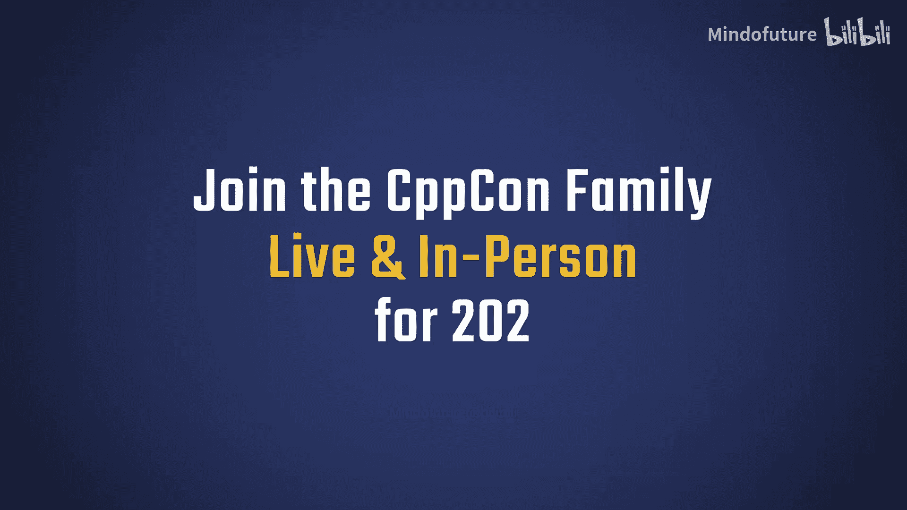
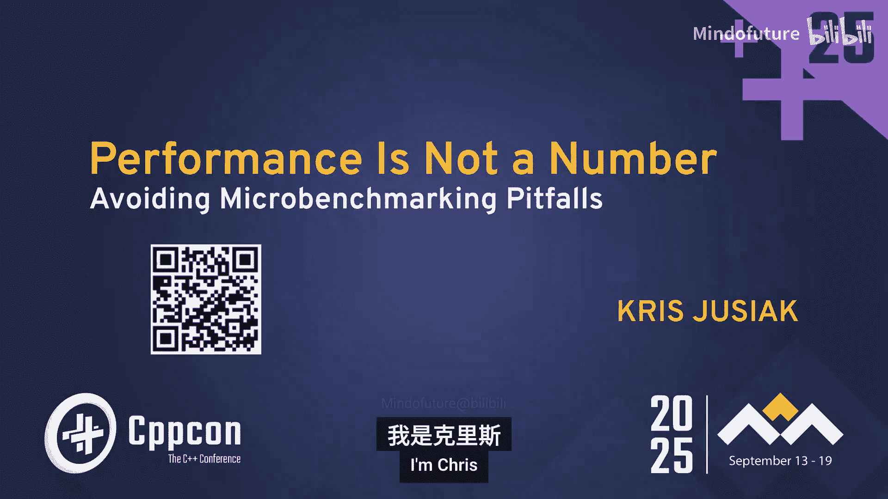
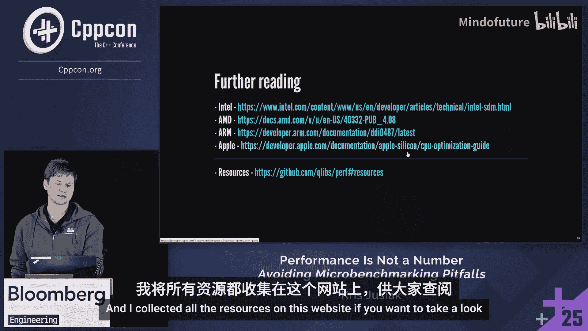

# Cppcon-2025-｜-C++-｜-C语言--｜-汇编-｜-编译器-｜-操作系统-｜-Linux-｜-Windows-p75-P75_为何99%的C++微基准测试是谎言——以及如何编写那重要的1%_-Kris_Jusiak--BV1wyPBzrEeu_p75-

I like that CPPCon can dive really deep into the intricacies of the language compared to a more broad overview of computer science syndrome I think CPPCon is absolutely worth it to attend if people are having doubts about attending I think that the best case for attending is being able to see and experience the new advancements in C++ as they're happening。

So， hello。I'm Chris， surprise surprise， our work with state Securities。

 state securities and today we'll talk about performance and especially about the measuring because that's the most important part in my opinion and why we'll see an alternative to explain why is that so important？

And why without the reliable measurement， it's so difficult to。To do the optimizations afterwards。

 And it's especially important in the micromch marking world， because。嗯。

There is a lot of noise which we have to handle。 And all of that is very difficult。

And it's become even way more difficult in the last decades or so。

 because everyone probably is familiar with the Moore's law。

 not the number of total transistor doubles every two years in the beginning。 when that started。

 that was the fact that。With that， also the performance increased the latency of the CPU in a sense because。

The smaller the transistors。The， the， the faster the frequency was。

 and we were gaining a lot of boost in the latency of the CPU。 That has changed around 2005， where。

We can probably reach the limit of the frequency unless we push it a bit further with like heat。

 and like the ti of is much。More difficult here。 So instead of that。

 the CPU is more focusing on Fput right now。 So we have more cars， more caches。

 more data parallellysis and stuff like that。So the number of trans students is growing。

 but maybe the purpose of it is a bit different。So all of that matters because nanose can count and counts way more than it counted before because we cannot just wait for the CPU and the frequency to be much faster over two years。

 because that will be more related to the flipput， not to the latetency itself。

And just to point it out that the CPU from 2005， like Pen 4， which is like FahHtz。

 in comparison to AM M D Z 5 from 2025， will be way， way slower。 And now。

 on my second count for some more than the others， this talk is for people who care。More about it。

So all of that is because the performance analysis is very difficult。

 it's very complex thing and theres no silverda bullet to it， there's no one library。

 one magic f which solves everything， so we approach it in stages so we have this system where we can analyze the networking TCP。

 stuff like that application when you have the design data structures。In the micro architectureit。

 when the most fun is happening， it's with the hardware effects， which we will focus today。

So you' probably heard always measure is the saying which you can often hear because if you can't measure it you can't improve it right it's like if you know garbage in。

 garbage out in a sense， so you have to really focus on that and that's why in my opinion it's very important to have the trust to measurement。

 understanding of it you have to be able to reproduce them and so on。So。

If you're on the system level， firstly， you would you know。

 do like EBPF if you're not familiar with that。To， to tackle the like Cico， Io and someva that。

 These are a great picture of。What you can trace in Linux and how to do that。

 so that's something which you may start with and there's a lot of aspects here。

 how does work is that you have the C kind of code which you compile and you can run it on the kernel side。

When you go to the application level， which will not focus too much today you have options depending whether you have like hardware specific painting。

 So， for example， you can use VTM or M D U Pro and satellite。

We'll focus more on the pair part because it's more generic。

 and it allows to do a lot of things with it。On the side note， you can do a lot of proaning as well。

 maybe not a lot a bit with GDPB， which is backed with the reverse engineering。

 reverse call stack by the interpoor trace。You can do your flame graphs and stuff on that。

But if you really want to measure something and you， hotspottting is not a good idea。

 and we'll explain it later， but。If you really want to measure something。

 you don't want to measure the start and the configuration part of it。 So part of is great。

But you would like to introduce it after the know initial step。 So the idea here is that we can。

Start it after the start that would be a Cisco， but if you have a thought how to integrate a pair with your C+ pluscode。

 that's one way to do it and that will be a Cisco and you will pay for the Cisco when you start。

And everything on that level， which is important to do because you don't want to recompile your application for performance measurement。

 because that will introduce the bias， which we'll discuss later。

 and you actually don't want to do that。So X-ray is one of the tools which is great for that。

 because you can。With basically very little overhead， introduce。Enabling and disabing profiling。

 So the way it works， it starts by adding the knobs with a specific number of bytes to the entry and the exhibit the function。

 And then we do the code patching。😊，And we change the knob to the， to the jump。

And then we can profile and we can you connect Linux Per way。

 and you have one binary enable this other profiling， a pro which you want at any point in time。

And that's important because you have to always validate that measurement in your end to production。

 like environment。If you another plank， you can do something similar。

 This is one option of the like if you're familiar with the static keys on Linux。

 that's kind of similar idea works with， as I mean， as go to under the hood。

 and that how we can do it。 So notice game we have like this con expert bulling variable， which。

When we set to true。Actually doesn't have an mistake。 It changes the code underneath。

 And when you can start and stop your profiler move like the jump， which will be patched。

a grandtime towards your code。 So this way， you can do a lot of。You know， proper。

 more accurate measurements of the hot pot which you， for example， care about。

It's very fascinating how to do that with the multipar environment。 I mean the profile equals  true。

 There's one。 There's many ways， but there's one very。Fast way， which requires specific order。

Would you want to discuss， but if you're interested to grab me after it。And also。

It's also important to put a jam into the eyesh afterwards so that you won't get the miss in the first time。

So overall， if you want to check out the tools， you can run this Docker file and see all of them。

But what I want to point out is that the hotspot image we have been doing here doesn't mean the speed up。

 You can overall speed up。 You can you know， optimize some function。

And you won't get overall speed up of your application or something。

 It depends how you approach it and what you will do with it。But that's overall point。

 which I'm trying to make here。 also that you don't have bottleneck doesn't mean you're fastest as well。

 so。Really depends what you care about。Finally， I just wanted to point out cause。

 which is a great profiling tool for if you have multi further application。The way it works。

 it eliminates like artificially slows downs and speed up part of the component and then measured the overall performance and how that impacted。

 if you haven't tried it。You should。All of that， I'm going a bit fast in the beginning because that's kind of very basic stuff。

 which。It can easily find。Right now， we will get to the more interesting part， so。

We will get to this micro detector where， you know， finally， we go to our microMaing part。

And why you want to do micro mark， Because while the iteration speed， like if you have to run on the。

 you know， production machine or something like that that's slow， is version that slow。

And all of that makes it a difficult process like coronary cases， data distribution coverage， very。

 very hard to do it in the production lung environment。

 so we want to optimize it with microch marking。And that。

The idea is here that we have a piece of code and we just measure it。

It's very important how we measure it though and what we'll get out of it。So， for example。

 let's take a look into。A please bus function， a simple one， which。I've chosen for reason。

 but we'll see later。And if you like， you know， try to understand what the performance of it。

EYou know， we can use like libraries for benchmark， which。Do measure something。

 And it's like really hard to say if you get 40 to nanoseconds。

 where that's good or what does actually means and what condition is the same if it's faster than the other version。

 all of that is really dependent and the complexity behind。

The performance measurement is really hard， and the noise。

 which ratio in the benchmarking also has to be taken into account。So。哎。The ground rule of this tu。

 Let's talk about the micro benchmarkching pitfalls。 I politically named a few of them。

 There's a lot of them。But that's the one which I believe it's worth focusing on。

So we have the noise， which is relatively。Simple to the love。 We have the bias， which。

Is the hardest that would be the hardware effect， the faith where you know。

 we have the numbers and just trust them。The chaos， how we optimize it。

And the de illusionlusion that， you know。We have our micro benchmarkchs。 Everything is P T damage。

Faster， or few thousand times faster。 And then we apply to the production in this slog， right。

 I don't know whether anyone who's seen that before。Right， so。For the record。

 everyone will save soon。But okay， so just a disclaimer， because right now。

 well go into more details and more。Hardcota。 so hopefully。At least some of you will enjoy that。

 So we'll focus here on X 86 because microbch marking on the architecture is really depending on the architecture。

 But some of these things， most other things apply across。

 Well also focus on Linux because that's the easiest one to deal with if it comes to the performance。

😊，And you will see a lot of shortcuts here， which well use afterward。

 So I just tried to give you the names。嗯。We can follow up with R I II。

 I guess sounds like you would fit here。 So you can see that like CPU vendors have a lot of shortcuts as well for the performance monitoring unit。

 which allows us to。Get the better understanding of what we are actually dealing with。

And I wanted to point out that the CPUs are a bit like system languages。

YouYou can use C plus plasmas to to make them fast。

 But how easily you can tweak and verify it really matters。 So， for example。

 Intel is really good with providing the tooling。If it comes to the。Understanding the performance。

 And I specifically will say here about the interproor trays。

 which we willll use extensively here because it's great for microgrich market。

That's also available on Apple M4， but it's much harder to get。To it from that perspective。So。

We leverage this library。 It's not that important， but it's just easier to illustrate because I've been working on。

 so。We'll use Linux Perf kernelnal API， which is the perf Even open。 We'll use I T。

 which is the Intel library to get the。Intoprosor Tres。Decoding will use LDM MA。

 so allDM D will use that in C++。And for plottin， we'll useplot and XL。

 which allow us to plot on the terminal normal terminal， as well as TTY。

It you move to the hardware machine after。So let's start with the noise。

So the noise starts when we hit the main or even earlier when we have a global variable or something。

And the main reason for it。Yeah，In that environment is that we have。Oh， behind it。

 So that's a map of Linux。 And you can see here there's a lot of moving pieces， not just one。

 It's not a simple thing。If you can put a number on it。Be my guest but。I would claim it's difficult。

 It's a really complex thing。 That's you know the， the theme of bi is。But you can do a few things。

 the noise which you care about will depend on your setup and your application。

 but some of the common things which we want to avoid is for example， the can mode tasks。

 isolation so that will just pin one of the CPUs to a specific。That the kernel want switch it。

 which is important in micromawan we can do。A lot of disabling of the features。 you can use pipe。

 system tune if you can be asked to figure out what you really want to disable。

 but I would encourage you to do that。And when we have priorities and affinities which you have to set up for having less noise unless you run with the noise in the production man。

That would be probably difficult to optimize。 But one of the coolest idea which I got asked from Igma who is here is to use UFI。

And。This is a way you can avoid the noise altogether。

 So if you really care about the nanocyclconds or cyclees。

 you can get and avoid the kernel altogether， go to the。UFI ring 0， all the privileges， yours。

 you can。Also， disable CPU features， and I encourage you to do this experiment one in your lifetime to appreciate how CPUs from 2025 are better than 2005。

 if you disable cash or branch prediction。😊，And run some code。

 you'll definitely see and appreciate it more。 But it's a very great tool to。

 to go really low level if you care about it。😊，The other thing which I believe is really important when you start micro benchmarkch marketinging and we get into harder stuff later on is to have the standing projects。

 right。We wantna pray， for example。Where we running。

 how we running and just check that we optimize don profile the bike builds。

You't to get much performance out of that。 One thing which I wanted to point out here is that。

I would advise to log CPUID so we can have this family model and step in。

 which gives you the ability to quickly log it online。And， you know。

 unless you run on specific hardware， you will get all the information which you can print otherwise either way。

So just a side note， since we're using modules here， because it's above plus 20 plus。

One thing which I find very interesting with modules。 And I think that's the main。

Pmise of them is the fact that you can have compile time testing in your module which you expose。

Or not， which you do not expose like you static acids and comes extra compant。 And then。

It will be compiled once when you， you know， compile via module and all your compile time testing will be already there。

 So I believe that's very important to do when you expose a library， because otherwise。

 you will deal with。People just not run in the tests either way。 So that will verify。

 And this specific case is very important， because it。EYour CPU， hardware and compiler specific。

But the other thing between。Wna do before we start。

Dealing with the noise and microbech manequ is to do some brandtime checks。Let's do self testing。

 on the left， you'll see like if the machine is not tuned very well。

 meaning we didn't do the noise reduction of some sort。Willll get valid of nice。 And if we。

Not care about that noise because it're not part of our experiments。

 and that will influence the benchmarking way more。Then they should。 And you know。

 our conclusions will be。Has the noise on the right side， you'll see that if you optimize it better。

You will have better。But results in the end。 But what we can do as well。

 since we have L V M in that case and other things， we can verify the。Measure versus documented thin。

 So this will be an example of the star type of like a curve in which rule。

Vify that the basic instructions， latencies in that case have the same values as the MCA providing from the scheduling model。

 which is used by a L BM for optimizations。 So if they imagine。Not just that div is really slow。

AndPro everyone knows why。Well， not why， but that it is。 so avoid it。

 but you'll see that it matches meaning our you know framework is tuned for performance and you can track those numbers if you want in like Europe tables and Agner fog instruction tables。

As well， one thing which I wanted to point out if you go to the microMaching on the like cycles level。

 the are few tools which you can leverage like LLVM has one for day measurements。

 they verify whether the scheduling model which they have in the LLVM matches the reality for the platform。

And so on。 So， okay， so this is just the noise's noise just kind of simple to deal with。

Let's talk about something more。Difficult to deal with， actually， the bias， so。

There will be a lot of things here， but the goal is to have reproducible results。

 which we can apply then to the production code and get actually reliable things。

A resultsult as well， meaning they correlate to our margin。 and if you haven't read those papers。

 I'll just link them here。 They're really great， especially the producing our data， the first one。

It shows how an environment variable in Linux。Increases the changes the alignment of the stack and in day they measured is as a 30 to 300% slowdown of the application。

 So， but I was bug in the day， It's a bit better right now， but the problem still exist。

 which we have to encounter for because you don't want to have measurements different when you run as you know full versus bar right。

 makes no sense。So why all of that is so complex。 probably you've seen the Linux。 Well。

 you've seen it。 You've been here， the Linux map。There's also the， the CPU kind of chart here。

 which is also complexity actually even way or complex under the hood。

 And that's what we run our instructions， which we don't even run instructions like on CPU。

 we run microperss。 But all of that points out to the complexity to。What is happening under the hood。

 All of that was much easier back in the day。 It's much harder this day。These days。

 And we cannot just ignore that anymore。So just a few words about the measurements。

 They are not independent， and they are not normally distributed。

And it's really hard to get to the normal distribution to do the statistics of it。

So we have to do a lot of runs， and I advise you to do that so that you have samples and iterations。

 if you have to to get somewhere closer to the measurements。Weja。

Like a normal distribution so that you can do some statistics on it， because like。

 if you take mean and you don't have a normal distribution。EThat won't be really valuable for you。

 And we would like to answer， is this thing faster。Or slower by some percentage。

With a given confidence。 And that are different clocks， which you have to use。

 we will use timestime counter because it's the thing in which we you know。

 allows us to measure the lower part of them。Pyclees， but is often used。

A high resolution clock from a static kernel， which is the worst idea。 And because all that's one。

 it tried to be deprecated。2， it's an all to system clock or steady clock。 steady clock is fine。

 but system clock is not fine。 you might get it's like。EIt may change the， a calendar clock。

 So it may is allowing， you know， to change the date so you can get negative numbers there。

So don't do。So let's take a look into the normal distribution which we don't usually have。

 So most of the micro benchmarkch will have。Skew distributions or bi normalmal distribution or whatever distribution。

 but really hard to get to the normal distribution。Overall， so if you plot it。

 which I always advise you to do。If you don't have the。Normal distribution。

 take some other statistics， which you can then overall reason about， if you can't。

Just don't take the mean。 Min will not give much value here。

So I was pointing out about the noise right now I'm talking about the bias。

 which is the most important because of the hardware effects， which will take a look in the second。

 although that is just case specific。 But if you see the you know。

 the the bars like here and you don't see these error  error bars。We chose the variability。

It's really hard。 It means that it was probably one measurement or it's a mean or something。

 which then is really hard to reason whether it's faster or slower。Because， you know。

 the first one might be sometimes slower or sometimes fasterutter。 So if you really care。

 about you have to show all of that and not just assume。It will be better or worse。

So let's get to the latency versus throughput。 So most benchmarking will just do the throughput and we'll discuss why in a second。

 But there are two different measurements and two different metrics as well。 So latency。

 it's time to takes for a single operation to complete versus throughput， which is the total time。

Total number of operations compete in a given amount of time， usually a second。So。

That's very important to distinction when you actually measure it， because。When you do let latency。

You can do it by start， call a function stop。But you won't get much resolution out of it often1。

 So it's valuable in some cases， not all of the cases。 If you do a loop。

You actually have to introduce data dependency between the run in order to get it sequential。Because。

 you know， otherwise， and sometimes we need to do memory fans as well。

 if you have a right to get this sequential， we have to subtract the overload afterwards。

 But with let and that's very simple。Fru pot the other hand。Its like， if you have a look。

 what is happened with this question mark here is the fact that CPU doesn't wait for us。 like。

 because we have a。Closing bracket on the floor。 Ill wait。 No， CPU goes ahead of you。

 And that's kind of the key to performance as well。 Like performance is not gain at the current time。

 it's going in the future。 Like if CPU is in the far away in the future。 you fast。 Otherwise。

 you probably won。 So the throughput， you know， you have different policies to measure the through。

 like heres the sequential policy。 when you just have four。

 but you can go into different approaches as well。Advis you also to read the low overhead tool。

Paper which is used for the nano bench， Probably not the nano bench you've heard about the nano bench which is used by Europe stable。

 and they show how they measure the latency， for example， by unrolling。

Twice as much And then unrolling just once and subtracting that at a very interesting rate。 if you。

 if you into that。Okay， so then the latency itself。

As a metric is also different when an anthput the measurement， right， So latetency will be there。

And a second per operation， which is at the time。 the throughput will be the operations pair know。

 second。 you can get the throughput by， you know。Gigabys per second。 You can get inverse throughput。

 which is also the measure of。Of the measurement throughput， but the magic is inverse throughrupput。

 which is the same as the latency in that case， but from the different measurement。这要 have别不要。

And I just love this picture。 So I just put it on。To show the difference between latency and throughput。

If youre more latency related， you know， you often will go to SPGA or AsI or something like that。

And that would be for let I say， for throughput， usually would go to a GPU。 So and between the CPU。

 which is。And would be focusing today， but I just re light this picture。Okay， so。Right now。

 we'll focus on the hardware effects of。Of micro benchmarkching and the code in general。

 which affects everyone。 And if you're not taking care into consideration that it will affect you。

 you will miss out。 So， for example。Unused function may change your performance dramatically because of the code layout。

it's not even used。 It's just a function there。 you compile it in。

 and that will change your performance characteristic。 It will change the code layout。

 You may be on the cache branches and some of that。Stack。

 how it will be aligned will change your performance。Memorory access， obviously， branch prediction。

 the most important。Data layout， all of that will change your performance characteristics of a micro benchmarkch。

 So if you have a micro benchmarkch and you just didn't just took the default， whatever。

It's really hard to take it and apply it to your code in production。 But it's like a different lab。

 different thing and doesn't doesn't really work well。

It also doesn't say that you should remove that code because maybe the dead code makes you fast。

does kid。So let's talk about like brand prediction。

 and cash is the most important to well focus on that a bit。

So modern branch prediction can learn like 10001，0 branches or something like that。

 I think that's on Apple。And for director record， like the static branch predictor。

 if you have no history。Backwards， branches will be taken for where will be not taken。

 So that's for the los。 But， you know， just in case if anyone was wondering how does work。

 So this thing is really complex。 I really advise you to， towards watch some hardware talks。

 how does work under the hood。 I have some resources afterwards。

But what is important here that we have our loop and we would measure the same parameters。Well。

 the brand prediction is way smarterer than we are， And we will have the history。

10000 elements of whatever。 P I P， which is the In pointer and。

 and there like global and and a lot of things there。So we have to change that。

 We have to have a kind of distribution of the input。So let's take a look into。

 and that will be just case specific。So if we bend， for example， this fist buzz。We pause。Comp売タムカスタ。

And we have like an auto parameter that will be alighted or maybe you familiar with like optimized。

 which is the wrong word。 But away， so， so that would be a different behavior one。

 you should pass three。OrCon and totally different。 If you try to treat the branch prediction。

 branch predictionor。 But by given like the sequence range or unpredictable， which is like。

uniformniform distribution or a choice， which have sense on probabilities。 And also。

 it's very important to remember that if you have a。Heap， like malag and all of that is really smart。

 You have to pollute heap when you push into those things in order not to have unrealistic scenarios。

So if you run it， we'll get a lot of numbers。呃。which就系。Alright， they knew itll be really hard to see。

 So let's move to the charts。 That's why， you know。

 you want to plot things because plotting is much easier to reason about。

So you can say here that the  errors a small meaning that we were able to reproduce that to a certain degree without the noise。

So Bar will show us。You know， lower is better。 But what is kind of important here is the fact that。

The range， which is the。The green one， the third from the right is if you have the iteration for loop and you just put I of the iteration into your benchmark。

 which is often done。 So we do  four， and we pass the iteration into the the loop。You know。

 we change the parameters。 We change the data。 Be good。 If you have branches in our code。

That will be predicted。 Most likely， I I put here a million。So。

You can see the difference in the profile。 also what is kind of interesting。

That the uniform distribution， which is。Hardly having the real time real world， but。It's much。

 much slower， but even slower is if you have unpredictable worst cases often。

 because we have to develop a lot more。So， something to。Like， if anything。

 I just do that for the micromch marking， because that will change。The results。Very much。

So the other thing we do want to focus on when we micro benchmarkchmark is to show like histogram so that we can see the data distribution because that will be skewed so that would give us better understanding whether what statistics to use。

There are different ones like boxes。 we can show our outliers。

And the tendency of central tendency and variability。

But I wanted to show the most important and not use that often。

 empirical commmotative distribution function。Because that shows everything。 They know moving。

 nothing like。No buckets， nothing like that。 All the points contribute to the results。

 so you can easily compare all the measurements。All the samples which you've done。

 which you had to do either way， to see how that affects the performance。

 so really encouraged to use those and they show cumulative data proportion。And just a side note。

 if you。Because all of that was on the terminal。 So that's not the UI or anything。

 That's the terminal and the terminal emulator。 If you're interested， Xel。

 which is supported by all the terminals。Like Windows Mac is just a format that you print。

 And when console the terminal will show a pixel and telllaada。 So this is pretty cool。

 But often when you， you know， move to the。Your production machine and something like that you want to use like TTI。

 which you can do as well。That's the same chart。Pt the。Just just where it's looking。And also。

If you familiar with a Ju notebook， that that's also a good choice to do the analysis。O。

So let's take a look into a second one。Which is the。EThe code layer。

So I opening out code layout will affect the performance of everything。 So you compile。

 you change anything before I was saying that if you change the profiling and you compile at end。

 that will change your profiling result。 My performance right。 So be aware of that。So。

What we can do here from like application level perspective。

 we can enable other space layer randomization。But that's fixed per run。

 And that's a security feature。 But we can use it for the fact that the heat will be randomized。

And will be randomized for the code itself。 And there is like clang and mold support layout randomization。

 where we can shuffle functions around。And see how that affects it。That will be Peranddo。

 So you would have to recompile， recompile and go about it many times。There is best。

Not maintain animal， but a great tool stabilizer， which was using LVMR under the hood to randomize those things at run time every we have a second。

So that was pretty cool as well。However， you know， you have tried a lot of long runninging things to。

 to get the normal distribution out of。The results and how that affects the branching and other things it。

 is also。A difficult。So we can do from benchmarking perspective。We have this function 1。

And we can do， you， different benchmark。 We put some concrete on it。

And we can do that different distributions of the values。So， for example。

 you can align the loop because if you do not align。Basic blogs。Well。

 compiler will choose the alignment for you， which might be not but you。

 It will choose when you in the， you know， level in different contexts， like your app context。

You know， follow boundary。 that also depends how big your loop is whether。

It will affect not the stack size， the stack alignment， the functional alignment。

 The functional alignment is 16 by。But design， for example， of other compilers are not。

And you have to run in the new process as well to， to get a bit of a ahead of yourself。

So you have to do that。Then we'll get to the cache。 And that's even even harder to do。

I don't encourage you to like see what your hardware is。 So Alistoppo is like on Linux。

 where you can just see that， you know， L3 is shirt in most cases。

 So and how many nu manuals you have and stuff at that。 But that allows you to。To， to then。

 for example， if you have L three being shared between different curls， you can， you know。

 trash it from a different cor like。You know， you use false sharing to， to benchmark。

You should read it， by the way， and the paper described here， if you haven't。

But what I've been experimenting experimenting with and works pretty well for me。

 and we'll discuss how to do it afterwards。So what I've been doing。

 I've been doing something like that， so。Run。E distributed already， you know， as we pointed out。

 the brand prediction and stuff。EF to collect the executive branches。

 addresses instructions on the instruction pointer basis。Then we do our loops， and we actually。

Set up the branch prediction。And flash the courage based on。Our profiling results。

 So we have the results。 We know there is a lookup table thats the addresses。

 And when we have the distribution of what do you want to measure。

 we want to measure if it's 10% full，50%，70 and the same the branch prediction。

 because it's so hard to get to all the branches。Out of outside。

 So you have to go from like under the hood。EThis is difficult， and it is really hacky。 but it works。

 If you have L three app it up， you can do it from a different car。 So know your hardware。

And when you have to。You cannot do the loop here。 You might sometimes go with annoying。

 because if you do the loop。You know， the cache and the branchn prediction is very fast to learn。

 and you will lose all of the setup which you might。And you have to use something like。

Fast things to， to imagine like the cycles。So。All of that， I don't want to scare you。

 there's a lot of more of it and you can go higher or lower。

 you can go into like know execution port。 that will also affect like you know which ALU。

 for example， will be chosen like if you have a code surrounding it and it's already used and in microcro mark in Mo。

 that will be a different result so。There's a lot of things here。

 which one has to consider in order to actually map the results with certain probability to。

 to thecode。 It's happening It's not easy。 and there's no silver bullet。 It does a lot of work。

But there's a lot of gratitude when， when you make it right。

So the faitha is something which we look into right now， meaning， you know， you have the timing。

 we like we did， the buyers， we did the noise。 And right now we get the timing。 we。

 we feel good about ourselves because this is faster， we is slower。 We go and ship it。😊，Well。

 now it's like without understanding why it's not really that valuable because you will miss some some bias。

 either way。 So we have to go through that。 And a lot of these tools， because Matt is here。

 so you can check out on that Godbal。Compil Explorer a shout out。 But I wanted to point out that。

 you know， sometimes when you do benchmark， you profile with the filter just this one benchmark。

 right。So will that affect the result， Will that have the bias and someone out。Yes， it will。

 It would potentially change your results， so。That would be related to， for example。

 the environment variables and the style alignment and size。So be aware of that。 So what we can do。

 we have to do some profiling。 And for that， we have disability with。Profils。We can count。

And we in the simple plusword， we wantt count Ciscal phrase。 So here will be。If we want a cycles。

 instructions and like timestime country willll do that with the instructions provided by the come by the CPU。

 So R the PMMC and RTC is something we wantna use。To be ciscal free to have better measurements。

So to be in a cycles world。We can do sampling as well。

 We have to have some hardware support for that。 That will give us the results per instruction pointer。

And then we can more reason about it with analysis which I will show in a second。

But you have to be really aware that sometimes you have to do a lot of measurements。

 especially when you do analysis， because there's this multiplexing。

 which happens because there is just。Likely8 Harvard counters which you can。

 can use in the in the CPU。And Tracing， my favorite for the micromch mark。We just， you know。

We just record the instructions being executed。And then reason about。

So that's something which you can also get the cycles。

And the accuracy of the cycles will depend on your hardware。

 but you want to get as close as as possible to。嗯嗯。To it。So then we have the profiler， we do。

Start stop here， like not this prevent all。 It's the same。 like， in my opinion。

 the right way for naming， do not optimize， which is so confusing because a lot of know folks on by Spain that it's。

I'll prevent optimization。 Now， it's prevent e lesion。Compil。So we log。 we get。

Some cool numbers be good。 Well， now， we have to go a bit further。 That's where we go to the MCA。

 for example， when we have to disassemble those things。

And that's something which we can leverage LLVM offer。So here， I pointed out in the beginning。

 the scheduling model that you can find it in the L VM project and see all these numbers which they have verify。

Whether they correct for your setup。So here we have to introduce because we're in simple class。

 we don't have size of the function。 We have to do kind of some magic。 We can do labels。I put it out。

 As and go to。 We'll leverage that again because that prevents reordering。

 and we can get the labels of the code。E it doesn't emit an instruction。

It prohibits some optimization sometimes， but doesn' doesn't emit an instructions。

 So the code is the same。Under the hood。 And for。MCA， we don't have to。Run it。

 You can just take the pointer。And get the region。That's probably small。

 but that's not the point here。 The point is that we can do a lot of analysis based on that。

 So here well focus on the annotate， which is the instruction pointer。 So what we can do。哎。You know。

 sometimes。Some may think that， less assembly instruction is better。

That doesn't mean much assembly instruction have different latencies。

 They execute different number of euroops。 They have different throughput all that we can get out of the MA for your。

Machine， if you have a good scheduling model， which you can verify。And also。

 maybe not that important， but I like to point it out that like ci bear risk。 like。

 it's not about the instruction number because all of them have tons of instruction It's more about the。

Encoding part and theco arm will have the you static one， and x 86 has。AVable， variable length。

Neither， neither doesn't mean it's faster or slower。 It's just different。

We can see the resource pressure， so， for example。There's a lot of execution parts on the compiler。

 which you can see in this diagram。 and a lot of there's also a lot of Ls。

 And do you want to see which parts have been。Assigned and used in your code to understand why。

And you can do a lot of more things。 For example， you have the code like caant。

 and you can do this throughput simulation where you。You know。

 have the assembly of this code and you you know， loop a multiple times for it。 and you will see the。

嗯。The executions， the timehaand here。Which we really wna avoid the equals。

 You can read about the MC E timeline。 That's like how each cycle， you know。

 your CPU is being executed。One thing I wanted to point out is this assembly。

 which you can easily get out of compile Explorer。And tracing， which you can't at the moment。

 because you have to run the around your code with the specific values。

So here will be the begin end region。 and well have fi instruction and some timeline。

 And on the right side， we have the trays， which。Depending on the input parameters for this function。

 willll have different results and different instructions being executed。

 What is pretty cool here that we can， you know。Grab forever code what has been executed。

 pipe it to timeline and see how on the CPU to， you know。

 search integrity based on the MCA cadjoi model。 And that gives you a lot of。

Better understanding why， why and how things are happening on the low level side。

So then we apply that to our benchmarking。E for the latency in that case。And if we do the region。

We'll see。Like， we ran fe buzzs with 15，5 and unpredictable， which means like we randomize the input。

If you get the assembly， that will be the same。 But if you get the trays。

 meaning what instructions have been executed， there is a different story here being told。 So 15。

 because like if you look at the feesbu， that's like the the first part where we can。

don't care about the rest because we return。So this is different， right？What is also cool。

 We can do comparison of the timeline。And you should look into that。A long time。

 you will see quite a lot out of a di like that， which I encourage。

EAnd you can do a lot of other things。 like you can see where the loads were coming from and the branch prediction。

 so。Like 15 didn't miss anything like feels 15， the same as。

 And this is like based on frequency as well。And， and the5 doesn't miss anything， right。

 And the unpredictable will miss。Because we treat brand prediction。And you can do flow charts。

 flow graphs as well to see but of flame graphs。 and you can use LBR to get them out。

 And then you know， one important thing about the flame graphs is that they do not have time in it。

 is just occurrences。So be aware of that。Okay， so we'll have to go through the chaos right now。

 which is。Important part when you， you know， we we done the timing。

 we have the timing when we did the analysis， So were more confident into why。 But you know， how we。

 what we go about it， how we optimize all those things。And like， you know。

 random walk will give us into like local minimum and ideas and2 years of experience to know what to do。

Modern CPU are usually bottomlink by， you know， if you supply all the instructions。

 and that't be really good， but likely unlikely。so what we can do。

 we can reduce overall instruction count。Increase the per cycle。

 instruction per cycle or Europes per cycle。And。Additionally。

 we can apply top down microteual analysis where we don't have to。Think about it。

 that might meaning we don't have to come with the hypothesis。 But if。

I will change that and how that like， you know， this is random。

 This like won't lead you into right spot often。 my， but you'll never know。

 And also it's like if you try to optimize for an instruction per cycle like Uops per cycle。

 especially you know when to stop because you will never hit more when the dispot with。

 which you can take from the scheduling model for other regular be 6。

 if you have UOs per cycle maxs being 6 well。Ain't gonna be faster than that。

So let's take a look into the top down microticction analysis。So we have to have a goal。

 so that's from Intel， Intel says。Based on type of application you are。

 that your rough numbers which you aiming for。You can， obviously， say。Designed yourself。

 But the idea is here that we cover the whole CPU。In this diagram and just go around it。

With the analysis。So first， there's like first level。

 whether we are retiring instructions or we have misses or we front them or back and bound。

We do that。 Then we do the second round。 So， for example， we have backing bound。

 We see that it's either a core bound or memory bound， and we have you know。ECouns for that。

And then we go deeper。 let's say we were a memory bound。 and it's like L2 bound。

 So we know what to optimize and what will have an effect of the。Optimization。

 but all of that makes no sense and want to give you the results if you have the bias or the noise。

So you have to have all of that in order to actually reproduce the results in。In the end。

So that's how we can do that。 Not that important。But what we can see here。

 just to point out that if you have this sequence or something that is predictable very well， well。

 we won't be。My branch prediction bound， which is bad because we are， but that won't be shown。

 So you can use this analysis method， which is structured， gives you sanity in your work。

 But you have to have the。Bas and the noise removed first。 And then if you have that， then is's easy。

 Like all of that is documented。 If you have retiring， what you can do， what to apply。

 then you can learn a wouldn seedy。 if you have bot speculation， I can you know。

 watch feed talks and like go branchless or if you fronted bound， you can， you know， go T N P。

 whatever。You get the gist。So， finally。We've done all of that。 So we have the pro we like on。

 We reduce the noise。 We get the timing。 We understand why we did it properly from， you know。

 the chaos perspective， so。We have the understanding。And then。We have to also apply。

Measures to always ensure that it will go through to the production。 So， for example。

We have to very like， there's no point if you fast and you run。So for example。

 if you start in that case。You would like to specify to verify that all of that。

Is being sorted after you sort， right， And that's very difficult to do outside of the benchmark because you don't have this coal anymore。

 So we can do that in like some benchmark Q A， P A。

 But the thing is that you won't affect the benchmarking。 So youll get that out。

And my favorite out of all of that is the testing。 If you have all this tooling。

 we can actually apply， you know， the testing， which will give us the answers for what we potentially care about so we can disassemble。

 We can trace， We can analyze and we'll leverage the tools which we shown here。

 Not that important how。😊，You can ask me after。So， for example。You can test that disassembly of a。

P bus function that it has 19 instructions。And what these instructions are。

 if you really care about something being the same。You can do that。 It's not ideal way of。

Stress testing things， but it sometimes， especially if you have something with vs or something like that you might want to verify the order of things that it's actually happening the way you want it。

You can trace and opening it up。 It's a different thing than this assembly。

 So if you're rely get fist with 15， we'll get 7 instructions。So we can verify that and verify。

Whether everything makes sense。In the end， and just test it。And my favorite is like。

 what if we have one function。And the other function。

 And we verified that C plus plus gives us the optimized way so we can。Compare to dis assemblies。

 or we can compile the trace。For the specific arguments。 And in that case， we have UB here。

 and that will be optimized to basically return true。But when you can， you， you can。

 you can imagine what you can do。 that It's a lot of potential to。To understand and ensure that。

In the future， it will be what you assume it will be。 And if it's not， well， it will fail。

 which is also important to know。And my favorite， by far， is to analyze。 So as I pointed out。

 we have this timeline so we can， you know， run， and that will be from there。😊。

There's a lot of aspects here。 So we ran the phasebus with Red 15。

 We record instructions of this analog of this run。 There'll be。7 instructions。

 And then we can verify how cycle， per cyclee things have been dispatd on the lower level， so。

I found it extremely useful and cool to， to do。😊，And then。

Which is the most important part of all of that is， so we did all this work。

 We tried to reduce the noise bias us our measurements， as statistically saying。

And we run it with the profile， which doesn't change the biasers again， and。

And our benchmark points are slower， but the application is faster。What do we do。

 What do we do in that case， Shi it。 It's faster， right。Well， no， we have。

 meaning we done something wrong。 We， the correlation is really important。 That's why， you know。

 this a car is F1 car corresponding to the wind tunnel that， you know。

 if you don't have a correlation between the wind tunnel and the。The race track。 Well， you。

 your optimization makes no sound after that。 If you do not correlate on microbeching。

 there's no that much value in them for that specific reason。

 If you care about applying them for the。For the future， optimizations。 So what do you do。

 you go back。Vify why， maybe it was the noise。 Maybe it was the bias。

 There's a lot of biases which you couldn't maybe seen。And when you try to correlate it。

 and if it correlates。Then you apply it。So。To sum up。Because were running out of time。Always measure。

 but you know， just measuring you know， for loop and divide by number of iterations。

Likely won't get you fired。But nothing， but maybe not。

And we want to avoid micro benchmarking pitfalls。 So there's a noise。 So we want to tune it。

 There's a bias。 There have to have the modeling what or how to approach it。 The CPU are so。Complex。

 as well as the O S that is difficult it's。Not an easy task。

We have to have the faith after that that will we measured makes sense and why。

Because if you measure something， and it doesn't。You don't understand why。 like。

 it doesn doesn't make doesn't make value。And ideally， we。Avoid this chaotic。 I will optimize that。

 I will optimize that。 Let just learn the hardware， approach it in the structured way。

And go about it。 And then。Validate， like the most important part of that。 you've done all of that。

 We validate in the end。 And then it correlates， it improve the， you know。

 performance in the production。 We have the framework， which we can deal with， experiment quickly。

 fast it。😊，All of that is。Been great。Mda to slides。嗯。Well， as I pointed out， some care more about。

Another a second， when others， HF T is usually Kmar。And here。

 I just wanted to put out the further reading because I just scratched the surface。

 It's like so much more。 I just pointed out the few things which might opinion are important the most common things。

 but is waymo。 So I really encourage you to read the manuals day long。

 But if you write reading C plus plus standard。😊，It's not much different。 That's better to read。

And I collected all the resources on this website。 if you wanna take a look。

And with that， thank you if， if。

